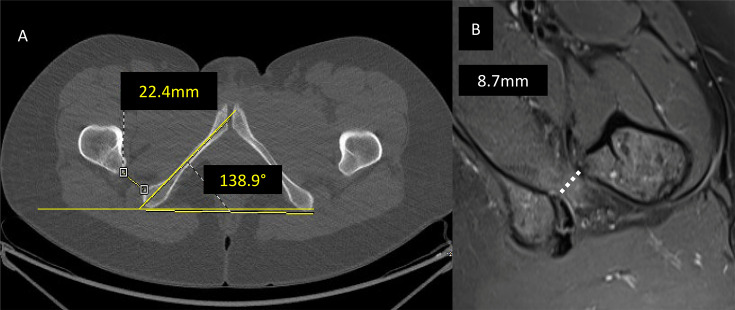
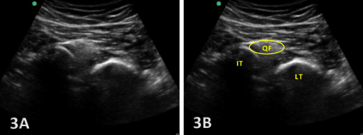
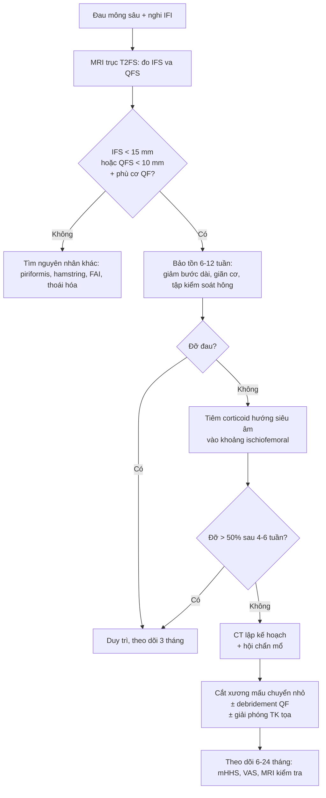
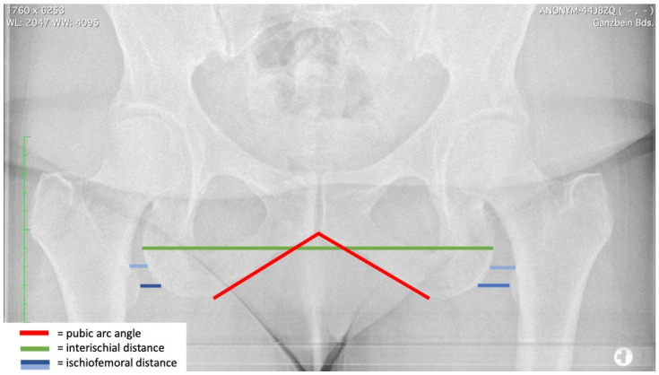
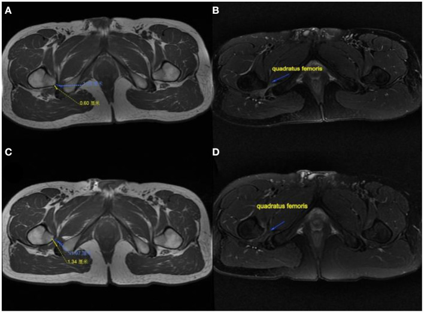

# 382 — Ischiofemoral impingement: hẹp khoảng mấu chuyển nhỏ – ụ ngồi, phù cơ quadratus femoris & ngưỡng can thiệp

**Tags:** `pattern:hep-khoang` `pattern:phu-co` `pattern:dau-mong-sau` `pattern:chen-ep-than-kinh` `vung:hong` `vung:mong-sau` `anatomy:quadratus-femoris` `protocol:MRI-hong` `protocol:CT-hong` `protocol:tiem-sieu-am` `incidentaloma:khong`
**Mức chắc chắn (certainty):** tổng hợp y văn (literature synthesis) — ghép **nghiên cứu 250 bệnh nhân đau hông không do viêm khớp** (Bone Jt Open 2026, PMC13270448), **256 hông trong phẫu thuật bảo tồn khớp** (2025, PMC11971088), **tổng quan chèn ép ngoài khớp** (EFORT Open Rev 2025, PMC12494060), **197 hông sau thay khớp háng** (Eur Radiol 2024, PMC11166821), **hình thái khung chậu nữ** (J Clin Med 2023, PMC9968236), **kỹ thuật siêu âm** (Int J Sports Phys Ther 2024, PMC11837867) và **4 ca mổ nội soi mấu chuyển nhỏ** (Front Surg 2022, PMC8888844). Không có ca do nhóm tự chụp.

> **Câu hỏi thực hành:** nữ **46 tuổi**, đau **mông sâu bên phải** 8 tháng, đau tăng khi **bước dài, leo cầu thang, xoay trong hông**; khám nghiệm pháp **ischiofemoral impingement (IFI) dương tính**, không đau khớp háng. MRI hông: **phù cơ quadratus femoris**, khoảng ischiofemoral hẹp. Câu hỏi: **có phải IFI thật không, đo ở đâu và ngưỡng nào, hay chỉ là phù cơ do gắng sức; và khi nào tiêm – khi nào mổ?**
> Bài chốt **ba quyết định**: **(1) chẩn đoán = hẹp khoảng + phù cơ trên MRI, không phải đau mông đơn thuần; (2) ngưỡng IFS < 15 mm và QFS < 10 mm là ngưỡng hỗ trợ, không phải chốt tuyệt đối; (3) điều trị khởi đầu luôn là bảo tồn – tiêm hướng siêu âm, mổ chỉ khi thất bại và có hẹp thực sự.**

## 1. Tổng quan bệnh học – cơ chế hình ảnh: vì sao 2 mm hẹp lại gây đau mông sâu

- **Giải phẫu – hai khoảng cần đo:**
  - **Khoảng ischiofemoral (ischiofemoral space — IFS):** khoảng ngắn nhất giữa **vỏ xương phía trong mấu chuyển nhỏ (lesser trochanter)** và **vỏ xương phía ngoài ụ ngồi (ischial tuberosity)**, đo trên **lát cắt trục (axial)** của CT hoặc MRI.
  - **Khoảng cơ quadratus (quadratus femoris space — QFS):** khoảng hẹp nhất mà **cơ quadratus femoris** phải chui qua, giới hạn bởi **gân iliopsoas/mấu chuyển nhỏ** phía trước và **gân gốc cơ gân kheo (hamstring)** phía sau — đây là nơi **chèn ép chức năng** thực sự.
  - **Cơ quadratus femoris** bám từ **bờ ngoài ụ ngồi** tới **mào liên mấu chuyển** mặt sau xương đùi; **thần kinh tọa (sciatic nerve)** chạy ngay sau cơ → chèn ép cơ gây **đau lan kiểu sciatica** (EFORT Open Rev 2025, PMC12494060).
- **Ngưỡng định lượng (bắt buộc nhớ):**

| Thông số | Giá trị | Nguồn |
|---|---|---|
| IFS ở người khỏe | **18–26 mm** | EFORT Open Rev 2025 |
| IFS ở IFI vs chứng (gộp) | **14,91 ± 4,8 mm** vs **26,01 ± 7,98 mm** | EFORT Open Rev 2025 (meta-analysis) |
| **Ngưỡng IFS** | **< 15 mm**: **Se 76,9% – Sp 81,0% – độ chính xác 78,3%** | EFORT Open Rev 2025 |
| **Ngưỡng QFS** | **< 10 mm**: **Se 78,7% – Sp 74,1%** | EFORT Open Rev 2025 |
| IFS giảm theo tuổi | **−0,09 mm mỗi năm** | EFORT Open Rev 2025 |
| IFS nữ vs nam | **nam rộng hơn 31%** (p < 0,001); góc mu–mu nữ **+30%**, khoảng liên ụ ngồi nữ **+7%** | J Clin Med 2023, PMC9968236 |
| Siêu âm | IFS trung bình **2,14 cm** | EFORT Open Rev 2025 |

- **TẠI SAO hẹp → phù cơ:** chèn ép lặp lại khi **duỗi – xoay trong – bước dài** làm cơ **thiếu máu cục bộ vi mô + tổn thương sợi cơ** → **phù gian bào** (T2/STIR tăng tín hiệu, T1 bình thường); nếu kéo dài → **teo và thoái hóa mỡ** (T1 tăng tín hiệu, thể tích cơ giảm) (EFORT Open Rev 2025; Front Surg 2022).
- **Ai bị – con số thật:**
  - **5,6% (14/250)** bệnh nhân đau hông không do viêm khớp, **tất cả là nữ**; IFS **24,8 ± 6,7 mm** vs **34,9 ± 10,2 mm** ở nhóm chứng (p < 0,001), QFS **9,2 ± 3,4 mm** vs **20,7 ± 7,0 mm** (Bone Jt Open 2026, PMC13270448);
  - **9% (23/256 hông)** ở người trẻ được đánh giá cho phẫu thuật bảo tồn khớp; IFS **1,7 ± 0,6 cm** vs **2,8 ± 0,7 cm** (p < 0,001); **góc ụ ngồi > 127°** là yếu tố dự báo độc lập (**OR 5,9; KTC 1,3–27,1**) (PMC11971088);
  - **sau thay khớp háng (THA) đường vào trước:** **197 hông**, **góc anteversion xương đùi sau mổ 22,5 ± 6,8°**, **thay đổi 3,6 ± 3,3°**; **thay đổi anteversion dự báo IFI với AUC 0,859** (anteversion đơn thuần AUC 0,726) (Eur Radiol 2024, PMC11166821).
- **Vì sao nữ nhiều hơn:** khung chậu nữ có **ụ ngồi rộng hơn, góc mu–mu lớn hơn**, làm **IFS nhỏ hơn** — đây là **khác biệt giải phẫu**, không phải “bệnh của nữ”; và **IFS giảm dần theo tuổi** giải thích vì sao người lớn tuổi cũng gặp (EFORT Open Rev 2025; J Clin Med 2023).
- **Cơ chế hẹp mắc phải:** **coxa valga**, **loạn sản khớp háng (DDH)**, di chứng **Legg–Calvé–Perthes**, **gãy đầu trên xương đùi**, **u sụn xương (osteochondroma)**, **thoái hóa khớp làm xương đùi trượt lên trên – vào trong**, **cắt xương valgus**, **anteversion xương đùi tăng** (EFORT Open Rev 2025).

## 2. Mẫu hình + chẩn đoán phân biệt theo vị trí đau (Gamut)

- **Mẫu hình 1 — “đau mông sâu + phù cơ quadratus femoris”:** IFS hẹp ± QFS hẹp, phù cơ, không tràn dịch khớp háng → **IFI** (thể cơ học/động).
- **Mẫu hình 2 — “đau mông sâu + teo cơ + không phù”:** **IFI mạn** (thoái hóa mỡ) hoặc **chèn ép thần kinh tọa**; phân biệt bằng **tín hiệu thần kinh tọa trên MR neurography**.
- **Mẫu hình 3 — “đau mông + dấu hiệu chèn ép thần kinh”:** gamut **hội chứng cơ hình lê (piriformis syndrome)**, **hội chứng mông sâu (deep gluteal syndrome)**, **IFI**, **u/dây thần kinh**, **di chứng gãy khung chậu**.
- **Mẫu hình 4 — “hẹp khoảng do xương”:** **osteochondroma**, **di chứng chấn thương**, **sau THA/cắt xương** — cần **CT** để đo xương chính xác và lập kế hoạch mổ.
- **Mẫu hình 5 — “hẹp khoảng hai bên, không triệu chứng”:** biến thể giải phẫu; **không can thiệp** nếu không có phù cơ + đau tương ứng.
- **Gợi nhớ theo vị trí:** đau **mông sâu** → nghĩ **IFI, piriformis, hamstring, dây thần kinh tọa**; đau **bẹn** → nghĩ **FAI, iliopsoas, subspine**; đau **mấu chuyển lớn** → nghĩ **GTPS (gluteal tendinopathy)**. IFI hiếm khi đau bẹn đơn thuần.

## 3. Bảng so sánh phân biệt (ma trận đối chiếu)

| Thực thể (entity) | Hình ảnh điển hình | Chốt vào (rule-in) | Chốt loại (rule-out) | Gợi ý xác nhận |
|---|---|---|---|---|
| **Ischiofemoral impingement** | **IFS < 15 mm**, **QFS < 10 mm**, **phù cơ quadratus femoris** trên T2/STIR, ± teo mỡ | **Đau mông sâu + nghiệm pháp IFI/LSW dương tính + IFS hẹp + phù cơ QF** | **IFS > 18 mm + cơ QF bình thường** → không phải IFI | MRI trục T2FS; tiêm hướng siêu âm giảm đau |
| **Piriformis syndrome** | Phì đại/viêm cơ hình lê, **tín hiệu thần kinh tọa**, dày dây thần kinh; IFS **bình thường** | **Đau khi xoay trong + chèn ép cơ hình lê + IFS bình thường** | **IFS hẹp + phù QF** → nghĩ IFI hơn | MRI trục + MR neurography; tiêm cơ hình lê |
| **Bệnh gân gốc cơ gân kheo (proximal hamstring tendinopathy)** | **Dày gân > 2 mm, tăng tín hiệu gân** tại ụ ngồi, phù mô quanh gân | **Đau khi ngồi xổm/ngồi lâu, đau ngay ụ ngồi, gân dày** | **Không dày gân + phù cơ QF** → nghĩ IFI | MRI trục + sagittal; siêu âm |
| **FAI / rách sụn viền** | Sụn viền rách, **cam/pincer**, tràn dịch khớp; **IFI có thể kèm theo** | **Đau bẹn + nghiệm pháp FADIR + sụn viền rách** | **IFI: đau mông sâu, không đau bẹn** | MR arthrography; X-quang khung chậu |
| **Thoái hóa khớp háng** | Hẹp khe khớp trên–trong, xơ xương dưới sụn, **xương đùi trượt lên trên** → IFS hẹp thứ phát | **Hẹp khe khớp + gai xương + tuổi lớn** | **Khe khớp bình thường** → không quy cho thoái hóa | X-quang, CT |
| **Osteochondroma vùng mấu chuyển/ụ ngồi** | **Cuống xương tủy liên tục với xương gốc**, sụn bọc, có thể chèn ép | **Cuống xương liên tục tủy xương** | **Không liên tục tủy** → không phải osteochondroma | CT; MRI đánh giá chèn ép |
| **IFI sau THA** | IFS hẹp + phù QF, **anteversion xương đùi sau mổ tăng** | **Đau mông sau THA + anteversion thay đổi + IFS hẹp** | **Không thay đổi anteversion + cơ QF bình thường** | CT đo anteversion trước/sau; MRI |

*(A) CT trục: đo IFS (**22,4 mm**) và góc ụ ngồi (**138,9°**) — góc lớn hơn 127° là yếu tố dự báo. (B) MRI T2 trục: **IFI trái với phù cơ và QFS chỉ 8,7 mm** (đường chấm). Nguồn: Bone Jt Open 2026, PMC13270448, CC BY-NC-ND 4.0 — nguyên bản, không crop, không ghép.*

## 4. Protocol chụp + ngưỡng & thuật toán điều trị

- **MRI hông – khung chậu (chuẩn vàng):** trục **T1** (giải phẫu, teo mỡ), **T2 fat-sat / PD fat-sat / STIR** (phù cơ), **trục T2 qua ngang mấu chuyển nhỏ** để đo **IFS và QFS**; thêm **sagittal** đánh giá gân hamstring và **MR neurography** khi nghi chèn ép thần kinh tọa. Đo **hai bên** để so sánh.
- **CT:** khi cần **đo xương chính xác** (góc ụ ngồi, góc anteversion xương đùi, offset, biến dạng sau chấn thương/THA) và **lập kế hoạch cắt xương**.
- **X-quang khung chậu (AP, tư thế đứng chức năng):** dùng cho **hình thái khung chậu** (góc mu–mu, khoảng liên ụ ngồi, CCD) — **không dùng để chẩn đoán IFI** (xem cạm bẫy mục 5).
- **Siêu âm cơ xương khớp:** đo **IFS động** khi **xoay trong hông**, thấy **hẹp khoảng và phù cơ** theo thời gian thực; IFS trung bình **2,14 cm**; **phụ thuộc người làm** nên không thay MRI (PMC11837867; EFORT Open Rev 2025).

*3A/3B: đầu dò dọc trục, hông xoay trong — cơ quadratus femoris (**QF**) bị ép giữa ụ ngồi (**IT**) và mấu chuyển nhỏ (**LT**). Nguồn: Int J Sports Phys Ther 2024, PMC11837867, CC BY-NC 4.0.*
- **Tiêm hướng siêu âm (điều trị + chẩn đoán):** kim vào **khoảng ischiofemoral/quantratus femoris**, thuốc **corticosteroid + lidocaine**; đau giảm rõ sau tiêm hỗ trợ xác nhận nguồn đau. **Chưa có thử nghiệm lớn về liều** — dùng theo kinh nghiệm trung tâm.
- **Mổ (khi thất bại bảo tồn):** **cắt xương mấu chuyển nhỏ (lesser trochanter osteoplasty)** ± **giải phóng/debridement cơ quadratus** ± **giải phóng thần kinh tọa**, qua nội soi khớp đường sau; hoặc **ischioplasty** (mài bờ ngoài ụ ngồi) để **giữ nguyên bám tận iliopsoas**.
  - Kết quả 4 ca (Front Surg 2022, PMC8888844): **IFS 13,4 mm → 25,1 mm**, **QFS 5,1 mm → 14,6 mm**, **mHHS tăng ~43 điểm**, **VAS 5 → 0,5**, theo dõi **24 tháng**, không biến chứng thần kinh/mạch; cắt **~1/3 mấu chuyển nhỏ phía sau–trong**, độ sâu **1–1,5 đường kính burr**.
- **Thuật toán xử trí:**

- **Con số tiên lượng cần nhớ:** **thay đổi anteversion sau THA** dự báo IFI với **AUC 0,859**; **IFI gặp 5,6–9%** ở nhóm đau hông không viêm khớp/phẫu thuật bảo tồn; **nữ chiếm ưu thế rõ** trong các loạt có triệu chứng.

## 5. Biến thể bình thường và cạm bẫy

- **Phù cơ quadratus không triệu chứng:** phù nhẹ có thể gặp ở người **không đau** hoặc **bên đối diện**; chỉ chẩn đoán IFI khi **phù + hẹp khoảng + đau tương ứng khi khám**. Đừng điều trị “phù trên MRI”.
- **Đo IFS trên phim AP là bẫy:** khoảng đo trên **X-quang đứng** chịu ảnh hưởng **góc khung chậu và tư thế**, không tương đương **lát trục CT/MRI**. Dùng phim AP cho **hình thái khung chậu**, không để chốt IFI.

*Phim AP khung chậu: đường đỏ = góc mu–mu, xanh lá = khoảng liên ụ ngồi, xanh dương = khoảng ischiofemoral. Đây là **công cụ nghiên cứu hình thái**, không phải cách đo chẩn đoán IFI. Nguồn: J Clin Med 2023, PMC9968236, CC BY 4.0.*
- **Góc ụ ngồi > 127°** là yếu tố **dự báo**, không phải tiêu chuẩn chẩn đoán; góc lớn đơn thuần không gây đau.
- **Chẩn đoán nhầm với piriformis:** nếu **IFS bình thường** và **cơ QF bình thường**, đừng “gắn” IFI chỉ vì đau mông sâu — tìm **cơ hình lê, gân hamstring, dây thần kinh tọa**.
- **Teo mỡ không hồi phục:** sau một thời gian dài, **thay mỡ trong cơ** (T1 tăng) có thể **không mất đi dù đã mổ** — nên theo dõi **chức năng (mHHS)**, không chỉ ảnh.
- **Sau THA:** đau mông mới sau mổ có thể do **anteversion thay đổi, offset, hoặc IFI**; đo **anteversion trước/sau** trên CT thay vì quy cho “đau cơ”.
- **Hoại tử cơ do đái tháo đường, xạ trị, viêm cơ, chèn ép thần kinh** đều gây phù cơ QF — **phải đọc bối cảnh**, không chỉ đo khoảng.

## 6. Tự lượng giá — Blind Quiz

**Ca 1 — Nữ 38 tuổi, đau mông sâu trái 1 năm, đau khi bước dài; MRI trước và sau mổ (A/B trước, C/D sau 6 tháng).**

- Câu hỏi: mô tả A–D; dấu hiệu nào chốt chẩn đoán? Vì sao sau mổ khoảng đo tăng?

<b>Bấm để hiện đáp án (findings + chẩn đoán)</b>

- **Findings:** (A) **IFS và QFS hẹp trước mổ** — số đo trên ảnh **0,60 cm**; (B) **cơ quadratus femoris teo và thoái hóa, tăng tín hiệu**; (C) sau mổ **khoảng đo 1,34 cm**; (D) **cơ QF tín hiệu trở về bình thường và thể tích tăng**.
- **Chẩn đoán:** **ischiofemoral impingement** — hẹp khoảng mấu chuyển nhỏ – ụ ngồi gây chèn ép cơ QF; đã **cắt xương mấu chuyển nhỏ + debridement QF + giải phóng thần kinh tọa**.
- **Vì sao khoảng tăng:** lấy bỏ **~1/3 mấu chuyển nhỏ phía sau–trong** làm **mấu chuyển nhỏ lùi ra trước–ngoài**, mở rộng IFS/QFS; trong loạt 4 ca: **IFS 13,4 → 25,1 mm**, **QFS 5,1 → 14,6 mm**, **VAS 5 → 0,5**.
- **Nguồn ảnh:** Front Surg 2022, PMCID **PMC8888844**, **CC BY 4.0** (nguyên bản, giữ nhãn A–D).

**Ca 2 — Nữ 52 tuổi, đau mông phải, đã loại thoái hóa khớp. Xem CT trục (A) và MRI T2 trục (B).**

- Câu hỏi: hai số đo trên ảnh là gì? Ngưỡng nào hỗ trợ chẩn đoán? 3 chẩn đoán phân biệt?

<b>Bấm để hiện đáp án (findings + chẩn đoán)</b>

- **Findings:** (A) **IFS = 22,4 mm**, **góc ụ ngồi = 138,9°**; (B) **QFS = 8,7 mm** kèm **phù cơ quadratus femoris** — **QFS < 10 mm** và phù cơ là bất thường, dù **IFS 22,4 mm vẫn trong khoảng “bình thường” 18–26 mm**.
- **Chẩn đoán:** **ischiofemoral impingement** (thể hẹp **QFS** nhiều hơn IFS) — bài học: **đo cả hai khoảng**, đừng chỉ đo IFS.
- **Phân biệt:** piriformis syndrome (IFS/QFS bình thường, tín hiệu thần kinh tọa), bệnh gân hamstring (gân dày tại ụ ngồi), FAI/rách sụn viền (đau bẹn, tràn dịch khớp).
- **Ngưỡng:** IFS **< 15 mm** (Se 76,9%/Sp 81,0%), QFS **< 10 mm** (Se 78,7%/Sp 74,1%); **góc ụ ngồi > 127°** là yếu tố dự báo (OR 5,9).
- **Nguồn ảnh:** Bone Jt Open 2026, PMCID **PMC13270448**, **CC BY-NC-ND 4.0** — nguyên bản, không crop, không ghép.

## Bài liên quan chéo
- [558 – Hội chứng cơ hình lê](../558-hoi-chung-co-hinh-le/lesson.md)
- [556 – Đau sàn chậu cơ mác – đau thần kinh thẹn](../556-dau-san-chau-co-mac-pudendal-neuralgia/lesson.md)
- [370 – Nhiễm trùng cơ xương khớp](../370-nhiem-trung-msk/lesson.md)
- [305 – Đau xương cụt (coccygodynia)](../305-dau-xuong-cut-coccygodynia/lesson.md)
- [228 – Thoát vị đĩa đệm thắt lưng Pfirrmann/Modic](../228-thoat-vi-dia-dem-that-lung-pfirrmann-modic/lesson.md)
- [301 – Protocol MSK](../301-protocol-msk/lesson.md)
- [300 – Tổng quan hệ Cơ – Xương – Khớp](../300-tong-quan-he-co-xuong-khop/lesson.md)

## Ảnh
- `382_ischiofemoral_CT-MRI_PMC13270448-F3.jpg` — CT trục (IFS 22,4 mm, góc 138,9°) + MRI T2 (QFS 8,7 mm, phù cơ).
- `382_ischiofemoral_MRI-truoc-sau-mo_PMC8888844-F3.jpg` — MRI trước/sau cắt xương mấu chuyển nhỏ.
- `382_ischiofemoral_X-quang_PMC9968236-F1.jpg` — phim AP khung chậu với các đường đo hình thái (chỉ để minh họa hình thái, **không dùng chẩn đoán**).
- `382_ischiofemoral_sieu-am_PMC11837867-F3.jpg` — siêu âm động khoảng ischiofemoral.
- Nguồn, giấy phép từng ảnh: `images/CREDITS.md`; link bài gốc: `sources.md`.

> Không dùng để chẩn đoán độc lập khi chưa có người hướng dẫn.
