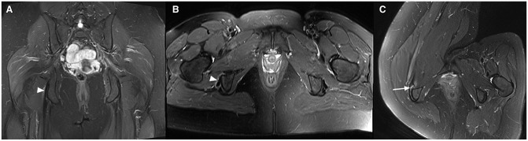
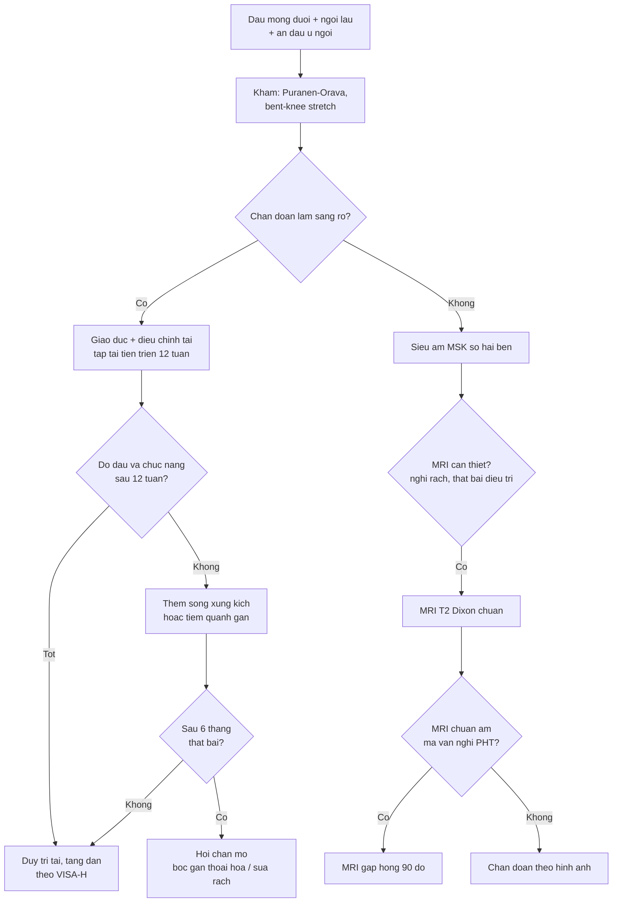
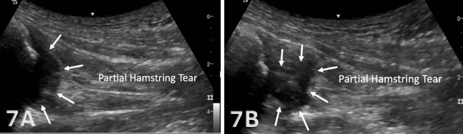
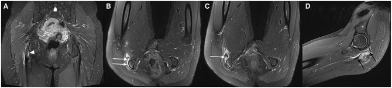
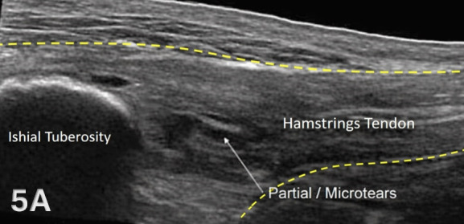

# 383 — Bệnh gân gốc cơ gân kheo gần (proximal hamstring tendinopathy): ngưỡng dày gân, MRI tư thế gấp hông & khi nào can thiệp

**Tags:** `pattern:benh-gan` `pattern:day-gan` `pattern:phu-quanh-gan` `pattern:dau-mong-sau` `vung:mong-sau` `vung:hong` `anatomy:hamstring` `protocol:MRI-hong` `protocol:sieu-am-msk` `protocol:tiem-huong-sieu-am` `incidentaloma:khong`
**Mức chắc chắn (certainty):** tổng hợp y văn (literature synthesis) — ghép **nghiên cứu MRI tư thế gấp hông 38 bệnh nhân/67 gân** (Orthop J Sports Med 2024, PMC11425786), **RCT 100 bệnh nhân vật lý trị liệu vs sóng xung kích** (Am J Sports Med 2025, PMC12657663), **tổng quan có hệ thống 12 nghiên cứu/424 bệnh nhân** (Int J Sports Phys Ther 2021, PMC8016446), **tổng quan 13 nghiên cứu điều trị bảo tồn** (Sports 2023, PMC10053564), **nghiên cứu tiêm collagen heo 28 vận động viên** (Sports 2025, PMC12567699), **tiêm corticoid dưới huỳnh quang 18 vận động viên/22 ca** (Orthop J Sports Med 2014, PMC4555570), **mổ 17 vận động viên** (J Orthop Traumatol 2013, PMC3667353), **siêu âm chẩn đoán gân gốc cơ gân kheo** (Int J Sports Phys Ther 2026, PMC13046448) và **tổng quan bệnh gân hông** (Rheumatol Adv Pract 2024, PMC11003818). Không có ca do nhóm tự chụp.

> **Câu hỏi thực hành:** nữ **38 tuổi**, chạy bộ 40 km/tuần, đau **mông dưới bên phải** 8 tháng, đau tăng khi **ngồi lâu, chạy lên dốc, duỗi hông**; ấn đau **ngay ụ ngồi**, nghiệm pháp **Puranen–Orava dương tính**. MRI khung chậu thường: **gân “gần như bình thường”**, chỉ phù nhẹ quanh gân. Câu hỏi: **có phải bệnh gân gốc cơ gân kheo không, cần chụp lại tư thế nào, ngưỡng dày gân ra sao, và khi nào tiêm – khi nào mổ?**
> Bài chốt **ba quyết định**: **(1) chẩn đoán là lâm sàng + hình ảnh tương ứng, không phải chỉ dựa vào độ dày gân; (2) MRI tư thế gấp hông 90° phát hiện thêm tổn thương ở 71% bệnh nhân có MRI thường âm; (3) điều trị nền là tập tải tiến triển ở độ dài cơ – gân, tiêm chỉ là bổ trợ, mổ sau ≥ 6 tháng thất bại.**

## 1. Tổng quan bệnh học – cơ chế hình ảnh: vì sao đau ở ụ ngồi khi ngồi

- **Giải phẫu:** ba cơ gân kheo bám vào **ụ ngồi (ischial tuberosity)**: **cơ nhị đầu đùi đầu dài + cơ bán gân** tạo **gân chung (conjoint tendon)** ở mặt sau–trong; **cơ bán màng** bám riêng, sâu và ra ngoài hơn; **thần kinh tọa** chạy ngay sau–ngoài gân chung. **Túi hoạt dịch ụ ngồi (ischio-gluteal bursa)** nằm giữa gân và xương, là nguồn đau chồng lấp.
- **Bệnh học:** PHT là **bệnh thoái hóa gân do tải lặp lại (tendinopathy)**, không phải viêm: **rối loạn sắp xếp collagen, tăng mạch máu bất thường, giảm độ bền chịu lực**, kèm **chèn ép** khi ngồi (lực nén + lực kéo đồng thời). Vì vậy hình ảnh thấy **dày gân, giảm âm/tăng tín hiệu trong gân, phù quanh gân**, không thấy dịch khớp.
- **TẠI SAO đau khi ngồi:** tư thế ngồi làm **ụ ngồi tì trực tiếp vào gân**, tăng lực nén tại vùng bám tận; chạy lên dốc/duỗi hông mạnh làm tăng lực kéo — hai cơ chế cộng lại giải thích kiểu đau **khu trú sâu ở mông dưới**, không lan theo khoanh da.
- **Ngưỡng định lượng trên siêu âm (bắt buộc nhớ):**

| Thông số | Giá trị bình thường | Nguồn |
|---|---|---|
| Độ dày **gân chung** tại ụ ngồi (lát cắt ngang) | **4–6 mm** | Int J Sports Phys Ther 2026, PMC13046448 |
| Độ dày **gân cơ bán màng** | **5–7 mm** | Int J Sports Phys Ther 2026, PMC13046448 |
| So sánh bên đối diện | Bắt buộc; bất đối xứng là dấu hiệu gợi ý | PMC13046448 |
| Gân dày + giảm âm + mất cấu trúc sợi + Doppler (+) | Bất thường, phù hợp PHT | PMC13046448 |

- **Không có một ngưỡng mm tuyệt đối được xác nhận cho PHT** — các nghiên cứu dùng **so sánh bên đối diện + mất cấu trúc sợi + phù quanh gân**, không dùng một con số cố định. Bài ghi rõ “chưa có ngưỡng tuyệt đối”, không bịa.
- **Giá trị của MRI tư thế gấp hông:** **38 bệnh nhân/67 gân** có triệu chứng PHT được chụp MRI **chuẩn (nằm ngửa)** và **gấp hông 90° (nằm nghiêng)**. Kết quả: **71% bệnh nhân** thấy tổn thương **nặng hơn** ở tư thế gấp hông; **16% gân** được chẩn đoán lành ở tư thế chuẩn chuyển thành **rách**; trong số gân “bình thường” ở tư thế chuẩn, **6%** thành **rách** và **11%** thành **bệnh gân** khi gấp hông (Orthop J Sports Med 2024, PMC11425786).
- **Vì sao gấp hông lại lộ tổn thương:** gấp hông 90° làm **gân căng và bị kéo ra khỏi ụ ngồi**, đồng thời **mô mềm quanh gân giãn ra**, nên phần **rách mặt dưới/nội gân** không còn bị xương che lấp — đây là mẹo “đọc lại bằng tư thế gây triệu chứng”.
- **Tần suất và đối tượng:** PHT gặp ở **vận động viên chạy nước rút, chạy dài, nhảy rào** và cả người **ít vận động ngồi nhiều**; tổng quan 12 nghiên cứu gộp **424 bệnh nhân** (229 nam) cho thấy bằng chứng can thiệp còn **rất thấp** (Int J Sports Phys Ther 2021, PMC8016446). Không có số prevalence dân số đáng tin — bài không đưa con số giả.

## 2. Mẫu hình + chẩn đoán phân biệt theo vị trí đau (Gamut)

- **Mẫu hình 1 — “đau sâu mông dưới + ngồi lâu + ấn đau ụ ngồi”:** PHT; phân biệt **viêm túi hoạt dịch ụ ngồi** (đau cùng chỗ, nhưng dịch túi hoạt dịch là dấu chốt).
- **Mẫu hình 2 — “đau khi chạy nước rút/duỗi hông + đau ụ ngồi”:** PHT hoặc **rách/đứt gân gốc**; đứt gân có **mất liên tục sợi + khoảng giảm âm + dịch/máu tụ**, đau dữ dội khởi phát đột ngột.
- **Mẫu hình 3 — “đau mông sâu + xoay trong hông + bước dài”:** **hẹp khoảng ischiofemoral (IFI)** — IFS **< 15 mm**, QFS **< 10 mm**, phù cơ quadratus femoris (bài 382).
- **Mẫu hình 4 — “đau mông + lan chân theo khoanh da”:** **hội chứng cơ hình lê** hoặc **đau rễ thắt lưng**; IFS bình thường, tín hiệu thần kinh tọa có thể bất thường.
- **Mẫu hình 5 — “đau mặt trong ụ ngồi”:** **rách gân cơ khép lớn (adductor magnus ischiocondylar)** — đau trong, gần gốc dương vật/đáy chậu, khác PHT.
- **Mẫu hình 6 — “đau đáy chậu, rát, không đau khi ấn ụ ngồi”:** **đau thần kinh thẹn (pudendal neuralgia)** — không có tổn thương gân trên MRI.
- **Gợi nhớ theo cơ chế:** **nén khi ngồi** → PHT, bursitis; **kéo khi chạy** → PHT, rách gân; **xoay hông** → IFI, piriformis; **lan theo khoanh da** → rễ/thần kinh ngoại biên.

## 3. Bảng so sánh phân biệt (ma trận đối chiếu)

| Thực thể (entity) | Hình ảnh điển hình | Chốt vào (rule-in) | Chốt loại (rule-out) | Gợi ý xác nhận |
|---|---|---|---|---|
| **Bệnh gân gốc cơ gân kheo (PHT)** | Gân **dày** (so bên đối diện), **giảm âm/tăng tín hiệu** trong gân, **mất cấu trúc sợi**, **phù quanh gân**, Doppler (+) | **Đau khu trú ụ ngồi + ngồi lâu/running + ấn đau + hình ảnh gân tương ứng** | **Gân bình thường + không phù quanh gân + đau lan theo khoanh da** → tìm nguyên nhân khác | Siêu âm LAX/SAX so hai bên; MRI T2 Dixon; MRI gấp hông 90° nếu chuẩn âm |
| **Viêm túi hoạt dịch ụ ngồi (ischial bursitis)** | **Dịch túi hoạt dịch** giữa gân và ụ ngồi, dạng ổ dịch khu trú, có thể có vách | **Ổ dịch túi hoạt dịch + đau khi ngồi** | **Không có dịch túi + gân dày** → PHT | Siêu âm động; MRI T2FS; hút dịch |
| **Hẹp khoảng ischiofemoral (IFI)** | **IFS < 15 mm** (Se 76,9%/Sp 81,0%), **QFS < 10 mm** (Se 78,7%/Sp 74,1%), phù cơ quadratus femoris | **Đau mông sâu + nghiệm pháp IFI + IFS/QFS hẹp + phù cơ** | **IFS > 18 mm + cơ quadratus bình thường** → không IFI | MRI trục T2FS; tiêm hướng siêu âm (bài 382) |
| **Hội chứng cơ hình lê** | Phì đại/viêm cơ hình lê, tín hiệu **thần kinh tọa**, IFS bình thường | **Đau khi xoay trong + chèn ép cơ hình lê + IFS bình thường** | **IFS hẹp + phù cơ quadratus** → IFI | MRI trục + MR neurography |
| **Rách/đứt gân gốc cơ gân kheo** | **Mất liên tục sợi**, khoảng **giảm âm**, **dịch/máu tụ**, gân co rút; MRI thấy di lệch | **Khởi phát đột ngột “bốp” + yếu duỗi hông + mất liên tục sợi** | **Sợi còn liên tục, chỉ dày + phù** → PHT | Siêu âm động; MRI; đo khoảng co rút |
| **Rách gân cơ khép lớn (ischiocondylar)** | Tổn thương mặt **trong** ụ ngồi, phù/giảm âm gân cơ khép lớn | **Đau mặt trong ụ ngồi/đáy chậu + đau khi khép đùi** | **Đau mặt sau–ngoài, gân chung dày** → PHT | Siêu âm mặt trong; MRI |
| **Đau thần kinh thẹn** | Không có tổn thương gân; có thể dày thần kinh thẹn trên MR neurography | **Đau rát đáy chậu, đau khi ngồi nhưng không đau khi ấn ụ ngồi** | **Ấn đau khu trú ụ ngồi + gân dày** → PHT | Khám thần kinh; block chẩn đoán |

*(A) Coronal và (B) axial tư thế chuẩn: chỉ phù nhẹ quanh gân (đầu mũi tên), gân “gần như bình thường”. (C) Axial khi **gấp hông phải 90°**: lộ **rách một phần gân cơ bán màng** (mũi tên). Nguồn: Orthop J Sports Med 2024, PMCID **PMC11425786**, **CC BY 4.0** — nguyên bản, giữ nhãn A–C.*

### Đọc đúng vị trí tổn thương trên mặt cắt
- **Gân chung (nhị đầu đầu dài + bán gân)** nằm **mặt sau–trong** ụ ngồi; **cơ bán màng** bám **sâu và ra ngoài** — trên axial, tổn thương bán màng nằm **phía ngoài** gân chung, dễ bị đọc nhầm là “gân chung bình thường”.
- **Phù quanh gân đơn thuần** có thể do **túi hoạt dịch**, **chèn ép**, hoặc **sau tiêm** — không đồng nghĩa bệnh gân.
- **So sánh bên đối diện** là bắt buộc trên siêu âm; trên MRI, đặt ROI đối xứng và đọc cả hai bên.

## 4. Protocol chụp + ngưỡng & thuật toán điều trị

- **Chẩn đoán lâm sàng trước, hình ảnh sau:** tổng quan khuyến cáo PHT **có thể chẩn đoán bằng bệnh sử + nghiệm pháp**, không cần hình ảnh thường quy; chỉ chụp khi **chẩn đoán không chắc, không đáp ứng điều trị, hoặc nghi rách/đứt** (Rheumatol Adv Pract 2024, PMC11003818).
- **Nghiệm pháp:** ấn trực tiếp **ụ ngồi**; **Puranen–Orava** (duỗi hông + duỗi gối kháng lực); **bent-knee stretch** và **modified bent-knee stretch**; đau khi **ngồi xổm/ngồi lâu**.
- **Siêu âm MSK (đầu tay):**
  - Tư thế **nằm nghiêng**, chi trên, **hông hơi gấp, gối hơi gấp** để gân căng nhẹ; đầu dò **thẳng** cho lát cắt dọc (LAX) và **ngang** (SAX) tại ụ ngồi.
  - Đo **độ dày gân chung 4–6 mm**, **bán màng 5–7 mm**; tìm **mất cấu trúc sợi, giảm âm, phù quanh gân, Doppler (+)**; **so bên đối diện**.
  - Động: gấp/duỗi gối để xem sợi gân trượt và phát hiện rách ẩn.
- **MRI (khi siêu âm không kết luận hoặc cần đánh giá rách):**
  - **Chuẩn:** khung chậu/đùi **T1**, **T2 fat-sat/Dixon**, axial + coronal + sagittal.
  - **Nếu MRI chuẩn âm mà vẫn nghi PHT:** chụp thêm **tư thế gấp hông 90°** (nằm nghiêng) — phát hiện thêm **71%** tổn thương nặng hơn, **16%** chuyển từ bệnh gân thành rách (PMC11425786).
  - Đọc: dày gân, tăng tín hiệu trong gân, **phù quanh gân**, **phù tủy xương ụ ngồi**, dịch túi hoạt dịch, di lệch/co rút gân.
- **Điều trị theo bậc:**
  1. **Giáo dục + điều chỉnh tải:** giảm ngồi lâu (đệm chữ U, ngồi nghiêng), giảm chạy dốc/tăng tốc đột ngột; **tập tải tiến triển ở độ dài cơ–gân**: **hông gấp 110°, gối gấp 45–90°**, kèm **ổn định vùng chậu–thắt lưng** (Sports 2023, PMC10053564).
  2. **Sóng xung kích:** RCT 100 bệnh nhân cho thấy **không khác vật lý trị liệu** về VISA-H/GROC; nhưng nhóm sóng xung kích **hài lòng hơn** và **sức khỏe chung tốt hơn** ở 52 tuần — có thể dùng như lựa chọn (Am J Sports Med 2025, PMC12657663).
  3. **Tiêm:** **corticoid quanh gân dưới hướng dẫn** (không tiêm trong gân): VAS **7,22 → 3,94**, **38,8%** hết đau hoàn toàn ở trung bình **24,8 tháng** (Orthop J Sports Med 2014, PMC4555570). **Collagen heo** 3 lần cách tuần: trở lại thể thao **57 vs 72 ngày** (p = 0,0083), **HR 5,35** (Sports 2025, PMC12567699). Bằng chứng còn yếu, không dùng thay tập.
  4. **Mổ:** sau **≥ 6 tháng** thất bại bảo tồn; **17 vận động viên** mổ bóc gân thoái hóa: trở lại chạy **2,4 tháng**, trở lại thể thao **4,4 tháng**, **88% kết quả tốt** (J Orthop Traumatol 2013, PMC3667353).
- **Thuật toán một lượt:**

- **Theo dõi:** dùng **VISA-H (0–100)** và **mức đau khi ngồi**; trong RCT, VISA-H tăng từ **49,8–50,7** lên **73,9–74,7** sau 52 tuần ở cả hai nhóm — cải thiện lớn nhưng **không khác giữa vật lý trị liệu và sóng xung kích** (PMC12657663).

## 5. Biến thể bình thường và cạm bẫy

- **MRI chuẩn âm không loại trừ PHT:** **6%** gân “bình thường” trên MRI chuẩn hóa ra **rách** và **11%** ra **bệnh gân** khi chụp gấp hông 90° (PMC11425786). Nếu bệnh cảnh điển hình, **đừng dừng ở “MRI bình thường”**.
- **Dày gân không triệu chứng:** người chạy nhiều có thể dày gân **không đau**; chỉ chẩn đoán PHT khi **đau khu trú + nghiệm pháp + hình ảnh tương ứng**.
- **Nhầm túi hoạt dịch với bệnh gân:** ổ dịch **giữa gân và xương** là bursitis; điều trị khác (hút dịch + corticoid vào túi), không tập nặng ngay.
- **Tiêm corticoid trong gân:** làm **yếu gân và tăng nguy cơ rách**; chỉ tiêm **quanh gân/dưới hướng dẫn**, và **không lặp lại nhiều lần**.
- **Kéo giãn mạnh khi đang đau:** làm tăng lực nén tại ụ ngồi; ưu tiên **tải ở độ dài trung gian**, tăng dần.
- **Bỏ sót rách/đứt gân:** đau đột ngột + yếu duỗi hông + không duỗi được gối chống trọng lực → tìm **mất liên tục sợi**, **co rút**, **dịch/máu tụ**; đừng điều trị như PHT đơn thuần.

*7A–7B: **mất liên tục cấu trúc sợi** và **khoảng giảm âm sát bám tận** kèm dịch/máu tụ — hình ảnh **rách/đứt một phần**, khác với chỉ dày gân + vi rách trong PHT. Nguồn: Int J Sports Phys Ther 2026, PMCID **PMC13046448**, **CC BY-NC 4.0** — nguyên bản.*
- **Đau lan chân:** nếu có **lan theo khoanh da, dị cảm, yếu cơ** → khám thần kinh/tìm nguyên nhân rễ hoặc thần kinh tọa, không quy hết cho gân.
- **Vận động viên lớn tuổi:** thoái hóa gân kèm **phù tủy xương ụ ngồi** có thể gặp; phù tủy đơn thuần không đồng nghĩa rách.

## 6. Tự lượng giá — Blind Quiz

**Ca 1 — Nữ 38 tuổi, đau mông dưới phải; MRI chuẩn (A, B) và MRI gấp hông phải 90° (C).**

- Câu hỏi: hình A/B có bất thường rõ không? Hình C thay đổi gì? Vì sao phải chụp thêm tư thế gấp hông?

<b>Bấm để hiện đáp án (findings + chẩn đoán)</b>

- **Findings:** (A) coronal và (B) axial tư thế chuẩn: **phù nhẹ quanh gân** (đầu mũi tên), gân **gần như bình thường**, không thấy rách rõ. (C) axial **gấp hông 90°**: lộ **rách một phần gân cơ bán màng** (mũi tên).
- **Chẩn đoán:** **bệnh gân gốc cơ gân kheo có rách một phần** — tổn thương bị che lấp ở tư thế chuẩn.
- **Vì sao:** gấp hông làm gân căng và tách khỏi ụ ngồi, mở ra phần rách mặt dưới; trong loạt 38 bệnh nhân, **71%** thấy tổn thương nặng hơn, **16%** chuyển từ bệnh gân thành rách.
- **Nguồn ảnh:** Orthop J Sports Med 2024, PMCID **PMC11425786**, **CC BY 4.0**.

**Ca 2 — Nam 57 tuổi, đau mông phải; (A) coronal chuẩn, (B–C) axial gấp hông, (D) sagittal gấp hông.**

- Câu hỏi: tổn thương ở gân nào? Mức độ rách thay đổi thế nào giữa tư thế chuẩn và gấp hông? Đo gì trên sagittal?

<b>Bấm để hiện đáp án (findings + chẩn đoán)</b>

- **Findings:** (A) coronal chuẩn: **rách một phần gân cơ bán màng** (đầu mũi tên). (B, C) axial gấp hông: rách **lớn hơn nhiều**, gần như **bong gân hoàn toàn** (mũi tên trắng). (D) sagittal gấp hông: đo **chiều dài đoạn rách** giữa hai mũi tên đen.
- **Chẩn đoán:** **rách gân cơ bán màng tiến triển** — mức độ nặng hơn được phát hiện nhờ tư thế gấp hông.
- **Ý nghĩa:** mức rách quyết định **bảo tồn hay mổ**; MRI chuẩn có thể **đánh giá thấp** tổn thương.
- **Nguồn ảnh:** Orthop J Sports Med 2024, PMCID **PMC11425786**, **CC BY 4.0**.

**Ca 3 — Bệnh nhân chạy dài, đau ụ ngồi; siêu âm dọc (LAX) tại ụ ngồi.**

- Câu hỏi: mô tả 3 dấu hiệu bất thường? Độ dày bình thường của gân chung là bao nhiêu? Có cần sinh thiết không?

<b>Bấm để hiện đáp án (findings + chẩn đoán)</b>

- **Findings:** **gân dày** tại ụ ngồi; **mất cấu trúc sợi** bình thường; **vùng giảm âm** trong gân sát bám tận = **rách một phần/vi rách**; bờ xương ụ ngồi là đường tăng âm cong có bóng lưng.
- **Ngưỡng:** gân chung bình thường **4–6 mm**, bán màng **5–7 mm**; so bên đối diện.
- **Chẩn đoán:** **bệnh gân gốc cơ gân kheo** — chẩn đoán lâm sàng + siêu âm; **không sinh thiết**, không cần mô bệnh.
- **Nguồn ảnh:** Int J Sports Phys Ther 2026, PMCID **PMC13046448**, **CC BY-NC 4.0** — nguyên bản.

## Bài liên quan chéo
- [382 – Ischiofemoral impingement](../382-ischiofemoral-impingement/lesson.md)
- [558 – Hội chứng cơ hình lê](../558-hoi-chung-co-hinh-le/lesson.md)
- [370 – Nhiễm trùng cơ xương khớp](../370-nhiem-trung-msk/lesson.md)
- [305 – Đau xương cụt (coccygodynia)](../305-dau-xuong-cut-coccygodynia/lesson.md)
- [228 – Thoát vị đĩa đệm thắt lưng Pfirrmann/Modic](../228-thoat-vi-dia-dem-that-lung-pfirrmann-modic/lesson.md)
- [301 – Protocol MSK](../301-protocol-msk/lesson.md)
- [300 – Tổng quan hệ Cơ – Xương – Khớp](../300-tong-quan-he-co-xuong-khop/lesson.md)

## Ảnh
- `383_pht_MRI-tu-the_PMC11425786-F3.jpg` — MRI chuẩn vs gấp hông: phù nhẹ → rách một phần bán màng.
- `383_pht_MRI-rach_PMC11425786-F5.jpg` — rách bán màng lớn hơn khi gấp hông; sagittal đo chiều dài rách.
- `383_pht_sieu-am_PMC13046448-F5.jpg` — siêu âm LAX: gân dày, mất cấu trúc sợi, vi rách.
- `383_pht_sieu-am-dut_PMC13046448-F7.jpg` — siêu âm LAX: rách/đứt một phần gân (chẩn đoán phân biệt).
- Nguồn, giấy phép từng ảnh: `images/CREDITS.md`; link bài gốc: `sources.md`.

> Không dùng để chẩn đoán độc lập khi chưa có người hướng dẫn.
