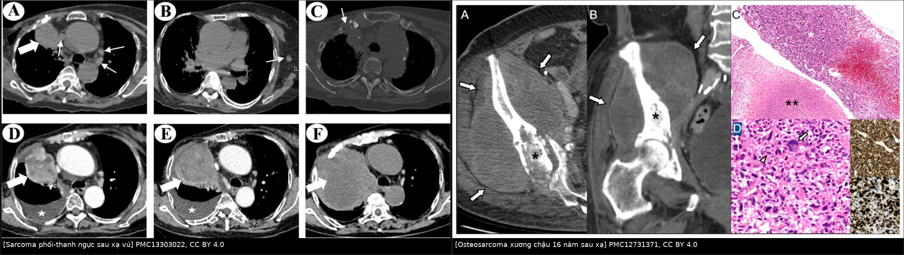
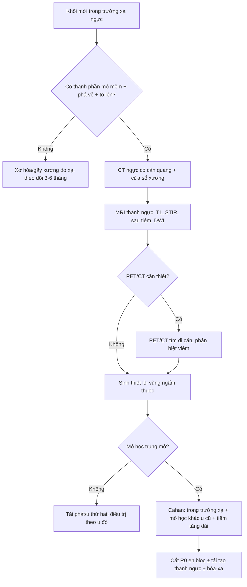
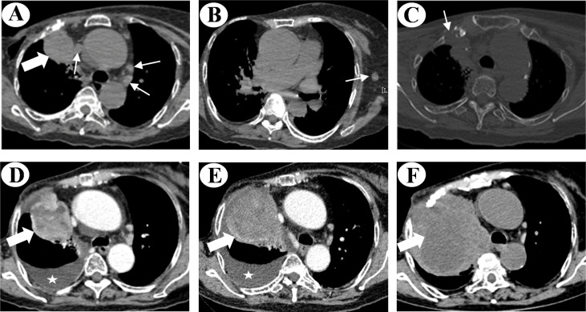
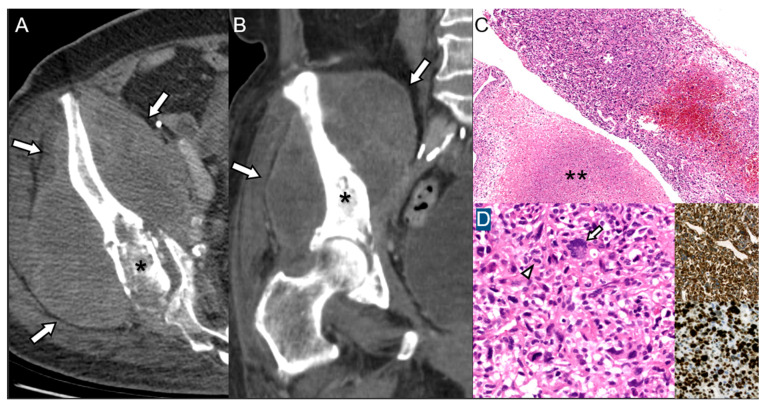
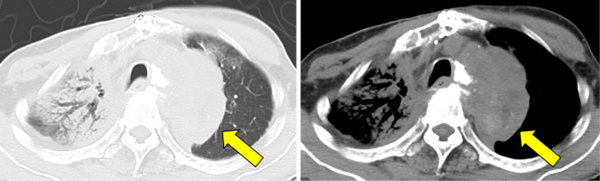

# 384 — Sarcoma do xạ sau xạ trị ngực: khối mới trong trường chiếu 10 năm sau / Radiation-induced sarcoma of the chest

**Tags:** `pattern:gia-u` `pattern:tieu-xuong` `pattern:phu-tuy-xuong` `vung:thanh-nguc` `vung:suon` `vung:phoi` `protocol:CT-nguc` `protocol:MRI-xuong` `protocol:PET-FDG`
**Mức chắc chắn (certainty):** tổng hợp y văn (literature synthesis) — biên từ đoàn hệ 33 ca RIS (PMC4843709), 419 ca RIS đa trung tâm (PMC5537501), nghiên cứu bệnh–chứng 98 ca RIS so với 239 sarcoma ngẫu nhiên (PMC3261679), loạt 7 ca RIS/4.556 bệnh nhân xạ trị (PMC9561616), tổng quan hình–mô bệnh học RIS (PMC12731371, CC BY), ca sarcoma phổi–thành ngực sau xạ vú (PMC13303022, CC BY), ca osteosarcoma trung thất 28 năm sau xạ lành tính (PMC12589164, CC BY-NC-ND) và ca osteosarcoma sườn thứ phát sau neuroblastoma (PMC13700335, CC BY-NC-ND). Số liệu lấy từ toàn văn/bảng, không viết từ abstract gián tiếp.

## 1. Tổng quan — xạ trị để lại một "vùng đất" mà tế bào phải sửa chữa suốt đời

### 1.1. Cơ chế: đứt DNA → bất ổn định gen → sarcoma sau nhiều năm

- Tia xạ gây **đứt sợi đôi DNA**; tế bào sống sót mang **đột biến TP53/RB1 và tái sắp xếp nhiễm sắc thể phức tạp** — đây là chữ ký của **bất ổn định gen do xạ (radiation-driven genomic instability)** (PMC12731371). Mô xơ hóa sau xạ vẫn tiếp tục tái tạo, viêm mạn và giảm miễn dịch tại chỗ → sau **nhiều năm** một dòng tế bào trung mô tích lũy đủ đột biến để thành sarcoma.
- **TẠI SAO phải nhiều năm:** mỗi lần phân bào chỉ thêm vài đột biến; mô xạ nghèo mạch, giảm tế bào gốc nên chu kỳ tái tạo chậm — vì vậy **thời gian tiềm tàng trung vị 12,1 năm**, cá biệt **28 năm** (PMC4843709, PMC12589164). Đây là lý do "theo dõi 5 năm sau xạ" là không đủ.
- **TẠI SAO tổn thương trông "ác tính":** sarcoma là mô tế bào dày đặc, giàu mạch nhưng thiếu vỏ → trên CT là **khối mô mềm 30–50 HU, ngấm thuốc không đồng nhất**, phá vỏ xương, phản ứng màng xương; trên MRI là **T1 thấp, T2 cao, ngấm thuốc mạnh, hạn chế khuếch tán** do tăng độ đặc tế bào. Ngược lại, **xơ hóa sau xạ** là mô sợi nghèo tế bào, nghèo mạch → **T2 thấp, không ngấm thuốc, không to ra**. Đây là trục phân biệt chính.
- **Vị trí tổn thương quyết định tiên lượng:** sarcoma **trung tâm** (trung thất, sát tim–mạch lớn) khó cắt R0 hơn sarcoma chi; đây là một trong các lý do RIS có tiên lượng xấu hơn sarcoma ngẫu nhiên cùng độ (PMC3261679).

### 1.2. Con số phải nhớ

| Chỉ số | Số liệu | Nguồn |
|---|---|---|
| RIS trong tổng số sarcoma | **0,9%** (33/3.674) tại một trung tâm; **~3%** tổng số sarcoma mô mềm trong y văn | PMC4843709, PMC9561616 |
| Tần suất sau xạ trị | **0,15%** (7/4.556); **ung thư vú 0,19%** (5/2.570), **đầu–cổ 0,10%** (2/1.986) | PMC9561616 |
| Thời gian tiềm tàng | **trung vị 12,1 năm** (33 ca); trung bình **7,3 năm** (7 ca, có hóa trị); trung bình chung **8–14 năm**; cá biệt **28 năm** | PMC4843709, PMC9561616, PMC12589164 |
| Hóa trị trước đó | Làm **ngắn** thời gian tiềm tàng: **HR 1,37** (95% CI 1,08–1,72; p = 0,009) trên 419 ca | PMC5537501 |
| Tuổi khi mắc RIS | Tuổi lớn hơn làm **tăng nguy cơ**: **HR 2,11** (95% CI 1,83–2,43) | PMC5537501 |
| Sống còn | Trung vị **2,9 năm**, sống 5 năm **44,7%**; **5 năm 10–36%** trong y văn | PMC4843709, PMC9561616 |
| Phẫu thuật | Chỉ **58%** cắt được; cắt triệt căn: sống 5 năm **65%** vs **0%** ở nhóm điều trị bảo tồn | PMC4843709 |
| So với sarcoma ngẫu nhiên | Sống 5 năm liên quan sarcoma **32%** (RIS) vs **51%** (chứng); khác biệt do **vị trí trung tâm, diện cắt không sạch, hoại tử vi thể, di căn** | PMC3261679 |
| Mô học thường gặp | Osteosarcoma **36,4%** (33 ca); osteosarcoma hoặc **UPS** (u mô bào sợi không biệt hóa) là phổ biến nhất; còn chondrosarcoma, angiosarcoma, leiomyosarcoma | PMC4843709, PMC12731371 |
| Thời gian nhân đôi khối u (ca thực tế) | **38 × 48 mm → 52 × 58 mm sau 29 ngày**, rồi tiếp tục to sau 17 ngày | PMC13303022 |

- **Điểm cần phản biện:** tần suất **0,15%** là tỷ lệ **tích lũy trên bệnh nhân đã xạ trị** trong một loạt đơn trung tâm, không phải nguy cơ 10 năm; các loạt khác báo **0,03–0,3%** tùy thời gian theo dõi. Không dùng con số này để nói "nguy cơ rất thấp" với người sống 20–30 năm sau xạ — chính vì thế mà các ca 28 năm vẫn xuất hiện.

## 2. Mẫu hình + chẩn đoán phân biệt theo vị trí (Gamut)

### 2.1. Gamut theo vị trí trong lồng ngực

- **Thành ngực/xương sườn (sau xạ vú, phổi, trung thất):** **osteosarcoma**, **chondrosarcoma**, **UPS**, leiomyosarcoma; hình ảnh: **khối mô mềm + phá xương sườn**, có thể vôi hóa dạng sụn/xương (chondrosarcoma/osteosarcoma).
- **Vú (sau xạ vú):** **angiosarcoma** — tổn thương da/dưới da, bầm tím, nốt tím; MRI ngấm mạnh, lan theo da; tiên lượng xấu, tái phát tại chỗ cao.
- **Phổi/màng phổi (sau xạ phổi–trung thất):** leiomyosarcoma, angiosarcoma, sarcoma dạng biểu mô; khối trong nhu mô hoặc dày màng phổi, tràn dịch tái phát.
- **Trung thất/khí quản–thực quản (sau xạ trung thất, xạ lành tính):** osteosarcoma, sarcoma mô mềm — khối **8 cm** xâm lấn khí quản/thực quản trong ca 28 năm sau xạ (PMC12589164); đây là vị trí **không cắt được** → tiên lượng rất xấu.
- **Sườn ở người sống sót ung thư nhi:** sarcoma xương thứ phát (osteosarcoma/chondrosarcoma) sau xạ + hóa trị; **không phải mọi ca đều do xạ** — xem mục 5.

### 2.2. Gamut "khối mới trong trường xạ" — 5 nhóm phải nghĩ

1. **Sarcoma do xạ** (bài này).
2. **Tái phát u nguyên phát** — cùng vị trí, mô học khớp u cũ; thời gian ngắn hơn (tháng–vài năm), thường có hạch/di căn theo đường của u cũ.
3. **Xơ hóa/hoại tử sau xạ** — khối giả u, **không to lên**, không ngấm thuốc, T2 thấp, có thể vôi hóa; gãy xương sườn do xạ thuộc nhóm này ([1650](../1650-gay-xuong-suon-xuong-don-sau-xa-tri/lesson.md)).
4. **Nhiễm trùng/viêm** — áp-xe, viêm xương tủy xương sau xạ, viêm phổi do xạ; sốt, phản ứng viêm, đáp ứng kháng sinh.
5. **U ác thứ hai không do xạ** — carcinom thứ phát, lymphoma; mô học biểu mô/lympho, không phải sarcoma.

## 3. Bảng so sánh phân biệt (ma trận đối chiếu)

| Thực thể (entity) | Hình ảnh điển hình | Chốt vào (rule-in) | Chốt loại (rule-out) | Gợi ý xác nhận |
|---|---|---|---|---|
| **Sarcoma do xạ (RIS)** | Khối mô mềm mới trong trường xạ; xương: **ổ tiêu xương mới trong xương đặc trước đó**, phá vỏ, phản ứng màng xương; MRI ngấm thuốc không đồng nhất, T2 cao, hạn chế khuếch tán | **Khối mô mềm mới + phá hủy xương + to lên theo thời gian**, nằm đúng trường chiếu, **≥ 10 năm** sau xạ | Không có khối mô mềm, bờ xơ đặc, ổn định ≥ 12 tháng → không phải sarcoma | Sinh thiết lõi (core needle) vùng **sống**, không lấy trung tâm hoại tử; mô bệnh + IHC |
| **Tái phát u nguyên phát** | Khối ở vị trí u cũ, mô học giống u cũ; hạch/di căn theo đường lan của u cũ | **Mô học trùng u nguyên phát**, thời gian ngắn (< 5 năm) | Mô học **khác u cũ** (ví dụ carcinom vú → sarcoma) → RIS | Đối chiếu mô bệnh u cũ, IHC |
| **Xơ hóa/hoại tử xương sau xạ (giả u)** | Đám xơ đặc, dày vỏ, **không khối mô mềm**, có thể canxi hóa; T1/T2 thấp, **không ngấm thuốc** | **Ổn định qua ≥ 2 lần chụp cách ≥ 6 tháng**, không ngấm thuốc | To ra, ngấm thuốc, phá vỏ → không phải xơ | So phim cũ; MRI; theo dõi 3–6 tháng |
| **Gãy xương sườn do xạ** | Ổ gãy trong trường xạ, **hai đầu xương lành nhưng không áp sát**, không khối mô mềm; hay gặp sau SBRT | **Không có thành phần mô mềm**, nhiều sườn cùng mức liều | Có khối mô mềm/quá sản xương bất thường → nghi sarcoma | CT lát mỏng, MRI; theo dõi |
| **Nhiễm trùng sau xạ** | Dày mô mềm lan tỏa, khí trong mô, phản ứng màng xương; sốt, CRP tăng | **Khí trong mô + đáp ứng kháng sinh**, không có khối đặc | Khối đặc ngấm thuốc, không khí, không đáp ứng kháng sinh | Cấy, CRP, theo dõi |
| **U ác thứ hai không do xạ** | Khối trong phổi/vú, hạch; mô học biểu mô hoặc lympho | **Mô học carcinom/lymphoma**, không phải sarcoma | Mô học trung mô (spindle, osteoid, chondroid) → sarcoma | Sinh thiết + IHC |

*Trái: sarcoma phổi–thành ngực sau xạ vú — khối lớn, phá xương sườn, tràn dịch (PMC13303022). Phải: osteosarcoma xương chậu **16 năm** sau xạ — phá xương + khối mô mềm lớn, kèm mô bệnh (PMC12731371). Cả hai CC BY 4.0; ghép letterbox bằng `tools/make_composite.py`.*

### 3.1. Ba câu hỏi trước khi gọi "sarcoma do xạ"

1. **Vị trí có nằm trong trường chiếu không?** Đối chiếu bản đồ liều/xạ (nếu còn) hoặc vị trí giải phẫu tương ứng.
2. **Mô học có khác u nguyên phát không?** Khác → ủng hộ RIS.
3. **Thời gian tiềm tàng có dài không?** Trung vị 12,1 năm (PMC4843709); dưới 3 năm vẫn có thể nhưng phải loại trừ tái phát/u thứ phát khác.

## 4. Protocol chụp + tiêu chuẩn chẩn đoán

### 4.1. Trình tự hình ảnh

- **CT ngực có cản quang, cửa sổ mô mềm + cửa sổ xương, lát ≤ 1–2 mm** — đo kích thước 3 chiều, mô tả **thành phần mô mềm**, **phá vỏ**, **phản ứng màng xương**, **vôi hóa**. Đây là modality đầu tay vì vừa thấy phổi–trung thất vừa thấy xương thành ngực.
- **MRI vùng thành ngực/xương** (T1, T2 fat-sat/STIR, T1 sau tiêm, DWI): xác định **thành phần mô mềm ngoài xương**, mức ngấm thuốc, quan hệ với mạch máu–thần kinh, hạn chế khuếch tán. RIS điển hình: **ngấm thuốc không đồng nhất, phá vỏ, phát triển dạng giãn nở** (PMC12731371).
- **PET/CT FDG** khi cần phân biệt với xơ hóa/tái phát hoặc tìm di căn; lưu ý **viêm phổi do xạ và mô xơ viêm có thể tăng FDG** → không chẩn đoán sarcoma chỉ bằng PET.
- **Sinh thiết lõi dưới hướng dẫn CT/siêu âm** — lấy vùng **mô đặc ngấm thuốc**, tránh trung tâm hoại tử; đủ mẫu cho IHC và xét nghiệm phân tử. Trong ca sarcoma phổi sau xạ vú, chẩn đoán xác định bằng sinh thiết lõi: **leiomyosarcoma, Ki-67 ~20%, TP53 đột biến VAF 68%** (PMC13303022).
- **Không sinh thiết mù** ổ gãy xương sườn điển hình sau SBRT (không khối mô mềm) — nguy cơ làm nặng tổn thương và không đổi xử trí ([1650](../1650-gay-xuong-suon-xuong-don-sau-xa-tri/lesson.md)).

### 4.2. Tiêu chuẩn Cahan (1948) và bản sửa đổi

Bốn điều kiện kinh điển (PMC9561616):
1. **Không có bằng chứng u mới tại thời điểm xạ trị**;
2. **Sarcoma phát sinh trong trường chiếu xạ**;
3. **Thời gian tiềm tàng dài** (trung vị 12,1 năm; trung bình 8–14 năm);
4. **Sarcoma được chứng minh bằng mô bệnh học**.

Bản sửa đổi (Cahan–Arlen) bổ sung yêu cầu **mô học khác u nguyên phát** — điểm này quan trọng khi u đầu tiên là carcinom và u mới là sarcoma.

### 4.3. Điều trị và theo dõi (ảnh hưởng tới cách đọc hình ảnh)

- **Phẫu thuật cắt R0 là yếu tố tiên lượng mạnh nhất:** sống 5 năm **65%** sau cắt triệt căn vs **0%** ở nhóm bảo tồn; chỉ **58%** ca cắt được (PMC4843709).
- **Hóa trị/xạ trị bổ trợ theo mô học**; sarcoma thành ngực thường cần **tái tạo thành ngực** (vá mô mềm/vật liệu tổng hợp) — sau mổ, khó phân biệt tái phát với thay đổi hậu phẫu trên CT, cần MRI + so phim.
- **Theo dõi lâu dài, không chỉ 5 năm:** ca 28 năm sau xạ lành tính cho thấy mốc 5 năm không đủ (PMC12589164); với người sống sót ung thư nhi, theo dõi tới tuổi trưởng thành.

## 5. Biến thể bình thường và cạm bẫy

- **Gãy xương sườn do xạ là "bạn đồng hành" của sarcoma, không phải sarcoma.** Sau SBRT phổi, gãy sườn gặp **23,2%** (41/177) trên CT lát mỏng, trung bình **21,2 tháng** sau xạ; loạt khác **32%**; **Dmax sườn > 54 Gy** làm tăng gãy **47,7% vs 12,9%** (p = 0,0184). Dấu chốt: **không có khối mô mềm**, hai đầu xương lành nhưng không áp sát ([1650](../1650-gay-xuong-suon-xuong-don-sau-xa-tri/lesson.md)).
- **Không phải mọi sarcoma thứ phát trong vùng xạ đều do xạ.** Ca bé gái **12 tuổi** (sau neuroblastoma giai đoạn III) bị **chondroblastic osteosarcoma sườn 9 năm sau điều trị**; trường và liều xạ **không truy hồi được**, và **hóa trị alkyl hóa trước đó** là yếu tố cạnh tranh — tác giả kết luận **không thể xác nhận cũng không loại trừ** nguồn gốc do xạ (PMC13700335). Đây là ví dụ trung thực nguồn: không gán nhãn RIS khi thiếu dữ liệu trường xạ.
- **PET dương không đồng nghĩa sarcoma:** viêm phổi do xạ, xơ hóa hoạt động, nhiễm trùng đều tăng FDG. Ngược lại sarcoma độ thấp có thể FDG thấp.
- **Sinh thiết trúng trung tâm hoại tử** cho kết quả "hoại tử, không tế bào" → bỏ sót sarcoma; lấy vùng **sống/ngấm thuốc** ở ngoại vi khối, có thể cần lặp.
- **Khối nhỏ trong xương đặc trước đó** dễ bị đọc là "xơ hóa tiến triển": RIS sớm có thể chỉ là **ổ tiêu xương mới trong vùng xơ đặc** — nếu **to lên** thì phải sinh thiết dù chưa có khối mô mềm lớn.
- **Xạ trị lành tính cũng gây sarcoma:** ca 28 năm sau xạ **u nang xương phình mạch (aneurysmal bone cyst)** — khối **8 cm** xâm lấn khí quản/thực quản, tử vong ngày 27 (PMC12589164). Đừng bỏ qua tiền sử xạ lành tính khi hỏi bệnh.

## 6. Tự lượng giá — Blind Quiz

**Ca 1 — Nữ 83 tuổi, bỏ vú phải + xạ trị hơn 20 năm trước, ho và khó thở.**

- Gợi ý: không sốt, không tái phát vú trước đó; khối tăng nhanh qua 3 lần chụp trong 6 tuần.
- Câu hỏi: Mô tả khối và xương sườn? Tại sao không thể coi là "di căn vú muộn"? Sinh thiết thế nào?

<b>Bấm để hiện đáp án (findings + chẩn đoán)</b>

- Dấu hiệu: **khối lớn thùy trên phải 38 × 48 mm** (A–C) tăng thành **52 × 58 mm sau 29 ngày** (D), rồi to tiếp (E, F), **ngấm thuốc không đồng nhất**, **phá xương sườn kề bên**, tràn dịch màng phổi ít; vú phải đã mất.
- Chẩn đoán: **leiomyosarcoma phổi–thành ngực sau xạ trị vú** — mô bệnh: tế bào hình thoi, Ki-67 ~20%, **TP53 đột biến VAF 68%**, ER/PR/Her2 âm.
- Vì sao không phải di căn vú: mô học **trung mô**, không phải carcinom; âm các dấu vú; khối **phá xương và tăng sinh nhanh** tại đúng trường xạ.
- Nguồn ảnh: Zhang D et al., *Front Oncol* 2026;16:1831335, Fig. 1, PMC13303022, **CC BY 4.0**.

**Ca 2 — Nữ 73 tuổi, xạ trị ung thư nội mạc tử cung 16 năm trước, đau hông phải.**

- Câu hỏi: Dấu hiệu chính trên CT? Vì sao đây là sarcoma xương chứ không phải di căn xương? Mô bệnh bổ sung gì?

<b>Bấm để hiện đáp án</b>

- Dấu hiệu: **phá hủy xương cánh chậu phải** (dấu sao) + **khối mô mềm lớn** (mũi tên); CT coronal cho thấy mức độ phá vỏ và khối ngoài xương.
- Chẩn đoán: **osteosarcoma do xạ** — mô bệnh: tăng sinh tế bào hình thoi dày đặc, **hoại tử địa lý**, **8/10 HPF có phân bào**, vimentin dương, **Ki-67 95%**.
- Vì sao không phải di căn: RIS tạo **chất nền xương (osteoid)**, phá vỏ, phản ứng màng xương; di căn thường nhiều ổ, không tạo osteoid.
- Nguồn ảnh: Jeong HS et al., *Diagnostics* 2025;15(24):3120, Fig. 5, PMC12731371, **CC BY 4.0**.

**Ca 3 — Nam 60 tuổi, khó thở và khó nuốt; xạ trị 28 năm trước cho u nang xương lành tính.**

- Câu hỏi: Khối nằm ở đâu và xâm lấn gì? Vì sao tiên lượng khác sarcoma thành ngực? Điều gì khiến ca này vẫn được gọi là "do xạ" dù xạ cho bệnh lành tính?

<b>Bấm để hiện đáp án</b>

- Dấu hiệu: **khối lớn cạnh quai động mạch chủ**, xâm lấn **khí quản và thực quản**, gây hẹp và xẹp phổi; bệnh nhân tử vong ngày 27, **mổ tử thi** xác định **osteosarcoma**.
- Chẩn đoán: **osteosarcoma do xạ 28 năm sau xạ trị u nang xương phình mạch** (bệnh lành tính).
- Vì sao tiên lượng xấu: vị trí **trung tâm, không cắt được** — đúng yếu tố làm RIS kém hơn sarcoma ngẫu nhiên (PMC3261679).
- Bài học: **thời gian tiềm tàng có thể tới 28 năm**; xạ lành tính vẫn có nguy cơ.
- Nguồn ảnh: Sunanaga S et al., *Intern Med* 2025;64(20):3062–3065, Fig. 1, PMC12589164, **CC BY-NC-ND 4.0** (dùng nguyên bản, không chỉnh sửa).

## Bài liên quan chéo
- [1650 — Gãy xương sườn và xương đòn sau xạ trị](../1650-gay-xuong-suon-xuong-don-sau-xa-tri/lesson.md)
- [1763 — Xơ hóa mô mềm cổ sau xạ](../1763-xo-hoa-mo-mem-co-sau-xa/lesson.md)
- [330 — Tiếp cận u xương và "don't touch"](../330-tiep-can-u-xuong-va-dont-touch/lesson.md)
- [6701 — Di căn phổi Wilms và sarcoma xương ở trẻ](../6701-di-can-phoi-wilms-va-sarcoma-xuong-o-tre/lesson.md)
- [001 — Tổng quan hệ Ngực](../001-tong-quan-he-nguc/lesson.md)

## Ảnh
- `384_sarcoma-phoi-sau-xa_CT_PMC13303022.jpg`, `384_osteosarcoma-do-xa_CT_PMC12731371.jpg`, `384_sarcoma-trung-that-sau-xa_CT_PMC12589164.jpg`, `composite_384_sarcoma-mo-mem-va-xuong.jpg`. Nguồn + giấy phép từng ảnh: `images/CREDITS.md`.

> Không dùng để chẩn đoán độc lập khi chưa có người hướng dẫn.
