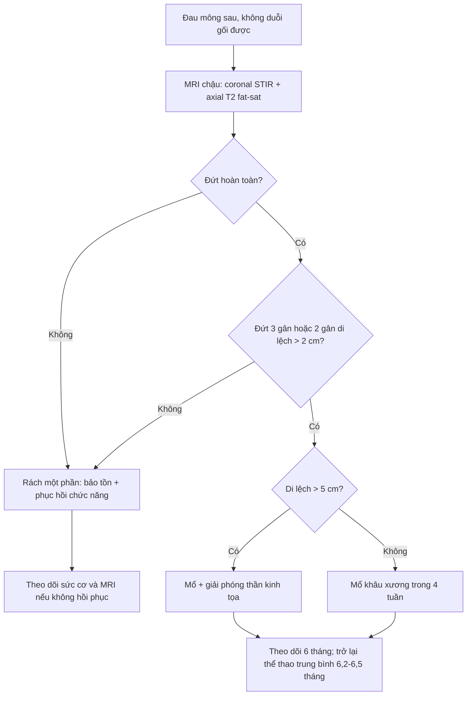
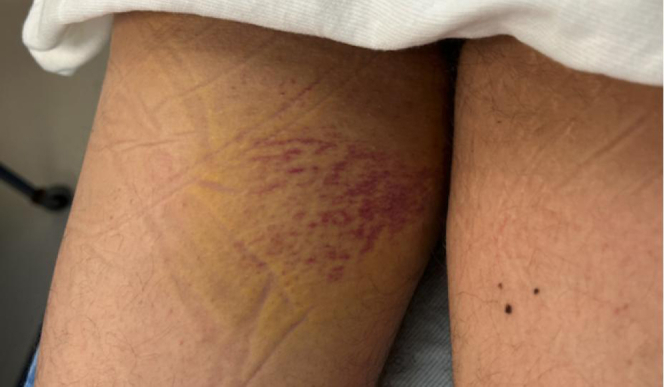
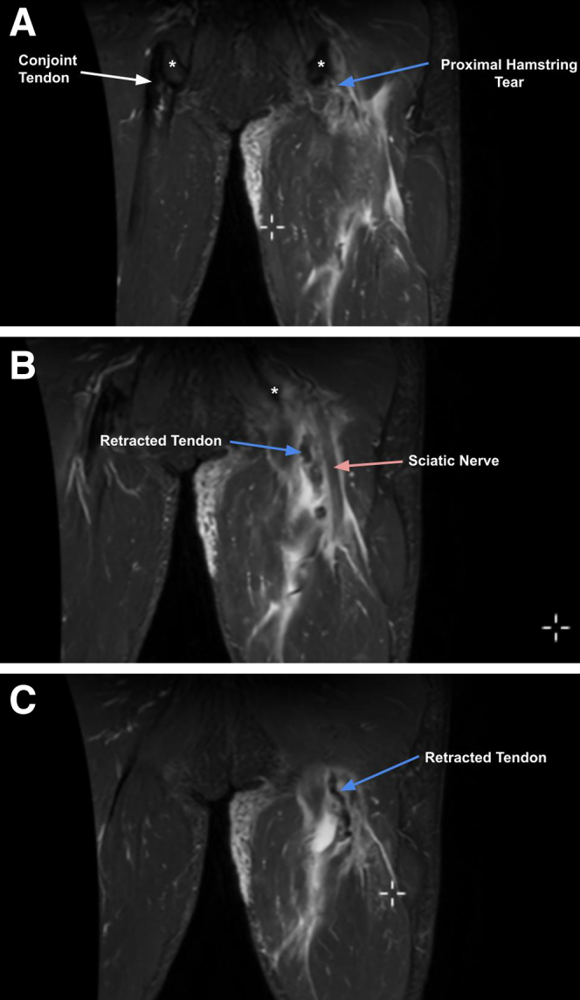
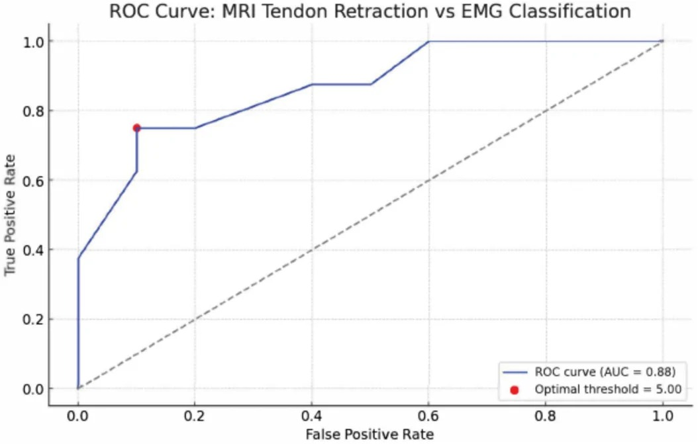
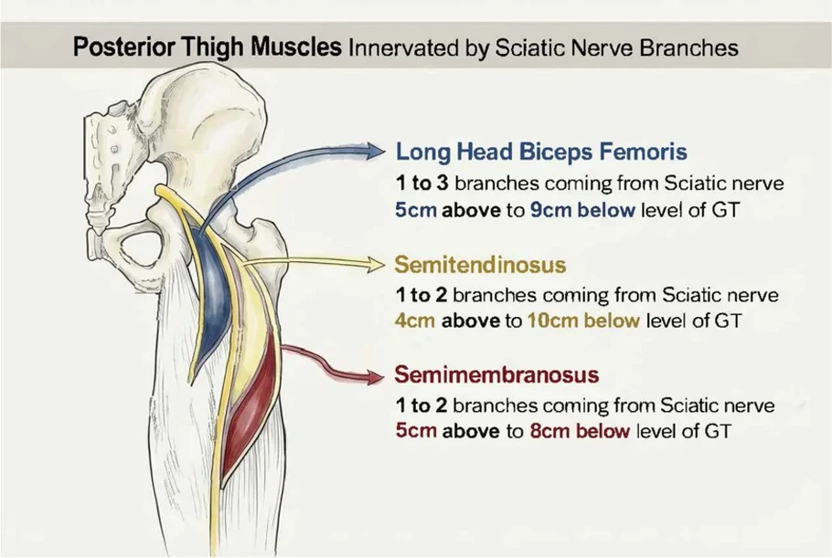

# 3840 — Rách và đứt gân gốc cơ gân kheo cấp và mạn: ngưỡng di lệch, khi nào mổ và thần kinh tọa

**Tags:** `pattern:dut-gan` `pattern:co-rut-gan` `pattern:dau-mong-sau` `vung:mong-sau-dui` `vung:chan` `anatomy:co-gan-kheo` `protocol:MRI-chau` `protocol:MRI-co-xuong` `score:NARD` `score:Wood`
**Mức chắc chắn (certainty):** tổng hợp y văn (literature synthesis) — ghép **nghiên cứu tiến cứu 18 ca đứt hoàn toàn có EMG và MRI** (J Exp Orthop 2026, PMCID **PMC12966922**), **95 ca bảo tồn của thử nghiệm PHACT** (Sports Med Open 2026, PMCID **PMC13149700**), **tổng quan 2.833 ca mổ** (Orthop J Sports Med 2023, PMCID **PMC10536870**), **meta-analysis 1.530 ca** (Bone Jt Open 2022, PMCID **PMC9134830**), **740 ca đứt lại** (Am J Sports Med 2024, PMCID **PMC10986149**) và **ca MRI minh họa** (Arthrosc Tech 2025, PMCID **PMC12800983**). Không có ca do nhóm tự chụp.

> **Câu hỏi thực hành:** nam **52 tuổi**, ngã khi trượt tuyết, nghe "bụp" sau mông, đau dữ dội khi ngồi và khi duỗi gối; **3 ngày sau** có bầm máu mặt sau đùi, không duỗi được gối chống trọng lực, tê nhẹ mặt sau cẳng chân. MRI cho thấy gân gốc co rút **7 cm**. Bệnh nhân hỏi: **"Có phải rách cơ không? Có cần mổ không? Mổ có nguy cơ gì cho dây thần kinh? Bao lâu mới chạy lại được?"**
> Bài chốt **năm quyết định**: **(1) đứt hoàn toàn 3 gân hoặc 2 gân di lệch > 2 cm là chỉ định mổ ở người hoạt động; (2) di lệch > 5 cm là ngưỡng "thần kinh tọa bị đe dọa" (NARD) — AUC 0,88, Se 90%, Sp 75%; (3) mổ trong vòng 4 tuần: trì hoãn > 32 ngày làm tăng đứt lại HR 2,5; (4) bảo tồn không miễn phí — ở 95 ca theo dõi 24 tháng, khối cơ nạc còn 78% và mỡ tăng 139% so với bên lành, di lệch là yếu tố dự báo mạnh nhất; (5) biến chứng mổ: chung 15,3%, thần kinh tọa 1,7%, đứt lại 0,8% trong tổng quan 2.833 ca.**

## 1. Tổng quan bệnh học – cơ chế hình ảnh: vì sao gân "co rút" lại là trung tâm của mọi quyết định

- **Giải phẫu:** ba cơ gân kheo bám vào **ụ ngồi (ischial tuberosity)**. **Gân chung (conjoint tendon)** gồm **cơ bán gân (semitendinosus)** và **đầu dài cơ nhị đầu đùi (long head of biceps femoris)**; **cơ bán màng (semimembranosus)** bám riêng, ở phía trước–trong. **Thần kinh tọa** chạy ngay **phía sau–ngoài ụ ngồi**, cách điểm bám **~1,2 cm** (PMC10455575) — vì thế mọi mảnh gân co rút đều kéo theo nguy cơ chèn ép/tổn thương thần kinh.
- **Cơ chế chấn thương:** co cơ lệch tâm (eccentric) mạnh khi **gối duỗi và háng gập**, điển hình **trượt nước, nhảy rào, chạy nước rút**; người trung niên có thể đứt khi **vấp/ngã** thông thường. Nam thường chấn thương khi thể thao, nữ thường khi sinh hoạt hằng ngày (PMC12966922).
- **Vì sao gân co rút:** khi gân đứt khỏi ụ ngồi, cơ vẫn còn trương lực và co về phía xa; khoảng trống giữa mảnh gân và xương được lấp bằng **máu tụ và dịch viêm**. Trên MRI, **gân là cấu trúc collagen đặc → tín hiệu thấp trên mọi chuỗi xung**; khoảng trống chứa dịch → **T2/STIR tăng tín hiệu mạnh**, còn **mảnh gân co rút** là dải tín hiệu thấp, đầu gần dày lên. Đây là lý do **coronal STIR** là chuỗi xung tốt nhất để đo di lệch: dịch sáng làm nổi bật khoảng trống, gân tối làm nổi bật mảnh gân.
- **TẠI SAO phải đo bằng cm chứ không mô tả "đứt hoàn toàn":** di lệch quyết định **khả năng khâu về ụ ngồi không căng**, **nguy cơ thần kinh tọa** và **mức thoái hóa cơ**. Ở 18 ca đứt hoàn toàn, nhóm EMG bất thường có di lệch **5,9 ± 2,2 cm** so với **2,9 ± 1,5 cm** ở nhóm EMG bình thường (**p = 0,005**); ROC cho **AUC 0,88**, cắt **5 cm** với **Se 90%**, **Sp 75%** (PMC12966922).
- **TẠI SAO bảo tồn vẫn để lại di chứng:** 95 ca đứt hoàn toàn được điều trị bảo tồn, đo DIXON tại **24 tháng**: **khối cơ nạc chỉ còn 78%** (LSI 67,2–87,1), **phân suất mỡ tăng lên 139%** (124,5–166,8), **lực đẳng trường tối đa 84%** (75,4–94,0) so với bên lành. Mô hình gồm **di lệch, tuổi, giới, kích thước máu tụ** giải thích **48%** phương sai khối cơ và **48%** phương sai mỡ; **di lệch là yếu tố giải thích mạnh nhất** (PMC13149700).
- **TẠI SAO thần kinh tọa bị tổn thương:** các nhánh vận động tới cơ gân kheo tách khỏi thần kinh tọa trong khoảng **4–5 cm trên tới 8–10 cm dưới mức mấu chuyển lớn (greater trochanter)** (PMC12966922, Figure 4). Khi gân co rút > 5 cm, mảnh gân và sẹo xơ đi vào **vùng 1** — nơi các nhánh vận động sớm bắt đầu tách ra — nên vừa **kéo căng** vừa **chèn ép** thần kinh. Đây là cơ sở giải phẫu của **NARD (nerve-at-risk distance) = 5 cm**.
- **Tần suất và gánh nặng:** tỉ lệ ước tính **0,81 ca/1.000 giờ** thể thao đồng đội (PMC10455575). Đứt hoàn toàn không mổ có thể để lại **yếu duỗi háng, đau khi ngồi, không chạy nước rút được** — đây là lý do phải phân tầng ngay từ MRI.

## 2. Mẫu hình + chẩn đoán phân biệt theo vị trí và mức độ (Gamut)

- **Theo mức độ (trên MRI):**
  - **Rách một phần (partial):** một bó gân đứt, các bó còn lại liên tục; thường ở **mặt dưới (undersurface)** của gân chung; MRI thấy **tín hiệu tăng trong gân nhưng không có khoảng trống hoàn toàn**; điều trị bảo tồn trước, nội soi gân khi thất bại.
  - **Đứt hoàn toàn, di lệch < 2 cm:** đầu gân còn gần ụ ngồi; có thể khâu thì đầu hoặc bảo tồn ở người ít vận động.
  - **Đứt hoàn toàn, di lệch 2–5 cm:** chỉ định mổ ở người hoạt động; khâu trực tiếp thường được.
  - **Đứt hoàn toàn, di lệch > 5 cm:** **NARD** — nguy cơ thần kinh tọa cao; cần **mổ + giải phóng/thăm dò thần kinh tọa**, đôi khi cần ghép gân nếu không kéo được.
  - **Bong điểm bám xương (osseous avulsion):** mảnh xương ụ ngồi đi cùng gân; MRI/CT thấy **mảnh xương di lệch**, tủy xương phù; mổ khi mảnh di lệch đáng kể ở người trẻ.
- **Theo thời gian:** **cấp < 6 tuần**; **mạn 6–12 tuần trở lên** — mạn tính có sẹo xơ dính thần kinh tọa, mổ khó hơn, nguy cơ thần kinh cao hơn (mổ mạn **5,1%** so với **0,7%** ở mổ cấp, PMC10455575).
- **Theo số gân:** **3 gân** (gân chung + bán màng) nặng nhất; **2 gân** (gân chung) thường gặp; **đơn độc cơ bán màng** có tiên lượng hồi phục sớm hơn (**HR 4,84** cho trở lại thể thao sớm, PMC10943609).
- **Theo thần kinh:** không triệu chứng; **đau tê mặt sau đùi/cẳng chân** (kích thích); **yếu cơ, teo cơ, giảm phản xạ** (tổn thương vận động) — cần **EMG** để phân biệt tổn thương **do chấn thương** với **do mổ** (23% ca không có tổn thương trước mổ bị tổn thương sau mổ, PMC12966922).
- **Chẩn đoán phân biệt của đau mặt sau đùi:** rách cơ–gân kheo gần (strain), **hẹp khoang đùi–ụ ngồi (ischiofemoral impingement)**, **hội chứng cơ hình lê**, đau thần kinh thẹn, **viêm bao hoạt dịch ụ ngồi**, bệnh khớp cùng chậu, gãy mỏi cổ xương đùi, **chèn ép thần kinh tọa do sẹo/u**, và đau lan từ cột sống thắt lưng. Điểm khác biệt: đứt gân gốc có **cơ chế co lệch tâm rõ**, **bầm máu mặt sau đùi**, **yếu duỗi háng**, và **MRI có khoảng trống dịch tại ụ ngồi**.
- **Ba bẫy hay gặp ở "vùng mông sau":** (1) **rách cơ thường** không có khoảng trống tại ụ ngồi; (2) **ischiofemoral impingement** đau khi dạng–xoay háng, MRI thấy hẹp khoảng và phù cơ hình vuông đùi; (3) **chèn ép thần kinh tọa do sẹo** sau chấn thương cũ — MRI thấy thần kinh tọa dày/tín hiệu tăng, không có gân đứt cấp.

## 3. Bảng so sánh phân biệt (ma trận đối chiếu)

| Thực thể (entity) | Hình ảnh điển hình (MRI) | Chốt vào (rule-in) | Chốt loại (rule-out) | Gợi ý xác nhận |
|---|---|---|---|---|
| Rách một phần gân chung | Tín hiệu tăng trong gân, **không có khoảng trống hoàn toàn**; mặt dưới gân tổn thương | **Còn bó gân liên tục từ ụ ngồi tới cơ** + đau/không duỗi gối hết | Khoảng dịch hoàn toàn giữa gân và ụ ngồi → đứt hoàn toàn | MRI 3T lát mỏng; nội soi gân nếu bảo tồn thất bại |
| Đứt hoàn toàn, di lệch < 2 cm | Đầu gân gần ụ ngồi, khoảng dịch **< 2 cm** | **Di lệch < 2 cm + còn khả năng khâu thì đầu** | Di lệch ≥ 2 cm ở người hoạt động → cân nhắc mổ | Coronal STIR, đo từ vỏ ụ ngồi tới đầu gân |
| Đứt hoàn toàn, di lệch 2–5 cm | Khoảng dịch **2–5 cm**, đầu gân co lên, cơ phù | **Di lệch ≥ 2 cm + yếu duỗi háng + người hoạt động** | Di lệch < 2 cm → bảo tồn có thể đủ | MRI + khám sức cơ; mổ trong 4 tuần |
| Đứt hoàn toàn, di lệch > 5 cm (NARD) | Khoảng dịch **> 5 cm**, gân co cao, thần kinh tọa bị kéo/chèn | **Di lệch > 5 cm + tê/yếu + EMG bất thường** | Không có triệu chứng và EMG bình thường → vẫn cân nhắc mổ vì nguy cơ tiến triển | MRI + EMG; mổ giải phóng thần kinh tọa |
| Bong điểm bám xương | **Mảnh xương ụ ngồi** di lệch cùng gân; phù tủy xương | **Thấy mảnh xương + gân dính vào mảnh** | Không có mảnh xương → đứt phần mềm | CT nếu MRI không rõ mảnh xương |
| Đứt mạn tính > 6–12 tuần | Gân co rút xa, sẹo xơ, thần kinh tọa dính; cơ teo/mỡ hóa | **Bờ gân mờ, dính mô mềm, cơ teo** + tiền sử chấn thương cũ | Có khoảng dịch cấp + phù mô mềm → cấp | MRI + EMG; cân nhắc ghép gân |
| Chèn ép thần kinh tọa do sẹo | Thần kinh tọa dày, tín hiệu tăng, dính gân–thần kinh; **không có gân đứt cấp** | **Đau tê theo đường thần kinh tọa + MRI thấy thần kinh bất thường** | Khoảng dịch tại ụ ngồi + gân co rút → đứt gân cấp | EMG; MRI thần kinh (MRN) |

- Ảnh MRI minh họa đứt hoàn toàn có co rút và liên hệ thần kinh tọa: xem mục 6 (ảnh ngoài, đáp án trong thẻ details).

## 4. Protocol chụp + ngưỡng phân tầng điều trị

### 4.1 MRI — chuỗi xung và cách đo

- **Chỉ định:** nghi đứt gân gốc (không duỗi gối được, bầm máu mặt sau đùi, sa sút chức năng), trước mổ, và khi cần phân biệt với đau mặt sau đùi do nguyên nhân khác.
- **Chuỗi xung tối thiểu:** **coronal T1** (giải phẫu, mỡ tủy), **coronal STIR/T2 fat-sat** (dịch, đo di lệch), **sagittal PD/T2** (hướng gân, khoảng dịch), **axial T2 fat-sat** (đếm gân, diện bám, thần kinh tọa). Lát **3–4 mm**, FOV đủ từ **ụ ngồi tới mấu chuyển nhỏ**.
- **Cách đo di lệch:** trên **coronal STIR**, đo từ **vỏ xương ụ ngồi** (không phải bờ máu tụ) tới **đầu gần của mảnh gân co rút**, theo trục gân; ghi **cm** và **số gân đứt**. Đo ở lát thấy khoảng trống lớn nhất, không cộng mảnh xương nếu có bong điểm bám.
- **Dấu "dropped ice cream sign":** mất dấu gân bám vào ụ ngồi — đầu gân "rơi" xuống dưới; **dương tính** = đứt hoàn toàn khỏi diện bám (PMC10943609). Đây là dấu định tính nhanh, nhưng **không thay thế đo cm**.
- **Đánh giá thần kinh tọa:** vị trí, đường kính, tín hiệu T2, mất lớp mỡ quanh thần kinh, dính vào mảnh gân; **không kết luận tổn thương chức năng chỉ dựa trên tín hiệu** — cần **EMG**.
- **Đánh giá cơ:** teo, phù, **mỡ hóa** (T1 tăng tín hiệu); DIXON định lượng phân suất mỡ nếu theo dõi bảo tồn.

### 4.2 Siêu âm

- Đầu dò thẳng tần số cao, mặt cắt dọc và ngang qua ụ ngồi; động tác **duỗi gối chủ động** giúp thấy khoảng trống và đầu gân di động.
- Ưu điểm: nhanh, tại giường, so sánh hai bên; hạn chế: **phụ thuộc người làm**, khó đo chính xác khi phù/bầm máu nhiều, không thấy thần kinh tọa rõ như MRI. **MRI là chuẩn** để quyết định mổ.

### 4.3 Ngưỡng quyết định điều trị

- **Chỉ định mổ (người hoạt động):** **đứt 3 gân**, hoặc **đứt 2 gân với di lệch > 2 cm** (PMC12579506); đứt hoàn toàn ở vận động viên; **di lệch > 5 cm** (NARD) nên mổ + giải phóng thần kinh tọa (PMC12966922).
- **Thời điểm:** mổ **cấp trong vòng 4 tuần**; **trì hoãn > 32 ngày** làm tăng đứt lại **HR 2,5 (95% CI 1,24–5,06)** trong 740 ca (PMC10986149). **Mạn > 6–12 tuần** cần kỹ thuật giải phóng/ghép gân, nguy cơ thần kinh cao hơn.
- **Bảo tồn:** rách một phần, đứt hoàn toàn di lệch nhỏ ở người ít vận động, hoặc chống chỉ định mổ. Theo dõi **sức cơ, dáng đi, đau khi ngồi**; MRI lặp nếu không hồi phục.
- **Kết quả sau mổ (tổng hợp):** hài lòng **92,6%**, LEFS **74,7**, sức cơ **87%** bên lành, trở lại thể thao **84,5%** trung bình **6,5 tháng**, đứt lại **1,2%**, rối loạn thần kinh tọa **3,5%** (PMC9134830). Ở vận động viên chuyên nghiệp: trở lại **98,4%**, về mức trước chấn thương **78,1%** sau **6,2 ± 2,5 tháng** (PMC10943609).
- **Biến chứng (2.833 ca):** chung **15,3%**, lớn **4,6%**; **thần kinh tọa 1,7%**, huyết khối tĩnh mạch **0,8%**, mổ lại **0,8%**, đứt lại **0,8%**, nhiễm sâu **0,4%**; thần kinh bì đùi sau **2,4%**, yếu cơ tồn tại **2,3%**, đau khi ngồi **2,2%**, tê quanh vết mổ **1,8%** (PMC10536870).

### 4.4 Phục hồi chức năng và theo dõi

- Giai đoạn đầu bảo vệ gân khâu, tránh **duỗi gối thụ động mạnh** và co cơ lệch tâm sớm; tập tiến triển theo đau và sức cơ, không theo mốc cứng.
- **Trở lại thể thao** trung bình **6,2–6,5 tháng**; kiểm tra **sức cơ so bên lành** trước khi cho chạy nước rút/thi đấu.
- **Theo dõi sau mổ:** đau khi ngồi, tê mặt sau đùi, sức duỗi háng; MRI chỉ khi nghi đứt lại hoặc biến chứng, không chụp thường quy.

## 5. Biến thể bình thường và cạm bẫy

- **Mảnh xương nhỏ ở ụ ngồi:** có thể là **bong điểm bám xương** hoặc **vôi hóa/heterotopic ossification** cũ; so phim cũ và xem gân có liên tục không.
- **Đo di lệch từ bờ máu tụ:** sẽ **đo ngắn hơn** thực tế; luôn đo từ **vỏ xương ụ ngồi** tới **đầu gân**.
- **Chỉ chụp axial:** gân chạy chéo, axial dễ cắt ngang gân và **đánh giá thấp co rút**; bắt buộc có **coronal STIR**.
- **Rách mặt dưới (undersurface):** gân còn dính mặt trên nên đường viền ngoài bình thường; **MRI thường quy dễ bỏ sót**, cần lát mỏng/3T và khám động.
- **Tín hiệu thần kinh tọa tăng:** có thể do **phù sau chấn thương** mà không có yếu cơ; **EMG** mới phân biệt tổn thương chức năng. Ngược lại, EMG bình thường không loại trừ đau do kích thích.
- **Sẹo xơ mạn tính giả u:** mô sẹo quanh ụ ngồi có thể tăng tín hiệu và dày, giống sarcoma/ u thần kinh; **không sinh thiết mù** khi có tiền sử chấn thương — đối chiếu MRI cũ và EMG.
- **Đứt lại sau mổ:** **75%** xảy ra trong **6 tháng đầu**, trung vị **88,5 ngày**, **74%** không chấn thương (PMC10986149); đau "bụp" tái phát + mất sức cơ → MRI ngay.
- **Bỏ sót huyết khối tĩnh mạch:** tỉ lệ **0,8%** trong tổng quan; phù chân, đau bắp chân sau mổ cần siêu âm Doppler, không quy hết cho đau mổ.
- **Coi "di lệch nhỏ = lành":** bảo tồn vẫn có thể mất **22%** khối cơ nạc và tăng **39%** mỡ tại 24 tháng; cần theo dõi chức năng, nhất là ở người trẻ hoạt động.

## 6. Tự lượng giá — Blind Quiz

**Ca 1 — Nam 45 tuổi, ngã trượt nước, đau mông phải, bầm máu mặt sau đùi 3 ngày.**

- Gợi ý lâm sàng: không duỗi gối chống trọng lực được, đau tăng khi ngồi; không tê rõ.
- Câu hỏi: Dấu hiệu ngoài da gợi ý gì? Chẩn đoán hình ảnh đầu tay là gì? Cần đo gì trên ảnh?

<b>Bấm để hiện đáp án (findings + chẩn đoán)</b>

- Dấu hiệu: **bầm máu (ecchymosis) mặt sau đùi** lan xuống theo trọng lực — dấu hiệu thường gặp của đứt gân gốc cơ gân kheo, không đặc hiệu cho rách cơ thường.
- Chẩn đoán: nghi **đứt gân gốc cơ gân kheo**; chỉ định **MRI chậu** (coronal STIR + axial T2 fat-sat) để xác định số gân và **di lệch cm**.
- Vì sao: bầm máu + không duỗi gối + cơ chế co lệch tâm là bộ ba gợi ý; siêu âm có thể sàng lọc nhưng MRI là chuẩn để quyết định mổ.
- Nguồn ảnh: Arthrosc Tech 2025, PMCID PMC12800983, CC BY-NC-ND 4.0.

**Ca 2 — Nam 52 tuổi, MRI coronal T2: gân co rút, thần kinh tọa cạnh đầu gân.**

- Gợi ý lâm sàng: tê nhẹ mặt sau cẳng chân, yếu duỗi háng; hình ảnh có nhãn giải phẫu của tác giả.
- Câu hỏi: Mô tả vị trí khoảng dịch và đầu gân. Vì sao phải nhắc thần kinh tọa? Đo di lệch ở chuỗi xung nào?

<b>Bấm để hiện đáp án (findings + chẩn đoán)</b>

- Dấu hiệu: **(A–C) chuỗi coronal T2 từ trước ra sau** — khoảng dịch tăng tín hiệu tại **ụ ngồi**, **đầu gân co rút** (mũi tên xanh), **thần kinh tọa** nằm sát phía sau–ngoài (mũi tên hồng ở B); gân chung bên lành còn bám (mũi tên trắng ở A).
- Chẩn đoán: **đứt hoàn toàn gân gốc cơ gân kheo có co rút**; cần **đo cm trên coronal STIR/T2** và đánh giá thần kinh tọa. Nếu di lệch **> 5 cm** → NARD, mổ + giải phóng thần kinh.
- Vì sao: thần kinh tọa cách ụ ngồi **~1,2 cm** và các nhánh vận động tách ra trong khoảng **5 cm trên–10 cm dưới mấu chuyển lớn**; gân co rút càng xa càng kéo/dính thần kinh.
- Nguồn ảnh: Arthrosc Tech 2025, PMCID PMC12800983, CC BY-NC-ND 4.0.

**Ca 3 — Ngưỡng 5 cm: đọc đường ROC và quyết định.**

- Gợi ý lâm sàng: bệnh nhân đứt hoàn toàn, không triệu chứng thần kinh rõ; MRI di lệch 4,5 cm.
- Câu hỏi: Điểm cắt 5 cm có nghĩa gì? Với 4,5 cm, có loại trừ được tổn thương thần kinh không? Vì sao?

<b>Bấm để hiện đáp án (findings + chẩn đoán)</b>

- Dấu hiệu: ROC **AUC 0,88**; điểm cắt **5,00 cm** cho **Se 90%**, **Sp 75%** — 5 cm là ngưỡng **NARD**, không phải "ngưỡng chẩn đoán tuyệt đối".
- Trả lời: **4,5 cm không loại trừ** tổn thương thần kinh (Sp 75% nghĩa là 25% ca không có tổn thương vẫn có thể nằm trên ngưỡng; và ngược lại, ca dưới ngưỡng vẫn có thể có tổn thương). Cần **khám thần kinh + EMG** khi có triệu chứng; quyết định mổ dựa trên **toàn bộ**: số gân, di lệch, chức năng, nghề nghiệp.
- Vì sao: nghiên cứu chỉ **18 ca**, khoảng tin cậy rộng; bài dùng ngưỡng như **công cụ phân tầng**, không phải tiêu chuẩn duy nhất.
- Nguồn ảnh: J Exp Orthop 2026, PMCID PMC12966922, CC BY 4.0.

> **Ảnh dữ liệu bổ sung:** sơ đồ phân nhánh thần kinh tọa vào ba cơ gân kheo (ảnh ngoài, đáp án trong details) — dùng để nhớ vì sao co rút > 5 cm lại nguy hiểm.

<b>Bấm để hiện đáp án (đọc sơ đồ)</b>

- Nhánh tới **đầu dài cơ nhị đầu đùi**: **1–3 nhánh**, từ **5 cm trên tới 9 cm dưới** mấu chuyển lớn.
- Nhánh tới **cơ bán gân**: **1–2 nhánh**, từ **4 cm trên tới 10 cm dưới**.
- Nhánh tới **cơ bán màng**: **1–2 nhánh**, từ **5 cm trên tới 8 cm dưới**.
- Ý nghĩa: vùng này trùng với **NARD 5 cm**; mảnh gân co rút đi vào vùng nhánh vận động sớm → vừa kéo căng vừa chèn ép.
- Nguồn: J Exp Orthop 2026, PMCID PMC12966922, CC BY 4.0.

## Bài liên quan chéo
- [380 – Bệnh xơ cung cụ ở trẻ](../380-benh-xo-cung-cu-o-tre/lesson.md)
- [382 – Ischiofemoral impingement](../382-ischiofemoral-impingement/lesson.md) (đau mặt sau đùi, chẩn đoán phân biệt)
- [383 – Bệnh gân gốc cơ gân kheo gần](../383-benh-gan-goc-co-gan-kheo-gan/lesson.md) (PHT và rách một phần)
- [370 – Nhiễm trùng cơ xương khớp](../370-nhiem-trung-msk/lesson.md)
- [375 – U phần mềm](../375-u-phan-mem/lesson.md) (sẹo xơ giả u, u thần kinh ngoại biên)

> Không dùng để chẩn đoán độc lập khi chưa có người hướng dẫn.
