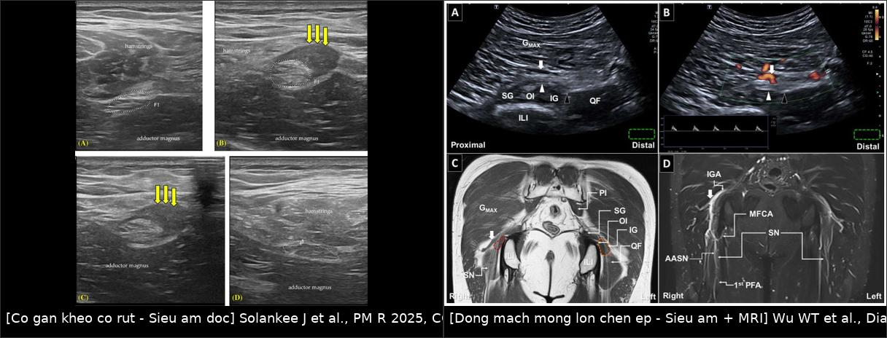
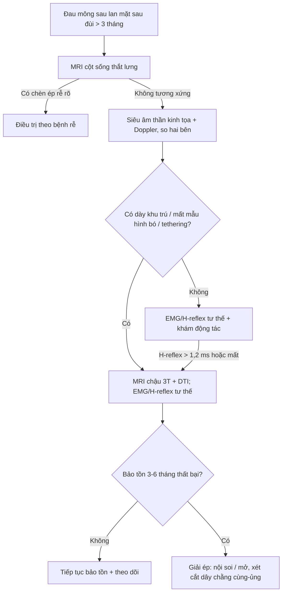
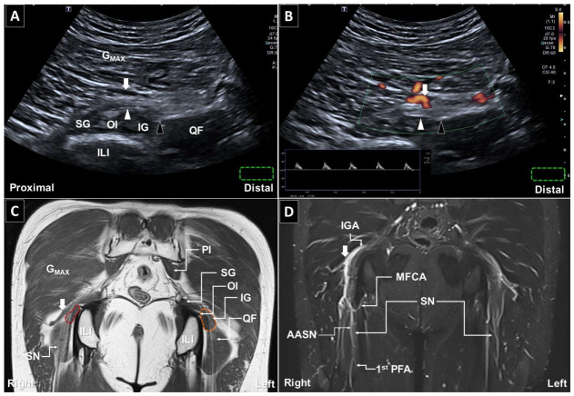
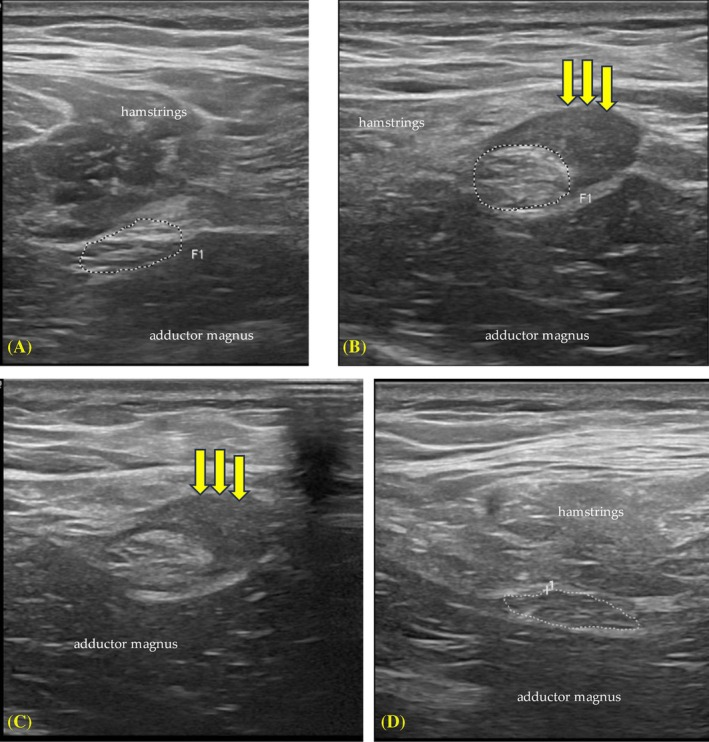
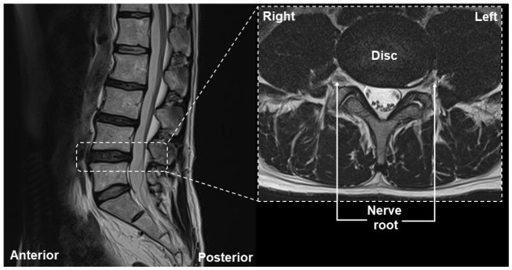

# 3841 — Chèn ép thần kinh tọa mạn sau chấn thương/mổ: "đau mông sau tái diễn dù gân đã lành" / Chronic sciatic nerve entrapment

**Tags:** `pattern:day-than-kinh` `pattern:chen-ep-than-kinh` `pattern:dau-mong-sau` `vung:chi-duoi` `vung:mong-sau-dui` `vung:khop-hang` `anatomy:than-kinh-toa` `protocol:MRI-chau` `protocol:sieu-am-than-kinh` `score:NRS-11`

**Mức chắc chắn (certainty):** tổng hợp y văn (literature synthesis) — số liệu từ **một phân tích 212 ca piriformis/deep gluteal syndrome** (BMC Surg 2025, PMCID **PMC12512919**), **một đoàn hệ phẫu thuật 81 ca** (2024, PMCID **PMC10924905**), **một loạt 30 ca nội soi khớp giải ép thần kinh tọa** (J Orthop Surg Res 2023, PMCID **PMC10507890**), **một nghiên cứu đa phương thức 19 ca** (2025, PMCID **PMC12397617**) và **ba ca nguyên văn có ảnh** (PMC13256393 — mạch mông dưới; PMC12065090 — sau rách gân kheo; PMC13552143 — cầu thủ tái phát). Không có thử nghiệm ngẫu nhiên; các ngưỡng điều trị là thực hành đồng thuận, chỗ suy luận được ghi rõ.

> **Câu chốt:** chèn ép thần kinh tọa **ngoài cột sống** (extraspinal) là nguyên nhân **hay bị bỏ** của đau mông–mặt sau đùi. Ba con số quyết định: **(1)** trong **212 ca**, chỉ **29,7%** được xác nhận bằng MRI chậu và **47,6% không có bất kỳ dấu hiệu hình ảnh/nội mổ nào** — chẩn đoán **không được chỉ dựa vào hình ảnh** (PMC12512919); **(2)** **41,1%** đáp ứng điều trị bảo tồn, **58,9%** phải mổ, và **chẩn đoán không có bằng chứng hình ảnh làm tăng nguy cơ thất bại phẫu thuật OR 5,3** (PMC12512919); **(3)** khi đã mổ, **giải ép đơn thuần thành công 61,7%**, nhưng **cắt thêm dây chằng cùng–ủng (sacrotuberous ligament) nâng lên 79,4% so với 42,6%** (PMC10924905).

## 1. Tổng quan bệnh học – cơ chế hình ảnh (TẠI SAO)

### 1.1 Giải phẫu: vì sao "đau mông" lại là bệnh của dây thần kinh

- **Thần kinh tọa (sciatic nerve)** tạo từ **L4–S3**, đi ra khỏi khung chậu qua **lỗ ngồi lớn (greater sciatic foramen)**, **dưới cơ lê (piriformis)** ở **85–90%** người; **10–15%** có biến thể **xuyên cơ lê** hoặc **trên cơ lê** — chính biến thể này là một cơ chế chèn ép.
- Sau khi ra khỏi lỗ ngồi lớn, dây đi qua **khoang mông sâu (deep gluteal space)** — một khoang ảo có: **thành sau là cơ mông lớn**, **thành trước là mặt sau xương đùi + khớp hông**, **thành trong là dây chằng cùng–ủng và cùng–gai**, **thành ngoài là mấu chuyển lớn**. Trong khoang này dây thần kinh **bắt chéo** các cấu trúc: cơ lê, cơ sinh đôi (gemelli), cơ bịt trong, **củ ngồi (ischial tuberosity)** và **gân gốc cơ kheo**.
- Xuống đùi, dây chạy **giữa cơ khép lớn (adductor magnus) và nhóm cơ kheo**, rồi tách thành **thần kinh chày và thần kinh mác chung** — nơi đây là đoạn **dễ đo siêu âm** và là mốc tham chiếu kích thước.
- Vì vậy "đau mặt sau đùi" có **ba ổ chèn ép khác nhau**: trong khoang mông sâu, tại **bờ củ ngồi/gân kheo**, và dọc **đường đi ở đùi sau**. Định vị đúng ổ quyết định thái độ điều trị.

### 1.2 TẠI SAO chèn ép mạn cho hình ảnh "dày + sáng" trên MRI

- Dây thần kinh ngoại biên là **ống trụ nhiều bó (fascicle)** bọc bởi **màng ngoại thần kinh (epineurium)**; giữa các bó là **nội thần kinh (endoneurium)** chứa mao mạch và dịch. Khi bị ép mạn tính, **áp lực nội dây tăng** → **ứ máu tĩnh mạch và rối loạn hàng rào máu–thần kinh** → **phù nội dây**. Phù này làm **nước tự do tăng** → **T2/STIR sáng** và **diện tích cắt ngang (cross-sectional area, CSA) tăng**.
- Do phù **trong bó** làm các bó **căng ra**, **mất mẫu hình "tổ ong/sợi chỉ" (loss of fascicular pattern)** — đây là dấu **đặc hiệu hơn** tăng tín hiệu đơn thuần vì dây bình thường cũng có thể hơi sáng do **mỡ nội thần kinh**.
- **TẠI SAO có ngấm thuốc:** khi hàng rào máu–thần kinh vỡ, gadolinium vào khoang nội dây → **ngấm thuốc dạng bó** ở thì muộn. Ngấm thuốc mạnh gợi **viêm/hoạt tính**, không gợi mức chèn ép.
- **TẠI SAO có teo cơ:** chèn ép sợi trục gây **thoái hóa Waller** phía dưới → cơ do dây chi phối **phù trên T2/STIR ở giai đoạn cấp–bán cấp**, rồi **thay mỡ, teo trên T1** ở giai đoạn mạn. Thấy **phù cơ kheo/khép lớn** trên STIR là bằng chứng **gián tiếp** của tổn thương thần kinh đang hoạt động.
- **TẠI SAO T1 quan trọng:** **xơ hóa (fibrosis)** và **mô sẹo** có T1 **trung tính–thấp**, T2 **thấp**, không ngấm thuốc; chúng **xóa mặt phẳng mỡ quanh thần kinh** và **dính dây vào cơ/gân**. Đây là dấu **"tethering"** — thứ mà siêu âm động (dynamic ultrasound) thấy rõ hơn MRI tĩnh.

### 1.3 Ngưỡng định lượng tham chiếu

- **CSA thần kinh tọa bình thường trên siêu âm độ phân giải cao** (200 người trưởng thành): tại **1 cm trên chỗ tách đôi**, nam **0,560 cm² = 56 mm²**, nữ **0,456 cm² = 45,6 mm²**; tại **4 cm trên chỗ tách đôi**, nam **42,8 mm²**, nữ **34,8 mm²** (PMC8264619). CSA **tương quan thuận với chiều cao (r ≈ 0,92)**, **không tương quan với tuổi** → **phải so cùng vị trí, cùng bên đối diện**, không dùng một con số tuyệt đối cho mọi người.
- **Điện sinh lý:** trong 19 ca nghi hội chứng mông sâu, **63%** có **H-reflex tăng thời tiềm (> 1,2 ms) hoặc mất** khi làm nghiệm pháp tư thế/gắng sức — trong khi **chỉ 2/19** có tiếp xúc rễ thần kinh trên MRI cột sống (PMC12397617). Nói cách khác: **MRI cột sống bình thường không loại trừ chèn ép ngoài cột sống**.
- **Kết cục:** thành công phẫu thuật định nghĩa là **giảm ≥ 50% điểm đau NRS-11**; trong 81 ca đạt **61,7%**, mức giảm đau trung bình **43,9 ± 34,2%** (PMC10924905).
- **Dịch tễ:** 212 ca (117 nữ/95 nam), tuổi trung bình **43,6 ± 14,8**; **38,2%** có chấn thương vùng chậu/hoạt động thể thao mạnh; **9,0%** đã mổ cột sống thất bại trước đó (PMC12512919).

## 2. Mẫu hình + chẩn đoán phân biệt theo vị trí (Gamut)

- **Khoang mông sâu – phía sau cơ lê:** hội chứng cơ lê (piriformis syndrome), biến thể dây xuyên cơ lê, **phì đại cơ lê**, **cơ sinh đôi–bịt trong** dày.
- **Khoang mông sâu – phía ngoài:** **hội chứng chèn ép ụ ngồi–đùi (ischiofemoral impingement)** với phù cơ vuông đùi; dây thần kinh tọa nằm **ngay sau** vùng hẹp nên có thể bị kích thích thứ phát.
- **Bờ củ ngồi – gân gốc cơ kheo:** **hội chứng gân kheo gần**, **rách/co rút gân kheo** tạo **sẹo xơ quấn dây** — thể hay gặp sau chấn thương thể thao; đây là **chủ đề của bài 3840** nhưng **phần thần kinh** là bài này.
- **Mạch máu:** **động mạch mông dưới (inferior gluteal artery)** phì đại/bất thường **bắt chéo và đè** lên dây — ca nguyên văn PMC13256393; Doppler là chìa khóa phân biệt với dải xơ.
- **Dây chằng/xơ:** **dây chằng cùng–ủng** dày, dải xơ sau chấn thương, **xơ sau tiêm bắp** (post-injection fibrosis), xơ sau mổ háng/mông.
- **Trong dây thần kinh:** **u vỏ bao thần kinh (peripheral nerve sheath tumor)**, **u sợi thần kinh**, **di căn lan theo dây (perineural spread)** — dày **hình thoi, liên tục**, không theo vị trí giải phẫu hẹp.
- **Bắt chước (mimics):** **bệnh rễ L5/S1**, hẹp ống sống, **viêm gân kheo đơn thuần**, thoái hóa khớp hông, **bệnh thần kinh ngoại biên do đái tháo đường**, bệnh **đám rối thắt lưng–cùng do xạ** (bài 1843).

## 3. Bảng so sánh phân biệt (ma trận đối chiếu)

| Thực thể (entity) | Hình ảnh điển hình (US/MRI) | Chốt vào (rule-in) | Chốt loại (rule-out) | Gợi ý xác nhận |
|---|---|---|---|---|
| **Hội chứng cơ lê / chèn ép khoang mông sâu** | Dây **dày khu trú + T2 sáng** ngay sau cơ lê; cơ lê dày/bất đối xứng; không có ổ chèn ép khác | **Đau mông sâu tăng khi ngồi lâu/duỗi–xoay trong**, FAIR test dương, **H-reflex > 1,2 ms** | Dây bình thường + không đau khi tư thế → nghĩ nguyên nhân cột sống | US động + MRI chậu 3T; EMG loại rễ |
| **Chèn ép do gân kheo co rút/sẹo xơ** | Dây **dính vào gân kheo co rút**, gân **mất mẫu hình sợi**, cơ kheo **phù/teo mỡ**; US động thấy dây **không trượt** | **Tiền sử rách gân kheo**, đau khi gấp duỗi gối, **dấu tụt dây khi co cơ** | Gân kheo liên tục, dây trượt bình thường → không phải thể này | US 2 bên cùng mốc (9 cm và 16 cm dưới củ ngồi) |
| **Chèn ép do động mạch mông dưới** | Cấu trúc **ống, có phổ Doppler**, bắt chéo dây; MRI thấy **mạch phì đại** cùng bên | **Doppler xác nhận mạch**, dây **phì đại ngay dưới chỗ bắt chéo**, đau giảm sau giải ép/hydrodissection | Không có phổ Doppler → là dải xơ/cơ | Siêu âm Doppler + MRI tương phản |
| **Hội chứng ụ ngồi–đùi** | **Khoảng ụ ngồi–mấu chuyển nhỏ hẹp**, cơ vuông đùi **phù T2**, dây tọa **lệch sau** | Đau mông **khi duỗi–xoay ngoài**, hẹp khoảng < 15 mm (ngưỡng tham khảo trên MRI) | Cơ vuông đùi bình thường + dây dày khu trú nơi khác | MRI chậu có lát cắt qua ụ ngồi |
| **U vỏ bao thần kinh** | Dày **hình thoi, bờ rõ**, **dấu đuôi (tail sign)**, ngấm thuốc, có thể **xâm lấn mô mềm** | Khối **liên tục theo dây**, không đúng vị trí hẹp giải phẫu | Dày **đối xứng hai bên**, không có khối → không phải u | MRI có tương phản + sinh thiết nếu cần |
| **Bệnh rễ L5/S1** | Rễ **bị chèn trong lỗ liên hợp/ống sống**, dây ngoài cột sống bình thường | Đau **theo dermatome**, nghiệm pháp Lasègue, **EMG có tổn thương rễ** | MRI cột sống bình thường **không loại trừ** chèn ép ngoài cột sống | MRI cột sống + EMG; nếu âm → khảo sát mông sâu |

*Trái: siêu âm dọc — dây thần kinh tọa bị **gân kheo co rút + sẹo xơ** giữ chặt (mũi tên vàng), cơ kheo mất mẫu hình. Phải: siêu âm dọc + Doppler — **động mạch mông dưới** bắt chéo gây chèn ép khu trú, kèm MRI coronal T1 cho thấy mạch phì đại. Nguồn: Solankee J et al., PM R 2025 (PMC12065090), CC BY 4.0; Wu WT et al., Diagnostics 2026 (PMC13256393), CC BY 4.0. Ảnh ghép letterbox, không crop.*

### Dấu hiệu "tethering" trên siêu âm động — cách đọc

- Đặt đầu dò **dọc trục dây** tại **9 cm và 16 cm dưới củ ngồi** (mốc chuẩn của PMC12065090), cho bệnh nhân **co–duỗi gối chủ động**. Bình thường dây **trượt lên xuống độc lập** với cơ kheo; khi có sẹo, dây **bị kéo theo cơ** và **không trượt** — dấu này có giá trị hơn đo CSA đơn thuần.
- **So sánh bên đối diện ở đúng cùng mốc** — vì CSA phụ thuộc chiều cao (r ≈ 0,92) và giới.

## 4. Protocol chụp + ngưỡng phân tầng điều trị

### 4.1 MRI chậu – đùi (3T là ưu tiên)

- **Phạm vi:** từ **L4** đến **dưới mấu chuyển nhỏ** — đủ để thấy đám rối, lỗ ngồi lớn, khoang mông sâu và đoạn đùi trên.
- **Chuỗi xung tối thiểu:** axial **T1** (3 mm) + axial **T2 fat-sat/STIR** (3 mm) + coronal **T1** + coronal **STIR** + sagittal T1/T2. Thêm **3D STIR SPACE 1 mm** khi cần tái tạo theo trục dây (MR neurography).
- **DTI (khi có):** b = 800–1.000, 12–20 hướng; đọc **FA và độ khuếch tán (diffusivity)**. Trong nghiên cứu 19 ca, **độ khuếch tán tăng ở bên có triệu chứng** trong khi **FA không khác biệt (P = 0,913)** — nghĩa là **FA đơn thuần không đủ**, phải đọc kèm hình thái (PMC12397617).
- **Tương phản:** bắt buộc khi nghi **u, nhiễm trùng, thay đổi sau mổ**; không cần thường quy cho chèn ép cơ học đơn thuần.
- **Cạm bẫy kim loại:** sau mổ háng/khớp háng, dùng **chuỗi xung giảm nhiễu kim loại (metal artifact reduction, MAVRIC/SEMAC)** và **tăng băng thông**; **không kết luận dây đứt** chỉ vì nhiễu.

### 4.2 Siêu âm thần kinh – cơ (đầu dò cao tần)

- **Đầu dò:** linear **10–18 MHz** cho đoạn đùi; **4–8 MHz** hoặc convex cho khoang mông sâu ở người béo.
- **Trình tự:** (1) xác định **củ ngồi** và **mấu chuyển lớn**; (2) dây ở **trục ngắn** hình "tổ ong"; (3) đo **CSA** bằng trace thủ công; (4) **Doppler** phân biệt mạch; (5) **động** để tìm tethering; (6) lặp lại **bên đối diện**.
- **Ngưỡng tham chiếu:** CSA **56 mm² (nam) / 45,6 mm² (nữ)** tại 1 cm trên chỗ tách đôi; **42,8 / 34,8 mm²** tại 4 cm trên (PMC8264619). Tăng **rõ so với bên đối diện** + mất mẫu hình bó mới đáng kể.

### 4.3 Điện sinh lý

- **EMG/NCS** để **loại bệnh rễ và bệnh đa dây thần kinh**; **H-reflex** với nghiệm pháp tư thế (gấp–khép–xoay trong) — **thời tiềm > 1,2 ms hoặc mất** gặp ở **63%** ca hội chứng mông sâu (PMC12397617).
- EMG **bình thường không loại trừ** chèn ép mạn mức độ nhẹ — vì vậy cần kết hợp hình ảnh động.

### 4.4 Ngưỡng quyết định điều trị

| Bước | Ngưỡng / số liệu | Nguồn |
|---|---|---|
| Điều trị bảo tồn trước | Vật lý trị liệu, giãn cơ, tiêm hướng dẫn siêu âm; **41,1%** khỏi | PMC12512919 |
| Khi nào cân nhắc mổ | Thất bại bảo tồn ≥ 3–6 tháng + **có bằng chứng chèn ép trên US/MRI/EMG** | PMC12512919, PMC10507890 |
| Kết quả giải ép | **61,7%** giảm ≥ 50% NRS-11; cắt thêm **dây chằng cùng–ủng: 79,4% vs 42,6%** | PMC10924905 |
| Kết quả nội soi khớp | **30 ca**: VAS **5,0 → 0,5**; mHHS **64 → 95**; tốt/rất tốt **90%** | PMC10507890 |
| Cảnh báo | Chẩn đoán **không có bằng chứng hình ảnh** → **OR thất bại 5,3** | PMC12512919 |

## 5. Biến thể bình thường và cạm bẫy

- **Biến thể đường đi:** dây **xuyên cơ lê** hoặc **trên cơ lê** ở **10–15%** — bản thân biến thể **không phải bệnh**; chỉ có ý nghĩa khi **dày + sáng khu trú đúng chỗ bắt chéo** và **lâm sàng tương ứng**.
- **Cạm bẫy 1 — "MRI cột sống bình thường = không có bệnh":** trong 19 ca nghi mông sâu, **chỉ 2 ca** có tiếp xúc rễ trên MRI cột sống (PMC12397617). Bình thường cột sống **không loại trừ** chèn ép ngoài cột sống.
- **Cạm bẫy 2 — chẩn đoán bằng hình ảnh đơn thuần:** **47,6%** ca trong y văn **không có dấu hiệu hình ảnh/nội mổ**; chẩn đoán ca đó vẫn có thể đúng nhưng **nguy cơ thất bại mổ OR 5,3** → phải có **nghiệm pháp lâm sàng + điện sinh lý** trước khi mổ (PMC12512919).
- **Cạm bẫy 3 — đo CSA không so bên:** CSA phụ thuộc **chiều cao (r ≈ 0,92)**; dùng ngưỡng tuyệt đối sẽ **gọi dày oan** ở người cao và **bỏ sót** ở người thấp (PMC8264619).
- **Cạm bẫy 4 — tăng tín hiệu T2 đơn thuần:** dây bình thường có thể hơi sáng do **mỡ nội thần kinh**; chỉ tính khi **mất mẫu hình bó + dày + bất đối xứng**.
- **Cạm bẫy 5 — gân kheo co rút giả dây to:** cơ/gân co rút đẩy dây ra sau, trên lát cắt ngang dây **trông to hơn**; dùng siêu âm **dọc trục + động** để phân biệt.
- **Cạm bẫy 6 — bỏ sót u:** dày **hình thoi, bờ rõ, ngấm thuốc, có tail sign** → phải loại **u vỏ bao thần kinh** trước khi gọi "chèn ép lành tính".
- **Cạm bẫy 7 — sau mổ:** nhiễu kim loại + thay đổi tín hiệu do mổ có thể **giả dày dây**; so với phim nền và dùng chuỗi xung giảm nhiễu.

## 6. Tự lượng giá — Blind Quiz

**Ca 1 — Nam 45 tuổi, đau mông phải lan mặt sau đùi > 2 năm, đã tiêm/giãn cơ nhiều lần không đỡ. Siêu âm và MRI dưới đây:**

- Câu hỏi: cấu trúc bắt chéo dây là **mạch hay dải xơ**? Dấu hiệu nào trên siêu âm chứng minh? Dây thần kinh thay đổi ra sao ngay dưới chỗ bắt chéo?

<b>Bấm để hiện đáp án</b>

- **Cấu trúc bắt chéo là động mạch:** hình ống, **có phổ Doppler** (ô B), bắt chéo và **đè lên dây thần kinh tọa** (mũi tên trắng); đây là **động mạch mông dưới bất thường**.
- Dây thần kinh **phì đại khu trú ngay dưới chỗ chèn ép** (đầu mũi tên đen), kèm **tăng tín hiệu** trên MRI.
- MRI coronal T1 (C) và T1 sau tiêm (D) cho thấy **mạch phì đại bên phải** so với bên trái (vòng cam).
- Điều trị trong ca gốc: **hydrodissection hướng dẫn siêu âm** bằng dextrose 5% + lidocaine; đau **7 → 3**, hết triệu chứng sau **2 tháng**.
- Nguồn: Wu WT et al., Diagnostics 2026 (PMC13256393), CC BY 4.0.

**Ca 2 — Nam 33 tuổi, cầu thủ bóng đá, "rách gân kheo" tái diễn 12 tháng, MRI gân đã lành nhưng vẫn đau sâu mặt sau đùi:**

- Câu hỏi: vì sao MRI gân "lành" mà vẫn đau? Dấu hiệu nào trên siêu âm chỉ ra nguyên nhân thật?

<b>Bấm để hiện đáp án</b>

- (A) dây thần kinh tọa **bên phải không triệu chứng** — kích thước và mẫu hình bình thường.
- (B) dây **bên trái phì đại**; **cơ kheo co rút, tăng âm và mất cấu trúc cơ**; **mô sẹo giảm âm (mũi tên vàng) dính chặt dây thần kinh vào gân kheo co rút**.
- (C, D) cùng dây ở **16 cm dưới củ ngồi**: vẫn thấy **dính và mất trượt** — tương ứng **tethering**.
- Chẩn đoán: **chèn ép thần kinh tọa do sẹo gân kheo co rút** — tổn thương **ngoài dây**, nên MRI gân "lành" không loại trừ.
- Nguồn: Solankee J et al., PM R 2025 (PMC12065090), CC BY 4.0.

**Ca 3 — Nữ 52 tuổi, đau mông–đùi phải 8 tháng, MRI thắt lưng dưới đây. Chẩn đoán là gì và bước tiếp theo?**

- Câu hỏi: hình ảnh có giải thích được triệu chứng không? Cần khảo sát gì tiếp?

<b>Bấm để hiện đáp án</b>

- MRI thắt lưng: **thoát vị đĩa đệm L4–L5 nhỏ, không chèn ép rễ thần kinh, không rách vòng sợi**; các lát L3–S1 **không có tổn thương rễ đáng kể**.
- Hình ảnh **không tương xứng** với đau lan mặt sau đùi → nghi **chèn ép ngoài cột sống** (hội chứng mông sâu / gân kheo / mạch).
- Bước tiếp: **siêu âm thần kinh tọa + Doppler so hai bên**, **MRI chậu 3T**, **EMG/H-reflex có nghiệm pháp tư thế**.
- Nguồn: Wu WT et al., Diagnostics 2026 (PMC13256393), CC BY 4.0.

## Bài liên quan chéo
- [300 – Tổng quan hệ Cơ – Xương – Khớp](../300-tong-quan-he-co-xuong-khop/lesson.md)
- [3840 – Rách & đứt gân gốc cơ gân kheo](../3840-rach-dut-gan-goc-co-gan-kheo/lesson.md) (biến chứng thần kinh tọa **1,7%**; cùng gamut đau mông sau)
- [382 – Hội chứng ụ ngồi–đùi (ischiofemoral impingement)](../382-ischiofemoral-impingement/lesson.md) (chèn ép cơ học lân cận)
- [1843 – Bệnh rễ đám rối thần kinh do xạ](../1843-benh-re-dam-roi-than-kinh-do-xa/lesson.md) (đau–yếu chi dưới sau xạ)
- [3101 – Hội chứng CHANTER](../3101-hoi-chung-chanter-opioid/lesson.md) (đau mông sau do nguyên nhân mạch máu)

## Ảnh
- `3841_chen-ep-than-kinh-toa_SieuAm_MRI_PMC13256393.jpg` — siêu âm dọc B-mode/Doppler + MRI coronal T1: **động mạch mông dưới** chèn ép dây tọa.
- `3841_chen-ep-than-kinh-toa_SieuAm_PMC12065090.jpg` — siêu âm 4 ô: dây bình thường vs **phì đại + sẹo gân kheo**.
- `3841_chen-ep-than-kinh-toa_MRI-cot-song_PMC13256393.jpg` — MRI thắt lưng: thoát vị nhỏ **không chèn ép rễ** (dùng cho cạm bẫy).
- `3841_chen-ep-than-kinh-toa_Mo_PMC12065090.jpg` — ảnh mổ: dây dính chặt cơ kheo.
- `composite_chan-doan.jpg` — ảnh ghép letterbox 2 cơ chế (CC BY 4.0).
- Chi tiết nguồn + giấy phép từng ảnh: [`images/CREDITS.md`](images/CREDITS.md).

> Không dùng để chẩn đoán độc lập khi chưa có người hướng dẫn.
