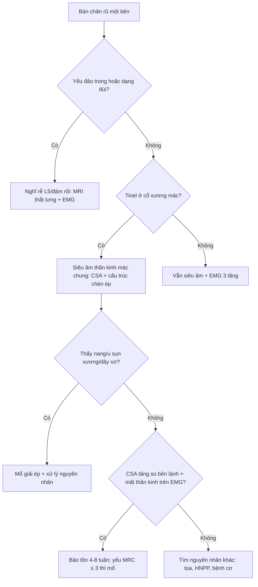
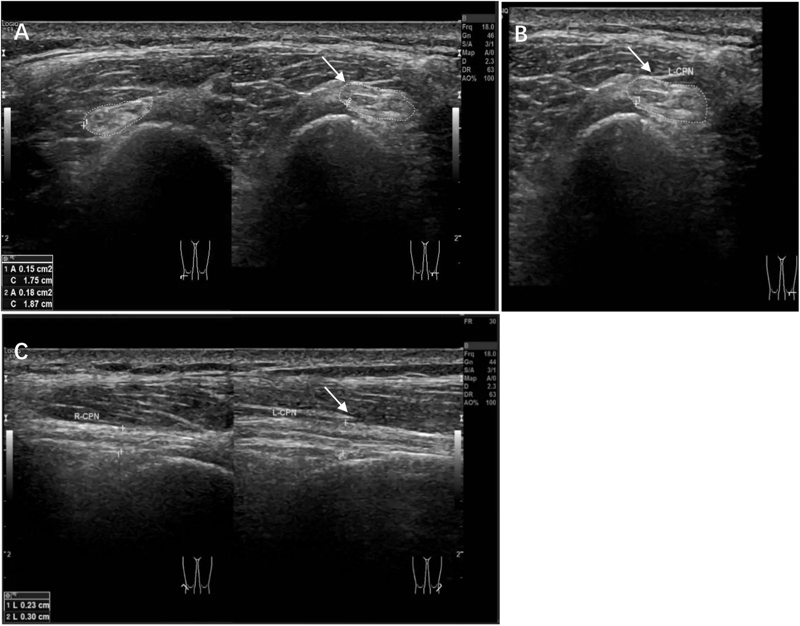
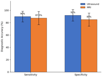

# 3842 — Chèn ép thần kinh mác chung tại cổ xương mác: "bàn chân rũ" không đau lưng thì đừng đi tìm rễ L5

**Tags:** `pattern:ban-chan-ru` `pattern:day-than-kinh` `pattern:chen-ep-than-kinh` `pattern:mot-ben` `vung:chi-duoi` `vung:khop-goi` `anatomy:than-kinh-mac` `protocol:sieu-am-than-kinh` `protocol:MRI-than-kinh`
**Mức chắc chắn (certainty):** tổng hợp y văn (literature synthesis) — ghép **ca nguyên văn 16 tuổi chèn ép thần kinh mác chung trong đợt tăng trưởng nhanh** (*Front Pediatr* 2026, PMCID **PMC13690938**, CC BY 4.0) và **bài tổng quan định khu "bàn chân rũ" theo giải phẫu – điện cơ – hình ảnh** (*J Spine Res Surg* 2026, PMCID **PMC13591402**, CC BY 4.0).

> **Câu chốt:** **bàn chân rũ một bên, không đau lưng, không yếu cơ đùi** → nghĩ **thần kinh mác chung tại cổ xương mác**, và câu hỏi hình ảnh chỉ có hai: **(1) thần kinh có dày khu trú ở cổ xương mác không? (2) có cấu trúc chèn ép (nang, u sụn xương, dây xơ) không?** Ba con số định khung: **siêu âm độ phân giải cao nhạy 90% / đặc hiệu 92%, nhỉnh hơn MRI 87,5% / 85%** ở 40 ca nghi ngờ (PMC13591402); **thần kinh mác chung trong ca dày 0,18 cm² so với 0,15 cm² bên đối diện** và **đường kính trước–sau 3,0 mm so với 2,3 mm** (PMC13690938); **dây xơ 3 × 1 mm** được giải ép, **sức cơ hồi phục sau 14 ngày**.

## 1. Tổng quan bệnh học – cơ chế hình ảnh (TẠI SAO)

### 1.1. Giải phẫu: vì sao cổ xương mác là điểm yếu nhất của chi dưới

- Thần kinh mác chung tách từ **thần kinh tọa**, chạy chếch ra ngoài, **bọc quanh cổ xương mác** rồi vào **ống mác (peroneal tunnel)** — ống **xơ–xương** có **thành sau là cổ xương mác**, **thành trước là mạc sâu + vòm xơ của nguyên ủy cơ mác dài**; trong ống hoặc ngay dưới ống, thần kinh chia **nhánh nông** và **nhánh sâu**.
- **TẠI SAO dễ chèn ép:** thần kinh **nằm nông, áp sát xương, ít mô mỡ đệm, biên độ di động nhỏ**; mọi lực ép ngoài (gối vắt chéo, ngồi xổm lâu, bó bột, nẹp) hoặc căng (gấp gối, tăng chiều dài chi) đều dồn vào **cùng một điểm hẹp**.
- **TẠI SAO yếu cơ mà không teo ngay:** chèn ép trước hết gây **mất myelin khu trú (neurapraxia)** — dẫn truyền chậm/block nhưng sợi trục còn; chỉ khi kéo dài mới **thoái hóa sợi trục (axonopathy)** → teo cơ, mất điện thế vận động. Đây là lý do **điện cơ giúp định thời gian**, còn **siêu âm/MRI định vị trí**.

### 1.2. TẠI SAO trên ảnh lại thấy đúng chỗ dày

- Chỗ chèn ép → **ứ trệ dòng chảy sợi trục (axonal transport)** → **phù nội sợi và quanh sợi** → **thần kinh to ra khu trú, giảm âm, mất mẫu bó (loss of fascicular pattern)** trên siêu âm; trên MRI là **T2/STIR tăng tín hiệu, dày thần kinh**, và **phù cơ do mất thần kinh (denervation edema)** ở **cơ trước xương chày** — dấu hiệu **gián tiếp nhưng rất sớm**.
- **TẠI SAO đo diện tích cắt ngang (CSA) chứ không chỉ "to hay không to":** thần kinh người gầy, chỗ chia nhánh, hoặc tư thế đầu dò đều làm ảnh hưởng cảm nhận; **CSA tại điểm to nhất + so bên đối diện cùng tư thế** là cách duy nhất khách quan. Ca PMC13690938: **0,18 cm² so với 0,15 cm²** (**+20%**), **trục dài 0,30 cm so với 0,23 cm**.
- **TẠI SAO có dây xơ mà siêu âm lần đầu "bình thường":** lần đầu đầu dò đặt vào **mô mềm quanh khớp gối**, không chạy dọc **đường đi thần kinh** → bỏ sót. Quy tắc: **khảo sát thần kinh phải đi theo thần kinh, từ khoeo xuống cổ xương mác và vào ống**.

### 1.3. Ngưỡng định lượng nằm lòng

| Đại lượng | Số liệu | Nguồn |
|---|---|---|
| Siêu âm phân giải cao (n = 40 ca nghi ngờ) | **nhạy 90%, đặc hiệu 92%** | PMC13591402 |
| MRI thường (cùng 40 ca) | **nhạy 87,5%, đặc hiệu 85%** | PMC13591402 |
| CSA thần kinh mác chung trong ca bệnh | **0,18 cm²** (bên đối diện **0,15 cm²**) | PMC13690938 |
| Đường kính trước–sau | **3,0 mm** (đối diện **2,3 mm**) | PMC13690938 |
| Trục dài đoạn dày | **0,30 cm** (đối diện **0,23 cm**) | PMC13690938 |
| Dây xơ chèn ép (mổ) | **3 × 1 mm**, bắc qua bao ngoài thần kinh | PMC13690938 |
| Dẫn truyền vận động mác chung | **4,13 ms** (đối diện 3,23 ms; bình thường **≤ 4,5 ms**) | PMC13690938 |
| Biên độ CMAP | **6,2 mV** (đối diện 6,7 mV; bình thường **> 5,0 mV**) | PMC13690938 |
| Tốc độ dẫn truyền vận động | **48,9 m/s** (đối diện 48,3; bình thường **> 45 m/s**) | PMC13690938 |
| SNAP thần kinh mác nông | **11,1 µV** (đối diện **21,8 µV**) | PMC13690938 |
| Thần kinh tọa: nhánh mác nặng hơn nhánh chày | **64%** (n = 100) | PMC13591402 |
| Trong bệnh thần kinh tọa | **EMG cơ trước xương chày bất thường 92%**, **CMAP cơ duỗi ngắn ngón chân giảm/mất 80%** | PMC13591402 |
| Hồi phục sau giải ép (ca) | cải thiện **ngày 14**, tiếp tục **tháng thứ 3** | PMC13690938 |
| Tăng trưởng trước khởi phát (ca) | **+6 cm** chiều cao và **+1 cỡ giày** trong **6 tháng** | PMC13690938 |

- **Chưa rõ — cần tra:** chưa có **ngưỡng CSA tuyệt đối (cm²)** được thẩm định đa trung tâm cho thần kinh mác chung ở trẻ; ca này dùng **so sánh bên đối diện**, không dùng một con số tuyệt đối.

## 2. Mẫu hình + chẩn đoán phân biệt theo vị trí (Gamut)

- **Rễ L5:** yếu **dorsiflexion + duỗi ngón cái**, nhưng **yếu cả đảo bàn chân** (cơ chày sau, thần kinh chày) và **yếu dạng đùi** (cơ mông nhỡ, thần kinh mông trên); **đau lưng, nghiệm pháp căng rễ**; **SNAP bình thường** vì tổn thương **trước hạch**.
- **Đám rối thắt lưng–cùng:** nhiều rễ, nhiều dây → mẫu hình **không khớp một dây**; bệnh cảnh **chậu/ sau phúc mạc, xạ trị, máu tụ**.
- **Thần kinh tọa (ưu thế nhánh mác):** **64%** ca thần kinh tọa có nhánh mác nặng hơn; phân biệt bằng **cơ nhị đầu đùi đầu ngắn** (do **nhánh mác của dây tọa chi phối, trên khớp gối**) — cơ này **bất thường = tổn thương ở trên cổ xương mác**.
- **Thần kinh mác chung tại cổ xương mác:** yếu **gấp mu bàn chân + duỗi ngón + đảo ngoài** (cơ mác), **giữ nguyên gấp lòng và đảo trong**; **Tinel ở cổ xương mác**; cảm giác **mặt trước ngoài cẳng chân và mu bàn chân** (trừ kẽ ngón 1 do dây mác sâu).
- **Dây mác sâu / dây mác nông (tổn thương xa hơn):** chỉ yếu **duỗi ngón/duỗi cổ chân** (sâu) hoặc chỉ **đảo ngoài + cảm giác mu chân** (nông) — không có dày thần kinh ở cổ xương mác.
- **Không do thần kinh:** **đứt gân cơ trước xương chày** (không mất cảm giác, có khuyết gân), **hội chứng khoang cẳng chân** (đau nhiều, căng), **bệnh cơ**, **tổn thương tháp (đột quỵ)** — nhớ **dấu hiệu tháp** để không bỏ.
- Gợi nhớ **FOOT DROP**: **F**ibular neck, **O**steochondroma/ganglion, **O**vergrowth (tăng trưởng nhanh), **T**rauma/bó bột, **D**iabetes, **R**adiculopathy L5, **O**besity/weight loss, **P**rolonged squatting/crossing.

## 3. Bảng so sánh phân biệt (ma trận đối chiếu)

| Thực thể (entity) | Hình ảnh điển hình | Chốt vào (rule-in) | Chốt loại (rule-out) | Gợi ý xác nhận |
|---|---|---|---|---|
| Chèn ép thần kinh mác chung tại cổ xương mác | **Dày khu trú, giảm âm, mất mẫu bó** tại cổ xương mác; **CSA tăng so bên lành**; MRI **T2 tăng tín hiệu thần kinh + phù cơ trước xương chày** | **Tinel tại cổ xương mác + yếu gấp mu giữ nguyên đảo trong + CSA tăng** | **Cơ nhị đầu đùi đầu ngắn bất thường** → tổn thương trên cổ xương mác | Siêu âm dọc đường đi; EMG; MRI thần kinh |
| Rễ L5 | Không dày thần kinh ngoại biên; thoát vị/ hẹp lỗ liên hợp trên MRI cột sống | **Yếu đảo trong + dạng đùi + đau lưng**; **SNAP bình thường** | **SNAP giảm** → tổn thương ngoại biên (sau hạch) | MRI thắt lưng + EMG kim cơ chày sau/mông nhỡ |
| Bệnh thần kinh tọa ưu thế nhánh mác | Tổn thương tọa trên MRI chậu; **cơ nhị đầu đầu ngắn mất thần kinh** | **Yếu cơ nhị đầu đầu ngắn + yếu nhánh chày kèm** | **Cơ nhị đầu đầu ngắn bình thường** → loại tọa | MRI chậu; EMG 3 tầng |
| Đám rối thắt lưng–cùng | Khối/máu tụ/xạ trị vùng chậu; nhiều dây cùng bất thường | **Mẫu hình nhiều rễ, nhiều dây** | Mẫu hình **một dây** → loại đám rối | MRI chậu + EMG nhiều cơ |
| Nang hạch / u sụn xương cổ xương mác | **Khối dạng nang cạnh khớp mác–chày trên** hoặc **u sụn xương có vỏ xương liên tục tủy** | **Thấy cấu trúc chèn ép + thần kinh bị đẩy** | Không thấy khối, thần kinh dày lan toả → nghĩ bệnh thần kinh di truyền | Siêu âm + MRI; X-quang cho u sụn xương |
| Bệnh thần kinh do chèn ép di truyền (HNPP) | **Dày thần kinh ở nhiều điểm chèn ép** (cổ tay, khuỷu, cổ xương mác), thường hai bên | **Tái phát nhiều đợt + tiền sử gia đình** | Chỉ một điểm, một bên, có dây xơ khu trú → loại HNPP | Khám toàn bộ dây thần kinh + di truyền |

## 4. Protocol chụp + hệ phân độ

### 4.1. Siêu âm thần kinh (bước đầu tiên, rẻ và nhạy nhất)

- Đầu dò **linear 12–18 MHz** (ca dùng **18 MHz**); bệnh nhân **nằm ngửa, gối hơi gấp**, quét **mặt ngoài khoeo → cổ xương mác → ống mác**, **mặt cắt ngang và dọc**.
- Đo **CSA tại điểm to nhất** và **so bên đối diện cùng tư thế**; ghi **đường kính trước–sau**, **mẫu bó**, **độ hồi âm**, và **tìm cấu trúc chèn ép** (nang, u sụn xương, dây xơ, cơ bất thường).
- Đánh giá **động**: gấp/duỗi gối xem thần kinh có bị **căng/kẹp** thêm (hữu ích khi siêu âm lúc nghỉ bình thường).

### 4.2. MRI và điện cơ

- **MRI:** T1W (giải phẫu), **T2 fat-sat/STIR** (thần kinh, phù cơ), **DWI** tuỳ chọn, **sau tiêm** khi nghi u/nang; trường chụp **từ khoeo tới đầu trên xương mác**, đủ thấy **cơ trước xương chày** cho dấu **phù do mất thần kinh**.
- **Điện cơ:** dẫn truyền vận động **qua cổ xương mác** (tìm **chậm dẫn truyền khu trú/block**), **SNAP thần kinh mác nông + sural** (phân biệt rễ/ngoại biên), **EMG kim**: **cơ trước xương chày**, **cơ mác dài**, **cơ duỗi ngắn ngón chân**, **cơ nhị đầu đùi đầu ngắn**, **cơ chày sau**, **cơ mông nhỡ**.

### 4.3. Ngưỡng và quyết định điều trị

- **Bảo tồn** trước: bỏ yếu tố ép (không vắt chéo chân, nẹp ban đêm giữ bàn chân trung tính, đệm gối), vật lý trị liệu.
- **Mổ giải ép** khi: **yếu nặng (MRC ≤ 3)**, **thất bại bảo tồn**, **có cấu trúc chèn ép**, **dày thần kinh khu trú rõ kèm mất thần kinh trên EMG**. Ca PMC13690938 mổ sau **~1 tháng** bảo tồn thất bại với **MRC 1**.
- **Chưa rõ — cần tra:** không có **thời gian bảo tồn tối thiểu** được thẩm định bằng thử nghiệm ngẫu nhiên cho chèn ép mác chung; các ca công bố chọn mổ theo **mức yếu + cấu trúc chèn ép**.

## 5. Biến thể bình thường và cạm bẫy

- **"Bàn chân rũ = đột quỵ" (bẫy thỏa mãn tìm kiếm):** yếu **gấp mu đơn thuần** ở người trẻ, không liệt nửa người, không dấu tháp → **không phải tổn thương tháp**; nhưng vẫn phải khám **dấu tháp** để loại.
- **Siêu âm "bình thường" vì quét sai đường:** ca PMC13690938 có **siêu âm lần đầu không bất thường** vì đầu dò đặt vào **mô mềm quanh gối**, không chạy dọc thần kinh. Không kết luận bình thường nếu chưa thấy **thần kinh liên tục từ khoeo tới ống mác**.
- **Dày thần kinh hai bên = không phải chèn ép đơn thuần:** nghĩ **HNPP** hoặc bệnh thần kinh di truyền — khám **cổ tay, khuỷu, cổ xương mác hai bên**.
- **Không thấy dày nhưng vẫn có bệnh:** thể **thuần thoái hóa sợi trục** có thể CSA gần bình thường → **điện cơ quyết định**, không loại bệnh chỉ vì ảnh đẹp.
- **Cơ nhị đầu đùi đầu ngắn:** nếu bất thường trên EMG → tổn thương **trên cổ xương mác** (thần kinh tọa), **không mổ cổ xương mác**.
- **Bỏ sót u sụn xương:** luôn chụp **X-quang/CT xương** khi siêu âm thấy **bờ xương không đều** dưới thần kinh; u sụn xương cổ xương mác là nguyên nhân mổ được, dễ bỏ.

## 6. Tự lượng giá — Blind Quiz

**Ca 1 — Nam 16 tuổi, yếu gấp mu bàn chân trái 2 tuần, không đau lưng, không chấn thương; cao thêm 6 cm trong 6 tháng. Ảnh siêu âm bên dưới.**

- Gợi ý: MRC gấp mu = 1; Tinel dương ở cổ xương mác; cảm giác giảm mặt trước ngoài cẳng chân và mu chân.
- Câu hỏi: dấu hiệu chính? Đo gì để chứng minh? Ba phân biệt và dấu hiệu loại trừ?

<b>Bấm để hiện đáp án (findings + chẩn đoán)</b>

- Dấu hiệu: thần kinh mác chung trái **to khu trú, giảm âm, mất mẫu bó** tại cổ xương mác; **CSA 0,18 cm² so với 0,15 cm²** bên phải, **trước–sau 3,0 mm so với 2,3 mm**, trục dài **0,30 cm so với 0,23 cm**.
- Điện cơ: **SNAP mác nông 11,1 µV so với 21,8 µV**, **CMAP 6,2 mV**, có **sợi rung ở cơ trước xương chày** → tổn thương **sợi trục nhẹ, còn bù**.
- Chẩn đoán: **chèn ép thần kinh mác chung tại cổ xương mác** (mổ thấy **dây xơ 3 × 1 mm**) — **loại L5** vì **không yếu đảo trong, không đau lưng**; **loại tọa** vì **cơ nhị đầu đầu ngắn bình thường**.
- Nguồn ảnh: *Front Pediatr* 2026 (PMC13690938), CC BY 4.0.

**Ca 2 — Cùng bệnh nhân, câu hỏi chọn phương thức: siêu âm hay MRI?**

- Câu hỏi: đọc hai cặp cột; khi nào vẫn cần MRI dù siêu âm nhỉnh hơn?

<b>Bấm để hiện đáp án</b>

- Siêu âm: **nhạy 90%, đặc hiệu 92%**; MRI: **nhạy 87,5%, đặc hiệu 85%** (n = 40, khoảng tin cậy rộng).
- Vẫn cần MRI khi: nghi **tổn thương gần hơn (tọa/đám rối)**, cần **trường nhìn rộng**, tìm **u/nang sâu**, hoặc đánh giá **phù cơ do mất thần kinh** và **teo mỡ** mạn.
- Nguồn ảnh: *J Spine Res Surg* 2026 (PMC13591402), CC BY 4.0.

> Không dùng để chẩn đoán độc lập khi chưa có người hướng dẫn.

## Bài liên quan chéo
- [3841 – Chèn ép thần kinh tọa mạn sau chấn thương/mổ](../3841-chen-ep-than-kinh-toa-man-sau-chan-thuong/lesson.md)
- [228 – Thoát vị đĩa đệm thắt lưng: phân loại Pfirrmann/Modic](../228-thoat-vi-dia-dem-that-lung-pfirrmann-modic/lesson.md)

## Ảnh
- `3842_than-kinh-mac_SieuAm_PMC13690938-fig2.webp` — siêu âm thần kinh mác chung (A–C), PMC13690938, CC BY 4.0.
- `3842_than-kinh-mac_BieuDo_PMC13591402-fig2.gif` — biểu đồ độ chính xác siêu âm vs MRI, PMC13591402, CC BY 4.0.
