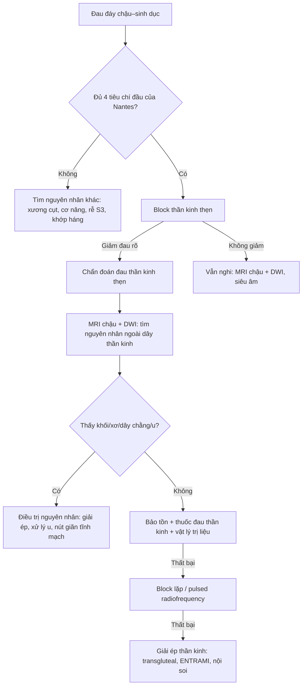
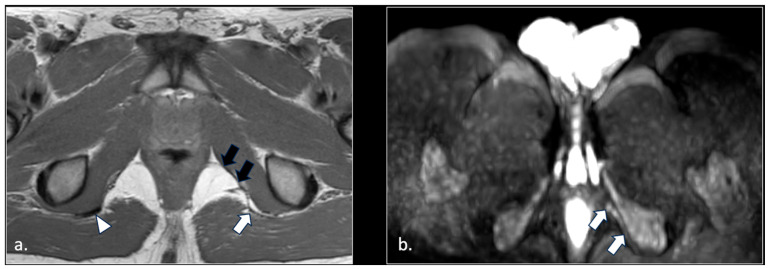
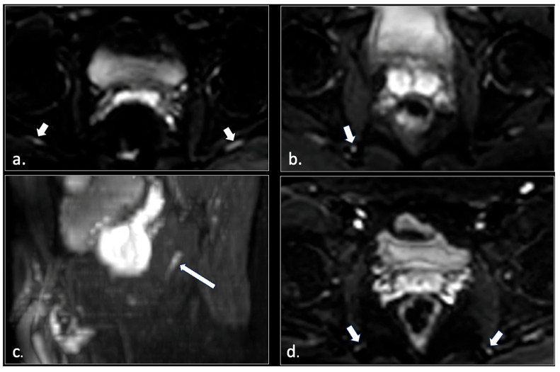
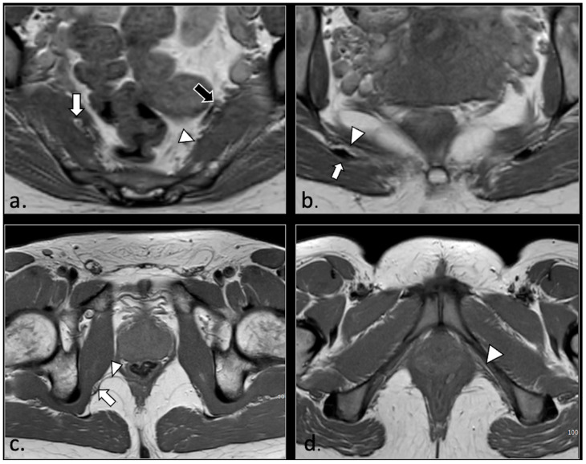

# 3843 — Đau thần kinh thẹn & chèn ép trong ống Alcock / Pudendal neuralgia and Alcock canal entrapment

**Tags:** `pattern:day-than-kinh` `pattern:chen-ep-than-kinh` `pattern:dau-day-chau` `vung:than-kinh-ngoai-bien` `vung:khung-chau` `anatomy:than-kinh-then` `protocol:MRI-chau` `protocol:sieu-am-than-kinh` `score:Nantes`

**Mức chắc chắn (certainty):** tổng hợp y văn (literature synthesis) — số liệu từ **một đoàn hệ MRI 81 ca** có protocol DWI chuyên biệt (Diagnostics 2026, PMCID **PMC12840153**, CC BY 4.0), **một tổng quan hệ thống 35 bài** về chẩn đoán – điều trị (Pain Ther 2026, PMCID **PMC12804544**), **một nghiên cứu can thiệp sớm 81 ca** (PMC11944006), cùng các nghiên cứu chẩn đoán hình ảnh được tổng quan đó trích dẫn (siêu âm Doppler 83 ca/166 dây, MRN 139 dây, MRI 580 ca). Không có ca do nhóm tự chụp.

> **Câu chốt:** đau đáy chậu – sinh dục **tăng khi ngồi, không đánh thức ban đêm, không mất cảm giác khách quan** là **đau thần kinh thẹn (pudendal neuralgia)**, chẩn đoán **lâm sàng theo tiêu chuẩn Nantes**. Ba con số quyết định: **(1)** hình ảnh **không phải cửa ải chẩn đoán** — trong **81 ca** đủ tiêu chuẩn lâm sàng, chỉ **42/81 (51,9%)** có bất thường dây thần kinh trên DWI, **39/81 (48,1%) MRI hoàn toàn bình thường** (PMC12840153); **(2)** khi có bất thường, **23/42 (54,8%)** kèm **nguyên nhân ngoài dây thần kinh** (dây chằng, cơ, xơ hóa ống Alcock, u, giãn tĩnh mạch) — chính là phần **mổ được**; **(3)** thời gian từ khởi phát tới điều trị là yếu tố dự báo mạnh nhất: can thiệp **< 13 tháng** giảm VAS **5,4 so với 3,4 điểm** và giảm tỷ lệ tiêm lại **10% so với 35%** (PMC11944006).

## 1. Tổng quan bệnh học – cơ chế hình ảnh (TẠI SAO)

### 1.1 Đường đi bốn đoạn — bốn ổ chèn ép

- Thần kinh thẹn là dây **hỗn hợp cảm giác – vận động – tự chủ**, tạo từ **rễ trước S2–S4**. Trong chậu, dây chạy **mặt trước cơ lê (piriformis)**, ra khỏi chậu qua **lỗ ngồi lớn**, bắt chéo **dây chằng cùng–gai (sacrospinous ligament)**, vòng qua **gai ngồi (ischial spine)**, vào lại chậu qua **lỗ ngồi nhỏ**, rồi đi trong **ống Alcock (pudendal canal)** — ống do **mạc bịt trong** tạo thành, chứa **dây thần kinh + động–tĩnh mạch thẹn trong**.
- Cuối ống, dây chia **ba nhánh**: **thần kinh trực tràng dưới**, **thần kinh đáy chậu**, **thần kinh lưng dương vật/âm vật**.
- Vì vậy có **4 ổ chèn ép** (phân loại theo giải phẫu, dùng trong tổng quan PMC12804544): **(1)** dưới cơ lê; **(2)** trong **khoảng liên dây chằng** cùng–gai/cùng–ủng; **(3)** trong **ống Alcock**; **(4)** **nhánh tận** (dương vật/âm vật).
- **TẠI SAO đau tăng khi ngồi:** cả ba ổ chính đều chịu **lực nén trực tiếp của trọng lượng cơ thể** khi ngồi (củ ngồi – dây chằng cùng–ủng – thành bên ống Alcock). Đây là lý do tiêu chuẩn Nantes đặt **"đau khi ngồi"** làm tiêu chí thiết yếu, và cũng là lý do **khối chèn ép ở ống Alcock** (xơ hóa, giãn tĩnh mạch) lại gây đau **một bên, tiến triển trong ngày**.

### 1.2 TẠI SAO DWI thấy dây thần kinh còn STIR/T2 fat-sat hay bị nhiễu

- **Dây thần kinh bình thường giàu mỡ myelin và ít nước tự do**, sợi trục xếp song song nên **khuếch tán nước dị hướng (anisotropic)**. Trên **DWI b600**, dây thần kinh bình thường **gần như không thấy** (tín hiệu thấp), trừ **rễ thắt lưng–cùng và dây thần kinh tọa** vốn **tăng tín hiệu sinh lý** khi ra khỏi lỗ liên hợp.
- Khi bị chèn ép → **ứ trệ vận chuyển sợi trục, phù nội sợi (endoneurial edema)** → **nước ngoại bào tăng** → **tăng tín hiệu trên DWI b600** và **dày dây thần kinh**. Đây là cơ sở của tiêu chuẩn hình ảnh do nhóm Messina đề xuất: dây thần kinh thẹn được coi là **bất thường khi tăng tín hiệu ngang với dây thần kinh tọa cùng bên trên 2 lát b600 liên tiếp hoặc 3 lát không liên tiếp** (PMC12840153).
- **TẠI SAO không dùng T2 fat-sat/STIR làm chuẩn:** máu chảy trong **động–tĩnh mạch thẹn trong** (đi cùng dây trong ống Alcock) cũng **tăng tín hiệu**, tạo **"dây thần kinh giả"**; DWI là chuỗi **"máu đen" (black-blood)** nên tách được dây thần kinh khỏi mạch. Nhóm tác giả ghi rõ đây là lý do họ chọn DWI thay vì MRN T2 cổ điển.
- **Giới hạn vật lý:** độ phân giải **3 mm** cho T1/T2 và **4 mm** cho DWI đủ thấy đoạn **gần** (tới ống Alcock), nhưng **nhánh tận rất khó thấy**, kể cả khi đã đánh dấu bằng chỉ mổ.

### 1.3 Ngưỡng định lượng nằm lòng

| Đại lượng | Số liệu | Nguồn |
|---|---|---|
| Tần suất trong dân số | **1/100.000** (Quỹ Pudendal Neuropathy); ước tính **tới 1%**; **nữ gấp > 2 lần nam** | PMC12840153 |
| Bất thường dây thần kinh trên DWI (đoàn hệ 81 ca) | **42/81 = 51,9%**; một bên **33/42**, hai bên **9/42** | PMC12840153 |
| MRI hoàn toàn bình thường dù đủ tiêu chuẩn lâm sàng | **39/81 = 48,1%** | PMC12840153 |
| Có nguyên nhân ngoài dây thần kinh | **23/42 = 54,8%** (dây chằng 5, cơ lê 4, rách cơ mu–cụt 4, xơ hóa ống Alcock 4, u/Tarlov/giãn tĩnh mạch phần còn lại) | PMC12840153 |
| Siêu âm Doppler màu (83 ca) | nhạy **90%**, đặc hiệu **67%** cho chèn ép mạch–thần kinh | PMC12804544 |
| MR neurography 3T (139 dây) | nhạy **65%** (90/139) | PMC12804544 |
| MRI (580 ca đau chậu mạn) | **78%** (454/580) có bất thường gợi ý | PMC12804544 |
| Block thần kinh thẹn (76 ca, đường trực tràng) | **62%** đáp ứng dương (đủ tiêu chí Nantes thứ 5) | PMC12804544 |
| Block thần kinh thẹn — hiệu quả giảm đau | **68–94%** trong các nghiên cứu | PMC12804544 |
| Ngưỡng thời gian can thiệp sớm (ROC) | **13 tháng** (nhạy 78%, đặc hiệu 72%) | PMC11944006 |
| Can thiệp sớm so với muộn | VAS giảm **5,4 so với 3,4 điểm**; chất lượng sống **+18 so với +8 điểm**; tiêm lại **10% so với 35%** | PMC11944006 |
| Tỷ lệ phải mổ sau thất bại bảo tồn/block | **8–15%** | PMC12804544 |
| Mổ giải ép (thử nghiệm ngẫu nhiên 32 ca) | nhóm mổ tốt hơn nhóm thuốc tại **12 tháng**, p = 0,0025; **9/16** ca nhóm chứng xin mổ | PMC12804544 |

- **Chưa rõ — cần tra:** chưa có **ngưỡng diện tích cắt ngang (CSA) tuyệt đối** của dây thần kinh thẹn được thẩm định đa trung tâm; tài liệu hiện tại dùng **so sánh bên đối diện** và **tăng tín hiệu DWI**, không dùng một con số mm² cố định.

## 2. Mẫu hình + chẩn đoán phân biệt theo vị trí (Gamut)

- **Đau đáy chậu một bên, tăng khi ngồi, giảm khi đứng/nằm** → nghĩ ngay **thần kinh thẹn**; đau **không đánh thức ban đêm** và **không mất cảm giác khách quan** giúp loại đau do tổn thương thực thể nặng.
- **Theo ổ chèn ép (gamut định vị):**
  - **Trong chậu (gần):** rễ **S2–S4** bị chèn (thoát vị, u, **nang Tarlov**), **đám rối cùng**, cơ lê phì đại.
  - **Khoảng liên dây chằng:** dày/xơ **dây chằng cùng–gai hoặc cùng–ủng**, can xương sau chấn thương khung chậu.
  - **Ống Alcock:** **xơ hóa đáy chậu** (sau sinh, sau mổ, sau xạ), **giãn tĩnh mạch thẹn**, **u bao dây thần kinh (schwannoma)**.
  - **Nhánh tận:** đau **dương vật/âm vật** đơn thuần, sau chấn thương hoặc phẫu thuật vùng chậu.
- **Gamut theo bệnh cảnh (không phải thần kinh thẹn):** đau **xương cụt** (bài 304), **hội chứng cơ nâng hậu môn**, **đau rễ S3**, **bệnh khớp háng – chèn ép ụ ngồi–cơ đùi (ischiofemoral impingement)**, **viêm tuyến tiền liệt/viêm âm đạo**, **đau sau mổ sa sinh dục**.
- Gợi nhớ **NANTES** cho 5 tiêu chí thiết yếu: **N**eurological distribution (S2–S4), **A**ggravated by sitting, **N**o night awakening, **T**ouch/sensation intact, **E**fficacy of nerve block.

## 3. Bảng so sánh phân biệt (ma trận đối chiếu)

| Thực thể (entity) | Hình ảnh điển hình | Chốt vào (rule-in) | Chốt loại (rule-out) | Gợi ý xác nhận |
|---|---|---|---|---|
| **Đau thần kinh thẹn do chèn ép** | DWI b600: dây thần kinh **tăng tín hiệu, dày** ở gai ngồi/ống Alcock; T1/T2 thấy **dày–xơ dây chằng cùng–gai/cùng–ủng**, **xơ hóa thành ống Alcock** | **Đau tăng khi ngồi + không thức ban đêm + block dương**; **tăng tín hiệu trên ≥ 2 lát b600 liên tiếp** | **MRI bình thường không loại trừ** (48,1% ca) — chẩn đoán vẫn dựa lâm sàng | MRI chậu có DWI + block thần kinh thẹn |
| **Hội chứng cơ lê (piriformis)** | **Cơ lê phì đại/mất đối xứng**, đám rối **thắt lưng–cùng** bị đẩy; có thể kèm đau mông – đùi sau (bài 3841) | **Đau mông sâu + đau lan mặt sau đùi**, đau khi duỗi/khép háng kháng lực | Đau **khu trú đáy chậu**, không đau mông → loại | MRI chậu + nghiệm pháp FAIR |
| **Nang Tarlov (nang quanh rễ cùng)** | Nang **dịch ở ống sống cùng** S2–S4, có thể **tăng tín hiệu T1 do máu cũ** | **Nang lớn đúng rễ S2–S4 + đau điển hình**; giảm đau sau giải ép nang (ca PMC12840153) | Nang nhỏ, không tương ứng rễ → **có thể là phát hiện tình cờ**, không quy nhân | MRI cùng–cụt T1/T2 + myelography |
| **U bao dây thần kinh thẹn (schwannoma)** | **Khối dạng nang/đặc dọc đường đi**, **ngấm thuốc**, có thể nhiều u (ca 2 schwannoma) | **Thấy khối liên tục với dây thần kinh + ngấm thuốc** | Không thấy khối, chỉ dày lan tỏa → loại | MRI sau tiêm + mô bệnh |
| **Giãn tĩnh mạch thẹn trong ống Alcock** | **STIR MIP: giãn tĩnh mạch toàn vùng chậu dưới**, bó mạch lớn cạnh dây thần kinh | **Giãn tĩnh mạch cùng bên đau + tăng tín hiệu dây trên DWI** | Không giãn tĩnh mạch, dây bình thường → loại | MRI chậu có STIR MIP; siêu âm Doppler |
| **Rách/xơ cơ mu–cụt (pubococcygeus) & xơ cạnh âm đạo** | **Mất liên tục cơ mu–cụt**, cơ còn lại mỏng, **âm đạo lệch bên**; xơ cạnh âm đạo trên T2 | **Mất cơ + lệch trục âm đạo + đau một bên** | Cơ nguyên vẹn, đối xứng → loại | MRI sàn chậu động (khi có) |
| **Đau xương cụt / sau cắt xương cụt** | Xương cụt bình thường hoặc di chứng mổ; **không bất thường dây thần kinh** | **Đau khu trú xương cụt, tăng khi ngồi nghiêng**; block thẹn âm | **Đau lan tới dương vật/âm vật + block dương** → loại | X-quang/CT cùng–cụt; so với bài 304 |

## 4. Protocol chụp + hệ phân độ/điểm

### 4.1 Protocol MRI chậu–sàn chậu (1,5T hoặc 3T)

- **T2 FSE axial/coronal/sagittal không bão hòa mỡ**: TR 4.000 ms, TE hiệu dụng 100 ms, **lát 3 mm**, SENSE 1,5.
- **T2 FSE axial có bão hòa mỡ (SPIR)**: TR 4.500 ms, TE 100 ms, **lát 3 mm** — tìm **xơ hóa, phù**, nhưng nhớ **nhiễu do mạch máu**.
- **T1 FSE axial**: TR 450–550 ms, TE 10–15 ms, **lát 3 mm** — giải phẫu, mỡ, máu cũ.
- **Myelography SSTSE coronal/sagittal** — phát hiện **nang Tarlov**.
- **DWI EPI toàn đường đi dây thần kinh (từ xương cùng tới đáy chậu)**: **b = 0/100/600**, TR 4.100 ms, TE 85 ms, ma trận 125 × 100, EPI factor 41, SENSE 2,5, **lát 4 mm**. Đọc trên **ảnh MIP b600** và **ảnh axial nguồn**.
- **Sau tiêm gadolinium + trừ ảnh** khi nghi **u, viêm, xơ hóa sau mổ** (ca PMC12840153 Hình 4: xơ hóa + ngấm thuốc dọc dây sau mổ giải ép hai bên).

### 4.2 Siêu âm (bổ trợ, định hướng block)

- Đầu dò **linear tần số cao** hoặc **đầu dò endocavitary** cho đoạn trong ống Alcock; khảo sát **ngang và dọc** toàn đường đi, **so bên đối diện cùng tư thế**.
- Ghi **CSA, độ hồi âm, mẫu bó**, và **tìm cấu trúc chèn ép** (dây chằng dày, xơ, mạch máu giãn).
- **Siêu âm Doppler màu**: nhạy **90%**, đặc hiệu **67%** (83 ca) — **đặc hiệu thấp** nên dương tính không đủ chẩn đoán.

### 4.3 Tiêu chuẩn Nantes (chẩn đoán lâm sàng) và bậc thang điều trị

**5 tiêu chí thiết yếu** (phải đủ): (1) đau **đúng vùng chi phối** thần kinh thẹn (từ hậu môn tới dương vật/âm vật); (2) đau **chủ yếu khi ngồi**; (3) **không đánh thức ban đêm**; (4) **không mất cảm giác khách quan**; (5) **giảm đau sau block thần kinh thẹn**.

**4 tiêu chí loại trừ:** đau **chỉ khu trú** xương cụt/mông/xương mu/hạ vị; **ngứa**; đau **chỉ từng cơn kịch phát**; có **bất thường hình ảnh giải thích được đau**.

**Tiêu chí bổ trợ:** dị cảm nóng rát, đau khi đại tiện, cảm giác dị vật trực tràng/âm đạo, đau tăng dần trong ngày, đau một bên, **điểm đau chói ở gai ngồi (Valleix)**, đau khi giao hợp.

- **Bậc thang điều trị (theo PMC12804544):** bảo tồn (tránh ngồi lâu, đệm, thuốc đau thần kinh) → **block thần kinh** (vừa chẩn đoán vừa điều trị; hiệu quả **68–94%**) → **pulsed radiofrequency/điện kích** (giảm đau tới **95%** ca khó trị nhưng **độ bền chưa rõ**) → **mổ giải ép** cho **8–15%** thất bại.
- **Thời điểm:** can thiệp trong **13 tháng** đầu cho kết quả tốt hơn rõ rệt (mỗi tháng chậm thêm làm VAS cuối tăng **0,18 điểm**, p < 0,001).

## 5. Biến thể bình thường và cạm bẫy

- **Dây thần kinh tọa tăng tín hiệu sinh lý trên DWI** — đừng lấy đó làm chuẩn bệnh lý; **dây thần kinh thẹn bình thường thì KHÔNG thấy** trên b600. Đây là điểm dễ đọc ngược.
- **Nhiễu mạch máu trên T2 fat-sat/STIR** (động–tĩnh mạch thẹn trong đi cùng trong ống Alcock) tạo **dây thần kinh giả** → luôn đối chiếu **DWI** và **ảnh nguồn axial**.
- **Nang Tarlov tình cờ:** phần lớn nang nhỏ **không gây đau**; một nghiên cứu gần đây đặt lại vai trò của nang Tarlov trong đau thần kinh thẹn (PMC12840153 dẫn lại). Chỉ quy nhân khi **nang đúng rễ S2–S4 cùng bên đau** và **giảm đau sau giải ép**.
- **MRI âm tính không loại trừ bệnh** (48,1%): nguyên nhân có thể là **bệnh thần kinh cảm giác mắc phải/di truyền** (kể cả Charcot–Marie–Tooth) dưới ngưỡng phân giải của MRI.
- **Bẫy "satisfaction of search":** thấy **giãn tĩnh mạch** hoặc **dày dây chằng** rồi dừng lại, bỏ qua **u bao dây thần kinh** hoặc **rách cơ mu–cụt** ở bên đối diện.
- **Sau mổ giải ép vẫn đau:** hình ảnh **xơ hóa + ngấm thuốc dọc dây** (Hình 4) là **di chứng/bệnh tái phát**, không phải "MRI bình thường sau mổ"; đừng hứa hết đau sau mổ lần hai.
- **Hai bên:** bất thường hai bên (**9/42** ca) gợi ý nguyên nhân **toàn thân/cơ học** (tư thế ngồi, đạp xe, chấn thương lặp lại) hơn là một ổ chèn ép đơn lẻ.

## 6. Tự lượng giá — Blind Quiz

**Ca 1 — Nam 33 tuổi, đau đáy chậu – bìu trái 3 năm, đạp xe nghiệp dư 10 năm. Đau tăng khi ngồi, không thức ban đêm; ấn dọc dây thần kinh thẹn tái hiện đau.**

- Gợi ý: block thần kinh thẹn trái chỉ giảm đau **1 tuần**.
- Câu hỏi: dấu hiệu trên T1 và DWI? Ba chẩn đoán phân biệt? Vì sao block chỉ giảm ngắn?

<b>Bấm để hiện đáp án (findings + chẩn đoán)</b>

- Dấu hiệu: T1 **(a)** — **dây chằng cùng–ủng trái mỏng** (mũi tên trắng), dây chằng phải bình thường (đầu mũi tên); **thành trong ống Alcock trái dày** (hai mũi tên đen). DWI b600 **(b)** — **dây thần kinh thẹn trái trong ống Alcock tăng tín hiệu**.
- Chẩn đoán: **đau thần kinh thẹn do vi chấn thương lặp lại khi đạp xe** — dây chằng mỏng đi + xơ hóa thành ống, dây thần kinh bị ép trong ống chật. Block chỉ giảm **1 tuần** vì nguyên nhân **cơ học còn nguyên**.
- Phân biệt: **u bao dây thần kinh** (không thấy khối ngấm thuốc), **nang Tarlov** (không có nang), **đau xương cụt** (không đau khu trú xương cụt, block dương).
- Nguồn ảnh: *Diagnostics* 2026 (PMC12840153), Hình 9, CC BY 4.0.

**Ca 2 — Nữ 43 tuổi, đau đáy chậu trái sau chấn thương; MRI chậu có DWI. Bốn panel dưới đây là các mức tín hiệu khác nhau trên b600.**

- Câu hỏi: panel nào là **bình thường**? Tiêu chí nào biến "tăng tín hiệu" thành **bệnh lý**? Cạm bẫy mạch máu?

<b>Bấm để hiện đáp án</b>

- Panel **(a)** không thấy bất thường dây thần kinh thẹn; **dây thần kinh tọa vẫn tăng tín hiệu sinh lý** (mũi tên).
- Panel **(b)** và **(d)**: **tăng tín hiệu dây thần kinh thẹn phải** ở mức gai ngồi; **(c)** tái tạo sagittal cho thấy tín hiệu tăng dọc đoạn ống Alcock.
- Tiêu chí: tăng tín hiệu **ngang với dây thần kinh tọa cùng bên** trên **2 lát b600 liên tiếp** hoặc **3 lát không liên tiếp**; đọc kèm **ảnh axial nguồn**, không chỉ MIP.
- Cạm bẫy: trên **T2 fat-sat/STIR** mạch máu cũng sáng → dùng **DWI "máu đen"** để tách; dây thần kinh thẹn bình thường **không thấy** trên b600.
- Nguồn ảnh: *Diagnostics* 2026 (PMC12840153), Hình 10, CC BY 4.0.

**Ca 3 — Ôn giải phẫu: bốn mức cắt T1 của đường đi dây thần kinh thẹn.**

- Câu hỏi: ở mức nào dây thần kinh nằm **giữa hai dây chằng**? Mức nào dễ bị bỏ sót nhất khi quét?

<b>Bấm để hiện đáp án</b>

- **(a)** ngang cơ lê: đám rối thắt lưng–cùng và **đám rối thẹn** mặt trước cơ lê; biến thể **rễ S2 xuyên cơ lê** là yếu tố thuận lợi chèn ép.
- **(b)** ngoài chậu: dây thần kinh đi **giữa dây chằng cùng–ủng (sau) và cơ cụt/dây chằng cùng–gai (trước)** — đây là **khoảng liên dây chằng**, ổ chèn ép số 2.
- **(c)** ống Alcock gần: bó mạch–thần kinh sát **cơ bịt trong**; **(d)** ống Alcock xa — **khó thấy nhất**, nơi nhánh tận tách ra.
- Bỏ sót thường do **không quét đủ thấp tới ống Alcock xa** và **không dùng DWI**.
- Nguồn ảnh: *Diagnostics* 2026 (PMC12840153), Hình 1, CC BY 4.0.

> Không dùng để chẩn đoán độc lập khi chưa có người hướng dẫn.

## Bài liên quan chéo
- [3841 – Chèn ép thần kinh tọa mạn sau chấn thương/mổ](../3841-chen-ep-than-kinh-toa-man-sau-chan-thuong/lesson.md)
- [3842 – Chèn ép thần kinh mác chung tại cổ xương mác](../3842-chen-ep-than-kinh-mac-dau-xuong-mac/lesson.md)
- [304 – Đau đáy chậu sau cắt xương cụt](../304-dau-dai-dang-sau-cat-xuong-cut/lesson.md)

## Ảnh
- `3843_dau-than-kinh-then_MRI_PMC12840153-fig1.jpg` — T1 bốn mức giải phẫu, PMC12840153, CC BY 4.0.
- `3843_dau-than-kinh-then_MRI_PMC12840153-fig9.jpg` — ca đạp xe: dây chằng mỏng + DWI dương, PMC12840153, CC BY 4.0.
- `3843_dau-than-kinh-then_MRI_PMC12840153-fig10.jpg` — DWI bình thường so với bất thường, PMC12840153, CC BY 4.0.
