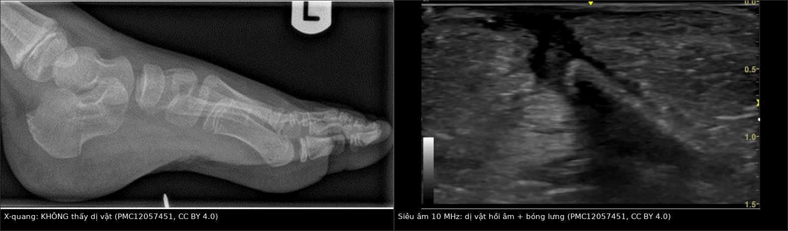
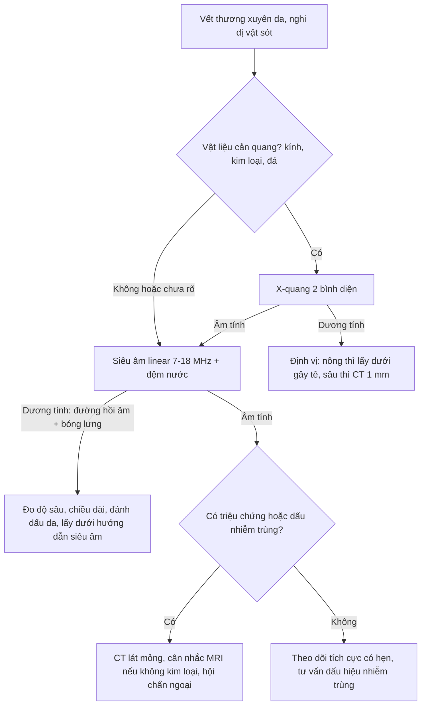
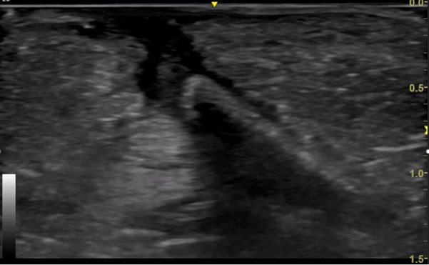
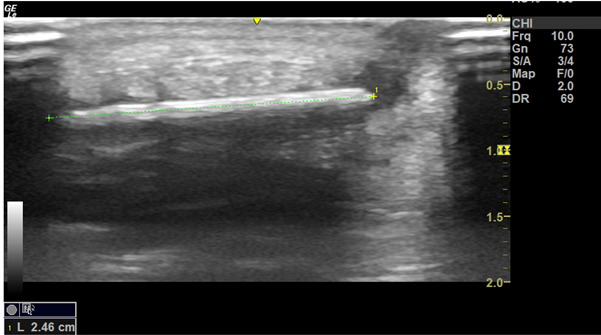
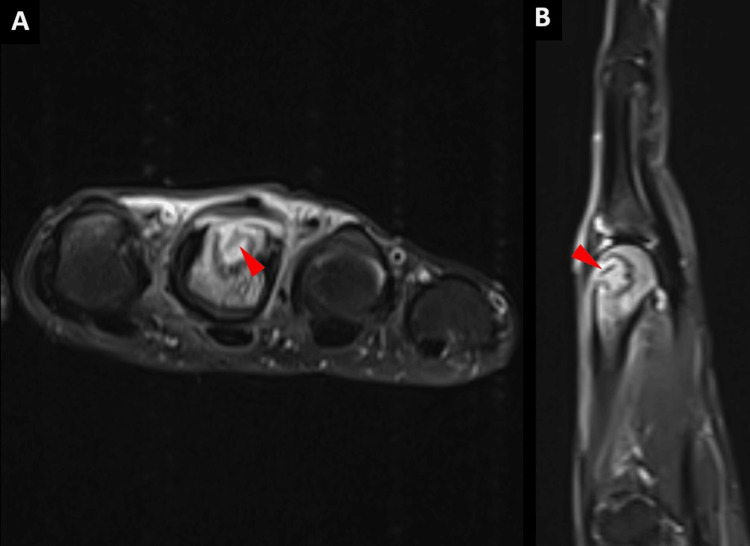

# 3844 — Dị vật sót trong mô mềm chi (gỗ, gai, kính, nhựa) / Retained soft-tissue foreign body of the limb

**Tags:** `pattern:di-vat` `pattern:duong-hong-sieu-am` `vung:mo-mem` `vung:chi-duoi` `protocol:sieu-am-mo-mem`

**Mức chắc chắn (certainty):** tổng hợp y văn (literature synthesis) — biên từ **nghiên cứu 51 ca dị vật cản quang kém có X-quang âm tính** (*Indian J Radiol Imaging* 2014, **PMC4094976**), **tổng quan POCUS 2025** (*POCUS J*, **PMC12057451**, CC BY 4.0), **cẩm nang kỹ thuật siêu âm dị vật** (*J Clin Ultrasound* 2020, **PMC7754500**) và **các ca có ảnh minh họa** (**PMC13728522**, **PMC13354026**, **PMC13470597** — đều CC BY). Nhóm **không có bệnh nhân của mình**.

> **Câu chốt:** **X-quang âm tính KHÔNG loại trừ dị vật.** Gỗ, gai, nhựa, vỏ cây có **số nguyên tử hiệu dụng gần mô mềm** nên gần như **không tạo tương phản tia X** — một nghiên cứu kinh điển cho thấy **86% dị vật gỗ có X-quang âm tính** dù lấy ra được. **Siêu âm tần số cao (7–18 MHz) là đầu tay** cho vật cản quang kém: dị vật hiện là **đường hồi âm dày (hyperechoic) kèm bóng lưng (posterior shadowing)**, xung quanh là **quầng giảm âm do viêm hạt/mủ**. Kính, kim loại, sỏi thì **cản quang** — X-quang/CT hợp lý hơn. Bẫy chết người: **vật hồi âm mạnh bị đọc là "khí trong mô"**, và **siêu âm âm tính vẫn không phải bằng chứng loại trừ**.

## 1. Tổng quan bệnh học – cơ chế hình ảnh (TẠI SAO)

### 1.1 Vì sao gỗ "vô hình" trên X-quang — vật lý, không phải "máy kém"

- **Tương phản tia X phụ thuộc số nguyên tử hiệu dụng (Z_eff) và mật độ điện tử.** Mô mềm có **Z_eff ≈ 7,4** (C, H, O, N). **Cellulose của gỗ (C₆H₁₀O₅)** có **Z_eff ≈ 6,7–7,4** — **gần như trùng mô mềm**, hiệu số suy giảm **< 5%** → nằm **dưới ngưỡng tương phản** của detector phim/CR, **không thấy được**.
- **Thủy tinh** chứa **Si, Na, Ca (và chì ở thủy tinh pha lê)** → **cản quang rõ**; **kim loại** **cản quang rất mạnh**. Vì vậy **"dị vật" không phải một bệnh cảnh hình ảnh duy nhất** — phải hỏi **vật liệu gì** trước khi chọn modality.
- **Nước và thời gian làm gỗ "đổi tính":** gỗ khô có **đậm độ rất thấp, gần mức khí**; khi **ngấm dịch** thì **đậm độ tăng dần theo thời gian** — cùng một mảnh gỗ có thể **giống khí ở ngày đầu** và **giống mô mềm về sau**. Vì vậy trên CT, **gỗ là cấu trúc đậm độ thấp dễ bị đọc là "bọt khí trong áp-xe"**, và phải **hạ cửa sổ xuống mức phổi (−270 đến −300 HU)** mới thấy rõ (**PMC12332695**; *BMJ Case Rep* 2024, **PMC10859975**). *Ngưỡng HU chính xác theo thời gian chưa có trong nguồn đã đọc — ghi "chưa rõ", cần tra thêm.*

### 1.2 Vì sao siêu âm thấy được — trở kháng âm học, không phải "vật sáng"

- **Trở kháng âm (acoustic impedance, Z = ρ·c):** mô mềm **~1,5 MRayl**, gỗ **cao hơn mô mềm**, không khí **~0,0004 MRayl**. Chênh trở kháng **gỗ–mô mềm** đủ lớn để **phản xạ mạnh** → **hồi âm mạnh**; kim loại phản xạ **gần như toàn phần** → **hồi âm cực mạnh + chuỗi đuôi sao (comet tail)**.
- **Bóng lưng (posterior acoustic shadowing):** gỗ/kim loại **hấp thụ và phản xạ gần hết** năng lượng → vùng sau dị vật **tối đen**. **Dị vật mềm, mủn (gỗ mục, lá)** có thể **không tạo bóng rõ** → **âm tính giả**.
- **Viền giảm âm quanh dị vật** = **viêm hạt (granulation tissue) và mủ** — dấu **gián tiếp** rất giá trị, xuất hiện sau **vài ngày đến vài tuần**; phù mô mềm xung quanh tạo hình **"cobblestoning"** (**PMC13728522**, Hình 2).
- **Tần số quyết định độ phân giải:** đầu dò **linear 7–18 MHz** phát hiện được dị vật **0,5 mm đến > 10 mm** ở độ sâu vài cm; **dị vật sâu > 3–4 cm** cần đầu dò **5–12 MHz** hoặc **đệm nước (standoff/water bath)** (**PMC7754500**).

### 1.3 Vì sao dị vật bị bỏ sót — 3 cơ chế lâm sàng

1. **Vết thương nhỏ, tự lành:** vết chích **2–3 mm** đóng lại trong vài ngày; bệnh nhân **quên** hoặc không biết mình giẫm phải.
2. **X-quang được coi là "đã loại trừ":** với gỗ/gai/nhựa, **X-quang âm tính là quy luật**, không phải ngoại lệ (**PMC12057451**).
3. **Diễn tiến âm thầm:** dị vật tồn tại **nhiều tháng đến nhiều năm**, biểu hiện bằng **sưng mạn, nốt dưới da, rò dịch tái phát, viêm gân bao hoạt dịch, viêm xương tủy** → bị chẩn đoán là **"viêm mô tế bào mạn", "u mô mềm", "viêm gân vô căn"**. Có ca **giữ dị vật gỗ trong bàn chân 30 năm**, ca **mảnh gỗ trong khớp gối gây tràn dịch tái phát**.

### 1.4 Số phải nhớ

- **X-quang với dị vật gỗ:** **âm tính 86%** (nghiên cứu 1982, dẫn trong **PMC12057451**).
- **Siêu âm:** nghiên cứu **51 ca** dị vật **cản quang kém** + X-quang âm tính, đầu dò **12 MHz**: **độ nhạy 97,9%**, **độ chính xác 90,2%**, **giá trị tiên đoán dương 92%**; **4 dương tính giả**, **1 âm tính giả** (**PMC4094976**).
- **Tổng quan 17 nghiên cứu (2015):** **độ nhạy gộp 72% (57–83%)**, **độ đặc hiệu 92% (88–95%)** — thấp hơn nghiên cứu đơn lẻ, phản ánh **phụ thuộc người làm và tần số đầu dò** (**PMC12057451**).
- **Nghiên cứu trên tử thi:** phát hiện **58/65** dị vật → **độ nhạy 89%**, **độ đặc hiệu 93%** (**PMC12057451**).
- **Lợi ích của siêu âm trong mổ:** nhóm được **định vị bằng siêu âm** dùng **1,33 ± 0,34 phim X-quang** so với **4,65 ± 1,81** ở nhóm mổ "mò" (p = 0,021) — **giảm cả thời gian mổ và liều tia** (**PMC12057451**).
- **Kích thước thực tế trong các ca:** mảnh tăm **1,8 cm** ở gan bàn chân (**PMC13728522**); mảnh gỗ **2,46 cm** đo trên siêu âm (**PMC12057451**); mảnh gỗ **1,7 × 0,3 cm** cạnh gân chày sau ở cổ chân (**PMC13470597**); dị vật **6 mm trong xương bàn tay** (**PMC13354026**).

## 2. Mẫu hình + chẩn đoán phân biệt theo vật liệu và vị trí (Gamut)

- **A — Vật cản quang kém, nông (da – dưới da, bàn chân, bàn tay):** gỗ, gai, tre, vỏ hạt, nhựa, thủy tinh mờ → **siêu âm đầu tay**; X-quang **có thể âm tính và không có giá trị loại trừ**.
- **B — Vật cản quang mạnh (kính dày, kim, đinh, mảnh đạn, sỏi):** **X-quang 2 bình diện** đủ để định vị nông; **CT** khi sâu/trong khớp/gần mạch–thần kinh, hoặc khi cần **3D** để mổ.
- **C — Dị vật trong khớp / trong xương:** đau–tràn dịch tái phát (**khớp gối, khớp bàn ngón**), **khuyết xương + phản ứng màng xương**; **MRI** thấy **cấu trúc đường tín hiệu thấp trong ổ dịch T2 sáng**; **CT** thấy **khuyết vỏ xương** (**PMC13354026**).
- **D — Dị vật + nhiễm trùng:** **áp-xe quanh dị vật** (ổ dịch có vỏ), **viêm mô hoại tử**, **viêm gân bao hoạt dịch**, **viêm tủy xương** — dị vật là **"hạt nhân" không thể chữa khỏi bằng kháng sinh đơn thuần**.
- **E — "Khối u mô mềm" không rõ nguồn:** u hạt dị vật (foreign-body granuloma) **giả u**, **nốt cứng, ngấm thuốc**, dễ sinh thiết nhầm — **luôn hỏi tiền sử chấn thương xuyên qua da**.

## 3. Bảng so sánh phân biệt (ma trận đối chiếu)

| Thực thể (entity) | Hình ảnh điển hình | Chốt vào (rule-in) | Chốt loại (rule-out) | Gợi ý xác nhận |
|---|---|---|---|---|
| **Gỗ / gai / tre** | X-quang **âm tính**; US: **đường hồi âm dày + bóng lưng**, có thể **quầng giảm âm**; CT: **đậm độ thấp, giống khí** | **Cấu trúc đường thẳng hồi âm + bóng lưng ở đúng vị trí đau, có tiền sử chấn thương** | Bóng lưng **không có cấu trúc hồi âm** bên trên → chỉ là khí/mô xơ | US 7–18 MHz, 2 mặt phẳng, đệm nước; **không dựa X-quang để loại trừ** |
| **Kính** | **Cản quang** trên X-quang/CT; US: hồi âm mạnh, **bóng lưng sắc**, đôi khi **đuôi sao** | **Điểm cản quang hình que/đa giác** khớp vị trí vết thương | Không thấy cản quang + không thấy hồi âm → **vẫn chưa loại trừ** (mảnh < 2 mm, thủy tinh không chì) | X-quang 2 bình diện; CT lát mỏng |
| **Kim loại (kim, đinh, mảnh đạn)** | Cản quang rất mạnh + **artifact** trên CT/MRI; US: **hồi âm cực mạnh + comet tail** | **Cản quang + đuôi sao trên US** | Không có đuôi sao → vật phi kim | X-quang; **tránh MRI nếu nghi kim loại ferromagnetic** |
| **Nhựa / thủy tinh hữu cơ** | X-quang **âm tính**; US: **hồi âm dày, bóng lưng yếu hoặc không có** | **Cấu trúc hồi âm + phù mô mềm khu trú** | Không thấy gì trên US **không loại trừ** | US + đối chiếu lâm sàng, **theo dõi có hẹn** |
| **Áp-xe không có dị vật** | Ổ dịch có vỏ, phù mô mềm, **không có cấu trúc đường** | **Không có cấu trúc hồi âm/cản quang bên trong** sau khi hút mủ | Có **mảnh đường hồi âm/cản quang** trong ổ → dị vật | US, CT; **hút mủ + soi dịch** |
| **U hạt dị vật (giả u)** | Nốt **giảm âm/hỗn hợp**, ngấm thuốc, **có thể có viền**; MRI **tín hiệu thấp trung tâm** | **Tiền sử chấn thương xuyên da + cấu trúc trung tâm tín hiệu thấp** | Không có cấu trúc trung tâm + bờ đều, không tiền sử → nghĩ u thật | MRI + **hỏi kỹ tiền sử**, tránh sinh thiết mù |

*Trái: X-quang bàn chân — không thấy dị vật. Phải: siêu âm 10 MHz cùng bệnh nhân — đường hồi âm dày kèm bóng lưng sâu. Nguồn: POCUS J 2025 (PMC12057451), CC BY 4.0. Ảnh ghép letterbox.*

## 4. Protocol chụp + quy tắc quyết định

- **Bước 1 — X-quang 2 bình diện** khi **vật liệu có thể cản quang** (kính, kim loại, đá, xương) hoặc chưa rõ vật liệu. **X-quang âm tính → đi tiếp bước 2**, không dừng lại.
- **Bước 2 — Siêu âm tần số cao (đầu dò linear 7–18 MHz):**
  - quét **dọc và ngang** trục vết thương, **so sánh với bên đối diện**;
  - **đệm nước/standoff** cho tổn thương rất nông (**< 5 mm**) và các vùng lồi (gót, ngón);
  - **đánh dấu trên da** vị trí và **đo độ sâu** (mm) + **chiều dài** dị vật;
  - **Doppler** để tránh nhầm mạch máu/mảnh xơ; **đè đầu dò** xem cấu trúc có di động, có đổi hình (khí thì đổi, dị vật thì không).
- **Bước 3 — CT** khi: dị vật **sâu > 3–4 cm**, **trong khớp/xương**, **gần mạch máu–thần kinh**, hoặc cần **bản đồ 3D trước mổ**; lát **≤ 1 mm**, **cửa sổ xương + mô mềm**, **dựng MPR**.
- **Bước 4 — MRI** (thận trọng): chỉ khi **không nghi kim loại ferromagnetic**; có giá trị cho **dị vật trong khớp, trong xương, tổn thương mạn** — dị vật là **cấu trúc tín hiệu thấp** trên nền **dịch T2 tăng tín hiệu** (**PMC13354026**).
- **Quy tắc "định vị trước, mổ sau" (localization-first):** với bệnh nhân **ổn định**, ưu tiên **X-quang nếu vật cản quang**, **siêu âm nếu vật cản quang kém/không rõ độ sâu**; **siêu âm âm tính không phải loại trừ dứt khoát**; nếu chưa định vị được thì **theo dõi tích cực có hẹn** thay vì **mổ dò** làm rộng vết thương (**PMC13526354**).
- **Chỉ định lấy dị vật:** đau kéo dài, nhiễm trùng/áp-xe, dị vật **trong khớp, trong xương, gần mạch–thần kinh**, dị vật **di động**, hoặc **yêu cầu của bệnh nhân** sau khi giải thích. **Rooks 2020** lưu ý: mảnh gỗ/kính **sâu, không triệu chứng** có thể **không cần lấy ngay** — cân nhắc giữa **nguy cơ mổ** và **nguy cơ nhiễm trùng** (**PMC7754500**).

## 5. Biến thể bình thường và cạm bẫy

- **"Khí" trong mô mềm:** bóng lưng **không có cấu trúc hồi âm bên trên**, **đổi hình khi đè đầu dò**, lan toả theo mô → khí; dị vật thì **cố định, có hình dạng**. Nhưng **gỗ khô có đậm độ gần khí trên CT** → **đừng gọi là "khí trong áp-xe"** nếu có **đường thẳng**.
- **Bẫy "cắt xiên" (oblique cross-cut artifact):** quét **chéo trục** dị vật làm nó **ngắn lại, mất đầu**, hoặc **giả thành nhiều mảnh** → luôn **xoay đầu dò 90°** tìm **trục dài nhất** (**PMC7754500**).
- **Bẫy "trung bình thể tích" (volume averaging):** đầu dò **không song song** mặt phẳng dị vật → hình **mờ, giảm hồi âm**; dị vật **nằm cạnh gân/xương** có thể **bị che bóng** bởi chính các cấu trúc đó.
- **Bóng lưng do xương/sụn/khí trong ruột** có thể **giả dị vật**; ngược lại **vôi hóa, mảnh xương nhỏ, sẹo xơ** có thể **giả hồi âm mạnh**.
- **Dị vật bị đọc là "u":** u hạt dị vật **ngấm thuốc, bờ không đều**; MRI thấy **trung tâm tín hiệu thấp**; **sinh thiết mù** có thể **bỏ sót** hoặc **làm vỡ áp-xe**.
- **Kính không phải lúc nào cũng thấy:** mảnh **< 2 mm**, thủy tinh **không chì**, nằm **sau xương** → **X-quang âm tính**; trong nghiên cứu 51 ca, **3 ca dị vật kính** lại thuộc nhóm **X-quang âm tính** (**PMC4094976**) — bằng chứng trực tiếp rằng **không được loại trừ bằng X-quang**.
- **Satisfaction of search:** thấy một mảnh là dừng — **vết thương do kính/vỡ có thể để lại nhiều mảnh**; luôn **quét toàn bộ đường đi của vật** và **đếm mảnh**.

## 6. Tự lượng giá — Blind Quiz

**Ca 1 — Nam 32 tuổi, giẫm mảnh gỗ ở gan bàn chân 3 tuần trước, nay đau khi đi, sờ thấy điểm đau khu trú. X-quang âm tính.**

- Câu hỏi: mô tả cấu trúc bất thường? Vì sao X-quang âm tính? Hai dấu hiệu siêu âm giúp chốt? Bước tiếp theo?

<b>Bấm để hiện đáp án</b>

- **Findings:** **đường hồi âm dày (hyperechoic), thẳng**, nằm ở mô dưới da – mô mỡ **~0,5–1 cm**, phía sau là **bóng lưng tối đen**; mô xung quanh **giảm âm nhẹ** (viêm).
- **Vì sao X-quang âm tính:** cellulose có **Z_eff ≈ mô mềm** → không tạo tương phản tia X; **86%** dị vật gỗ có X-quang âm tính.
- **Chốt:** **cấu trúc hồi âm + bóng lưng** ở đúng điểm đau, **có tiền sử chấn thương** — chẩn đoán **dị vật gỗ sót**.
- **Tiếp theo:** **đo chiều dài (2,46 cm) và độ sâu**, đánh dấu da, **lấy dưới hướng dẫn siêu âm** bằng đường rạch nhỏ; kiểm tra **không còn mảnh thứ hai**; dự phòng uốn ván.
- **Nguồn ảnh:** *POCUS J* 2025, Hình 4, **PMC12057451**, CC BY 4.0.

**Ca 2 — Nữ 41 tuổi, sưng–đau mặt trong cổ chân 2 tháng, không nhớ chấn thương; X-quang bình thường.**

- Câu hỏi: ảnh đo gì? Nếu siêu âm âm tính thì có loại trừ dị vật không? Ba chẩn đoán phân biệt khi siêu âm chỉ thấy **phù mô mềm**?

<b>Bấm để hiện đáp án</b>

- **Ảnh đo chiều dài** dị vật trên siêu âm: **2,46 cm** — con số này quyết định **đường rạch và dụng cụ**, không chỉ để "xác nhận có dị vật".
- **Siêu âm âm tính KHÔNG loại trừ:** độ nhạy gộp chỉ **72% (57–83%)**; dị vật **rất nông, rất nhỏ, sau xương, hoặc gỗ mủn không tạo bóng** → **theo dõi có hẹn**, chụp lại khi có triệu chứng; **không mổ dò**.
- **Ba phân biệt khi chỉ có phù mô mềm:** **viêm gân bao hoạt dịch mạn**, **u hạt dị vật không thấy được**, **bệnh lý thần kinh chèn ép** (ví dụ hội chứng ống cổ chân) — và **dị vật bị bỏ sót** luôn nằm trong danh sách.
- **Nguồn ảnh:** *POCUS J* 2025, Hình 5, **PMC12057451**, CC BY 4.0.

**Ca 3 — Nam 31 tuổi, đau bàn tay sau chấn thương 24 giờ, X-quang chỉ có "khuyết vỏ xương mờ"; MRI được chỉ định.**

- Câu hỏi: mô tả tín hiệu bất thường? Vì sao MRI thấy rõ hơn X-quang? Khi nào **không** được chụp MRI?

<b>Bấm để hiện đáp án</b>

- **Findings:** ổ **tăng tín hiệu trên chuỗi ức chế mỡ (PD fat-sat)** trong đầu xương bàn ngón 3, chứa **cấu trúc đường tín hiệu THẤP** (mũi tên đỏ); X-quang trước đó chỉ thấy **khuyết vỏ xương mờ** (**PMC13354026**, Hình 3).
- **Vì sao MRI thấy:** dị vật gỗ **nghèo proton** → **tín hiệu thấp trên mọi chuỗi**; nó nằm trong **ổ dịch viêm T2 sáng** → **tương phản âm–dương** rất cao, trong khi X-quang không có tương phản.
- **Chống chỉ định/ thận trọng:** **nghi kim loại ferromagnetic** (mảnh đạn, mảnh bom, kim loại không rõ nguồn) — nguy cơ **di lệch và đốt nóng**; **artifact từ kim loại** làm mất chi tiết; luôn **hỏi tiền sử + chụp X-quang sàng lọc** trước MRI.
- **Bài học:** dị vật **trong xương/khớp** là chỉ định **MRI/CT**, không phải siêu âm đơn thuần.
- **Nguồn ảnh:** *Cureus* 2026, Hình 5, **PMC13354026**, CC BY 4.0.

## Bài liên quan chéo
- [1936 – Tụ máu bao cơ thẳng bụng](../1936-tu-mau-bao-co-thang-bung/lesson.md) (khối mô mềm cấp tính, cùng nguyên lý "khối = máu/dịch/khí")
- [370 – Nhiễm trùng MSK: viêm tủy, Brodie, Charcot](../370-nhiem-trung-msk/lesson.md) (dị vật là "hạt nhân" của viêm tủy/áp-xe)
- [449 – Chấn thương mắt & dị vật nội nhãn](../449-chan-thuong-mat-dich-vat/lesson.md) (cùng nguyên lý chọn modality theo vật liệu; CT 1 mm)
- [1986 – Viêm mô hoại tử ở trẻ](../1986-viem-mo-hoai-tu-o-tre/lesson.md) (nhiễm mô mềm nhanh, cần tìm cửa vào)
- [3841 – Chèn ép thần kinh tọa mạn sau chấn thương](../3841-chen-ep-than-kinh-toa-man-sau-chan-thuong/lesson.md) (đau chi mạn sau chấn thương — nhớ dị vật)

## Ảnh
- Tên file: `3844_di-vat-sot-mo-mem-chi_{XQ,US,MRI}-*.jpg`; nguồn + giấy phép từng ảnh trong `images/CREDITS.md`.

> Không dùng để chẩn đoán độc lập khi chưa có người hướng dẫn.
