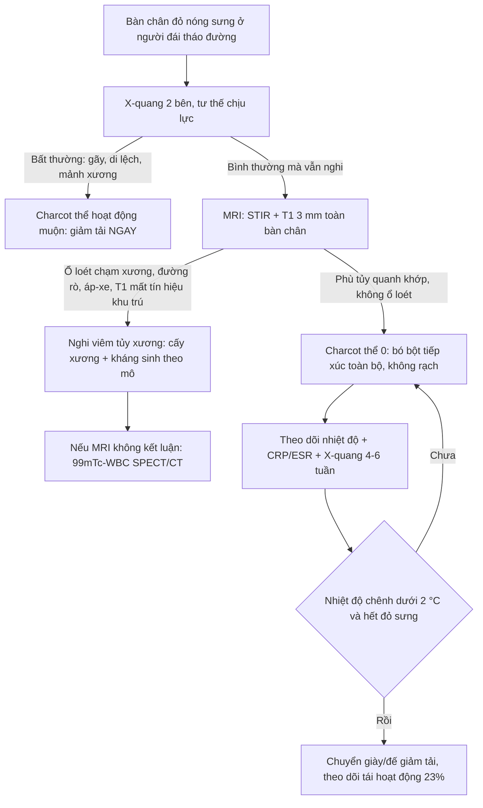
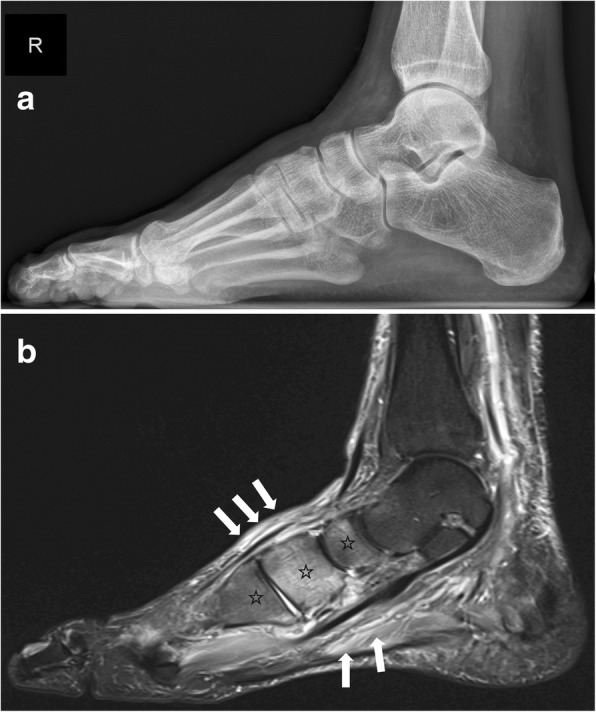
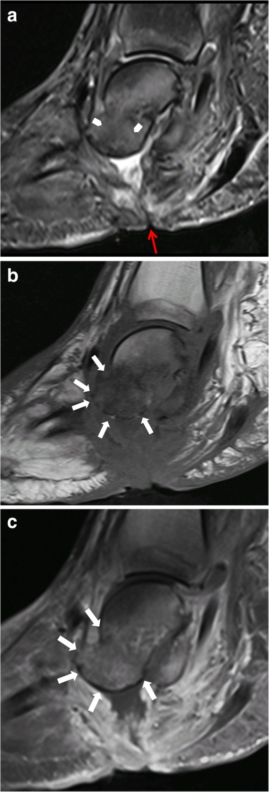
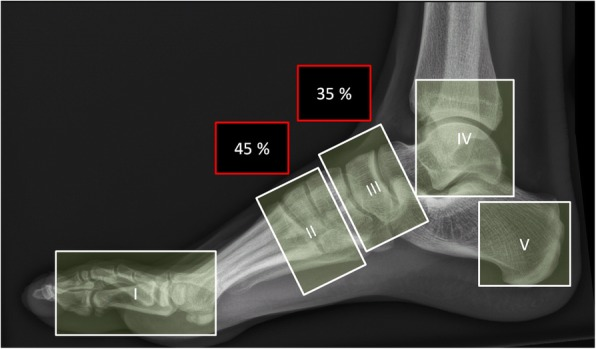

# 3845 — Bàn chân Charcot cấp / Acute Charcot neuro-osteoarthropathy (CNO)

**Tags:** `pattern:phu-tuy-xuong` `pattern:phu-mo-mem` `pattern:gay-xuong` `pattern:bien-dang-ban-chan` `pattern:hoai-tu-xuong` `vung:ban-chan` `vung:co-xuong` `vung:khop` `score:Eichenholtz` `score:Sanders-Frykberg` `score:MSKI-RADS` `protocol:MRI-ban-chan` `protocol:Xquang-ban-chan` `protocol:CT-ban-chan` `incidentaloma:khong`

**Mức chắc chắn (certainty):** tổng hợp y văn (literature synthesis) — dựa trên **bài tổng quan có hình ảnh (pictorial review) 21 hình** (*Insights into Imaging* 2019, **PMC6682845**, CC BY 4.0) và **bài tổng quan cập nhật 2026** về bàn chân Charcot (*J Clin Med* 2026, **PMC12986205**, CC BY 4.0); số liệu theo dõi MRI lấy từ **đoàn hệ 143 đợt Charcot** (*J Foot Ankle Res* 2025, **PMC12182253**, CC BY 4.0). Nhóm **không có bệnh nhân của mình**; **không ghi tên tác giả** — attribution dùng tạp chí + năm + PMCID.

> **Câu chốt:** Bàn chân Charcot cấp là **bàn chân nóng, đỏ, sưng ở người đái tháo đường có biến chứng thần kinh ngoại biên**, và đây là bệnh **chẩn đoán bằng lâm sàng + MRI, không bằng X-quang**. Ba con số phải thuộc: **(1)** X-quang **được báo "bình thường" ở 79% số xương có phù tủy** trên MRI (PMC12986205) — nên **X-quang âm không loại trừ**; **(2)** **chẩn đoán muộn ≥ 8 tuần làm tăng 5 lần nguy cơ kết cục xấu**, và trung vị trễ chẩn đoán thực tế **~87 ngày** (PMC12986205); **(3)** **MRI là chọn lựa đầu tay khi X-quang bình thường**, với **STIR 3 mm toàn bàn chân + T1 3 mm** — phù tủy xương, phù mô mềm, gãy dưới sụn là dấu hiệu của **thể hoạt động**, còn **nang dưới sụn, phá khớp, tăng sinh xương** là dấu hiệu **thể mạn** (PMC6682845). Điều trị gốc là **giảm tải (off-loading) ngay**, không phải kháng sinh.

## 1. Tổng quan bệnh học – cơ chế hình ảnh

### 1.1 Cơ chế: vì sao một bàn chân "mất cảm giác" lại tự phá hủy

- **Hai học thuyết bổ sung nhau:** (a) **thần kinh – mạch máu (neurovascular)**: mất trương lực giao cảm → **giãn mạch, tăng lưu lượng** → xương bị **tiêu xương do sung huyết**; (b) **thần kinh – chấn thương (neurotraumatic)**: mất cảm giác đau → **vi chấn thương lặp lại khi đi lại** mà bệnh nhân không biết. Hai cơ chế cộng lại thành **viêm vô khuẩn mạn tính của xương và khớp**: cytokines (IL-6, TNF-α, RANKL) hoạt hóa hủy cốt bào mạnh hơn tạo cốt bào.
- **Vì sao đỏ – nóng – sưng:** chính là **viêm** (tăng tưới máu + phù). Vì vậy **bàn chân Charcot cấp bắt chước viêm mô tế bào và huyết khối tĩnh mạch sâu** — và điều trị thì **ngược hẳn**: Charcot cần **giảm tải và bất động**, không rạch, không kê kháng sinh dài.
- **Vì sao tổn thương ưu thế ở khớp Lisfranc:** đó là **điểm chịu lực chuyển tiếp giữa bàn chân trước và giữa**, biên độ vận động nhỏ nhưng tải lớn — nơi ứng suất tập trung khi mất cảm giác bảo vệ.

### 1.2 TẠI SAO hình ảnh trông như vậy (vật lý chuỗi xung)

- **Phù tủy xương (bone marrow oedema, BME):** phù = **nước tự do** thay mỡ trong tủy → trên **T1W tủy mất tín hiệu sáng của mỡ (tối hơn cơ/đĩa đệm)**, trên **STIR/T2W fat-sat tăng tín hiệu mạnh**. Đây là lý do **bắt buộc phải có T1W**: chỉ STIR thì không phân biệt được **phù (nước)** với **thay thế tủy thật** (mủ, tế bào u, xơ).
- **Vì sao STIR rất nhạy nhưng không đặc hiệu:** nước ở đâu cũng sáng — phù do Charcot, do viêm tủy xương, do gãy stress, do phẫu thuật, do chuyển hóa đều tăng tín hiệu. **Độ nhạy cao, độ đặc hiệu thấp** — nên "STIR sáng" không phải chẩn đoán.
- **Thể hoạt động (active) vs thể mạn (chronic):** hoạt động = **phù tủy + phù mô mềm + gãy dưới sụn + tràn dịch khớp**; mạn = **nang dưới sụn, phá hủy khớp, tăng sinh xương, mảnh xương rời, trật khớp** (PMC6682845). Trên T1, mô xơ–xương đặc **tối ở mọi chuỗi xung**, còn mỡ tủy hồi phục thì **sáng lại trên T1** — đây là cách đọc "bệnh còn hoạt động hay đã nguội".
- **Vì sao X-quang chậm:** hủy xương phải mất **~30–50% khoáng chất** mới thấy trên phim, nên trong **thể 0 (Eichenholtz 0)** phim **bình thường** dù tủy đã phù; nghiên cứu đồng thuận cho thấy X-quang báo bình thường **79% số xương có BME** trên MRI (PMC12986205).
- **Vì sao siêu âm/CT ít vai trò ở thể sớm:** CT **không thấy phù tủy**; giá trị của CT nằm ở **thể muộn**: đánh giá **tăng sinh xương, can xương, di lệch**, quy hoạch mổ và theo dõi khung cố định ngoài (PMC6682845).

### 1.3 Ngưỡng định lượng nằm lòng

| Chỉ số | Số / ngưỡng | Nguồn |
|---|---|---|
| X-quang "bình thường" dù có phù tủy | **79%** số xương có BME | PMC12986205 |
| Trễ chẩn đoán | trung vị **~87 ngày**; bị bỏ sót tới **95%** ca; **≥ 8 tuần → nguy cơ kết cục xấu ×5** | PMC12986205 |
| Vị trí theo Sanders–Frykberg | zone **II ~45%**, zone **III ~35%** | PMC6682845 |
| Tái hoạt động sau khi đã "nguội" | **~23%**, trung bình **27 tháng** | PMC6682845 |
| Thời gian giảm tải | **có thể tới 18 tháng** | PMC6682845 |
| Biến chứng muộn | **tới 80%** bàn chân Charcot loét; nguy cơ cắt cụt cao | PMC12986205 |
| Chênh nhiệt độ bàn chân | **≥ 2 °C** so với bên đối diện thường được coi là "đang hoạt động" — **nhưng IWGDF nghi ngờ độ chính xác của ngưỡng này** | PMC12986205 |
| CRP trong Charcot cấp | **bình thường ở ~50%** ca; CRP **79 mg/L** và ESR **60 mm/h** là ngưỡng tốt nhất để gợi ý viêm tủy xương | PMC12986205 |
| MRI cho viêm tủy xương ở bàn chân | độ nhạy **77–100%**, độ đặc hiệu **80–100%**, **NPV 98%** | PMC6682845 |

## 2. Mẫu hình + chẩn đoán phân biệt theo vị trí (gamut)

- **Mẫu hình:** **bàn chân nóng–đỏ–sưng một bên** ở người đái tháo đường lâu năm, **không sốt cao**, **không có cửa vào nhiễm trùng**, X-quang có thể bình thường → MRI: **phù tủy xương + phù mô mềm quanh khớp giữa bàn chân**.
- **Gamut theo vị trí (Sanders–Frykberg, dùng được trên phim không cần thông tin lâm sàng):**
  - **Zone I** – khớp bàn–ngón và gian đốt (ít gặp).
  - **Zone II** – khớp **bàn–cổ chân (Lisfranc)** — **~45%**, hay gây **biến dạng "rocker-bottom"**.
  - **Zone III** – khớp **cổ chân giữa (Chopart: sên–thuyền, gót–hộp)** — **~35%**.
  - **Zone IV** – **cổ chân và dưới sên** (nguy cơ sụp đổ, mất vững nặng).
  - **Zone V** – **xương gót** (thường sau chấn thương/gãy).
- **Gamut theo bối cảnh (quan trọng nhất ở phòng cấp cứu):** bàn chân đỏ nóng một bên ở người đái tháo đường = **Charcot cấp**, **viêm mô tế bào/áp-xe**, **huyết khối tĩnh mạch sâu**, **gút/canxi hóa cấp**, **viêm tủy xương**, **gãy stress/thiếu xương**, **huyết khối – thiếu máu chi**.
- **Mnemonic "HOT FOOT"** (6 thứ phải loại trừ trước khi yên tâm với Charcot): **H**uyết khối tĩnh mạch sâu, **O**steomyelitis (viêm tủy xương), **T**ổn thương mô mềm (viêm mô tế bào/áp-xe), **F**racture (gãy stress), **O**ut of gout (gút), **T**hiếu máu – tắc mạch.

## 3. Bảng so sánh phân biệt (ma trận đối chiếu)

| Thực thể (entity) | Hình ảnh điển hình | Chốt vào (rule-in) | Chốt loại (rule-out) | Gợi ý xác nhận |
|---|---|---|---|---|
| **Charcot cấp (thể hoạt động)** | Phù tủy xương **lan quanh khớp** (Lisfranc/Chopart), phù mô mềm, **gãy dưới sụn**, tràn dịch khớp; X-quang có thể **bình thường** | **Bàn chân nóng đỏ sưng + mất cảm giác bảo vệ + X-quang bình thường mà STIR phù tủy**, **không có loét/cửa vào** | **Loét thủng tới xương, đường rò (sinus tract), áp-xe mô mềm, mất tín hiệu tủy trên T1 khu trú** → nghĩ viêm tủy xương | MRI (STIR + T1), X-quang 2 bên, nhiệt độ, CRP/ESR |
| **Viêm tủy xương (OM)** | **Mất tín hiệu tủy trên T1 khu trú**, phù tủy **liên tục với ổ loét**, **đường rò tới xương**, áp-xe, phản ứng màng xương | **Loét sâu chạm xương + sinus tract + áp-xe + CRP 79 mg/L / ESR 60 mm/h** | Phù tủy **đối xứng quanh khớp, không ổ loét** → nghiêng Charcot | MRI ± đối chiếu **99mTc-HMPAO-WBC SPECT/CT** (đặc hiệu cao hơn), cấy xương |
| **Viêm mô tế bào / áp-xe mô mềm** | Phù và thâm nhiễm **mô dưới da**, **không phù tủy**, có thể ổ dịch | **Đỏ lan theo mô mềm, đau, sốt**, phù tủy **âm** | **Phù tủy rõ mà mô mềm chỉ phù nhẹ** → không phải nhiễm mô mềm đơn thuần | Siêu âm mô mềm, MRI; **màu đỏ do phụ thuộc biến mất sau 5–10 phút kê cao** gợi ý Charcot |
| **Huyết khối tĩnh mạch sâu (DVT)** | Tĩnh mạch sâu **không xẹp, có huyết khối**, phù mô mềm lan **toàn chi**, **không phù tủy** | **Siêu âm Doppler dương + D-dimer cao**, phù cả cẳng chân | **Phù khu trú quanh khớp bàn chân + phù tủy** → Charcot | Siêu âm Doppler (là xét nghiệm đầu tay khi phù một chi) |
| **Gút / bệnh tinh thể** | **Nang/hạt mềm quanh khớp**, viêm mô mềm, **không phù tủy lan rộng**, có thể **gãy bờ xương** | **Tinh thể urat trong dịch khớp**, hạt tăng tín hiệu T1 (urate) | **Phù tủy rộng, nhiều xương** → không phải gút | Chọc dịch khớp, siêu âm (dấu "double contour") |
| **Gãy stress / thiếu xương** | **Đường gãy mảnh trên T1**, phù tủy **quanh một xương**, phản ứng màng xương | **Đau tăng khi tải, phù tủy giới hạn một xương**, không phá khớp | Phù tủy **nhiều xương quanh một khớp** + biến dạng khớp → Charcot | MRI (T1 thấy đường gãy), CT nếu cần |

- **Ảnh ghép đối chiếu:** 3 ảnh dưới đây **giữ nguyên từng hình**, không ghép — mỗi hình là một luận điểm khác nhau (X-quang âm vs STIR dương; biến chứng viêm tủy; bản đồ vùng).

### Ba dấu hiệu đọc đúng — đừng đọc lẫn

- **X-quang âm ≠ không bệnh:** ở thể 0, phim **bình thường** nhưng STIR đã phù tủy — đây là **cửa sổ vàng để giảm tải sớm**, và bỏ qua nó là lý do của **trễ chẩn đoán 87 ngày**.
- **Phù tủy "quanh khớp" (peri-articular) = Charcot; "khu trú + dính ổ loét" = viêm tủy xương:** hai bệnh cùng phù tủy, khác nhau ở **bản đồ phân bố** và **cửa vào nhiễm trùng**.
- **Xương hộp (cuboid) tụt xuống thấp nhất** trong biến dạng rocker-bottom → **loét đúng dưới xương hộp** → đường rò vào xương hộp → viêm tủy xương (PMC6682845).

## 4. Protocol chụp + hệ phân độ/điểm chuẩn hóa

### 4.1 Protocol

- **X-quang bàn chân 2 bên, tư thế chịu lực (weight-bearing)**: AP + nghiêng; so sánh bên đối diện; **không loại trừ** khi bình thường.
- **MRI là chọn lựa đầu tay khi X-quang bình thường mà vẫn nghi Charcot** (khuyến cáo của Charcot Guidance Group/IWGDF, PMC12986205):
  - **FOV lớn, toàn bàn chân–cổ chân** (bệnh có thể lan nhiều vùng);
  - **STIR (hoặc T2 fat-sat) sagittal 3 mm toàn bàn chân** — nhìn phù tủy + mô mềm;
  - **T1 TSE sagittal 3 mm** — **bắt buộc** để phân biệt phù với thay thế tủy thật;
  - **T1 transverse 3 mm vùng cổ chân/Lisfranc**; **T2 coronal 3 mm** nhìn nang dưới sụn, dịch, đường rò;
  - **Cản quang chỉ khi nghi nhiễm trùng** (áp-xe, viêm tủy xương) — không dùng thường quy (bệnh nhân đái tháo đường có nguy cơ suy thận).
- **CT:** thể muộn, đánh giá **tăng sinh/can xương, di lệch**, quy hoạch mổ, theo dõi khung cố định ngoài; hoặc khi **chống chỉ định MRI**.
- **Y học hạt nhân:** khi MRI chống chỉ định/không kết luận — **99mTc-HMPAO-WBC SPECT/CT** có **độ đặc hiệu cao hơn MRI** trong phân biệt Charcot – viêm tủy xương (cùng độ nhạy); **FDG-PET/CT** có thể theo dõi mức viêm và hỗ trợ quyết định thời gian điều trị.
- **Báo cáo theo cấu trúc MSKI-RADS** (2025) khi có nhiễm trùng xương–khớp: phân độ giúp thống nhất ngôn ngữ với phẫu thuật.

### 4.2 Phân độ

| Hệ | Dùng để | Nội dung cốt lõi |
|---|---|---|
| **Eichenholtz (0–IV, bản sửa đổi)** | Giai đoạn tự nhiên, chọn cách điều trị | **0**: đỏ–nóng–sưng, **X-quang bình thường**, MRI đã phù tủy; **I** phát triển (mảnh xương, di lệch); **II** kết dính (can xương, xơ); **III** tái tạo (biến dạng cố định); (IV: biến dạng nặng/loét) |
| **Sanders–Frykberg (I–V)** | Định khu tổn thương, tiên lượng biến dạng | I bàn–ngón, II Lisfranc, III Chopart, IV cổ chân/dưới sên, V xương gót |
| **Brodsky/Trepman** | Mô tả rộng theo vùng giải phẫu | Dùng khi cần so sánh nghiên cứu |

- **Điều trị:** **bó bột tiếp xúc toàn bộ (TCC) không tháo, cao tới gối** là lựa chọn ưu tiên; nếu không khả thi → **walker boot cao gối cố định không tháo** (IWGDF, PMC12986205). **Bắt đầu giảm tải trước khi có kết quả chụp** — lợi ích lớn hơn nguy cơ.
- **Theo dõi bằng MRI lặp lại:** đoàn hệ 143 đợt Charcot cho thấy nhóm chụp MRI theo dõi có **thời gian bó bột và tổng thời gian điều trị dài hơn có ý nghĩa** (p < 0,001) dù đặc điểm và kết cục tương đương — **chưa có bằng chứng MRI lặp lại rút ngắn điều trị** (PMC12182253). Đây là lý do phải dùng MRI theo dõi một cách có chỉ định, không thường quy.

## 5. Biến thể bình thường và cạm bẫy

- **Cạm bẫy lớn nhất: X-quang bình thường.** 79% xương có phù tủy vẫn được đọc là bình thường trên X-quang → **không được kết luận "không có Charcot"**.
- **Ngưỡng chênh nhiệt ≥ 2 °C không phải chân lý:** IWGDF nêu rõ **ngưỡng này tùy tiện**, thiếu chuẩn hóa vị trí đo (4–8 mốc không được kiểm chứng) — dùng như **xu hướng theo dõi**, không phải tiêu chuẩn chẩn đoán duy nhất.
- **CRP bình thường không loại trừ Charcot cấp:** ~50% ca có CRP bình thường; ngược lại CRP **79 mg/L**/ESR **60 mm/h** mới là ngưỡng gợi ý **viêm tủy xương**.
- **Đỏ do phụ thuộc (dependent rubor):** đỏ của Charcot **giảm sau 5–10 phút kê cao chân**; đỏ của nhiễm trùng **không giảm** — nghiệm pháp lâm sàng miễn phí, hay bị bỏ qua.
- **Phù tủy sau mổ/ghép xương/sau gãy** có thể tồn tại **nhiều tháng** — đừng gọi là "Charcot tái hoạt" chỉ vì STIR còn sáng; cần **T1 tương ứng** và bối cảnh.
- **"Satisfaction of search":** thấy phù tủy ở Lisfranc rồi dừng, bỏ sót **ổ loét ở gan bàn chân dưới xương hộp** hoặc **huyết khối tĩnh mạch sâu đồng thời**.
- **Đừng thăm dò/đặt que vào ổ loét tới xương** để "kiểm tra" — làm tăng nguy cơ đưa vi khuẩn vào xương; nghi viêm tủy xương thì **MRI + cấy xương khi cần**.
- **Biến thể bình thường dễ nhầm:** mỡ tủy bàn chân ở người trẻ (tủy đỏ còn lại) có thể **giảm tín hiệu T1 nhẹ** đối xứng — đối chiếu bên đối diện và vị trí quanh khớp.

## 6. Tự lượng giá — Blind Quiz ngay trên trang tĩnh

**Ca 1 — Nam 58 tuổi, đái tháo đường type 2 15 năm, bàn chân phải nóng đỏ sưng 3 tuần, không sốt, không loét. Xem 2 ảnh rồi trả lời.**

- Gợi ý: mất cảm giác monofilament, mạch mu chân rõ, CRP 6 mg/L.
- Câu hỏi: (a) X-quang có bất thường không? (b) Chuỗi xung ở hình b là gì và dấu hiệu chính? 3 chẩn đoán phân biệt? Việc cần làm ngay?

<b>Bấm để hiện đáp án (findings + chẩn đoán)</b>

- **X-quang (a):** **không thấy bất thường** — không gãy, không di lệch, không hủy xương rõ.
- **MRI (b, sagittal STIR):** **phù tủy xương lan rộng ở các xương cổ chân giữa** (dấu sao), **phù mô mềm và gân cơ** (mũi tên), không có ổ loét/đường rò.
- **Chẩn đoán:** **bàn chân Charcot cấp thể 0 (Eichenholtz 0)** — bàn chân nóng đỏ + X-quang âm + STIR phù tủy quanh khớp.
- **Phân biệt:** viêm mô tế bào, huyết khối tĩnh mạch sâu, gút, viêm tủy xương (không có cửa vào ở ca này).
- **Việc cần làm ngay:** **giảm tải bằng bó bột tiếp xúc toàn bộ** — không rạch, không kháng sinh; hẹn chụp lại.
- Nguồn ảnh: *Insights into Imaging* 2019, PMC6682845, Fig. 14, **CC BY 4.0** (nguyên bản).

**Ca 2 — Bệnh nhân Charcot 5 năm, loét gan bàn chân 2 tháng không lành, chảy mủ:**

- Câu hỏi: Dấu hiệu nào trên ảnh nói "nhiễm trùng" chứ không chỉ "Charcot"? Vì sao vị trí ổ loét lại quan trọng?

<b>Bấm để hiện đáp án</b>

- **Dấu hiệu:** **ổ loét da + đường rò (sinus tract) chạy từ da tới xương** (mũi tên), **mất tín hiệu mỡ tủy trên T1 khu trú** tại xương dưới ổ loét, **ngấm thuốc viền** sau tiêm.
- **Vì sao vị trí quan trọng:** ở biến dạng rocker-bottom, **xương hộp trở thành xương thấp nhất** → chịu lực và loét đúng trên nó → đường rò vào xương hộp.
- **Chẩn đoán:** **Charcot + viêm tủy xương chồng lấp** → cần **cấy xương** và kháng sinh theo mô bệnh, không chỉ kháng sinh kinh nghiệm.
- **Phản biện:** phù tủy đơn thuần quanh khớp **không** chứng minh nhiễm trùng — chốt là **cửa vào + T1 khu trú + đường rò/áp-xe**; nếu MRI không rõ, **99mTc-WBC SPECT/CT** đặc hiệu hơn.
- Nguồn ảnh: *Insights into Imaging* 2019, PMC6682845, Fig. 21, **CC BY 4.0** (nguyên bản).

**Ca 3 — Bạn nhận bệnh nhân Charcot, cần mô tả tổn thương theo vùng để bàn với phẫu thuật:**

- Câu hỏi: 5 vùng gồm những khớp/xương nào? Vùng nào hay gặp nhất và chiếm bao nhiêu %?

<b>Bấm để hiện đáp án</b>

- **Zone I:** khớp bàn–ngón và gian đốt; **II:** khớp bàn–cổ chân (Lisfranc); **III:** khớp cổ chân giữa (Chopart: sên–thuyền, gót–hộp); **IV:** cổ chân và dưới sên; **V:** xương gót.
- **Hay gặp nhất:** **zone II ~45%**, sau đó **zone III ~35%** (PMC6682845).
- **Ý nghĩa:** zone II/III → nguy cơ **rocker-bottom**; zone IV → sụp đổ cột trong, mất vững nặng, dễ phải mổ.
- Nguồn ảnh: *Insights into Imaging* 2019, PMC6682845, Fig. 6, **CC BY 4.0** (nguyên bản).

## Bài liên quan chéo
- [370 – Nhiễm trùng cơ xương khớp](../370-nhiem-trung-msk/lesson.md) (viêm tủy xương, áp-xe mô mềm)
- [6179 – Viêm xương tủy cấp ở trẻ: MRI là chốt](../6179-viem-xuong-tuy-cap-o-tre/lesson.md) (phù tủy xương – nguyên lý chuỗi xung)
- [383 – Bệnh gân gót – gân chày – cân gan chân](../383-benh-gan-goc-co-gan-kheo-gan/lesson.md) (đau bàn chân, chẩn đoán phân biệt mô mềm)
- [320 – Gãy xương – trật khớp cấp cứu](../320-gay-xuong-trat-khop-cap-cuu/lesson.md) (gãy stress, bỏ sót trên X-quang)
- [300 – Tổng quan Cơ – Xương – Khớp](../300-tong-quan-he-co-xuong-khop/lesson.md)

## Ảnh
- Tên file theo quy ước `3845_charcot_<Modality>_<PMCID>-f<so>.jpg`; nguồn + giấy phép từng ảnh ở `images/CREDITS.md`.
- Cả 3 ảnh **CC BY 4.0** từ *Insights into Imaging* 2019 (**PMC6682845**), tải từ PMC CDN, **nguyên bản** — giữ nhãn a/b/c và mũi tên của hình gốc.

> Không dùng để chẩn đoán độc lập khi chưa có người hướng dẫn.
