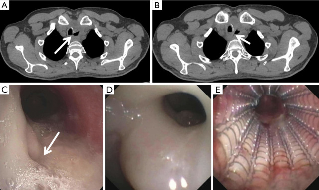
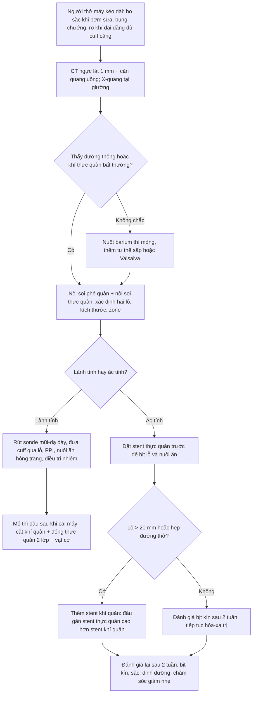
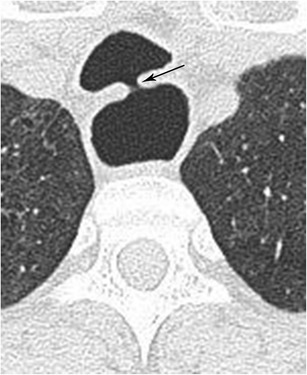
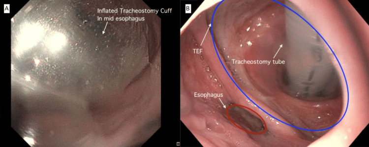

# 3854 — Rò khí quản – thực quản mắc phải: ống cuff, khối u và quyết định bịt một bên hay hai bên / Acquired tracheoesophageal fistula

**Tags:** `pattern:ro` `pattern:ro-khi-quan-thuc-quan` `pattern:ho-sac-khi` `pattern:khi-trong-thuc-quan` `pattern:nhieu-xa` `vung:khi-quan` `vung:thuc-quan` `vung:trung-that` `vung:phoi` `protocol:CT-nguc-can-quang` `protocol:nuot-can-quang` `protocol:noi-soi-phe-quan`

**Mức chắc chắn (certainty):** tổng hợp y văn (literature synthesis) — số liệu từ loạt **58 ca TEF lành tính** (PMC12557663), loạt **288 ca TEF ác tính** (PMC11333233), **51 ca rò hô hấp – tiêu hóa do ung thư thực quản** (PMC8909259), loạt **15 ca trong 20 năm** (PMC12535024), hai bài tổng quan của nội soi phế quản và tiêu hóa (PMC10713237, PMC10713241), cùng bằng chứng thực nghiệm về áp lực cuff (PMC2556761). Nhóm **không có bệnh nhân của mình**.

> **Câu chốt:** rò khí quản – thực quản (tracheoesophageal fistula, TEF) mắc phải là **một lỗ thông giữa hai ống có áp lực khác nhau**, nên mọi quyết định phải trả lời **ba câu cùng lúc**: **(1) lỗ rò do đâu** — cuff/sonde ở người thở máy, u xâm lấn, xạ trị, hay mổ thực quản; **(2) đang đe dọa đường thở hay đường tiêu hóa trước** — sặc và bít lòng khí quản nguy hiểm trước khi suy dinh dưỡng kịp giết bệnh nhân; **(3) bịt một bên hay hai bên** — thực quản, khí quản, hay cả hai. Ba con số neo: TEF gặp ở **0,5–3,8%** người thở máy kéo dài, **~75%** TEF lành tính là do thủ thuật, và **4–8%** ung thư thực quản có rò. Bỏ sót = viêm phổi hít sặc tái diễn; gọi nhầm viêm phổi thành "nhiễm trùng bệnh viện" = chậm cả tháng.

## 1. Tổng quan bệnh học – cơ chế hình ảnh

### 1.1 Vì sao lỗ rò nằm đúng chỗ đó: thành sau khí quản là màng, không có sụn

- **Giải phẫu quyết định bệnh:** khí quản có **vòng sụn chữ C** ở phía trước – bên, còn **thành sau (pars membranacea)** chỉ là **cơ trơn + niêm mạc**, **không có sụn**. Ngay sau nó là **thành trước thực quản**. Hai ống chỉ cách nhau bằng một vách mềm **1–2 mm**.
- Vì thế áp lực của bóng cuff (cuff) **không bị sụn đỡ** mà truyền gần như toàn bộ sang **vách khí quản – thực quản**: thiếu máu niêm mạc ở **cả hai mặt** cùng một mức → loét → hoại tử → thủng. Tổn thương luôn ở **1/3 giữa – dưới khí quản**, đúng nơi cuff tỳ vào (loạt 58 ca: **64% đoạn dưới, 28% đoạn giữa**; PMC12557663).
- **Ngưỡng áp lực có số:** áp lực tưới máu mao mạch khí quản **20–25 cmH₂O**; nghiên cứu nội soi trên 40 bệnh nhân cho thấy **tắc dòng máu niêm mạc khi áp lực thành bên > 30 cmH₂O** (PMC2556761). Khuyến nghị thực hành giữ cuff **~25 cmH₂O**; vượt **20–25 cmH₂O** đã bắt đầu thiếu máu (PMC12206091).
- **Sonde mũi – dạ dày là "đòn bẩy" thứ hai:** sonde cứng nằm giữa cuff và thành sau thực quản tạo **hai điểm ép** thay vì một — đây là lý do **cặp cuff + sonde** nguy hiểm hơn cuff đơn thuần. Vì vậy, khi đã nghi TEF, **phải rút sonde mũi – dạ dày** hoặc chuyển sang **mở thông dạ dày/hỗng tràng** (PMC10713237).
- **Yếu tố làm nhanh hơn:** thở máy kéo dài (**trung bình 20,8 ngày** trong loạt 58 ca; **24 ngày** nếu có mở khí quản), suy dinh dưỡng, đái tháo đường, corticoid, nhiễm trùng đang hoạt động (PMC12557663, PMC10713241). Về thời gian, TEF do cuff thường lộ sau **3–4 tuần** thở máy (PMC10713237), nên "mới thở máy 5 ngày" **không loại trừ** nhưng cũng không phải bối cảnh điển hình.

### 1.2 Vì sao ung thư và xạ trị tạo lỗ rò — và vì sao tiên lượng khác hẳn

- **U xâm lấn trực tiếp:** thực quản là ống nằm sát khí quản và phế quản gốc trái; **64–71%** ung thư thực quản ở **1/3 giữa**, nên khi u xuyên thành, nó gặp **màng khí quản** hoặc **phế quản gốc trái** trước tiên (PMC10713237). TEF ác tính: **53–80%** ở khí quản, **18–25%** phế quản gốc trái, **7–13%** ở carina.
- **Xạ trị – hóa trị làm mô không lành:** tia xạ gây **viêm tắc mạch nhỏ, thiếu máu, xơ hóa**; **bevacizumab (kháng VEGF)** ức chế lành vết thương nên làm tăng nguy cơ thủng. **90%** rò sau xạ xuất hiện **> 1 tháng** sau điều trị, và có thể **nhiều tháng** sau (PMC10713237, PMC12499430).
- **Hệ quả tiên lượng:** TEF ác tính xuất hiện ở giai đoạn muộn — **tới 90% đã di căn** khi có rò; sống trung vị chỉ **4–8 tuần** nếu chỉ điều trị nội khoa (PMC10713237), **< 3 tháng** trong tổng quan khác (PMC10713241). Vì thế mục tiêu là **bịt lỗ + nuôi ăn + giữ đường thở**, không phải "chữa khỏi".
- **Ngược lại, TEF lành tính sau cuff có thể chữa khỏi:** mổ thì đầu thành công **75–93%**, tử vong mổ **0–2,8%**, biến chứng **12–54%** (PMC10713237); trong tổng quan 165 ca TEF tái phát lành tính, mổ mở thành công **93,5%** so với nội soi **84%**, và **rò tái phát 21% vs 63%** (PMC10713241).

### 1.3 Vì sao hình ảnh thấy — và vì sao CT một mình có thể âm

- **Khí trong thực quản là dấu hiệu bất thường:** thực quản bình thường **xẹp**, chỉ có một ít khí khi nuốt. Ở người thở máy, thực quản **đầy khí** gợi ý: (a) sonde/dịch, (b) nuốt khí, hoặc (c) **khí từ khí quản qua lỗ rò**. Dấu hiệu chốt là **mất liên tục khu trú thành sau khí quản** và **cột khí hai ống nhập làm một** trên lát **≤ 1 mm** và **MPR vành/dọc**.
- **Cản quang uống là "thuốc nhuộm động":** chỉ thấy đường rò khi bệnh nhân **nuốt được** và lỗ rò **đang mở**. Vì vậy độ nhạy **nuốt cản quang 70–97%**, **CT 50%**, **nội soi thực quản 80%**, **nội soi phế quản 46%** (PMC10713237) — CT âm **không loại trừ**, nhất là ở người đang thở máy, có sonde, hoặc lỗ rò đóng tạm thời.
- **Vì sao ưu tiên barium hơn Gastrografin khi nghi TEF:** barium **cản quang mạnh, bám niêm mạc**, cho hình chi tiết; nếu sặc, barium **không hấp thu** và có thể gây **viêm phổi – tắc phế quản do barium**. Ngược lại, **Gastrografin (iodine, quá thương thẩm)** khi hít vào phổi gây **phù phổi và viêm phổi nặng, có ca tử vong** (PMC10713237). Thực hành: **barium loãng thì mỏng là lựa chọn đầu** khi nghi TEF và bệnh nhân còn nuốt được; **cản quang nước ít thương thẩm** khi nguy cơ sặc lớn hoặc nghi thủng trung thất. Đây là **khác biệt thực hành** (mục 7).
- **Cái bẫy vật lý hay gặp:** cuff bơm căng nằm **trong lòng thực quản** khi lỗ rò lớn — trên CT/X-quang, "bóng tròn trong thực quản" bị đọc là **khối u/thức ăn**; trên lâm sàng là **mất thể tích khí lưu thông + bụng chướng**. Ca tử vong trong y văn cho thấy đúng hình ảnh này (PMC7405977).

### 1.4 Ngưỡng định lượng cần nhớ

| Đại lượng | Số liệu | Nguồn |
|---|---|---|
| TEF ở người thở máy kéo dài | **0,5–3,8%**; tổng quan khác ghi **tới 3%** | PMC12557663; PMC10713241 |
| Thời gian thở máy trước khi có rò | trung bình **20,8 ngày** (mở khí quản **24 ngày**) | PMC12557663 |
| Áp lực cuff gây tắc tưới máu niêm mạc | **> 30 cmH₂O**; mục tiêu **~25 cmH₂O**; ngưỡng tưới máu mao mạch **20–25 cmH₂O** | PMC2556761; PMC12206091 |
| TEF ác tính trong ung thư thực quản / phổi | **4–8%** / **0,3%**; di căn lúc chẩn đoán **tới 90%** | PMC10713237 |
| Tỉ lệ nguyên nhân ác tính của TEF mắc phải | **~50%**; trong đó **77–92%** do ung thư thực quản | PMC5438315; PMC10713237 |
| Nguyên nhân thủ thuật trong TEF lành tính | **~75%** (cuff, mở khí quản, hậu phẫu, nội soi, stent) | PMC12557663 |
| Độ nhạy chẩn đoán | nuốt cản quang **70–97%**; CT **50%**; nội soi thực quản **80%**; nội soi phế quản **46%** | PMC10713237 |
| Dấu hiệu Ono (ho ngay sau nuốt) | **20–100%**; **~80%** trong loạt 58 ca | PMC10713237; PMC12557663 |
| Kích thước lỗ rò | "nhỏ" **< 10 mm** (một số dùng **5 mm**); loạt 15 ca: **1–3 cm 40%**, **< 1 cm 20%**, **> 5 cm 20%** | PMC10713237; PMC12535024 |
| Hẹp khí quản kèm theo | **62%** (hẹp **1–3 cm**); hẹp sau mổ TEF **26,6%** | PMC12557663; PMC12535024 |
| Bịt kín lỗ rò bằng stent | **94,12%** (176/187); hai stent **97%** so với **67%** chung | PMC11333233; PMC10713237 |
| Sống trung vị TEF ác tính | **4–8 tuần** nội khoa; **< 3 tháng**; stent thực quản **11,9 tháng** (chọn lọc) | PMC10713237; PMC10713241; PMC8909259 |

## 2. Mẫu hình + chẩn đoán phân biệt theo vị trí (gamut)

### 2.1 Gamut theo **cơ chế** — nhớ bằng C-A-S-T-E

- **C — Cuff (bóng chèn) và catheter:** thở máy kéo dài, mở khí quản, cuff quá căng, sonde mũi – dạ dày. Đây là nhóm **hay gặp nhất** ở người lớn nằm hồi sức.
- **A — Ác tính (malignancy):** ung thư thực quản (chủ yếu), phổi, tuyến giáp, lymphoma trung thất; u xâm lấn trực tiếp qua vách khí quản – thực quản.
- **S — Surgery:** sau **cắt thực quản** (rò miệng nối/hoại tử ống dạ dày), sau mổ trung thất, sau mổ cột sống ngực – cổ.
- **T — Therapy (điều trị gây tổn thương):** xạ trị, hóa trị, **bevacizumab (kháng VEGF)**, **stent ăn mòn**, nong bóng, đặt sonde, nội soi can thiệp.
- **E — External injury & infection:** chấn thương ngực – cổ kín/xuyên thấu, hít – uống chất ăn mòn, lao trung thất, nhiễm nấm, **hội chứng Macklin** kéo dài.

### 2.2 Gamut theo **vị trí** lỗ rò

- **Khí quản cổ – 1/3 trên (zone I–II):** cuff mở khí quản, chấn thương cổ, sau mổ tuyến giáp; khó xử lý vì sát dây thanh, dễ tổn thương thần kinh quặt ngược.
- **1/3 giữa – dưới khí quản (zone II–III):** **điển hình của cuff**; thường kèm **hẹp khí quản** do thiếu máu cùng vùng — **62%** trong loạt 58 ca.
- **Carina và phế quản gốc (zone IV–VII):** sau **cắt thực quản** (phế quản gốc trái **46%**, khí quản **39%**), u trung thất, xạ trị; đây là nơi **stent khí quản khó che kín** và dễ gây hẹp nhánh đối diện.
- **Nhiều lỗ (multifocal):** gặp trong xạ trị lan rộng và u trung thất; **tới 2%** TEF ác tính có nhiều vị trí (PMC10713237) — nội soi phải xem **toàn bộ** khí quản và cả hai phế quản gốc.

## 3. Bảng so sánh phân biệt (ma trận đối chiếu)

| Thực thể (entity) | Hình ảnh/đặc điểm điển hình | Chốt vào (rule-in) | Chốt loại (rule-out) | Gợi ý xác nhận |
|---|---|---|---|---|
| **TEF do cuff/sonde (lành tính)** | Khí trong lòng thực quản + **mất liên tục thành sau khí quản 1/3 giữa–dưới**; rò cản quang; cuff có thể nằm trong thực quản | **Tiền sử thở máy ≥ 3–4 tuần** + lỗ rò thấy trên **≥ 2 bình diện** + **Ono's sign** | Thực quản xẹp hoàn toàn, không khuyết thành, cản quang + nội soi **âm 2 lần** | CT lát mỏng 1 mm + nuốt cản quang; nội soi phế quản **và** thực quản |
| **TEF ác tính** | Khối u thực quản/trung thất **xâm lấn, hoại tử**, hẹp lòng, hạch; khí thực quản; di căn gan/phổi/xương | **U tiến triển + lỗ rò thấy trên nội soi** + sụt cân/khó nuốt | Không có khối, tổn thương đối xứng do cuff, không di căn | Nội soi + sinh thiết; CT ngực – bụng có cản quang |
| **Rò miệng nối sau cắt thực quản** | Khí – dịch quanh miệng nối, **phế quản gốc trái** hoặc khí quản, tràn dịch/tràn khí; ống dạ dày thành dày | **Mổ < 30 ngày**, khuyết miệng nối, **hoại tử ống dạ dày** | Miệng nối liền, không khí ngoài lòng sau 2 tuần | Cản quang uống + CT; nội soi ống mềm |
| **Thủng thực quản tự phát (Boerhaave)** | Khí trung thất, tràn dịch **bên trái**, khí dọc thực quản, không có lỗ vào khí quản | **Sau nôn dữ dội**, đau ngực, Macklin, tràn dịch trái | Không thấy đường thông vào khí quản, không có bóng cuff | CT + cản quang uống; liên hệ bài 1869 |
| **Tổn thương thành sau khí quản chưa rò (erosion)** | Khuyết niêm mạc, **hở sụn/vết loét** nhưng chưa thấy đường thông; khí trung thất ít | **Nội soi thấy loét thành sau + cuff quá căng**; không rò cản quang | Có khí thực quản + rò cản quang → đã thành TEF | Nội soi ống mềm; theo dõi 48–72 giờ |
| **TEF bẩm sinh kiểu H ở người lớn** | Đường rò nhỏ, **không tiền sử thở máy**, ho sặc và viêm phổi **từ nhỏ**; thực quản giãn trên lỗ rò | **Triệu chứng từ nhỏ/tái phát nhiều năm** + rò nhỏ trên nội soi | Khởi phát sau đặt ống/mở khí quản hoặc sau xạ → mắc phải | Nội soi + nuốt cản quang thì mỏng |
| **Viêm phổi hít sặc đơn thuần** | Đông đặc **thùy dưới phụ thuộc**, mờ quanh phế quản, không có đường rò | Bệnh cảnh hít sặc, **CT không thấy khí thực quản/khuyết thành** | **Khí thực quản + giãn dạ dày khi thở máy + rò khí dai dẳng** → nghĩ TEF | Điều trị – chụp lại; nội soi nếu tái diễn cùng thùy |
| **Rò động mạch chủ – thực quản** | **Giả phình/loét xuyên thành ĐMC** sát thực quản, máu tụ trong lòng thực quản | **Tiền triệu chảy máu + đau ngực + giả phình ĐMC** | Không có tổn thương ĐMC, rò hướng khí quản | CTA ngực; liên hệ bài 1852 |

*TEF do ung thư giáp thể không biệt hóa di căn cạnh khí quản: (A–B) CT có cản quang — hoại tử khối cạnh khí quản trái tạo đường thông vào khí quản (mũi tên); (C–D) nội soi thấy lỗ rò; (E) stent thực quản kim loại tự bung phủ che lỗ rò. Nguồn: Mediastinum 2023 (PMC10713237), Fig. 2, CC BY-NC-ND 4.0 — nguyên bản, không cắt ghép.*

## 4. Protocol chụp + hệ phân độ/điểm chuẩn hóa

### 4.1 Protocol hình ảnh khi nghi TEF

- **CT ngực – trung thất:** lát **≤ 1 mm**, tái tạo **MPR vành và dọc theo trục khí quản**; **cửa sổ phổi** (khí trong thực quản, đường rò, xẹp phổi) + **cửa sổ trung thất** (thành, khí trung thất, hạch, u, stent). Cho **cản quang uống** (barium loãng hoặc cản quang nước ít thương thẩm) **nếu bệnh nhân nuốt được**; ghi rõ **có/không cản quang** vì CT không cản quang chỉ có độ nhạy **~50%**.
- **Tư thế – động tác:** chụp thêm **nằm sấp** hoặc **Valsalva** khi lỗ rò nhỏ, vì cản quang chỉ lọt khi có chênh áp. Ở người thở máy: bơm **thì thở ra** để đánh giá hẹp động kèm theo.
- **Đo và báo cáo:** **kích thước lỗ rò (mm)** theo trục ngang và dọc, **vị trí theo zone** (I–VIII), **khoảng cách tới dây thanh và carina**, **mức hẹp khí quản (%)**, **có/không tụt cuff vào thực quản**, **diện đông đặc/hít sặc**, **hạch – u – di căn**.
- **Nuốt cản quang:** barium loãng **thì mỏng, động**; chụp **tư thế nghiêng** và **ngửa/sấp**; nếu âm mà nghi ngờ cao → **lặp lại** hoặc **nội soi**. Không dùng Gastrografin đậm đặc làm mặc định vì nguy cơ **phù phổi do sặc** (PMC10713237).
- **Nội soi là chuẩn vàng và là cửa điều trị:** **nội soi phế quản** thấy lỗ phía khí quản (**nhạy 46%** nếu soi đơn thuần), **nội soi thực quản** thấy lỗ phía thực quản (**80%**); **luôn soi cả hai** để xác định **hai lỗ**, kích thước, và tình trạng niêm mạc. Khi khó thấy: **xanh methylene**, **bơm khí**, **ánh sáng tự phát** (PMC10713237).
- **Trước can thiệp:** **cấy khí quản** (62% dương tính trong loạt 58 ca), **nuôi ăn qua hỗng tràng**, **rút sonde mũi – dạ dày**, **đưa cuff xuống dưới lỗ rò** nếu lỗ cao, **PPI**, **đánh giá dinh dưỡng và nhiễm trùng** (PMC12557663, PMC10713237).

### 4.2 Phân độ vị trí và kích thước (dùng để chọn stent/mổ)

- **Phân vùng của Wang (8 zone):** I–III = khí quản trên/giữa/dưới; IV = carina; V = phế quản gốc phải; VI = phế quản thùy giữa – trung gian; VII = phế quản gốc trái đoạn gần; VIII = phế quản gốc trái đoạn xa (PMC10713237).
- **Phân loại của Qureshi:** I = trong **2 cm** dưới sụn nhẫn; IIa = khí quản gần – giữa; IIb = khí quản xa; III = carina; IV = phế quản gốc; V = đường thở xa (PMC10713237).
- **Kích thước:** "nhỏ" = **< 10 mm** (một số tác giả dùng **5 mm**); **> 20 mm** hoặc có **hẹp đường thở** là ngưỡng cân nhắc **đặt stent hai bên** (PMC10713237, PMC11333233). Không có phân độ quốc tế thống nhất cho TEF mắc phải — ghi rõ khi báo cáo.

### 4.3 Thuật toán xử trí thực hành

- **Bệnh lành tính:** stent chỉ là **cầu nối**, không phải đích. Mổ thì đầu (cắt đoạn khí quản + đóng thực quản hai lớp ± vạt cơ) là chuẩn khi bệnh nhân đã cai máy; **trì hoãn mổ khi còn thở máy** vì tăng **bục miệng nối và hẹp tái phát** (PMC10713237, PMC12557663).
- **Bệnh ác tính:** **stent thực quản trước**; thêm **stent khí quản** khi có **hẹp đường thở** hoặc **không bịt kín**; nếu đặt hai stent, **đầu gần của stent thực quản phải cao hơn stent khí quản** để tránh stent thực quản gấp vào lòng và di trú (PMC10713237). ACCP khuyến cáo **mức 1B** cho **hai stent** khi có nguy cơ hẹp đường thở.
- **Không can thiệp được:** giảm đau, hút miệng, đầu cao, nuôi ăn hỗng tràng, kháng sinh theo đợt — sống trung vị **4–8 tuần** (PMC10713237).

## 5. Biến thể bình thường và cạm bẫy

- **"Khí trong thực quản" không đồng nghĩa TEF:** sonde mũi – dạ dày, nuốt khí khi lo lắng, hoặc thực quản giãn do liệt có thể có khí. Chốt là **khuyết thành khu trú + cản quang lọt**, không phải một bong bóng khí đơn độc.
- **CT không cản quang âm không loại trừ:** độ nhạy **~50%**; nếu nghi ngờ, phải **nuốt cản quang** hoặc **nội soi**, và lặp lại khi lỗ rò đóng tạm thời.
- **Nuốt cản quang âm lần đầu:** lỗ rò nhỏ có thể bị **nút nhầy/thức ăn** bịt; lặp lại với **tư thế sấp, Valsalva, bơm khí** hoặc nội soi (PMC10713237).
- **Bóng cuff trong thực quản bị đọc là "khối u/thức ăn":** đây là dấu hiệu của **lỗ rò lớn** — trên lâm sàng kèm **mất thể tích khí lưu thông, bụng chướng, rò khí quanh cuff**. Ca tử vong đã được báo cáo với đúng hình ảnh này (PMC7405977).
- **Rò khí dai dẳng dù cuff căng + không cai được máy + bụng chướng:** bộ ba gợi ý TEF ở người thở máy, dễ bị quy cho **hở cuff, viêm phổi, liệt ruột** (PMC10713241).
- **Nhầm với viêm phổi hít sặc thông thường:** đông đặc **cùng một thùy** tái diễn, đặc biệt **thùy dưới phải** ở người nằm ngửa, phải chụp lại và **nội soi** thay vì chỉ đổi kháng sinh.
- **Sau cắt thực quản:** khí – dịch quanh miệng nối có thể là **rò lành tính tự hạn chế** hoặc **hoại tử ống dạ dày**; **hoại tử** có thành ống dày, mất lớp niêm mạc, khí trong thành và toàn thân nhiễm độc — **không đặt stent che lên hoại tử** (liên hệ bài 1887, 1870).
- **Sau xạ trị:** rò có thể xuất hiện **nhiều tháng** sau khi u đã ổn định; đừng mặc định "u tiến triển" — sinh thiết và nội soi phân biệt **hoại tử do xạ** với **u sống**.
- **TEF bẩm sinh kiểu H ở người lớn:** ho sặc **từ nhỏ**, viêm phổi tái diễn, thực quản giãn; đừng gán cho "thở máy" khi không có tiền sử. Ngược lại, TEF **mắc phải** ở trẻ đã mổ teo thực quản là **tái phát**, không phải bẩm sinh mới.

## 6. Tự lượng giá — Blind Quiz

**Ca 1 — Bệnh nhân thở máy kéo dài, CT ngực không cản quang, khó thở tăng và bụng chướng.**

- Gợi ý lâm sàng: người lớn nằm hồi sức, đặt nội khí quản nhiều tuần, đang được bơm sữa qua sonde; xuất hiện ho, bụng chướng và viêm phổi tái diễn.
- Câu hỏi: (1) Mũi tên chỉ cấu trúc gì, và vì sao nó bất thường? (2) Chẩn đoán nào giải thích cả bụng chướng? (3) Bước xác nhận và bước xử trí đầu tiên?

<b>Bấm để hiện đáp án (findings + chẩn đoán)</b>

- Dấu hiệu: **khuyết khu trú thành sau khí quản**, cột khí khí quản **thông trực tiếp** với **lòng thực quản đầy khí** (mũi tên). Thực quản bình thường xẹp; khí trong lòng ở người thở máy là bất thường.
- Chẩn đoán: **rò khí quản – thực quản mắc phải do cuff** (acquired TEF). Bụng chướng vì khí từ khí quản theo lỗ rò vào thực quản rồi xuống dạ dày — dấu hiệu lâm sàng rất gợi ý ở người thở máy.
- Xác nhận: **nuốt cản quang barium thì mỏng** (nhạy 70–97%) và **nội soi phế quản + thực quản**; CT không cản quang chỉ nhạy ~50%.
- Xử trí đầu tiên: **rút sonde mũi – dạ dày**, **đưa cuff xuống dưới lỗ rò** nếu được, **hút miệng**, **nuôi ăn hỗng tràng**, kháng sinh theo cấy; hội chẩn ngoại lồng ngực.
- Nguồn ảnh: *Insights into Imaging* 2017 (PMC5438315), Fig. 19, **CC BY 4.0** — nguyên bản, không cắt.

**Ca 2 — Nội soi thực quản ở bệnh nhân mở khí quản, đang bơm sữa qua sonde.**

- Gợi ý lâm sàng: bệnh nhân chấn thương, mở khí quản, hút nhiều đờm lẫn dịch dạ dày; nội soi kiểm tra vì nghi rò.
- Câu hỏi: (1) Cấu trúc lớn trong lòng thực quản (A) là gì? (2) Lỗ rò nằm ở đâu so với cuff? (3) Vì sao tình trạng này đe dọa tính mạng ngay?

<b>Bấm để hiện đáp án (findings + chẩn đoán)</b>

- Dấu hiệu: (A) **bóng cuff của ống mở khí quản** nhìn thấy **trong lòng thực quản** qua lỗ rò lớn; (B) lỗ rò thành trước thực quản, **ống mở khí quản lộ vào thực quản** — tức cuff đã **tụt qua lỗ rò**.
- Chẩn đoán: **TEF mắc phải khổng lồ sau mở khí quản** (ca gốc: lỗ rò **8 cm**, PMC10505277). Cuff nằm trong thực quản → **mất thể tích khí lưu thông**, đồng thời **dịch dạ dày tràn vào khí quản** → sặc, nhiễm trùng huyết.
- Vì sao nguy hiểm ngay: đây là **"không thông khí được" + sặc ồ ạt**, không chỉ là rò tiêu hóa; phải **đưa cuff về khí quản**, hút, và xử lý đường thở trước.
- Nguồn ảnh: *Cureus* 2023 (PMC10505277), Fig. 2, **CC BY 3.0** — nguyên bản, không cắt.

**Ca 3 — Ung thư tuyến giáp di căn cạnh khí quản, khó thở và ho ra dịch sau ăn.**

- Gợi ý lâm sàng: nữ lớn tuổi, ung thư giáp thể không biệt hóa, khối cạnh khí quản trái hoại tử sau hóa trị; khó thở tăng, ho khi nuốt.
- Câu hỏi: (1) Trên CT (A–B), dấu hiệu nào cho thấy đường thông? (2) Vì sao ưu tiên stent thực quản trước? (3) Khi nào cần thêm stent khí quản?

<b>Bấm để hiện đáp án (findings + chẩn đoán)</b>

- Dấu hiệu: khối **hoại tử cạnh khí quản trái** mất mặt phẳng với thành khí quản, **khí trong khối thông với lòng khí quản** (mũi tên); nội soi (C–D) thấy **lỗ rò**; (E) **stent thực quản kim loại tự bung phủ** che lỗ rò.
- Chẩn đoán: **TEF ác tính** do ung thư giáp di căn cạnh khí quản (PMC10713237). Đây là bệnh cảnh **giảm nhẹ triệu chứng**, không chữa khỏi: sống trung vị **4–8 tuần** nếu chỉ nội khoa.
- Vì sao stent thực quản trước: bịt nguồn **dịch tiêu hóa tràn vào đường thở**, cho ăn lại, và **không chèn ép khí quản**; stent thực quản đặt trước cũng dễ hơn về mặt kỹ thuật.
- Thêm stent khí quản khi: **hẹp đường thở có triệu chứng**, **lỗ > 20 mm**, hoặc **không bịt kín** sau stent thực quản; nhớ **đầu gần stent thực quản cao hơn stent khí quản**.
- Nguồn ảnh: *Mediastinum* 2023 (PMC10713237), Fig. 2, **CC BY-NC-ND 4.0** — nguyên bản, không cắt/ghép.

## 7. Câu hỏi nghiên cứu & điểm chưa đồng thuận (tính đến 11/2026)

1. **[Tranh cãi] Ở TEF ác tính, đặt stent HAI bên có thực sự tốt hơn stent một bên về bịt kín và sống còn, hay chỉ nên dành cho lỗ > 20 mm / có hẹp đường thở?**
   - **Đã biết:** ACCP khuyến cáo **mức 1B** đặt hai stent khi có nguy cơ hẹp đường thở; loạt 61 bệnh nhân của Ke cho thấy bịt kín hoàn toàn **97%** khi đặt hai stent so với **67%** chung (PMC10713237). Loạt **288 ca** lại không thấy khác biệt giữa stent thực quản và stent khí quản đơn thuần về bịt kín, và chỉ dành hai stent cho **lỗ > 20 mm** hoặc hẹp đường thở (PMC11333233).
   - **Chưa rõ:** chưa có **thử nghiệm ngẫu nhiên**; các loạt đều hồi cứu, chọn bệnh, và định nghĩa "bịt kín" khác nhau (nội soi, nuốt cản quang, triệu chứng).
   - **Hướng nghiên cứu:** registry tiền cứu so sánh **một stent vs hai stent**, phân tầng theo **kích thước lỗ, vị trí zone, hẹp đường thở**, với tiêu chí chính là **bịt kín ở 2 tuần** và **sống 3 tháng**.
   - **Nguồn:** PMC10713237 (2023); PMC11333233 (2024); PMC8909259 (2022).

2. **[Khoảng trống] TEF lành tính sau cuff: mổ lúc nào, và có nên mổ khi bệnh nhân còn thở máy hoặc còn corticoid?**
   - **Đã biết:** mổ mở thành công **93,5%**, rò tái phát **21%** so với nội soi **84%** và **63%** (165 ca, PMC10713241); tử vong mổ **0–2,8%**, biến chứng **12–54%** (PMC10713237); loạt 58 ca: **rò tái phát tới 11,1%**, liệt dây thanh **14%**, bục miệng nối **7%** (PMC12557663).
   - **Chưa rõ:** không có tiêu chuẩn về **thời điểm mổ** (sau bao nhiêu ngày cai máy), **ngưỡng corticoid**, **vai trò mở khí quản tạm**, và **khi nào chấp nhận stent như giải pháp cuối** ở người không mổ được.
   - **Hướng nghiên cứu:** nghiên cứu đoàn hệ tiền cứu ghi **thời gian cai máy, liều corticoid, tình trạng nhiễm khuẩn khí quản** và kết cục **liền miệng nối**, để xây dựng tiêu chí "mổ được".
   - **Nguồn:** PMC12557663 (2025); PMC10713237 (2023); PMC12535024 (2025).

3. **[Khác biệt thực hành] TEF ác tính: hóa – xạ trị có thể làm LÀNH lỗ rò, hay chỉ làm lỗ rò to thêm?**
   - **Đã biết:** một nghiên cứu **40 ca** ung thư biểu mô vảy thực quản có rò cho thấy hóa – xạ đồng thời + nuôi ăn đầy đủ **đóng rò ở 80%**, trung vị **5 tuần**; một loạt khác **16/24** bệnh nhân đóng rò và ăn lại được (PMC10713241). Nhưng xạ trị cũng là **nguyên nhân gây rò** do hoại tử thiếu máu, và nhiều trung tâm coi rò là **chống chỉ định tương đối** của xạ tiếp (PMC12499430, PMC10713237).
   - **Chưa rõ:** không có yếu tố dự báo **đóng rò** so với **to thêm**; khác biệt lớn về **liều, kỹ thuật xạ, phác đồ hóa trị** giữa các loạt.
   - **Hướng nghiên cứu:** nghiên cứu tiền cứu phân tầng theo **kích thước lỗ, vị trí, mô học, liều xạ tích lũy**, với tiêu chí **đóng rò trên nội soi/nuốt cản quang ở 8 tuần** và **biến chứng chảy máu/thủng**.
   - **Nguồn:** PMC10713241 (2023); PMC12499430 (2025); PMC11333233 (2024).

## Bài liên quan chéo

- [001 – Tổng quan hệ Ngực](../001-tong-quan-he-nguc/lesson.md) — bảng DDx của hệ, nơi bài này được nối vào mẫu hình "khí – dịch trung thất".
- [1869 – Vỡ thực quản tự phát (Boerhaave)](../1869-vo-thuc-quan-tu-phat/lesson.md) — cùng bệnh cảnh khí trung thất nhưng **không có lỗ vào khí quản**.
- [1844 – Rò và hoại tử thực quản do xạ](../1844-ro-hoai-tu-thuc-quan-do-xa/lesson.md) — mặt bệnh của xạ trị, cùng cơ chế thiếu máu – hoại tử.
- [1852 – Rò động mạch chủ – thực quản](../1852-ro-dong-mach-chu-thuc-quan/lesson.md) — rò thực quản với **mạch máu**, biểu hiện bằng chảy máu ồ ạt chứ không phải sặc.
- [1870 – Rò thực quản – màng phổi mạn](../1870-ro-thuc-quan-mang-phoi-man/lesson.md) — cùng nguyên lý bịt lỗ bằng stent/EVT nhưng đích là khoang màng phổi.
- [1887 – Rò dưỡng trấp sau cắt thực quản](../1887-ro-duong-trap-sau-cat-thuc-quan/lesson.md) — biến chứng khác của cùng mổ, phân biệt bằng triglyceride dịch.
- [1768 – Cổ đông cứng sau xạ đường thở khó](../1768-co-dong-cung-sau-xa-duong-tho-kho/lesson.md) — biến chứng đường thở sau xạ, cùng nhóm bệnh nhân.
- [3151 – Stent đường thở sau ghép phổi](../3151-stent-duong-tho-sau-ghep-phoi/lesson.md) — kỹ thuật chọn stent khí quản và biến chứng stent.
- [3108 – Vỡ mỏm phế quản sau cắt phổi](../3108-vo-mom-phe-quan-sau-cat-phoi/lesson.md) — nguyên lý "vật liệu che lỗ rò" ở mỏm phế quản.
- [3057 – Vỡ khí quản – phế quản sau đặt nội khí quản](../3057-vo-khi-quan-phe-quan-sau-dat-noi-khi-quan/lesson.md) — cùng cơ chế chấn thương áp lực của cuff.

## Áp dụng lâm sàng trong 1 phút

- Người thở máy **> 2–3 tuần** + **ho sặc khi bơm sữa** + **bụng chướng** + **rò khí dai dẳng** → nghĩ TEF trước khi nghĩ "viêm phổi bệnh viện".
- **CT không cản quang bình thường không loại trừ**: độ nhạy chỉ **~50%**; phải **nuốt barium** hoặc **nội soi hai chiều**.
- **Bóng cuff trong thực quản** = lỗ rò lớn, cấp cứu đường thở, không phải "dị vật".
- **Lành tính:** mổ thì đầu sau khi cai máy; stent chỉ là cầu. **Ác tính:** stent thực quản trước, thêm stent khí quản khi hẹp/lỗ lớn, và nhớ **đầu gần stent thực quản cao hơn stent khí quản**.

> **Disclaimer y tế:** bài này là học liệu tổng hợp, **không dùng để chẩn đoán hay điều trị độc lập**. Mọi quyết định mổ, đặt stent hay nuốt cản quang phải do ê-kíp hồi sức – lồng ngực – nội soi tiêu hóa quyết định trên từng bệnh nhân.
