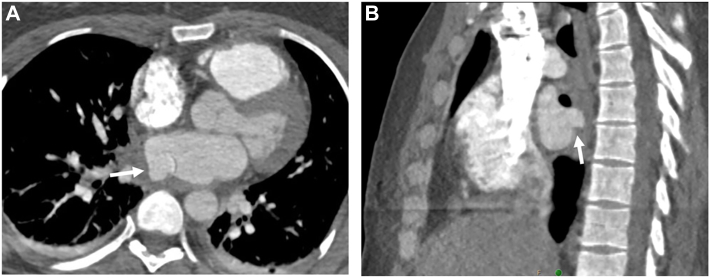
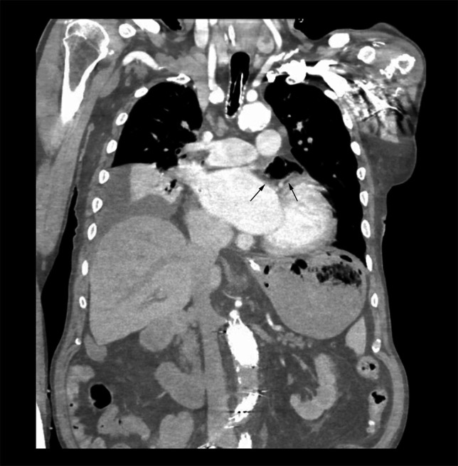
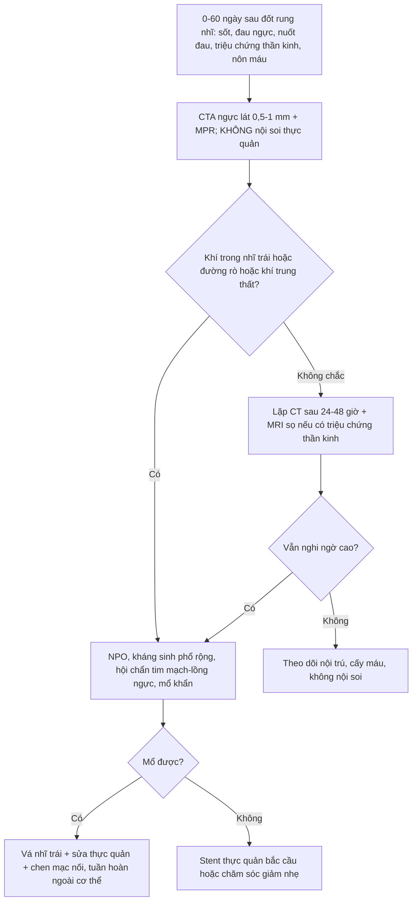
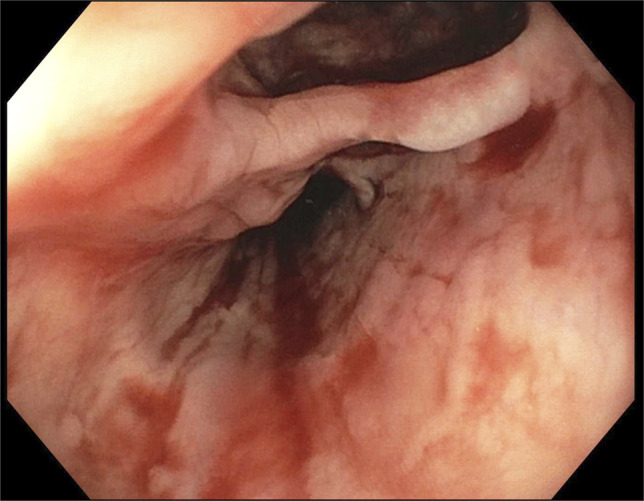
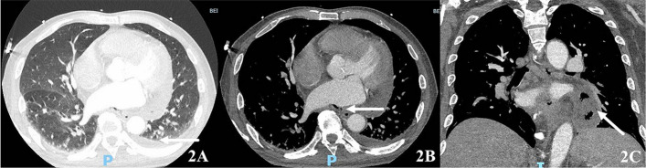
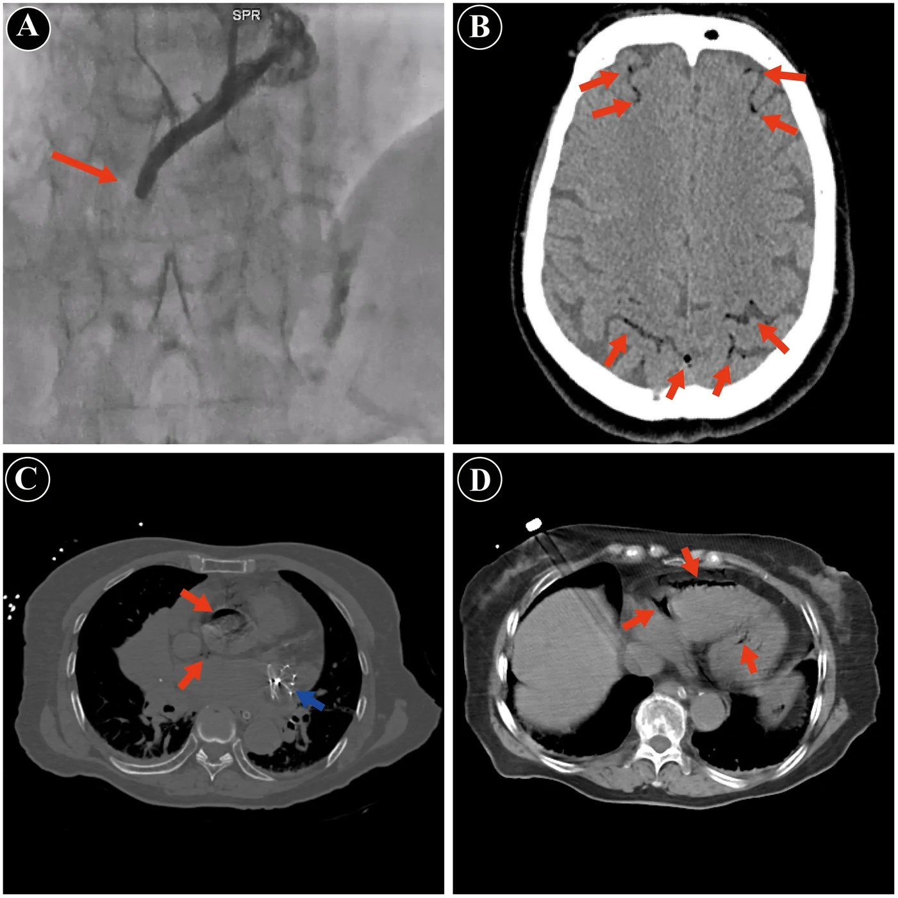

# 3856 — Rò nhĩ trái – thực quản sau đốt rung nhĩ: khí trong nhĩ trái, cấm nội soi, và cửa sổ mổ tính bằng giờ / Atrioesophageal fistula after atrial fibrillation ablation

**Tags:** `pattern:ro` `pattern:khi-trong-nhi-trai` `pattern:khi-trung-that` `pattern:tran-dich-mang-tim` `pattern:nhoi-mau-nao-nhieu-o` `vung:tim` `vung:thuc-quan` `vung:trung-that` `protocol:CT-nguc-can-quang` `protocol:CTA` `protocol:MRI-so-nao`

**Mức chắc chắn (certainty):** tổng hợp y văn (literature synthesis) — số liệu từ **khảo sát toàn cầu POTTER-AF 553.729 thủ thuật** (PMC10344651), **POTTER-AF 2 trên cơ sở dữ liệu FDA** (PMC12659787), **tổng quan 257 ca rò** (PMID 34260115), **tổng quan mổ 219 ca** (PMID 37084936), **loạt 65 ca** (PMC5986301), **loạt 12 ca mổ có ảnh CT** (PMC12776963), **3.852 bệnh nhân đốt có nội soi siêu âm** (PMC7026048) và các ca nguyên văn có ảnh (PMC10686608, PMC13716589, PMC12441444, PMC12559572). Nhóm **không có bệnh nhân của mình**.

> **Câu chốt:** rò nhĩ trái – thực quản (atrioesophageal fistula, AEF) là **lỗ thông giữa buồng tim trái áp lực thấp và một ống tiêu hóa chứa khí – vi khuẩn**. Ba con số neo: **(1)** gặp ở **0,025%** thủ thuật đốt (RF **0,038%** so với cryo **0,0015%**; PMC10344651); **(2)** triệu chứng xuất hiện **trung vị 18 ngày**, chẩn đoán **21 ngày** sau đốt (khoảng **0–60 ngày**); **(3)** tử vong **65,8%**, và **89,5%** nếu chỉ điều trị nội khoa (PMC10344651). Hai câu quyết định: **khí trong nhĩ trái trên CT = dấu chốt**, và **nội soi thực quản khi đang nghi AEF là chống chỉ định tuyệt đối** — bơm khí vào thực quản đẩy khối khí và vi khuẩn vào tuần hoàn hệ thống.

## 1. Tổng quan bệnh học – cơ chế hình ảnh

### 1.1 Vì sao lỗ rò nằm đúng thành sau nhĩ trái: khoảng cách 2,5 mm và không có lớp đệm

- **Giải phẫu quyết định bệnh:** thực quản chạy sát **thành sau nhĩ trái** (posterior left atrial wall), có chỗ chỉ cách **2,5 mm** (PMC8174315). Giữa hai ống chỉ là **mô liên kết lỏng lẻo + mỡ**, không có sụn hay cơ dày; thực quản lại **không có thanh mạc** nên khi thành bị hoại tử, viêm nhiễm lan thẳng vào trung thất và màng tim.
- **Vì sao là nhĩ trái chứ không phải nhĩ phải:** các đường đốt cô lập tĩnh mạch phổi (pulmonary vein isolation, PVI) và đốt thành sau (posterior wall isolation) nằm **trên thành sau nhĩ trái**, đúng nơi thực quản đi qua. Đốt bằng năng lượng nhiệt (RF, cryo) tạo tổn thương **từ ngoài vào trong**: cơ tim bị đốt nóng → thành thực quản phía đối diện bị thiếu máu → loét → hoại tử → thủng.
- **Vì sao khí vào được nhĩ trái:** áp lực nhĩ trái khoảng **8–12 mmHg**, còn khi nuốt, áp lực lòng thực quản tăng lên **30–80 mmHg** trong vài giây. Mỗi lần nuốt là một **bơm khí – dịch – vi khuẩn** qua lỗ rò vào nhĩ trái. Khí nhẹ hơn máu nên đi theo dòng ra thất trái → ĐMC → **não và động mạch vành**; vi khuẩn bám vào nội mạc nhĩ bị tổn thương tạo **khối sùi** (PMC12441444).
- **Vì sao tổn thương tiến triển chậm 1–4 tuần:** đốt gây **hoại tử đông** và **viêm tắc mạch nhỏ**; mô chết được thay bằng loét, rồi mỏng dần dưới áp lực và dòng axit – pepsin trào ngược. Vì thế AEF hiếm khi xuất hiện trong 48 giờ đầu; trung vị **18 ngày** (PMC10344651). Trào ngược dạ dày – thực quản được xem là **yếu tố thúc đẩy** loét thành rò (PMC13716589).

### 1.2 Phổ tổn thương thực quản do nhiệt — vì sao "chỉ loét" chưa phải đích

- **Phân loại Kansas City** (dùng trong các nghiên cứu nội soi sau đốt; PMC7026048): **type 1** = ban đỏ; **type 2a** = loét nông; **type 2b** = loét sâu; **type 3a** = thủng **chưa** thông với nhĩ (rò màng tim – thực quản); **type 3b** = **rò nhĩ trái – thực quản**. Chỉ type 3b mới là AEF; type 3a là **rò màng tim – thực quản** (esophagopericardial fistula, EPF) — bệnh cảnh chèn ép tim chứ không phải thuyên tắc khí.
- **Tần suất tổn thương thực quản sau đốt:** phân tích gộp ghi nhận **11%** có tổn thương bất kỳ và **5%** có loét (PMC7026048 dẫn lại). Trong 236 bệnh nhân được **nội soi siêu âm (EUS)** sau đốt, **40%** nhóm có vùng đốt chồng lấn thực quản có tổn thương (25 type 1, 35 type 2), so với **3,5%** khi không chồng lấn (p < 0,001); **overlap là yếu tố dự báo độc lập, OR 21,2 (95% CI 6,23–72,0)**. Cryo ít tổn thương hơn RF: **OR 0,28 (0,11–0,72)**.
- **Bao nhiêu loét tiến triển thành thủng?** Khoảng **10%** loét do đốt tiến triển thành thủng (PMC7026048 dẫn Halbfass). Trong nhóm không nội soi của chính nghiên cứu 3.852 bệnh nhân, **5/3.616 (0,14%)** có type 3 — **cả 5 đều đốt RF và đều có overlap thực quản** (3 EPF, 2 AEF). Đây là lý do phải **phát hiện sớm ở nhóm có yếu tố nguy cơ**, không chờ triệu chứng.
- **MRI tương phản muộn (LGE-MRI) trong 24 giờ** phát hiện tổn thương nhiệt thực quản ở **39,1%** bệnh nhân (nhẹ **27,5%**, trung bình **9,9%**, nặng **1,7%**); phần lớn **hết trên MRI lặp lại sau 3 tháng** (PMC8174315). Điều này giải thích vì sao phần lớn tổn thương thoáng qua, chỉ một số ít đi tới rò.

### 1.3 Vì sao hình ảnh thấy — và vì sao CT âm không loại trừ

- **Khí trên CT là tín hiệu mạnh nhất vì tương phản vật lý cực lớn:** khí có **−1.000 HU** (khí lẫn dịch **−700 đến −1.000 HU**), trong khi mỡ **−40 đến −120 HU**, máu đông **50–80 HU**, cơ tim **40–60 HU**. Trên cửa sổ trung thất, một ít khí trong lòng nhĩ trái đầy cản quang là **vùng đen tuyệt đối**, không thể nhầm với mỡ hay huyết khối nếu đọc đúng cửa sổ.
- **Nhưng khí chỉ có khi lỗ rò đang mở và có khí vào:** lỗ nhỏ bị nút nhầy/thức ăn bịt, hoặc bệnh nhân nằm yên không nuốt, có thể **không thấy khí**. Trong tổng quan 257 ca, **24,2%** ca có CT/MRI ngực đầu tiên **bình thường hoặc không đặc hiệu**, và những ca này **chẩn đoán muộn hơn** (p < 0,001; PMID 34260115). Vì vậy CT âm **không loại trừ** khi lâm sàng nghi cao.
- **Các dấu hiệu gián tiếp có số:** trong loạt 12 ca mổ (PMC12776963), CT có cản quang cho thấy **tràn dịch màng phổi 91,7%**, **khí trung thất 91,7%**, **tràn dịch/khí màng tim 83,3%**, **dày thành thực quản + thâm nhiễm mỡ quanh thực quản 58,3%**, **thoát cản quang từ nhĩ trái 8,3%**. Khảo sát POTTER-AF: CT đặt chẩn đoán ở **80,2%** ca.
- **Vì sao cần MPR và nhiều thì:** đường rò thường **xiên, ngắn 2–5 mm**, nằm giữa thành sau nhĩ và thực quản; lát cắt ngang đơn thuần dễ cắt vuông góc với đường rò. Tái tạo **vành/dọc theo trục nhĩ – thực quản**, thêm thì **tĩnh mạch (60–70 giây)** và **ECG-gated** giúp thấy rõ đường rò, khí trong nhĩ và loại trừ giả khí do chuyển động.

### 1.4 Ngưỡng định lượng cần nhớ

| Đại lượng | Số liệu | Nguồn |
|---|---|---|
| Tần suất AEF sau đốt | **0,025%** chung; **RF 0,038%**; **cryo 0,0015%** | PMC10344651 |
| Tần suất theo loạt khác | **0,02–0,25%**; một số trung tâm **0,034%**; cryo **~0,004% (1/25.000)** | PMC12594277; PMC12776963; PMC12816882 |
| Thời gian từ đốt đến triệu chứng | trung vị **18 ngày** (IQR 7,75–25; **0–60**) | PMC10344651 |
| Thời gian đến chẩn đoán | trung vị **21 ngày** (IQR 15–29,5; **2–63**); triệu chứng → chẩn đoán **3 ngày** | PMC10344651 |
| Triệu chứng khởi phát thường gặp | **sốt 59,3%**; thần kinh **62,9–75%**; xuất huyết tiêu hóa **41%**; đau ngực **40–83%** | PMC10344651; PMID 37084936; PMID 29109075 |
| Tử vong | **65,8%** chung; mổ **51,9%**, nội soi can thiệp **56,5%**, nội khoa **89,5%** (OR 7,46) | PMC10344651 |
| Tử vong theo loạt mổ | mổ **20,6%** so với không mổ **93,5%**; sống chung **47%**, mổ **71,9%** so với **11%** | PMC5986301; PMID 37084936 |
| Vị trí và kích thước tổn thương | lỗ nhĩ trái **11,9 ± 5,1 mm**; lỗ thực quản **12,1 ± 3,3 mm** (loạt 12 ca) | PMC12776963 |
| Yếu tố nguy cơ mạnh nhất trên thủ thuật | **vùng đốt chồng lấn thực quản OR 21,2**; cryo **OR 0,28** so với RF | PMC7026048 |
| Nhiệt độ lòng thực quản | tổn thương xuất hiện khi **> 41°C**; cryo ngắt ở **15°C** giảm loét từ **18,8% → 3,2%** | PMC12594277; PMC12816882 |
| Đốt thành sau | hạ công suất **≤ 25 W**, thời gian **≤ 15 giây** mỗi điểm khi có overlap | PMC7026048 |
| Tỉ lệ sống sau mổ theo kỹ thuật | cắt thực quản **71%** so với sửa trực tiếp + vạt **25%** (18 ca) | PMC11704549 |

## 2. Mẫu hình + chẩn đoán phân biệt theo vị trí (gamut)

### 2.1 Mẫu hình nhận diện: "bốn dấu hiệu quanh một buồng tim vừa bị đốt"

- **Bối cảnh bắt buộc:** bệnh nhân **0–60 ngày** sau đốt rung nhĩ, đặc biệt có **đốt thành sau** hoặc **đốt lại**.
- **Bốn nhóm dấu hiệu, xếp theo giá trị:** **(1) khí trong nhĩ trái** — đặc hiệu nhất, gần như chẩn đoán xác định khi không có catheter trong buồng tim; **(2) đường rò/outpouching thành sau nhĩ trái** thông với thực quản; **(3) khí trung thất + khí màng tim + tràn dịch màng phổi/màng tim** — dấu hiệu sớm, không đặc hiệu; **(4) ổ nhồi máu/não khí trên CT sọ** — dấu hiệu của biến chứng thuyên tắc, không phải của lỗ rò.
- **Câu hỏi lâm sàng định hướng:** sau đốt 2–4 tuần, **sốt + đau ngực + triệu chứng thần kinh thoáng qua** (yếu nửa người, nói khó, co giật) là bộ ba kinh điển; thêm **nôn máu** thì gần như chắc chắn. Đừng chờ đủ bộ ba.

### 2.2 Gamut theo vị trí tổn thương

- **Tại thành sau nhĩ trái:** AEF (type 3b) · phình giả nhĩ trái (pseudoaneurysm) có khí màng tim · huyết khối/sùi thành sau nhĩ · loét thực quản chưa rò · tái phát u/tổn thương đốt cũ.
- **Trong màng tim:** EPF (type 3a) · viêm màng ngoài tim do nhiệt · tràn khí màng tim · chèn ép tim · hội chứng sau cắt màng tim (post-cardiac injury syndrome).
- **Trung thất:** viêm trung thất do thực quản thủng · khí trung thất do thông khí áp lực dương · rò khí quản – thực quản (bài 3854) · rò ĐMC – thực quản (bài 1852).
- **Tuần hoàn hệ thống/não:** thuyên tắc khí não (nhiều ổ, đối xứng hai bán cầu) · nhồi máu do sùi nhiễm khuẩn · nhồi máu cơ tim do khí mạch vành · cơn thiếu máu não thoáng qua.
- **Thực quản muộn:** hẹp thực quản sau lành · túi thừa giả · rò tái phát sau stent · loét mạn.

*Bước trung gian trước khi thành rò hoàn chỉnh: (A) mặt phẳng ngang và (B) mặt phẳng dọc cho thấy **túi lồi (phình giả) thành sau nhĩ trái** (mũi tên) kèm **khí trong màng tim**. Khi thấy khí màng tim sau đốt thành sau, phải lặp CT 24–48 giờ vì tổn thương có thể tiến triển thành rò. Nguồn: Annals of Thoracic Surgery Short Reports 2025 (PMC12559572), Fig. 1, CC BY 4.0 — nguyên bản.*

### 2.3 Mẫu hình theo thời gian — ba cửa sổ

- **≤ 7 ngày:** hiếm; nếu có thường là **thủng sớm do nhiệt độ quá cao**, bệnh cảnh nặng, khí trung thất rõ, dễ nhầm với viêm màng ngoài tim cấp sau đốt.
- **8–30 ngày (đỉnh):** chiếm phần lớn; trung vị **18 ngày**; biểu hiện **sốt, đau ngực, triệu chứng thần kinh**, thường đã xuất viện nên dễ bị đánh giá ở tuyến đầu là "nhiễm trùng hô hấp" hoặc "đột quỵ".
- **> 30 ngày (muộn):** tới **60–63 ngày**; hay gặp thể **thực quản – màng tim** hoặc biểu hiện **nhiễm khuẩn huyết tái phát** do vi khuẩn miệng; đừng loại trừ chỉ vì "đã quá 4 tuần".

## 3. Bảng so sánh phân biệt (ma trận đối chiếu)

| Thực thể (entity) | Hình ảnh/đặc điểm điển hình | Chốt vào (rule-in) | Chốt loại (rule-out) | Gợi ý xác nhận |
|---|---|---|---|---|
| **AEF (rò nhĩ trái – thực quản)** | Khí trong nhĩ trái, đường rò/outpouching thành sau nhĩ, khí trung thất, tràn dịch màng tim/phổi, dày thành thực quản | **Khí trong nhĩ trái** + bối cảnh đốt 0–60 ngày; cấy máu vi khuẩn miệng | Không có khí nhĩ trái, không đường rò, và CT lặp lại bình thường trong 48 giờ khi lâm sàng thấp | CTA ngực lát 0,5–1 mm + MPR; MRI sọ nếu có triệu chứng thần kinh; hội chẩn mổ ngay |
| **EPF (rò màng tim – thực quản)** | Khí/dịch màng tim, dày màng tim, chèn ép tim; **không có khí trong nhĩ trái** | Khí màng tim + tràn dịch màng tim lớn + bối cảnh đốt; chọc màng tim ra dịch đục/khí | Có khí trong nhĩ trái hoặc đường rò vào nhĩ → AEF | CT ngực + siêu âm tim; chọc dẫn lưu màng tim cấp cứu |
| **Loét thực quản do nhiệt (chưa rò)** | Dày thành thực quản, loét trên nội soi/EUS, không khí ngoài lòng, không đường rò | **Type 2b trên EUS/nội soi** + vùng đốt chồng lấn; không khí trung thất | Có khí nhĩ trái/trung thất/đường rò → đã thủng | EUS/nội soi **chỉ khi chưa nghi rò**; theo dõi 48–72 giờ |
| **Phình giả nhĩ trái + khí màng tim (tiền rò)** | Túi lồi thành sau nhĩ, khí màng tim, chưa thấy đường thông rõ | Túi lồi + khí màng tim sau đốt; CT lặp lại thấy tiến triển | Không thay đổi sau 48 giờ và không khí nhĩ trái | CTA + siêu âm tim; mổ dự phòng nếu tiến triển |
| **Viêm trung thất/áp-xe sau đốt** | Khí – dịch trung thất, dày mô mềm, hạch, không thấy lỗ vào nhĩ | Khí trung thất + sốt + tăng CRP/PCT; dịch trung thất có mủ | Có khí nhĩ trái/đường rò → AEF; không có tổn thương thực quản | CT ngực cản quang; cấy dịch trung thất; dẫn lưu |
| **Vỡ thực quản tự phát (Boerhaave)** | Khí trung thất, tràn dịch **bên trái**, khí dọc thực quản, sau nôn dữ dội | Tam chứng Mackler + khí trung thất + tràn dịch trái; không tiền sử đốt | Có tiền sử đốt thành sau + khí nhĩ trái → AEF | CT + cản quang uống; liên hệ bài 1869 |
| **Khí do catheter/truyền dịch (lành tính)** | Bọt khí nhỏ trong **tim phải**, buồng bơm cản quang, tan nhanh | Khí chỉ ở tim phải, không có khí nhĩ trái, không dịch trung thất | Khí **trong nhĩ trái** hoặc khí + đường rò → bệnh lý | Xem lại thì chụp; khí nhĩ trái không bao giờ là "bọt bơm thuốc" |
| **Viêm nội tâm mạc/khối sùi thành sau nhĩ** | Khối sùi "thạch nhũ" bám thành sau nhĩ, cấy máu dương; có thể kèm khí nhĩ trái | Cấy máu + siêu âm tim qua thực quản thấy khối bám thành sau nhĩ | Không có khối, không khí nhĩ trái, cấy máu âm | Cấy máu trước kháng sinh; TEE khi an toàn; liên hệ AEF nếu có khí |
| **Tràn dịch màng phổi/màng tim đơn thuần sau đốt** | Dịch ít, không khí, bệnh nhân ổn định, tự giảm | Dịch ít + không khí + không đường rò + CRP giảm dần | Dịch tăng nhanh, có khí, sốt cao, triệu chứng thần kinh | Siêu âm/CT lặp lại 48–72 giờ; theo dõi nội trú |
| **Hẹp thực quản muộn sau lành** | Hẹp đều tại vị trí đốt, nuốt khó tiến triển sau 1–3 tháng, không khí ngoài lòng | Nuốt khó + hẹp trên cản quang/nội soi, không rò | Có khí trung thất/khí nhĩ trái → còn rò hoạt động | Cản quang uống thì mỏng; nong/stent nếu hẹp có triệu chứng |

*CTA ngực thì muộn, mặt phẳng vành: **khối khí lớn trong nhĩ trái** (mũi tên đen), một ít khí ở thất trái và nhĩ phải; bệnh nhân vào viện vì nôn máu và liệt nửa người, nội soi sau đó làm bùng phát thuyên tắc khí. Nguồn: ACG Case Reports Journal 2023 (PMC10686608), Fig. 1, CC BY 4.0 — nguyên bản, không cắt.*

## 4. Protocol chụp + hệ phân độ/điểm chuẩn hóa

### 4.1 Protocol hình ảnh khi nghi AEF

- **CT/CTA ngực là bước đầu tiên, không phải nội soi:** lát **0,5–1 mm**, tái tạo **MPR vành, dọc và xiên theo trục nhĩ trái – thực quản**; **ECG-gated** nếu tim đập nhanh; cửa sổ **trung thất** (khí, thành, dịch, đường rò) + **cửa sổ phổi** (tràn khí, đông đặc, xẹp).
- **Cản quang:** dùng **cản quang tĩnh mạch thì động mạch phổi + thì muộn** để thấy đường rò và loại trừ thuyên tắc phổi; **không dùng cản quang uống làm mặc định** vì cản quang có thể chui qua lỗ rò vào nhĩ trái và làm nặng thuyên tắc; nếu cần chứng minh đường rò, bàn với phẫu thuật trước.
- **Chụp gì thêm:** **CT sọ không cản quang** (khí nội sọ) + **MRI sọ DWI** (nhồi máu nhiều ổ) khi có triệu chứng thần kinh; **siêu âm tim** đánh giá tràn dịch/chèn ép và khối sùi; **TEE** có thể thấy khối sùi/đường rò nhưng **không thay thế CT** và phải cân nhắc ở bệnh nhân bất ổn (ca PMC13716589 đã tránh TEE vì nguy cơ thêm khí).
- **Nội soi thực quản:** **chống chỉ định khi đang nghi AEF** — bơm khí (insufflation) làm tăng áp lực lòng thực quản, đẩy khí và dịch vào nhĩ trái. Đã có ca tử vong do thuyên tắc khí não lan tỏa ngay sau nội soi (PMC8525678). Nội soi **chỉ** dùng khi đã loại trừ rò và cần đánh giá loét (type 1–2) theo chương trình.
- **Xét nghiệm:** **cấy máu 2 lần trước kháng sinh** (vi khuẩn miệng: *Streptococcus salivarius/anginosus/constellatus*, vi khuẩn kỵ khí); CRP/PCT; lactate; đông máu. Cấy máu âm không loại trừ — trong ca PMC12441444 cấy máu đầu tiên âm, sau đó dương *S. epidermidis* và *Klebsiella*.
- **Nếu CT đầu âm mà nghi cao:** **lặp CT/CTA sau 24–48 giờ**, thêm MRI sọ; không chờ đủ triệu chứng. Loạt 12 ca dùng đúng quy trình này đạt chẩn đoán trong **2 ngày** và sống **91,7%** (PMC12776963).

### 4.2 Phân độ dùng trong báo cáo

- **Kansas City (tổn thương thực quản sau đốt):** type 1 ban đỏ · 2a loét nông · 2b loét sâu · 3a thủng chưa thông nhĩ (EPF) · 3b AEF. Ghi rõ **type** + **vị trí so với vòng đốt** + **kích thước (mm)**.
- **Phân độ tổn thương nhiệt trên LGE-MRI:** không / nhẹ / trung bình / nặng, đối chiếu nội soi; phần lớn hết sau **3 tháng** (PMC8174315). Dùng cho nghiên cứu/theo dõi, không dùng để quyết định mổ.
- **Phân loại kết cục của POTTER-AF:** **OF** (có rò) so với **OI** (tổn thương không thủng) — tử vong **76,6%** so với **15,4%** (PMC12659787); đừng gộp hai nhóm khi so sánh.
- **Báo cáo CT tối thiểu:** có/không **khí trong nhĩ trái**; vị trí và kích thước **đường rò/outpouching**; **khí trung thất/màng tim**; **tràn dịch màng phổi/màng tim** (thể tích ước tính); **dày thành thực quản (mm)**; **thoát cản quang**; **huyết khối/sùi** trong nhĩ; **di căn nhiễm** ở phổi.

### 4.3 Thuật toán xử trí thực hành

### 4.4 Vì sao mổ là điều trị chính — và mổ những gì

- **Nguyên tắc:** **bịt nguồn nhiễm + bịt lỗ nhĩ + dẫn lưu trung thất**, không chỉ "che" lỗ rò. Mổ trên **tuần hoàn ngoài cơ thể (CPB)** cho phép mở nhĩ phải, sửa thành sau nhĩ trong tim ngừng đập, rồi chuyển sang đường ngực trái để xử lý thực quản.
- **Kỹ thuật thường thành công** (219 ca, PMID 37084936): **mở ngực phải 45,1%**, **vá nhĩ trái bằng mảnh 61,1%**, **sửa thực quản trực tiếp 68,3%**, **đặt vạt giữa hai cơ quan 84,6%**, **CPB 84,8%**; mổ có CPB sống **86,7%** so với **41,2%** khi không CPB (p < 0,001).
- **Loạt 12 ca Bắc Kinh** (PMC12776963): mở **xương ức giữa + ngực trái**, CPB, hạ nhiệt **35°C**; lỗ nhĩ **≥ 10 mm** vá bằng **màng tim tự thân**, lỗ nhỏ khâu có pledget; thực quản khâu **hai lớp riêng**; **chen mạc nối** giữa nhĩ và thực quản; nếu viêm trung thất nặng → **chuyển dòng thực quản** (esophagectomy/diversion) và tái lập lưu thông sau.
- **Chọn kỹ thuật theo mức nhiễm:** thực quản còn sống, trung thất sạch → **sửa trực tiếp + vạt**; trung thất mủ, thành thực quản hoại tử → **cắt thực quản + tái tạo thì hai**; số liệu Pháp: **cắt thực quản sống 71%** so với **sửa trực tiếp + vạt 25%**, yếu tố tiên lượng tử vong là **suy thần kinh (HR 4,91)** và **nhiễm khuẩn huyết (HR 6,25)** (PMC11704549).
- **Stent thực quản:** dùng làm **cầu nối** ở người không mổ được hoặc chờ mổ; **không phải điều trị triệt để** — bịt tạm lỗ rò nhưng vẫn còn ổ nhiễm trung thất, và stent có thể di trú/ăn mòn. Trong POTTER-AF, điều trị nội soi (chủ yếu stent) có tử vong **56,5%**, gần mổ **51,9%** nhưng bệnh nhân thường nặng hơn (chọn lọc).
- **Điều trị nội khoa đơn thuần:** chỉ dành cho **ca nghi ngờ chưa xác định** hoặc người không còn chỉ định can thiệp; tử vong **89,5%** khi đã có rò (PMC10344651). Ca "bảo tồn thành công" (PMC12882674) là ca **nghi ngờ**, CT lặp lại bình thường, cấy máu *S. salivarius* và hồi phục sau **6 tuần** kháng sinh — không dùng để biện minh cho việc chờ ở ca có khí trong nhĩ trái.

## 5. Biến thể bình thường và cạm bẫy

- **CT đầu âm không loại trừ:** **24,2%** ca có hình ảnh đầu tiên bình thường/không đặc hiệu, và nhóm này chẩn đoán muộn hơn (PMID 34260115). Nghi cao → **lặp sau 24–48 giờ**.
- **Khí ở tim phải không phải khí ở nhĩ trái:** bọt khí nhỏ sau bơm cản quang/đường truyền nằm ở **tim phải**, tan nhanh. Khí **trong nhĩ trái** luôn là bất thường và phải tìm đường vào (AEF, PFO, catheter).
- **Tràn dịch màng phổi/màng tim sau đốt là chuyện thường:** dịch ít, không khí, bệnh nhân ổn định thì theo dõi; nhưng **dịch tăng nhanh + khí + sốt** đổi hoàn toàn ý nghĩa.
- **Sốt sau đốt bị quy cho "viêm phổi bệnh viện" hoặc "viêm màng ngoài tim":** sốt là triệu chứng khởi phát thường gặp nhất (**59,3%**), và bệnh nhân thường đã xuất viện — hỏi đúng **ngày đốt** là chìa khóa.
- **Triệu chứng thần kinh bị quy cho đột quỵ do rung nhĩ:** **62,9–75%** ca có triệu chứng thần kinh; đây là **thuyên tắc khí**, không phải huyết khối — kháng đông không chữa được, và **chụp sọ tìm khí** là bước bắt buộc.
- **Nôn máu bị quy cho DOAC:** xuất huyết tiêu hóa gặp **41%**; nội soi để "tìm nguồn chảy máu" trong bối cảnh này có thể **giết bệnh nhân** — ca PMC8525678 tử vong do thuyên tắc khí não lan tỏa sau nội soi.
- **Nội soi thực quản "để chẩn đoán":** tuyệt đối tránh khi nghi AEF. Nếu đã lỡ nội soi và bệnh nhân xấu đi, nghĩ ngay **thuyên tắc khí**, cho **thở oxy 100%**, đặt **Trendelenburg** và hội chẩn can thiệp.

*Hình ảnh nội soi cho thấy **lỗ khuyết niêm mạc 8 mm ở thực quản giữa**, thông vào một cấu trúc "đập theo nhịp" — chính là nhĩ trái. Ảnh này được chụp ở ca đã bị rò; nó minh họa **vì sao nội soi là thủ thuật nguy hiểm nhất** trong bệnh này: mỗi lần bơm khí là một lần đẩy khí vào nhĩ trái. Nguồn: ACG Case Reports Journal 2023 (PMC10686608), Fig. 2, CC BY 4.0 — nguyên bản.*
- **TEE không phải "không được làm" nhưng không được làm thay CT:** TEE giúp thấy sùi/đường rò (PMC12441444) nhưng có thể bỏ sót khí nhĩ trái và làm nặng tình trạng ở bệnh nhân bất ổn; ưu tiên CT trước.
- **Khối sùi thành sau nhĩ bị đọc là huyết khối:** sùi trong AEF thường bám **thành sau nhĩ**, hình "thạch nhũ", cấy máu vi khuẩn miệng; huyết khối thường ở tiểu nhĩ trái. Đừng bắt đầu kháng đông rồi bỏ qua ổ nhiễm.
- **Gọi AEF khi chỉ có loét:** loét type 2b chưa thủng không cần mổ; điều trị **NPO + PPI tĩnh mạch + nuôi ăn hỗng tràng** và lặp EUS (PMC7026048). Mổ oan ở ca chỉ loét cũng là tai biến.
- **"Đã quá 4 tuần thì không phải AEF":** sai — khoảng thời gian tới **60–63 ngày**, có ca **1 tháng** sau đốt vẫn rò (PMC13716589).

*Ba dấu hiệu gián tiếp trên CT có cản quang ở bệnh nhân rò nhĩ trái – thực quản: (2A) tràn dịch màng phổi trái (mũi tên trắng); (2B) khí trung thất sát thực quản; (2C) tái tạo vành: khí và dịch trong trung thất dọc thực quản (mũi tên trắng). Không có khí trong nhĩ trái trên các lát này — vì vậy phải đọc thêm MPR và lặp CT nếu nghi. Nguồn: BMC Surgery 2025 (PMC12776963), Fig. 2, CC BY-NC-ND 4.0 — nguyên bản, không cắt/ghép.*

## 6. Tự lượng giá — Blind Quiz

**Ca 1 — Nam 63 tuổi, bệnh cơ tim giãn EF 15%, 1 tháng sau đốt RF; nôn máu rồi hôn mê sau nội soi.**

- Gợi ý lâm sàng: đau bụng âm ỉ, sau đó nôn máu; nội soi dạ dày được làm vì "xuất huyết tiêu hóa", bệnh nhân tụt huyết áp và hôn mê ngay sau đó.
- Câu hỏi: (1) Cấu trúc đen lớn trong buồng tim là gì? (2) Vì sao bệnh nhân xấu đi **sau** nội soi? (3) Nếu quay lại thời điểm trước nội soi, bước tiếp theo đúng là gì?

<b>Bấm để hiện đáp án (findings + chẩn đoán)</b>

- Dấu hiệu: **khối khí lớn trong nhĩ trái** (mũi tên), một ít khí ở thất trái và nhĩ phải; trên CT sọ sau đó có **khí lan tỏa trong não** và phù não.
- Chẩn đoán: **rò nhĩ trái – thực quản** với **thuyên tắc khí hệ thống**. Nội soi đã bơm khí vào thực quản, đẩy khí qua lỗ rò vào nhĩ trái → não.
- Vì sao nguy hiểm: thuyên tắc khí não không đáp ứng kháng đông; tổn thương não có thể không hồi phục dù mổ sửa được lỗ rò.
- Bước đúng trước nội soi: **CTA ngực lát mỏng**, cấy máu, kháng sinh, NPO, hội chẩn tim mạch – lồng ngực; **không nội soi thực quản/dạ dày** khi nghi AEF.
- Nguồn ảnh: *ACG Case Reports Journal* 2023 (PMC10686608), Fig. 1, **CC BY 4.0** — nguyên bản.

**Ca 2 — Bệnh nhân 63 tuổi, sốt 39°C và đau ngực ngày thứ 12 sau đốt; CT ngực có cản quang.**

- Gợi ý lâm sàng: đốt RF cô lập tĩnh mạch phổi + đường đốt thêm ở thành sau; sau 12 ngày sốt cao, đau ngực, bạch cầu tăng.
- Câu hỏi: (1) Ba bất thường trên ảnh là gì? (2) Dấu hiệu nào **quyết định** chẩn đoán AEF? (3) Nếu các lát này không thấy khí trong nhĩ trái thì làm gì?

<b>Bấm để hiện đáp án (findings + chẩn đoán)</b>

- Dấu hiệu: **(2A)** tràn dịch màng phổi trái; **(2B)** khí trung thất sát thực quản; **(2C)** khí – dịch trung thất dọc thực quản trên tái tạo vành.
- Chẩn đoán: **rò nhĩ trái – thực quản** (loạt 12 ca, PMC12776963). Ba dấu hiệu này là **gián tiếp**, không đặc hiệu; dấu chốt là **khí trong nhĩ trái** hoặc **đường rò thấy rõ**.
- Nếu không thấy khí nhĩ trái: **đừng loại trừ** — lặp CT/CTA sau **24–48 giờ**, thêm MRI sọ nếu có triệu chứng thần kinh, và hội chẩn sớm.
- Điều trị: NPO, kháng sinh phổ rộng, **mổ khẩn** (vá nhĩ + sửa thực quản + mạc nối); loạt này sống **91,7%** nhờ quy trình "CT → chẩn đoán trong 2 ngày → mổ ngay".
- Nguồn ảnh: *BMC Surgery* 2025 (PMC12776963), Fig. 2, **CC BY-NC-ND 4.0** — nguyên bản, không cắt/ghép.

**Ca 3 — Nữ 84 tuổi, 1 tháng sau đốt RF + bít tiểu nhĩ trái; đột ngột mất ý thức, ST chênh lên thành dưới.**

- Gợi ý lâm sàng: nhập viện vì hồi hộp, 4 giờ sau mất ý thức, sốt 37,8°C, ST chênh lên ở II, III, aVF; troponin tăng nhanh.
- Câu hỏi: (1) Vì sao **nhồi máu cơ tim** lại là biến chứng của rò thực quản? (2) Ảnh cho thấy khí ở những đâu? (3) Vì sao không chụp cản quang và không nội soi ở ca này?

<b>Bấm để hiện đáp án (findings + chẩn đoán)</b>

- Dấu hiệu: **(A)** khí trong động mạch vành phải giữa, dòng TIMI 0; **(B)** nhiều ổ khí nội sọ; **(C–D)** khí trong ĐMC, động mạch vành, các buồng tim.
- Cơ chế: khí từ thực quản → nhĩ trái → thất trái → ĐMC → **động mạch vành phải** (nhồi máu) và **não** (hôn mê). Cấy máu *Streptococcus constellatus* — vi khuẩn miệng — là chìa khóa thứ hai.
- Xử trí: hút khí qua catheter (dòng về TIMI 3) nhưng tổn thương não không hồi phục; bệnh nhân tử vong sau **27 giờ**. Không chụp cản quang vì bất ổn huyết động; **tránh nội soi và TEE** vì nguy cơ thêm khí.
- Bài học: **ST chênh lên + sốt + triệu chứng thần kinh trong 4 tuần sau đốt** = nghĩ AEF trước khi can thiệp mạch vành.
- Nguồn ảnh: *Frontiers in Cardiovascular Medicine* 2026 (PMC13716589), Fig. 3, **CC BY 4.0** — nguyên bản.

## 7. Câu hỏi nghiên cứu & điểm chưa đồng thuận (tính đến 11/2026)

1. **[Tranh cãi] Ở AEF đã xác định, mổ hở hay stent thực quản nội soi nên là điều trị đầu tay?**
   - **Đã biết:** POTTER-AF (138 ca) ghi tử vong mổ **51,9%** và can thiệp nội soi **56,5%**, không khác biệt có ý nghĩa, trong khi nội khoa **89,5%** (PMC10344651). Tổng quan 120 ca lại thấy mổ **33%** so với nội soi **65%** và nội khoa **97%** (PMID 29109075); tổng quan mổ 219 ca: mổ **71,9%** sống so với **11%** không mổ (PMID 37084936). Loạt Pháp 18 ca: cắt thực quản sống **71%**, sửa trực tiếp + vạt **25%** (PMC11704549).
   - **Chưa rõ:** các so sánh đều **hồi cứu, chọn bệnh**; ca được stent thường nặng hơn hoặc không mổ được, nên "không khác biệt" có thể do chọn lọc. Chưa có ngưỡng kích thước lỗ hay mức nhiễm trung thất để chọn stent thay mổ.
   - **Hướng nghiên cứu:** registry tiền cứu phân tầng theo **kích thước lỗ, mức nhiễm trung thất, tình trạng thần kinh**, so sánh mổ sớm với stent bắc cầu rồi mổ thì hai; tiêu chí chính là sống 90 ngày và di chứng thần kinh.
   - **Nguồn:** PMC10344651 (2023); PMID 37084936 (2023); PMC11704549 (2024); PMID 29109075 (2017).

2. **[Khoảng trống] Làm sao phát hiện AEF trước khi có khí trong nhĩ trái — và có nên nội soi tầm soát loét ở nhóm nguy cơ cao?**
   - **Đã biết:** **24,2%** ca có CT/MRI ngực đầu tiên bình thường hoặc không đặc hiệu và chẩn đoán muộn hơn (PMID 34260115); tổn thương nhiệt trên LGE-MRI gặp ở **39,1%** nhưng phần lớn hồi phục sau **3 tháng** (PMC8174315); khoảng **10%** loét tiến triển thành thủng, và trong 3.852 bệnh nhân chỉ **0,14%** có type 3, tất cả đều RF + overlap (PMC7026048).
   - **Chưa rõ:** chưa có **dấu hiệu CT/biomarker** nào dự báo được ca loét nào sẽ thủng; chưa rõ lợi ích của **nội soi tầm soát 48–72 giờ** so với nguy cơ bơm khí ở người có lỗ rò nhỏ chưa phát hiện; chưa có ngưỡng nhiệt độ lòng thực quản an toàn tuyệt đối.
   - **Hướng nghiên cứu:** đoàn hệ tiền cứu kết hợp **LGE-MRI 24 giờ + EUS 72 giờ + theo dõi 6 tháng**, tìm mô hình dự báo tiến triển; đánh giá an toàn của nội soi tầm soát có kiểm soát áp lực bơm khí.
   - **Nguồn:** PMID 34260115 (2021); PMC8174315 (2021); PMC7026048 (2020); PMC12816882 (2026).

3. **[Khác biệt thực hành] Có nên dùng PPI dự phòng sau đốt để giảm rò thực quản?**
   - **Đã biết:** PPI được dùng rộng rãi vì cho rằng trào ngược axit làm loét tiến triển; nhưng phân tích POTTER-AF cho thấy **không khác biệt** về tần suất rò, thời gian khởi phát, biến chứng và tử vong giữa trung tâm có và không dùng PPI, dù tỉ lệ kê PPI tăng theo thời gian (PMC12550554). Một phân tích khác cũng không giảm tổn thương thực quản nặng, chỉ có tín hiệu ở người có sẵn viêm thực quản trào ngược.
   - **Chưa rõ:** không có thử nghiệm ngẫu nhiên; PPI có thể có lợi ở nhóm có viêm thực quản trào ngược nền nhưng số mẫu nhỏ; tương tác thuốc (clopidogrel, DOAC) và nguy cơ nhiễm khuẩn chưa được cân đo trong bối cảnh này.
   - **Hướng nghiên cứu:** thử nghiệm ngẫu nhiên ở bệnh nhân đốt thành sau, phân tầng theo viêm thực quản nền, với tiêu chí **loét type 2b trên EUS** và **AEF**; đồng thời ghi tương tác thuốc và nhiễm khuẩn.
   - **Nguồn:** PMC12550554 (2025); PMC10344651 (2023); PMC12594277 (2025).

## Bài liên quan chéo

- [800 – Tổng quan Tim mạch](../800-cardiovascular-overview/lesson.md) — bảng DDx của hệ, nơi bài này nối vào nhóm "biến chứng sau can thiệp điện sinh lý".
- [810 – CT động mạch vành & CAD-RADS](../810-coronary-cta-cadrads/lesson.md) — kỹ thuật CTA và đọc thì động mạch; ca AEF có thể giả "nhồi máu" do khí mạch vành.
- [820 – MRI tim LGE & mapping](../820-cardiac-mri-lge-mapping/lesson.md) — LGE-MRI phát hiện tổn thương nhiệt thực quản sau đốt.
- [1852 – Rò động mạch chủ – thực quản](../1852-ro-dong-mach-chu-thuc-quan/lesson.md) — cùng vách thực quản nhưng rò vào ĐMC, biểu hiện bằng chảy máu ồ ạt.
- [3854 – Rò khí quản – thực quản mắc phải](../3854-ro-khi-quan-thuc-quan-mac-phai/lesson.md) — cùng nguyên lý "lỗ thông giữa hai ống", nhưng đường thở chứ không phải nhĩ trái.
- [1869 – Vỡ thực quản tự phát (Boerhaave)](../1869-vo-thuc-quan-tu-phat/lesson.md) — khí trung thất không có lỗ vào tim, phân biệt bằng tiền sử và vị trí tràn dịch.
- [1844 – Rò và hoại tử thực quản do xạ](../1844-ro-hoai-tu-thuc-quan-do-xa/lesson.md) — cùng cơ chế thiếu máu – hoại tử thành thực quản.

## Áp dụng lâm sàng trong 1 phút

- **Bất kỳ bệnh nhân nào trong 0–60 ngày sau đốt rung nhĩ** có **sốt + đau ngực + triệu chứng thần kinh** (hoặc nôn máu) → **nghĩ AEF**, chụp **CTA ngực lát 0,5–1 mm** ngay.
- **Khí trong nhĩ trái** trên CT = dấu chốt; **CT âm lần đầu không loại trừ** (24,2% âm) → lặp sau **24–48 giờ** nếu nghi.
- **Không nội soi thực quản/dạ dày** khi đang nghi AEF; bơm khí có thể gây thuyên tắc khí não tử vong.
- **Điều trị:** NPO, kháng sinh phổ rộng, hội chẩn tim mạch – lồng ngực, **mổ khẩn** (vá nhĩ + sửa thực quản + mạc nối); stent chỉ là cầu nối.
- **Phòng ngừa:** tránh vùng đốt chồng lấn thực quản (OR 21,2), hạ công suất thành sau **≤ 25 W**, theo dõi nhiệt độ lòng thực quản, cân nhắc làm mát thực quản chủ động hoặc PFA.

> **Disclaimer y tế:** bài này là học liệu tổng hợp, **không dùng để chẩn đoán hay điều trị độc lập**. Mọi quyết định chụp, nội soi, mổ hay đặt stent phải do ê-kíp điện sinh lý – tim mạch – lồng ngực – hồi sức quyết định trên từng bệnh nhân.
