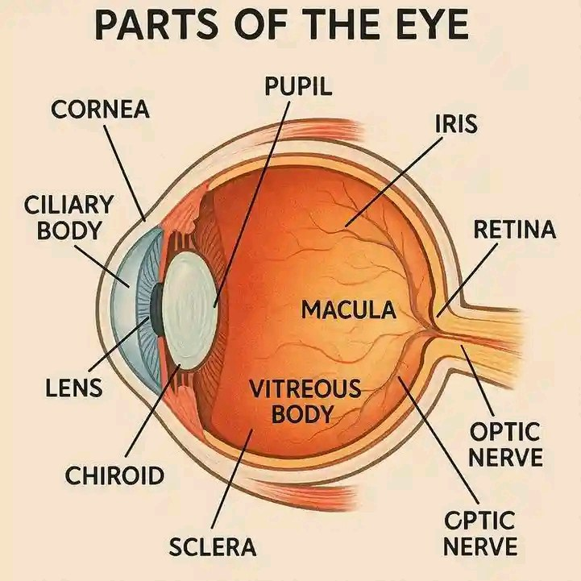
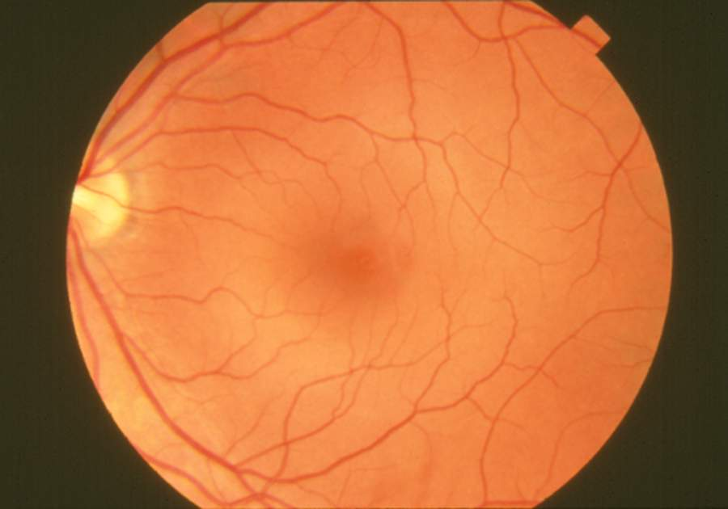
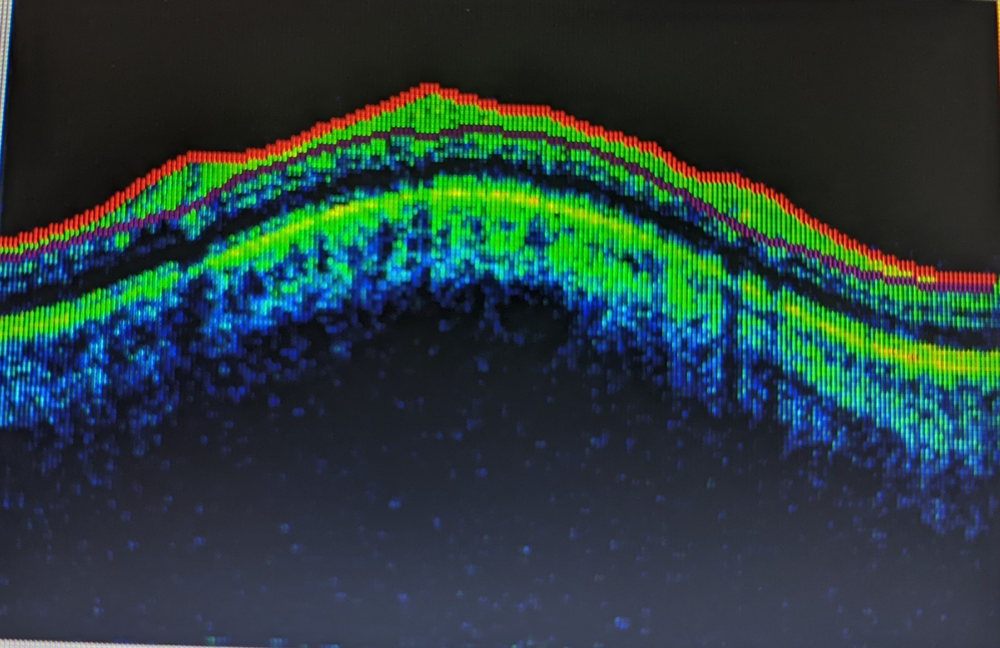

# 400 — Tổng quan Mắt & thị giác / Eye & visual pathway overview

**Tags:** `tong-quan`
**Mức chắc chắn (certainty):** tổng hợp y văn (literature synthesis).

## Hình ảnh nền tảng (giải phẫu & phương thức)
> Ba ảnh nền tảng để định hướng trước khi đọc các bài chi tiết: giải phẫu nhãn cầu → ảnh đáy mắt bình thường → OCT võng mạc bình thường.

| Giải phẫu nhãn cầu (anatomy) | Đáy mắt bình thường (fundus) | OCT võng mạc bình thường (macular OCT) |
|---|---|---|
|  |  |  |

- **Giải phẫu:** nhãn cầu = **giác mạc → tiền phòng → thuỷ tinh thể → dịch kính**; thành sau gồm **võng mạc (retina) – hắc mạc (choroid) – củng mạc (sclera)**; **hoàng điểm (macula)** ở cực sau, **đĩa thị (optic disc)** nơi các sợi trục và mạch trung tâm võng mạc ra vào.
- **Đáy mắt bình thường:** đĩa thị sáng, mạch xuất phát từ đĩa chia 4 hướng, **hoàng điểm sẫm hơn** (do biểu mô sắc tố dày), không xuất tiết/xuất huyết/đốm bông.
- **OCT võng mạc (quang học đồng tiêu — Optical Coherence Tomography):** cắt ngang võng mạc thành các lớp; **lõm trung tâm (foveal depression)** ở hoàng điểm là bình thường. OCT là chốt cho **phù hoàng điểm, dịch dưới võng mạc, màng trước võng mạc, teo/lớp sợi thần kinh (RNFL)**. (Xem bài [441](../441-OCT-hoang-diem/lesson.md), [442](../442-glaucoma-OCT/lesson.md).)
- Nguồn ảnh: Wikimedia Commons — CC0 (Aliyu Mohammed Aliyu), Public domain (NIH/NEI), CC BY-SA 4.0 (Bobjgalindo); chi tiết ở `images/CREDITS.md`.

## Bảng so sánh phân biệt bắt buộc (Mắt & thị giác)
| Mẫu hình (pattern) | Vị trí (location) | Gamut chính (DDx) | Phân biệt nhanh | Bài chi tiết |
|---|---|---|---|---|
| Cơ phì đại chừa gân | Hốc mắt (orbit) | Graves (TED) | Thân cơ to, gân bình thường | [421](../421-loi-mat-Graves/lesson.md) |
| Cơ phì đại cả gân | Hốc mắt | Viêm giả u (pseudotumor), cellulitis | Cả gân + đau + đáp ứng steroid | 422 |
| Vỡ sàn + kẹt cơ | Hốc mắt | Blow-out, trapdoor trẻ em | Giọt lệ (teardrop), nhìn đôi dọc | [420](../420-vo-san-hoc-mat/lesson.md) |
| Máu sau nhãn cầu / hốc mắt căng | Hốc mắt (ngoài nón – trong nón – đỉnh) | Hội chứng khoang (OCS) · máu tụ dưới màng xương · khí căng · áp-xe · CCF · u | **Lồi mắt + đau + RAPD/giảm thị lực + nhãn cầu cứng**; **IOP bình thường ở 10/24 trẻ** nên **không dùng IOP để loại trừ**; **thần kinh thị 32,0 vs 25,8 mm**, **PGA 128,7° vs 146,9°**, **SOV nhỏ 69%**; **canthotomy trong 60–120 phút** | [1510](../1510-hoi-chung-khoang-hoc-mat/lesson.md), [1514](../1514-mau-tu-duoi-gale-va-loi-mat-hai-ben/lesson.md), [420](../420-vo-san-hoc-mat/lesson.md) |
| **Nhãn áp tăng NGAY sau tiêm nội nhãn (đỉnh 30 giây, hết trong 30 phút)** | Tiền phòng – nhãn cầu (globe) | **Đỉnh thể tích · thiếu tưới máu · tăng IOP kéo dài · viêm nội nhãn · bọt khí · xước giác mạc** | **IOP 39,2 ± 12,4 mmHg (< 1 phút), 79,7% ≥ 25 mmHg, về 17,7 ± 6,5 ở phút 30 = sinh lý**; **> 50 mmHg + thị lực sáng tối → chọc tiền phòng**; đau tăng ngày 2–3 = viêm nội nhãn | [1465](../1465-tang-nhan-ap-sau-tiem-noi-nhan/lesson.md) |
| **Bong võng mạc trắng đục + "màng che" sau tiêm nội nhãn** | Võng mạc ngoại vi (vùng tiêm 3,5–4,0 mm) – hoàng điểm | **IVARD** · bong thanh dịch do bệnh nền/thuốc · bong co kéo · tách lớp võng mạc · bong hắc mạc | **Lỗ rách thấy khi soi 360° + ấn sclera = IVARD**; **0,02%/mũi anti-VEGF vs 0,134%/mũi implant DEX**; **63,5% đã bong hoàng điểm**, triệu chứng **6,5 ngày**; **OCT hoàng điểm bình thường không loại trừ** | [1469](../1469-bong-vong-mac-co-lo-sau-tiem-noi-nhan/lesson.md) |
| **Dịch dưới võng mạc VÒM NHẴN, KHÔNG có lỗ, EZ còn nguyên** sau tiêm/bóc màng | Khoang dưới võng mạc – hoàng điểm (subretinal space) | **Dịch hậu phẫu lành tính · CSC/pachychoroid · CNV · VKH · MEKAR · u hắc mạc (melanoma/osteoma/di căn) · bong hắc mạc** | **Có lỗ = RRD (mổ); không lỗ = tìm nguyên nhân**; **B-scan loại khối u**; **hai bên + lớn tuổi + FAF da báo = di căn**; CSC quan sát **3–6 tháng**, MEKAR **tới 90%** tự hết | [1479](../1479-bong-vong-mac-thanh-dich/lesson.md) |
| **Vòm dày trong nhãn cầu sau mổ, KHÔNG dính đĩa thị** (bong hắc mạc) | Khoang dưới hắc mạc (thể mi → quanh lỗ thị) | **Bong hắc mạc thanh dịch (hạ áp/viêm) · xuất huyết dưới hắc mạc (SCH) · bong võng mạc · xuất huyết dịch kính · viêm củng mạc sau (dấu T) · u hắc mạc · nanophthalmos · topiramate** | **Không dính đĩa thị = hắc mạc**; **dấu tam giác 36/36 = 100%** khi bong toàn bộ; trống âm = thanh dịch, hồi âm = máu; **tràn dịch sau trabeculectomy 5,4%**, hết trong **4,3 tháng**; **SCH phaco 0,03–0,1%**, mổ **7–14 ngày**; **dấu T là dịch dưới bao Tenon**, không phải bong hắc mạc | [1484](../1484-bong-hac-mac-sau-mo-mat/lesson.md) |
| **Lỗ rách võng mạc ngoại vi CHƯA bong** (nhá đèn/ruồi bay mới) | Võng mạc ngoại vi – xích đạo – ora serrata | **Lỗ có nắp có triệu chứng · lỗ nút · lỗ teo trong lattice · dialysis · GRT ≥ 90° · bong dưới lâm sàng · tách lớp võng mạc** | **9,9% mắt PVD có lỗ/bong**; laser quanh lỗ có triệu chứng → **< 5%** (thực tế **7,2%**); lỗ không triệu chứng **~0,5%/11 năm**; **25,1%** "đủ chỉ định" bị loại khi SS-OCT không thấy co kéo; GRT mắt bên kia **OR 0,14** | [1481](../1481-lo-rach-vong-mac-laser-du-phong/lesson.md) |
| **Bong võng mạc ở mắt ĐÃ CẤY IOL, lỗ nhỏ sát ora, PCO che lỗ** | Võng mạc ngoại vi – ora serrata – hoàng điểm (mắt pseudophakic) | **PRD · bong co kéo/PVR · bong hắc mạc · tách lớp võng mạc · bong thanh dịch · PVD đơn thuần** | **Màng dính đĩa thị + lỗ thấy khi ấn sclera = PRD**; **0,21% trong 1 năm (6.690/3.177.195)**, trung vị **139 ngày**, **59,9% < 6 tháng** nhưng **90% trong 14 năm**; **PCR HR 12,83**, sau PCR bong **9,4%**; **AL ≥ 26 mm + nam HR 16,3**, nguy cơ 5 năm **9,40%** (nam 40–59); **PPV ± đai: 79,0% vs 73,5% (p = 0,558)**; YAG **xung đột** (gộp RR **1,57** nhưng phân nhóm phaco **p = 0,95**) | [1487](../1487-bong-vong-mac-gia-the-thuy-tinh/lesson.md) |
| **Khối trắng–xám MỘT BÊN ở người lớn, không sẹo cũ kề bên** (unilateral white retinal mass) | Võng mạc – dịch kính – hoàng điểm | **Toxocariasis nội nhãn người lớn** · toxoplasmosis · u hạt lao/sarcoid · melanoma hắc mạc · DUSN · di vật | **U hạt 92,1% (cực sau 50,5%, ngoại vi 44,1%), di chuyển 16,1% = chốt; khuyết RNFL 53,2% vs 7,3%; IgE > 100 ở 69,6% nhưng ái toan chỉ 11,6%; IgG ≥ 0,250; Se IgE dịch ở người lớn chỉ 66,7%** | [1464](../1464-toxocariasis-noi-nhan-nguoi-lon/lesson.md) |
| **Nhãn áp tăng MUỘN sau xuất huyết dịch kính, mắt đã hết đỏ** | Tiền phòng – góc tiền phòng – dịch kính | **Tế bào ma (ghost cell) · hồng cầu tươi · tan máu · phacolytic · viêm · NVG · do corticoid** | **Tế bào nhỏ kaki + KHÔNG flare + góc mở = tế bào ma**; flare/KP = viêm; tân mạch góc = NVG; tế bào to = thể thủy tinh; IOP đỉnh **46,5 ± 8,0 mmHg** | [1457](../1457-glaucom-te-bao-hong-cau-sau-xuat-huyet-dich-kinh/lesson.md) |
| **Khí trong hốc mắt (lạo xạo, sưng mi)** | Hốc mắt – khoang ngoài nón – khe ổ mắt trên | Tràn khí đơn thuần · **tràn khí căng/OCS** · khí nội sọ · máu sau nhãn cầu · viêm mô tế bào sinh hơi | **Khí −1.000 HU + IOP 28 → 48 mmHg/24 giờ + lồi mắt + căng thần kinh thị = tràn khí căng**; **khí dọc khe ổ mắt trên → xoang hang/nội sọ dù không gãy xương** | [3105](../3105-tran-khi-o-mat-sau-cham-thuong-go-ma/lesson.md) |
| **Khuyết niêm mạc tiền vách, nhìn thấy độn hốc mắt** | Hốc mắt đã múc nhãn cầu (anophthalmic socket) | **Lộ độn** (thiếu xơ–mạch hóa · di lệch · nhiễm · peg · sau xạ) · nang kết mạc · u hạt · tái phát melanoma · co rút hốc mắt | **< 3 mm theo dõi, ≥ 3 mm mổ**; MRI gadolinium **cold zone phía trước**; **vá trực tiếp thất bại nếu độn còn di lệch**; nhiễm → **tháo độn + DFG** | [3228](../3228-lo-don-hoc-mat-sau-muc-nhan-cau/lesson.md) |
| **Sụp mi + liệt nhãn cầu tiến triển, không đau** | Cơ vận nhãn + hệ dẫn truyền tim (EOM, heart) | **KSS · CPEO · OPMD/OPDM · nhược cơ · TED · viêm cơ hốc mắt · tổn thương thân não** | **Khởi phát < 20 tuổi + sắc tố võng mạc + block dẫn truyền = KSS (1–3/100.000)**; **teo EOM đối xứng trên MRI = myopathic**; **dao động + không teo = nhược cơ**; **thân cơ to chừa gân = TED** | [498](../498-kearns-sayre-cpeo/lesson.md) |
| Vôi hóa trong nhãn cầu | Nhãn cầu (globe) | Retinoblastoma (trẻ), drusen đĩa thị, osteoma hắc mạc, phthisis bulbi (người lớn) | Tuổi + vôi hóa thô (RB) / vôi hóa đĩa (drusen) / xương trong hắc mạc (osteoma) | [412](../412-u-trong-nhan-cau/lesson.md) |
| Cơ cả gân/viêm | Hốc mắt | Giả u, cellulitis, IgG4 | Đau + cả gân + steroid 48h | [422](../422-viem-gia-u/lesson.md) |
| Mạch xoang hang | Xoang hang | Fistula, huyết khối | Tiếng thổi + SOV giãn | [423](../423-fistula-xoang-hang/lesson.md) |
| Khối tuyến lệ | Trên-ngoài (ngoài nón) | **PA · ACC · lymphoma · IgG4** · sarcoid · viêm túi lệ · dacryops · di căn | **Một thùy + T2 sáng + ADC > 1,14 = PA; cả hai thùy hai bên + ADC < 0,76 = lymphoma; phá xương + wedge trên = ACC; dây dưới ổ mắt dày = IgG4** | [424](../424-tuyen-le/lesson.md), [3230](../3230-khoi-tuyen-le/lesson.md) |
| **Mô mới trong hốc mắt SAU XẠ ACC tuyến lệ** | Giường mổ – đỉnh hốc mắt – khe ổ mắt trên – xoang hang – xương | **Tái phát · sẹo xơ · pseudoprogression/RICE · hoại tử xạ · RION · bệnh võng mạc do xạ · vạt/vật liệu · u thứ phát** | **Nốt đặc + T2 trung gian + ADC < 887 + lớn dần = tái phát; T2 tối + không ngấm + ADC cao + ổn định = sẹo; ngấm đỉnh ~3 tháng rồi giảm = pseudoprogression; viền ngấm + trung tâm hoại tử > 6 tháng = hoại tử xạ; mất thị lực không khối = RION** | [3233](../3233-theo-doi-acc-tuyen-le-sau-xa-va-tai-phat/lesson.md) |
| TK thị/giao thoa | TK-yên | Viêm, NAION, glioma/ONSM, adenoma | Đau + ngấm = viêm; tram-track = ONSM; bán manh = yên | [430](../430-duong-thi-giac/lesson.md), [431](../431-u-than-kinh-thi/lesson.md), [432](../432-vung-yen/lesson.md) |
| **ON tái phát/phụ thuộc steroid** | Thần kinh thị (optic nerve) | **CRION · MOG-ON · AQP4-ON · MS-ON · double-negative ON** · NAION · độc–chuyển hóa | **Ngấm dài ≥ 1/2 TK thị + AQP4 âm + tái phát khi giảm steroid = CRION**; **MOG-IgG (+) + đĩa phù + perineural = MOG-ON**; **AQP4 (+) + dài/chiasm + area postrema = NMOSD**; **ổ ngắn + OCB (+) + tổn thương não = MS** | [464](../464-viem-than-kinh-thi-tai-phat-CRION/lesson.md), [430](../430-duong-thi-giac/lesson.md), [434](../434-teo-thi-than-kinh-thi-doc-va-LHON/lesson.md) |
| Đĩa thị | Đĩa thị (disc) | Phù đĩa, drusen, IIH | Frisén 0–5; lõi tối = drusen | [433](../433-phu-dia-thi-drusen/lesson.md) |
| **Hắc mạc quanh đĩa dày + dịch TRONG võng mạc từ bờ đĩa** | Đĩa thị – hắc mạc quanh đĩa – hoàng điểm mũi | **PPS** · CSCR lan quanh đĩa · phù đĩa thị/IIH · NAION · drusen đĩa · CNV quanh đĩa · hố đĩa thị | **Túi dịch quanh đĩa + hắc mạc > 300 µm + PPA 100% + FA không rỉ = PPS**; **RNFL dày + đau đầu + áp lực mở > 25 cm CSF = phù đĩa thị**; **mạng CNV trên OCTA = CNV** | [405](../405-pachychoroid-quanh-dia-thi-pps/lesson.md) |
| Teo thị 2 bên | Thần kinh thị (optic nerve) | LHON, độc–chuyển hóa, viêm, **di truyền (DOA/Wolfram)**, chèn ép | **GCL mất sớm = LHON**; RNFL thái dương mỏng = độc chất/DOA; **teo thị + DM/điếc/ĐTĐ nhạt = Wolfram** | [434](../434-teo-thi-than-kinh-thi-doc-va-LHON/lesson.md), [439](../439-teo-thi-di-truyen/lesson.md) |
| Teo thị 2 bên + **ĐIẾC** (DOA+/WFS1 trội) | Thần kinh thị (optic nerve) + võng mạc + tai trong | **OPA1/DOA+** vs **WFS1 trội (Wolfram-like)** vs WS1 lặn (DIDMOAD) vs LHON vs độc chất vs glaucoma | **Điếc xuất hiện TRƯỚC teo thị (WFS1: 2 vs 10 tuổi) = WFS1**; **ANSD (ABR mất sóng + CM còn) + missense GTPase = OPA1**; **OPL lamination trên OCT = WFS1 trội** | [437](../437-teo-thi-kem-diec/lesson.md) |
| **VUS ở OPA1/WFS1** | Thần kinh thị + tai trong | **VUS ≠ bệnh, VUS ≠ lành**: OPA1 (AD), WFS1 (AR/AD), OTOF/AIFM1 (AN), đa hình lành | **PM2 + PP3 chỉ 2 điểm (VUS)**; cần **phân ly (PP1), de novo (PS2), chức năng (PS3)**; **2 biến thể P/LP mới phân độ được Wolfram** | [479](../479-tu-van-di-truyen-vus-opa1-wfs1/lesson.md) |
| **ĐTĐ sơ sinh + điếc + đục thể thủy tinh** | Thần kinh thị + tai trong + tụy + thể thủy tinh | **Hattersley–Urano (WFS1 trội nặng)** · Wolfram lặn · ĐTĐ sơ sinh kênh KATP · rubella/CMV bẩm sinh · m.3243A>G | **Tam chứng sơ sinh + một biến thể WFS1 missense = Hattersley–Urano**; **đái tháo nhạt + 2 biến thể LOF = Wolfram lặn**; **OPL lamination + điếc trước teo thị = WFS1 trội** | [499](../499-hattersley-urano-wfs1-troi/lesson.md) |
| **Người mang OPA1 không triệu chứng** | Thần kinh thị (RGC) | **OPA1 độ thấm không hoàn toàn (~70%)** · LHON carrier · WFS1 trội · drusen đĩa thị · glaucoma · chèn ép thị thần kinh | **RNFL/GCL thái dương mỏng dù VA 20/20 + phân ly gia đình = OPA1 dưới lâm sàng**; **drusen "lumpy bumpy" + siêu âm tăng âm = giả teo thị**; **mất theo vùng + lõm đĩa = glaucoma** | [1627](../1627-nguoi-mang-opa1-khong-trieu-chung/lesson.md) |
| Phù đĩa thị thiếu máu cấp (> 50 tuổi) | Thần kinh thị (optic nerve) | **AAION (GCA) vs NAION** vs viêm thị, PION, CRAO | Đĩa **nhợt trắng phấn + đốm bông + 2 bên + đau hàm → GCA (cấp cứu steroid)**; đĩa **sung huyết + disc-at-risk mắt lành → NAION (không steroid)** | [435](../435-gca-va-naion-aion/lesson.md) |
| **Sau NAION: mắt đối diện, tái phát, tiến triển** | Thần kinh thị (optic nerve) | **NAION tiến triển · NAION mắt đối diện (15–24%/5 năm) · tái phát cùng mắt (3–8%) · AION do GCA · NAION do GLP-1 RA** | **C/D nhỏ đối xứng + mất thị lực không đau lần nữa = mắt đối diện**; **xấu thêm 7–14 ngày = thể tiến triển (loại trừ GCA)**; **thuốc GLP-1 khởi đầu < 12 tháng = nguy cơ do thuốc** | [480](../480-naion-dieu-tri-va-theo-doi/lesson.md) |
| Thành mạch lớn dày / hẹp | ĐMC & nhánh (aorta/branches) | **TAK (< 40/≤ 60) vs GCA (≥ 50)** (C-GCA/LV-GCA), aortitis nhiễm khuẩn, xơ vữa, loạn sản cơ–xơ | **"Macaroni" tăng âm = TAK** vs **"halo" giảm hồi âm = GCA**; tuổi là chốt; PET = hoạt tính viêm | [436](../436-takayasu-vs-gca/lesson.md) |
| Biến chứng mạch lớn GCA / aortitis | ĐMC & nhánh (aorta/branches) | **Theo dõi dài hạn**: phình/tách thành ĐMC ngực, hẹp mạch, aortitis nhiễm khuẩn (loại trừ), hở van ĐMC | **Hoạt tính (FDG-PET, đảo ngược) tách rời tổn hại cấu trúc (CTA/MRA, tiến triển)**; **hết viêm KHÔNG hết nguy cơ**; ĐMC ngực HR 13,46; GC tích lũy = độc tính | [438](../438-theo-doi-dai-han-gca-bien-chung-mach-lon/lesson.md) |
| Tắc mạch võng mạc | Võng mạc (retina) | CRVO/BRVO, CRAO | Cherry-red + giờ vàng < 4–6 giờ | [444](../444-tac-mach-vong-mac/lesson.md) · [276](../276-tac-dong-mach-trung-tam-vong-mac/lesson.md) |
| **Trắng đục lan tỏa KHÔNG có điểm đỏ anh đào** | Võng mạc + hắc mạc + đoạn trước | **OAO** · CRAO · tắc động mạch mi sau (Amalric) · OIS · viêm màng bồ đào cấp | **Không điểm đỏ + OCT mất cả lớp ngoài + hắc mạc không đổ đầy = OAO**; tam giác ngoại vi = Amalric | [278](../278-tac-dong-mach-mat/lesson.md) |
| **Đáy mắt gần bình thường + ám điểm cạnh trung tâm** | Hoàng điểm – lớp nhân trong (INL) | **PAMM** · AMN · đốm bông · phù hoàng điểm · Purtscher | **Dải tăng phản xạ INL + EZ/IZ nguyên = PAMM**; **OPL/ONL + đứt EZ/IZ = AMN** | [279](../279-pamm-nhoi-mau-lop-giua/lesson.md) · [441](../441-OCT-hoang-diem/lesson.md) |
| Bong võng mạc | Võng mạc (retina) | Rách, co kéo, tiết dịch, PVR | Macula-on 24 giờ; V/Y dính đĩa | [445](../445-bong-vong-mac/lesson.md) |
| **Bong võng mạc SAU xạ trị u nội nhãn** | Võng mạc – hắc mạc (retina–choroid) | **Thanh dịch do u hoạt động · TRLE (rò lipid) · bong co kéo · lỗ rách do teo xạ · tràn dịch hắc mạc · tái phát u "giả bong"** | **U dày lên/mất hollow = u hoạt động → xạ lại; u phẳng + lipid = TRLE → anti-VEGF; màng co kéo/lỗ rách + đe dọa hoàng điểm = PPV; B-scan trước mọi ca** | [1441](../1441-bong-vong-mac-xa-sau-xa-tri-u-noi-nhan/lesson.md) |
| **Mủ tiền phòng + bất thường thấu kính** | Thể thủy tinh – tiền phòng (lens – AC) | **Phacoantigenic (bao vỡ) · phacolytic (bao nguyên) · lens particle · phacomorphic · viêm nội nhãn · TASS · SO** | **Tìm vật liệu thấu kính = chốt; cấy âm + mắt bên yên; IOP có thể bình thường lúc đầu → đo lại; không bỏ mắt khi chưa loại trừ SO** | [1443](../1443-viem-mang-bo-dao-do-thau-kinh/lesson.md) |
| **Viêm tiền phòng MỘT BÊN sau chấn thương kín** | Tiền phòng – mống mắt – thể mi (AC – iris – ciliary body) | **Viêm do chấn thương (lành tính) · SO khởi phát sớm · viêm nội nhãn (nếu xuyên thấu) · viêm do thấu kính · góc lõm · tách thể mi** | **Một bên + rách cơ vòng mống mắt + khởi phát 1–3 ngày = viêm do chấn thương**; **hai bên/u hạt = SO (khám mắt kia mỗi lần)**; **soi góc sau khi máu tan: ~50% trẻ có máu tiền phòng có góc lõm**; **tái chảy máu tới 38% trong tuần đầu** | [1444](../1444-viem-mang-bo-dao-sau-chan-thuong/lesson.md) |
| **Đau mắt nhiều hơn tổn thương + viêm thần kinh tỏa tia ở người đeo kính tiếp xúc** | Giác mạc – biểu mô đáy → nhu mô → thần kinh (cornea) | **Acanthamoeba** · herpes (đuôi gai bóng tận cùng) · nấm sợi (bờ lông vũ + vệ tinh) · vi khuẩn (mủ đặc, giờ) · Pythium · độc tố dung dịch kính | **Viêm thần kinh tỏa tia 46,2% (chỉ tồn tại ~13 ngày; viêm quanh thần kinh 91,9% trong 7 ngày đầu) + vòng Wessely 53,8% + mảng nội mô 69,2%; IVCM nang vách đôi 10–25 µm ở biểu mô đáy, Se 94%/Sp 87%; chẩn đoán ≤ 14 ngày OR 19,78, 23,5% mất mắt; corticoid trước chẩn đoán = melting** | [1472](../1472-viem-giac-mac-acanthamoeba/lesson.md) |
| **Loét giác mạc "kháng nấm" + tua, chấm nội nhu mô, rãnh ngoại vi** | Giác mạc – nhu mô + rìa (cornea – stroma – limbus) | ***Pythium insidiosum*** (oomycete, **không ergosterol**) · nấm sợi (bờ lông vũ, vệ tinh) · Acanthamoeba · Pseudomonas · HSV | **≥ 2 trong 5 dấu hiệu T–D–R–F–L → nghi Pythium** (AUC **0,896**, dương tính giả **1,4%**); **kháng nấm MIC > 128 µg/mL** vs **azithromycin 8 / doxycycline 4 µg/mL**; **cấy thạch máu** (Sabouraud dễ âm giả) + **PCR ITS**; **linezolid 0,2% + azithromycin 1% mỗi giờ**, ghép khi lan rìa | [3200](../3200-viem-giac-mac-pythium/lesson.md) |
| **Chấm/trợt biểu mô đa ổ dai dẳng, cấy âm, rìa fluorescein dương** | Giác mạc – biểu mô / nhu mô (epithelium – stroma) | **Microsporidia (MKC/MSK)** · HSV không điển hình · nấm · Acanthamoeba · *Pythium* · SPK do khô/độc tố | **Nhuộm modified trichrome 78,6% / ZN 89,5% / calcofluor** + **IVCM thấy vỏ kép phản xạ mạnh**; **cấy âm KHÔNG loại trừ**; **MKC** (nông, PHMB 0,02% lành **90%**) vs **MSK** (nhu mô, **9 tháng**, ghép **18/21**) | [3202](../3202-viem-giac-mac-do-microsporidia/lesson.md) |
| **Thâm nhiễm giác mạc bờ lông vũ + vệ tinh + mảng nội mô sau chấn thương thực vật** | Giác mạc – biểu mô → nhu mô → nội mô (cornea) | **Nấm sợi (*Fusarium*/*Aspergillus*)** · *Pythium* (tua, rãnh ngoại vi) · *Nocardia* · vi khuẩn · HSV · *Candida* · loét thần kinh dưỡng | **KOH 85,3% / IVCM 89,8% / cấy 75,7% — cấy âm KHÔNG loại trừ**; **natamycin 5% > voriconazole 1%** (thủng **34 vs 18**, p = 0,02); **AS-OCT mảng nội mô bờ mờ 25/28**; **TPK diệt nhiễm 89,9%, tái phát 10,1%** | [3216](../3216-viem-giac-mac-nam-soi/lesson.md) |
| **Ổ đặc màu KEM, bờ MỜ, đa ổ, tiến triển CHẬM — sau ghép nội mô hoặc bề mặt kém** | Giác mạc – nhu mô / mặt phân cách mảnh ghép (cornea – stroma – graft interface) | ***Candida*** (nấm men, **không sợi thật**) · nấm sợi (bờ lông vũ, vệ tinh) · vi khuẩn · HSV · *Acanthamoeba* · microsporidia · loét thần kinh dưỡng · **thải ghép (KP dày)** | **IVCM bào tử tròn 2–5 µm (Se 92,5% số mắt) — pseudohyphae chỉ 32,4% nên "không sợi" KHÔNG loại trừ**; **cấy âm → PCR ITS**; **trễ chẩn đoán 94,2 ngày, 27,5% bị điều trị như HSV**; **45% phải ghép xuyên, chỉ 20% đạt ≥ 20/200**; **ổ interface + mảnh ghép bong → bơm rửa/tiêm voriconazole 0,05 mg/0,1 mL, không tăng corticoid** | [3220](../3220-viem-giac-mac-nam-men-candida/lesson.md) |
| **Đám trắng ở MẶT PHÂN CÁCH sau ghép nội mô, khởi phát 1 tuần–2 năm, vành ghép cấy nấm dương** | Giác mạc – mặt phân cách mảnh ghép (graft–host interface) + vành ghép người hiến | **Nấm men lây từ người hiến (*Candida*)** · thải ghép nội mô · nhiễm vi khuẩn interface · NTM · nấm sợi · dịch interface · màng Descemet sót · TASS | **Vành ghép dương + cùng loài ở người nhận/mắt bạn = DTH**; **0/145–0/16 vành ghép dương không nhiễm** nên cấy dương KHÔNG đồng nghĩa nhiễm; **âm vành ghép KHÔNG loại trừ**; **~7% (1/15) nguy cơ nội nhãn ở EK**; **muộn tới 2–3 năm**; **tăng corticoid vì "thải ghép" làm nấm bùng** | [3226](../3226-nam-ghep-giac-mac-tu-nguoi-hien/lesson.md) |
| **Sẹo trắng khu trú, mắt không đỏ — ghép loại nào?** | Giác mạc – nhu mô / Descemet / nội mô (stroma – endothelium) | **Sẹo nông · sẹo sâu · phù nội mô · loạn dưỡng · band keratopathy · loạn sản bẩm sinh** | **AS-OCT đo độ sâu: ≤ 100 µm → PTK; 100–200 µm → SALK; > 200 µm + ECD > 1.000 → DALK; toàn bề dày/ECD < 1.000 → PKP; chỉ nội mô → DSEK/DMEK**; sẹo "yên" vẫn viêm mô học (**thải 56% vs 33%**) | [3201](../3201-seo-giac-mac-ghep/lesson.md) |
| **Mắt mềm / tiền phòng dẹt / Seidel dương — vá bằng gì?** | Giác mạc – nhu mô → Descemet → tiền phòng (cornea – AC) | **Descemetocele · thủng ≤ 3 mm · thủng 3–6 mm thiếu mô · tan chảy miễn dịch · mắt khô-neurotrophic · thủng + mủ tiền phòng · pseudocornea · hở vết mổ phaco** | **Seidel + kích thước + nhiễm hoạt động**: ≤ 3 mm → **keo** (dán 1 lần **56,5%**, dán lại **86,9%**) hoặc **màng ối 2 lớp không chỉ** (**kín 100%**, **14,2 ± 3,6 ngày**); 3–6 mm → **nút Tenon** (**87%**); > 5 mm/mô nhiễm → **PK**; **tháo keo chỉ khi AS-OCT kiểu 3** (sớm → **40% rò lại**) | [3203](../3203-de-doa-thung-giac-mac/lesson.md) |
| **Loét/khuyết biểu mô KHÔNG đau, mắt không đỏ — "khô mắt" mãi không lành** | Giác mạc – biểu mô → đám rối thần kinh dưới đáy (epithelium – SBNP) | **NK stage 1–3 · khô mắt nặng · phơi nhiễm/hở mi · loét nhiễm · PUK · LSCD · độc chất (BAK/thuốc tê)** | **Đo cảm giác mới tách được NK**: Cochet–Bonnet **≤ 40 mm**, bông chỉ **đặc hiệu 30,8%**; **AS-OCT điểm mỏng nhất** (thủng khi **< 200 µm**); cenegermin **74,0% vs 43,1%** lành (8 tuần, **6 lần/ngày**), tái phát **13,6%**; **luôn loại trừ nhiễm + sửa mi** trước | [3204](../3204-loet-giac-mac-than-kinh/lesson.md) |
| **Đau nhiều hơn tổn thương + khuyết biểu mô không lành + thâm nhiễm nhu mô hình vòng** | Giác mạc – biểu mô → nhu mô → nội mô (cornea) | **Lạm dụng thuốc tê** · độc tính **BAK** · Acanthamoeba (vòng Wessely) · HSV giả đuôi gai · nhiễm khuẩn/nấm · loét thần kinh (3204) · Mooren/PUK | **Ngừng thuốc tê 48–72 giờ là nghiệm pháp**: đau giảm + bờ khuyết liền = độc chất; **fluorescein KHÔNG tương quan IVCM** (tế bào gai **45,8 vs 24,0/mm²**, chiều dài sợi thần kinh AUC **0,992**); cấy dương **7/14 mắt** không loại trừ độc chất; BAK độc **dưới CMC 0,01%** qua ty thể | [3205](../3205-loet-giac-mac-do-thuoc-te-bak/lesson.md) |
| **Bỏng hóa chất + mất mạch rìa (limbal ischemia)** | Giác mạc – rìa – kết mạc (cornea – limbus – conjunctiva) | **Bỏng kiềm · bỏng acid/HF · bỏng nhiệt · SJS/TEN · hạt vôi còn sót · viêm giác mạc HSV** | **Số giờ rìa thiếu máu quyết định tiên lượng, không phải độ đục**: **< 1/3 = Roper–Hall II**, **1/3–1/2 = III**, **> 1/2 = IV**; **Dua > 9–< 12 giờ = V, 12 giờ = VI**; **pH < 6,5 hoặc > 7,5 dự báo LSCD**; **rửa đến pH ≈ 7, đo lại tới 1 giờ, lật mi lấy hạt**; **corticoid 7–10 ngày**, **AMT trong 2 tuần** | [1456](../1456-bong-hoa-chat-mat/lesson.md) |
| **Dải mờ NGANG vùng khe mi, mắt không đỏ, có "lỗ phô-mai" — đục thể thủy tinh hay bệnh giác mạc?** | Giác mạc – Bowman → nhu mô trước (cornea) | **Dải canxi (band keratopathy) · loạn dưỡng Schnyder · loạn dưỡng dạng giọt · thoái hóa dạng khí hậu · vành rìa Vogt · lắng đọng do thuốc phosphate/NSAID · phù giác mạc mất bù nội mô** | **Dải NGANG đúng khe mi + chừa 1–2 mm sát rìa + lỗ "Swiss cheese" + AS-OCT dải tăng phản xạ CÓ BÓNG MỜ phía sau** (không có bóng mờ = không phải cặn canxi đặc); EDTA sạch trục quang **97,8%**, tái phát **28,1%**; PTK cần nhu mô tồn dư **≥ 250 µm** | [3208](../3208-benh-giac-mac-dang-dai/lesson.md) |
| **Đục TRUNG TÂM hình đĩa ± tinh thể lấp lánh, mắt không đỏ, arcus ở người < 40 tuổi** | Giác mạc – Bowman → nhu mô TRƯỚC, trung tâm (cornea, anterior stroma) | **Loạn dưỡng Schnyder · band keratopathy · arcus lipoides đơn thuần · paraproteinemic keratopathy · cystinosis · lipid keratopathy thứ phát · Dieffenbachia/oxalate · lắng đọng thuốc · GDLD** | **Trung tâm + tiến triển theo TUỔI + arcus 23–38 tuổi + tinh thể dấu phẩy**; **chỉ 54% có tinh thể**; AS-OCT **tăng phản xạ nhu mô trước, sâu 100–140 µm** (có thể có bóng mờ); CCT **563 ± 44 µm**; **UBIAD1**, cholesterol **10×**; PTK **20/175 → 20/40**, PK **72% ≥ 20/50 / tái phát 21% / 5 năm** | [3211](../3211-loan-duong-giac-mac-schnyder/lesson.md) |
| **Bong võng mạc SAU viêm nội nhãn** | Võng mạc–dịch kính (retina–vitreous) | **Lỗ hoại tử (RRD) vs màng xơ co kéo (TRD/PVR) vs bong tiết dịch vs bong hắc mạc giả RD** | **Màng dính đĩa + aftermovement = võng mạc**; **lỗ đúng ổ chorioretinitis cũ + bong trong ngày = lỗ hoại tử**; **aphakia p = 0,014 / dính đồng tử sau p = 0,023**; bong **14,8%**, trung vị **27 ngày**, **81,3% < 2 tháng**, **bỏ mắt 31,3%** | [1402](../1402-bong-vong-mac-sau-viem-noi-nhan/lesson.md) |
| **Lỗ hoàng điểm thứ phát sau mổ bong võng mạc/ROP** | Hoàng điểm – dịch kính (macula – vitreous) | **Lỗ thật (ILM mất, bờ teo) vs pseudohole/lamellar hole vs lỗ co kéo do PVR vs lỗ do chấn thương** | **ILM đã bóc + bờ teo + dầu silicone = không thể vạt ILM → màng ối/ART**; đóng **91–100%** nhưng cải thiện thị lực chỉ **66%** ở lỗ tái phát; OCT type 1 vs type 2 | [1429](../1429-lo-hoang-diem-thu-phat-manh-oi/lesson.md) |
| Phù hoàng điểm viêm | Hoàng điểm (macula) | Uveitic CME vs DME | Anti-VEGF thất bại 3 mũi → steroid | [446](../446-phu-hoang-diem-viem/lesson.md) |
| **Màng đứt hoàng điểm MỚI trên mắt đã mổ bong võng mạc** | Hoàng điểm – dịch kính (macula – vitreous) | **sFTMH sau RRD · lỗ nguyên phát · lamellar hole · pseudohole · CME chưa thủng · lỗ do PFCL · lỗ do chấn thương** | **MLD tự đóng 128–162 µm vs không đóng 387–589 µm; tự đóng 5–18%, tái mở tới 71%, trung vị 56 ngày vs mổ 18,5 ngày; tiền triệu = dấu nứt hoàng điểm; PFCL 16% vs 0% (p = 0,012); CME sau mổ 75,9% vs 9,1%** | [1879](../1879-mang-dut-hoang-diem-sau-mo-bong-vong-mac/lesson.md) |
| **Phù hoàng điểm sau phacovitrectomy trên mắt BƠM DẦU** | Hoàng điểm – INL/Henle (macula) | **CME thật (Irvine–Gass) · dầu trong võng mạc (khoang giả) · co kéo ERM/PVR · dịch dưới võng mạc · thiếu máu hoàng điểm** | **Nang giảm hồi âm đều ở INL + khởi phát 28,83 ± 9,22 ngày = CME → lấy dầu giúp 411 → 267 µm trong 3 ngày**; **có đốm tăng hồi âm + tăng hồi âm lớp sâu + dầu 5.000 cSt/đã bóc ILM = dầu trong võng mạc, KHÔNG tiêm lặp**; tiêm trong dầu chỉ đạt 488 → 396 µm với 8,25 mũi | [1875](../1875-phu-hoang-diem-dang-nang-mat-bom-dau/lesson.md) |
| **Nhìn mờ + OCT có nang 1 tuần–8 tháng sau phaco KHÔNG biến chứng** | Hoàng điểm – INL/OPL (macula) | **PCME/Irvine–Gass · DME · CSCR (do corticoid) · ERM co kéo · CME do prostaglandin (1882) · viêm nội nhãn** | **Có ≥ 1 yếu tố nguy cơ (phù mắt đối bên OR 19,5 · bệnh võng mạc ĐTĐ 13,1 · tắc tĩnh mạch 12,6 · ERM 5,6) + nang INL/OPL không co kéo = PCME**; **SRF không nang + "mỏ chim" = CSCR → giảm corticoid**; **mủ tiền phòng 3–7 ngày = viêm nội nhãn**; dự phòng NSAID chỉ hơn placebo ở nhóm **có nguy cơ** (p = 0,031 vs 0,858) | [1478](../1478-du-phong-phu-hoang-diem-sau-phaco/lesson.md) |
| **Trục quang mờ lại sau phaco trên mắt bơm dầu (PCO)** | Bao sau – bao trước – IOL – tiền phòng | **PCO màng xơ/Elschnig · xơ co bao trước · đục mặt trước IOL · dầu nhũ tương/màng dầu · dầu tiền phòng** | **Màng SAU IOL + bờ tới xích đạo = PCO → YAG (3,5–4,5 mm, năng lượng thấp); màng DỪNG ở bờ haptic = đục IOL (YAG vô ích); vòng bao trước co = mở bao bằng mổ; bọt dầu ở bờ đồng tử + tiền phòng nông = dầu tiền phòng, IOP tới 67 mmHg**; YAG sau phacovitrectomy: **27,41% phải YAG/6 năm**, bong võng mạc **1,39%/12 tháng** | [1873](../1873-bao-sau-duc-thu-phat-mat-bom-dau-yag/lesson.md) |
| **Trục quang mờ lại sau phacovitrectomy KHÔNG còn dầu (PCO)** | Bao sau – IOL – màng hyaloid trước | **PCO màng xơ · ngọc trai Elschnig · thể hỗn hợp · màng hyaloid trước · IOL canxi hóa · phimosis bao trước · CME/ERM** | **Màng SAU IOL + bờ tới xích đạo = PCO thật**; khe IOL–bao trên OCT: **xơ 25,4 µm (14,20 mJ/mm²)** vs **ngọc trai 112,1 µm (5,75 mJ/mm²)**; năng lượng theo độ **22,30 / 41,62 / 79,52 mJ** (độ 2/3/4); **< 1,8 mJ/nhát + hội tụ 100–200 µm sau bao**; PCO tới YAG **29,1 vs 36,3 tháng** (**HR 1,337**); YAG **không** tăng bong ở phaco (**p = 0,95**; **HR 1,03**) nhưng mắt đã PPV **13,8% CME** (ERM); mở bao sau thì đầu **4,4% vs 28,2%** | [1492](../1492-duc-bao-sau-iol-yag-sau-cat-dich-kinh/lesson.md) |
| **Mất thị lực KHÔNG đau + bong vòm hoàng điểm** | Hoàng điểm – hắc mạc (macula – choroid) | **CSCR (do corticosteroid/nội sinh)** vs CNV/AMD vs PICCP/VKH vs NAION vs HCQ | **Rà soát corticosteroid mọi đường + OCT bong vòm + FA rò điểm + ICGA tăng thấm = CSCR**; **ICGA giảm tưới máu = viêm hắc mạc mao mạch**; **dịch mới ở bệnh nhân uveitis đang dùng steroid KHÔNG được tăng steroid** | [470](../470-cscr-do-corticosteroid-mat-thi-luc-khong-dau/lesson.md) |
| **SRF dai dẳng + hắc mạc dày + KHÔNG drusen** | Hoàng điểm – hắc mạc (macula – choroid) | **CSCR hoạt động · PNV (type 1 MNV) · PCV · nAMD drusen-driven · PPE** | **SIRE/dấu hai lớp + OCTA có mạng mạch dưới RPE = PNV → anti-VEGF; OCTA âm = CSCR → half-dose PDT**; **polyp trên ICGA = PCV → anti-VEGF + PDT**; **16% PNV có SCT < 200 µm nên hắc mạc mỏng không loại trừ** | [482](../482-tan-mach-hac-mac-sau-cscr-man/lesson.md) |
| **Dịch/ PED "nằm thấp" trên nền loạn dưỡng hoa văn (PRPH2)** | Hoàng điểm – võng mạc ngoài – hắc mạc | **CNV type 1/2 trên PRPH2 · vật liệu vitelliform · teo RPE tiến triển · foveal crack sign · AMD thể tân mạch (bệnh giả)** | **FAF hình cánh bướm/ hình trứng đối xứng + khởi phát < 50 tuổi = PRPH2, không phải AMD**; **OCTA có flow dưới RPE = CNV kể cả khi KHÔNG dịch → anti-VEGF; không flow = vật liệu/ teo → theo dõi**; **foveal crack sign: không flow, không tiêm**; **CNV ở PRPH2 3–17% tùy đoàn hệ** | [1407](../1407-cnv-loan-duong-hoa-van-prph2/lesson.md) |
| **Phù hoàng điểm ở mắt ĐÃ XẠ TRỊ** | Hoàng điểm – đĩa thị (macula – optic disc) | **Bệnh hoàng điểm do xạ · tái phát u · RON · ĐTĐ · CRVO/BRVO · thiếu máu mắt** | **Tổn thương khớp bản đồ liều + không dày u trên siêu âm = do xạ → anti-VEGF; kháng ≥ 3 mũi → implant DEX 0,7 mg/FAc 0,19 mg (EZ còn nguyên mới có lợi ích chức năng); u dày lên/dịch trên u = tái phát → điều trị u; ngấm thuốc đầu dây thần kinh thị trên MRI = RON**; **45–55 Gy vào ≥ 1/2 võng mạc → RR 53%; 20 Gy/2 lần × 10 Gy vẫn gây RON sau 18 tháng; EZ nguyên vẹn +6,4 chữ vs teo RPE −11,7 chữ** | [1409](../1409-benh-vong-mac-do-xa-sau-xa-tri/lesson.md), [1418](../1418-phu-hoang-diem-xa-khang-anti-vegf/lesson.md) |
| **Trẻ sau xạ sọ–hốc mắt: đỏ mắt, sợ ánh sáng, chảy nước mắt, nhìn kém dần** | Bề mặt nhãn cầu – tuyến lệ (ocular surface – lacrimal gland) | **Khô mắt do xạ · rối loạn tuyến Meibomius · thiếu tế bào gốc vùng rìa · giác mạc thần kinh dưỡng · viêm kết mạc do thuốc/GVHD** | **Dmean tuyến lệ > 10 GyEQD2 → khô mắt > 20% (74 mắt, theo dõi 9 năm); Schirmer ≤ 5 mm/5 phút + TBUT < 10 giây + nhuộm fluorescein 1/3 dưới; chảy nước mắt phản xạ không loại trừ khô; tuyến lệ teo/thay mỡ trên CT–MRI = mất chức năng** | [1470](../1470-kho-mat-do-xa-o-tre/lesson.md) |
| **Trẻ sau xạ trị u não/retinoblastoma có tổn thương mới** | Võng mạc – hoàng điểm ở trẻ | **Bệnh võng mạc do xạ · tái phát retinoblastoma · xuất huyết sau xạ · trắng mạch thoáng qua · Coats-like** | **Khối đặc/tăng kích thước = tái phát; phù nang + mạch khớp bản đồ liều = do xạ; OCTA còn dòng = trắng mạch thoáng qua, không đốt**; **23,4 Gy/13 lần vẫn gây trắng mạch thoáng qua; plaque 45 Gy → bệnh võng mạc do xạ 15%, xuất huyết u 30%** | [1419](../1419-vong-mac-xa-tre-sau-xa-tri/lesson.md), [1458](../1458-benh-than-kinh-thi-do-xa-o-tre/lesson.md) |
| **Mù KHÔNG đau sau xạ vùng trên yên/hốc mắt, RAPD (+)** | Dây thị – giao thoa (optic nerve – chiasm) | **RION · tái phát u tại giao thoa · viêm thị do ICI · NAION/AION · teo thị do glôcôm sau xạ** | **Ngấm thuốc đối xứng, dừng ở ranh giới liều, Dmax dây thị > 50 Gy, tiềm tàng 3 tháng–3 năm = RION; khối lệch bên lớn dần + nang/vôi = tái phát; ngấm vỏ dây thị + đau khi liếc + đang anti-PD1 = ICI**; **PENTEC 57 Gy → 5%, 64 Gy → 50%; trẻ u cơ vân RION chỉ khi Dmax > 53 GyEQD2** | [1458](../1458-benh-than-kinh-thi-do-xa-o-tre/lesson.md) |
| **Đồng tử trắng ở trẻ RB ĐÃ điều trị** | Thể thủy tinh – dịch kính (lens – vitreous) | **Đục do xạ · đục do melphalan IAC/tiêm nội nhãn · đục do corticoid · tái phát RB/seeds · bong võng mạc tiết dịch** | **PSC hạt/vacuole, không khối, tiềm tàng 1–5 năm = đục; B-scan có khối/canxi/seeds = tái phát (KHÔNG mổ đục); 5 chu kỳ IAC + 9 tháng = melphalan; PENTEC 9 Gy → 50% đục** | [1459](../1459-duc-the-thuy-tinh-do-xa-sau-retinoblastoma/lesson.md) |
| Lác ở trẻ sinh non/ROP — quyết định mổ | Cơ vận nhãn (extraocular muscles) | **Lác trong sơ sinh**, **lác điều tiết**, **lác cảm giác/ROP**, **giả lác ngoài do hoàng điểm lệch**, lác ngoài gián đoạn | **Cover test là chốt** (Hirschberg "ngoài" + cover test "trong" = giả lác ngoài); **khúc xạ lý liệt + đeo kính 6–8 tuần trước khi mổ**; **mổ hai mắt ưu tiên** (mổ một mắt OR 6,49–7,20 tái mổ); **ROP phải ổn định trước mổ** | [472](../472-phau-thuat-lac-tre-sinh-non-rop/lesson.md) |
| **Lác ngoài THỨ PHÁT sau mổ lác trong** | Cơ vận nhãn + thị giác hai mắt | **CXT muộn do sẹo giãn · tụt/mất cơ MR · CXT "tự phát" ở lác trong điều tiết · lác cảm giác · lác ngoài ở bại não · Duane đã mổ** | **Thành công động học 95,9% (1 năm) → 54,9% (10 năm), trung vị 130 tháng, 14,0% quá chỉnh**; **khép hạn chế + góc ngoài ≥ 15 PD sau ≥ 6 tháng = CXT cơ học → đưa MR ra trước (1 mm ≈ 3,5 PD)**; **khép đầy đủ + ≤ 20 PD → over-minus 8–12 tuần**; **xuất hiện ≤ 2 tuần + khép −3/−4 = tụt cơ → MRI + mổ lại sớm** | [1405](../1405-lac-ngoai-thu-phat-sau-mo-lac-trong/lesson.md) |
| **Đo khúc xạ ở trẻ Down/bại não/tự kỷ** | Hệ thị giác trẻ có nhu cầu đặc biệt | **Loạn thị ở Down (70,3%) · keratoconus ở Down (15% mắt 9–18 tuổi) · viễn thị cao ở bại não/chậm phát triển · sai số thiết bị ở tự kỷ** | **Down/rối loạn TKTW → tropicamide 1% thay cyclopentolate**; **đồng tử ≥ 6 mm + mất phản xạ sáng mới đọc**; **bias Retinomax−Plusoptix −2,12 D trước, −1,37 D sau lý liệt → không thay thế máy**; **CCT 479 µm/Kmax 49,2 D ở Down = nghi keratoconus → tomography + CXL** | [1412](../1412-do-khuc-xa-ly-liet-tre-dac-biet/lesson.md) |
| **Keratoconus ở trẻ Down — sàng lọc & theo dõi** | Giác mạc (cornea) | **Nền mỏng–dốc đối xứng của nhóm · keratoconus sớm (lệch khu trú) · keratoglobus · pellucid · biến dạng do kính/dụi mắt · hydrops** | **Nền Down: CCT 479 µm, Kmax 49,2 D, BAD-D 2,5 → một tham số KHÔNG đủ, cần ≥ 3/4 (Kmax > 48 D · IS > 1,4 · BAD-D > 1,6 · độ cao sau > 10 µm)**; **tiến triển > 1 D/năm → CXL epi-off dưới gây mê**; **ghép DALK sống 67–85%** | [1414](../1414-keratoconus-down-syndrome/lesson.md) |
| **VKC + keratoconus ở trẻ — CXL quanh viêm** | Kết mạc sụn mi/rìa – giác mạc | **VKC thể sụn mi · thể rìa · loét khiên · keratoconus · glôcôm do corticoid · GPC do kính** | **KC trong VKC tới 26,8%, bất thường tomography tới 71%**; **viêm hoạt động = chống chỉ định CXL**; **VKC đã kiểm soát: K steep −2,02 D sau 12 tháng, 3/38 mắt thấm vô khuẩn**; **Bonini 0–4**; **trẻ dùng dexamethasone: 82,2% tăng IOP, +10 mmHg** | [1451](../1451-vkc-keratoconus-cxl/lesson.md) |
| Đốm trắng võng mạc | Võng mạc–hắc mạc | MEWDS, AZOOR, PIC, serpiginous | FAF đốm sáng tự khỏi vs bờ lan | [447](../447-dom-trang-vong-mac/lesson.md) |
| Viêm hoại tử võng mạc | Võng mạc (retina) | ARN, CMV retinitis, PORN | Vitritis ↔ mức miễn dịch; PCR dịch nội nhãn | [452](../452-hoai-tu-vong-mac-ARN-CMV/lesson.md) |
| Viêm mạch võng mạc (bệnh hệ thống) | Võng mạc (retina) | **Behçet vs lupus (SLE)**, sarcoid, ARN/CMV, lymphoma masquerade | **Vitritis + thoát thuốc "dương xỉ" trên FFA = Behçet**; **đốm bông + SLEDAI cao, ít vitritis = lupus** | [455](../455-behcet-lupus-mat/lesson.md) |
| Viêm võng mạc–màng mạch suy giảm miễn dịch KHÔNG HIV | Võng mạc (retina) | CMV sau ghép/ung thư máu/thuốc ức chế miễn dịch | **Viêm nhiều hơn HIV** (dễ nhầm ARN); **PCR máu có thể âm** → PCR dịch tiền phòng; tái phát → tìm u lympho ẩn | [454](../454-viem-vong-mac-suy-giam-mien-dich/lesson.md) |
| Theo dõi & tái hoạt CMV retinitis sau ghép | Võng mạc (retina) | Tái hoạt muộn, IRU, bong võng mạc; **ngừng kháng virus** | **Tái hoạt = tiến triển so ảnh UWF nền tảng** (không phải sẹo cũ); HIV ngừng khi **≥ 3 tháng điều trị + lành + CD4 ≥ 100 ≥ 3 tháng trên ART**; **không HIV không có ngưỡng CD4 phổ quát** | [459](../459-theo-doi-dai-han-cmv-retinitis/lesson.md) |
| Viêm dịch kính mạn ở người lớn tuổi (giả uveitis) | Võng mạc–dịch kính (retina–vitreous) ± CNS | **U lympho nội nhãn (PVRL)** vs viêm màng bồ đào (trung gian, giang mai, lao, MFC), nấm, amyloidosis | **Ổ vàng–kem dưới RPE + đục dịch kính ít viêm + hai mắt ở tuổi > 60, đáp ứng corticoid một phần rồi tái phát** → sinh thiết dịch kính; chốt **IL-10 dịch kính > 400 pg/mL**, **IL-10:IL-6 > 1**, **MYD88 L265P** | [462](../462-u-lympho-noi-nhan-PVRL/lesson.md) |
| Nhiễm trùng nội nhãn nội sinh (nấm) | Võng mạc–dịch kính (retina–vitreous) | **Nấm (Candida/Aspergillus)** vs vi khuẩn nội sinh (Klebsiella) vs CMV/ARN vs u lympho (masquerade) | **"Fluff ball"/"quả cầu tuyết"/"chuỗi ngọc trai" + bối cảnh candidemia/catheter/TPN/ICU/giảm bạch cầu hạt; phần lớn KHÔNG triệu chứng** → soi đáy mắt **bắt buộc**, cấy/PCR dịch kính; **corticoid nội nhãn = chống chỉ định** | [463](../463-viem-noi-nhan-noi-sinh-nam/lesson.md) |
| **Chọn kháng nấm theo loài & kháng sinh đồ** | Dịch kính–võng mạc (vitreous–retina) | **Candida** vs **Aspergillus** vs **Fusarium** vs **Mucorales** vs nấm sẫm màu | **Loài quyết định thuốc**: Candida → fluconazole/voriconazole/echinocandin; Aspergillus → voriconazole + cắt dịch kính sớm; **Fusarium → natamycin + voriconazole, echinocandin VÔ HIỆU**; **rezafungin/ibrexafungerp không tác dụng với Fusarium** | [474](../474-khang-nam-noi-nhan-chon-thuoc-theo-loai/lesson.md) |
| **Viêm màng bồ đào giả danh do u lympho T/NK hoặc u lympho thứ phát** | Võng mạc–dịch kính–hắc mạc–thể mi | **ENKTL (T/NK)** vs **PVRL tế bào B** vs **u lympho thứ phát** vs melanoma hắc mạc vs viêm màng bồ đào | **IL-10:IL-6 < 1 ở 71% u lympho T** → **KHÔNG loại trừ bằng IL-10**; chốt **EBER/EBV DNA + CD56/TIA-1/GrB**; **dày hắc mạc 2,8–3,2 mm** = nghĩ u lympho thứ phát (kể cả sau 5 năm) | [473](../473-u-lympho-T-NK-va-u-lympho-thu-phat-o-mat/lesson.md) |
| **Viêm tiền phòng–dịch kính sau mổ/tiêm: TASS vs nấm ngoại sinh** | Tiền phòng → dịch kính; ổ cố định trên IOL/bao thể thủy tinh | **TASS** vs **nấm ngoại sinh** vs vi khuẩn nội nhãn vs *P. acnes* vs tồn dư vỏ thể thủy tinh | **12–48 giờ + phù limbus-to-limbus + KHÔNG viêm dịch kính + cấy âm + đáp ứng corticoid = TASS**; **> 2 tuần + sợi/tia trên IOL + cấy/PCR nấm = ngoại sinh** (cấy dương chỉ **13,8%**); **lấy IOL khi ổ còn trên IOL** | [495](../495-viem-noi-nhan-nam-ngoai-sinh-vs-TASS/lesson.md) |
| **Điều trị u lympho T/NK nội nhãn** | Dịch kính–võng mạc + bệnh hệ thống mũi–họng | **ENKTL** vs PVRL tế bào B vs viêm màng bồ đào vs CMV retinitis | **Asparaginase là trục** (CHOP CR ~30%): DDGP OS 5 năm **74,3%** vs SMILE **51,7%**; MTX nội nhãn **400 µg** → lui bệnh mắt **82,4%**; **EBV DNA < 3.255 copies/mL**; allo-HSCT R/R OS 2 năm **57,6%** | [496](../496-u-lympho-T-NK-noi-nhan-dieu-tri-va-ghep/lesson.md) |
| Chọn thuốc & phác đồ anti-VEGF cho ROP | Võng mạc (retina) | **Bevacizumab vs ranibizumab vs aflibercept vs conbercept vs laser** | Zone I/A-ROP → anti-VEGF (thuốc dai, liều thấp); **IR: IVB 11% · IVC 16% · IVR/IVA 27%**; khoảng tái điều trị BCZ 6,7 tuần > RBZ 3,1 tuần; RD gộp 1,4% | [461](../461-chon-thuoc-phac-do-anti-vegf-cho-rop/lesson.md) |
| Mù bẩm sinh + điếc ở trẻ trai (Norrie) | Võng mạc + tai trong (retina & inner ear) | **Norrie (*NDP*, X-linked lặn)** vs FEVR/IP/Coats/RB | **Nam đủ tháng + bong võng mạc hai bên + điếc tiến triển + chậm phát triển**; **mẹ mang gen → con trai 50% mắc**; xét gen *NDP* + chẩn đoán trước sinh | [467](../467-norrie-di-truyen-tu-van-va-theo-doi/lesson.md) |
| **Tổn thương võng mạc ngoài do thuốc (ngoài HCQ)** | Võng mạc (retina) | **Tamoxifen (nang giả + mất EZ) · clofazimine (tinh thể + mắt bò) · deferoxamine/quá tải sắt (teo võng mạc ngoài + FAF đốm) · ức chế MEK (MEKAR)** vs HCQ, MacTel 2, CSCR | **MEKAR = bong thanh dịch hai bên đối xứng, không nâng RPE, hắc mạc bình thường, KHÔNG ngừng thuốc ung thư**; **tamoxifen = nang giả hoàng điểm + OCTA bình thường**; **clofazimine = ám điểm trước khi đáy mắt đổi**; **teo + FAF đốm = đối chiếu ferritin** | [487](../487-nhiem-doc-vong-mac-thuoc-khac-ngoai-hcq/lesson.md) |
| **HCQ trong thai kỳ & cho con bú** | Võng mạc (retina) + mẹ–thai | **HCQ retinopathy** vs **tiền sản giật/PRES** vs CSCR vs IIH vs tắc mạch (tăng đông) vs ĐTĐ | **Thai kỳ KHÔNG tăng tốc độc tính → giữ HCQ suốt thai (EULAR 2024/ACR 2020)**; **mờ mắt + HA/protein niệu = nghĩ tiền sản giật trước**; **nồng độ ≤ 500 ng/mL gắn bùng phát nặng (không phải độc tính)** | [488](../488-hcq-trong-thai-ky-va-cho-con-bu/lesson.md) |
| **Theo dõi & tái phát PVRL (tiến triển CNS)** | Võng mạc–dịch kính ± CNS | **Tái phát nội nhãn** vs **độc tính MTX (keratopathy 41,2%)** vs **bệnh võng mạc do xạ** vs nhiễm trùng vs **sẹo RPE không hoạt động** vs **"nơi trú ẩn" quanh implant** | **Mắt sạch KHÔNG loại trừ CNS: 60–90% tiến triển CNS, ~1/3 đã có CNS lúc chẩn đoán**; **MRI não có gadolinium mỗi 4–6 tháng**; **IL-10 âm tính hóa < 10 pg/mL**; **tổn dư OCT bất biến = sẹo, không phải tái phát** | [491](../491-pvrl-theo-doi-tai-phat/lesson.md) |
| **Triệu chứng thần kinh/thị giác MỚI sau điều trị u lympho nội nhãn** | Chất trắng não (trung tâm bán bầu dục, vành tia, quanh não thất) ± đường thị giác | **MTX leukoencephalopathy** vs **tái phát PCNSL** vs **PML** vs **hoại tử phóng xạ** vs **PRES** vs nhồi máu | **DWI sáng + ADC TỐI + KHÔNG ngấm + không hiệu ứng khối = độc tính MTX**; tLE tích luỹ **15,1% (6 tháng) – 29,2% (2 năm) – 32,0% (5 năm)**, **IT MTX HR 4,50**, trung vị **3,0 tháng**; **tái phát = khối ngấm + hiệu ứng khối** | `494`, `491`, `462`, `213` |
| **Suy giảm nhận thức sau điều trị PCNSL/PVRL** | Chất trắng trán–đỉnh + mạng nhận thức | **Di chứng MTX/tLE** vs tái phát u vs xạ vs trầm cảm–mệt mỏi vs suy giáp/OSA | **8/33 suy giảm dù không than phiền; IPCG z ≤ −1,5; giảm > 1 z = có ý nghĩa; MoCA < 26 dương tính giả cao; ổ ngấm mới = tái phát** | [1421](../1421-nhan-thuc-sau-doc-than-kinh-mtx/lesson.md) |
| **Sinh thiết nội nhãn & xử lý mẫu** | Dịch kính, võng mạc, hắc mạc | **Chọc hút tiền phòng** vs **chọc hút dịch kính** vs **PPV chẩn đoán** vs **FNAB võng mạc 41G** vs **sinh thiết hắc–võng mạc** | **Mẫu nguyên chất 0,5–1,0 mL TRƯỚC infusion** (pha loãng → cytokine thấp giả tạo); **23G/25G, không 27G** (27G giảm sống sót tế bào u); **nộp toàn bộ cassette: tế bào học 75% → 92%**; **ly tâm 500 × g/5 phút** | [492](../492-sinh-thiet-hac-vong-mac-dich-kinh/lesson.md) |
| **Viêm nội nhãn nội sinh do VI KHUẨN (Klebsiella/S. aureus)** | Hắc mạc–võng mạc → dịch kính; ổ nhiễm ngoài mắt: gan, tim, đường niệu, catheter | **Klebsiella (áp-xe gan) vs S. aureus/Streptococcus (endocarditis/catheter)** vs nấm (463) vs PVRL (462) vs ARN/CMV | **Ổ MỦ DƯỚI VÕNG MẠC lớn + tiến triển giờ–ngày + đái tháo đường/áp-xe gan**; **tiền phòng có thể CHỈ hypopyon nhẹ** → soi đáy mắt, tiêm nội nhãn ngay; **CT: áp-xe thùy trái/hai thùy + xâm lấn tĩnh mạch gan (OR 148)** | [475](../475-viem-noi-nhan-noi-sinh-vi-khuan/lesson.md) |
| **Thứ tự can thiệp khi áp-xe gan KÈM viêm nội nhãn** | Hắc mạc–võng mạc–dịch kính + gan | **Tiêm nội nhãn trước/đồng thời vs dẫn lưu gan trước** vs chờ cấy vs chờ 24 giờ | **Cửa sổ 48 giờ; tiêm nội nhãn ≤ 48 giờ; dẫn lưu gan SONG SONG nếu ổ > 5 cm; cắt dịch kính khi mủ đặc che đĩa thị hoặc xấu sau 24 giờ; 31% đạt CF, 31% NLP** | [1420](../1420-ap-xe-gan-klebsiella-va-viem-noi-nhan/lesson.md) |
| **Viêm nội nhãn CẤP sau tiêm nội nhãn** | Tiền phòng → dịch kính | **Nhiễm khuẩn (Staph/Strep) · vô khuẩn–độc · nấm muộn · bùng phát viêm màng bồ đào** | **< 24 giờ + đau ít + cấy âm = vô khuẩn; 1–7 ngày + mủ + đau = nhiễm**; **0,033–0,081%/mũi tiêm; implant dexamethasone 0,125% vs anti-VEGF 0,033%; B-scan: màng dịch kính 70%, bong võng mạc 8%; EVS: PPV khi LP, HM trở lên chọc–tiêm tương đương** | [1425](../1425-viem-noi-nhan-sau-tiem-noi-nhan/lesson.md) |
| **Mắt đỏ sau tiêm nội nhãn ở người dùng thuốc chống đông/kháng kết tập tiểu cầu** | Kết mạc → tiền phòng → dịch kính | **SCH lành tính · hyphema · xuất huyết dịch kính đột phá · xuất huyết hắc mạc · viêm nội nhãn** | **SCH đơn thuần + thị lực không đổi = TIẾP TỤC thuốc**; **3.106 mũi: 0 biến chứng xuất huyết** (warfarin 548, clopidogrel 523, aspirin 1.254); hyphema **1/10.000**; **đau + mủ + viêm dịch kính = viêm nội nhãn**, không phải "chỉ là máu" | [1449](../1449-tiem-noi-nhan-o-benh-nhan-dung-thuoc-chong-dong/lesson.md) |
| **Viêm nội nhãn TÁI PHÁT / KHÔNG đáp ứng** | Tiền phòng → dịch kính → implant/vỏ bao | **Ổ kín/fibrin · kháng vancomycin (VRE/VRSA) · biofilm trên implant/IOL · nấm · masquerade** | **Không giảm sau 48–72 giờ hoặc mủ quay lại = kiểm soát ổ thất bại → PPV**; **cấy âm 37–44% (lần hai còn thấp hơn)**; **kháng vancomycin 11,1% ca cấy dương, 100% đa kháng**; **implant DEX: khởi phát 33 ngày, tái phát 20 ngày sau PPV**; **dexamethasone nội nhãn: 265 mắt, không lợi ích thị lực** | [1426](../1426-viem-noi-nhan-tai-phat-khong-dap-ung/lesson.md) |
| **Hai mắt cùng viêm/giảm thị lực sau tiêm HAI MẮT CÙNG NGÀY** | Tiền phòng + dịch kính **hai bên** (đối xứng) | **Viêm vô khuẩn do thuốc/lô · nhiễm khuẩn từ lọ/lô · TASS · tăng IOP cấp · xuất huyết dưới kết mạc · bùng phát uveitis · bong võng mạc** | **Đối xứng + kết mạc yên + đau ít + mủ không đặc = vô khuẩn** (aflibercept 8 mg: **3,7%/mũi**); **mủ đặc + đau tăng + cùng lô = nhiễm khuẩn → cấy + kháng sinh nội nhãn CẢ HAI MẮT + cách ly lô**; nguy cơ **mỗi buổi = 2 × mỗi mũi**; **69.239 buổi/138.478 mũi: 0 ca hai bên, 33 ca một mắt (0–0,53%/mũi)** | [1427](../1427-tiem-anti-vegf-hai-mat-cung-ngay/lesson.md) |
| **Tăng nhãn áp sau tiêm/implant CORTICOID nội nhãn** | Bè củng mạc – góc tiền phòng ± dịch kính | **Steroid response · implant lạc tiền phòng · viêm bè · thể keo tồn lưu · glaucoma tân mạch · pupillary block** | **Đỉnh IOP tháng 2–3 với DEX-I; ≥ 25 mmHg hoặc tăng ≥ 10 mmHg = OHT; góc MỞ + tiền phòng TRONG = steroid response; thanh implant ở góc dưới + phù giác mạc = lạc tiền phòng 0,63% → LẤY implant; FAc 0,19 mg: OHT 24,6%, KHÔNG tự hết vì implant không phân hủy**; tích lũy **50–60% (≥ 21) · 25–30% (≥ 25) · 6–7% (≥ 35 mmHg) ở 12–24 tháng**, mổ glaucoma **0,9%** | [1411](../1411-tang-nhan-ap-do-corticoid-noi-nhan/lesson.md) |
| **Mắt đỏ đau + IOP 40–60 + tiền phòng SÂU + thể thủy tinh chín** | Thể thủy tinh – tiền phòng (lens – AC) | **Phacolytic** · lens particle · phacoantigenic · viêm nội nhãn · TASS · glôcôm góc đóng cấp | **Dịch tiền phòng như sữa + hạt/tinh thể + góc MỞ + thể thủy tinh chín = phacolytic → LẤY thể thủy tinh**; **IOP 40,05 ± 12,0 mmHg (279 mắt)**; **0,64% ca mổ đục thể thủy tinh**; **có IOL không loại trừ (ca 7 năm sau phaco, IOP 60)**; **mủ thật + vitritis = viêm nội nhãn** | [1452](../1452-glaucom-do-the-thuy-tinh-chua-mo/lesson.md) |
| **Đã lấy thể thủy tinh vì phacolytic — đặt IOL ở đâu?** | Bao thể thủy tinh – rãnh thể mi – tiền phòng | **IOL trong bao** · **IOL 3 mảnh rãnh thể mi** · IOL cố định mống mắt/củng mạc · **aphakia** · IOL 1 mảnh acrylic ở rãnh (chống chỉ định) | **Bao–zonule quyết định: bao vững → trong bao; hỏng vành bao → rãnh 3 mảnh; mất bao → cố định mống mắt/củng mạc; viêm nặng → aphakia tạm**; **95,5% IOL ở rãnh, 5,1% aphakia, đứt zonule 7,5%, rách bao sau 3,9%**; **IOP < 21 mmHg 83,3%, thị lực ≥ 6/18 73,1%**; **IOL không chữa teo thị do tăng áp kéo dài (6/120)** | [1454](../1454-dat-iol-mat-phacolytic/lesson.md) |
| **Ghép giác mạc xong nay mổ đục thể thủy tinh — công suất IOL bao nhiêu?** | Giác mạc ghép (PK/DALK/DSAEK/DMEK) – tiền phòng – IOL | **Công thức chuẩn theo K quy ước** · **Barrett True K + total keratometry** · **ray tracing (OKULIX/Olsen)** · **aphakic refraction** · **add-on toric rãnh thể mi** (pseudophakic) | **Cắt chỉ làm Km trước 41,99 → 46,37 D, ACD 3,31 → 3,53 mm, AL không đổi → công suất giảm −4,67 ± 5,42 D (PK) vs −2,49 D (DALK); đo lại 1 tháng sau cắt chỉ**; **triple DMEK: BUII MAE 0,74 D, 72% trong ±1 D, nhắm −0,75 đến −1,0 D**; **loạn thị không đều ≤ 3 mm: SimK IOLMaster > Pentacam**; **pseudophakic + −9,8 D → add-on toric +11,0 D, SE 0,0 D, 20/25** | [1462](../1462-sinh-trac-iol-sau-ghep-giac-mac/lesson.md) |
| **Tiền phòng dẹt + nhãn áp cao sau mổ nội nhãn (PI đã thông)** | Tiền phòng – thể mi – dịch kính trước | **Aqueous misdirection (glôcôm ác tính)** vs bít đồng tử, tắc bao, xuất huyết trên hắc mạc, tràn dịch thể mi, rò vết mổ | **PI thông + tiền phòng dẹt ĐỀU + LV 0,46 mm/AVD 0,69 mm (vượt đường gai củng mạc) + không dịch trên hắc mạc** = misdirection; **atropine 1% (KHÔNG pilocarpine)**; **2–4% sau mổ glôcôm, khởi phát tới 2.920 ngày sau phaco**; **ZHV 100%/6 tháng**; **CBTmax trước cơn 0,87 vs 0,95 mm, AUC 0,74** | [1448](../1448-glaucoma-ac-tinh-sau-mo-noi-nhan/lesson.md), [418](../418-nanophthalmos-tran-dich-hac-mac/lesson.md), [1452](../1452-glaucom-do-the-thuy-tinh-chua-mo/lesson.md) |
| **Giác mạc phù sau ghép nội mô (DSAEK/DMEK), thị lực không cải thiện** | Giác mạc – mặt phân cách mảnh ghép (cornea – graft interface) | **Bong mảnh ghép** · interface fluid (mặt phân cách cũ, IOP cao) · nếp gấp mảnh ghép · màng Descemet còn sót · mảnh ghép lật ngược | **Dải tối dưới mảnh ghép trên AS-OCT + CCT 1 tuần > 600 µm hoặc BCVA không cải thiện = bong ≥ 1/3, phải rebubble**; **bong < 1/3, < 500 µm ngoại vi → theo dõi, rebubble không lợi**; **19% sổ đăng ký DMEK**; **thất bại ghép 30% vs 9% sau rebubble** | [1445](../1445-bong-manh-ghep-dsaek-dmek-rebubble/lesson.md) |
| **Tầm soát mắt ở trẻ candidemia (NICU)** | Võng mạc–dịch kính sơ sinh | **Candida chorioretinitis (không viêm dịch kính)** vs **ROP** vs CMV/toxo bẩm sinh vs xuất huyết do sinh | **Cấy máu/nước tiểu dương *Candida* = soi đáy mắt + chọc dịch não tủy cho MỌI sơ sinh (IDSA mức mạnh)**; **ổ vàng–kem đơn độc, không viêm dịch kính vẫn là bệnh thật**; **2,7% sơ sinh nhiễm nấm xâm lấn có tổn thương mắt** | [476](../476-tam-soat-mat-candidemia-nhi/lesson.md) |
| U hắc mạc | Hắc mạc (choroid) | Melanoma, nevus, di căn | Dày ≥ 2 mm + T1 sáng = melanoma | [448](../448-u-hac-mac/lesson.md) |
| **U lympho hắc mạc (nguyên phát/thứ phát)** | Hắc mạc → có thể lan ngoài củng mạc | **U lympho** vs melanoma thể lan tỏa vs hemangioma vs di căn vs **VKH** vs tràn dịch hắc mạc | **Dày hắc mạc lan tỏa 830–920 µm + hồi âm THẤP + đốm giảm huỳnh quang ICGA 100% + FAF bình thường 59%**; **siêu âm đo quá +66%** so với EDI-OCT; corticoid **không** cải thiện | [493](../493-u-lympho-nguyen-phat-hac-mac/lesson.md) |
| **Võng mạc ĐTĐ trong THAI KỲ** | Võng mạc (retina) + mẹ–thai | DME, PDR/VH, TRD vs **tiền sản giật** vs CSCR vs thay đổi sinh lý | **Không DR + HbA1c < 53 mmol/mol → 0/175 tiến triển STDR**; DR nền trung bình → PDR **29%**; đoàn hệ ghép cặp 2025 **aHR 0,64** (không tăng); nguy cơ **đến 12 tháng sau sinh** | [490](../490-vong-mac-dai-thao-duong-trong-thai-ky/lesson.md) |
| **Chấn thương hở nhãn cầu trên CT** | Nhãn cầu–hốc mắt | Vỡ (BETT) vs rách xuyên vs xuyên thủng vs IOFB; giả khí/dầu silicone/mảng củng mạc | **Mất thể tích + bờ củng mạc gián đoạn** (spec **> 98%**); CT gộp **sens 77%/spec 94%**, **20%** chỉ một dấu; thang CT **A+P+G 0–10** | [449](../449-chan-thuong-mat-dich-vat/lesson.md) |
| OCT | Hoàng điểm/RNFL | DME/AMD, glaucoma | CST ≥ 300 µm; asymmetry > 9 µm | [441](../441-OCT-hoang-diem/lesson.md), [442](../442-glaucoma-OCT/lesson.md) |
| Võng mạc ĐTĐ | Võng mạc (retina) | NPDR/PDR, DME | 4-2-1; CST ≥ 300 µm; PRP 1200–1600 | [443](../443-vong-mac-dai-thao-duong/lesson.md) |
| Tân mạch võng mạc trẻ sinh non | Võng mạc (retina) | ROP (ICROP) | Non tháng ≤ 30 tuần/≤ 1500 g + zone/stage/plus; **AP-ROP = cấp cứu** | [456](../456-benh-vong-mac-tre-sinh-non/lesson.md) |
| Bệnh "giả ROP" ở trẻ đủ tháng | Võng mạc (retina) | **FEVR, Norrie, incontinentia pigmenti, Coats**, PFV/PHPV; **Coats plus** (CTC1) khi hai bên + bệnh hệ thống | **Trẻ ĐỦ tháng** (không sinh non) + leukocoria/bong võng mạc; **FA ngoại vi là chốt**; loại trừ **retinoblastoma** trước; **Coats-like HAI BÊN + vôi hóa/nang não = Coats plus** | [457](../457-benh-gia-rop-tre-du-thang/lesson.md), [465](../465-coats-plus-syndrome-ctc1/lesson.md), [413](../413-PFV-PHPV-day-xo-the-thuy-tinh/lesson.md) |
| **Leukocoria + nhãn cầu nhỏ + dây xơ neo đĩa thị** | Nhãn cầu (globe) | **PFV/PHPV** vs retinoblastoma, Coats, ROP 5, FEVR, toxocariasis | **Dây xơ từ đĩa thị tới bao sau thể thủy tinh + AL ngắn + có mạch trong dây (Doppler) + KHÔNG vôi hóa** = PFV; **vôi hóa thô + khối đặc** = RB (loại trừ trước, không sinh thiết nội nhãn) | [413](../413-PFV-PHPV-day-xo-the-thuy-tinh/lesson.md), [412](../412-u-trong-nhan-cau/lesson.md) |
| **Nhãn cầu nhỏ + TĂNG nhãn áp (nghịch lý "mắt bé")** | Tiền phòng – thể mi (anterior chamber, ciliary body) | **PFV/CFPM thể trước** vs glaucoma bẩm sinh nguyên phát (PCG), Peters, aniridia, Sturge–Weber, retinoblastoma thứ phát | **Màng xơ dính đồng tử 360° + UBM thấy mỏm thể mi cuộn vào màng + ACD 1,50 mm + AL dài hơn mắt lành 3,4 mm** = CFPMSG; **HAI BÊN + không màng + HCD/AL tăng** = PCG | [414](../414-glaucoma-va-nhan-cau-nho-o-pfv/lesson.md), [413](../413-PFV-PHPV-day-xo-the-thuy-tinh/lesson.md), [442](../442-glaucoma-OCT/lesson.md) |
| **Mắt nhỏ/không nhãn cầu + khuyết cực sau (phổ MAC)** | Nhãn cầu – hốc mắt (globe, orbit) | **Anophthalmia, nhãn cầu nhỏ đơn thuần, coloboma hắc–võng mạc, nhãn cầu nhỏ + nang, nang mắt bẩm sinh**, Morning Glory, staphyloma quanh đĩa | **Nhãn cầu < 20 mm (AP) + CD < 10 mm**; **cổ nang thông với củng mạc = nhãn cầu nhỏ + nang**; **không có mô nhãn cầu trong nang = nang mắt bẩm sinh**; **mất viền hắc mạc T1 sáng ở đáy = coloboma**, còn viền = staphyloma | [415](../415-phe-nhan-cau-nho-coloboma/lesson.md), [411](../411-sieu-am-nhan-cau/lesson.md), [413](../413-PFV-PHPV-day-xo-the-thuy-tinh/lesson.md) |
| **Đục giác mạc bẩm sinh trung tâm ± dính mống mắt** | Tiền phòng – giác mạc – góc | **Peters I/II/III**, Peters plus, sclerocornea, anterior staphyloma, Axenfeld–Rieger, PCG, chấn thương sinh | **Khuyết hậu mạc trung tâm + dây mống mắt (UBM) = Peters I**; **+ thể thủy tinh dính = Peters II**; **mất rìa + mạch hóa = sclerocornea**; **HCD 11,5 mm/AL 20,8 mm vẫn có thể là Peters** | [416](../416-di-tat-tien-phong-o-tre/lesson.md), [414](../414-glaucoma-va-nhan-cau-nho-o-pfv/lesson.md), [442](../442-glaucoma-OCT/lesson.md) |
| **Hõm đĩa thị hình phễu + búi glia trung tâm** | Đĩa thị – hốc mắt – nền sọ đường giữa | **Morning Glory (MGDA)** vs coloboma đĩa thị, hố đĩa thị, staphyloma quanh đĩa, PFV giả MGDA | **Búi glia + mạch tỏa tia + mất liên tục củng mạc trên T2** = MGDA; **độ sâu hõm/AL ≥ 0,25 → OR 2,10 bong võng mạc**; **45% có bất thường mạch não/đường giữa → MRI + MRA mọi ca** | [417](../417-hoi-chung-morning-glory/lesson.md), [415](../415-phe-nhan-cau-nho-coloboma/lesson.md), [431](../431-u-than-kinh-thi/lesson.md) |
| **Khối đường giữa mũi/vòm/xoang + khuyết xương nền sọ** | Nền sọ trước – xoang bướm – hốc mắt | **Thoát vị não nền sọ** vs glioma mũi, dermoid, polyp/mucocele, ung thư xoang, u màng não dây thị | **Khuyết xương bờ nhẵn + dải dịch não tủy/mô não liên tục với nội sọ, không ngấm thuốc** = BE; **BE 1/35.000–40.000; thể bướm < 5% BE, 1/700.000**; **suy tuyến yên 47,1%, xấu đi sau mổ 48,5%**; **KHÔNG sinh thiết khối đập theo mạch** | [419](../419-thoat-vi-nao-nen-so/lesson.md), [417](../417-hoi-chung-morning-glory/lesson.md), [432](../432-vung-yen/lesson.md) |
| **Nhãn cầu ngắn + hắc mạc dày + bong tiết dịch** | Củng mạc – hắc mạc | **UES type 1/2/3** vs VKH, viêm củng mạc sau, tràn dịch do thuốc, glaucoma ác tính | **AL < 20,5 mm + củng mạc 2,1–3,2 mm + dịch trên hắc mạc không viêm** = nanophthalmos/UES; **glaucoma 51,88%**; **cắt củng mạc 96,2% sau 1 mổ** | [418](../418-nanophthalmos-tran-dich-hac-mac/lesson.md), [411](../411-sieu-am-nhan-cau/lesson.md), [1436](../1436-benh-vogt-koyanagi-harada/lesson.md) |
| **U hạt ngoại vi + dây co kéo dịch kính** | Võng mạc–dịch kính (retina–vitreous) | **Toxocariasis nội nhãn (OLM)** vs retinoblastoma, Coats, PFV, FEVR, Toxoplasma, DUSN | **Trẻ + u hạt ngoại vi (90% thái dương) + dây xơ co kéo tới đĩa thị + ELISA *Toxocara* (+)** = OLM; **loại trừ RB (canxi hóa thô) trước**; **FA có thể bỏ sót u hạt** | [466](../466-toxocariasis-noi-nhan/lesson.md) |
| **U hạt toxocariasis "đã phẳng" rồi thị lực giảm lại** | Võng mạc–dịch kính (hoàng điểm + chu biên) | **CNV · TRD · CME · ERM · tái phát u hạt** vs sẹo cũ, bong nguyên phát, nang võng mạc ngoại vi | **Tái phát 6 tháng 17,4%** (corticoid + albendazole) vs **54,5%** (corticoid đơn thuần); **TRD tái phát sau mổ 24–42%**; **CNV: dịch dưới võng mạc + rò thì muộn, anti-VEGF 1+PRN ~1,4 mũi**; **nang ngoại vi 2–2,6 mm không rách ≠ bong** | [426](../426-toxocariasis-theo-doi-bien-chung-muon/lesson.md) |
| **Viêm dịch kính + đốm xám trắng ngoại võng mạc MỘT BÊN, đốm đổi chỗ** | Võng mạc–dịch kính (retina–vitreous) | **DUSN (xác định/giả định)** vs toxocariasis, MEWDS, APMPPE, MFC, toxoplasmosis, viêm thần kinh thị, RP một bên | **Ấu trùng thấy được chỉ 25–40%**; **tổn thương đổi vị trí giữa 2 lần chụp + ERG âm (sóng b giảm > sóng a) + RNFL 80,25 vs 104,75 µm** = DUSN; **không thấy giun (60–75%) → DUSN giả định, albendazole 400 mg/ngày × 30 ngày** | [425](../425-dusn-au-trung-di-dong-duoi-vong-mac/lesson.md) |
| Di chứng & theo dõi dài hạn sau ROP | Võng mạc (retina) | Tái hoạt sau anti-VEGF, cicatricial, cận thị/lác/nhược thị, bong VM muộn, glaucoma góc đóng | **Chuỗi ảnh phân biệt tái hoạt (tiến triển) vs di chứng (ổn định)**; anti-VEGF theo dõi **≥ 65 tuần PMA**; khúc xạ liệt điều tiết + chỉnh thị | [458](../458-di-chung-theo-doi-dai-han-sau-rop/lesson.md) |
| Bệnh võng mạc tăng huyết áp/bệnh máu | Võng mạc (retina) | HTR (KWB), thiếu máu, sickle cell, leukemia | Đốm bông + xuất huyết tia + sao hoàng điểm ← HA cao; Roth spot ← thiếu máu | [453](../453-benh-vong-mac-tang-huyet-ap-va-thieu-mau/lesson.md) |
| **Bong võng mạc thanh dịch HAI BÊN + hắc mạc dày** | Hắc mạc – võng mạc (choroid, retina) | **VKH** vs viêm màng bồ đào giao cảm, viêm hắc mạc do ICI, viêm củng mạc sau, thoát dịch hắc mạc, CSC hai bên, u lympho nội nhãn, lao/giang mai/sarcoid | **SFCT bình thường 220–360 µm; VKH cấp 900–940 µm + BALAD + HDD đối xứng trên ICGA + KHÔNG tiền sử chấn thương/mổ** = VKH; **có chấn thương/mổ nội nhãn mắt kia = viêm giao cảm**; **corticoid chỉ đỡ tạm + đốm dưới RPE + IL-10/IL-6 > 1 = u lympho** | [1436](../1436-benh-vogt-koyanagi-harada/lesson.md), [1438](../1438-viem-mang-bo-dao-giao-cam/lesson.md), [1435](../1435-hoi-chung-masquerade-u-lympho-noi-nhan/lesson.md), [411](../411-sieu-am-nhan-cau/lesson.md) |
| Màng dịch kính | Nhãn cầu (globe) | Bong võng mạc, XH dịch kính, bong hắc mạc | V/Y dính đĩa = võng mạc; aftermovement = máu; T-sign = hắc mạc | [411](../411-sieu-am-nhan-cau/lesson.md) |
| **Đục thể thủy tinh chín/đậm — không soi được đáy mắt, có phải B-scan trước mổ?** | Hậu đoạn (dịch kính – võng mạc – hắc mạc) + bao sau thể thủy tinh | **Bong võng mạc do rách · bong co kéo · bong hắc mạc · retinoschisis · asteroid hyalosis · viêm dịch kính · phù phép · rơi nhân/dị vật · u** · đường cong bao sau trên **25 MHz** · **dấu hai đỉnh** | B-scan phát hiện **90/750 (12%)** mắt có bệnh hậu đoạn (chấn thương **39/71 = 55%** vs **51/679 = 7,5%**); đổi kế hoạch mổ **154/9.820 (1,57%)**; **32,2%** đục chín có bệnh hậu đoạn chỉ lộ sau mổ, **mắt bên kia OR 47,72**; **không loại trừ**: TRD độ nhạy **72,4%**, PCR trên đục cực sau bỏ sót **2/4** dù dùng 25 MHz, lỗ teo **< 0,2–0,5 mm không thấy**; ESCRS 2024 **GRADE +** dùng siêu âm khi không nhìn rõ hậu đoạn; **hai đỉnh 80–90%** = vỏ hóa lỏng → cờ Argentina | [1498](../1498-sieu-am-bscan-truoc-phaco-hau-doan/lesson.md) |
| **Đốm đục tròn nhiều vòng ở CỰC SAU thể thủy tinh, mắt còn trong** | Cực sau thể thủy tinh – bao sau (lens pole, posterior capsule) | **PPC type 1–4 (Daljit Singh) · hở bao sau có sẵn · pseudohole · PSC · mảng xơ bao sau · posterior lenticonus · Mittendorf dot** | **Rách bao sau 3,4% type 1 → 10,4% type 2 → 75% type 3** (388 mắt); **AS-OCT: hở 14/100, 12/13 ca PCR đã có hở trước (Se 92,3% · Sp 97,7% · NPV 98,8%)**; **SS-AS-OCT bao liên tục → PCR 1,9% (1/54)** vs **abrupt → 25% (4/16)**; **25 MHz bỏ sót 2/4 PCR**, hồi âm cao giữa đục và bao = **dính**; **đục > 4 mm + tuổi < 40**; **YAG ≥ 4–6 tuần** | [1504](../1504-duc-the-thuy-tinh-cuc-sau/lesson.md) |
| **Đồng tử giãn 6,5 mm + mống mắt lượn sóng rồi sa ra vết mổ trong phaco (bệnh nhân dùng tamsulosin)** | Mống mắt – tiền phòng – vết mổ giác mạc (iris, anterior chamber, wound) | **IFIS do α1-antagonist · pseudoexfoliation · dính sau · co đồng tử do chấn thương/dòng chảy · sa do rò vết mổ** | **Tam chứng Chang + DMR mỏng 354,6 vs 446,9 µm (p < 0,001) + PL ratio < 58,7% (AUC 0,913)**; tamsulosin **RR 13,85 (7,34–26,11)**; **ngừng thuốc không loại trừ** (đã có ca sau ngừng 2 năm); IFIS làm ca mổ **+101,34 €** và **biến chứng 18,75% vs 4,32%** | [1508](../1508-hoi-chung-mong-mat-dan-hoi-ifis/lesson.md) |
| **Đồng tử 5,5 mm + vảy trắng bờ đồng tử + rung thể thủy tinh ở người 72 tuổi** | Bao trước – dây chằng Zinn – mống mắt (capsule, zonule, iris) | **PEX · IFIS · dính sau · xơ cơ thắt (tuổi/ĐTĐ) · đứt zonule do chấn thương · Marfan/homocystinuria** | **Vảy + ba vùng bao trước + phacodonesis** = PEX; **172.008 mắt: đứt dây chằng RR 6,7, PCR 2,3, rơi nhân 2,5, dùng CTR 38,8; trật IOL muộn RR 7,3**; trật trong bao **0,5–3% sau 6–12 năm**, **PEX 66,7%** loạt 45 ca; **CTR không sút chỉ không ngăn biến chứng** (p = 0,64) | [1512](../1512-pseudoexfoliation-truoc-phaco/lesson.md) |
| **PEX + đục thể thủy tinh + IOP 24 mmHg trên 1 thuốc: chọn phaco đơn thuần, thêm MIGS hay lọc?** | Góc tiền phòng – bè củng mạc – thể thủy tinh (angle, trabecular meshwork, lens) | **PEXG · POAG · góc đóng/phacomorphic · phacolytic · glôcôm do steroid · tân mạch** | **Đích 15–18: phaco đơn thuần (−3,0 đến −4,5 mmHg); đích 13–15: phaco + MIGS (KDB −6,9; Hydrus −4,6); đích ≤ 12: phacotrabeculectomy/Preserflo (11–12 mmHg)**; **GATT chỉ 82,5% đạt < 12 so với 92,0% của trab**; **87,3% ca PXF có glôcôm không từng ghi nhận IOP cao** | [3223](../3223-pex-glaucoma-phaco-migs-trab/lesson.md) |
| **Thanh trắng 6 × 0,46 mm ở góc dưới tiền phòng + phù giác mạc MỘT BÊN** | Giác mạc–tiền phòng (cornea, AC) | **Implant dexamethasone lạc** vs mảnh thể thủy tinh còn sót, vòng Soemmering, ống dẫn lưu, mảnh cannula, mảnh ghép DMEK bong | **Tiêm nội dịch kính ≤ 4 tuần + thanh đúng 6 mm bo tròn + mắt PPV/pseudophakic = implant lạc** (lạc **1,6%**, **4,8%** nếu PPV); **CCT 655 µm + 20/400 → lấy implant → 560 µm + 20/32**; **37,5% phải ghép giác mạc**, triệu chứng→mổ dài hơn **p = 0,007** | [1428](../1428-phu-giac-mac-sau-implant-tien-phong/lesson.md) |
| **Mảnh trắng bờ nham nhở < 2 mm ở góc dưới + phù giác mạc MỘT BÊN nhiều năm sau phaco** | Giác mạc–tiền phòng (cornea, AC) | **Mảnh thể thủy tinh (nhân/haptic) còn sót** vs mảnh vỏ mềm, vòng Soemmering, implant DEX lạc, mủ tiền phòng thật, mảnh ghép DMEK bong, giọt dầu silicon | **Phaco 4–15 năm trước + mảnh 0,96 × 0,75 mm ở 6 giờ dính nội mô + IOP 14–15 mmHg + CDVA 20/200** → **rửa tiền phòng → 20/40 sau 3 tháng**; **ECD 458 tế bào/mm²** sau lấy mảnh; **arcus che góc → UBM/AS-OCT là chốt** | [1442](../1442-manh-the-thuy-tinh-con-sot/lesson.md) |
| **Dầu/nhũ tương dầu trong tiền phòng + giác mạc mờ dần** | Giác mạc–tiền phòng (cornea, AC) | **Bệnh dải do dầu (28% khi giữ dầu ≥ 6 tháng) · mất bù nội mô do dầu (4,7–12%) · lắng đọng dưới biểu mô · pupillary block** vs phù sau phaco, viêm nội nhãn | **Khe sáng hẹp: dải khúc xạ sắc nét, di động = dầu; mờ dày lan tỏa = phù**; ECD giảm **7,6% (0–38,1)** trung bình nhưng **30% mắt không giảm**; canxi dải → **EDTA 0,05 mol/L 5–30 phút** | [1837](../1837-dau-silicone-tien-phong-ton-thuong-noi-mo/lesson.md) |
| **Dầu trong tiền phòng đọng NỬA DƯỚI + tăng nhãn áp muộn** | Giác mạc–tiền phòng–góc (cornea, AC, angle) | **Dầu silicone NẶNG (HSO, 1,02–1,06 g/cm³) đọng đáy** vs mủ tiền phòng, dầu nhẹ nổi trên, PFCL tồn lưu, đục thể thủy tinh | **Bờ trên lớp dầu NGANG theo trọng lực + tiền sử dầu nặng = HSO**; **UBM: góc DƯỚI tăng echo (p < 0,01) với Densiron XTRA, góc TRÊN với dầu 2.000/5.000 cSt**; IOP vọt **> 30 mmHg trong 14 ngày** (overfill) vs tăng muộn (bít bè); **1 tháng vs 3 tháng: dính 91,6% vs 81,8%** nhưng 3 tháng tăng IOP và mất lợi ích thị lực | [1864](../1864-dau-silicone-nang-bien-chung-phia-duoi/lesson.md) |
| **Mắt còn bóng khí — đo AL/công suất IOL thế nào?** | Khoang dịch kính (gas) – tiền phòng – thể thủy tinh/IOL | **Sinh trắc quang qua khí** · **A-scan qua khí** · **B-scan giả bong võng mạc do mặt khí–dịch** · **khí tiền phòng sau DSAEK/DMEK** · lệch khúc xạ do **vị trí IOL** | **Chiết suất khí ≈1,000 vs 1,336 → đoạn khí đọc ngắn 25,1% (0,1 mm AL = 0,28 D)**; A-scan qua khí **không có đỉnh võng mạc**; chờ tan **SF6 10–14 ngày / C2F6 5–6 tuần / C3F8 8–10 tuần** (C3F8 0,7 mL 100%: **35,6 ± 3,9 ngày**, `69,14 − 1,33 × AL`, r −0,85); khí **không cản phép đo trước mổ** mà làm lệch kết quả: **ME −0,82 ± 0,64 D**, IOL ra trước **1,07 ± 0,20 mm**, công thức **p = 0,546/0,531** → nhắm **+0,50 D**; AL **ICC 0,97** | [1490](../1490-sinh-trac-iol-mat-bom-khi/lesson.md) |
| **Đục thể thủy tinh ở mắt bơm dầu + khúc xạ "trật" sau mổ** | Thể thủy tinh (lens) | Đục nhân/PSC sau PPV · đục sau khi đã lấy dầu · **đục giả do giọt dầu** · phù hoàng điểm sau mổ | **Đục tới 80%/2 năm sau PPV; PSC 63,6% khi bơm dầu**; **một thì: PE +0,21 D, phù hoàng điểm 3%, glôcôm 7%** vs **hai thì: −0,26 D, 23%, 23%** (p = 0,008/0,013); **Kane** tốt nhất ± 0,50 D; **AL trong dầu dài 0,12 mm** → hiệu chỉnh Zhang | [1863](../1863-duc-the-thuy-tinh-mat-bom-dau-silicone/lesson.md) |
| **Mắt ERM đã bóc màng rồi mờ dần: đục thể thủy tinh hay màng tái phát? Mổ phối hợp hay hai thì, tính IOL ra sao?** | Thể thủy tinh – dịch kính – hoàng điểm (lens, vitreous, macula) | **Đục nhân/PSC sau PPV · ERM tái phát · CME sau phaco · PCO · lỗ hoàng điểm · cận thị do IOL ra trước** | **~80% đục TTT trong 2 năm sau PPV** nhưng **ERM tái phát chỉ 2,0%** khi bóc ILM → **LOCS III trước, OCT sau** (chỉ số chất lượng OCT **không** phân độ được đục, 183 mắt); phối hợp một thì: **MPE −0,41 ± 0,85 D** vs **+0,09 ± 0,45 D** phaco đơn thuần (**584 mắt**, MAE chênh **0,10 D**); **AL KHÔNG trôi** (ICC **0,997**) — thủ phạm là **IOL ra trước 0,94–1,07 mm** + **CMT giảm 66 µm ≈ 0,2 D**; **IOLdown 0,5–1 D**: Barrett IOLdown **MAE 0,40 D**, **41,6% trong ± 0,25 D** (401 mắt) | [1480](../1480-duc-the-thuy-tinh-sau-boc-mang-erm/lesson.md) |
| **Mắt bơm dầu: đo trục nhãn cầu thế nào và tin số nào?** | Khoang dịch kính (vitreous cavity) – thể thủy tinh/IOL | A-scan 1532 m/s · A-scan 980–1000 m/s · sinh trắc quang chế độ thường · chế độ mắt bơm dầu · B-scan ngâm phân đoạn · AL mắt bên · công thức chiết suất cho dầu tồn lưu | **Vận tốc dầu 987 m/s → A-scan đọc dài ~55% đoạn dầu; n_SO 1,403 vs 1,336 → quang học đọc dài +5% (~0,80 mm); 0,1 mm AL = 0,28 D**; dầu sẽ lấy → AL sau lấy dầu (hai thì) + BUII **MedAE 0,42 D**; dầu vĩnh viễn → **công thức n_SO = 1,403** (đừng cộng mò +3…+5 D: sai **3,79 D**) | [1477](../1477-sinh-trac-iol-mat-bom-dau-silicone/lesson.md) |
| **Mắt phakic sau MIGS mờ dần: đục thật hay tổn thương thoáng qua?** | Thể thủy tinh – bao trước – tiền phòng | **Đục nhân/PSC tiến triển · đục dưới bao trước dạng không bào ngày 1 · rách bao do dụng cụ · OVD/bọt khí · IOL mờ ở mắt đã phaco** | **Không bào tròn dưới bao trước ngày 1 + AS-OCT bao liên tục + tự mất ≤ 21 tháng = không phải đục thật, không phaco**; **đục nhân/PSC khu trú trục quang = đục thật**; iStent đứng riêng đục tiến triển **5,0% (6/121) ở 2 năm**; TMH giữ thể thủy tinh **6/80 ≈ 7,5%**; MIGS chỉ cộng **1,8–1,9 mmHg** so với phaco | [1935](../1935-duc-the-thuy-tinh-sau-migs/lesson.md) |
| **Mắt có bọng lọc tốt rồi đục thể thủy tinh: phaco có phá bọng?** | Bọng lọc – tiền phòng – thể thủy tinh | **Suy bọng do xơ hóa sau phaco · bao xơ Tenon · tăng IOP do corticoid · OVD sót · glôcôm ác tính · hypotony maculopathy** | **Bọng dẹt + mất khoang dịch trên AS-OCT + IOP không thuốc tăng ≥ 3 mmHg sau phaco = suy bọng do phaco**; thành công bọng **75/75/71% (6/12/18 tháng)** so với **92/92/91%** nhóm chứng; **CBIITS 5 năm 40,0% vs 59,1%** (p = 0,01); **khoảng cách trab → phaco càng ngắn càng xấu**; ECD mất **17,9% (phaco) / 31,6% (một thì) / 42,6% (hai thì)** | [1983](../1983-duc-the-thuy-tinh-sau-trabeculectomy/lesson.md) |
| **Mắt có bọng lọc mỏng–không mạch, "ướt" nhiều năm sau trab: rò thật hay chỉ toát mồ hôi, đã nhiễm chưa?** | Bọng lọc – tiền phòng – dịch kính (bleb, AC, vitreous) | **Rò bọng muộn do dò củng mạc · bọng toát mồ hôi quá lọc · blebitis · viêm nội nhãn liên quan bọng · bệnh hoàng điểm do hạ nhãn áp · khe thể mi · rò ở điểm vào kim sau needling** | **Seidel dương ≥ 15 giây từ MỘT điểm + IOP ≤ 6 mmHg + bọng mỏng không mạch = rò muộn** (rò chậm có thể vẫn IOP **12–14 mmHg**); **bọng trắng + viêm dịch kính = BRE**, mủ tiền phòng **chỉ 53%**; rò muộn **3–13%** sau antimetabolite, **MMC gấp ~3 lần 5-FU**; BRE **0,2–1,3%** (**tới 9,4%** khi bọng nửa dưới), **Streptococcus 55%**, **24% NLP**; ghép củng mạc + đưa kết mạc **83,3%** thành công, **0 rò tái phát** | [1991](../1991-ro-bong-loc-muon-viem-noi-nhan/lesson.md) |
| **Bọng lọc xẹp sau trab, IOP bò lên 2–6 tuần: chọc kim hay mổ lại?** | Bọng lọc – vạt củng mạc – khoảng dưới kết mạc (bleb – scleral flap) | **Bao xơ Tenon (10–30%) · bọng xơ mờ · dính vạt · bít lỗ trong bởi mống mắt/dịch kính · tăng IOP do corticoid · OVD sót · glôcôm ác tính** | **Soi góc thấy lỗ thông + Seidel âm + không mủ = needling được** (IOP giảm **9,74 mmHg**, thành công hoàn toàn **45,9%**, có thuốc **70,4%**); **Seidel dương/mủ = không chọc**; lỗ bịt = revision phía trong | [1992](../1992-needling-bong-loc-sau-trabeculectomy/lesson.md) |
| **Needling thất bại 2 lần, IOP vẫn 28 mmHg, kết mạc thượng–thái dương dày dính: mổ lại trab hay đặt van, van nào?** | Bọng lọc – bản van xích đạo – tiền phòng – nội mô (bleb, episcleral plate, AC, endothelium) | **Trabeculectomy lại + MMC · Ahmed FP7 (184 mm², van 8 mmHg) · Baerveldt 350 mm² (không van, thắt ống ~6 tuần) · ClearPath/PAUL 350 · CPC** | **Kết mạc di động + góc phần tư mới = mổ lại được** (TVT 5 năm: thất bại **29,8% van vs 46,9% trab**, HR 2,15; mổ lại **9% vs 29%**); kết mạc xơ = van; **Baerveldt hạ áp sâu hơn (12,7 vs 14,7 mmHg) nhưng hạ áp quá mức 4,5% vs 0,4%**; Ahmed cần mổ thêm **16% vs 8%** | [1993](../1993-that-bai-needling-van-dan-luu/lesson.md) |
| **Đã có van rồi mà IOP bò lên: ống bít hay ống tụt — bơm rửa, laser, tái định vị hay thay ống?** | Tiền phòng – rãnh thể mi – lòng ống – bản van (AC, ciliary sulcus, tube lumen, plate) | **Bít do máu cục/fibrin · bít do mống mắt · bít do dịch kính · màng xơ đầu ống · IOL/vòng Soemmering · tụt ống (retraction) · bao xơ quanh bản · IOP tăng do corticoid/glôcôm ác tính** | **Biến cố ống 16/144 mắt (11,1%); bít ống 11/81 (13,6%) với 10/11 ở đầu ống**; **AS-OCT/UBM quyết định nhánh**: đầu ống ngoài tiền phòng = **tụt** (tube extender/tube-in-tube), mống mắt = **Nd:YAG 36 → 12 mmHg**, dịch kính = **cắt dịch kính + gắp** (YAG chỉ **32 → 28 mmHg**); tái định vị khi **ECD < 1.000 tế bào/mm² và giảm > 50%** (**12,66% vs 0%** trong 2 năm); **IOP vọt sau tháo chỉ thắt ≠ bít** | [1996](../1996-tac-tut-ong-van-dan-luu-glaucoma/lesson.md) |
| **Đã có van, IOP tăng lại 2–8 tuần và bọng quanh bản CĂNG: pha tăng áp hay bao xơ thật — chọc bọng, bóc vỏ xơ hay thay van?** | Bọng quanh bản – kết mạc/Tenon – bao xơ – tiền phòng (bleb, plate, capsule) | **Pha tăng áp tự giới hạn · bao xơ quanh bản (encapsulated bleb) · bít ống · tụt ống · tăng IOP do corticoid · glôcôm ác tính · rò bọng** | **IOP > 21 mmHg trong 3 tháng đầu + còn nang = pha tăng áp (52,8%, KHÔNG dự báo thất bại); nang đơn + thành phản âm cao + > 3 tháng = bọng căng → chọc bọng + 5-FU 5 mg; vỏ xơ Ahmed dày 2,48 mm (2 lớp 3 : 1, viêm gần như không còn) → bóc vỏ 31,2 → 11,8 mmHg; AS-OCT: 375 µm/phản âm 132 (căng) vs 580 µm/103 (chức năng); ấn nhãn cầu −22/−26 vs −1,6 mmHg** | [3206](../3206-bong-cang-sau-van-dan-luu-glaucoma/lesson.md) |
| **Sau ống XEN, bọng DẸT + IOP tăng: bít đầu trong, bít lòng 45 µm hay bao xơ đầu ngoài — chọc bọng hay mổ mở?** | Góc tiền phòng – lòng ống XEN – khoảng dưới kết mạc/Tenon – bọng lọc (angle, stent lumen, subconjunctival space, bleb) | **Bít đầu trong do mống mắt/fibrin/vỏ thể thủy tinh · bít lòng ống 45–63 µm · ring of steel/bao xơ đầu ngoài · nang Tenon · ống trong Tenon · tụt/gãy ống · tăng IOP do corticoid · dính kết mạc lan tỏa** | **Chỉ needling khi soi góc thấy ống đúng vị trí + đầu trong thông + Seidel âm**; needling **53,9%**, mổ mở **17,8%** (773 mắt); **thành dày KHÔNG tương quan IOP** (p = 0,844) — khoang dịch mới là chốt (bọng **1,28 vs 0,70 mm**, IOP **15,0 vs 19,2 mmHg**; r = **−0,518**); needling trung vị **14 tuần**, mổ mở trung vị **37 tuần** | [3209](../3209-bong-loc-sau-xen-gel-stent/lesson.md) |
| **Sau PreserFlo, bọng DẸT + IOP tăng: hồ thượng củng mạc, stent nylon trong lòng hay đầu ngoài dính Tenon — chọc bọng hay RÚT ỐNG?** | Đường hầm củng mạc – lòng ống **70 µm** – Tenon – bọng lọc (scleral tunnel, lumen, Tenon, bleb) | **Không hồ/xơ hóa · đầu ngoài tiếp xúc Tenon · stent 10-0 lưu trong lòng · ống vào rãnh thể mi/tắc sắc tố · ống đảo ngược/di lệch · lộ–thò ống · nang Tenon · tăng IOP do corticoid** | **Hồ thượng củng mạc dự báo thành công (OR 9,76; dài 3,18 vs 1,09 mm); thành dày/chiều cao/rộng bọng KHÔNG dự báo**; bọng PreserFlo vs XEN: hồ **92,7% vs 30,8%**, cao **2,13 vs 1,85 mm**, thành **1,60 vs 1,1 mm**; needling **20,9%**, can thiệp **27,2%**, mổ tiếp **15,0%**; lọc hướng rìa **HR 0,28–0,57** | [3213](../3213-bong-loc-sau-preserflo-microshunt/lesson.md) |
| **Mảng trắng–xám KHÔNG mạch ĐÚNG vị trí tiêm corticoid depot, ngày 3–30: hoại tử do thuốc hay nhiễm?** | Củng mạc trước – kết mạc – bao Tenon / khoang dưới bao Tenon (anterior sclera, conjunctiva, sub-Tenon) | **Hoại tử do triamcinolone depot · nhiễm củng mạc sau tiêm (Nocardia/Aspergillus) · viêm củng mạc hoại tử tự miễn (GPA/RA) · SINS sau mổ · hoại tử kết mạc đơn thuần · mỏng củng mạc do nốt viêm lành** | **Đúng vị trí tiêm + 3–30 ngày + còn tinh thể = do thuốc**; hoại tử **trắng và MỎNG** (AS-OCT **692 vs 833 µm**) khác viêm củng mạc **đỏ và dày**; vá củng mạc sau tiêm ở người có viêm củng mạc **0/176** trong 15 năm nhưng ca hoại tử dùng **20 mg** (gấp 2,5–10 lần liều 2–8 mg của các loạt an toàn); SINS khởi phát **251 ngày** — chậm hơn hẳn | [3210](../3210-viem-cung-mac-hoai-tu-sau-tiem-triamcinolone/lesson.md) |
| **Đỏ mắt SÂU + đau nhức về đêm, KHÔNG trắng khi nhỏ phenylephrine: thượng củng mạc hay củng mạc — dày hay đã hoại tử?** | Củng mạc – thượng củng mạc – bao Tenon – hậu cực (sclera, episclera, sub-Tenon) | **Episcleritis · viêm củng mạc lan tỏa · dạng nốt · hoại tử có viêm · scleromalacia perforans · viêm củng mạc sau · SINS · nhiễm (lao/giang mai/herpes) · masquerade (lymphoma/melanoma/IgG4)** | **Phenylephrine 2,5% không trắng mạch sâu = củng mạc**; AS-OCT MTST hoạt động **922 vs 798 µm** (lan tỏa **1.009** / nốt **978** / **HOẠI TỬ 692 < chứng 833 µm** — mỏng mới là nặng); B-scan sau **> 1,7 mm** (Se **87,5%**/Sp **88,9%**) + **T-sign**; củng mạc tím **không mỏng** nhưng tăng phản xạ **65,07% vs 42,70%**; **40–50%** có bệnh hệ thống, **ANCA 18%**, tái phát **70,45%** | [3207](../3207-viem-cung-mac-scleritis/lesson.md) |
| **Đau sâu một mắt + áp-xe củng mạc khu trú, dai dẳng, không đáp ứng corticoid: nhiễm *Nocardia* hay nấm/tự miễn?** | Củng mạc trước – rìa – kết mạc phủ (anterior sclera, limbus, conjunctiva) | ***Nocardia* · nấm sợi · *Pseudomonas* · mycobacteria · viêm củng mạc hoại tử tự miễn · SINS · hoại tử depot · dị vật/u hạt · masquerade** | **Sợi mảnh phân nhánh kháng acid yếu (ZN 1%) + cấy khuẩn lạc khô trắng phấn 2–7 ngày = *Nocardia***; **20% ZN âm** và cấy âm sớm **không loại trừ**; **tổn thương đường hầm** → debridement lặp; **43 mắt: 83% khỏi, 75% phải mổ** | [3214](../3214-nocardia-viem-cung-mac/lesson.md) |
| **Nốt/áp-xe củng mạc dai dẳng nhiều TUẦN–THÁNG sau pterygium/ghép, ít mủ, không đáp ứng corticoid: NTM hay *Nocardia*/lao/SINS?** | Củng mạc trước – giường mổ pterygium – rìa – giác mạc nông (anterior sclera, limbus) | **NTM (*M. abscessus/chelonae/fortuitum/haemophilum*) · *Nocardia* · *M. tuberculosis* · nấm sợi · SINS · u hạt chỉ khâu · masquerade** | **AFB MẠNH (ZN 3%/Fite-Faraco) + khuẩn lạc khô mọc 3–7 ngày = NTM**; *Nocardia* sau mổ bề mặt khởi phát **7–28 ngày** còn NTM **1,5–40 tuần**; **cấy âm 7 ngày KHÔNG loại trừ** (giữ 8 tuần; *M. haemophilum* cần **30–32 °C + sắt**); **NTM không đáp ứng TMP-SMX** | [3215](../3215-ntm-viem-cung-mac-sau-pterygium/lesson.md) |
| **Hoại tử/áp-xe củng mạc BỜ TOẢ TUA + ổ vệ tinh + mảng canxi sau pterygium/MMC, lan giác mạc thành bờ lông vũ/mảng nội mô: nấm sợi hay SINS?** | Củng mạc trước – bare sclera – rìa – khoang dưới Tenon (anterior sclera, limbus, sub-Tenon) | **Nấm sợi (*Aspergillus*/*Fusarium*/*Bipolaris*/*Scedosporium*) · SINS · NTM · *Nocardia* · *Pseudomonas* · lao · nấm men (*Candida*) · masquerade** | **Sợi nấm có vách trên KOH/calcofluor/GMS + cấy nấm = nấm**; nấm **5–38%** viêm củng mạc nhiễm ở nhiệt đới; ủ sau mổ **1 tuần–36 năm**, sau tiêm dưới Tenon **nấm 2–3 tháng** vs vi khuẩn **< 1 tháng**; **chỉ 18% khỏi bằng thuốc đơn thuần**, điều trị trung bình **92 ngày**; **corticoid làm nặng** → cấy/sinh thiết trước | [3217](../3217-viem-cung-mac-nam-soi-sau-pterygium/lesson.md) |
| **Lộ đai/ống silicon + mủ và hoại tử củng mạc quanh vật liệu, kéo dài nhiều TUẦN–NĂM, kháng sinh không đỡ: nấm hay SINS?** | Củng mạc phủ trên vật liệu ngoại lai – rìa – kết mạc (sclera over explant, limbus) | **Nấm (sợi + tối màu/*Curvularia*) · vi khuẩn (*Pseudomonas*/*Staph*) · NTM (*M. abscessus*) · *Nocardia* · SINS vô khuẩn · u hạt dị vật do dầu silicon · viêm nội nhãn** | **Cấy đai/mủ rất hay ÂM (6%, 1/17) nhưng cấy CHÍNH MẢNH ĐAI dương 88,2% → đừng bỏ vật liệu**; viêm củng mạc sau đai **45/100.000 ca/năm**, xuất hiện **33,4 tuần**, hoại tử **47%**, **tháo đai 59%**; **mủ nâu–đen = nấm tối màu**; nấm củng mạc **54 ngày** mới chẩn đoán, điều trị **92 ngày**; **tháo đai mang 10–11% nguy cơ bong võng mạc (đai vòng 25%)** | [3221](../3221-viem-cung-mac-nam-sau-buckle/lesson.md) |
| **Góc đóng + đục thể thủy tinh: phaco đủ chưa, có nên thêm MIGS?** | Góc tiền phòng – bè – thể thủy tinh | **Phaco đơn thuần · phaco + GSL · AIT/goniotomy · GATT · iStent · endoCPG · XEN** | **PAS ≥ 180° dính thật = phaco đơn thuần không đủ**; MIGS giảm **7,71 mmHg / 1,57 thuốc** nhưng phaco-MIGS chỉ hơn phaco **1,22 mmHg (CI vắt 0) và 0,59 thuốc (CI sát 0)**; **AIT 11,48 > iStent 4,12** (p < 0,01); **tái dính PAS 83,3% ở thể mạn, trong 7 ngày** | [1985](../1985-migs-glocom-goc-dong/lesson.md) |
| **Trẻ sau xạ trị RB đột ngột tăng nhãn áp** | Góc tiền phòng – thể mi – võng mạc | **NVG do bệnh võng mạc do xạ · góc hẹp do phù thể mi/tràn dịch hắc mạc · tăng nhãn áp do corticoid · u gieo tế bào góc/máu tiền phòng** | **Tân mạch mống mắt + FA không tưới máu = NVG; tiền phòng nông + UBM thể mi dày = góc hẹp (KHÔNG pilocarpine); góc mở + đang corticoid = do thuốc; pseudohypopyon/khối mới = tái phát u**. Sau plaque: glôcôm **11%/5 năm**, NVG **5%**; IOP trẻ bình thường **5–20 mmHg** | [1450](../1450-glaucom-sau-xa-tri-o-tre/lesson.md) |
| **Bờ bao sau rách: "rung" hay "lởm chởm/cuộn"** | Thể thủy tinh – bao sau – tiền phòng | **Rách đơn thuần (hyaloid trước còn) · rách + sa dịch kính · mảnh nhân rơi · đứt zonule** | **Bờ NHỌN RUNG = hyaloid nguyên vẹn → có thể trong bao**; **LỞM CHỞM TĨNH + dịch kính = cắt dịch kính trước + IOL 3 mảnh rãnh**; **không vành bao = cố định củng mạc** | [1883](../1883-rach-bao-sau-phaco-mat-da-cat-dich-kinh/lesson.md) |
| **Trẻ NF1 có OCT GC-IPL/pRNFL mỏng** | Hoàng điểm – đĩa thị – đường thị | **OPG (dây thị/giao thoa/đường thị) · FASI · glôcôm · cận thị/đĩa nghiêng · lỗi phân đoạn · teo thị do tăng áp nội sọ** | **GC-IPL < P5 (Cirrus 6,5 tuổi: < 76 µm) hoặc bất đối xứng > 2 µm + mỏng ≥ 10% ở ≥ 2 vùng = cờ đỏ; khớp hình thái với thị trường (95%) và MRI (92%); GC-IPL lấy được 88% vs pRNFL 49%** | [1453](../1453-oct-rnfl-gcl-opg-nf1/lesson.md) |

| **Đặc xoang một bên + hủy xương + lan hốc mắt ở người đái tháo đường/giảm miễn dịch** | Xoang cạnh mũi → hốc mắt – PPF/ITF – xoang hang | **Nấm xâm lấn cấp (Mucor/Aspergillus)** · SCC xoang · lymphoma NK/T · GPA · áp-xe vi khuẩn · mycetoma/AFS | **Không mức khí–dịch + mất ngấm thuốc niêm mạc + lan ngoài xoang = AIFS** (tử vong **50–80%** khi có biến chứng hốc mắt); **CTSI ≥ 11** dự báo không đáp ứng (nhạy **78,26%**, đặc hiệu **95,35%**); turbinate đen có ở **30%** người không bệnh | [1473](../1473-viem-xoang-nam-xam-lan-cap-hoc-mat/lesson.md) |
| **Lỗ toàn bộ hoàng điểm + bong võng mạc trên mắt cận thị NẶNG** | Hoàng điểm – võng mạc – củng mạc sau cực (macula – sclera) | **MHRD · MS-MD không lỗ · bong có lỗ ngoại vi · bong co kéo · lỗ tầng + bong · CNV cận thị · lỗ hoàng điểm không bong** | **AL > 26,5 mm + lỗ toàn bộ + SRF khu trú trong lõm hắc mạc = MHRD**; đai **thất bại 4,00% so với PPV 25,00%** (p = 0,04) nhưng đóng lỗ **64,00% so với 58,33%** (p = 0,45) và thị lực **không khác** (p = 0,653); vạt ILM đảo đóng **95,24%** so với bóc ILM **41,67%**; MSS **3 → 4 chỉ 3 tháng** | [1878](../1878-bong-vong-mac-lo-hoang-diem-can-thi-nang/lesson.md) |
| **Song thị / hạn chế nâng mắt sau đặt đai hoàng điểm** | Hoàng điểm – hốc mắt sau – cơ vận nhãn (macula – posterior orbit – EOM) | **Vướng cơ học do dải đai · lác do cắt/khâu cơ · liệt dây IV sẵn có · lộ đai · nhiễm đai · chèn ép thị thần kinh · tái bong** | **Song thị 5–30%**, **hạn chế nâng 43%**, **lộ đai 7,5–15%**, **lệch tâm phải chỉnh 32,5%** nhưng **0% tháo**; **155 mắt áp 97,42% → 100%** ở 2 năm và rối loạn vận nhãn **hết trong 2 năm**; tháo đai củng mạc **1,5%**, **tái bong 11%** — **3/4 ca khi tháo < 1 tháng** | [1493](../1493-bien-chung-dai-hoang-diem-khi-nao-thao/lesson.md) |
| **Song thị hoặc lác xuất hiện sau mổ bong võng mạc KHÔNG có đai** | Võng mạc – hoàng điểm – cơ vận nhãn – hốc mắt (retina/macula – EOM – orbit) | **Macular diplopia/DFDS · aniseikonia · hạn chế cơ học do sẹo/dầu silicone · lác do cắt/khâu cơ · liệt dây IV/VI · lác do mất thị lực · tái bong võng mạc** | Song thị **1,54%** (bơm khí), **2,28%** (PPV±đai), **2,73%** (đai) — mổ cơ chỉ **0,22–0,27%** (25.169 mắt); sau bong hoàng điểm **aniseikonia −3,1% ở 12 tháng**, **54% micropsia**, khoảng **−9% đến +2%** → song thị **khi trục thẳng**, **prism/mổ cơ không sửa được**; di lệch võng mạc **16,3%** (81,25% xuống dưới) nhưng **0/98** than song thị; mổ cơ **72%** thành công (< 10Δ ngang + < 4Δ dọc), **62%** hết song thị; tháo đai tái bong **10%** (đai vòng **25%**) | [1499](../1499-song-thi-lac-sau-mo-bong-vong-mac/lesson.md) |
| **Lác trong ± lệch dọc sau đặt đai vòng quanh củng mạc, hạn chế dạng: đai kéo cơ, đai trượt ra trước hay HES?** | Cơ trực trong–ngoài – cơ trực trên–dưới – củng mạc xích đạo – đai silicon (rectus muscles, scleral equator, encircling band) | **Dây neo do đai (leash) · dính mỡ/sẹo (fat adherence) · đai trượt ra trước · cơ yếu do độc tính thuốc tê/thiếu máu · lác cảm giác/aniseikonia · HES (3212) · mất bù heterophoria sẵn có** | **Đai vòng tự nó gây song thị 7% (18/264), 55% là lác trong + lệch dọc; khúc xạ −2,0 D**; sau mổ đai lác **3,8%** (**2,7% hạn chế cơ học**), sổ đăng ký **2,73% song thị / 1,79% lác**; **CT: đai đúng xích đạo hay ra trước** (ca trượt ra trước: **hạ nhãn 40 PD + forced duction (+) mọi hướng**); mổ cơ **không tháo đai 74%**, **cắt một đoạn đai 92%**, **tháo đai vòng tái bong 25% vs 0% đai đoạn** | [3218](../3218-lac-trong-do-dai-vong-cung-mac/lesson.md) |
| **Lộ ống/bản van dẫn lưu glôcôm qua kết mạc ± mủ quanh van, nhiều tháng–năm sau đặt van** | Kết mạc–Tenon trên ống – mảnh ghép – bản xích đạo – tiền phòng – hốc mắt (conjunctiva over tube, patch graft, GDD plate, AC, orbit) | **Lộ ống khô · nhiễm quanh van · lộ bản van · nhiễm/áp-xe hốc mắt · viêm nội nhãn muộn (27% KHÔNG lộ) · lộ chỉ khâu · nang kết mạc sau vá** | **91% viêm nội nhãn sau van có lộ hoặc vừa vá lộ, trung vị **4 năm**, **100% phải tháo van**, chỉ **22% ≥ 20/200**; AS-OCT mô phủ trên ống **trung vị 190 µm (54–552)**; vá giữ van sống **76,2% / 54,7%** (1/4 năm); lộ ống Baerveldt **2,96%**, ống tiền phòng **OR 6,07** | [3224](../3224-lo-ong-van-dan-luu-glaucoma/lesson.md) |
| **Song thị ± hạn chế vận nhãn sau đặt van/ống lọc glôcôm: bản van ép cơ, bao xơ co kéo hay van di lệch?** | Bản van – cơ trực trên/ngoài/dưới – bao xơ – hốc mắt sau vách (GDD plate – rectus muscles – capsule – orbit) | **Hiệu ứng khối/bao xơ quanh bản · bản di lệch ra trước/sau · nhiễm hốc mắt/áp-xe · Brown · HES (3212) · TED · lác cảm giác/aniseikonia · yếu cơ do thuốc tê** | **Đặt van làm song thị 2,03% vs 0,49% (1 năm) và 3,01% vs 1,26% (5 năm), aHR 2,08/1,61; Ahmed 4,7% (10/211), khởi phát 14,5 ± 12,3 ngày, 10/10 song thị ĐỨNG, tự hết 5,1–6,1 tháng; Molteno 3,3%, tự hết 62,5%; MRI góc SR–LR 101,6° vs 94,7°, không ca nào bản lệch; mổ bóc vỏ xơ + giảm bản hết 5/9, cải thiện 3/9** | [3219](../3219-song-thi-han-che-van-nhan-sau-van-loc-glocom/lesson.md) |
| **Phù giác mạc + tế bào tiền phòng 3–4+ + đồng tử méo/giãn sau mổ cơ trực ở mắt đã có đai vòng** | Đoạn trước – mống mắt – thể mi – cơ trực – đai vòng silicon (anterior segment – iris – ciliary body – rectus – buckle) | **ASI · TASS · viêm nội nhãn · glôcôm cấp/UGH · ngộ độc thuốc · tắc động mạch mắt** | **7 ĐM mi trước** (trực ngoài chỉ 1) + **2 ĐM mi dài sau**; cắt 1 cơ = mất **2/7** dòng mi trước; **> 3 cơ trực** hoặc **mổ lại < 6 tháng**; FA mống mắt khuyết tưới máu **67% vs 12,5%** (tenotomy vs plication), **cơ dọc 100% vs 25%**; OCTA **57% → 55%** ngày 1; **Olver–Lee I–IV**; hồi phục **2–12 tuần**, còn **đồng tử méo/teo mống mắt** | [3222](../3222-thieu-mau-doan-truoc-sau-mo-co-truc-dai-vong/lesson.md) |
| **Mắt giả thủy tinh thể MỘT BÊN: viêm tiền phòng + máu tiền phòng + tăng nhãn áp tái phát, đèn khe gần bình thường** | Mống mắt – thể mi – góc tiền phòng – IOL/vật liệu ngoại lai (iris – ciliary body – angle – IOL/implant) | **UGH do IOL ở rãnh · UGH do vật liệu glôcôm (Ahmed/Hydrus/iStent) · SR-UGH · viêm màng bồ đào tăng nhãn áp · TASS · viêm nội nhãn · PEX/phân tán sắc tố · glôcôm tế bào ma · ASI (3222)** | **Tiếp xúc IOL–mống mắt/thể mi 77,3%; sắc tố 59,3%; TID 50,0%; xuất huyết 48,7%; 92,2% IOL hậu phòng, 76,2% ở rãnh; trung vị 4,8 năm; tái phát 46,2%; mổ 77,2%; IOP tồn tại 59,3%; < 10% đủ bộ ba; IOP ≥ 22 lúc chảy máu đầu → AUC 0,80** | [3225](../3225-hoi-chung-ugh-sau-dat-dai-ong-silicon/lesson.md) |
| **Lác trong + hạ nhãn cầu TIẾN TRIỂN ở mắt cận thị nặng, hạn chế dạng và nâng (heavy eye syndrome)** | Cơ trực trên – cơ trực ngoài – dải SR–LR – nón cơ – hậu cực nhãn cầu (SR–LR band, muscle cone, posterior globe) | **HES/myopic strabismus fixus · lác tuổi già (SES/ARDE) · lác do lồi hắc mạc · lác sau đai củng mạc · liệt dây VI · TED · viêm cơ hốc mắt · sau cắt cơ trực trong** | **Nhãn cầu thoát nón cơ + góc SR–LR ≥ ~120° (chứng 96,2°; cận thị có lác trong trung vị 107,5°) + trục > 27 mm**; HES chỉ **2/68 (2,9%)**; Yokoyama đơn thuần **≤ 40Δ**, phối hợp lùi MR **12–85Δ**; quá chỉnh sớm **50Δ XT → 10Δ sau 1 tháng** | [3212](../3212-hoi-chung-mat-nang-can-thi-cao/lesson.md) |
| **Nang dịch góc mắt trong ± nang trong hốc mũi ở sơ sinh** | Túi lệ – ống lệ đạo – ngách mũi dưới | **Nang túi lệ bẩm sinh** · thoát vị não–màng não · glioma mũi · nang bì · u máu nhũ nhi · teo màng mũi | **Bộ ba: nang góc mắt trong (0–20 HU) + ống lệ đạo giãn + nang ngách mũi dưới, KHÔNG khuyết xương, KHÔNG ngấm thuốc**; khuyết xương + liên tục nội sọ = encephalocele (**cấm nong/massage**); nhiễm thứ phát **50,85%**, nang mũi **aOR 5,07** | [1483](../1483-nang-tui-le-va-tac-le-dao-o-tre/lesson.md) |
| **Sưng–đau góc mắt trong ở người lớn, ấn có mủ ở điểm lệ** | Túi lệ – ống lệ đạo – hốc mắt trước vách | **Viêm/áp-xe túi lệ** · viêm mô tế bào trước vách · viêm mô tế bào/áp-xe hốc mắt · nang nhầy · u túi lệ · viêm xoang sàng · **viêm túi lệ ứ đọng (ADR)** · nấm mucor | **Dưới dây chằng + ổ dịch viền ngấm thuốc + mô mềm quanh**; **lan trên dây chằng 8/9 u / phá xương = u hoặc nấm**; **ra sau vách = lồi mắt, hạn chế vận nhãn, thị lực giảm**; không có ngưỡng HU phân biệt dịch/mủ | [1485](../1485-viem-tui-le-cap-va-ap-xe-tui-le/lesson.md) |
| **Chảy nước mắt MỘT BÊN sau chấn thương giữa mặt hoặc sau mổ xoang/xạ trị** | Túi lệ – ống lệ đạo – ống lệ đạo xương – ngách mũi dưới | **Tắc lệ đạo do chấn thương** · **tắc thứ phát sau mổ xoang/medial maxillectomy** · **tắc do xạ** · PANDO · **hẹp/đứt lệ quản** · viêm túi lệ cấp (1485) · ADR · u túi lệ/lymphoma | **Gãy xương ống lệ đạo 37,6%** phim chấn thương giữa mặt nhưng biến chứng lệ đạo có triệu chứng chỉ **0,4%**; **gãy đường thẳng 32,0%**, ZMC **70,8%**; lún **≥ 1,3 mm trục / ≥ 6 mm tránh**; **túi lệ di lệch 66,7%**, rách túi lệ **22,2%**; **CT-DCG-MPR tương quan mổ 94,7%**, độ nhạy di lệch túi lệ **100% vs 58,3%**; **DCR nội soi 94,4%/88,9%**; tắc thứ phát **79,7%** vs PANDO **87,9%** (xạ **68,0%**, mổ lại **66,7%**) | [1496](../1496-tac-le-dao-sau-chan-thuong-va-mo-xoang/lesson.md) |
| **Bệnh nhân ĐANG có ống silicon lệ đạo, chảy nước mắt/tiết nhầy tái phát** | Điểm lệ – lệ quản – túi lệ – ngách mũi dưới (punctum – canaliculus – sac – meatus) | **Sa ống · rãnh/cắt điểm lệ (cheese-wiring) · hạt quanh điểm lệ · hạt bít lỗ thông · màng sinh học/nhiều loài vi khuẩn · hẹp tái phát · cọ xước giác mạc** | **Sa ống = thấy vòng ống ngoài điểm lệ** (trẻ **14,8–41,4%**, người lớn **1,5–16,7%**); **điểm lệ còn tròn → đẩy lại 81,8%**, **đã thành rãnh → tháo**; **cấy ống (+) 96,2%**, **S. aureus 66,6%**, **3 loài tăng khi lưu ≥ 12 tuần** (p = 0,04); **90% ống có màng sinh học ở tuần 8**; **lưu 1 tháng không kém 4 tháng** (100/87/87% vs 95/91/82%); **CT không thấy ống** (silicon không cản quang) | [1502](../1502-ong-silicon-le-dao/lesson.md) |
| **Lỗ rò/nốt đường giữa sống mũi có lông nhô ra, nhiễm tái diễn cùng chỗ** | Sống mũi – khoang trước mũi – sàng trước/foramen caecum | **Nang bì/đường rò (NDSC)** · thoát vị não–màng não · lạc chỗ mô thần kinh đệm · nang biểu bì · u quái · nang túi lệ (1483) | **T1 sáng mất tín hiệu trên fat-sat = mỡ** + cuống tới **foramen caecum**; lông ở lỗ rò **gần đặc hiệu**; **Furstenberg dương + bóp xẹp = EPHC**; **foramen caecum rộng/crista galli chẻ đôi**; lan nội sọ **4–57%**, **không đoán được bằng vị trí lỗ rò** | [1491](../1491-nang-bi-mui-duong-ro-bam-sinh-o-tre/lesson.md) |
| **Dày hắc mạc khu trú ở người lớn, B-scan cho khối nội nhãn** | Hắc mạc – khoang dưới võng mạc (choroid) | **Melanoma · névus · hemangioma khu trú · di căn · u xương hắc mạc · melanocytoma · lymphoma** | **Hồi âm thấp–trung bình + rỗng âm + hình nấm = melanoma**; **hồi âm CAO đồng nhất = hemangioma**; **đáy rộng, dày/đáy 0,38, tiền sử ung thư = di căn**; **hồi âm rất cao + bóng lưng + CT tỉ trọng xương = u xương**; **MOLES: dày > 2 mm và/hoặc > 4 DD = 2 điểm, tổng ≥ 3 = melanoma**; **không sinh thiết melanoma điển hình** | [1486](../1486-khoi-hac-mac-sieu-am/lesson.md) |
| **Hắc mạc DÀY LAN TỎA/PHẲNG một bên, không có khối vòm, ở người lớn** | Hắc mạc – hắc mạc quanh đĩa thị (choroid) | **Melanoma hắc mạc thể lan tỏa · di căn hắc mạc · u lympho hắc mạc · hemangioma lan tỏa · VKH · viêm hắc mạc (lao/sarcoid) · bong hắc mạc** | **Dày/đáy < 0,20 + sắc tố cam + SRF một bên = melanoma lan tỏa** (3% u hắc mạc nhưng **di căn 24% / 5 năm, 36% / 10 năm**); **dày/đáy 0,38 + tiền sử ung thư = di căn**; **hồi âm THẤP + đốm giảm huỳnh quang ICGA 100% = lymphoma**; **hai bên + SFCT 900–940 µm + đáp ứng corticoid = VKH**; **hồi âm CAO đồng nhất = hemangioma** | [1507](../1507-melanoma-hac-mac-lan-toa/lesson.md), [1486](../1486-khoi-hac-mac-sieu-am/lesson.md) |
| **Khối sắc tố MỐNG MẮT (đốm phẳng, nốt vòm hoặc "khối" sau mống mắt) ở người lớn** | Mống mắt – bờ đồng tử – vùng midzone – rễ mống mắt/góc (iris) | **Nevus · melanoma mống mắt · nang IPE · nang lớp đệm/cấy ghép · di căn mống mắt · nốt Lisch/mammillation · adenoma biểu mô sắc tố · melanoma thể mi lan ra** | **Nevus dày 0,8 mm / đáy 3 mm vs melanoma dày 2 mm / đáy 6 mm**; **dày ≥ 1 mm + ABCDEF (tuổi ≤ 40, xuất huyết, 4–9 giờ, lan tỏa, ectropion, bờ lông vũ) = nguy cơ**; **nang: trống hồi âm + vách mỏng + đổi theo giãn đồng tử (1.440 → 300 µm)**; **AS-OCT chỉ tương đương UBM khi dày < 2 mm/đáy < 2,5 mm**; **nhãn áp 18,8 vs 14,6 mmHg, C/D 0,36 vs 0,24**; nevus → melanoma **2% / 68 tháng, 8% / 15 năm** | [3231](../3231-u-mong-mat-melanoma-nevus-nang/lesson.md) |
| **Khối hắc mạc trong nhãn cầu + mô mềm NGOÀI củng mạc, hoặc nốt sẫm màu trên củng mạc** | Hắc mạc – củng mạc – hốc mắt sau (choroid – sclera – retrobulbar) | **Lan ngoài củng mạc (ESE) · xâm lấn củng mạc đơn thuần · viêm củng mạc sau · viêm mô mỡ hốc mắt · varix tĩnh mạch xoáy · di căn/u lympho hốc mắt · lan của retinoblastoma/medulloepithelioma (trẻ)** | **Cùng tín hiệu/hồi âm với u trong + liên tục qua củng mạc = ESE**; **> 5 mm = T4b → xạ hốc mắt bổ trợ (ESMO 2026)**; **siêu âm 100% (10/10) vs MRI 29%**; **MRI giả dương do viêm/mạch nuôi**; **HR tử vong 4,73** | [1511](../1511-lan-ngoai-cung-mac-melanoma-hac-mac/lesson.md) |
| **Mắt đã xạ bản mạch vì melanoma hắc mạc, gồ/dày mới ở bờ sẹo** | Hắc mạc – bờ u cũ – hoàng điểm/đĩa thị | **Tái phát bờ · tái phát trong trường · sẹo xơ–teo · hoại tử u · bệnh hoàng điểm do xạ · bệnh thần kinh thị do xạ · di căn hắc mạc · hemangioma** | **Tăng chiều dày ≥ 15% cùng kinh tuyến + thân đặc hồi âm THẤP + mạch trong u = tái phát** (57–58% ở bờ); **dẹt + hồi âm CAO = sẹo**; **nang/HRF hoàng điểm, không nối khối = maculopathy (46,7%)**; cạnh đĩa thị **20% vs 6%**, liều đỉnh **< 110 Gy-eq 32% vs 8%**; tái phát tới **51,5 năm** | [1497](../1497-tai-phat-bo-sau-xa-ban-mach-melanoma-hac-mac/lesson.md) |
| **Hốc mắt đã múc nhãn cầu vì melanoma hắc mạc, khối mô mềm MỚI ± đẩy độn/đau/kính giả không vừa** | Hốc mắt sau múc: mô xơ quanh độn – đỉnh hốc mắt – cuống thần kinh thị | **Tái phát melanoma · mô xơ–fibrovascular quanh độn · viêm/nhiễm độn · melanoma nguyên phát hốc mắt (nếu múc mắt không do u) · di căn · lymphoma · nang kết mạc · xơ hóa sau xạ** | **Tái phát ~3%** (u lớn), **18%** nếu có **lan ngoài củng mạc**; **48%** xuất hiện **≥ 36 tháng**, tới **40–42 năm**; **vành ngấm đều ôm sát độn = mô xơ lành**, còn **khối đẩy độn + T1↑/T2↓ + ngấm không đều → sinh thiết**; ADC melanoma **1,16 ± 0,26** chồng lấn lymphoma **0,6–0,8** và viêm **1,0–1,3**; **15% u không sắc tố**; ESMO 2026 khám **6 tháng/lần 2–5 năm** rồi hằng năm | [1515](../1515-theo-doi-hoc-mat-sau-muc-nhan-cau/lesson.md) |
| **Trẻ đã mổ đục thể thủy tinh bẩm sinh, vài tháng–vài năm sau mất đỏ đồng tử, không đau** | Mặt sau bao thể thủy tinh – màng hyaloid trước – đồng tử (visual axis) | **VAO xơ · VAO tăng sinh (ngọc Elschnig) · màng đồng tử do viêm (fibrin) · phimosis bao trước · đục/calci hoá IOL · sót chất nhân · màng hyaloid trước dày · viêm nội nhãn mạn · bong võng mạc che trục quang** | **Để bao sau nguyên = gần như chắc chắn đục; cắt bao sau không cắt dịch kính trước → tới 60%**; nhũ nhi < 4 tháng có IOL: mổ lại **72% vs 16%**, màng đồng tử **40% vs 7%**; IOL < 2 tuổi **~40%** mổ lại; trung vị **6 tháng (1–22)**; hình thái **tăng sinh 54,5% / xơ 33,3% / hỗn hợp 12,1%**; UBM **xơ màng = đường tăng âm liên tục**, **tái sinh vỏ = echo hỗn hợp** → **YAG (~78 xung × 1,0–2,0 mJ; tái phát 23–30%)** hay **mổ lại**; **phải loại trừ bong võng mạc trước YAG** | [6211](../6211-duc-truc-quang-vao-sau-mo-duc-thuy-tinh-bam-sinh/lesson.md) |
| **Trẻ nhìn kém nhưng nhãn cầu BÌNH THƯỜNG, đồng tử còn phản xạ, có sinh non/ngạt/co giật** | Đường thị sau giao thoa: tia thị – đồi thị – vỏ chẩm – vỏ liên hợp | **PVL · nhồi máu–xuất huyết quanh não thất · HIE thể vùng tưới máu · nhồi máu ổ chẩm/PCA · PRES · dị dạng vỏ não · di chứng viêm não · giãn não thất do shunt · MRI bình thường** | **Tăng tín hiệu T2 chạm màng nội tủy + mất thể tích chất trắng + não thất bờ lượn sóng = PVL** (khác **vùng myelin tận**: có dải tối myelin + hình tam giác đỉnh hướng lên); **60–70% trẻ bại não có CVI**, chẩn đoán muộn **4,6 tuổi**; **PVL độ 3 → suy giảm thị lực 74% vs độ 2: 15%**; **đồng tử còn phản xạ và MRI đẹp không loại trừ CVI** | [1494](../1494-mu-vo-nao-cvi-o-tre/lesson.md) |
| **Trẻ đã mổ đục thể thủy tinh bẩm sinh, nhiều năm sau nhìn kém dần ± lác/rung giật mới** | Võng mạc ngoại vi – ora serrata – hoàng điểm (mắt aphakia/pseudophakia) | **Bong võng mạc có lỗ/dialysis sau mổ (PRD nhi) · bong co kéo do PFV/ROP/PVR · bong thanh dịch (Coats/PHPV/u) · bong hắc mạc · tách lớp võng mạc (Stickler/XLS) · bong sau chấn thương · bong sau viêm nội nhãn** | **Gộp 5.922 mắt: 2,4% (0,7–5,0); không IOL 6,1% vs có IOL 1,9% (p = 0,267); chậm phát triển trí tuệ 11,0%; trung vị 7–9 năm, còn nguy cơ ở năm 8; PFV HR 8,20, sinh non HR 6,89, IOL HR 0,44, glôcôm HR 49,01, AL ≤ 23,4 mm OR 0,55; bong nhi 66% toàn bộ / 75% bong hoàng điểm; PVR D3 chỉ 50%** | [6210](../6210-bong-vong-mac-sau-mo-duc-thuy-tinh-bam-sinh/lesson.md) |
| **Trẻ chấn thương mắt, mất đỏ đồng tử hoặc không thấy thể thủy tinh ở ổ** | Thể thủy tinh – bao – dịch kính (lens, capsule, vitreous) | **Đục do chấn thương kín (hoa thị) · rách bao sau · trật thể thủy tinh · dị vật nội nhãn · đục bẩm sinh phát hiện muộn · màng đồng tử sau viêm** | **Đục thể thủy tinh do chấn thương ~30% đục thể thủy tinh nhi (đỉnh 2–8 tuổi); 21,3% đã rách bao sau, Scheimpflug Se 70% / Sp 89,18%; CT vỡ nhãn cầu Se 77% / Sp 94% nhưng 33,3% ca xuyên thấu CT âm; dị vật hậu đoạn OR 11,556; mổ không biến chứng chờ 3–4 tuần; IOL dưới 2 tuổi → ~40% mổ lại vì đục trục quang** | [6213](../6213-duc-thuy-tinh-chan-thuong-tre/lesson.md) |
| **Trẻ RB đã xạ trị, nhiều tháng–nhiều năm sau mờ dần một mắt, đèn khe thấy đục dưới bao sau** | Thể thủy tinh – bao sau – trục quang (lens, posterior capsule, visual axis) | **Đục do xạ (PSC) · đục do melphalan IAC/IvitC · đục do corticoid · tái phát RB · màng đồng tử sau viêm · đục trục quang sau mổ · đục bẩm sinh phát hiện muộn** | **Xạ toàn nhãn cầu 71,1% vs chừa thấu kính 35,3%** (liều trung vị **37,53 vs 9,93 Gy**), tiềm tàng **51,8 tháng**; ngưỡng ICRP **0,5 Gy**, PSC là hình thái chính; **20–25%** đục 5 năm ở **7 Gy**; **16,8%** đục sau IAC/IvitC (melphalan, nhãn áp) nên **không quy mọi đục cho xạ**; **CT không chẩn đoán/phân độ đục, không còn khuyến cáo cho RB**; MRI **CE-T1 ≤ 2 mm** loại trừ tái phát trước khi mổ; **PCO 100%**, viêm **2/6**, IOL **< 2 tuổi ~40%** mổ lại | [6214](../6214-duc-the-thuy-tinh-xa-tri-retinoblastoma/lesson.md) |
| **Sau chấn thương đầu–mặt, giảm thị lực MỘT BÊN mà nhãn cầu còn nguyên, RAPD (+)** | Dây thị – ống thị giác – giao thoa – xoang hang (optic nerve, canal, chiasm, cavernous sinus) | **TON trực tiếp (gãy ống + mảnh xương) · TON gián tiếp · đứt dây thị · máu tụ sau nhãn cầu/OCS · huyết khối xoang hang · hội chứng giao thoa chấn thương · NAION giả TON** | **TON 0,7–2,5%** chấn thương đầu–mắt (tới **8%** TBI); **71,4%** tổn thương trong ống thị giác (n=42); STIR **sáng + dày**, DWI **hạn chế khuếch tán**; **đứt dây = mất liên tục + dịch lấp = không mổ**; cải thiện gộp **50,6%** (1.851 ca): corticoid **56,2%**, giải ép + corticoid **42,9%**, theo dõi **47,8%**, **3 RCT âm tính**; giải ép khi **mảnh xương chèn + còn nhận ánh sáng**, cửa sổ **24–48 giờ** | [1501](../1501-chan-thuong-thi-than-kinh-ton/lesson.md) |
| **Sau chấn thương kín, nhãn cầu còn nguyên, KHÔNG RAPD, đáy mắt có dải sáng hình cung/vệt ± mảng đỏ hoàng điểm** | Hắc mạc – màng Bruch – RPE (choroid, Bruch membrane, RPE) | **Rách hắc mạc gián tiếp (hình cung đồng tâm đĩa thị) · rách trực tiếp (song song ora) · chorioretinitis sclopetaria · commotio retinae · angioid streaks (PXE) · lacquer cracks cận thị · CNV sau rách** | **5–10%** chấn thương kín có rách hắc mạc, **~80% gián tiếp**; **hoàng điểm 68%** (111 mắt); SS-OCT: **khe Bruch 103–465 µm**, Sattler/Haller còn; máu **dưới võng mạc** (không dưới RPE); **CNV 12–20%**, **82% trong năm đầu**, trung vị **230 ngày**; rách **< 1.500 µm từ hoàng điểm** hoặc **dài > 4.000 µm** = nguy cơ cao (**4.504 vs 3.054 µm**, p = 0,03) | [1505](../1505-rach-hac-mac-chan-thuong/lesson.md) |
| **Dải vàng nhạt NGẮN, gấp khúc ở hậu cực mắt cận thị nặng ± tổn thương xám dưới võng mạc** | Hắc mạc – màng Bruch – RPE (choroid, Bruch membrane, RPE) | **Lacquer cracks · CNV cận thị type 2/type 1 · CNV do PCV/viêm · xuất huyết hoàng điểm không CNV · sẹo Fuchs · teo mảng · angioid streaks · rách hắc mạc chấn thương** | **Vết nứt 4,3–9,2%** mắt cận thị cao, **13% → CNV**, **42,7% → teo mảng**; hắc mạc **47,01 vs 105,88 µm** (MCT **≤ 52,28 µm: Se 76/Sp 97/AUC 0,926**), trục **29,41 vs 27,95 mm**; ICGA muộn **100%** vs **bwIR 90,6%** (κ 0,78); CNV **5–10%** mắt cận thị cao, **type 2 80,7%**, vết nứt kèm **45,0%**, tái phát **39,8%**; anti-VEGF **+14,1 chữ vs không điều trị**, **1+PRN 1,8 mũi** | [1513](../1513-lacquer-cracks-cnv-can-thi/lesson.md) |
| **Tách lớp võng mạc + cột Müller ở hoàng điểm mắt cận thị nặng** | Hoàng điểm – võng mạc – staphyloma sau cực (macula – retina – posterior staphyloma) | **MTM tách lớp · bong hoàng điểm · X-linked retinoschisis · hố đĩa thị · CNV cận thị · ERM nang giả · bong võng mạc rách** | **Cột Müller trong khoang dịch + staphyloma = MTM**; **30%** mắt cận thị cao; tiến triển **24,8–43,4% trong 2–3 năm**, **tăng > 100 µm = tiến triển**; **bong hoàng điểm 41,67%** → lỗ trong **23 ngày – 3 tháng**; mắt bạn **43,8%**, **9,98 vs 24,59%/năm**; PPV CFT **427 → 156 µm**, bong hoàng điểm dính **96,7%**, lỗ thứ phát **13,1%**; FSIP **4,25% vs 8,6%** | [1516](../1516-co-keo-can-thi-foveoschisis/lesson.md) |
| **Dải nâu–xám HAI BÊN, tỏa tia từ bờ đĩa thị, không chấn thương, hay gặp tuổi 40–50** | Hắc mạc – màng Bruch – RPE (choroid, Bruch membrane, RPE) | **Angioid streaks (PXE · Paget · huyết sắc tố/thalassemia · Ehlers–Danlos · vô căn) · rách hắc mạc chấn thương (một bên) · lacquer cracks cận thị · xơ hắc mạc/teo lan tỏa · viêm mạch võng mạc · histoplasmosis** | **PXE 59–87%** ca angioid streaks; **80–90%** bệnh nhân PXE có dải (**gần như tất cả** sau **20 năm**); **CNV 42–86 %** (**type 2**, dưới võng mạc); **FAF giảm huỳnh quang dọc dải**, FA **tăng sớm + nhuộm muộn**, **ICG bỏ sót tới 20%**; anti-VEGF **+6,9 chữ ETDRS ở 3 tháng**, **teo/xơ hóa 60,7% ở 48 tháng** | [1509](../1509-angioid-streaks-pxe/lesson.md) |
| **Sau chấn thương hốc mắt "nhỏ", đau–sưng kéo dài, hạn chế vận nhãn, RAPD mới, hoặc viêm mô tế bào tái phát** | Hốc mắt — ngoài nón/trong nón/đỉnh, thành ổ mắt, xoang cạnh mũi | **Dị vật gỗ (giả khí) · thủy tinh (+300…+600 HU) · kim loại (> 1.000 HU + giả ảnh dải) · nhựa (có thể tàng hình) · mảnh xương · răng/mão · áp-xe/mô hạt do dị vật · khí trong mô** | **CT chỉ thấy 42–72%** dị vật gỗ, tới **42%** dị vật không kim loại bỏ sót; **gỗ khô < 1 g/cm³ ≈ 0 HU** → **ổ khí "hình học"**, phải xem **cửa sổ phổi**; loạt **30 ca**: CT thấy **17**, đọc sai **10**, viêm mô tế bào **47%**, rò **23%**; **MRI chống chỉ định** khi chưa loại trừ kim loại; hữu cơ **lấy sớm** (mổ **3–12 giờ** nếu nội sọ/mạch), trơ không triệu chứng **theo dõi** | [1506](../1506-di-vat-hoc-mat-ton-luu/lesson.md) |

## Bài liên quan chéo
- [1514 – Máu tụ dưới gale lan vào hốc mắt ở trẻ: **25/126 trẻ OCS có máu tụ dưới gale**, **12 lồi mắt HAI BÊN**; khởi phát **5,4 ngày** (khám **15,4 ngày**); **68% (17/25)** phải can thiệp lần hai nếu chỉ xử lý búi máu dưới gale; **81% (102/126)** OCS trẻ do **máu tụ dưới màng xương** (chọc hút/mở xương thành công **95%**); đường lan **arcus marginalis + ổ mắt trên (3,8–3,9 mm)**; **11/126 rối loạn đông máu** → **IOP không loại trừ**](../1514-mau-tu-duoi-gale-va-loi-mat-hai-ben/lesson.md) *(mới — nối 1510/420/1461/3105)*
- [1510 – Hội chứng khoang hốc mắt cấp (OCS): **mù sau 90–120 phút**, **IOP bình thường ở 10/24 trẻ**, OCP bình thường **2–6 mmHg** và tới **> 100 mmHg** trong OCS; **thần kinh thị 32,0 vs 25,8 mm**, **PGA 128,7° vs 146,9°**, **"guitar pick"**, **SOV nhỏ 69%**; **canthotomy hạ ~50% áp lực**, thất bại **32%** → **vertical lid split** hoặc **giải ép xương**; **không chờ CT**](../1510-hoi-chung-khoang-hoc-mat/lesson.md) *(mới — nối 420/1506/449/1461/3105)*
- [1501 – Chấn thương thị thần kinh (TON): **CT ≤ 1 mm + MPR** tìm gãy ống thị giác và mảnh xương chèn (**71,4%** tổn thương trong ống, n=42); **MRI STIR** cho phù/dày, **DWI** cho hạn chế khuếch tán, **mất liên tục + dịch lấp = đứt dây = không mổ**; cải thiện gộp **50,6%** (1.851 ca) — corticoid **56,2%**, giải ép + corticoid **42,9%**, theo dõi **47,8%**, **3 RCT âm tính**; giải ép chỉ khi **chèn ép cơ học + còn nhận ánh sáng**, cửa sổ **24–48 giờ**](../1501-chan-thuong-thi-than-kinh-ton/lesson.md) *(mới — nối 449/420/1461/1458)*
- [1508 – IFIS: **tam chứng Chang** (mống mắt lượn sóng, đồng tử co dần, sa ra vết mổ) do **α1-antagonist**; **DMR 354,6 vs 446,9 µm** (DMR/SMR, **SMR không khác**), **PL ratio < 58,7% (AUC 0,913)**, đồng tử **≤ 7,0 mm (Se 73% / Sp 95%)**; **tamsulosin RR 13,85**, thể nặng **17,02** (alfuzosin **30,90** / terazosin **42,77**); **ngừng thuốc không loại trừ**; **+101,34 €/ca**, biến chứng **18,75% vs 4,32%**](../1508-hoi-chung-mong-mat-dan-hoi-ifis/lesson.md)
- [1512 – PEX trước phaco: **vảy bờ đồng tử + ba vùng bao trước + phacodonesis**; **172.008 mắt** — **đứt dây chằng RR 6,7**, PCR **2,3**, rơi nhân **2,5**, dùng CTR **38,8**, **trật IOL muộn RR 7,3**, **IOP ≥ 22 mmHg RR 1,6**; trật trong bao **0,5–3% / 6–12 năm**, **PEX 66,7%** loạt 45 ca; **CTR không sút chỉ không ngăn biến chứng** (p = 0,64) và có thể **tự trật gây góc đóng**; FLACS **không khác** ở 513 mắt](../1512-pseudoexfoliation-truoc-phaco/lesson.md) *(mới — nối 1508/1504/1492/1498)*
- [3223 – Phaco ở mắt PEX có glôcôm: **phaco đơn thuần hạ 3,0–4,5 mmHg** (PXF **−4,50** so với chứng **−2,35**); **phaco + lọc góc hơn 1,98 mmHg/0,69 thuốc nhưng biến chứng RR 2,66**; **KDB + phaco −6,9 mmHg** so với **hút bè −5,8** (mổ lại **13,3% so với 6,7%**); **Hydrus −4,6**; **Preserflo/trab về 11–12 mmHg**; **GATT chỉ 82,5% đạt < 12 so với trab 92,0%**](../3223-pex-glaucoma-phaco-migs-trab/lesson.md) *(mới — nối 1512/1508/1452/1985)*
- [1498 – B-scan trước phẫu thuật đục thể thủy tinh: **khi nào phải xem hậu đoạn**; **90/750 (12%)** mắt có bệnh hậu đoạn (**chấn thương 55%** vs **7,5%**), đổi kế hoạch mổ **1,57%**; **32,2%** đục chín lộ bệnh sau mổ, **mắt bên kia OR 47,72**; **TRD độ nhạy 72,4%**, lỗ teo **không thấy**, PCR đục cực sau bỏ sót **2/4** trên **25 MHz**; **dấu hai đỉnh 80–90%** = vỏ hóa lỏng → **cờ Argentina**](../1498-sieu-am-bscan-truoc-phaco-hau-doan/lesson.md) *(mới — nối 411/429/1484/1490/1492)*
- [1505 – Rách hắc mạc do chấn thương: **5–10%** chấn thương kín, **~80% gián tiếp** — dải sáng **hình cung đồng tâm đĩa thị**; **hoàng điểm 68%** (111 mắt); **SS-OCT: khe màng Bruch 103–465 µm**, máu **dưới võng mạc** (Sattler/Haller còn); type 1 **lồi hình chóp** vs type 2 **lõm mất mô**; **CNV 12–20%**, **82% trong năm đầu**, trung vị **230 ngày**; rách **< 1.500 µm từ hoàng điểm** hoặc **dài > 4.000 µm** = nguy cơ cao; **anti-VEGF 4,2 mũi**, **không laser dưới hoàng điểm**](../1505-rach-hac-mac-chan-thuong/lesson.md) *(mới — nối 1501/449/1479/1486/1498)*
- [1509 – Angioid streaks & CNV: dải **nâu–xám hai bên tỏa tia từ đĩa thị** (khe hở **màng Bruch đã vôi hóa**, rộng tới **~500 µm**); **PXE 59–87%** ca, **80–90%** PXE có dải (**gần như tất cả** sau **20 năm**), **Paget 8–15%**, **huyết sắc tố 0,9–6%**; **CNV type 2 42–86%**, không điều trị **< 20/200 ở thập niên 4–5**; **FAF giảm**, **FA tăng sớm + nhuộm muộn**, **NIR/multicolor nhạy hơn ảnh màu**, **ICG bỏ sót tới 20%**; **drusen đĩa thị 6–8% → > 20%** (dân số **0,3%**); **comet lesion 10–70%**; anti-VEGF **+6,9 chữ ở 3 tháng rồi ổn định tới 48 tháng**, nhưng **teo 60,7% / xơ hóa 60,7%**](../1509-angioid-streaks-pxe/lesson.md) *(mới — nối 1505/433/1479/1486)*
- [1513 – Vết nứt hắc mạc (lacquer cracks) & CNV cận thị: dải **vàng nhạt ngắn, gấp khúc ở hậu cực** = **đứt thật Bruch–RPE–choriocapillaris**; **4,3–9,2%** mắt cận thị cao, **13% → CNV**, **42,7% → teo mảng**; hắc mạc **47,01 vs 105,88 µm** (cutoff **52,28 µm**, AUC **0,926**) và trục **29,41 vs 27,95 mm**; ICGA muộn **100%** vs **bwIR 90,6%**, ICC **0,992**; CNV **5–10%** mắt cận thị cao, **type 2 80,7%**, vết nứt kèm **45,0%**, tái phát **39,8%**; anti-VEGF **+14,1 chữ** vs không điều trị, **1+PRN 1,8 mũi**; teo hoàng điểm **37,3% ở 5 năm**](../1513-lacquer-cracks-cnv-can-thi/lesson.md) *(mới — nối 1509/1505/1479/1469)*
- [1516 – Bệnh lý co kéo cận thị (MTM) & tách lớp hoàng điểm: **tách lớp có cột Müller + staphyloma**, **30%** mắt cận thị cao; tiến triển **43,4% / 38,2 tháng**, **26,67% / 15,4 tháng**, **24,8%**; **tăng > 100 µm = tiến triển**; **bong hoàng điểm 41,67%** → lỗ trong **23 ngày – 3 tháng**; mắt còn lại **43,8%**, **9,98 vs 24,59%/năm**; PPV CFT **427 → 156 µm**, **63,89%** lên ≥ 2 dòng; bong hoàng điểm dính **96,7%**, lỗ thứ phát **13,1%**; **FSIP 4,25% vs 8,6%**](../1516-co-keo-can-thi-foveoschisis/lesson.md) *(mới — nối 1878/1513/1493/1429)*
- [1507 – Melanoma hắc mạc thể LAN TỎA: **dày/đáy < 0,20** là định nghĩa thể phẳng; **3% u hắc mạc nhưng di căn 24% / 5 năm, 36% / 10 năm**; trung bình **dày 2,1 mm / đáy 14,7 mm = 14,8%** (111 ca); u **≤ 3 mm** vẫn di căn **4,5% / 5 năm, 8,8% / 10 năm**; **hồi âm cao KHÔNG loại trừ** (ca 1,9 mm); phân biệt **di căn (dày/đáy 0,38)** – **lymphoma (hồi âm thấp + ICGA đốm 100%)** – **VKH (hai bên, SFCT 900–940 µm)**](../1507-melanoma-hac-mac-lan-toa/lesson.md) *(mới — nối 1486/448/1497/493/1436)*
- [1511 – Lan ngoài củng mạc của melanoma hắc mạc: **HR tử vong 4,73**; **5 mm chia T4a/T4b** và là ngưỡng xạ hốc mắt bổ trợ; **siêu âm 100% (10/10) vs MRI 29%**; u nhỏ **8 × 6 × 2,1 mm** vẫn có ESE lớn; **FNAB xuyên dịch kính gieo tế bào sau 20 năm**](../1511-lan-ngoai-cung-mac-melanoma-hac-mac/lesson.md)
- [1515 – Theo dõi hốc mắt sau múc nhãn cầu vì melanoma hắc mạc: tái phát **~3%** (u lớn), **18%** khi có **lan ngoài củng mạc**; **48%** xuất hiện **≥ 36 tháng**, **74%** ca muộn **> 6 năm**, muộn nhất **40–42 năm**; **vành ngấm đều ôm sát độn = fibrovascular lành**, **khối đẩy độn + T1↑/T2↓ → sinh thiết**; ADC melanoma **1,16 ± 0,26** chồng lấn lymphoma **0,6–0,8**/viêm **1,0–1,3**; ESMO 2026 khám **6 tháng/lần 2–5 năm** rồi hằng năm, **không MRI thường quy**](../1515-theo-doi-hoc-mat-sau-muc-nhan-cau/lesson.md) *(mới — nối 1511/1497/1503/448)*
- [1506 – Dị vật hốc mắt tồn lưu: **gỗ giả khí — thủy tinh +300…+600 HU — kim loại > 1.000 HU + giả ảnh dải**; CT chỉ thấy **42–72%** dị vật gỗ (**42%** dị vật không kim loại bỏ sót); loạt **30 ca**: CT thấy **17**, đọc sai **10**, viêm mô tế bào **47%**, rò **23%**; **gỗ khô ≈ 0 HU** → **ổ khí "hình học"** + **cửa sổ phổi**; **MRI chống chỉ định** khi chưa loại trừ kim loại; hữu cơ **lấy sớm**, trơ không triệu chứng **theo dõi**](../1506-di-vat-hoc-mat-ton-luu/lesson.md) *(mới — nối 449/1501/1505/1461)*
- [1504 – Đục thể thủy tinh cực sau (PPC): **dự báo rách bao sau TRƯỚC mổ**; **3,4% type 1 → 10,4% type 2 → 75% type 3** (388 mắt, PCR chung **9,3%**); **AS-OCT hở 14/100 + 12/13 ca PCR đã có hở trước** (Se **92,3%** · Sp **97,7%** · NPV **98,8%**); **SS-AS-OCT bao liên tục → PCR 1,9%** vs **abrupt 25%**; **25 MHz bỏ sót 2/4 PCR**, hồi âm cao = **dính**; **đục > 4 mm + tuổi < 40**; **pseudohole / fish-mouthing**; **YAG ≥ 4–6 tuần**](../1504-duc-the-thuy-tinh-cuc-sau/lesson.md) *(mới — nối 1498/1492/6211/6213)*
- [3205 – Loét giác mạc do lạm dụng thuốc tê & độc tính BAK: **13 bệnh nhân/14 mắt**, lạm dụng **trung vị 8,5 ngày**, **100% thâm nhiễm nhu mô hình vòng**, cấy dương **7/14 mắt**, **1 thủng (7,7%)**; CDVA **0,61 → 0,154 logMAR**; IVCM: tế bào gai **45,8 vs 24,0/mm²**, kích thước **111,0 vs 63,7 µm²**, CNF AUC **0,992**, **fluorescein không tương quan**; BAK: **CMC ≈ 0,01%**, **≥ 0,02% giảm > 40% trở kháng/1 giờ**, **0,00025% vẫn −37%/72 giờ**](../3205-loet-giac-mac-do-thuoc-te-bak/lesson.md) *(mới — nối 3204/3203/1472)*
- [6211 – Đục trục quang (VAO) sau mổ đục thể thủy tinh bẩm sinh: **để bao sau nguyên = gần như chắc chắn đục**; **cắt bao sau không cắt dịch kính trước → tới 60%**; nhũ nhi < 4 tháng có IOL mổ lại **72% vs 16%**, màng đồng tử **40% vs 7%**; IOL < 2 tuổi **~40%** mổ lại; hình thái **tăng sinh 54,5% / xơ 33,3% / hỗn hợp 12,1%**, trung vị **6 tháng (1–22)**; UBM **xơ màng = đường tăng âm liên tục**, **tái sinh vỏ = echo hỗn hợp** → **YAG (~78 xung × 1,0–2,0 mJ, tái phát 23–30%, tăng nhãn áp 15%)** hay **mổ lại + cắt dịch kính trước**; **loại trừ bong võng mạc trước YAG**](../6211-duc-truc-quang-vao-sau-mo-duc-thuy-tinh-bam-sinh/lesson.md) *(mới — nối 6210/1643/413/1443)*
- [6213 – Đục thể thủy tinh do chấn thương ở trẻ: **~30%** đục thể thủy tinh nhi, đỉnh **2–8 tuổi**, xuyên thấu **76,6%** (Thượng Hải); **21,3%** đã rách bao sau — Scheimpflug **Se 70% / Sp 89,18% / chính xác 85,11%**; CT vỡ nhãn cầu **Se 77% / Sp 94% / AUC 0,91** nhưng **33,3%** ca xuyên thấu CT âm; dị vật nội nhãn **61,5%** kèm tổn thương thể thủy tinh, dị vật hậu đoạn **OR 11,556**; mổ không biến chứng **chờ 3–4 tuần**, rách bao/dị vật mổ sớm; **IOL dưới 2 tuổi → ~40% mổ lại**](../6213-duc-thuy-tinh-chan-thuong-tre/lesson.md) *(mới — nối 6210/6211/449)*
- [6214 – Đục thể thủy tinh do xạ trị RB: **toàn nhãn cầu 71,1% vs chừa thấu kính 35,3%** (liều trung vị **37,53 vs 9,93 Gy**, tiềm tàng **51,8 tháng**); ICRP **0,5 Gy**, **PSC** là hình thái chính, **2–5 năm** (liều cao) / **5–10 năm** (liều thấp); **20–25%** đục 5 năm ở **7 Gy**, mổ đục ở người sống sót RB **gấp 6 lần** ở **5–22 Gy**; **16,8%** đục sau IAC/IvitC (melphalan, nhãn áp) — **không quy mọi đục cho xạ**; **CT không chẩn đoán/phân độ đục, không còn khuyến cáo cho RB**, MRI **CE-T1 ≤ 2 mm** loại trừ tái phát; mổ sau xạ **PCO 100%**, viêm **2/6**, **IOL < 2 tuổi ~40%** mổ lại](../6214-duc-the-thuy-tinh-xa-tri-retinoblastoma/lesson.md) *(mới — nối 6213/6211/466/1497)*
- [6210 – Bong võng mạc ở trẻ sau mổ đục thể thủy tinh bẩm sinh: gộp **5.922 mắt — 2,4% (0,7–5,0)**; **không IOL 6,1% vs có IOL 1,9% (p = 0,267)**; **chậm phát triển trí tuệ 11,0%**; trung vị **7–9 năm**, **còn nguy cơ ở năm 8**; **PFV HR 8,20 · sinh non HR 6,89 · IOL HR 0,44 · glôcôm HR 49,01 · AL ≤ 23,4 mm OR 0,55**; **PCO che lỗ sát ora → soi 360° ấn sclera/UBM dưới mê**](../6210-bong-vong-mac-sau-mo-duc-thuy-tinh-bam-sinh/lesson.md) *(mới — nối 1487/1643/413/1481)*
- [1486 – Khối hắc mạc trên siêu âm: **hồi âm thấp–trung bình + rỗng âm + hình nấm = melanoma** (45 mắt: **0% hồi âm cao**); **hemangioma hồi âm CAO** (A-scan đỉnh cao); **di căn đáy rộng 9,9 mm, dày/đáy 0,38**; **u xương hắc mạc hồi âm rất cao + CT tỉ trọng xương, giảm canxi 95,5%**; **MOLES ≥ 3 = melanoma**, **không sinh thiết melanoma điển hình**](../1486-khoi-hac-mac-sieu-am/lesson.md) *(mới — nối 1479/411/412/1441)*
- [1497 – Tái phát bờ sau xạ bản mạch melanoma hắc mạc: **Abramson D/S/I = −15%/+15%**; **6,6%/5 năm, trung vị 18 tháng, 57,1% ở bờ**; **cạnh đĩa thị 20% vs 6% (HR 4,91)**, **liều đỉnh < 110 Gy-eq 32% vs 8%**; **thân hồi âm THẤP = u sống**, **dẹt hồi âm CAO = sẹo**; **hoàng điểm do xạ 46,7%** không phải u lan; tái phát **13 năm / 51,5 năm**](../1497-tai-phat-bo-sau-xa-ban-mach-melanoma-hac-mac/lesson.md) *(mới — nối 1486/448/1409/1441)*
- [1473 – Viêm xoang nấm xâm lấn cấp lan hốc mắt (AIFS): **CTSI 1–25** (nhẹ 1–8/vừa 9–16/nặng ≥ 17), ngưỡng **11**; **hai bên 9,09%** gắn tử vong **p=0,004**; đường lan **lamina papyracea – PPF/ITF – xoang hang**; **không chờ cấy, cắt lọc rộng sớm**](../1473-viem-xoang-nam-xam-lan-cap-hoc-mat/lesson.md) *(mới — nối 1461/422/710)*
- [1883 – Rách bao sau trong phaco trên mắt ĐÃ cắt dịch kính: bờ rách **rung** = hyaloid trước còn (có thể trong bao), **lởm chởm** = dịch kính sa (cắt dịch kính trước + IOL rãnh); PCR **1,9%**, phù hoàng điểm sau phaco ở mắt đã PPV **17,2%**; PPV khi rơi nhân **3–14 ngày** tương đương cùng ngày](../1883-rach-bao-sau-phaco-mat-da-cat-dich-kinh/lesson.md)
- [1985 – MIGS ở glôcôm góc đóng: PAS ≥ 180° thì phaco đơn thuần không đủ; MIGS giảm **7,71 mmHg / 1,57 thuốc** nhưng phaco-MIGS chỉ hơn phaco **1,22 mmHg (CI vắt 0)**; **AIT 11,48 > iStent 4,12**; tái dính PAS **83,3%** trong **7 ngày**](../1985-migs-glocom-goc-dong/lesson.md) *(mới — nối 1452/1935/1448)*
- [1983 – Đục thể thủy tinh sau trabeculectomy & phaco trên mắt có bọng: thành công bọng **75/75/71%** vs **92/92/91%**; CBIITS 5 năm **40,0% vs 59,1%**; IOP **11,6 → 13,2 mmHg**; **70% vs 36%** tăng IOP; ECD mất **42,6%** khi phacotrab hai thì](../1983-duc-the-thuy-tinh-sau-trabeculectomy/lesson.md) *(mới — nối 1935/1447/1411)*
- [1991 – Rò bọng lọc muộn & viêm nội nhãn liên quan bọng: rò muộn **3–13%** (MMC gấp **~3 lần** 5-FU), đến sau **96 ± 64 tháng** (tới **228 tháng**); IOP **6,3 → 12,1 mmHg** sau ghép củng mạc + đưa kết mạc (**83,3%** thành công, **0** tái phát); BRE **0,2–1,3%** (**9,4%** bọng nửa dưới), **Streptococcus 55%**, mủ tiền phòng **chỉ 53%**, **24% NLP**, **21%** múc nhãn cầu; Seidel phải đợi **≥ 15 giây**](../1991-ro-bong-loc-muon-viem-noi-nhan/lesson.md) *(mới — nối 1983/1425/1447)*
- [1993 – Thất bại needling: repeat trabeculectomy vs van dẫn lưu (Ahmed vs Baerveldt): TVT 5 năm thất bại **29,8% van vs 46,9% trab** (HR 2,15), mổ lại **9% vs 29%**; ABC 5 năm IOP **14,7 vs 12,7 mmHg**, hạ áp quá mức **0,4% vs 4,5%**; mất nội mô **4,54–6,57%/năm**, TC trung bình **1,69 mm**; MRI bản **giảm tín hiệu**, bọng **tăng tín hiệu** (479 vs 161 mm³)](../1993-that-bai-needling-van-dan-luu/lesson.md) *(mới — nối 1992/1991/1983)*
- [3206 – Bọng căng sau van dẫn lưu glôcôm: **pha tăng áp 52,8%** (không dự báo thất bại) vs **bao xơ thật**; vỏ xơ Ahmed **2,48 ± 0,42 mm** (2 lớp **3 : 1**, viêm gần như không còn), bóc vỏ **31,2 → 11,8 mmHg**; AS-OCT **phản âm > chiều dày** (375 µm/132 vs 580 µm/103); ức chế thủy dịch **−9,3 vs −4,4 mmHg**; chọc bọng + 5-FU **12,14 vs 15,13 mmHg**](../3206-bong-cang-sau-van-dan-luu-glaucoma/lesson.md) *(mới — nối 1996/1993/1992)*
- [3219 – Song thị & hạn chế vận nhãn sau van dẫn lưu glôcôm: **song thị 2,03% vs 0,49% (1 năm), 3,01% vs 1,26% (5 năm), aHR 2,08/1,61**; Ahmed **4,7%** (10/211), khởi phát **14,5 ngày**, **10/10 lệch đứng**, tự hết **5–6 tháng**; Molteno **3,3%**, tự hết **62,5%**; MRI **góc SR–LR 101,6° vs 94,7°**, bản không lệch; mổ bóc vỏ xơ + giảm bản **hết 5/9**](../3219-song-thi-han-che-van-nhan-sau-van-loc-glocom/lesson.md) *(mới — nối 3218/3212/1993/3206)*
- [3224 – Lộ ống/bản van dẫn lưu glôcôm muộn & nhiễm quanh van: **73% lộ vật liệu + 18% vừa vá lộ = 91%** viêm nội nhãn sau van, trung vị **4 năm (6 tuần–11 năm)**, **100% tháo van**, **22% ≥ 20/200**; viêm nội nhãn tích lũy **0,82/1,57/1,87%** (1/3/5 năm); lộ ống Baerveldt **2,96%**, **NVG OR 5,03**, **ống tiền phòng OR 6,07**; AS-OCT mô phủ **190 µm (54–552)**, mảnh ghép mỏng **42,1 µm/tháng**; vá giữ van sống **76,2/72,7/54,7%** (1/2/4 năm) — nối 3219/3206/1996/1991](../3224-lo-ong-van-dan-luu-glaucoma/lesson.md) *(mới — nối 3219/3206/1996/1991)*
- [3207 – Viêm củng mạc: **đỏ sâu không trắng khi nhỏ phenylephrine**; AS-OCT MTST **922,17 vs 798,05 µm** (lan tỏa **1.008,75** / nốt **978,33** / **hoại tử 692,33 < chứng 833,4 µm**), **29,54%** mỏng hơn chứng sau điều trị; B-scan sau **> 1,7 mm** (Se **87,5%**/Sp **88,9%**) + **T-sign**; **40–50%** có bệnh hệ thống, **ANCA 18%**, **RA 39%**, tái phát **70,45%**, đục TTT **29,5%** / glôcôm **15,9%**](../3207-viem-cung-mac-scleritis/lesson.md) *(mới — nối 411/421/422/449/3203)*
- [3210 – Hoại tử củng mạc sau tiêm triamcinolone dưới kết mạc: **mảng trắng KHÔNG mạch ĐÚNG vị trí tiêm, ngày 3–30**; tinh thể **5–19 µm** không tan + củng mạc **không mạch/không bạch mạch** → depot tồn tại nhiều tuần; vá củng mạc sau tiêm ở người có viêm củng mạc **0/176** (15 năm) nhưng ca hoại tử dùng **20 mg** so với liều an toàn **2–8 mg**; **97,0%** đỡ sau 1 mũi nhưng tăng nhãn áp **20,6%**; SINS khởi phát **251 ngày** (IQR 127–1.095); xử trí: **gỡ tinh thể + bóc hoại tử**, vá khi **Seidel dương/lộ hắc mạc**](../3210-viem-cung-mac-hoai-tu-sau-tiem-triamcinolone/lesson.md) *(mới — nối 3207/1425/1461/1991)*
- [3214 – Nhiễm củng mạc do *Nocardia*: **áp-xe khu trú + sợi mảnh phân nhánh kháng acid yếu (ZN 1%)**, **20% ZN âm**; **43 mắt: 83% khỏi, 75% debridement**; *Nocardia* **20%** viêm củng mạc ở Ấn Độ; **tổn thương đường hầm** giải thích tái phát; amikacin 2,5%/giờ + TMP-SMX 800/160 mỗi 12 giờ, kháng sinh **4 tuần–6 tháng sau khi hết dấu hiệu**](../3214-nocardia-viem-cung-mac/lesson.md) *(mới — nối 3207/3210/1461/1460)*
- [3215 – Viêm củng mạc do mycobacteria không lao (NTM): **"bản sao chậm" của *Nocardia*** — nốt dai dẳng **tuần–tháng** sau pterygium/ghép, ít mủ; NTM chỉ **12%** viêm củng mạc nhiễm, **94,4%** khởi phát sau mổ, **1,5–40 tuần**; **83%** là Runyon nhóm IV nhưng **M. haemophilum** cần **30–32 °C + hemin**, tới **8 tuần**; khỏi **94,1%** nhưng **71,4% ≤ 20/200**, **88,2% phải mổ**; amikacin 2,5% + clarithromycin, **không dùng TMP-SMX**, tránh corticoid](../3215-ntm-viem-cung-mac-sau-pterygium/lesson.md) *(mới — nối 3214/3207/3210/1460)*
- [3217 – Viêm củng mạc do nấm sợi sau pterygium/ghép: **bờ toả tua + vệ tinh + mảng canxi**, lan giác mạc **bờ lông vũ/mảng nội mô** — nấm **5–38%** viêm củng mạc nhiễm ở nhiệt đới (**23,8%**, 10/42 mắt); ủ **1 tuần–36 năm**, sau tiêm dưới Tenon **nấm 2–3 tháng** vs vi khuẩn **< 1 tháng**; **chỉ 18%** khỏi bằng thuốc đơn thuần, điều trị **92 ngày**, **2/10 tái phát**; **voriconazole MIC 1 vs amphotericin B 16 µg/mL** mà vẫn thủng → múc nội nhãn; cấy giữ **3–4 tuần**, debridement + ghép, **tránh corticoid**](../3217-viem-cung-mac-nam-soi-sau-pterygium/lesson.md) *(mới — nối 3215/3214/3216/1460/3210)*
- [3221 – Viêm củng mạc do nấm sau **đặt đai/ống silicon**: **vật liệu ngoại lai + biofilm trên củng mạc vô mạch = ổ nhiễm không tự khỏi**; nhiễm là lý do tháo đai **34%**, trung vị **2,4 tháng** (vs **12,6** ở ca không nhiễm); **102 mắt tháo đai: lộ+nhiễm 79,4%, nấm 2,94%**; viêm củng mạc sau đai **45/100.000/năm**, **33,4 tuần**, hoại tử **47%**, **tháo đai 59%**; **cấy đai/mủ chỉ 6% dương nhưng cấy chính mảnh đai 88,2%**; **mủ nâu–đen = nấm tối màu (*Curvularia*)**, ca lộ đai **14 năm**; nấm **54 ngày** chẩn đoán, **92 ngày** điều trị; **corticoid làm nặng** (ca *Aspergillus* nhận methylprednisolone IV + ciclosporin trước chẩn đoán); **tháo đai mang 10–11% bong võng mạc, đai vòng 25%**](../3221-viem-cung-mac-nam-sau-buckle/lesson.md) *(mới — nối 3217/3214/3215/3210/3218/3203)*
- [3209 – Bọng dẹt sau ống XEN gel stent: **3 điện trở nối tiếp** (đầu trong – lòng **45/63 µm** – thành bọng); needling **53,9%**, mổ mở **17,8%** (773 mắt), trung vị **14** và **37 tuần**; AS-OCT: bọng có khoang **1,28 vs 0,70 mm**, IOP **15,0 vs 19,2 mmHg**, **thành dày không tương quan IOP** (p = 0,844); mô học **36 bọng**: nguyên bào sợi + đại thực bào **100%**, **không viêm rõ**, IOP **29,1 → 18,3 mmHg** sau sửa; bẫy **chọc đúng chỗ không có ống**](../3209-bong-loc-sau-xen-gel-stent/lesson.md) *(mới — nối 1992/1996/3206/1991)*
- [3213 – Bọng dẹt sau PreserFlo MicroShunt: **đọc theo hồ thượng củng mạc, không theo độ dày thành** — hồ **OR 9,76**, dài **3,18 vs 1,09 mm** (51 mắt, AS-OCT tuần 4, mô hình **79,1%**); bọng PreserFlo vs XEN: hồ **92,7% vs 30,8%**, cao **2,13 vs 1,85 mm**, thành **1,60 vs 1,1 mm**, ra sau **6,21 vs 5,21 mm**; **3,18 mm** mốc hồ ở nhóm thành công; needling **20,9%**, can thiệp **27,2%**, mổ tiếp **15,0%** (81 mắt/2 năm); stent **10-0 nylon** trong lòng **70 µm** — lưu **3,5 tháng** gây nhiễm *S. agalactiae*, rút gây tụt áp + bong hắc mạc thoáng qua; needling **30G** có thể làm ống **đảo ngược**, IOP **6 → 50 mmHg**; **rút ống** khi lộ/thò, tan củng mạc, nhiễm, ống biến dạng](../3213-bong-loc-sau-preserflo-microshunt/lesson.md) *(mới — nối 3209/1992/1991/3206/1996)*
- [1992 – Needling bọng lọc + 5-FU/MMC sau trabeculectomy: IOP giảm **9,74 mmHg** (gộp 37 nghiên cứu/2.182 BN), thành công hoàn toàn **45,9%** · có thuốc **70,4%**; MMC **48,6%** vs 5-FU **44,3%**; teo theo thời gian **75%** (1 tháng) → **40,6%** (6 tháng); kim **26G**, vào **5–8 mm**, 5-FU **5 mg** / MMC **20–60 µg**; không chọc khi **Seidel dương** hoặc **có mủ**
- [1878 – Bong võng mạc do lỗ hoàng điểm ở mắt cận thị nặng (MHRD): **AL > 26,5 mm**, lõm hắc mạc sau cực; RCT 49 mắt **thất bại 4,00% (đai) so với 25,00% (cắt dịch kính)** (p = 0,04), đóng lỗ **64,00% so với 58,33%** (p = 0,45), thị lực **không khác** (p = 0,653); vạt ILM đảo đóng **95,24%** so với bóc ILM **41,67%** nhưng gliosis **42,9%**; gộp 373 BN bóc ILM **RR đóng 1,71 / áp 1,19**; MSS **1→2: 20 tháng, 2→3: 12, 3→4: 3 tháng**](../1878-bong-vong-mac-lo-hoang-diem-can-thi-nang/lesson.md) *(mới — nối 1879/445/1429/1467)*
- [1877 – PFCL tồn lưu dưới võng mạc: tỷ trọng **1,7–2,3 g/cm³** nên **lắng ở đáy** ổ dịch; tồn lưu **1–7%**; OCT **giọt tăng phản xạ + bóng che = dấu Ω** (võng mạc phủ **32 µm**); hút **kim 41–49 G** (30 G **0,22 phút** vs 49 G **3,34 phút**/250 µL; **10 mắt 100% thành công**, thị lực **−0,08 logMAR**); bọt C₃F₈ **giả PFCL** (bờ cầu vồng, tự tiêu); FTMH **tự đóng**](../1877-pfcl-ton-luu-duoi-vong-mac/lesson.md) *(mới — nối 1865/1410/1873)*
- [1457 – Glôcôm tế bào hồng cầu "ma" sau xuất huyết dịch kính: tế bào **kaki, không flare, góc mở**; **1–3 tuần** để hồng cầu mất hemoglobin; PDR sau anti-VEGF **8/71 = 11,3%**, IOP **46,5 ± 8,0 mmHg**, **bong co kéo RR 4,60**; ca trẻ **IOP 37 mmHg** + góc rẽ **30%**; ca muộn **45 tháng** sau goniotomy; **rửa tiền phòng → PPV**](../1457-glaucom-te-bao-hong-cau-sau-xuat-huyet-dich-kinh/lesson.md) *(mới — nối 1444/1452/1411)*
- [1837 – Dầu silicone trong tiền phòng & nội mô giác mạc: bệnh do dầu **2–30%**, bệnh dải **28%**, ECD **7,6%**, EDTA 0,05 mol/L](../1837-dau-silicone-tien-phong-ton-thuong-noi-mo/lesson.md)
- [1864 – Dầu silicone NẶNG (HSO): tỷ trọng **1,02–1,06** nên biến chứng ở phía DƯỚI — UBM góc dưới **p < 0,01** (dầu nhẹ: góc trên), IOP vọt **> 30 mmHg/14 ngày**, nhũ tương **10,7%**, **1 tháng vs 3 tháng 91,6% vs 81,8%**; mất thị lực không giải thích **0/33**](../1864-dau-silicone-nang-bien-chung-phia-duoi/lesson.md) *(mới — nối 1837/1410/1416/1863)*
- [1863 – Đục thể thủy tinh ở mắt bơm dầu silicone: đục **tới 80%/2 năm**, PSC **63,6%**; một thì **PE +0,21 D** vs hai thì **−0,26 D**; phù hoàng điểm **3% vs 23%**; AL trong dầu dài **0,12 mm**; Kane/EVO](../1863-duc-the-thuy-tinh-mat-bom-dau-silicone/lesson.md) *(mới — nối 1837/1410/1416)*
- [1935 – Đục thể thủy tinh sau MIGS: không bào dưới bao trước ngày 1 (tự mất ≤ 21 tháng) vs đục nhân/PSC thật; iStent đứng riêng **5,0% (6/121)**; TMH **6/80 ≈ 7,5%**; MIGS cộng **1,8–1,9 mmHg** so với phaco](../1935-duc-the-thuy-tinh-sau-migs/lesson.md) *(mới — nối 1447/1863/1452)*
- [1436 – Bệnh Vogt–Koyanagi–Harada (VKH): SRD hai bên **96,4%**, **BALAD 48,2%** (**OR 12,04** xơ hóa / **OR 14,78** sunset glow), **SFCT 220–360 µm → 940/898 µm → 347/447 µm**; **cửa sổ 2–4 tuần**, chậm 1 ngày **OR 1,17**; pulse IV tốt hơn uống (tái phát **3,72 vs 7,8**); **1.000 vs 500 mg không khác**; sunset glow **60–70%**, VKH mạn **22,5–79%**; nối 1435/492/411](../1436-benh-vogt-koyanagi-harada/lesson.md) *(mới)*
- [1437 – Viêm màng bồ đào do thuốc ức chế điểm kiểm miễn dịch (ICI) & thể VKH-like: **0,3–6%** thử nghiệm, **HR 2,39**; **73,1–80% hai bên**, **hắc mạc dày + SRD**; **52 ca VKH-like: khởi phát 22,2 tuần, 90,4% cần corticoid, 59,6% ngưng ICI, 82,7% hồi phục**; **50% chỉ cần corticoid tại chỗ**; tái phát khi truyền lại](../1437-viem-mang-bo-dao-do-uc-che-diem-kiem-mien-dich/lesson.md) *(mới — nối 1436/1435/487)*
- [1438 – Viêm màng bồ đào giao cảm (SO): **0,12–0,19% sau chấn thương xuyên thấu**, **0,061% sau mổ nội nhãn**, **0,016–0,13% sau cắt dịch kính**; **80% khởi phát < 3 tháng, 90% < 1 năm** nhưng tối đa **66 năm**; **SRD 85,4% vs MFC 14,6%**, SRD hõm **528,8 ± 437,5 µm**, **92,7% phục hồi dải ngoài**; **70% cải thiện, 58,2% ≥ 20/40**; cắt bỏ nhãn cầu **trong 2 tuần** chỉ khi mắt mất tiềm năng](../1438-viem-mang-bo-dao-giao-cam/lesson.md) *(mới — nối 1436/1437/1425)*
- [1428 – Implant corticoid lạc tiền phòng & phù giác mạc mất bù: lạc **1,6%** số lần tiêm (**4,8%** ở mắt đã PPV), phát hiện **19,4 ± 14,5 ngày**; **37,5% phải ghép giác mạc**; **lấy implant 65,6%**, đưa về sau **18,8%**, tái lạc **3/32**; **CCT 655 µm + 20/400 → lấy implant → 560 µm + 20/32**; khi không lạc ECD chỉ **−2,2%/3 tháng**](../1428-phu-giac-mac-sau-implant-tien-phong/lesson.md) *(mới — nối 1411/1410/442)*
- [1442 – Mảnh thể thủy tinh còn sót trong tiền phòng: **4 năm** và **15 năm** sau phaco; mảnh **0,96 × 0,75 mm** ở 6 giờ dính nội mô, **CDVA 20/200 → 20/40** sau rửa tiền phòng; **IOP 14–15 mmHg** (không tăng); **ECD 458 tế bào/mm²** sau lấy mảnh; **UBM/AS-OCT** chốt vì arcus che góc](../1442-manh-the-thuy-tinh-con-sot/lesson.md) *(mới — nối 1428/1411/1410)*
- [1452 – Glôcôm do thể thủy tinh chưa mổ: **dịch tiền phòng như sữa + góc MỞ + thể thủy tinh chín = phacolytic**; **IOP 40,05 ± 12,0 mmHg (279 mắt)**, **0,64%** ca mổ đục thể thủy tinh; **7 năm sau phaco vẫn có thể phacolytic (IOP 60)**; giả áp-xe giác mạc do thể thủy tinh dính nội mô](../1452-glaucom-do-the-thuy-tinh-chua-mo/lesson.md) *(mới — nối 1442/1411/442)*
- [1455 – Anti-VEGF ở mắt đã cắt dịch kính: **6,3 vs 6,1 mũi/24 tháng** (PPV vs không PPV), **6 tháng đầu 1,3 vs 3,2**; nửa đời thủy dịch người **7,19–11 ngày**; sau PPV ở khỉ ức chế VEGF **~1 tuần vs ~3 tuần** nhưng **không được giảm khoảng hàng loạt**; IOP 1 phút **~49 mmHg** ở mọi trạng thái dịch kính, về baseline **180 phút** *(mới — [bài học](../1455-anti-vegf-mat-da-cat-dich-kinh/lesson.md))*
- [1454 – Đặt IOL ở mắt đã phacolytic: **95,5% IOL ở rãnh thể mi, 5,1% aphakia**; đứt zonule **7,5%**, lấy cả bao **5,0%**, rách bao sau **3,9%**; **IOP < 21 mmHg 83,3%**, thị lực ≥ 6/18 **73,1%**; **IOL không chữa teo thị do tăng áp kéo dài**](../1454-dat-iol-mat-phacolytic/lesson.md) *(mới — nối 1452/1442/1411)*
- [1448 – Glôcôm ác tính / aqueous misdirection sau mổ nội nhãn: **tiền phòng dẹt + IOP cao + PI THÔNG**; **LV 0,46 vs −0,60 mm**, **ACD 2,41 vs 3,54 mm**, **CBTmax trước cơn 0,87 vs 0,95 mm (AUC 0,74)**; **atropine 1%, KHÔNG pilocarpine**; **2–4% sau mổ glôcôm**, khởi phát tới **2.920 ngày**; **LIT 3/4, ZHV 100%/6 tháng, CME 30%**](../1448-glaucoma-ac-tinh-sau-mo-noi-nhan/lesson.md) *(mới — nối 418/414/1452)*
- [419 – Thoát vị não nền sọ: **khối "polyp" đường giữa = NÃO**; **khuyết xương bờ nhẵn + dải CSF liên tục, mô não không ngấm thuốc**; **BE 1/35.000–40.000**, thể bướm **< 5% BE, 1/700.000**; **suy tuyến yên 47,1%, xấu đi sau mổ 48,5%**; **không sinh thiết khối đập theo mạch**](../419-thoat-vi-nao-nen-so/lesson.md) *(mới — nối 417/432/3051)*
- [1451 – VKC + keratoconus ở trẻ: **KC tới 26,8%, bất thường tomography tới 71%**; **viêm hoạt động = chống chỉ định CXL**; **CXL ngay khi chẩn đoán (VKC đã kiểm soát): K steep −2,02 D, K đỉnh −2,26 D, 3/38 mắt thấm vô khuẩn**; **ổn định 10 năm > 95%, CXL lại 4,2%, mắt còn lại 25%**; **dexamethasone ở trẻ: 82,2% tăng IOP, +10 mmHg**](../1451-vkc-keratoconus-cxl/lesson.md) *(mới — nối 1414/1412/1438/442)*
- [1435 – Hội chứng masquerade nội nhãn: u lympho nội nhãn giả viêm màng bồ đào — IL-10/IL-6 > 1, ISOLD, đốm dưới RPE, 58% lan CNS](../1435-hoi-chung-masquerade-u-lympho-noi-nhan/lesson.md) *(mới — 0,23–0,245 ca/triệu/năm; chẩn đoán muộn 85%, nhầm 64%; IL-10 dịch kính 65 pg/mL Se 93%/Sp 100%; ISOLD cut-off −9,97 Se 95,9%; cytology chỉ ~50%; sIL-2R huyết thanh KHÔNG dùng được; nối 1425/1426/492)*
- [1641 – OPMD & OPDM so với CPEO: sụp mi + liệt nhãn cầu + nuốt khó; OPMD gốc chi 80% (~53 tuổi), OPDM ngọn chi 77% (cẳng chân > đùi), DWI viền vỏ–tủy ở OPDM3](../1641-opmd-opdm-va-cpeo/lesson.md) *(mới — 10/13 PABPN1 93,1%; nuốt khó 96,8%; CK 110 IU/L; cricopharyngeal bar 53%; nối 498/477/421)*
- [1469 – Bong võng mạc có lỗ sau tiêm nội nhãn: **0,02%/mũi** anti-VEGF vs **0,134%/mũi** DEX; **63,5%** bong hoàng điểm khi đến viện; dính **83% / 96%**; **PVR 8/9 mắt DEX**; chốt bằng soi 360° + ấn sclera](../1469-bong-vong-mac-co-lo-sau-tiem-noi-nhan/lesson.md) *(mới — nối 1465/1425/1402)*
- [1479 – Bong võng mạc thanh dịch KHÔNG có lỗ sau tiêm/bóc màng: **soi 360° trước, OCT sau**; dịch có thể hết **3 tháng** rồi **tái phát sau 1 năm** (dome-shaped macula); CSC quan sát **3–6 tháng**; **MEKAR tới 90%** tự hết; bẫy **di căn hắc mạc hai bên giả CSC**](../1479-bong-vong-mac-thanh-dich/lesson.md) *(mới — nối 1469/1467/1436)*
- [1484 – Bong hắc mạc thanh dịch & xuất huyết dưới hắc mạc sau mổ mắt: **vòm dày không dính đĩa thị = hắc mạc**; **dấu tam giác 36/36**; tràn dịch sau trabeculectomy **5,4%** nhưng **79,9%** ca hạ áp số **không di chứng**, hết hoàn toàn **4,3 tháng**; **SCH phaco 0,03–0,1%**, **massive = ≥ 2 góc/kissing**, mổ **7–14 ngày**, BCVA cuối **2,1 logMAR**; bẫy **dấu T = viêm củng mạc sau**](../1484-bong-hac-mac-sau-mo-mat/lesson.md) *(mới — nối 411/445/1479/1992)*
- [1481 – Lỗ rách võng mạc cấp CHƯA bong: **9,9%** mắt PVD có lỗ/bong ngay lần khám đầu; laser quanh lỗ có triệu chứng → bong **< 5%** (đoàn hệ **600 mắt: 7,2%**, laser thêm **11%**); **nhiều lỗ OR 3,94**, **pseudophakia OR 3,15**, **xuất huyết dịch kính OR 2,31**; lỗ không triệu chứng **~0,5%/11 năm**; **GRT ≥ 90°** laser + **cerclage 360°**; mắt bên kia GRT **OR 0,14**; **25,1%** "đủ chỉ định" bị loại khi SS-OCT không thấy co kéo](../1481-lo-rach-vong-mac-laser-du-phong/lesson.md) *(mới — nối 1469/1479/411)*
- [1480 – Đục thể thủy tinh sau bóc màng ERM: **~80% đục trong 2 năm** sau PPV nhưng **ERM tái phát chỉ 2,0%**; phối hợp phaco–PPV gây **cận thị −0,41 ± 0,85 D** vs **+0,09 ± 0,45 D** (584 mắt); **AL không trôi** (ICC 0,997) — **IOL ra trước 0,94–1,07 mm** + CMT giảm **66 µm ≈ 0,2 D**; **IOLdown 0,5–1 D** (Barrett MAE **0,40 D**); **OCT không phân độ được đục** — bẫy gọi đục TTT là "màng tái phát"](../1480-duc-the-thuy-tinh-sau-boc-mang-erm/lesson.md) *(mới — nối 1467/1863/1477/1478)*
- [1409 – Bệnh võng mạc do xạ sau xạ trị u nội nhãn/hốc mắt: phân biệt tổn thương do xạ với tái phát u](../1409-benh-vong-mac-do-xa-sau-xa-tri/lesson.md) *(mới — 45–55 Gy vào ≥ 1/2 võng mạc → RR 53%; xạ toàn não trung vị 40,7 Gy vẫn gây bệnh; 20 Gy/2 lần × 10 Gy → RON sau 18 tháng; dự phòng anti-VEGF OR 0,50; aflibercept CMT 484→327 µm; nối 493/1404/1408)*
- [1418 – Phù hoàng điểm do xạ dai dẳng, kháng anti-VEGF: chọn implant dexamethasone 0,7 mg hay fluocinolone 0,19 mg](../1418-phu-hoang-diem-xa-khang-anti-vegf/lesson.md) *(mới — CEA: EZ nguyên vẹn +6,4 chữ vs teo RPE −11,7 chữ; DEX 92 mũi/50 mắt, OHT 22%; FAc 3,2→0,2 mũi/năm, OHT 24,6%, mổ 3,5%; nối 1409/1411/1404)*
- [1419 – Bệnh võng mạc do xạ ở TRẺ sau xạ trị u não/retinoblastoma: ngưỡng liều, lịch OCT/OCTA, phân biệt tái phát u](../1419-vong-mac-xa-tre-sau-xa-tri/lesson.md) *(mới — EBRT 40–50 Gy/1,8–2 Gy → CST 511→263 µm, 8,2 mũi năm 1; plaque 45 Gy → RR 15%, xuất huyết u 30%; 23,4 Gy/13 lần → trắng mạch thoáng qua, OCTA còn dòng; nối 1409/1418/412)*
- [1408 – Anti-VEGF nội dịch kính trong THAI KỲ & cho con bú: chọn theo Fc, không theo giá](../1408-anti-vegf-thai-ky-cho-con-bu/lesson.md) *(mới — ranibizumab 48 kDa/không Fc/t½ 6 giờ vs bevacizumab 149 kDa/21 ngày, máu mẹ 15,35 vs sữa 3,14 ng/mL, sảy thai 12% trong nền 10–20%, pump-and-dump 3 ngày; nối 490/488/481)*
- [410 – Giải phẫu hốc mắt](../410-giai-phau-hoc-mat/lesson.md)
- [420 – Vỡ sàn hốc mắt](../420-vo-san-hoc-mat/lesson.md)
- [421 – Lồi mắt Graves](../421-loi-mat-Graves/lesson.md)
- [411 – Siêu âm nhãn cầu](../411-sieu-am-nhan-cau/lesson.md)
- [401 – Phương thức CĐHA mắt](../401-phuong-thuc-mat/lesson.md) *(mới)*
- [412 – U trong nhãn cầu](../412-u-trong-nhan-cau/lesson.md) *(mới)*
- [3231 – U sắc tố mống mắt: melanoma vs nevus vs nang IPE trên UBM/AS-OCT](../3231-u-mong-mat-melanoma-nevus-nang/lesson.md) *(mới)*
- [413 – PFV/PHPV (tồn tại tuần hoàn bào thai): dây xơ dịch kính + nhãn cầu nhỏ](../413-PFV-PHPV-day-xo-the-thuy-tinh/lesson.md) *(mới)*
- [414 – Glaucoma & nhãn cầu nhỏ trong PFV: bẫy "mắt bé thì không thể tăng nhãn áp"](../414-glaucoma-va-nhan-cau-nho-o-pfv/lesson.md) *(mới)*
- [415 – Phổ nhãn cầu nhỏ – coloboma (MAC): MRI hốc mắt, phân loại Ida Mann/Gopal](../415-phe-nhan-cau-nho-coloboma/lesson.md) *(mới)*
- [416 – Dị tật tiền phòng ở trẻ (Peters, Axenfeld–Rieger, sclerocornea)](../416-di-tat-tien-phong-o-tre/lesson.md) *(mới)*
- [417 – Hội chứng Morning Glory: hõm đĩa thị hình phễu + MRI nền sọ/MRA](../417-hoi-chung-morning-glory/lesson.md) *(mới)*
- [418 – Nanophthalmos & hội chứng tràn dịch hắc mạc: AL < 20,5 mm, củng mạc dày, mổ củng mạc](../418-nanophthalmos-tran-dich-hac-mac/lesson.md) *(mới)*
- [422 – Giả u viêm](../422-viem-gia-u/lesson.md) *(mới)*
- [423 – Fistula xoang hang](../423-fistula-xoang-hang/lesson.md) *(mới)*
- [424 – Tuyến lệ](../424-tuyen-le/lesson.md) *(mới)*
- [3230 – Khối tuyến lệ: PA vs ACC vs lymphoma vs IgG4 — ADC, wedge sign, 4 câu hỏi trước mổ](../3230-khoi-tuyen-le/lesson.md) *(mới)*
- [3233 – Theo dõi ACC tuyến lệ sau xạ: tái phát vs thay đổi do xạ](../3233-theo-doi-acc-tuyen-le-sau-xa-va-tai-phat/lesson.md) *(mới — tái phát 31,1%, 4–168 tháng; ADC 887; pseudoprogression/RICE 3 tháng; RION 55–60 Gy)*
- [430 – Đường thị giác](../430-duong-thi-giac/lesson.md) *(mới)*
- [431 – U TK thị](../431-u-than-kinh-thi/lesson.md) *(mới)*
- [432 – Vùng yên](../432-vung-yen/lesson.md) *(mới)*
- [433 – Phù đĩa thị vs drusen](../433-phu-dia-thi-drusen/lesson.md) *(mới)*
- [434 – Bệnh TK thị do độc–chuyển hóa & LHON](../434-teo-thi-than-kinh-thi-doc-va-LHON/lesson.md) *(mới)*
- [435 – GCA & AAION vs NAION](../435-gca-va-naion-aion/lesson.md) *(mới)*
- [436 – Takayasu vs GCA (viêm mạch lớn)](../436-takayasu-vs-gca/lesson.md) *(mới)*
- [438 – Theo dõi dài hạn GCA & biến chứng mạch lớn (aortitis/phình–tách thành ĐMC)](../438-theo-doi-dai-han-gca-bien-chung-mach-lon/lesson.md) *(mới)*
- [439 – Teo thị di truyền: DOA/OPA1 & Wolfram](../439-teo-thi-di-truyen/lesson.md) *(mới)*
- [441 – OCT hoàng điểm](../441-OCT-hoang-diem/lesson.md) *(mới)*
- [442 – Glaucoma](../442-glaucoma-OCT/lesson.md) *(mới)*
- [443 – Võng mạc đái tháo đường](../443-vong-mac-dai-thao-duong/lesson.md) *(mới)*
- [444 – Tắc mạch võng mạc](../444-tac-mach-vong-mac/lesson.md) *(mới)*
- [445 – Bong võng mạc](../445-bong-vong-mac/lesson.md) *(mới)*
- [446 – Phù hoàng điểm viêm vs DME](../446-phu-hoang-diem-viem/lesson.md) *(mới)*
- [447 – Hội chứng đốm trắng](../447-dom-trang-vong-mac/lesson.md) *(mới)*
- [448 – U hắc mạc](../448-u-hac-mac/lesson.md) *(mới)*
- [449 – Chấn thương mắt & IOFB](../449-chan-thuong-mat-dich-vat/lesson.md) *(mới)*
- [450 – Mắt nhi](../450-mat-nhi/lesson.md) *(mới)*
- [451 – Hệ thống](../451-he-thong-mat/lesson.md) *(mới)*
- [452 – Hoại tử võng mạc cấp (ARN) & CMV retinitis](../452-hoai-tu-vong-mac-ARN-CMV/lesson.md) *(mới)*
- [453 – Bệnh võng mạc do tăng huyết áp & bệnh máu](../453-benh-vong-mac-tang-huyet-ap-va-thieu-mau/lesson.md) *(mới)*
- [454 – Viêm võng mạc–màng mạch ở người suy giảm miễn dịch KHÔNG HIV](../454-viem-vong-mac-suy-giam-mien-dich/lesson.md) *(mới)*
- [455 – Viêm mạch hệ thống khác ở mắt: Behçet & lupus](../455-behcet-lupus-mat/lesson.md) *(mới)*
- [456 – Bệnh võng mạc trẻ sinh non (ROP)](../456-benh-vong-mac-tre-sinh-non/lesson.md) *(mới)*
- [457 – Bệnh "giả ROP" ở trẻ đủ tháng: FEVR, Norrie, IP, Coats](../457-benh-gia-rop-tre-du-thang/lesson.md) *(mới)*
- [458 – Di chứng & theo dõi dài hạn sau ROP: tái hoạt sau anti-VEGF, cận thị/lác/nhược thị](../458-di-chung-theo-doi-dai-han-sau-rop/lesson.md) *(mới)*
- [459 – Theo dõi dài hạn & tái hoạt CMV retinitis sau ghép (UWF, ngưỡng CD4, khi nào ngừng kháng virus)](../459-theo-doi-dai-han-cmv-retinitis/lesson.md) *(mới)*
- [460 – Can thiệp](../460-can-thiep-mat/lesson.md) *(mới)*
- [6104 – Aniridia bẩm sinh & hội chứng WAGR: gen 11p13, glaucoma, AAK & tầm soát Wilms](../6104-aniridia-bam-sinh-va-hoi-chung-wagr/lesson.md) *(mới)*
- [6106 – Bệnh giác mạc do aniridia (AAK): phân độ Lagali, LSCT/PKP/KPro & thời điểm mổ thể thủy tinh](../6106-benh-giac-mac-do-aniridia-dieu-tri-va-phuc-hoi-be-mat/lesson.md) *(mới)*
- [6131 – Kính scleral trong bệnh bề mặt nhãn cầu nặng: vault 200–350 µm trên AS-OCT, Dk/t 85–160, phù 0,88% (lành) vs 7,2% (sau ghép), tân mạch SJS thoái triển sau 8 tháng](../6131-kinh-scleral-benh-be-mat-nhan-cau/lesson.md) *(mới)*
- [6132 – Viêm giác mạc nhiễm khuẩn liên quan kính tiếp xúc: viêm nặng nhập viện **2,52/10.000** (đeo qua đêm) vs **0,52/10.000** (dùng một lần/ngày); *Pseudomonas* **49,3%**, khỏi kháng sinh tại chỗ **97%**; AS-OCT **Se 85,7%/Sp 91,7%**; IVCM amip **85% vs cấy 74%**](../6132-viem-giac-mac-kinh-tiep-xuc/lesson.md) *(mới)*
- [462 – U lympho nội nhãn (PVRL) vs viêm màng bồ đào giả danh: IL-10/MYD88 + PET-CT](../462-u-lympho-noi-nhan-PVRL/lesson.md) *(mới)*
- [463 – Viêm nội nhãn nội sinh do nấm (Candida/Aspergillus): "fluff ball" & "chuỗi ngọc trai"](../463-viem-noi-nhan-noi-sinh-nam/lesson.md) *(mới)*
- [473 – U lympho T/NK nội nhãn & u lympho thứ phát ở mắt: IL-10 không cứu được bạn, EBER mới là chốt](../473-u-lympho-T-NK-va-u-lympho-thu-phat-o-mat/lesson.md) *(mới)*
- [474 – Kháng nấm nội nhãn: chọn thuốc theo loài & kháng sinh đồ, liều nội nhãn và khi nào cắt dịch kính](../474-khang-nam-noi-nhan-chon-thuoc-theo-loai/lesson.md) *(mới)*
- [475 – Viêm nội nhãn nội sinh do vi khuẩn: ổ mủ dưới võng mạc, "tiền phòng im lặng" & dự báo từ CT áp-xe gan](../475-viem-noi-nhan-noi-sinh-vi-khuan/lesson.md) *(mới)*
- [476 – Tầm soát mắt ở trẻ candidemia (NICU): ai soi, khi nào, đọc gì & tranh luận 2026](../476-tam-soat-mat-candidemia-nhi/lesson.md) *(mới)*
- [465 – Coats plus (CTC1/CRMCC): bệnh võng mạc giống Coats hai bên + vôi hóa–nang não & chảy máu tiêu hóa](../465-coats-plus-syndrome-ctc1/lesson.md) *(mới)*
- [466 – Toxocariasis nội nhãn (ấu trùng di chuyển ở mắt): u hạt ngoại vi + dây co kéo](../466-toxocariasis-noi-nhan/lesson.md) *(mới)*
- [426 – Toxocariasis nội nhãn: theo dõi & biến chứng muộn — CNV, bong võng mạc co kéo, tái phát u hạt](../426-toxocariasis-theo-doi-bien-chung-muon/lesson.md) *(mới — tái phát 6 tháng 17,4% vs 54,5%; TRD tái phát 24–42%; nối 466/425)*
- [437 – Teo thị kèm ĐIẾC: DOA+/OPA1 & WFS1 trội (Wolfram-like)](../437-teo-thi-kem-diec/lesson.md) *(mới)*
- [461 – Chọn thuốc & phác đồ anti-VEGF cho ROP: liều, khoảng tái tiêm & khi nào chuyển laser](../461-chon-thuoc-phac-do-anti-vegf-cho-rop/lesson.md) *(mới)*
- [467 – Norrie: tư vấn di truyền X-linked, chẩn đoán trước sinh & theo dõi điếc–phát triển](../467-norrie-di-truyen-tu-van-va-theo-doi/lesson.md) *(mới)*
- [470 – CSCR do corticosteroid & tiếp cận mất thị lực không đau](../470-cscr-do-corticosteroid-mat-thi-luc-khong-dau/lesson.md) *(mới)*
- [471 – Rung giật nhãn cầu ở trẻ nhũ nhi & trẻ sinh non: thể cảm giác – vô căn – thần kinh, ERG/OCT/gen](../471-rung-giat-nhan-cau-tre-nhu-nhi/lesson.md) *(mới)*
- [483 – Sàng lọc thị lực trẻ mầm non: photoscreener/autorefractor, ngưỡng chuyển tuyến & bỏ sót lác nhỏ](../483-sang-loc-thi-luc-tre-mam-non/lesson.md) *(mới)*
- [484 – Nhiễm độc võng mạc do hydroxychloroquine: SD-OCT/FAF/10-2, ngưỡng liều & phân biệt lupus retinopathy](../484-nhiem-doc-vong-mac-hydroxychloroquine/lesson.md) *(mới)*
- [482 – Tân mạch hắc mạc sau CSCR mạn (PNV): OCTA, phân biệt CSCR hoạt động & chọn anti-VEGF/PDT](../482-tan-mach-hac-mac-sau-cscr-man/lesson.md) *(mới)*
- [405 – Hội chứng pachychoroid quanh đĩa thị (PPS): phù đĩa thị giả, túi dịch quanh đĩa, ngưỡng hắc mạc 300 µm & theo dõi tự nhiên](../405-pachychoroid-quanh-dia-thi-pps/lesson.md) *(mới)*
- [487 – Nhiễm độc võng mạc do thuốc KHÁC ngoài HCQ: tamoxifen, clofazimine, deferoxamine, ức chế MEK](../487-nhiem-doc-vong-mac-thuoc-khac-ngoai-hcq/lesson.md) *(mới)*
- [488 – Hydroxychloroquine trong thai kỳ & cho con bú: an toàn mẹ–thai, lịch sàng lọc mắt, theo dõi thị giác trẻ phơi nhiễm](../488-hcq-trong-thai-ky-va-cho-con-bu/lesson.md) *(mới)*
- [491 – Theo dõi & tái phát PVRL: tái phát nội nhãn, tiến triển CNS, lịch MRI 4–6 tháng](../491-pvrl-theo-doi-tai-phat/lesson.md) *(mới)*
- [492 – Sinh thiết hắc–võng mạc & quy trình lấy mẫu dịch kính: kỹ thuật, xử lý mẫu, độ nhạy](../492-sinh-thiet-hac-vong-mac-dich-kinh/lesson.md) *(mới)*
- [493 – U lympho nguyên phát của hắc mạc: dày hắc mạc kín đáo, trễ 2 năm, phân biệt melanoma/di căn/VKH](../493-u-lympho-nguyen-phat-hac-mac/lesson.md) *(mới)*
- [494 – Độc thần kinh của methotrexate (MTX leukoencephalopathy) sau điều trị PVRL/PCNSL: DWI sáng–ADC tối, không ngấm; phân biệt tái phát u](../494-doc-than-kinh-methotrexate/lesson.md) *(mới)*
- [1420 – Áp-xe gan do Klebsiella + viêm nội nhãn nội sinh: tiêm nội nhãn ≤ 48 giờ, dẫn lưu gan song song, cắt dịch kính khi mủ đặc](../1420-ap-xe-gan-klebsiella-va-viem-noi-nhan/lesson.md) *(mới)*
- [1425 – Viêm nội nhãn sau tiêm nội nhãn: 0,033–0,081%/mũi, vô khuẩn 24–48 giờ vs nhiễm 1–7 ngày, B-scan màng dịch kính 70% + bong võng mạc 8%, EVS/CEVE](../1425-viem-noi-nhan-sau-tiem-noi-nhan/lesson.md) *(mới — nối 495/475/463/411)*
- [1427 – Tiêm anti-VEGF HAI MẮT CÙNG NGÀY: **69.239 buổi/138.478 mũi — 0 ca viêm nội nhãn hai bên**, 33 ca một mắt (0–0,53%/mũi); **nguy cơ mỗi buổi = 2 × mỗi mũi**; viêm vô khuẩn hai bên sau aflibercept 8 mg **3,7%/mũi**, hết trong **4 ngày** với corticoid tại chỗ; 4 kiểu phối hợp TER; **mỗi mắt một bộ vô khuẩn + quy tắc dừng sau mắt 1**](../1427-tiem-anti-vegf-hai-mat-cung-ngay/lesson.md) *(mới — nối 1424/1425/1426/1404)*
- [1449 – Tiêm nội nhãn ở người dùng thuốc chống đông/kháng kết tập tiểu cầu: **3.106 mũi — 0 biến chứng xuất huyết**; SCH **41–69%**, OR **3,25** với chống đông; hyphema **1/10.000**; warfarin vs DOAC xuất huyết dịch kính **RR 2,22**; **không ngừng thuốc** trừ SCH ồ ạt chảy máu hoạt động](../1449-tiem-noi-nhan-o-benh-nhan-dung-thuoc-chong-dong/lesson.md) *(mới — nối 1424/1425/1427/1404)*
- [1421 – Theo dõi nhận thức sau độc tính MTX: IPCG z-score, MoCA, lịch 3–6–12–24 tháng và phục hồi chức năng](../1421-nhan-thuc-sau-doc-than-kinh-mtx/lesson.md) *(mới)*
- [495 – Viêm nội nhãn do nấm ngoại sinh sau mổ/tiêm vs TASS: giữ hay bỏ IOL](../495-viem-noi-nhan-nam-ngoai-sinh-vs-TASS/lesson.md) *(mới)*
- [496 – Điều trị & theo dõi u lympho T/NK nội nhãn: asparaginase, ghép tế bào gốc, EBV DNA](../496-u-lympho-T-NK-noi-nhan-dieu-tri-va-ghep/lesson.md) *(mới)*
- [490 – Bệnh võng mạc đái tháo đường trong THAI KỲ: lịch theo tam cá nguyệt, laser/anti-VEGF & hậu sản](../490-vong-mac-dai-thao-duong-trong-thai-ky/lesson.md) *(mới)*
- [472 – Phẫu thuật lác ở trẻ sinh non/ROP: chỉ định, thời điểm, tái mổ & cạm bẫy giả lác ngoài](../472-phau-thuat-lac-tre-sinh-non-rop/lesson.md) *(mới)*
- [498 – Kearns–Sayre & CPEO: block dẫn truyền tim, MRI não (sợi U/thể cầu nhạt) & teo cơ vận nhãn](../498-kearns-sayre-cpeo/lesson.md) *(mới)*
- [477 – Bệnh ty thể có biểu hiện thị giác & tai: MELAS, MIDD, POLG, PHARC](../477-benh-ty-the-thi-giac-tai/lesson.md) *(mới)*
- [479 – Tư vấn di truyền & xử lý VUS trong teo thị/điếc (OPA1/WFS1)](../479-tu-van-di-truyen-vus-opa1-wfs1/lesson.md) *(mới)*
- [499 – Hattersley–Urano & phổ WFS1 trội: ĐTĐ sơ sinh + điếc + đục TTT, OPL lamination](../499-hattersley-urano-wfs1-troi/lesson.md) *(mới)*
- [1627 – Người mang OPA1 không triệu chứng: RNFL/GCL dưới lâm sàng, theo dõi & tư vấn 50%](../1627-nguoi-mang-opa1-khong-trieu-chung/lesson.md) *(mới)*
- [480 – NAION sau chẩn đoán: điều trị, dự phòng mắt đối diện & theo dõi dài hạn](../480-naion-dieu-tri-va-theo-doi/lesson.md) *(mới)*
- [481 – Biến chứng nội nhãn sau liệu pháp gene & tiêm nội dịch kính: CRA, IOI vô khuẩn, endophthalmitis](../481-bien-chung-noi-nhan-lieu-phap-gene-tiem-noi-dich-kinh/lesson.md) *(mới)*
- [1404 – Biến chứng mạn của tiêm anti-VEGF: tăng nhãn áp kéo dài, teo hoàng điểm, rách RPE, xơ hóa & đáp ứng kém](../1404-bien-chung-man-anti-vegf/lesson.md) *(mới)*
- [486 – Lác trong điều tiết sau khi đeo kính: 5 kiểu còn lác, lăng kính, kính hai tròng & ngưỡng mổ](../486-lac-trong-dieu-tiet-theo-doi-sau-kinh/lesson.md) *(mới)*
- [1403 – Phẫu thuật ROP giai đoạn 4–5: đai củng mạc vs cắt dịch kính chừa thể thủy tinh vs cắt thể thủy tinh](../1403-phau-thuat-rop-giai-doan-4-5/lesson.md) *(mới)*
- [1406 – Tái bong & co kéo sau mổ ROP 4–5: phân biệt co kéo – rách mới – xuất tiết, khi nào mổ lại](../1406-tai-bong-co-keo-sau-mo-rop/lesson.md) *(mới)*
- [1410 – Lấy dầu silicone & dầu tồn lưu: nhũ tương hóa, giọt tăng phản xạ trên OCT/AS-OCT, bong tái phát sau lấy dầu & kỹ thuật rửa PFCL](../1410-lay-dau-silicone-va-dau-ton-luu/lesson.md) *(mới)*
- [1416 – Glôcôm do dầu silicone: pupillary block vs bít bè do nhũ tương, lấy dầu – van – CPC](../1416-glaucom-do-dau-silicone/lesson.md) *(mới)*
- [1417 – Khi nào giữ dầu silicone vĩnh viễn: chọn ca, theo dõi dầu tồn lưu & dầu đục](../1417-giu-dau-silicone-vinh-vien/lesson.md) *(mới)*
- [1431 – Quang đông thể mi ở mắt bơm dầu: slow-coag 1.250 mW × 4 giây (72,2%) vs micropulse 31,3% duty (73%) vs CW “pop”; lặp tia và ngưỡng hạ áp quá mức](../1431-quang-dong-the-mi-mat-bom-dau/lesson.md) *(mới)*
- [1432 – Thay dầu silicone: bơm thiếu thể tích 58%, nhũ tương tới 70% sau 6 tháng, dầu đục; trao đổi PFCL–dầu và chọn 1.000 vs 5.000 cSt](../1432-thay-dau-silicone/lesson.md) *(mới)*
- [1433 – Viêm nội nhãn ở mắt bơm dầu silicone: mủ tiền phòng bị che, cấy dầu–dịch (âm 62%), lấy dầu muộn → teo nhãn; kháng sinh lặp q2–3 ngày](../1433-viem-noi-nhan-mat-bom-dau/lesson.md) *(mới)*
- [1434 – Hạ nhãn áp sau quang đông thể mi & rách thể mi: phân biệt suy thể mi với khe thông tiền phòng–khoang trên hắc mạc; UBM, atropine–laser–cyclopexy](../1434-ha-nhan-ap-rach-the-mi-sau-quang-dong/lesson.md) *(mới)*
- [1426 – Viêm nội nhãn sau tiêm tái phát/không đáp ứng: ổ kín & biofilm, kháng vancomycin 11,1%, chọc lại hay PPV (48–72 giờ), dexamethasone không lợi ích](../1426-viem-noi-nhan-tai-phat-khong-dap-ung/lesson.md) *(mới)*
- [274 – Thiếu máu mắt (OIS) và glôcôm tân mạch sau tái thông cảnh: FA chậm đổ đầy hắc mạc, dòng OA đảo ngược, tân mạch mống mắt; tái thông cứu mắt chỉ khi CHƯA có tân mạch; 12 ca NVG sau bóc nội mạc cảnh](../274-thieu-mau-mat-ois/lesson.md) *(mới — nối 271/270/1436)*
- [276 – Tắc động mạch trung tâm võng mạc cấp (CRAO): điểm đỏ anh đào + trắng đục cực sau, tế bào chết ~97 phút, cửa sổ 4–6 giờ, phân độ OCT, IVT < 4,5 giờ, 32,3% đã có đột quỵ trước đó](../276-tac-dong-mach-trung-tam-vong-mac/lesson.md) *(mới — nối 444/435/274/211)*
- [278 – Tắc động mạch mắt (OAO): **mất CẢ võng mạc và hắc mạc** nên **KHÔNG có điểm đỏ anh đào**; 0,85–2 ca/100.000/năm, 90 phút, cửa sổ 6 giờ; **52%** nguồn thuyên tắc tim; **dấu Amalric** (tam giác trắng đục, FFA tăng huỳnh quang ~1 phút nhưng ICGA không thấy); filler **71,4%** biến chứng thị giác, **69%** hoại tử da với HA](../278-tac-dong-mach-mat/lesson.md) *(mới — nối 276/274/444/435)*
- [279 – PAMM (nhồi máu lớp giữa hoàng điểm): dải tăng phản xạ **INL**, EZ/IZ nguyên, đáy mắt thường bình thường; PAMM ở **19,44%** mắt tắc động mạch (**22,38%** CRAO, **100%** CILRAO); resolved PAMM **71,1%** BRVO / **71,4%** CRVO vs **19,3%** người khỏe; **2,8 vs 0,8** RIPL ở bệnh tim mạch](../279-pamm-nhoi-mau-lop-giua/lesson.md) *(mới — nối 276/278/444/453/441)*
- [3211 – Loạn dưỡng giác mạc Schnyder: **đục TRUNG TÂM hình đĩa ± tinh thể cholesterol dấu phẩy**, **arcus 23–38 tuổi**, mờ nhu mô giữa ngoại vi sau 38 tuổi; **chỉ 54% có tinh thể** — tên cũ "crystalline" gây chẩn đoán muộn; AS-OCT **tăng phản xạ nhu mô trước**, tổn thương sâu **100–140 µm**, CCT **563 ± 44 µm**; **UBIAD1**, cholesterol giác mạc **10× / lipid 5×**; PTK **20/175 → 20/40**, **hyperopic ~+3 D**, tái phát hiếm, PK **72% ≥ 20/50**, tái phát **21%/5 năm**, nội mô **2.181 → 910/mm² ở 3→8 năm**](../3211-loan-duong-giac-mac-schnyder/lesson.md) *(mới — nối 3208/3201/3204/6132)*
- [3208 – Bệnh giác mạc dạng dải (band keratopathy): **dải ngang đúng khe mi + lỗ "Swiss cheese"**, chừa **1–2 mm sát rìa**; AS-OCT **dải tăng phản xạ dưới biểu mô + bóng mờ phía sau** (phát hiện trước đèn khe: **82,7%** khi sàng lọc ở lọc máu vs **43,8–60,6%**); thận mạn **IRR 12,21/aHR 11,56**, cường cận giáp **OR 43,5 → aOR 11,28**, dầu silicone **28%** (tăng rõ **≥ 10 tháng**); EDTA **97,8%** sạch trục quang / tái phát **28,1%**, PTK cần nhu mô tồn dư **≥ 250 µm**, BCVA **0,68 → 0,22 logMAR**; cạm bẫy **NSAID + phosphate sau phaco** gây tan chảy](../3208-benh-giac-mac-dang-dai/lesson.md) *(mới — nối 3203/3204/3205/3207/6132)*

- [3231 – U sắc tố mống mắt: **nevus dày 0,8 mm/đáy 3 mm vs melanoma 2 mm/6 mm**; **dày ≥ 1 mm + ABCDEF** (tuổi ≤ 40 HR 3, xuất huyết HR 9, 4–9 giờ HR 9, lan tỏa HR 14, ectropion HR 4, bờ lông vũ HR 3); nevus → melanoma **2%/68 tháng, 8%/15 năm, 11%/20 năm**; **nang IPE: trống hồi âm + đổi theo giãn đồng tử 1.440 → 300 µm**; **AS-OCT tương đương UBM chỉ khi dày < 2 mm/đáy < 2,5 mm**; **di căn 5%/10 năm, 10%/20 năm**; xâm lấn thể mi **58,3%** ca điều trị plaque nhưng **không tăng di căn** (P = 0,95)](../3231-u-mong-mat-melanoma-nevus-nang/lesson.md)

## Quy hoạch Mắt & thị giác (Master Curriculum 400–499)
> Đã viết có link; chưa viết là text dự kiến. ID ổn định, không đánh lại số.

**400–409 — Tổng quan, giải phẫu, kỹ thuật**
- **400** – Tổng quan *(bài này)*
- 401 – Phương thức CĐHA mắt *(đã có — [bài học](../401-phuong-thuc-mat/lesson.md))*
- **410** – Giải phẫu hốc mắt cắt lớp *(đã có)*
- 411 – Siêu âm nhãn cầu: bong võng mạc vs xuất huyết dịch kính vs bong hắc mạc *(đã có — [bài học](../411-sieu-am-nhan-cau/lesson.md))*
- 412 – U trong nhãn cầu *(đã có — [bài học](../412-u-trong-nhan-cau/lesson.md))*
- 413 – PFV/PHPV (tồn tại tuần hoàn bào thai): dây xơ dịch kính + nhãn cầu nhỏ, phân thể trước–sau–phối hợp, mổ & tiên lượng *(đã có — [bài học](../413-PFV-PHPV-day-xo-the-thuy-tinh/lesson.md))*
- 414 – Glaucoma & nhãn cầu nhỏ trong PFV/CFPM: bít đồng tử + kéo thể mi, phân độ UBM I–III, giải phóng màng & van Ahmed *(đã có — [bài học](../414-glaucoma-va-nhan-cau-nho-o-pfv/lesson.md))*
- 415 – Phổ nhãn cầu nhỏ – không nhãn cầu – coloboma (MAC): định nghĩa theo mm, MRI hốc mắt, phân loại Ida Mann 1–7 / Gopal 1–6, nguy cơ bong võng mạc *(đã có — [bài học](../415-phe-nhan-cau-nho-coloboma/lesson.md))*
- 416 – Dị tật tiền phòng ở trẻ: Peters I/II/III, Axenfeld–Rieger, sclerocornea, anterior staphyloma; UBM/AS-OCT và phân độ nặng I–IV *(đã có — [bài học](../416-di-tat-tien-phong-o-tre/lesson.md))*
- 417 – Hội chứng Morning Glory: **búi glia + mạch tỏa tia + mất liên tục củng mạc**, **độ sâu hõm/AL ≥ 0,25 → OR 2,10 bong võng mạc**, **MRI não + MRA mọi ca** *(mới — [bài học](../417-hoi-chung-morning-glory/lesson.md))*
- 418 – Nanophthalmos & UES: **AL < 20,5 mm**, **hắc mạc 1,74 mm**, **củng mạc 2,1–3,2 mm**, **glaucoma 51,88%**, **cắt củng mạc 96,2% sau 1 mổ** *(mới — [bài học](../418-nanophthalmos-tran-dich-hac-mac/lesson.md))*
- 419 – Thoát vị não nền sọ (trẻ + thể ẩn người lớn): **khuyết xương bờ nhẵn + mô não/CSF liên tục nội sọ**, **BE 1/35.000–40.000**, thể bướm **1/700.000**; **nội soi qua mũi ưu tiên**, **suy tuyến yên 47,1%** *(mới — [bài học](../419-thoat-vi-nao-nen-so/lesson.md))*

**420–429 — Hốc mắt: chấn thương, viêm, mạch**
- **420** – Vỡ sàn + hội chứng khoang *(đã có)*
- **421** – Lồi mắt Graves/TED *(đã có)*
- 422 – Cellulitis vs giả u viêm *(đã có — [bài học](../422-viem-gia-u/lesson.md))*
- 423 – Fistula vs huyết khối xoang hang *(đã có — [bài học](../423-fistula-xoang-hang/lesson.md))*
- 424 – Tuyến lệ: viêm vs u *(đã có — [bài học](../424-tuyen-le/lesson.md))*
- 3230 – Khối tuyến lệ: PA vs ACC vs lymphoma vs IgG4 trên MRI/CT (ADC, wedge sign, khoảng cách bờ sau → SOF) *(mới — [bài học](../3230-khoi-tuyen-le/lesson.md))*

**430–439 — Thần kinh thị giác & giao thoa**
- 430 – Đường thị giác *(đã có — [bài học](../430-duong-thi-giac/lesson.md))*
- 431 – U TK thị *(đã có — [bài học](../431-u-than-kinh-thi/lesson.md))*
- 432 – Vùng yên-giao thoa *(đã có — [bài học](../432-vung-yen/lesson.md))*
- 433 – Phù đĩa thị vs drusen đĩa *(đã có — [bài học](../433-phu-dia-thi-drusen/lesson.md))*
- 434 – Bệnh thần kinh thị do độc–chuyển hóa & LHON: tiếp cận teo thị 2 bên *(đã có — [bài học](../434-teo-thi-than-kinh-thi-doc-va-LHON/lesson.md))*
- 435 – Viêm động mạch tế bào khổng lồ (GCA) & AAION vs NAION: cấp cứu mù ở người > 50 tuổi *(đã có — [bài học](../435-gca-va-naion-aion/lesson.md))*
- 436 – Takayasu vs GCA (viêm mạch lớn): phân biệt tuổi + thành mạch, Numano *(đã có — [bài học](../436-takayasu-vs-gca/lesson.md))*
- 438 – Theo dõi dài hạn GCA & biến chứng mạch lớn: aortitis, phình/tách thành ĐMC, corticoid *(đã có — [bài học](../438-theo-doi-dai-han-gca-bien-chung-mach-lon/lesson.md))*
- 439 – Teo thị di truyền: DOA/OPA1 & Wolfram *(đã có — [bài học](../439-teo-thi-di-truyen/lesson.md))*
- 440 – Theo dõi & điều trị teo thị di truyền: idebenone, gene therapy & phục hồi chức năng *(đã có — [bài học](../440-theo-doi-dieu-tri-teo-thi-di-truyen/lesson.md))*

**440–449 — Võng mạc, hoàng điểm & glaucoma (OCT)**
- 441 – OCT hoàng điểm *(đã có — [bài học](../441-OCT-hoang-diem/lesson.md))*
- 442 – Glaucoma OCT *(đã có — [bài học](../442-glaucoma-OCT/lesson.md))*
- 443 – Võng mạc đái tháo đường ETDRS + DME *(đã có — [bài học](../443-vong-mac-dai-thao-duong/lesson.md))*
- 444 – Tắc mạch võng mạc CRVO/BRVO vs CRAO *(đã có — [bài học](../444-tac-mach-vong-mac/lesson.md))*
- 445 – Bong võng mạc rách/co kéo/tiết dịch *(đã có — [bài học](../445-bong-vong-mac/lesson.md))*
- 446 – Phù hoàng điểm viêm vs DME *(đã có — [bài học](../446-phu-hoang-diem-viem/lesson.md))*
- 447 – Hội chứng đốm trắng *(đã có — [bài học](../447-dom-trang-vong-mac/lesson.md))*
- 448 – U hắc mạc: melanoma vs nevus vs di căn *(đã có — [bài học](../448-u-hac-mac/lesson.md))*
- 449 – Chấn thương mắt & dị vật nội nhãn *(đã có — [bài học](../449-chan-thuong-mat-dich-vat/lesson.md))*

**450–459 — Nhi & bệnh hệ thống**
- 450 – Mắt nhi *(đã có — [bài học](../450-mat-nhi/lesson.md))*
- 451 – Bệnh hệ thống ở mắt *(đã có — [bài học](../451-he-thong-mat/lesson.md))*
- 452 – Hoại tử võng mạc cấp (ARN) & viêm võng mạc CMV *(đã có — [bài học](../452-hoai-tu-vong-mac-ARN-CMV/lesson.md))*
- 453 – Bệnh võng mạc do tăng huyết áp & bệnh máu (KWB/Goldberg) *(đã có — [bài học](../453-benh-vong-mac-tang-huyet-ap-va-thieu-mau/lesson.md))*
- 454 – Viêm võng mạc–màng mạch ở người suy giảm miễn dịch KHÔNG HIV (CMV sau ghép/ung thư máu) *(đã có — [bài học](../454-viem-vong-mac-suy-giam-mien-dich/lesson.md))*
- 456 – Bệnh võng mạc trẻ sinh non (ROP): ICROP zone–stage–plus & AP-ROP *(đã có — [bài học](../456-benh-vong-mac-tre-sinh-non/lesson.md))*
- 457 – Bệnh "giả ROP" ở trẻ đủ tháng: FEVR, Norrie, incontinentia pigmenti & Coats *(đã có — [bài học](../457-benh-gia-rop-tre-du-thang/lesson.md))*
- 458 – Di chứng & theo dõi dài hạn sau ROP: tái hoạt sau anti-VEGF, cận thị/lác/nhược thị & khúc xạ *(đã có — [bài học](../458-di-chung-theo-doi-dai-han-sau-rop/lesson.md))*
- 459 – Theo dõi dài hạn & tái hoạt CMV retinitis sau ghép: UWF, ngưỡng CD4/viremia, khi nào ngừng kháng virus *(đã có — [bài học](../459-theo-doi-dai-han-cmv-retinitis/lesson.md))*

**460–499 — Can thiệp, xạ trị & dự trữ**
- 460 – Can thiệp + xạ trị *(đã có — [bài học](../460-can-thiep-mat/lesson.md))*
- 461 – Chọn thuốc & phác đồ anti-VEGF cho ROP: bevacizumab vs ranibizumab vs aflibercept, liều, khoảng tái tiêm & khi nào chuyển laser *(đã có — [bài học](../461-chon-thuoc-phac-do-anti-vegf-cho-rop/lesson.md))*
- 462 – U lympho nội nhãn (PVRL) vs viêm màng bồ đào giả danh: IL-10/MYD88 + PET-CT *(đã có — [bài học](../462-u-lympho-noi-nhan-PVRL/lesson.md))*
- 463 – Viêm nội nhãn nội sinh do nấm (Candida/Aspergillus): "fluff ball"/"chuỗi ngọc trai" & phác đồ kháng nấm *(đã có — [bài học](../463-viem-noi-nhan-noi-sinh-nam/lesson.md))*
- 464 – Viêm thần kinh thị tái phát (CRION) & thể "âm tính kép": phụ thuộc steroid, MOG 92%, OCT pRNFL 39,3 µm, loại trừ AQP4/MOG *(đã có — [bài học](../464-viem-than-kinh-thi-tai-phat-CRION/lesson.md))*
- 465 – Coats plus (CTC1/CRMCC): bệnh võng mạc giống Coats hai bên + vôi hóa–nang não & chảy máu tiêu hóa *(đã có — [bài học](../465-coats-plus-syndrome-ctc1/lesson.md))*
- 466 – Toxocariasis nội nhãn (ấu trùng di chuyển ở mắt): u hạt ngoại vi + dây co kéo, ELISA/Goldmann–Witmer *(đã có — [bài học](../466-toxocariasis-noi-nhan/lesson.md))*
- 467 – Norrie: tư vấn di truyền X-linked, chẩn đoán trước sinh & theo dõi điếc–phát triển *(đã có — [bài học](../467-norrie-di-truyen-tu-van-va-theo-doi/lesson.md))*
- 468 – Sàng lọc ROP từ xa (tele-ROP) & trí tuệ nhân tạo: mạng lưới vệ tinh, ảnh góc rộng/điện thoại, học sâu & VSS *(đã có — [bài học](../468-tele-rop-sang-loc-ai-theo-doi/lesson.md))*
- 469 – Lác & nhược thị ở trẻ sinh non/ROP: kính chỉnh, bịt mắt vs atropine, điều trị kỹ thuật số & thời điểm can thiệp *(đã có — [bài học](../469-lac-nhuoc-thi-tre-sinh-non-rop/lesson.md))*
- 470 – Bệnh võng mạc trung tâm thanh dịch do corticosteroid & tiếp cận mất thị lực KHÔNG đau: OCT bong vòm, FA inkblot/smokestack, ICGA tăng thấm, giảm/ngừng steroid, half-dose PDT *(đã có — [bài học](../470-cscr-do-corticosteroid-mat-thi-luc-khong-dau/lesson.md))*
- 482 – Tân mạch hắc mạc sau CSCR mạn (PNV): **43% ca nAMD được xếp lại là PNV**, **SCT 298 ± 96 vs 228 ± 82 µm**, **7/43 mắt PNV có SCT < 200 µm**, **SIRE + OCTA mạng mạch**, **13,5% chuyển PCV sau 3,4 năm**, **11,0 vs 13,4 mũi tiêm/2 năm** *(mới — [bài học](../482-tan-mach-hac-mac-sau-cscr-man/lesson.md))*
- 471 – Rung giật nhãn cầu ở trẻ nhũ nhi & trẻ sinh non: phân biệt thể cảm giác – vô căn – thần kinh, OCT/ERG/gen, spasmus nutans & cạm bẫy MRI *(đã có — [bài học](../471-rung-giat-nhan-cau-tre-nhu-nhi/lesson.md))*
- 472 – Phẫu thuật lác ở trẻ sinh non/ROP: chỉ định, thời điểm, liều – tái phát, tái mổ & cạm bẫy giả lác ngoài do hoàng điểm lệch *(đã có — [bài học](../472-phau-thuat-lac-tre-sinh-non-rop/lesson.md))*
- 479 – Tư vấn di truyền & xử lý biến thể VUS OPA1/WFS1: ACMG/AMP + ClinGen, phân ly, chức năng, CVS/chọc ối/PGT-M *(đã có — [bài học](../479-tu-van-di-truyen-vus-opa1-wfs1/lesson.md))*
- 499 – Hattersley–Urano & phổ WFS1 trội: ĐTĐ sơ sinh + điếc + đục thể thủy tinh bẩm sinh, **OPL lamination 6/8**, phân độ theo vị trí biến thể *(mới — [bài học](../499-hattersley-urano-wfs1-troi/lesson.md))*
- 1627 – Người mang OPA1 không triệu chứng: **độ thấm ~70%**, **15/34 không suy giảm thị lực nhưng RNFL/GCL đã mỏng**, lịch OCT & tư vấn 50% *(mới — [bài học](../1627-nguoi-mang-opa1-khong-trieu-chung/lesson.md))*
- 480 – NAION sau chẩn đoán: không corticoid, phòng mắt đối diện, ABPM ban đêm, OSA, GLP-1 RA & phục hồi chức năng *(đã có — [bài học](../480-naion-dieu-tri-va-theo-doi/lesson.md))*
- 481 – Biến chứng nội nhãn sau liệu pháp gene & tiêm nội dịch kính: **CRA tại điểm tiêm/trung tâm/ngoại vi** (9–100%, khởi phát 3–6 tháng, OCT/FAF/IR), **IOI do vector 79%** (SUN grading), **endophthalmitis 0,013–0,061%** (1–7 ngày, chọc dịch kính + vancomycin/ceftazidime) *(đã có — [bài học](../481-bien-chung-noi-nhan-lieu-phap-gene-tiem-noi-dich-kinh/lesson.md))*
- 1404 – Biến chứng mạn của tiêm anti-VEGF: **MA 79,8%/10 năm** (nhóm đáp ứng kém 7,1% → 41,4% → 81,4%), **xơ 11,4% → 25,7% → 57,1%**, **rách RPE 1,9–7% khi PED > 400 µm**, **IOP > 25 mmHg/30 phút nếu không reflux**, **≥ 7 mũi/năm → nhiều phẫu thuật glaucoma hơn** *(mới — [bài học](../1404-bien-chung-man-anti-vegf/lesson.md))*
- 475 – Viêm nội nhãn nội sinh do vi khuẩn: ổ mủ dưới võng mạc, "tiền phòng im lặng", CT áp-xe gan dự báo nguy cơ (thùy trái/hai thùy OR 19,6–45,1; xâm lấn mạch OR 148), vancomycin 1 mg + ceftazidime 2,25 mg, cắt dịch kính sau 24 giờ thất bại *(đã có — [bài học](../475-viem-noi-nhan-noi-sinh-vi-khuan/lesson.md))*
- 476 – Tầm soát mắt ở trẻ candidemia/NICU: IDSA soi đáy mắt + chọc dịch não tủy cho mọi sơ sinh cấy dương, khác biệt người lớn–sơ sinh, RetCam/OCT cầm tay, tranh luận 2026 về "chọn lọc theo triệu chứng" *(đã có — [bài học](../476-tam-soat-mat-candidemia-nhi/lesson.md))*
- 483 – Sàng lọc thị lực trẻ mầm non: photoscreener/autorefractor, pass 20/50–20/40–20/32, chuyển tuyến trực tiếp & vì sao bỏ sót lác nhỏ *(đã có — [bài học](../483-sang-loc-thi-luc-tre-mam-non/lesson.md))*
- 484 – Nhiễm độc võng mạc do hydroxychloroquine: SD-OCT (mất EZ cạnh hoàng điểm / "flying saucer"), FAF "mắt bò", thị trường 10-2, liều ≤ 5 mg/kg, ngừng thuốc & theo dõi tiến triển sau ngừng *(đã có — [bài học](../484-nhiem-doc-vong-mac-hydroxychloroquine/lesson.md))*
- 487 – Nhiễm độc võng mạc do thuốc KHÁC ngoài HCQ: tamoxifen (nang giả + tinh thể), clofazimine (tinh thể + mắt bò), deferoxamine/quá tải sắt (teo võng mạc ngoài + FAF đốm), ức chế MEK (MEKAR — bong thanh dịch hai bên, tự khỏi) *(đã có — [bài học](../487-nhiem-doc-vong-mac-thuoc-khac-ngoai-hcq/lesson.md))*
- 488 – HCQ trong thai kỳ & cho con bú: giữ thuốc suốt thai (EULAR 2024/ACR 2020), nồng độ máu giảm (≤ 500 ng/mL → bùng phát nặng), mờ mắt thai kỳ nghĩ tiền sản giật/PRES, OCT trẻ phơi nhiễm ở 5 tuổi *(đã có — [bài học](../488-hcq-trong-thai-ky-va-cho-con-bu/lesson.md))*
- 491 – Theo dõi & tái phát PVRL: tái phát nội nhãn, tiến triển CNS 60–90%, MRI não 4–6 tháng, IL-10 âm tính hóa < 10 pg/mL, "nơi trú ẩn" quanh implant *(đã có — [bài học](../491-pvrl-theo-doi-tai-phat/lesson.md))*
- 492 – Sinh thiết hắc–võng mạc & lấy mẫu dịch kính: mẫu nguyên chất 0,5–1,0 mL, 23G/25G, cassette 75%→92%, FNAB 41G, LCM *(đã có — [bài học](../492-sinh-thiet-hac-vong-mac-dich-kinh/lesson.md))*
- 485 – Đo khúc xạ dưới lý liệt điều tiết ở trẻ mầm non: cyclopentolate 1% 2 giọt cách 5 phút, atropine khi viễn thị > 5 D, DSE 1,56 vs 0,97 D & quy tắc kê kính *(đã có — [bài học](../485-khuc-xa-ly-liet-dieu-tiet-tre-mam-non/lesson.md))*
- 486 – Lác trong điều tiết sau khi đeo kính: 5 kiểu còn lác (5P), ngưỡng mổ **> 15 PD**, lăng kính **≤ 20 PD** (thành công 30,6%), kính hai tròng khi AC/A cao, nhược thị tái phát 12,74% *(đã có — [bài học](../486-lac-trong-dieu-tiet-theo-doi-sau-kinh/lesson.md))*
- 489 – Loạn dưỡng hoa văn & teo võng mạc ngoài DI TRUYỀN (PRPH2, RP1L1/OMD, sector) vs độc tính thuốc: **EZ dày 42–44 µm** so với chứng ~17 µm, **PSPD 47,2%**, OMD mất ~1 dòng ETDRS/2 năm, ngưỡng ngừng HCQ *(mới — [bài học](../489-loan-duong-hoa-van-vs-doc-tinh-thuoc/lesson.md))*
- 1407 – CNV trên nền loạn dưỡng hoa văn PRPH2: **CNV 5/29 (17%) và 1/36**, **PED "nằm thấp" không exudate vẫn là CNV trên OCTA**, **3 mũi ranibizumab → CMT 323→247 µm, BCVA 6/12→6/6**, **CNV không ngăn được teo** *(mới — [bài học](../1407-cnv-loan-duong-hoa-van-prph2/lesson.md))*
- 1403 – Phẫu thuật ROP giai đoạn 4–5: đai củng mạc khi 4A co kéo ngoại vi, LSV khi 4A/4B, LV khi stage 5/màng dày; thành công **~90% → 57–79% → 25–33%**, cận thị nặng sau mổ *(đã có — [bài học](../1403-phau-thuat-rop-giai-doan-4-5/lesson.md))*
- 1406 – Tái bong & co kéo sau mổ ROP 4–5: thành công **94,2% → 88,2%** (4A) và **63,6% → 30,3%** (stage 5) sau 9 năm; mổ lại **8–23%**; **type 2 success** ở stage 5 = **10/13** bong lại *(mới — [bài học](../1406-tai-bong-co-keo-sau-mo-rop/lesson.md))*
- 490 – Bệnh võng mạc ĐTĐ trong THAI KỲ: lịch NICE 28 tuần/16–20 tuần, ADA mỗi tam cá nguyệt; **không DR + HbA1c < 53 mmol/mol → 0/175 STDR**; PRP là ưu tiên, anti-VEGF tránh tam cá nguyệt 1; nguy cơ đến 12 tháng sau sinh *(mới — [bài học](../490-vong-mac-dai-thao-duong-trong-thai-ky/lesson.md))*
- 493 – U lympho nguyên phát hắc mạc: dày hắc mạc 830–920 µm, **hồi âm thấp**, đốm giảm huỳnh quang ICGA 100%, trễ chẩn đoán 2 năm, sinh thiết 27G, EBRT sống còn 2 năm 94% *(mới — [bài học](../493-u-lympho-nguyen-phat-hac-mac/lesson.md))*
- 494 – Độc thần kinh của methotrexate sau điều trị PVRL/PCNSL: **DWI sáng + ADC tối + T2 thường bình thường + không ngấm**; phân độ **CTCAE v5.0** & hình ảnh **0–3**; tích luỹ **29,2% ở 2 năm**, **IT MTX HR 4,50**, trung vị **3,0 tháng** *(mới — [bài học](../494-doc-than-kinh-methotrexate/lesson.md))*
- 495 – Nấm ngoại sinh sau mổ/tiêm vs TASS: **12–48 giờ + phù limbus-to-limbus + dịch kính trong = TASS**; **> 2 tuần + sợi nấm trên IOL = nấm**; cấy dương **13,8%**; **lấy IOL** khi ổ còn trên IOL (55 mắt: lấy IOL không lợi thường quy) *(mới — [bài học](../495-viem-noi-nhan-nam-ngoai-sinh-vs-TASS/lesson.md))*
- 496 – Điều trị u lympho T/NK nội nhãn: **asparaginase là trục** (CHOP CR ~30%), **DDGP OS 5 năm 74,3% vs SMILE 51,7%**, **MTX nội nhãn 400 µg → 82,4% lui bệnh mắt**, **EBV DNA < 3.255 copies/mL**, **allo-HSCT R/R OS 2 năm 57,6%** *(mới — [bài học](../496-u-lympho-T-NK-noi-nhan-dieu-tri-va-ghep/lesson.md))*
- 495–499: dự trữ mở rộng
- 1415 – Bong võng mạc CÓ LỖ muộn ở mắt ROP "đã hồi phục": **rách 11–31%, bong 15–39%** ở người sống sót; **PAR sau anti-VEGF 31,65–100%** (không điều trị 33–62,5%), ngưỡng **> 2 DD**; tuổi bong **3–26 (TB 12)**, **100% bong hoàng điểm**, **PVR 67%**; **SB thất bại 33% / PPV 100% / phối hợp 40%**, thành công cuối **73%** sau **2,3 lần mổ**; thị lực **20/2500 → 20/500** *(mới — [bài học](../1415-bong-vong-mac-muon-rop-da-hoi-phuc/lesson.md))*
- 1402 – Bong võng mạc SAU viêm nội nhãn: **lỗ hoại tử → RRD** vs **màng xơ → TRD/PVR**; bong **14,8%** (8,3–21%), trung vị **27 ngày**, **81,3% < 2 tháng**; **bỏ mắt 31,3%**, gắn lại **56,3%**; **dầu silicone: bong 0–6,2% vs 25,5–76,6%** nhóm chứng; **B-scan quyết định khi dịch kính đục** *(mới — [bài học](../1402-bong-vong-mac-sau-viem-noi-nhan/lesson.md))*
- 497 – Theo dõi sau cấy ốc tai ở trẻ: biến chứng **13,7%** (nặng 5,2%), cấy lại **11,7%**, **EE 3,94%** (EFI **Se = Sp = 100%** ở 226 ca có imaging), **vôi hóa: EABR kích thích được 100% vs 80%**, viêm màng não **0,74%** (tới **72 tháng**); **X-quang âm tính giả ở IP-III — HRCT là chốt** *(mới — [bài học](../497-theo-doi-sau-cay-oc-tai-tre/lesson.md))*
- 498 – Kearns–Sayre & CPEO: **1–3/100.000**, khởi phát **< 20 tuổi**; bộ ba PEO + sắc tố võng mạc + block dẫn truyền; **MRI FLAIR sợi U/thể cầu nhạt/thân não + DWI hạn chế + teo EOM**; **ESC 2021 IIa C** đặt máy, **LVEF ≤ 50% → CRT**, **LGE/VT → ICD** *(mới — [bài học](../498-kearns-sayre-cpeo/lesson.md))*
- 1758 – U thần kinh đệm đường thị trong NF1: **15–30% trẻ NF1 có OPG nhưng chỉ 30–50% có triệu chứng**; sàng lọc bằng **thị lực 6–12 tháng/lần đến 8 tuổi rồi hằng năm** — **KHÔNG MRI sàng lọc**; ngưỡng tiến triển **≥ 0,2 logMAR**; **vincristine–carboplatin** (PFS 5 năm 48,4%), **selumetinib** (PFS 2 năm 78%), **tovorafenib** (giữ thị lực 87% mắt); **không sinh thiết** *(mới — [bài học](../1758-glioma-duong-thi-nf1/lesson.md))*

- [1441 – Bong võng mạc sau xạ trị u nội nhãn: **bong thanh dịch trước xạ 50–100%**, **TRLE 13%** (khởi phát trung bình **10 tháng**), **co kéo dịch kính–võng mạc 65,7%** ở mắt phải mổ; **plaque→PPV 38,1 tháng**; PPV **20/258 → 20/113** ở 12 tháng, **36,2% ≥ 20/50**, mổ lại **6,86%**, NVG **8,8%**, **0 mắt phải bỏ**; plaque trẻ **45 Gy → bong 20%**](../1441-bong-vong-mac-xa-sau-xa-tri-u-noi-nhan/lesson.md) *(mới — nối 1419/1409/1418)*
- [1443 – Viêm màng bồ đào do thấu kính: chỉ **6/140 ca** được chẩn đoán đúng; **phacoantigenic** (bao vỡ, mủ vô khuẩn, u hạt dạng đới) vs **phacolytic** (bao nguyên, IOP **bình thường–90 mmHg**, giả mủ); **3–23% kết hợp viêm màng bồ đào giao cảm**; **MSICS 78,8% ≥ 20/40 ở ngày 40**; **21/138 mắt bỏ** vì glôcôm do thấu kính được chẩn đoán đúng](../1443-viem-mang-bo-dao-do-thau-kinh/lesson.md) *(mới — nối 1438/1436/1411)*
- [1444 – Viêm màng bồ đào sau chấn thương mắt cấp: **45,5%** chấn thương kín ở trẻ có viêm do chấn thương (cao hơn máu tiền phòng 30,3%); **một bên + rách cơ vòng = lành tính**, **hai bên/u hạt = SO**; **tái chảy máu tới 38% trong tuần đầu**; **góc lõm ~50%** trẻ có máu tiền phòng, nhãn áp bất đối xứng sau **5–12 năm**; SO có thể xuất hiện **5 ngày** sau chấn thương](../1444-viem-mang-bo-dao-sau-chan-thuong/lesson.md) *(mới — nối 1438/1443/449)*
- [1450 – Glôcôm sau xạ trị ở trẻ: **4 cơ chế** (NVG do bệnh võng mạc do xạ · góc hẹp do phù thể mi · corticoid · u/máu bít bè); sau plaque **11%/5 năm**, NVG **5%**; **gây mê làm IOP giảm > 20%**; **thuốc → anti-VEGF/PRP → CPC → van**, không lọc/van khi u còn hoạt động](../1450-glaucom-sau-xa-tri-o-tre/lesson.md) *(mới — nối 1419/1441/1416/1411)*
- [1470 – Khô mắt và bệnh bề mặt nhãn cầu do xạ ở trẻ: **Dmean tuyến lệ > 10 GyEQD2 → nguy cơ khô mắt > 20%**, **> 40 Gy hốc mắt → lệch nhãn cầu**, **> 6 Gy thủy tinh → đục** (74 mắt/38 trẻ, theo dõi trung vị 9 năm); chảy nước mắt phản xạ **không loại trừ** khô; bậc thang điều trị 3 bước từ nước mắt nhân tạo/bịt điểm lệ → huyết thanh tự thân/kính củng mạc → màng ối/thần kinh hóa](../1470-kho-mat-do-xa-o-tre/lesson.md) *(mới — nối 1458/1459/1456/1419)*
- [1458 – Bệnh thần kinh thị do xạ ở trẻ (RION): **2,0%** (70 nghiên cứu), **4,5% khi > 50 Gy**; **PENTEC 57 Gy → 5%, 64 Gy → 50%**; tiềm tàng **16–30 tháng**; MRI **ngấm thuốc đối xứng giao thoa, dừng ở ranh giới liều**; trẻ u cơ vân **Dmax > 53 GyEQD2**; **anti-VEGF nội nhãn + HBO sớm** có triển vọng](../1458-benh-than-kinh-thi-do-xa-o-tre/lesson.md) *(mới — nối 1450/1419/1409/431)*
- [1459 – Đục thể thủy tinh do xạ sau retinoblastoma: **0,5 Gy** ngưỡng, **PENTEC 9 Gy → 50%**; RB xạ 45 Gy **57%**, IAC **16,8%**; **PSC**; mổ sau **67–96 tháng** khi u ổn định + **B-scan sạch**; **PCO 100%**](../1459-duc-the-thuy-tinh-do-xa-sau-retinoblastoma/lesson.md) *(mới — nối 1450/1419/412)*
- [1453 – OCT RNFL/GCL trong theo dõi OPG–NF1: **không có ngưỡng µm tuyệt đối**; GC-IPL **85,9 ± 5,3 µm** (P5 **76,0**) ở trẻ 6,5 tuổi; NF1-OPG **70 µm**, OPG lẻ tẻ **62 µm**; **giảm ≥ 10% RNFL ở ≥ 2 vùng → PPV 100%/NPV 94%**; GC-IPL lấy được **88%** vs pRNFL **49%**](../1453-oct-rnfl-gcl-opg-nf1/lesson.md) *(mới — nối 1758/431/442)*
- [1465 – Tăng nhãn áp cấp sau tiêm nội nhãn (IOP spike): đỉnh **30 giây** **59–60 mmHg**, **79,7% ≥ 25 mmHg**, về **17,7 ± 6,5 mmHg ở phút 30**; bơm tiêm đóng sẵn aflibercept 2 mg bơm **0,076 mL (1,5×)**; **r = −0,23** với trục nhãn cầu; giải áp tiền phòng bằng thước kẹp **23,52 vs 44,08 mmHg**; **> 50 mmHg + thị lực sáng tối → chọc tiền phòng**, đau tăng ngày 2–3 = viêm nội nhãn](../1465-tang-nhan-ap-sau-tiem-noi-nhan/lesson.md) *(mới — nối 1425/1427/1457/1411)*
- [1467 – Màng trước võng mạc (ERM) & 4 giai đoạn Govetto: **4–11,8%** dân số (tới **15% > 70 tuổi**); **194 mắt**: GĐ1 **22,1%**, GĐ2 **45,4%**, GĐ3 **26,3%**, GĐ4 **6,2%**, EIFL **32,5%**; **340 mắt** bóc màng: **0,54 → 0,26 logMAR**, GĐ4 lời nhiều nhất (**Δ −0,588**) nhưng trần thấp; **CMT 423/482/514 µm**; **bóc ILM tái phát 2,0% vs 11,0%**; **18,1% "ERM vô căn" thật ra có lỗ võng mạc ngoại vi**](../1467-mang-truoc-vong-mac-erm/lesson.md) *(mới — nối 1455/1865/1410/1464)*
- [1456 – Bỏng hóa chất mắt cấp: **11,5–22,1%** chấn thương mắt; kiềm **pH > 11,5** ăn sâu, amoniac vào tiền phòng **trong vài giây**, tổn thương nội nhãn không hồi phục **5–15 phút**; **rửa đến pH ≈ 7, đo lại tới 1 giờ, lật mi lấy hạt**; **Roper–Hall** (< 1/3 · 1/3–1/2 · > 1/2 rìa) và **Dua** (giờ rìa / % kết mạc); **pH < 6,5 hoặc > 7,5 → LSCD**; **36%** bỏng nặng còn **BCVA ≤ 6/18**; **corticoid 7–10 ngày**, **AMT trong 2 tuần**, **CLAU 80–90%**](../1456-bong-hoa-chat-mat/lesson.md) *(mới — nối 1444/449/1445)*
- [1445 – Bong mảnh ghép nội mô sau DSAEK/DMEK: bong cần rebubble **19%** (sổ đăng ký DMEK) tới **32,7%** (đoàn hệ), phát hiện **5 ± 2,1 ngày**; **CCT 1 tuần < 600 µm + BCVA cải thiện + không nếp nhu mô sau = khó bong ≥ 1/3** (90% vs 36,4%); rebubble mảnh **< 500 µm ngoại vi không lợi**, nhưng rebubble làm **thất bại ghép 30% vs 9%** (OR 4,28); **pre-cut có dextran 32,9% vs không dextran 6,3%**; **khí ra dịch kính ở SFIOL 63,7% vs PCIOL 6,7%**](../1445-bong-manh-ghep-dsaek-dmek-rebubble/lesson.md) *(mới — nối 1428/1411/1452)*
- [425 – DUSN & ấu trùng di động dưới võng mạc: **giun chỉ thấy 25–40%** (loạt 121 ca ~40%), **thị lực ≥ 80% ≤ 20/200 ở giai đoạn muộn**; **RNFL 80,25 vs 104,75 µm**, **CMT 205,5 vs 255,13 µm**, hắc mạc không khác (p = 0,262); **ERG âm**; **albendazole 400 mg/ngày × 30 ngày** khi không thấy giun; đốt laser ngay khi thấy giun (giun sợ ánh sáng → laser dẫn đường + hồng ngoại)](../425-dusn-au-trung-di-dong-duoi-vong-mac/lesson.md) *(mới — nối 466/457/452/455)*
- [1962 – Rách thể mi chấn thương & góc rẽ: **14,8%** người > 40 tuổi có góc rẽ khi soi góc có hệ thống (146/983), **23,5–100%** ở mắt có máu tiền phòng; glôcôm **7–9%**, **hai đỉnh** (≤ 1 năm do giảm tiết thể mi, và muộn nhiều năm theo độ rộng góc rẽ); chân mống mắt–gai củng mạc **0,4 mm** (BT **0,15**); **Mooney I–III**; **SLT 55,5%** (20 → 16,83 mmHg), **trabeculectomy 43% vs 74%** POAG, **Trabectome −31%**, **GATT 12 mmHg**; phân biệt **iridodialysis** và **khe thể mi** (hạ nhãn áp)](../1962-rach-the-mi-goc-re/lesson.md) *(mới — nối 1447/1434/1444)*
- [1460 – Viêm giác mạc do nấm: **1.051.787 ca/năm**, **8–11%** mất mắt; vùng nhiệt đới **20–60%** viêm giác mạc nhiễm trùng, châu Phi gộp **33,6%**; **bờ lông vũ + vệ tinh + mảng nội mô**; **MUTT I: natamycin 5% hơn voriconazole 0,18 logMAR**, thủng/TPK **OR 0,42** (Fusarium **0,06**); IVCM thấy sợi **2–6 µm**; **corticoid trong nấm = đường tới thủng**](../1460-viem-giac-mac-do-nam/lesson.md) *(mới — nối 6132/1445/463/474)*
- [1472 – Viêm giác mạc do Acanthamoeba: **đau nhiều hơn tổn thương** + **viêm thần kinh tỏa tia 46,2%** (mất dần khi muộn) + **vòng 53,8%** + **mảng nội mô 69,2%**; IVCM **nang vách đôi 10–25 µm ở biểu mô đáy** (Se **94%/Sp 87%**); **≤ 14 ngày OR 19,78**, **23,5% mất mắt**; **PHMB 0,08% lành 84,8%**; corticoid trước chẩn đoán → melting](../1472-viem-giac-mac-acanthamoeba/lesson.md) *(mới — nối 1460/1456/1445)*
- [3200 – Viêm giác mạc do *Pythium insidiosum*: oomycete **không ergosterol** → **kháng nấm MIC > 128 µg/mL** vs **azithromycin 8 / doxycycline 4 µg/mL**; **tua 59,3% vs 4,4%** (OR **24,1**), **chấm nội nhu mô 25,9% vs 1,4%**, **rãnh ngoại vi OR 60,6**, **vòng Wessely 0% vs 11,6%**; score 5 dấu ≥ 2 → **AUC 0,896**, dương tính giả **1,4%**; khỏi nội khoa **50–60%** (~**3 tháng**), **TPK tái phát 20–71%** (cryotherapy → **7,1%**), ghép **< 10 mm OR 5,8**](../3200-viem-giac-mac-pythium/lesson.md) *(mới — nối 1460/1472/6132)*
- [3216 – Viêm giác mạc do nấm sợi (*Fusarium*/*Aspergillus*): **bờ lông vũ + vệ tinh + mảng nội mô** sau chấn thương thực vật; **KOH 85,3% / IVCM 89,8% / cấy 75,7%** (cấy âm không loại trừ); **MUTT1: natamycin 5% > voriconazole 1%** (thủng **34 vs 18**, thị lực **−0,18 logMAR**); **TPK 198 mắt: diệt nhiễm 89,9%, tái phát 10,1%, sống ghép 5,9 tháng**; AS-OCT mảng nội mô **25/28 bờ mờ**](../3216-viem-giac-mac-nam-soi/lesson.md) *(mới — nối 3200/3202/1472/3214/6132/3203)*
- [3201 – Sẹo giác mạc sau loét đã lành — chọn ghép theo độ sâu: **10–12 triệu người** có sẹo, **250.000 mù**; sẹo "yên" vẫn **viêm mô học** (thải **56% vs 33%**); **PTK** cắt **72,7 ± 32,1 µm**, haze **1,5%**, hyperopic **~1,0 D**; **SALK ≤ 200 µm** trên AS-OCT (**1,32 → 0,62 logMAR**); **PKP 83% / lamellar 90%** sống ghép, thải **19% vs 0%**; 10 năm PK sống **92%** nhưng thị lực **≥ 6/12 chỉ 63%**](../3201-seo-giac-mac-ghep/lesson.md) *(mới — nối 1460/3200/1462)*
- [3202 – Viêm giác mạc do microsporidia: ký sinh **nội bào bắt buộc** → **cấy âm**, chẩn đoán sai **trung vị 1 tháng (100%)**; **modified trichrome 78,6%**, **ZN 89,5%**, IVCM **vỏ kép phản xạ mạnh**; **MKC** nông (**rìa fluorescein 65%**, PHMB 0,02% lành **90%**) vs **MSK** nhu mô (**9 tháng**, **33,3%** nhầm herpes, ghép **18/21**, lành **76,2% → 95,2%**)](../3202-viem-giac-mac-do-microsporidia/lesson.md) *(mới — nối 1460/1472/3200/6132)*
- [3203 – Đe dọa thủng & thủng giác mạc — keo, màng ối, nút Tenon hay ghép xuyên: nhiễm trùng thủng **6–26%**, **20,1%** descemetocele thủng trong **24–48 giờ**; keo **1 lần 56,5% / dán lại 86,9%** (sống **71,0% ở 90 ngày**), tự bong **56,5 ngày**, viêm nội nhãn **8%**; AS-OCT **3 kiểu lành** — tháo ở **41,7 ± 9,2 ngày** khi **kiểu 3**, sớm → **40% rò lại**; màng ối 2 lớp **kín 100%** (**14,2 ± 3,6 ngày**); Tenon **87%**; PK vs màng ối tái phát **23% vs 26%**](../3203-de-doa-thung-giac-mac/lesson.md) *(mới — nối 3201/3200/6132/1460)*
- [3204 – Loét giác mạc do thần kinh (NK) — mất cảm giác → loét "không đau" → cenegermin: mắc **≤ 5/10.000**, Mexico **5,67/10.000**, **HSV → NK 6–27%**, **VZV ~25%**; vào viện **74% stage 2, 20% stage 3**; **58%** khô mắt trước phaco có esthesiometry **≤ 40 mm** (bông **đặc hiệu 30,8%**); cenegermin 20 µg/mL **6 lần/ngày × 8 tuần**: **74,0% vs 43,1%** (REPARO), **69,6% vs 29,2%** (NGF0214), thực tế **84,6%** trung vị **15,5 ngày**, tái phát **13,6%** ở **126 ngày**; sau PKP lành chỉ **42,9%**, thị lực không đổi; AS-OCT **165 → 310 → 438 µm**; tái chi phối thần kinh **380 bệnh nhân/36 nghiên cứu**, cảm giác về **~80%** sau **5–6 tháng**](../3204-loet-giac-mac-than-kinh/lesson.md) *(mới — nối 3203/3201/1470/6132)*

- [1873 – PCO sau phaco trên mắt bơm dầu & thời điểm Nd:YAG: **27,41% phải YAG/6 năm** (54/197); **lấy dầu aOR 22,44**, bong võng mạc **25,44**, ĐTĐ **6,72**; IOL **Asphina 79,39 / MI60 29,0 / PCB00 5,85**; xơ bao trước **6 vs 24/36** (bơm dầu b = 8,734); YAG: rách **0,21%**, bong **0,60%/90 ngày** (**1,39%/12 tháng**), CME **1,23–5%**; đục IOL **20,5 ± 18,6 tháng**; dầu tiền phòng **IOP 67 mmHg**](../1873-bao-sau-duc-thu-phat-mat-bom-dau-yag/lesson.md) *(mới — nối 1863/1837/1410/1442)*
- [1875 – CME sau phacovitrectomy trên mắt bơm dầu: khởi phát **28,83 ± 9,22 ngày**, hoàng điểm **411 ± 41 → 267 ± 69 µm sau 3 ngày lấy dầu** (p = 0,028), **66,7%** hết nang; phù sau cắt dịch kính cần điều trị **2,0–27,3%**, **26,66%** ở 45 mắt bơm dầu (PVR p = 0,007); tiêm trong dầu **488 → 396 µm**, **8,25 mũi**; bromfenac sớm **14–15 µm**; dầu trong võng mạc **28 ca · 5.000 cSt · 220 ± 198 ngày**](../1875-phu-hoang-diem-dang-nang-mat-bom-dau/lesson.md) *(mới — nối 1863/1865/1410/441)*
- [1462 – Sinh trắc & công suất IOL sau ghép giác mạc: cắt chỉ → **Km trước 41,99 → 46,37 D**, **ACD 3,31 → 3,53 mm**, **AL 23,51 mm không đổi**, công suất **−4,67 ± 5,42 D (PK)** vs **−2,49 ± 4,65 D (DALK)**, dự báo bởi **Km trước + chênh đường kính ghép–giường**; **triple DMEK 149 mắt: BUII MAE 0,74 D / 72% ±1 D**, Olsen RT **1,06 D**, OKULIX **0,91–0,92 D** (chỉ OKULIX paraxial không lệch, p = 0,450), nhắm **−0,75 đến −1,0 D**; **loạn thị không đều ≤ 3 mm** → SimK IOLMaster tốt hơn Pentacam; **pseudophakic −9,8 D @140° → add-on toric +11,0 D @50°, SE 0,0 D, BCVA 20/25**](../1462-sinh-trac-iol-sau-ghep-giac-mac/lesson.md) *(mới — nối 1454/1445/1451)*
- [1461 – Áp-xe dưới màng xương hốc mắt ở trẻ: mủ **giữa xương và màng xương** qua **lamina papyracea 0,2–0,4 mm** nên ổ dịch **hình thấu kính sát thành**, không phải khối trong hốc mắt; **38,6%** ca viêm mô tế bào hốc mắt trẻ, thể tích TB **570 mm³**, lồi mắt **4,7 mm**; **> 0,5 mL hoặc > 5% thể tích hốc mắt → 100% mổ**, lồi mắt **> 4 mm 57,9%** vs **< 2 mm 0%**; Chandler **I 39/II 8/III 16/IV 8/V 12** (V **14,5%**), **mù 6,0%**; **< 9 tuổi + thị lực nguyên + ổ thành trong** mới được thử nội khoa 24–48 giờ; **mổ lại 26,7%** do ổ **thành trên + trong kết hợp**](../1461-ap-xe-duoi-mang-xuong-hoc-mat-o-tre/lesson.md) *(mới — nối 422/236/400)*
- [1483 – Nang túi lệ bẩm sinh & tắc lệ đạo ở trẻ: bộ ba CT **nang góc mắt trong 0–20 HU + ống lệ đạo giãn + nang ngách mũi dưới**, **không khuyết xương/không ngấm thuốc**; **0,02–0,2%** trẻ sơ sinh, hai bên **25%**; **tắc mũi sơ sinh thứ 2** sau teo màng mũi; nhiễm thứ phát **50,85%** (nang mũi **aOR 5,07**, massage **3,11**), viêm túi lệ **37,9–74%** vs **2,9%**; tự khỏi **76% trong 2 tuần**, trung vị **14,5 ngày**; nong **100%** (10 ca), mở nang mũi **tái phát 9%**; **cấm nong/massage khi chưa loại trừ encephalocele**](../1483-nang-tui-le-va-tac-le-dao-o-tre/lesson.md) *(mới — nối 424/1972/1461)*
- [1485 – Viêm túi lệ cấp & áp-xe túi lệ ở người lớn: **dưới dây chằng + mủ ở điểm lệ**; **vách hốc mắt là mốc** — ra sau vách gây **áp-xe ngoài nón 4,7 × 2,0 × 2,1 cm**, nhãn áp **50 mmHg**, mù (**7 ca đến 2018, ~10 ca đến 2025**); **không có ngưỡng HU phân biệt dịch/mủ**; **DCR nội soi ≤ 3 ngày: 87,8%/82,9%**, viện **4,6 vs 7,0 ngày**; bẫy **u lan trên dây chằng 8/9**, **ADR**, **mucor** ở đái tháo đường](../1485-viem-tui-le-cap-va-ap-xe-tui-le/lesson.md) *(mới — nối 1483/1461/424)*
- [1496 – Tắc lệ đạo sau chấn thương mặt & sau mổ xoang: **chảy nước mắt MỘT BÊN có nguyên nhân**; **gãy ống lệ đạo xương 37,6%** phim chấn thương giữa mặt (gãy thẳng **32,0%**, ZMC **70,8%**, NOE lún tránh **9,00 mm**) nhưng biến chứng có triệu chứng chỉ **0,4%** — **xương tổn thương ≠ tắc**; **lún ≥ 1,3 mm trục / ≥ 6 mm tránh**; **túi lệ di lệch 66,7%**, rách túi lệ **22,2%**, đứt dây chằng góc mắt trong **18,8%**; **CT-DCG-MPR: đặc hiệu tầng tắc 92,3% vs 69,2%**, độ nhạy di lệch túi lệ **100% vs 58,3%**, tương quan mổ **94,7%**; **DCR nội soi chấn thương 94,4%/88,9%**; tắc thứ phát **79,7%** vs PANDO **87,9%** (xạ **68,0%**, u xoang **70,3%**, mổ lại **66,7%**, chấn thương **84,6%**); chảy nước mắt sau mổ mũi **46,1% tuần 1 → 7,7% tháng 3** = phù nề, **không mổ sớm**](../1496-tac-le-dao-sau-chan-thuong-va-mo-xoang/lesson.md) *(mới — nối 1483/1485/1461/1473)*
- [1502 – Ống silicon lệ đạo: biến chứng & khi nào tháo: **sa ống** là biến chứng hay gặp nhất (trẻ **14,8–41,4%**, người lớn **1,5–16,7%**), **còn ống tại 4 tháng 92% buộc vs 32% không buộc** nhưng **15/32 lần khám sớm là cấp cứu**; **cheese-wiring → rò lệ quản**; **cấy ống (+) 96,2%**, **S. aureus 66,6%**, **3 loài tăng khi lưu ≥ 12 tuần**, **90% có màng sinh học ở tuần 8**; **lưu 1 tháng không kém 4 tháng** (**100/87/87% vs 95/91/82%**), **DCR ± ống không khác** (6 tháng **90% vs 93,3%**); **silicon không cản quang → CT không dùng để "tìm ống"**, **nội soi mũi là chuẩn**](../1502-ong-silicon-le-dao/lesson.md) *(mới — nối 1496/1485/1483/1461)*
- [1491 – Nang bì & đường rò bẩm sinh sống mũi ở trẻ: **lỗ rò + lông**; **T1 sáng mất tín hiệu khi fat-sat = mỡ**, cuống tới **foramen caecum**; lan nội sọ **4–57% (~10–25%)**, **không tương quan vị trí lỗ rò**; **foramen caecum rộng + crista galli chẻ đôi**; nhiễm **7%/năm** — **50% trước 4 tuổi, > 90% trước 9 tuổi**; tái phát **5,5–12%**, **cắt không trọn 50–100%**; MRI **Se 100%/Sp 95,7%** nhưng **kém nhạy khuyết xương < 1–2 mm** → **CT xương ≤ 1 mm**; Hartley I–IV; **rò dịch não tủy trong mổ 8,3%**, mổ lại **20%** trung vị **6 tháng**](../1491-nang-bi-mui-duong-ro-bam-sinh-o-tre/lesson.md) *(mới — nối 1483/1972/1461)*

- [1478 – Dự phòng phù hoàng điểm sau phaco bằng NSAID tại chỗ: 34 RCT — phù **RR 0,40 (0,32–0,49)** nhưng thị lực kém chỉ **RR 0,41**, chất lượng bằng chứng **thấp**; 1.000 mắt: phù **8,77%** có nguy cơ vs **2,17%** không nguy cơ, NSAID chỉ hơn placebo ở nhóm có nguy cơ (**p = 0,031** vs 0,858); OR phù mắt đối bên **19,5**, ĐTĐ **13,1**, ERM **5,6**, prostaglandin **1,6**; phối hợp corticoid **1,5%** vs đơn trị **3,6%/5,1%**; **tan giác mạc ngày 5** ở mắt khô/ĐTĐ](../1478-du-phong-phu-hoang-diem-sau-phaco/lesson.md) *(mới — nối 1882/1875/1467/1873)*

- [1877 – PFCL tồn lưu dưới võng mạc: giọt **tăng phản xạ + bóng che** dưới hõm = **dấu Ω**, võng mạc phủ mỏng; PFCL **1,7–2,3 g/cm³** nên **lắng xuống đáy**, tồn lưu **1–7%** mắt; hút **41 G 0,33 phút/250 µL** vs **49 G 3,34 phút**, **10/10 thành công, logMAR −0,08**; giọt thoát → **màng đứt toàn bộ hoàng điểm**](../1877-pfcl-ton-luu-duoi-vong-mac/lesson.md) *(mới — nối 1410/1865/1875)*
- [1493 – Biến chứng đai hoàng điểm: **song thị 5–30%** (NPB **7,5%**; đánh giá vận nhãn **30%**), **hạn chế nâng 43%**, **lộ đai 7,5–15%**, **lệch tâm phải mổ chỉnh 32,5%**, **0% tháo**; **155 mắt áp 97,42% → 100%** ở 2 năm, rối loạn vận nhãn **hết trong 2 năm**; **tháo đai củng mạc 1,5%** (35/2.375), **tái bong 11%** — **3/4 ca khi tháo < 1 tháng**, mọi tái bong trong **3 tháng**; ca MB tháo **tuần 10** vì song thị + lộ đai vẫn **áp/đóng lỗ** ở 6 tháng; MRI thấy đầu đai **không chạm dây thị** sau **11 năm**](../1493-bien-chung-dai-hoang-diem-khi-nao-thao/lesson.md) *(mới — nối 1878/1879/445/429/1490)*
- [1499 – Song thị & lác sau mổ bong võng mạc **không do đai**: phân đôi **sensory (macular diplopia/aniseikonia)** với **motor (hạn chế/dây IV–VI)**; aniseikonia **−3,1% ở 12 tháng**, **54% micropsia**; di lệch **16,3%** nhưng **0/98** song thị; prism trung bình **13,3 PD**, **87%** hết song thị; mổ cơ **72%** (< 10Δ/< 4Δ), **62%** hết song thị; tháo đai tái bong **10%** (vòng **25%**) — **không mổ cơ khi trục thẳng**](../1499-song-thi-lac-sau-mo-bong-vong-mac/lesson.md) *(mới — nối 1493/1878/1879/445/1498)*
- [3218 – Lác trong do đai vòng quanh củng mạc: **đai kéo cơ (leash) · dính mỡ · đai trượt ra trước · cơ yếu do thuốc tê · lác cảm giác · HES**; đai vòng **tự nó** gây song thị **7%** (55% lác trong + lệch dọc), khúc xạ **−2,0 D**; **CT: đai đúng xích đạo hay ra trước** (ca trượt: **hạ nhãn 40 PD**, forced duction (+) mọi hướng); mổ cơ **không tháo đai 74%**, **cắt một đoạn đai 92%**, **tháo đai vòng tái bong 25% vs 0%**](../3218-lac-trong-do-dai-vong-cung-mac/lesson.md) *(mới — nối 1499/1493/3212/429)*
- [3222 – Thiếu máu đoạn trước sau mổ cơ trực ở mắt đã có đai vòng: **7 ĐM mi trước** (trực ngoài 1) + **2 ĐM mi dài sau**, cắt 1 cơ mất **2/7** dòng; ASI **1/13.000–1/30.000**, **> 3 cơ trực** hoặc **mổ lại < 6 tháng**; đai vòng thêm **ép tĩnh mạch xoáy + peritomy 360° + tăng IOP**; FA **67% vs 12,5%**, **cơ dọc 100% vs 25%**; OCTA **57% → 55%**; **Olver–Lee I–IV**, corticoid tại chỗ/toàn thân, tháo đai là đánh đổi (tái bong **25% vs 0%** đai đoạn)](../3222-thieu-mau-doan-truoc-sau-mo-co-truc-dai-vong/lesson.md) *(mới — nối 3218/1499/1493/3219/3221/278)*
- [3225 – Hội chứng UGH sau IOL/vật liệu ngoại lai: **viêm + máu tiền phòng + tăng nhãn áp**; **0,4–1,2%** sau IOL nhưng **18,2%** sau IOL thứ phát (**36,4%** cố định chỉ củng mạc vs **4,5%** kẹp mống mắt, **RR 8,0**); **92,2% IOL hậu phòng, 76,2% ở rãnh**, trung vị **4,8 năm**; tiếp xúc **77,3%**, TID **50,0%**, xuất huyết **48,7%**, **< 10%** đủ bộ ba; tái phát **46,2%**, mổ **77,2%**, IOP tồn tại **59,3%**; mổ IOL giải quyết **77%**, **IOP ≥ 22 lúc chảy máu đầu → AUC 0,80**](../3225-hoi-chung-ugh-sau-dat-dai-ong-silicon/lesson.md) *(mới — nối 3222/3221/3224/3223/1457)*
- [3212 – Hội chứng mắt nặng (heavy eye syndrome) ở cận thị cao: **lác trong + hạ nhãn cầu tiến triển**, hạn chế **dạng** và **nâng**; **nhãn cầu thoát nón cơ trên–thái dương**, **LR xuống dưới – SR vào trong**; góc SR–LR **~121°** (chứng **96,2°**, cận thị lác trong trung vị **107,5°**), trục **27–34 mm**; HES chỉ **2/68 (2,9%)** lác trong ở người cận thị; **Yokoyama ≤ 40Δ**, phối hợp lùi MR **12–85Δ**; quá chỉnh sớm **50Δ XT → 10Δ sau 1 tháng**](../3212-hoi-chung-mat-nang-can-thi-cao/lesson.md)
- [3226 – Nấm lây từ người hiến sau ghép giác mạc: **vành ghép nấm dương 1,25–2,1%**, nhưng **0/145 và 0/16 ca nhiễm** ở hai đoàn hệ không dự phòng; **EBAA 2007–2014: viêm nội nhãn 0,028%, viêm giác mạc 0,019%, *Candida* 65%/81%**; vành ghép dương → **~3% viêm nội nhãn nấm / ~7% nhiễm nội nhãn ở EK**; **mắt bạn 73% cấy dương, 67% nhiễm**; **cùng người hiến lây cả hai mắt**, khởi phát **7 ngày–2 năm**; **âm vành ghép không loại trừ**, **tăng corticoid vì "thải ghép" làm nấm bùng** *(mới — nối 3220/1445/3216/1460/495)*](../3226-nam-ghep-giac-mac-tu-nguoi-hien/lesson.md)
- [1494 – Mù vỏ não & suy giảm thị giác vỏ não ở trẻ (CVI): **CVI là nguyên nhân hàng đầu** khiếm thị trẻ ở nước phát triển (**~1/2** khiếm thị đủ tiêu chuẩn ở Anh; **33%** khiếm thị nặng tại Ấn Độ) và **60–70%** trẻ bại não; **PVL độ 3 → thị lực kém 74% vs độ 2: 15%**; **tăng tín hiệu chạm màng nội tủy = PVL**, còn **dải tối myelin + tam giác đỉnh hướng lên = vùng myelin tận**; **T1 sáng ngày 3–4 là gliosis, không phải máu**; **fMRI: 4/24 không hoạt hóa, 7/24 lệch, voxel ↔ thị lực p < 0,001**; **đĩa thị lõm nhợt giả glôcôm**](../1494-mu-vo-nao-cvi-o-tre/lesson.md) *(mới — nối 430/477/210/224)*

> Không dùng để chẩn đoán độc lập khi chưa có người hướng dẫn.
