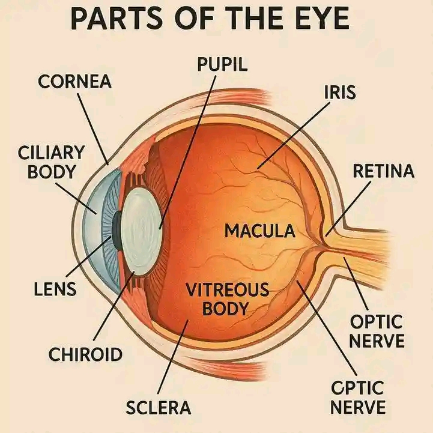
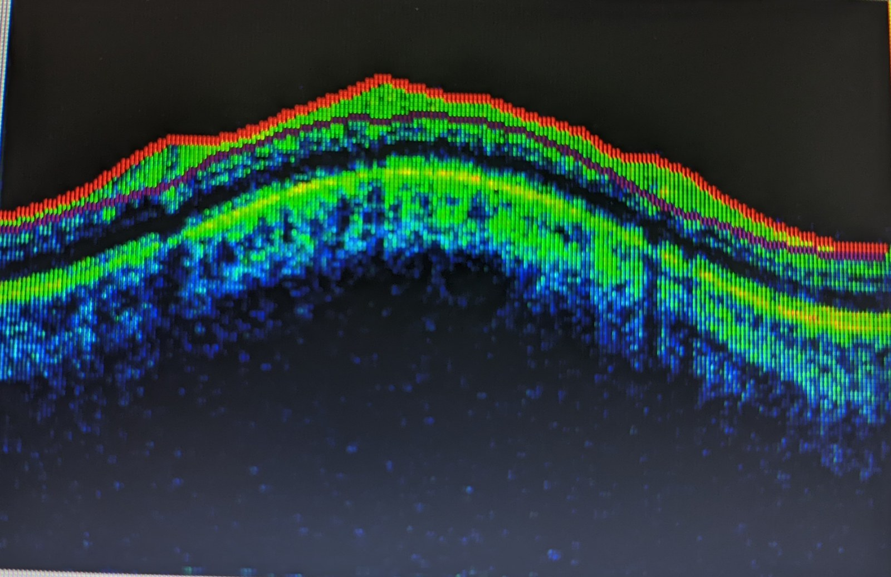

# 400 — Tổng quan Mắt & thị giác / Eye & visual pathway overview

**Tags:** `tong-quan`
**Mức chắc chắn (certainty):** tổng hợp y văn (literature synthesis).

## Hình ảnh nền tảng (giải phẫu & phương thức)
> Ba ảnh nền tảng để định hướng trước khi đọc các bài chi tiết: giải phẫu nhãn cầu → ảnh đáy mắt bình thường → OCT võng mạc bình thường.

| Giải phẫu nhãn cầu (anatomy) | Đáy mắt bình thường (fundus) | OCT võng mạc bình thường (macular OCT) |
|---|---|---|
|  |  |  |

- **Giải phẫu:** nhãn cầu = **giác mạc → tiền phòng → thuỷ tinh thể → dịch kính**; thành sau gồm **võng mạc (retina) – hắc mạc (choroid) – củng mạc (sclera)**; **hoàng điểm (macula)** ở cực sau, **đĩa thị (optic disc)** nơi các sợi trục và mạch trung tâm võng mạc ra vào.
- **Đáy mắt bình thường:** đĩa thị sáng, mạch xuất phát từ đĩa chia 4 hướng, **hoàng điểm sẫm hơn** (do biểu mô sắc tố dày), không xuất tiết/xuất huyết/đốm bông.
- **OCT võng mạc (quang học đồng tiêu — Optical Coherence Tomography):** cắt ngang võng mạc thành các lớp; **lõm trung tâm (foveal depression)** ở hoàng điểm là bình thường. OCT là chốt cho **phù hoàng điểm, dịch dưới võng mạc, màng trước võng mạc, teo/lớp sợi thần kinh (RNFL)**. (Xem bài [441](../441-OCT-hoang-diem/lesson.md), [442](../442-glaucoma-OCT/lesson.md).)
- Nguồn ảnh: Wikimedia Commons — CC0 (Aliyu Mohammed Aliyu), Public domain (NIH/NEI), CC BY-SA 4.0 (Bobjgalindo); chi tiết ở `images/CREDITS.md`.

## Bảng so sánh phân biệt bắt buộc (Mắt & thị giác)
| Mẫu hình (pattern) | Vị trí (location) | Gamut chính (DDx) | Phân biệt nhanh | Bài chi tiết |
|---|---|---|---|---|
| Cơ phì đại chừa gân | Hốc mắt (orbit) | Graves (TED) | Thân cơ to, gân bình thường | [421](../421-loi-mat-Graves/lesson.md) |
| Cơ phì đại cả gân | Hốc mắt | Viêm giả u (pseudotumor), cellulitis | Cả gân + đau + đáp ứng steroid | 422 |
| Vỡ sàn + kẹt cơ | Hốc mắt | Blow-out, trapdoor trẻ em | Giọt lệ (teardrop), nhìn đôi dọc | [420](../420-vo-san-hoc-mat/lesson.md) |
| Máu sau nhãn cầu | Hốc mắt | Hội chứng khoang (OCS) | Lồi mắt + IOP > 40 mmHg + canthotomy 2 giờ | [420](../420-vo-san-hoc-mat/lesson.md) |
| Vôi hóa trong nhãn cầu | Nhãn cầu (globe) | Retinoblastoma (trẻ), drusen đĩa thị, osteoma hắc mạc, phthisis bulbi (người lớn) | Tuổi + vôi hóa thô (RB) / vôi hóa đĩa (drusen) / xương trong hắc mạc (osteoma) | [412](../412-u-trong-nhan-cau/lesson.md) |
| Cơ cả gân/viêm | Hốc mắt | Giả u, cellulitis, IgG4 | Đau + cả gân + steroid 48h | [422](../422-viem-gia-u/lesson.md) |
| Mạch xoang hang | Xoang hang | Fistula, huyết khối | Tiếng thổi + SOV giãn | [423](../423-fistula-xoang-hang/lesson.md) |
| Tuyến lệ to | Trên-ngoài | IgG4, sarcoid, u | Không đau 2 bên + IgG4 | [424](../424-tuyen-le/lesson.md) |
| TK thị/giao thoa | TK-yên | Viêm, NAION, glioma/ONSM, adenoma | Đau + ngấm = viêm; tram-track = ONSM; bán manh = yên | [430](../430-duong-thi-giac/lesson.md), [431](../431-u-than-kinh-thi/lesson.md), [432](../432-vung-yen/lesson.md) |
| **ON tái phát/phụ thuộc steroid** | Thần kinh thị (optic nerve) | **CRION · MOG-ON · AQP4-ON · MS-ON · double-negative ON** · NAION · độc–chuyển hóa | **Ngấm dài ≥ 1/2 TK thị + AQP4 âm + tái phát khi giảm steroid = CRION**; **MOG-IgG (+) + đĩa phù + perineural = MOG-ON**; **AQP4 (+) + dài/chiasm + area postrema = NMOSD**; **ổ ngắn + OCB (+) + tổn thương não = MS** | [464](../464-viem-than-kinh-thi-tai-phat-CRION/lesson.md), [430](../430-duong-thi-giac/lesson.md), [434](../434-teo-thi-than-kinh-thi-doc-va-LHON/lesson.md) |
| Đĩa thị | Đĩa thị (disc) | Phù đĩa, drusen, IIH | Frisén 0–5; lõi tối = drusen | [433](../433-phu-dia-thi-drusen/lesson.md) |
| Teo thị 2 bên | Thần kinh thị (optic nerve) | LHON, độc–chuyển hóa, viêm, **di truyền (DOA/Wolfram)**, chèn ép | **GCL mất sớm = LHON**; RNFL thái dương mỏng = độc chất/DOA; **teo thị + DM/điếc/ĐTĐ nhạt = Wolfram** | [434](../434-teo-thi-than-kinh-thi-doc-va-LHON/lesson.md), [439](../439-teo-thi-di-truyen/lesson.md) |
| Teo thị 2 bên + **ĐIẾC** (DOA+/WFS1 trội) | Thần kinh thị (optic nerve) + võng mạc + tai trong | **OPA1/DOA+** vs **WFS1 trội (Wolfram-like)** vs WS1 lặn (DIDMOAD) vs LHON vs độc chất vs glaucoma | **Điếc xuất hiện TRƯỚC teo thị (WFS1: 2 vs 10 tuổi) = WFS1**; **ANSD (ABR mất sóng + CM còn) + missense GTPase = OPA1**; **OPL lamination trên OCT = WFS1 trội** | [437](../437-teo-thi-kem-diec/lesson.md) |
| Phù đĩa thị thiếu máu cấp (> 50 tuổi) | Thần kinh thị (optic nerve) | **AAION (GCA) vs NAION** vs viêm thị, PION, CRAO | Đĩa **nhợt trắng phấn + đốm bông + 2 bên + đau hàm → GCA (cấp cứu steroid)**; đĩa **sung huyết + disc-at-risk mắt lành → NAION (không steroid)** | [435](../435-gca-va-naion-aion/lesson.md) |
| Thành mạch lớn dày / hẹp | ĐMC & nhánh (aorta/branches) | **TAK (< 40/≤ 60) vs GCA (≥ 50)** (C-GCA/LV-GCA), aortitis nhiễm khuẩn, xơ vữa, loạn sản cơ–xơ | **"Macaroni" tăng âm = TAK** vs **"halo" giảm hồi âm = GCA**; tuổi là chốt; PET = hoạt tính viêm | [436](../436-takayasu-vs-gca/lesson.md) |
| Biến chứng mạch lớn GCA / aortitis | ĐMC & nhánh (aorta/branches) | **Theo dõi dài hạn**: phình/tách thành ĐMC ngực, hẹp mạch, aortitis nhiễm khuẩn (loại trừ), hở van ĐMC | **Hoạt tính (FDG-PET, đảo ngược) tách rời tổn hại cấu trúc (CTA/MRA, tiến triển)**; **hết viêm KHÔNG hết nguy cơ**; ĐMC ngực HR 13,46; GC tích lũy = độc tính | [438](../438-theo-doi-dai-han-gca-bien-chung-mach-lon/lesson.md) |
| Tắc mạch võng mạc | Võng mạc (retina) | CRVO/BRVO, CRAO | Cherry-red + giờ vàng < 4–6 giờ | [444](../444-tac-mach-vong-mac/lesson.md) |
| Bong võng mạc | Võng mạc (retina) | Rách, co kéo, tiết dịch, PVR | Macula-on 24 giờ; V/Y dính đĩa | [445](../445-bong-vong-mac/lesson.md) |
| Phù hoàng điểm viêm | Hoàng điểm (macula) | Uveitic CME vs DME | Anti-VEGF thất bại 3 mũi → steroid | [446](../446-phu-hoang-diem-viem/lesson.md) |
| **Mất thị lực KHÔNG đau + bong vòm hoàng điểm** | Hoàng điểm – hắc mạc (macula – choroid) | **CSCR (do corticosteroid/nội sinh)** vs CNV/AMD vs PICCP/VKH vs NAION vs HCQ | **Rà soát corticosteroid mọi đường + OCT bong vòm + FA rò điểm + ICGA tăng thấm = CSCR**; **ICGA giảm tưới máu = viêm hắc mạc mao mạch**; **dịch mới ở bệnh nhân uveitis đang dùng steroid KHÔNG được tăng steroid** | [470](../470-cscr-do-corticosteroid-mat-thi-luc-khong-dau/lesson.md) |
| Đốm trắng võng mạc | Võng mạc–hắc mạc | MEWDS, AZOOR, PIC, serpiginous | FAF đốm sáng tự khỏi vs bờ lan | [447](../447-dom-trang-vong-mac/lesson.md) |
| Viêm hoại tử võng mạc | Võng mạc (retina) | ARN, CMV retinitis, PORN | Vitritis ↔ mức miễn dịch; PCR dịch nội nhãn | [452](../452-hoai-tu-vong-mac-ARN-CMV/lesson.md) |
| Viêm mạch võng mạc (bệnh hệ thống) | Võng mạc (retina) | **Behçet vs lupus (SLE)**, sarcoid, ARN/CMV, lymphoma masquerade | **Vitritis + thoát thuốc "dương xỉ" trên FFA = Behçet**; **đốm bông + SLEDAI cao, ít vitritis = lupus** | [455](../455-behcet-lupus-mat/lesson.md) |
| Viêm võng mạc–màng mạch suy giảm miễn dịch KHÔNG HIV | Võng mạc (retina) | CMV sau ghép/ung thư máu/thuốc ức chế miễn dịch | **Viêm nhiều hơn HIV** (dễ nhầm ARN); **PCR máu có thể âm** → PCR dịch tiền phòng; tái phát → tìm u lympho ẩn | [454](../454-viem-vong-mac-suy-giam-mien-dich/lesson.md) |
| Theo dõi & tái hoạt CMV retinitis sau ghép | Võng mạc (retina) | Tái hoạt muộn, IRU, bong võng mạc; **ngừng kháng virus** | **Tái hoạt = tiến triển so ảnh UWF nền tảng** (không phải sẹo cũ); HIV ngừng khi **≥ 3 tháng điều trị + lành + CD4 ≥ 100 ≥ 3 tháng trên ART**; **không HIV không có ngưỡng CD4 phổ quát** | [459](../459-theo-doi-dai-han-cmv-retinitis/lesson.md) |
| Viêm dịch kính mạn ở người lớn tuổi (giả uveitis) | Võng mạc–dịch kính (retina–vitreous) ± CNS | **U lympho nội nhãn (PVRL)** vs viêm màng bồ đào (trung gian, giang mai, lao, MFC), nấm, amyloidosis | **Ổ vàng–kem dưới RPE + đục dịch kính ít viêm + hai mắt ở tuổi > 60, đáp ứng corticoid một phần rồi tái phát** → sinh thiết dịch kính; chốt **IL-10 dịch kính > 400 pg/mL**, **IL-10:IL-6 > 1**, **MYD88 L265P** | [462](../462-u-lympho-noi-nhan-PVRL/lesson.md) |
| Nhiễm trùng nội nhãn nội sinh (nấm) | Võng mạc–dịch kính (retina–vitreous) | **Nấm (Candida/Aspergillus)** vs vi khuẩn nội sinh (Klebsiella) vs CMV/ARN vs u lympho (masquerade) | **"Fluff ball"/"quả cầu tuyết"/"chuỗi ngọc trai" + bối cảnh candidemia/catheter/TPN/ICU/giảm bạch cầu hạt; phần lớn KHÔNG triệu chứng** → soi đáy mắt **bắt buộc**, cấy/PCR dịch kính; **corticoid nội nhãn = chống chỉ định** | [463](../463-viem-noi-nhan-noi-sinh-nam/lesson.md) |
| Chọn thuốc & phác đồ anti-VEGF cho ROP | Võng mạc (retina) | **Bevacizumab vs ranibizumab vs aflibercept vs conbercept vs laser** | Zone I/A-ROP → anti-VEGF (thuốc dai, liều thấp); **IR: IVB 11% · IVC 16% · IVR/IVA 27%**; khoảng tái điều trị BCZ 6,7 tuần > RBZ 3,1 tuần; RD gộp 1,4% | [461](../461-chon-thuoc-phac-do-anti-vegf-cho-rop/lesson.md) |
| Mù bẩm sinh + điếc ở trẻ trai (Norrie) | Võng mạc + tai trong (retina & inner ear) | **Norrie (*NDP*, X-linked lặn)** vs FEVR/IP/Coats/RB | **Nam đủ tháng + bong võng mạc hai bên + điếc tiến triển + chậm phát triển**; **mẹ mang gen → con trai 50% mắc**; xét gen *NDP* + chẩn đoán trước sinh | [467](../467-norrie-di-truyen-tu-van-va-theo-doi/lesson.md) |
| U hắc mạc | Hắc mạc (choroid) | Melanoma, nevus, di căn | Dày ≥ 2 mm + T1 sáng = melanoma | [448](../448-u-hac-mac/lesson.md) |
| Chấn thương mắt | Nhãn cầu–hốc mắt | Vỡ nhãn cầu, IOFB | Mắt xẹp + XH dịch kính; OTS | [449](../449-chan-thuong-mat-dich-vat/lesson.md) |
| OCT | Hoàng điểm/RNFL | DME/AMD, glaucoma | CST ≥ 300 µm; asymmetry > 9 µm | [441](../441-OCT-hoang-diem/lesson.md), [442](../442-glaucoma-OCT/lesson.md) |
| Võng mạc ĐTĐ | Võng mạc (retina) | NPDR/PDR, DME | 4-2-1; CST ≥ 300 µm; PRP 1200–1600 | [443](../443-vong-mac-dai-thao-duong/lesson.md) |
| Tân mạch võng mạc trẻ sinh non | Võng mạc (retina) | ROP (ICROP) | Non tháng ≤ 30 tuần/≤ 1500 g + zone/stage/plus; **AP-ROP = cấp cứu** | [456](../456-benh-vong-mac-tre-sinh-non/lesson.md) |
| Bệnh "giả ROP" ở trẻ đủ tháng | Võng mạc (retina) | **FEVR, Norrie, incontinentia pigmenti, Coats**, PHPV; **Coats plus** (CTC1) khi hai bên + bệnh hệ thống | **Trẻ ĐỦ tháng** (không sinh non) + leukocoria/bong võng mạc; **FA ngoại vi là chốt**; loại trừ **retinoblastoma** trước; **Coats-like HAI BÊN + vôi hóa/nang não = Coats plus** | [457](../457-benh-gia-rop-tre-du-thang/lesson.md), [465](../465-coats-plus-syndrome-ctc1/lesson.md) |
| **U hạt ngoại vi + dây co kéo dịch kính** | Võng mạc–dịch kính (retina–vitreous) | **Toxocariasis nội nhãn (OLM)** vs retinoblastoma, Coats, PFV, FEVR, Toxoplasma, DUSN | **Trẻ + u hạt ngoại vi (90% thái dương) + dây xơ co kéo tới đĩa thị + ELISA *Toxocara* (+)** = OLM; **loại trừ RB (canxi hóa thô) trước**; **FA có thể bỏ sót u hạt** | [466](../466-toxocariasis-noi-nhan/lesson.md) |
| Di chứng & theo dõi dài hạn sau ROP | Võng mạc (retina) | Tái hoạt sau anti-VEGF, cicatricial, cận thị/lác/nhược thị, bong VM muộn, glaucoma góc đóng | **Chuỗi ảnh phân biệt tái hoạt (tiến triển) vs di chứng (ổn định)**; anti-VEGF theo dõi **≥ 65 tuần PMA**; khúc xạ liệt điều tiết + chỉnh thị | [458](../458-di-chung-theo-doi-dai-han-sau-rop/lesson.md) |
| Bệnh võng mạc tăng huyết áp/bệnh máu | Võng mạc (retina) | HTR (KWB), thiếu máu, sickle cell, leukemia | Đốm bông + xuất huyết tia + sao hoàng điểm ← HA cao; Roth spot ← thiếu máu | [453](../453-benh-vong-mac-tang-huyet-ap-va-thieu-mau/lesson.md) |
| Màng dịch kính | Nhãn cầu (globe) | Bong võng mạc, XH dịch kính, bong hắc mạc | V/Y dính đĩa = võng mạc; aftermovement = máu; T-sign = hắc mạc | [411](../411-sieu-am-nhan-cau/lesson.md) |

## Bài liên quan chéo
- [410 – Giải phẫu hốc mắt](../410-giai-phau-hoc-mat/lesson.md)
- [420 – Vỡ sàn hốc mắt](../420-vo-san-hoc-mat/lesson.md)
- [421 – Lồi mắt Graves](../421-loi-mat-Graves/lesson.md)
- [411 – Siêu âm nhãn cầu](../411-sieu-am-nhan-cau/lesson.md)
- [401 – Phương thức CĐHA mắt](../401-phuong-thuc-mat/lesson.md) *(mới)*
- [412 – U trong nhãn cầu](../412-u-trong-nhan-cau/lesson.md) *(mới)*
- [422 – Giả u viêm](../422-viem-gia-u/lesson.md) *(mới)*
- [423 – Fistula xoang hang](../423-fistula-xoang-hang/lesson.md) *(mới)*
- [424 – Tuyến lệ](../424-tuyen-le/lesson.md) *(mới)*
- [430 – Đường thị giác](../430-duong-thi-giac/lesson.md) *(mới)*
- [431 – U TK thị](../431-u-than-kinh-thi/lesson.md) *(mới)*
- [432 – Vùng yên](../432-vung-yen/lesson.md) *(mới)*
- [433 – Phù đĩa thị vs drusen](../433-phu-dia-thi-drusen/lesson.md) *(mới)*
- [434 – Bệnh TK thị do độc–chuyển hóa & LHON](../434-teo-thi-than-kinh-thi-doc-va-LHON/lesson.md) *(mới)*
- [435 – GCA & AAION vs NAION](../435-gca-va-naion-aion/lesson.md) *(mới)*
- [436 – Takayasu vs GCA (viêm mạch lớn)](../436-takayasu-vs-gca/lesson.md) *(mới)*
- [438 – Theo dõi dài hạn GCA & biến chứng mạch lớn (aortitis/phình–tách thành ĐMC)](../438-theo-doi-dai-han-gca-bien-chung-mach-lon/lesson.md) *(mới)*
- [439 – Teo thị di truyền: DOA/OPA1 & Wolfram](../439-teo-thi-di-truyen/lesson.md) *(mới)*
- [441 – OCT hoàng điểm](../441-OCT-hoang-diem/lesson.md) *(mới)*
- [442 – Glaucoma](../442-glaucoma-OCT/lesson.md) *(mới)*
- [443 – Võng mạc đái tháo đường](../443-vong-mac-dai-thao-duong/lesson.md) *(mới)*
- [444 – Tắc mạch võng mạc](../444-tac-mach-vong-mac/lesson.md) *(mới)*
- [445 – Bong võng mạc](../445-bong-vong-mac/lesson.md) *(mới)*
- [446 – Phù hoàng điểm viêm vs DME](../446-phu-hoang-diem-viem/lesson.md) *(mới)*
- [447 – Hội chứng đốm trắng](../447-dom-trang-vong-mac/lesson.md) *(mới)*
- [448 – U hắc mạc](../448-u-hac-mac/lesson.md) *(mới)*
- [449 – Chấn thương mắt & IOFB](../449-chan-thuong-mat-dich-vat/lesson.md) *(mới)*
- [450 – Mắt nhi](../450-mat-nhi/lesson.md) *(mới)*
- [451 – Hệ thống](../451-he-thong-mat/lesson.md) *(mới)*
- [452 – Hoại tử võng mạc cấp (ARN) & CMV retinitis](../452-hoai-tu-vong-mac-ARN-CMV/lesson.md) *(mới)*
- [453 – Bệnh võng mạc do tăng huyết áp & bệnh máu](../453-benh-vong-mac-tang-huyet-ap-va-thieu-mau/lesson.md) *(mới)*
- [454 – Viêm võng mạc–màng mạch ở người suy giảm miễn dịch KHÔNG HIV](../454-viem-vong-mac-suy-giam-mien-dich/lesson.md) *(mới)*
- [455 – Viêm mạch hệ thống khác ở mắt: Behçet & lupus](../455-behcet-lupus-mat/lesson.md) *(mới)*
- [456 – Bệnh võng mạc trẻ sinh non (ROP)](../456-benh-vong-mac-tre-sinh-non/lesson.md) *(mới)*
- [457 – Bệnh "giả ROP" ở trẻ đủ tháng: FEVR, Norrie, IP, Coats](../457-benh-gia-rop-tre-du-thang/lesson.md) *(mới)*
- [458 – Di chứng & theo dõi dài hạn sau ROP: tái hoạt sau anti-VEGF, cận thị/lác/nhược thị](../458-di-chung-theo-doi-dai-han-sau-rop/lesson.md) *(mới)*
- [459 – Theo dõi dài hạn & tái hoạt CMV retinitis sau ghép (UWF, ngưỡng CD4, khi nào ngừng kháng virus)](../459-theo-doi-dai-han-cmv-retinitis/lesson.md) *(mới)*
- [460 – Can thiệp](../460-can-thiep-mat/lesson.md) *(mới)*
- [462 – U lympho nội nhãn (PVRL) vs viêm màng bồ đào giả danh: IL-10/MYD88 + PET-CT](../462-u-lympho-noi-nhan-PVRL/lesson.md) *(mới)*
- [463 – Viêm nội nhãn nội sinh do nấm (Candida/Aspergillus): "fluff ball" & "chuỗi ngọc trai"](../463-viem-noi-nhan-noi-sinh-nam/lesson.md) *(mới)*
- [465 – Coats plus (CTC1/CRMCC): bệnh võng mạc giống Coats hai bên + vôi hóa–nang não & chảy máu tiêu hóa](../465-coats-plus-syndrome-ctc1/lesson.md) *(mới)*
- [466 – Toxocariasis nội nhãn (ấu trùng di chuyển ở mắt): u hạt ngoại vi + dây co kéo](../466-toxocariasis-noi-nhan/lesson.md) *(mới)*
- [437 – Teo thị kèm ĐIẾC: DOA+/OPA1 & WFS1 trội (Wolfram-like)](../437-teo-thi-kem-diec/lesson.md) *(mới)*
- [461 – Chọn thuốc & phác đồ anti-VEGF cho ROP: liều, khoảng tái tiêm & khi nào chuyển laser](../461-chon-thuoc-phac-do-anti-vegf-cho-rop/lesson.md) *(mới)*
- [467 – Norrie: tư vấn di truyền X-linked, chẩn đoán trước sinh & theo dõi điếc–phát triển](../467-norrie-di-truyen-tu-van-va-theo-doi/lesson.md) *(mới)*
- [470 – CSCR do corticosteroid & tiếp cận mất thị lực không đau](../470-cscr-do-corticosteroid-mat-thi-luc-khong-dau/lesson.md) *(mới)*

## Quy hoạch Mắt & thị giác (Master Curriculum 400–499)
> Đã viết có link; chưa viết là text dự kiến. ID ổn định, không đánh lại số.

**400–409 — Tổng quan, giải phẫu, kỹ thuật**
- **400** – Tổng quan *(bài này)*
- 401 – Phương thức CĐHA mắt *(đã có — [bài học](../401-phuong-thuc-mat/lesson.md))*
- **410** – Giải phẫu hốc mắt cắt lớp *(đã có)*
- 411 – Siêu âm nhãn cầu: bong võng mạc vs xuất huyết dịch kính vs bong hắc mạc *(đã có — [bài học](../411-sieu-am-nhan-cau/lesson.md))*
- 412 – U trong nhãn cầu *(đã có — [bài học](../412-u-trong-nhan-cau/lesson.md))*

**420–429 — Hốc mắt: chấn thương, viêm, mạch**
- **420** – Vỡ sàn + hội chứng khoang *(đã có)*
- **421** – Lồi mắt Graves/TED *(đã có)*
- 422 – Cellulitis vs giả u viêm *(đã có — [bài học](../422-viem-gia-u/lesson.md))*
- 423 – Fistula vs huyết khối xoang hang *(đã có — [bài học](../423-fistula-xoang-hang/lesson.md))*
- 424 – Tuyến lệ: viêm vs u *(đã có — [bài học](../424-tuyen-le/lesson.md))*

**430–439 — Thần kinh thị giác & giao thoa**
- 430 – Đường thị giác *(đã có — [bài học](../430-duong-thi-giac/lesson.md))*
- 431 – U TK thị *(đã có — [bài học](../431-u-than-kinh-thi/lesson.md))*
- 432 – Vùng yên-giao thoa *(đã có — [bài học](../432-vung-yen/lesson.md))*
- 433 – Phù đĩa thị vs drusen đĩa *(đã có — [bài học](../433-phu-dia-thi-drusen/lesson.md))*
- 434 – Bệnh thần kinh thị do độc–chuyển hóa & LHON: tiếp cận teo thị 2 bên *(đã có — [bài học](../434-teo-thi-than-kinh-thi-doc-va-LHON/lesson.md))*
- 435 – Viêm động mạch tế bào khổng lồ (GCA) & AAION vs NAION: cấp cứu mù ở người > 50 tuổi *(đã có — [bài học](../435-gca-va-naion-aion/lesson.md))*
- 436 – Takayasu vs GCA (viêm mạch lớn): phân biệt tuổi + thành mạch, Numano *(đã có — [bài học](../436-takayasu-vs-gca/lesson.md))*
- 438 – Theo dõi dài hạn GCA & biến chứng mạch lớn: aortitis, phình/tách thành ĐMC, corticoid *(đã có — [bài học](../438-theo-doi-dai-han-gca-bien-chung-mach-lon/lesson.md))*
- 439 – Teo thị di truyền: DOA/OPA1 & Wolfram *(đã có — [bài học](../439-teo-thi-di-truyen/lesson.md))*
- 440 – Theo dõi & điều trị teo thị di truyền: idebenone, gene therapy & phục hồi chức năng *(đã có — [bài học](../440-theo-doi-dieu-tri-teo-thi-di-truyen/lesson.md))*

**440–449 — Võng mạc, hoàng điểm & glaucoma (OCT)**
- 441 – OCT hoàng điểm *(đã có — [bài học](../441-OCT-hoang-diem/lesson.md))*
- 442 – Glaucoma OCT *(đã có — [bài học](../442-glaucoma-OCT/lesson.md))*
- 443 – Võng mạc đái tháo đường ETDRS + DME *(đã có — [bài học](../443-vong-mac-dai-thao-duong/lesson.md))*
- 444 – Tắc mạch võng mạc CRVO/BRVO vs CRAO *(đã có — [bài học](../444-tac-mach-vong-mac/lesson.md))*
- 445 – Bong võng mạc rách/co kéo/tiết dịch *(đã có — [bài học](../445-bong-vong-mac/lesson.md))*
- 446 – Phù hoàng điểm viêm vs DME *(đã có — [bài học](../446-phu-hoang-diem-viem/lesson.md))*
- 447 – Hội chứng đốm trắng *(đã có — [bài học](../447-dom-trang-vong-mac/lesson.md))*
- 448 – U hắc mạc: melanoma vs nevus vs di căn *(đã có — [bài học](../448-u-hac-mac/lesson.md))*
- 449 – Chấn thương mắt & dị vật nội nhãn *(đã có — [bài học](../449-chan-thuong-mat-dich-vat/lesson.md))*

**450–459 — Nhi & bệnh hệ thống**
- 450 – Mắt nhi *(đã có — [bài học](../450-mat-nhi/lesson.md))*
- 451 – Bệnh hệ thống ở mắt *(đã có — [bài học](../451-he-thong-mat/lesson.md))*
- 452 – Hoại tử võng mạc cấp (ARN) & viêm võng mạc CMV *(đã có — [bài học](../452-hoai-tu-vong-mac-ARN-CMV/lesson.md))*
- 453 – Bệnh võng mạc do tăng huyết áp & bệnh máu (KWB/Goldberg) *(đã có — [bài học](../453-benh-vong-mac-tang-huyet-ap-va-thieu-mau/lesson.md))*
- 454 – Viêm võng mạc–màng mạch ở người suy giảm miễn dịch KHÔNG HIV (CMV sau ghép/ung thư máu) *(đã có — [bài học](../454-viem-vong-mac-suy-giam-mien-dich/lesson.md))*
- 456 – Bệnh võng mạc trẻ sinh non (ROP): ICROP zone–stage–plus & AP-ROP *(đã có — [bài học](../456-benh-vong-mac-tre-sinh-non/lesson.md))*
- 457 – Bệnh "giả ROP" ở trẻ đủ tháng: FEVR, Norrie, incontinentia pigmenti & Coats *(đã có — [bài học](../457-benh-gia-rop-tre-du-thang/lesson.md))*
- 458 – Di chứng & theo dõi dài hạn sau ROP: tái hoạt sau anti-VEGF, cận thị/lác/nhược thị & khúc xạ *(đã có — [bài học](../458-di-chung-theo-doi-dai-han-sau-rop/lesson.md))*
- 459 – Theo dõi dài hạn & tái hoạt CMV retinitis sau ghép: UWF, ngưỡng CD4/viremia, khi nào ngừng kháng virus *(đã có — [bài học](../459-theo-doi-dai-han-cmv-retinitis/lesson.md))*

**460–499 — Can thiệp, xạ trị & dự trữ**
- 460 – Can thiệp + xạ trị *(đã có — [bài học](../460-can-thiep-mat/lesson.md))*
- 461 – Chọn thuốc & phác đồ anti-VEGF cho ROP: bevacizumab vs ranibizumab vs aflibercept, liều, khoảng tái tiêm & khi nào chuyển laser *(đã có — [bài học](../461-chon-thuoc-phac-do-anti-vegf-cho-rop/lesson.md))*
- 462 – U lympho nội nhãn (PVRL) vs viêm màng bồ đào giả danh: IL-10/MYD88 + PET-CT *(đã có — [bài học](../462-u-lympho-noi-nhan-PVRL/lesson.md))*
- 463 – Viêm nội nhãn nội sinh do nấm (Candida/Aspergillus): "fluff ball"/"chuỗi ngọc trai" & phác đồ kháng nấm *(đã có — [bài học](../463-viem-noi-nhan-noi-sinh-nam/lesson.md))*
- 464 – Viêm thần kinh thị tái phát (CRION) & thể "âm tính kép": phụ thuộc steroid, MOG 92%, OCT pRNFL 39,3 µm, loại trừ AQP4/MOG *(đã có — [bài học](../464-viem-than-kinh-thi-tai-phat-CRION/lesson.md))*
- 465 – Coats plus (CTC1/CRMCC): bệnh võng mạc giống Coats hai bên + vôi hóa–nang não & chảy máu tiêu hóa *(đã có — [bài học](../465-coats-plus-syndrome-ctc1/lesson.md))*
- 466 – Toxocariasis nội nhãn (ấu trùng di chuyển ở mắt): u hạt ngoại vi + dây co kéo, ELISA/Goldmann–Witmer *(đã có — [bài học](../466-toxocariasis-noi-nhan/lesson.md))*
- 467 – Norrie: tư vấn di truyền X-linked, chẩn đoán trước sinh & theo dõi điếc–phát triển *(đã có — [bài học](../467-norrie-di-truyen-tu-van-va-theo-doi/lesson.md))*
- 468 – Sàng lọc ROP từ xa (tele-ROP) & trí tuệ nhân tạo: mạng lưới vệ tinh, ảnh góc rộng/điện thoại, học sâu & VSS *(đã có — [bài học](../468-tele-rop-sang-loc-ai-theo-doi/lesson.md))*
- 469 – Lác & nhược thị ở trẻ sinh non/ROP: kính chỉnh, bịt mắt vs atropine, điều trị kỹ thuật số & thời điểm can thiệp *(đã có — [bài học](../469-lac-nhuoc-thi-tre-sinh-non-rop/lesson.md))*
- 470 – Bệnh võng mạc trung tâm thanh dịch do corticosteroid & tiếp cận mất thị lực KHÔNG đau: OCT bong vòm, FA inkblot/smokestack, ICGA tăng thấm, giảm/ngừng steroid, half-dose PDT *(đã có — [bài học](../470-cscr-do-corticosteroid-mat-thi-luc-khong-dau/lesson.md))*
- 471–499: dự trữ mở rộng

> Không dùng để chẩn đoán độc lập khi chưa có người hướng dẫn.
