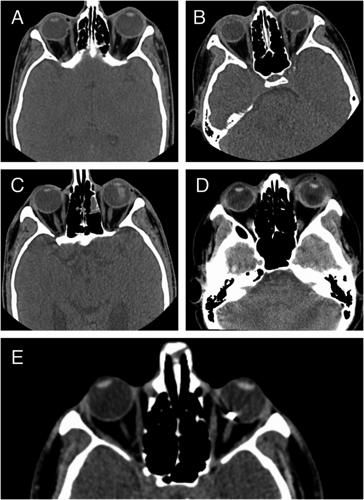
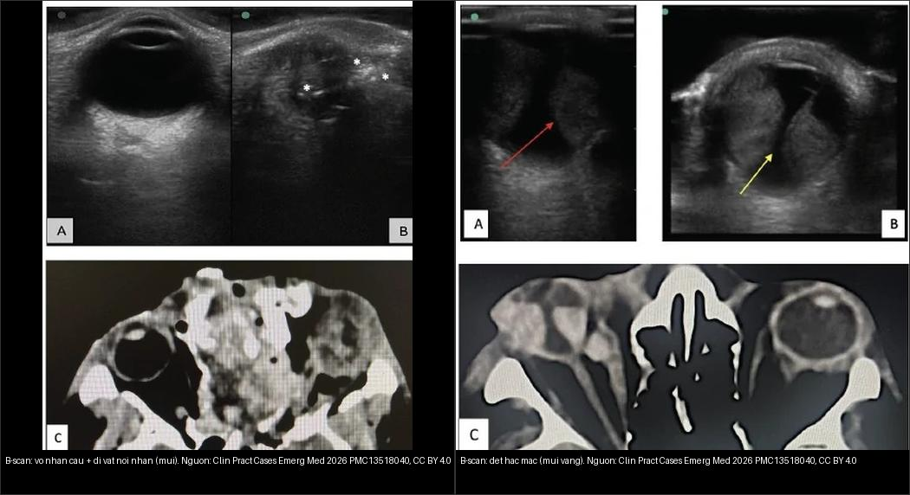
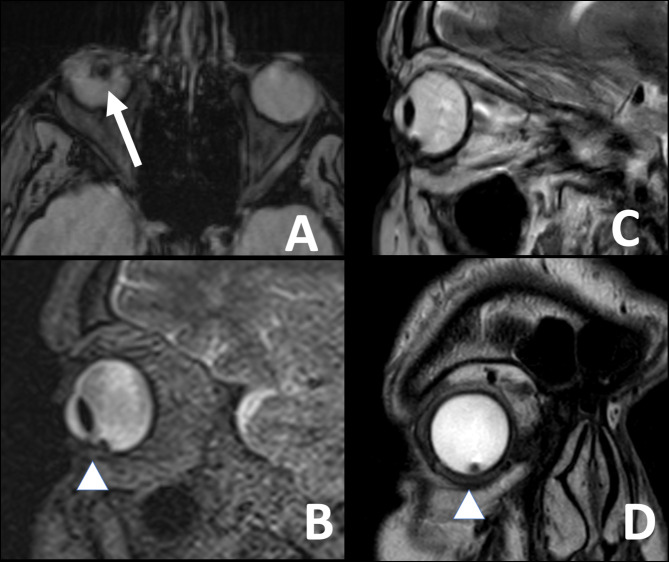
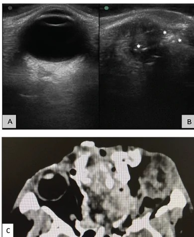
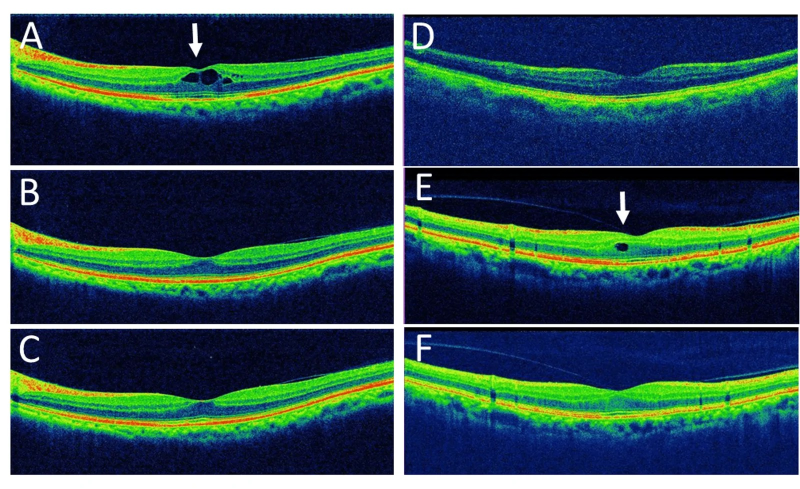

# 401 — Phương thức CĐHA mắt: CT/MRI/siêu âm/OCT / Eye imaging modalities

**Tags:** `pattern:protocol-mat` `vung:mat` `protocol:CT-1mm` `protocol:MRI-hoc-mat` `protocol:sieu-am-B-scan` `protocol:OCT`
**Mức chắc chắn (certainty):** tổng hợp y văn (literature synthesis) — nhóm tự biên từ y văn mở (BMC Ophthalmol 2025 PMC12220044; Clin Pract Cases Emerg Med 2026 PMC13518040; BMC Ophthalmol 2024 PMC11346195; Cureus 2026 PMC13588649), số liệu lấy nguyên từ bài gốc.

## 1. Tổng quan — chọn đúng vũ khí đầu tiên (TẠI SAO)

- **Câu hỏi quyết định:** tổn thương thuộc **xương** (vỡ), **mô mềm/đỉnh hốc mắt** (u/viêm/TK thị), **trong nhãn cầu mà không soi được** (máu/bong), hay **võng mạc–hoàng điểm ở mức micron** (DME/AMD/glaucoma)? Chọn theo **câu hỏi**, không theo thói quen.
- **CT lát mỏng ≤ 1 mm + MPR:** xương (vỡ), vôi hóa (retinoblastoma – RB), **dị vật kim loại** (hyperdense + tua streaking) — nhanh, cấp cứu. **TẠI SAO tránh CT ở trẻ nghi RB:** đột biến **RB1** + tia X → nguy cơ **u thứ phát**; MRI tìm luôn vôi hóa bằng GRE + lan theo thần kinh thị.
- **MRI (T1/T2 fat-sat + cản quang + GRE/SWI + DWI):** cơ (Graves/TED), TK thị, u, giao thoa **nón trong (intraconal) vs ngoài nón (extraconal)** — chuẩn mô mềm, không tia X. **TẠI SAO phải fat-sat:** mỡ hốc mắt rất sáng trên T1/T2 → fat-sat làm nổi mô mềm/quá trình viêm.
- **Siêu âm B-scan 10 MHz:** trong nhãn cầu cấp cứu (bong võng mạc / xuất huyết dịch kính / **u hắc mạc**) khi môi trường mờ — **cấm đè khi nghi vỡ nhãn cầu (globe rupture)**.
- **OCT (chụp cắt lớp quang học):** võng mạc–hoàng điểm (bản đồ thickness, DRIL, EZ) + glaucoma (RNFL/GCC) — **phân giải micron**, **không thay** CT/MRI hốc mắt.
- **Nguyên tắc bất biến:** mỗi phương thức trả lời **một loại câu hỏi**; kết quả **âm tính trên một phương thức không loại trừ** tổn thương nhỏ (ví dụ dị vật kim loại nhỏ mà CT/siêu âm bỏ sót — xem Ca 3 & mục 5).

*CT ≤ 1 mm: phân loại tổn thương trong vỡ nhãn cầu (bất thường củng mạc, lệch thủy tinh thể…). Nguồn: BMC Ophthalmol 2025 (PMC12220044), CC BY-NC-ND 4.0. Giữ nguyên bản.*

## 2. Gamut chỉ định theo câu hỏi

- **Chấn thương ± nghi vỡ/dị vật:** **CT ≤ 1 mm + MPR** (kim loại sáng, gỗ tối giả khí — **phải hỏi vật liệu dị vật**); siêu âm chỉ sau khi loại trừ vỡ.
- **Lồi mắt / viêm / u / đỉnh hốc mắt:** **MRI fat-sat + cản quang** (định vị trong–ngoài nón, TK thị, xoang hang).
- **Mờ mắt đột ngột mà không soi được đáy mắt:** **B-scan** — tìm **bong võng mạc**, xuất huyết dịch kính, **xuất huyết hắc mạc**, u.
- **Đái tháo đường / AMD / glaucoma:** **OCT** — phù hoàng điểm (CST, DRIL), drusen/CNV, RNFL/GCC.
- **Tăng nhãn áp / nghi u giàu mạch:** siêu âm + **OCT/OCE**, đôi khi **CTA/MRA** cho mạch máu.

## 3. Bảng chọn phương thức

| Câu hỏi lâm sàng | Vũ khí đầu tay | Thông số | Cấm/kỵ |
|---|---|---|---|
| Vỡ sàn/hốc mắt & dị vật | **CT ≤ 1 mm + MPR** | Xương + mô mềm, coronal/sagittal | Trẻ nghi RB → MRI; MRI nếu nghi dị vật kim loại |
| Cơ/TK thị/u/đỉnh hốc mắt | **MRI fat-sat + cản quang** | T1/T2 FS + GRE + DWI | Máy tạo nhịp; an thần trẻ |
| Bong/XH trong nhãn cầu | **B-scan 10 MHz** | V/Y, aftermovement, T-sign | **Cấm đè khi nghi vỡ** |
| Hoàng điểm/glaucoma | **OCT** | CST, DRIL/EZ, RNFL/GCC | Không thay CT/MRI hốc mắt |

*B-scan (kỹ thuật "bể nước"): vỡ nhãn cầu + dị vật nội nhãn (trái) vs bong hắc mạc (phải). Nguồn: Clin Pract Cases Emerg Med 2026 (PMC13518040), CC BY 4.0. Ảnh ghép letterbox.*

## 4. Protocol tóm tắt

- **CT hốc mắt:** **0,625–1 mm**, xương + mô mềm, **MPR coronal/sagittal**; cản quang khi u/viêm/mạch. **TẠI SAO ≤ 1 mm:** dị vật kim loại và vỡ xương nhỏ chỉ lộ trên lát mỏng + đa bình diện.
- **MRI hốc mắt:** cuộn bề mặt, lát **2–3 mm**, **fat-sat 2 bình diện + cản quang (T1 FS sau tiêm) + GRE/SWI**; DWI khi u/viêm. **TẠI SAO T1 fat-sat sau tiêm là bắt buộc:** phân biệt viêm/u (ngấm) với mỡ/tổn thương cũ.
- **B-scan 10 MHz:** cấu trúc đầu dò, tránh đè; đánh giá **V/Y, aftermovement, T-sign** (xem 411).
- **OCT:** hoàng điểm (bản đồ ETDRS) + **RNFL/GCC** cho glaucoma/TK thị (xem 441/442).

## 5. Biến thể bình thường và cạm bẫy

- **Dị vật gỗ trên CT tối giả khí** — có thể bị đọc thành "khí"; luôn hỏi **vật liệu** và chụp thêm MRI nếu cần.
- **Dị vật kim loại nhỏ có thể lọt CT lẫn siêu âm.** Ca nguyên văn (PMC11346195): siêu âm **không thấy** dị vật, **CT 1–2 mm cũng không thấy**, nhưng **MRI GRE** lộ **giả ảnh dị từ (susceptibility artifact)** do dị vật kim loại gây **siderosis** — bệnh nhân rối loạn thị lực tiến triển. **Cạm bẫy kép:** (a) đừng kết luận "không dị vật" chỉ vì CT/SA âm tính; (b) **MRI CHỐNG CHỈ ĐỊNH khi đã biết/nghi dị vật kim loại sắt từ (ferromagnetic)** — trong ca này MRI được chỉ định vì CT/SA âm tính mà vẫn nghi siderosis; nếu biết trước có kim loại thì **không** chụp MRI.
- **Thuốc cản quang + suy thận/dị ứng** — bù nước + hỏi tiền sử; ưu tiên MRI/không cản quang khi được.
- **An thần trẻ chụp MRI** — nhịn ăn + theo dõi, hẹn giờ; tránh chụp lặp không cần thiết (**ALARA**).
- **Không dùng siêu âm đè** khi nghi vỡ; không đặt bệnh nhân nghi dị vật kim loại vào máy MRI.

## 6. Tự lượng giá — Blind Quiz

**Ca 1 — Trẻ leukocoria nghi RB:** CT hay MRI đầu? Vì sao?

- Gợi ý: trẻ nhỏ, đồng tử trắng, chưa loại trừ u nguyên bào võng mạc.
- Câu hỏi: Chọn phương thức đầu tiên? Vì sao tránh CT?

<b>Bấm để hiện đáp án (findings + chẩn đoán)</b>

- **MRI (tránh CT):** **RB1 + tia X = nguy cơ u thứ phát**; MRI **GRE tìm vôi hóa** + **lan theo thần kinh thị**. (Nhớ: đây là lý do *khác* với ca MRI dị vật kim loại ở Ca 3 — bối cảnh quyết định.)
- Nguồn ảnh: BMC Ophthalmol 2024 (PMC11346195), CC BY-NC-ND 4.0 — minh họa **giả ảnh dị từ MRI GRE**, không phải ca retinoblastoma.

**Ca 2 — Chấn thương mắt mờ đột ngột + nghi vỡ:** B-scan ngay hay CT trước?

- Gợi ý: sau chấn thương vật lý, mắt mờ, không soi được đáy mắt.
- Câu hỏi: Làm gì trước? B-scan có được đè không?

<b>Bấm để hiện đáp án (findings + chẩn đoán)</b>

- **CT trước để loại trừ vỡ/dị vật; KHÔNG đè B-scan** — đè có thể làm thoát tổ chức nội nhãn qua vết vỡ. Khi đã loại vỡ (hoặc dùng kỹ thuật bể nước không đè), B-scan cho thấy **dị vật nội nhãn dạng echo sáng** / bong hắc mạc.
- Nguồn ảnh: Clin Pract Cases Emerg Med 2026 (PMC13518040), CC BY 4.0.

**Ca 3 — Rối loạn thị lực tiến triển, tiền sử chấn thương; siêu âm và CT đều không thấy dị vật.** Bước tiếp theo?

- Gợi ý: nghi **siderosis bulbi** (dị vật kim loại lưu lại lâu ngày), môi trường mờ.
- Câu hỏi: Vì sao CT/SA âm tính vẫn có dị vật? Cảnh báo gì khi dùng MRI?

<b>Bấm để hiện đáp án (findings + chẩn đoán)</b>

- **Findings:** MRI GRE cho **giả ảnh dị từ (susceptibility artifact)** ở phần dưới nhãn cầu phải = **dị vật kim loại nhỏ** mà **siêu âm và CT 1–2 mm bỏ sót**; mô bệnh/thị lực cải thiện sau lấy dị vật.
- **Chốt:** kích thước dị vật nhỏ có thể lọt cả CT lẫn siêu âm → giữ nghi ngờ cao; **MRI chỉ dùng khi CT/SA âm tính (như ca này)**; **nếu đã biết/nghi kim loại sắt từ thì KHÔNG chụp MRI** (nguy cơ di chuyển/nóng tổn thương).
- Nguồn ảnh: BMC Ophthalmol 2024 (PMC11346195), CC BY-NC-ND 4.0 (giữ nguyên bản).

**Ca 4 — Bệnh nhân theo dõi sau đục thủy tinh thể, giảm thị lực; soi thấy bình thường.** Dùng gì để đánh giá hoàng điểm?

- Gợi ý: mờ nhẹ sau mổ, không đau.
- Câu hỏi: Phương thức nào cho chẩn đoán? Dấu hiệu trên OCT gợi ý gì?

<b>Bấm để hiện đáp án (findings + chẩn đoán)</b>

- **OCT hoàng điểm:** thấy **nang dịch nội võng mạc (macular cysts)** — **phù hoàng điểm giả thủy tinh thể (Irvine-Gass)**; OCT phân giải micron nên phát hiện sớm hơn soi đáy mắt. **Không dùng CT/MRI** cho câu hỏi hoàng điểm.
- Nguồn ảnh: Cureus 2026 (PMC13588649), CC BY 4.0 (nhóm ca CME giả thủy tinh thể).

## Bài liên quan chéo
- [400 – Tổng quan Mắt](../400-tong-quan-mat-thi-giac/lesson.md)
- [411 – Siêu âm nhãn cầu](../411-sieu-am-nhan-cau/lesson.md)
- [410 – Giải phẫu hốc mắt](../410-giai-phau-hoc-mat/lesson.md)
- [421 – Lồi mắt Graves](../421-loi-mat-Graves/lesson.md)
- [441 – OCT hoàng điểm](../441-OCT-hoang-diem/lesson.md)
- [442 – Glaucoma (RNFL/GCC)](../442-glaucoma-OCT/lesson.md)
- [449 – Chấn thương mắt & IOFB](../449-chan-thuong-mat-dich-vat/lesson.md)

## Ảnh
- Tên file: `401_slug_Modality_SourceID.jpg`. Nguồn + giấy phép (license) từng ảnh trong `images/CREDITS.md`.
- Ảnh **CC BY-NC-ND** (PMC12220044, PMC11346195) giữ **nguyên bản**, không crop/ghép.
- AuntMinnie (Case of the Day): **chỉ dẫn link, không tải**.

> Không dùng để chẩn đoán độc lập khi chưa có người hướng dẫn.
