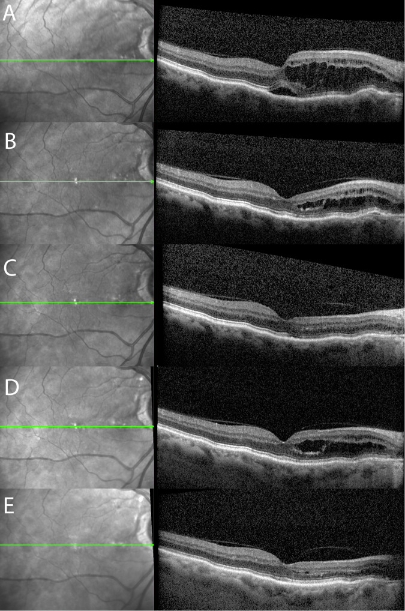
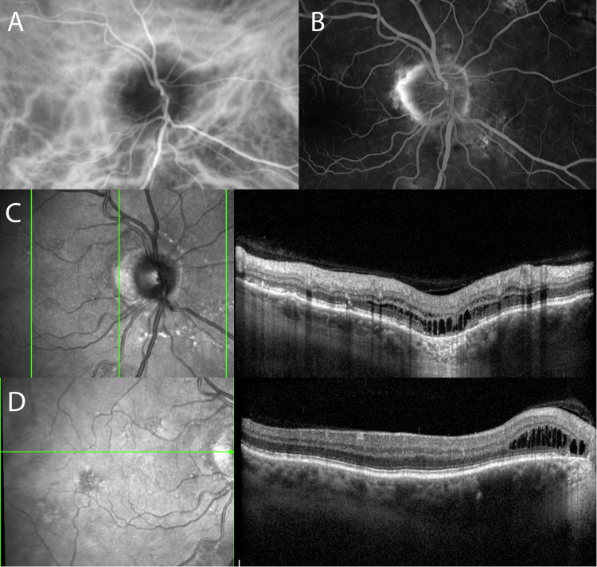
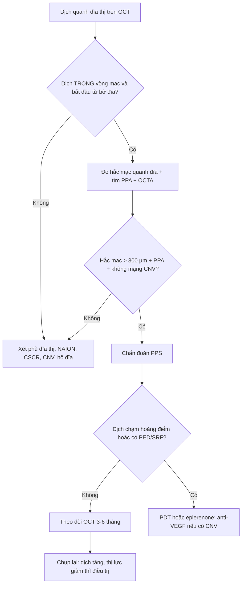
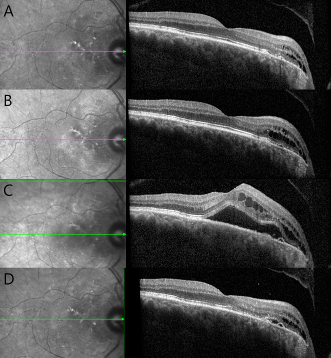
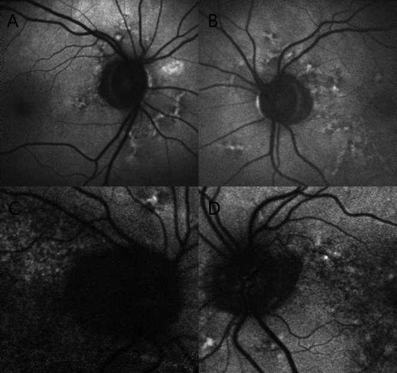

# 405 — Hội chứng pachychoroid quanh đĩa thị (PPS): "phù đĩa thị giả", túi dịch quanh đĩa & ngưỡng hắc mạc 300 µm

**Tags:** `pattern:phu-dia-thi` `pattern:hac-mac-day` `pattern:dich-voi-hoang-diem` `pattern:bo-hoang-diem` `vung:dia-thi` `vung:hoang-diem` `vung:hac-mac` `score:CT-300um` `protocol:OCT-EDI` `protocol:FA-ICGA` `protocol:OCTA`
**Mức chắc chắn (certainty):** tổng hợp y văn (literature synthesis) — ghép **đoàn hệ tự nhiên 24 mắt/14 bệnh nhân** (Ophthalmol Ther 2025, PMC12534684), **bài phân tích cơ chế – hình ảnh** (Eye 2024, PMC11584888), **tổng quan hình ảnh bệnh pachychoroid** (Turk J Ophthalmol 2025, PMC11866993), **loạt 3 ca eplerenone** (Case Rep Ophthalmol 2025, PMC12674667) và **ca micropulse 577 nm** (Am J Ophthalmol Case Rep 2022, PMC9706522). Không có ca do nhóm tự chụp.

> **Câu hỏi thực hành:** nam **68 tuổi**, **nhìn mờ nhẹ mắt phải 2 tuần**, không đau, không đau đầu; đáy mắt **đĩa thị trông "đầy", bờ mờ nhẹ**, OCT có **nhiều nang dịch trong võng mạc phía mũi hoàng điểm nối liền bờ đĩa**, hắc mạc quanh đĩa **dày, mạch Haller giãn**. Câu hỏi: **đây có phải phù đĩa thị do tăng áp lực nội sọ không, có cần chọc dò tủy sống không, và khi nào chỉ theo dõi?**
> Bài chốt **ba quyết định**: **(1) dịch nằm TRONG võng mạc và bắt đầu từ bờ đĩa = PPS, không phải phù đĩa thị; (2) hắc mạc quanh đĩa dày > 300 µm + mạch giãn là chốt cơ chế; (3) phần lớn chỉ theo dõi — chỉ điều trị khi dịch chạm hoàng điểm kéo dài hoặc có hình thái chồng lấp CSCR**. Nối [482 – Tân mạch hắc mạc sau CSCR mạn](../482-tan-mach-hac-mac-sau-cscr-man/lesson.md), [470 – CSCR do corticosteroid](../470-cscr-do-corticosteroid-mat-thi-luc-khong-dau/lesson.md), [433 – Phù đĩa thị vs drusen](../433-phu-dia-thi-drusen/lesson.md).

## 1. Tổng quan bệnh học – cơ chế hình ảnh: vì sao dịch "rỉ" vào võng mạc chứ không vào dưới võng mạc

- **Vị trí của PPS trong phổ bệnh pachychoroid:** PPS được mô tả lần đầu năm **2017–2018** (Phasukkijwatana và cộng sự, *Retina*), nằm cùng phổ với **CSCR, PPE, PNV, PCV, hốc hắc mạc khu trú (FCE)**. Điểm khác biệt: tổn thương **tập trung quanh đĩa thị và hoàng điểm phía mũi**, không ở hoàng điểm trung tâm như CSCR.
- **Cơ chế — chuỗi ba bước:**
  1. **Nối tĩnh mạch giữa các vòng xoáy (intervortex venous anastomoses) hình thành quanh đầu thần kinh thị** thay vì ở hoàng điểm (CSCR). Trên ICGA, các vòng nối này lộ ra thành **vùng phân thủy bất thường quanh đĩa** (Eye 2024, PMC11584888).
  2. Ứ trệ → **giãn mạch Haller (pachyvessels) + tăng tính thấm + tăng áp lực thủy tĩnh trong hắc mạc quanh đĩa**. Hắc mạc dày là **điều kiện nền**, không phải hậu quả của dịch.
  3. **Teo biểu mô sắc tố quanh đĩa (peripapillary atrophy, PPA)** làm mất hàng rào RPE → dịch **rỉ từ hắc mạc vào võng mạc** tại bờ đĩa, tạo **"túi dịch quanh đĩa" (peripapillary fluid pocket)** rồi lan dần ra hoàng điểm phía mũi.
- **TẠI SAO dịch TRONG võng mạc mà không phải dưới võng mạc:** áp lực thủy tĩnh trong hắc mạc của PPS **thấp hơn CSCR** — đủ để dịch thấm qua vùng RPE teo nhưng **không đủ bóc RPE** thành bong thanh dịch. Vì vậy đa số PPS **không có PED**, **không rỉ huỳnh quang** trên FA, và dịch đọng thành **nang trong võng mạc** (Eye 2024). Khi áp lực đủ cao (hoặc có CSCR chồng lấp), mới xuất hiện **PED + dịch dưới võng mạc**.
- **Ngưỡng định lượng phải thuộc:**
  - **Hắc mạc dày = chiều dày hắc mạc dưới hoàng điểm > 300 µm** trên OCT EDI/SS-OCT (Turk J Ophthalmol 2025, PMC11866993); trong đoàn hệ PPS, chiều dày hắc mạc **321,5 ± 72,24 µm tại 1,5 mm** và **204,38 ± 103,30 µm tại 3,0 mm** tính từ tâm hoàng điểm.
  - **PPA có mặt ở 100% (14/14) bệnh nhân**, chiều rộng trung bình **560 µm (157–1.135 µm)** — đây là **dấu hiệu nền** giúp phân biệt với phù đĩa thị thật (Ophthalmol Ther 2025, PMC12534684).
  - **Tuổi 74 ± 7 (57–88), 71% hai bên (10/14), nam:nữ = 10:4, cận thị thấp/viễn thị nhẹ (trục nhãn 22,34 ± 1,30 mm)** — chân dung điển hình là **nam lớn tuổi, mắt viễn thị**.
  - **Độ dày võng mạc vùng mũi trong (IN) 365,25 ± 53,50 µm và mũi ngoài (ON) 352,04 ± 57,57 µm** lúc chẩn đoán.
- **Diễn tiến tự nhiên (đoàn hệ 24 mắt, không điều trị):** **10/14 không có triệu chứng**, thị lực trung bình **0,05 logMAR** và **ổn định**; dịch **dao động lên xuống ("waxing and waning")** rồi giảm: **ON giảm −36,9 µm ở 2 năm (p = 0,034)**; **IN giảm −40,75 µm ở 2 năm (p = 0,023)** và **−39,97 µm ở 3 năm (p = 0,042)**. **5/24 mắt có CSCR đồng thời**, và khoảng **1/4 bệnh nhân** phát triển **PED thanh dịch + dịch dưới võng mạc** trong quá trình theo dõi.
- **TẠI SAO đây là "phù đĩa thị giả":** đĩa thị **trông đầy** vì hắc mạc quanh đĩa dày đẩy RPE/đĩa ra trước, có thể kèm **nếp gấp hắc mạc**; nhưng **không có tăng áp lực nội sọ**, **không mất xung tĩnh mạch tự phát**, và **RNFL không dày lan tỏa** như phù đĩa thị thật. Dịch nằm **trong võng mạc sát bờ đĩa**, không phải **dịch dưới võng mạc quanh đĩa kiểu phù gai**.

*Cùng một mắt PPS qua 5 mốc (Eye 2024, PMC11584888): dịch trong võng mạc **tăng rồi giảm** mà không can thiệp — bằng chứng cho "waxing and waning" và cho chiến lược theo dõi khi dịch ngoài hoàng điểm. Nguồn: CC BY 4.0, nguyên bản.*

## 2. Mẫu hình + chẩn đoán phân biệt theo vị trí & cơ chế (Gamut)

- **Ba câu hỏi bắt buộc khi thấy dịch quanh đĩa:**
  1. **Dịch nằm ở đâu?** *Trong võng mạc* (nang) → nghĩ PPS/CSCR mạn; *dưới võng mạc* → CSCR, phù đĩa thị, NAION; *dưới RPE* → PED, CNV.
  2. **Dịch bắt đầu từ đâu?** Từ **bờ đĩa lan ra** = PPS; từ **hoàng điểm lan vào** = CSCR.
  3. **Hắc mạc có dày + mạch giãn không?** Có = phổ pachychoroid; không = nguyên nhân đĩa thị/mạch máu/áp lực.
- **Gamut theo cơ chế:**
  - **Pachychoroid:** PPS, CSCR (lan quanh đĩa), PNV, PPE.
  - **Bất thường cấu trúc đĩa:** drusen đĩa thị, hố đĩa thị (optic disc pit), coloboma, PHOMS.
  - **Mạch máu:** NAION/AION, tắc tĩnh mạch nhánh quanh đĩa, CNV quanh đĩa.
  - **Áp lực:** tăng áp lực nội sọ (IIH, u não, huyết khối xoang).
  - **Viêm/u:** viêm thần kinh thị, sarcoid, u màng não vỏ thị, di căn đĩa.
- **Mnemonic "PPS = Peripapillary Pocket Syndrome":** **P**eripapillary **P**ocket + **S**ubretinal fluid chỉ khi chạm hoàng điểm; **P**achyvessels; **S**teroid là yếu tố làm nặng.
- **Bối cảnh gợi ý mạnh:** nam **> 60 tuổi**, **viễn thị**, **không đau**, **không đau đầu**, tình cờ thấy trên OCT, **u máu da/không**, **tiền sử dùng corticosteroid** (làm nặng).

## 3. Bảng so sánh phân biệt (ma trận đối chiếu)

| Thực thể (entity) | Hình ảnh điển hình | Chốt vào (rule-in) | Chốt loại (rule-out) | Gợi ý xác nhận |
|---|---|---|---|---|
| **PPS** | Hắc mạc quanh đĩa dày, mạch Haller giãn; **nang dịch TRONG võng mạc từ bờ đĩa** lan ra mũi hoàng điểm; **PPA**; FA thường **không rỉ** | **Túi dịch quanh đĩa + hắc mạc quanh đĩa > 300 µm + PPA + FA không rỉ** | Dịch dưới võng mạc lan tỏa + rỉ huỳnh quang + không PPA → CSCR/phù đĩa thị | OCT EDI xuyên đĩa 2 bình diện; FAF; FA/ICGA; OCTA loại CNV |
| **CSCR** | Dịch dưới võng mạc **hoàng điểm**, PED/RPE bump, rỉ điểm trên FA; hắc mạc dày | **Rỉ huỳnh quang khu trú + PED + dịch dưới võng mạc hoàng điểm** | Dịch **trong võng mạc** bắt đầu từ bờ đĩa + không rỉ → PPS | FA/ICGA; OCT; hỏi corticosteroid |
| **Phù đĩa thị / IIH** | Đĩa **phù hai bên**, RNFL dày, mất xung tĩnh mạch, **dịch dưới võng mạc quanh đĩa**, não thất bình thường; **áp lực mở > 25 cm CSF** | **Đau đầu + ù tai mạch đập + RNFL dày + áp lực mở > 25 cm CSF** | Không đau đầu, RNFL bình thường, có PPA + hắc mạc dày → PPS | Đo áp lực mở; MRI/MRV; OCT RNFL |
| **NAION** | Phù đĩa **một bên**, đĩa nhỏ C/D thấp, **khiếm khuyết thị trường theo chiều cao**, không đau | **Mất thị lực đột ngột không đau + phù đĩa + C/D nhỏ** | Dịch trong võng mạc từ bờ đĩa + PPA + hắc mạc dày → PPS | Thị trường; OCT; **hắc mạc dày có thể gặp trong NAION nên không loại trừ PPS** |
| **Drusen đĩa thị** | **Tự phát sáng trên FAF**, nốt tăng âm trong đĩa, **lõi giảm âm viền tăng âm** trên OCT; thường không dịch | **Nốt drusen + FAF tăng sáng + không dịch** | Có túi dịch trong võng mạc + PPA → PPS | FAF, OCT, siêu âm B (drusen canxi hóa) |
| **CNV quanh đĩa** | **PED xơ–mạch**, xuất huyết, **mạng mạch trên OCTA**, rỉ trên FA | **Mạng CNV trên OCTA + PED xơ–mạch + xuất huyết** | Không mạng mạch, không xuất huyết → PPS | OCTA; FA; anti-VEGF nếu xác nhận |
| **Hố đĩa thị (optic disc pit)** | **Hố nhỏ trong đĩa**, dịch **schisis-like** lớp trong rồi **bong lớp ngoài**, thường gặp ở người trẻ | **Hố đĩa + schisis + bong lớp ngoài** | Không hố, dịch trong võng mạc từ bờ đĩa → PPS | OCT xuyên đĩa; chụp đáy mắt |

*Đa phương thức ở một bệnh nhân PPS (Eye 2024, PMC11584888): **(A)** ICGA — nhiều **vòng nối giữa các tĩnh mạch xoáy quanh đĩa thị**; **(B)** FA — **rỉ nhẹ** phía thái dương đĩa trong vùng PPA; **(C, D)** OCT đứng và ngang — **nang dịch trong võng mạc xuất phát từ vùng PPA quanh đĩa**, lan dần ra ngoài. Nguồn: CC BY 4.0, nguyên bản.*

## 4. Protocol chụp + ngưỡng xử trí

- **Bước 1 — OCT EDI/SS-OCT (bắt buộc, là "phim chẩn đoán"):** chụp **qua đĩa theo 2 bình diện (ngang + đứng)**, thêm **lát cắt qua hoàng điểm phía mũi**. Đo:
  - **Chiều dày hắc mạc** tại **1,5 mm và 3,0 mm** từ tâm hoàng điểm (hoặc điểm dày nhất trong 500 µm quanh bờ đĩa).
  - **Vị trí túi dịch**: trong võng mạc hay dưới võng mạc; có **PED** không.
  - **PPA** và mức lan của nó (so với chẩn đoán cũ).
- **Bước 2 — FAF:** PPA giảm sáng, viền tăng sáng; mô tả **"dấu xương đùi" (femur sign)** — vùng tăng/giảm sáng quanh đĩa và hoàng điểm tạo hình giống xương đùi (Turk J Ophthalmol 2025).
- **Bước 3 — FA/ICGA (khi cần phân biệt CSCR/CNV):** PPS **thường không rỉ** trong vùng PPA; nếu rỉ mạnh + PED → nghĩ CSCR/CNV chồng lấp. ICGA thấy **vòng nối quanh đĩa** và **mạch Haller giãn**.
- **Bước 4 — OCTA:** loại **CNV quanh đĩa** trước khi kết luận PPS (không có mạng mạch = PPS đơn thuần).
- **Bước 5 — thị trường & RNFL:** PPS có thể **mở rộng điểm mù**; RNFL **không dày lan tỏa** như phù đĩa thị. Nếu RNFL dày + đau đầu → **đo áp lực mở** trước khi gắn nhãn PPS.
- **Ngưỡng điều trị (chỉ khi có chỉ định):**

| Tình huống | Xử trí | Bằng chứng / con số |
|---|---|---|
| Dịch **ngoài hoàng điểm**, không triệu chứng | **Theo dõi 3–6 tháng** bằng OCT | 10/14 không triệu chứng; thị lực 0,05 logMAR ổn định; dịch tự giảm (PMC12534684) |
| Dịch **chạm hoàng điểm** kéo dài, hoặc PPS/CSCR chồng lấp | **PDT** là lựa chọn được khuyến nghị trong phổ pachychoroid | Bài phân tích khuyến nghị PDT; bằng chứng PPS còn nhỏ (Eye 2024) |
| Muốn điều trị nội khoa | **Eplerenone 50 mg/ngày × 12 tháng** | 3 ca: hắc mạc **giảm 48 µm**, thị lực **tăng 10 chữ ở 75%**, không tác dụng phụ (PMC12674667) |
| Rỉ khu trú, muốn tránh PDT | **Micropulse 577 nm** | 1 ca: dịch dưới võng mạc hết sau 6 tháng, **20/32 → 20/20** (PMC9706522) |
| Có **CNV** trên OCTA | **Anti-VEGF** | Chỉ khi xác nhận mạng mạch; không dùng mù |
| Đang dùng **corticosteroid** | **Cân nhắc ngừng/giảm** | Steroid là yếu tố nguy cơ của phổ pachychoroid; báo cáo "đáp ứng steroid" không có nhóm chứng (Eye 2024) |

- **Theo dõi:** OCT mỗi **3–6 tháng** khi còn dịch; **6–12 tháng** khi ổn định; ghi **chiều dày hắc mạc, vị trí dịch, thị lực logMAR**. Tái phát/tiến triển về hoàng điểm là lý do điều trị, không phải "hắc mạc dày" đơn thuần.

## 5. Biến thể bình thường và cạm bẫy

- **Bẫy số 1 — gọi PPS là phù đĩa thị:** đĩa "đầy" + PPA + hắc mạc dày rất dễ bị đọc là phù gai; **chọc dò tủy sống ở người không tăng áp lực** là thủ thuật không cần thiết, còn **bỏ sót IIH thật** nếu chỉ dựa vào "đĩa đầy". Chốt: **RNFL + triệu chứng + áp lực mở**.
- **Bẫy số 2 — dịch trong võng mạc bị đọc là "phù võng mạc do đái tháo đường/tắc tĩnh mạch":** PPS **một bên hoặc hai bên không đối xứng**, dịch **sát bờ đĩa**, không có xuất huyết/tân mạch đái tháo đường. Luôn hỏi **tiền sử đái tháo đường, tăng huyết áp, thuốc**.
- **Bẫy số 3 — hắc mạc dày đơn thuần không phải PPS:** chiều dày hắc mạc **thay đổi theo tuổi, trục nhãn, tư thế đo**; ngưỡng **> 300 µm** chỉ có nghĩa khi **kèm dịch và PPA**. Đừng gắn nhãn bệnh cho người **cận thị nặng/hắc mạc dày không dịch**.
- **Bẫy số 4 — "u máu da không có thì không phải u mạch"** (bài học từ u máu đường thở): ở PPS, **không có dấu hiệu ngoài mắt** là bình thường; chẩn đoán dựa vào OCT/FA.
- **Bẫy số 5 — corticosteroid làm nặng bệnh:** nhiều báo cáo dùng **prednisolone tại chỗ** cho PPS, nhưng **không có nhóm chứng** và steroid là yếu tố nguy cơ của phổ pachychoroid; "cải thiện" có thể là **diễn tiến tự nhiên** (Eye 2024).
- **Bẫy số 6 — bỏ sót CNV:** PPS có thể **chồng lấp CSCR/CNV**; **OCTA trước khi kết luận "lành"**, vì anti-VEGF khác hoàn toàn theo dõi.
- **Cạm bẫy mặt cắt:** trên OCT **một lát cắt đơn lẻ**, nang dịch quanh đĩa có thể bị bỏ sót nếu cắt **qua trục thái dương**; luôn chụp **2 bình diện qua đĩa** và **lát qua hoàng điểm phía mũi**.

## 6. Tự lượng giá — Blind Quiz

**Ca 1 — Nam 65 tuổi, nhìn mờ nhẹ, đĩa thị "đầy", OCT có nang dịch phía mũi hoàng điểm.**

- Câu hỏi: Dịch nằm ở lớp nào? Nó bắt đầu từ đâu? Dấu hiệu nào trên ICGA giải thích cơ chế?

<b>Bấm để hiện đáp án (findings + chẩn đoán)</b>

- Dấu hiệu (findings): **(A)** ICGA — **vòng nối giữa các tĩnh mạch xoáy quanh đĩa**; **(B)** FA — **rỉ nhẹ** trong vùng PPA; **(C, D)** OCT — **nang dịch trong võng mạc** xuất phát từ **PPA sát bờ đĩa**, lan ra ngoài; hắc mạc quanh đĩa dày, mạch Haller giãn.
- Chẩn đoán (diagnosis): **PPS** — không phải phù đĩa thị vì dịch **trong võng mạc**, bắt đầu từ bờ đĩa, và **không có rỉ mạnh/PED**.
- Vì sao: vòng nối quanh đĩa → ứ trệ hắc mạc → dịch rỉ qua **PPA** vào võng mạc.
- Nguồn ảnh: Eye 2024 (PMC11584888), CC BY 4.0.

**Ca 2 — Cùng bệnh nhân, theo dõi 9 tháng không điều trị.**

- Câu hỏi: Mô tả thay đổi qua các mốc. Điều này nói gì về chỉ định điều trị?

<b>Bấm để hiện đáp án</b>

- Dấu hiệu (findings): **(A)** baseline — nang dịch trong võng mạc; **(B)** 6 tháng — dịch tăng; **(C)** 8 tháng — **PED thanh dịch + dịch dưới võng mạc**; **(D)** 9 tháng — gần như hết.
- Chẩn đoán (diagnosis): **PPS thể dao động tự nhiên**, có giai đoạn chồng lấp CSCR.
- Vì sao: dịch **lên xuống theo thời gian**, thị lực giữ ổn định → **theo dõi là hợp lý** khi chưa chạm hoàng điểm; điều trị khi dịch **kéo dài ở hoàng điểm** hoặc có PED/SRF tiến triển.
- Nguồn ảnh: Ophthalmol Ther 2025 (PMC12534684), CC BY-NC 4.0.

**Ca 3 — Bốn mắt PPS, nhìn FAF trước.**

- Câu hỏi: Dấu hiệu chung của cả 4 mắt là gì? Vì sao nó quan trọng hơn "hắc mạc dày"?

<b>Bấm để hiện đáp án</b>

- Dấu hiệu (findings): **teo biểu mô sắc tố quanh đĩa (PPA)** — vùng giảm sáng quanh đĩa, viền tăng sáng; có ở **14/14 bệnh nhân**, rộng trung bình **560 µm (157–1.135 µm)**.
- Chẩn đoán (diagnosis): **PPS với PPA là điều kiện nền**.
- Vì sao: PPA là **cửa vào** cho dịch từ hắc mạc vào võng mạc; hắc mạc dày đơn thuần không gây dịch nếu RPE quanh đĩa còn nguyên.
- Nguồn ảnh: Ophthalmol Ther 2025 (PMC12534684), CC BY-NC 4.0.

## Bài liên quan chéo
- [400 – Tổng quan Mắt & thị giác](../400-tong-quan-mat-thi-giac/lesson.md)
- [482 – Tân mạch hắc mạc sau CSCR mạn (PNV)](../482-tan-mach-hac-mac-sau-cscr-man/lesson.md)
- [470 – CSCR do corticosteroid & mất thị lực không đau](../470-cscr-do-corticosteroid-mat-thi-luc-khong-dau/lesson.md)
- [433 – Phù đĩa thị vs drusen đĩa: Frisén, IIH & PHOMS](../433-phu-dia-thi-drusen/lesson.md)
- [441 – OCT hoàng điểm](../441-OCT-hoang-diem/lesson.md)
- [3018 – Tăng áp lực nội sọ tự phát (IIH) ở người lớn](../3018-tang-ap-luc-noi-so-tu-phat-nguoi-lon/lesson.md)
- [480 – NAION: điều trị và theo dõi](../480-naion-dieu-tri-va-theo-doi/lesson.md)

## Ảnh
- 4 ảnh: 2 ảnh **CC BY 4.0** (Eye 2024) + 2 ảnh **CC BY-NC 4.0** (Ophthalmol Ther 2025) — **nguyên bản**, không crop/ghép; chi tiết trong `images/CREDITS.md`.
- Không tạo composite vì hai bài gốc khác bệnh cảnh và một bài là license **NC** (phi thương mại).

> Không dùng để chẩn đoán độc lập khi chưa có người hướng dẫn.
