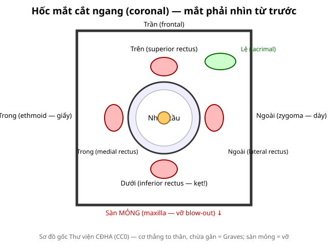

# 410 — Giải phẫu hốc mắt cắt lớp / Orbital cross-sectional anatomy

**Tags:** `pattern:binh-thuong` `vung:hoc-mat` `anatomy:hoc-mat`
**Mức chắc chắn (certainty):** tổng hợp y văn (literature synthesis) — nhóm tự biên từ y văn mở, chưa gắn ca nguyên văn đơn lẻ.

## 1. Tổng quan — 4 thành + 4 cơ thẳng + 1 dây thần kinh

- Hốc mắt là tháp xương: **trần (frontal)** dày, **sàn (maxilla)** mỏng nhất, **trong (ethmoid/lamina papyracea — giấy)** mỏng nhì, **ngoài (zygoma)** dày nhất. TẠI SAO vỡ hay gặp sàn + trong: mỏng + xoang kề (hàm trên, sàng) làm đường thoát áp lực.
- 4 cơ thẳng (trên/dưới/trong/ngoài) + cơ chéo trên; **thần kinh thị (optic nerve)** đi giữa ra lỗ thị giác; tuyến lệ trên-ngoài; tĩnh mạch mắt trên (dấu TED nặng).
- TẠI SAO CT cửa sổ xương + mô mềm: xương tìm vỡ (sàn/giọt lệ), mô mềm tìm kẹt cơ/máu/tụ dịch.

*Sơ đồ gốc Thư viện CĐHA, CC0.*

## 2. Mốc phải thuộc (gamut vị trí)

- **Sàn (maxilla):** cơ thẳng dưới + mỡ sa — vỡ blow-out, kẹt cơ (bài 420).
- **Trong (ethmoid):** cơ thẳng trong + xoang sàng mờ — vỡ + viêm xoang lan.
- **Đỉnh (apex):** thần kinh thị + mạch — chèn ép đỉnh = mù (OCS, u, TED nặng).
- **Ngoài (zygoma):** ít vỡ đơn độc; gãy phức hợp gò má (tripod).

## 3. Bảng biến thể hay nhầm

| Biến thể | Hình ảnh | Lành khi | Nghĩ bệnh khi |
|---|---|---|---|
| Rãnh dưới ổ mắt (infraorbital groove) | Khuyết sàn | Đối xứng, bờ xương đều | Lệch 1 bên + mô mềm sa → vỡ |
| Kênh thị 2 bên hơi lệch cỡ | Lỗ thị 2 bên khác cỡ nhẹ | Không triệu chứng | Kèm u/dày → glioma/meningioma |
| Xoang hàm kém phát triển | Sàn cao | Bẩm sinh, 2 bên | 1 bên sau chấn thương → xẹp xoang (silent sinus) |

## 4. Protocol

- **CT đa dãy lát mỏng ≤ 1 mm + MPR coronal/sagittal:** chuẩn chấn thương và u (coronal thấy sàn/giọt lệ rõ nhất).
- **MRI (T1/T2 fatsat + cản quang):** cơ (TED/viêm), thần kinh thị, đỉnh ổ mắt.
- **Siêu âm nhãn cầu:** trong nhãn cầu (bong võng mạc — bài 411 dự kiến).

## 5. Cạm bẫy

- **Thể tích trung bình (volume averaging)** giả dày cơ — lát mỏng + MPR xác nhận.
- **Xoang mờ sau chấn thương** = máu xoang (gợi vỡ sàn) — đừng đọc viêm xoang đơn thuần.
- **Trẻ em trapdoor:** X-quang/CT vỡ ít nhưng kẹt cơ nhiều (trắng mắt + nôn + nhịp chậm) — mổ sớm.

## 6. Tự lượng giá — Blind Quiz

**Ca 1 — Nhìn sơ đồ, kể tên 4 cơ + 2 tường mỏng nhất.**

<b>Bấm để hiện đáp án</b>

- Trên/dưới/trong/ngoài; mỏng nhất: **sàn (maxilla)** rồi **trong (ethmoid)** — 2 đường vỡ kinh điển.

**Ca 2 — Chấn thương + nhìn đôi dọc + CT giọt lệ sàn:** cơ nào kẹt? Vì sao trẻ nguy hiểm hơn? *(Nối bài 420.)*

<b>Bấm để hiện đáp án</b>

- **Cơ thẳng dưới** kẹt; trẻ trapdoor: xương đàn hồi sập lại kẹp cơ → thiếu máu cơ nhanh, mổ sớm.

## Bài liên quan chéo
- [400 – Tổng quan Mắt](../400-tong-quan-mat-thi-giac/lesson.md)
- [420 – Vỡ sàn hốc mắt](../420-vo-san-hoc-mat/lesson.md)
- [421 – Lồi mắt Graves](../421-loi-mat-Graves/lesson.md)

> Không dùng để chẩn đoán độc lập khi chưa có người hướng dẫn.
