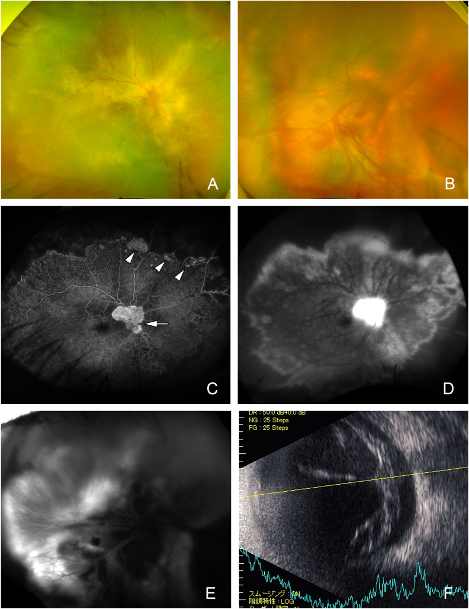

# 411 — Siêu âm nhãn cầu: bong võng mạc vs xuất huyết dịch kính / B-scan: RD vs VH

**Tags:** `pattern:mang-dich-kinh` `vung:nhan-cau` `protocol:sieu-am`
**Mức chắc chắn (certainty):** tổng hợp y văn (literature synthesis) — nhóm tự biên từ y văn mở, chưa gắn ca nguyên văn đơn lẻ.

## 1. Tổng quan — đầu dò 10 MHz + màng nào dính đâu

- Siêu âm B-scan **10 MHz** qua mi nhắm (không đè khi nghi vỡ nhãn cầu). TẠI SAO phân biệt được: võng mạc dính ở **đĩa thị + ora serrata** (màng chữ V/Y); xuất huyết dịch kính **không dính** (chấm di động); hắc mạc dính ở **lỗ thoát vortex + trước** (vòm, không qua đĩa → chữ T).
- **Aftermovement:** bảo BN đảo mắt — màng võng mạc bong **cứng, ít di động sau**; máu dịch kính **lắc lư nhiều (after movement +)**.
- Ngưỡng xử trí: bong võng mạc **có hoàng điểm (macula-on) = mổ trong 24–48 giờ** (mù hoàng điểm không hồi phục nếu để lâu); bong hắc mạc kèm T-sign sau chấn thương/mổ.

## 2. Gamut màng trong dịch kính

- **Bong võng mạc do rách (rhegmatogenous):** màng V/Y dính đĩa + ora, cứng, cận thị/chấn thương/mổ đục thủy tinh thể.
- **Bong xuất tiết/co kéo (đái tháo đường, Coats):** màng dày + xuất tiết, đái tháo đường lâu năm.
- **Xuất huyết dịch kính:** chấm/mây di động mạnh, đái tháo đường/tắc tĩnh mạch/chấn thương — không màng dính đĩa.
- **Bong hắc mạc:** vòm ngoại vi + **T-sign** (màng + dịch dưới hắc mạc), sau mổ/chấn thương/hạ nhãn áp.

## 3. Bảng so sánh

| Thực thể (entity) | B-scan điển hình | Chốt vào (rule-in) | Chốt loại (rule-out) | Gợi ý xác nhận |
|---|---|---|---|---|
| Bong võng mạc | **Màng V/Y dính đĩa + ora, cứng, ít aftermovement** | **Dính đĩa thị + hoàng điểm on/off** | Di động mạnh không dính → máu | Soi đáy rộng + mổ theo hoàng điểm |
| Xuất huyết dịch kính | **Chấm/mây di động mạnh, không màng dính** | **Aftermovement (+) + tiền sử ĐTĐ/tắc TM** | Màng V dính đĩa → bong võng mạc | Theo dõi tan (tuần-tháng) + tìm rách |
| Bong hắc mạc | **Vòm ngoại vi + T-sign, không qua đĩa** | **T-sign sau mổ/chấn thương/hạ áp** | Qua đĩa thị → võng mạc | Steroid/nghỉ + mổ khi kẹt (kissing) |
| Bong xuất tiết | Màng dày + dịch + xuất tiết (Coats/ĐTĐ) | **Xuất tiết + đái tháo đường/Coats** | Rách + di động → bong do rách | Điều trị nguyên nhân + laser/vitrektomy |

*Toàn figure: đáy mắt (A–B) + FA (C–E) + B-scan panel F (góc dưới phải): võng mạc dày bong kèm xuất tiết. Nguồn: Kishi et al., Am J Ophthalmol Case Rep 2026, CC BY-NC-ND 4.0 (giữ nguyên bản).*

## 4. Protocol siêu âm

- Đầu dò 10 MHz, gel qua mi nhắm; **cấm đè** khi nghi vỡ nhãn cầu (khám CT trước).
- Quét 4 góc + hoàng điểm (macula on/off quyết định mổ cấp cứu) + đo aftermovement.
- Bong hắc mạc sau mổ: theo dõi T-sign + nhãn áp (hạ áp kéo dài → mổ).

## 5. Cạm bẫy

- **Máu cũ đặc** giả màng bong — tăng gain + đảo mắt (máu vẫn lắc).
- **Bong võng mạc mạn** màng dày cứng giả hắc mạc — tìm dính đĩa thị (võng mạc qua đĩa, hắc mạc không).
- **Staphyloma cận thị nặng** giả bong — so 2 mắt + đo trục nhãn cầu.

## 6. Tự lượng giá — Blind Quiz

**Ca 1 — Nhìn panel F, mô tả màng trước khi mở đáp án.**

- Hỏi: màng dày hay mỏng? Có dính đĩa không? Xuất tiết gợi nguyên nhân gì?

<b>Bấm để hiện đáp án</b>

- **Bong võng mạc xuất tiết dày** (Coats-like, đái tháo đường/BBS) — màng dày + xuất tiết, khác bong do rách (màng mỏng, rách) và máu (không màng).
- Nguồn: Kishi et al., Fig. 1F, CC BY-NC-ND 4.0.

**Ca 2 — Chấm di động mạnh + không màng dính đĩa sau đái tháo đường 15 năm:** chẩn đoán + theo dõi? *(Bảng mục 3.)*

<b>Bấm để hiện đáp án</b>

- **Xuất huyết dịch kính:** aftermovement (+) + không dính — theo dõi tan, soi tìm rách võng mạc khi máu tan.

## Bài liên quan chéo
- [400 – Tổng quan Mắt](../400-tong-quan-mat-thi-giac/lesson.md)
- [410 – Giải phẫu hốc mắt](../410-giai-phau-hoc-mat/lesson.md)
- [412 – U trong nhãn cầu (đã có)](../412-u-trong-nhan-cau/lesson.md) (vôi hóa vs xuất huyết)

> Không dùng để chẩn đoán độc lập khi chưa có người hướng dẫn.
