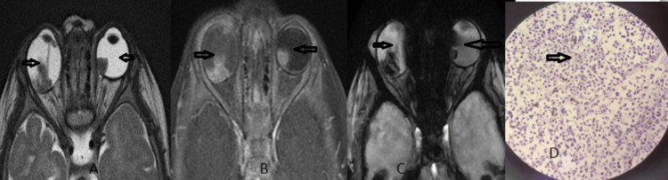
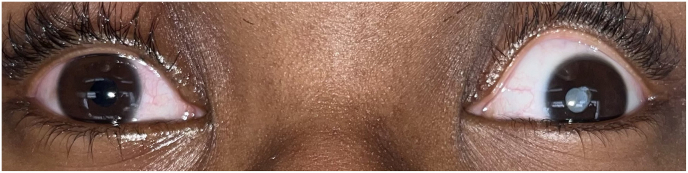
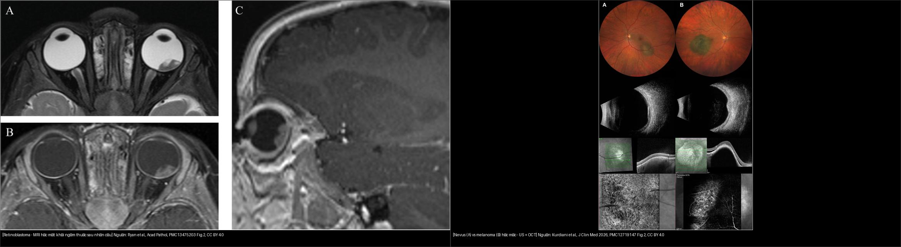
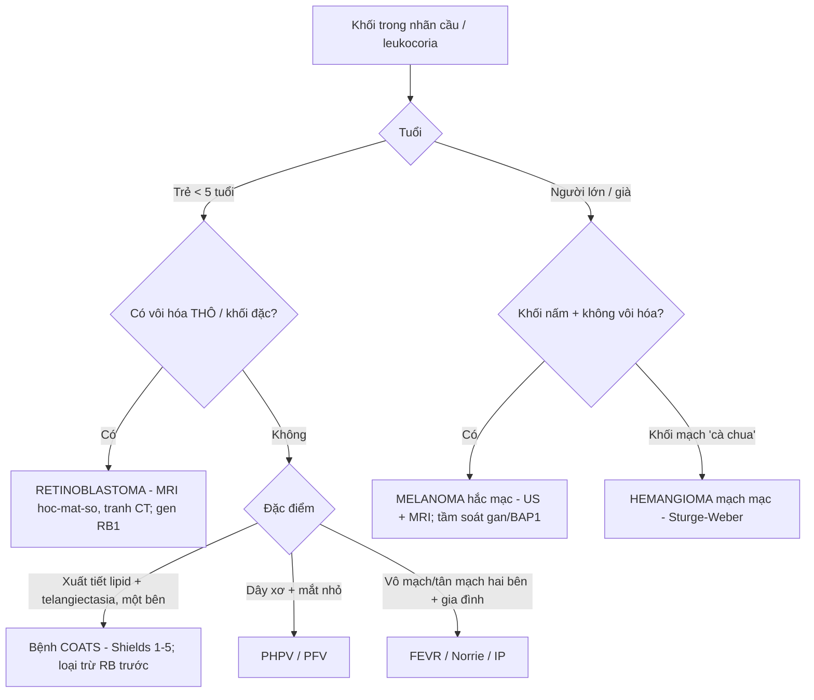
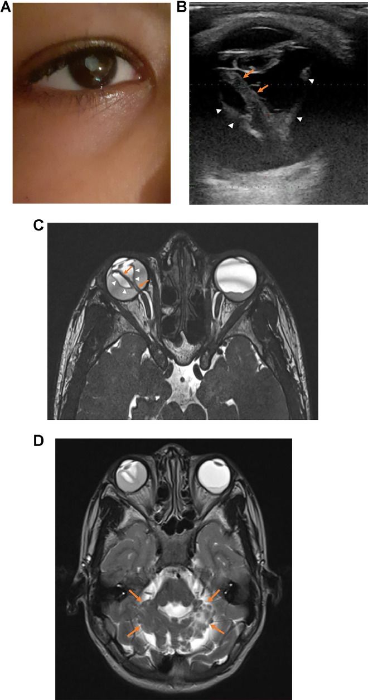
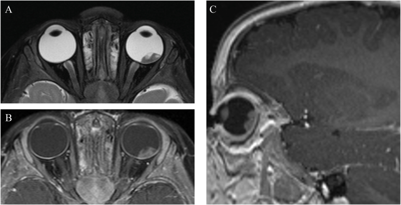
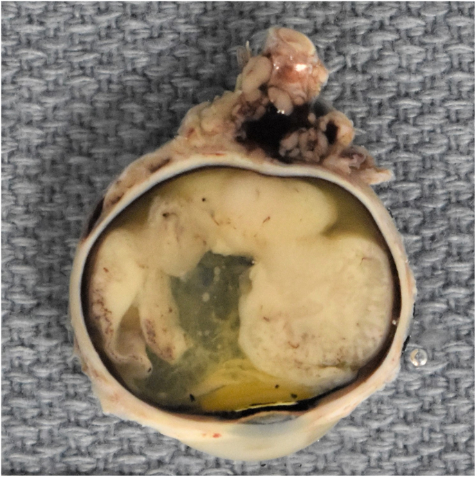
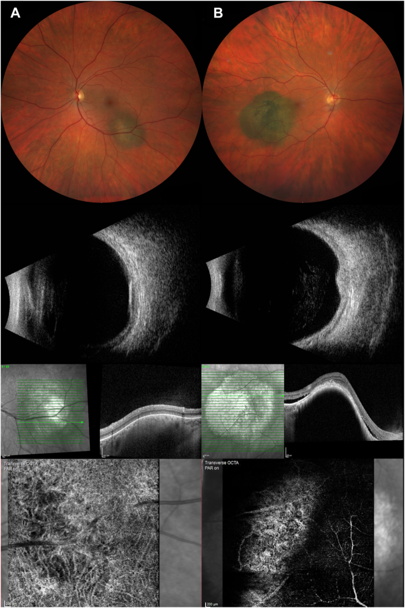

# 412 — U trong nhãn cầu: retinoblastoma vs melanoma / Coats / PHPV / Intraocular tumors

**Tags:** `pattern:voi-hoa` `pattern:khoi-noi-nhan-cau` `pattern:leukocoria` `vung:nhan-cau` `score:Shields` `score:TFSOM` `protocol:MRI-hoc-mat` `protocol:sieu-am-B-scan`
**Mức chắc chắn (certainty):** tổng hợp y văn + ca nguyên văn (literature synthesis + verbatim case) — tổng hợp từ y văn mở (Acad Pathol 2026; Ophthalmol Sci 2026; Radiol Case Rep 2025; Cureus 2025), có gắn hình thái ca nguyên văn.

## 1. Tổng quan — TUỔI + VÔI HÓA là hai trục quyết định

- **Câu hỏi gốc của mọi "khối trong nhãn cầu": tuổi bệnh nhân bao nhiêu, khối có vôi hóa không?** Hai trục này định hướng gần như toàn bộ chẩn đoán phân biệt (bài học lõi của dải Mắt 400).
- **Retinoblastoma (RB):** u nội nhãn ác tính hay gặp nhất ở trẻ; **~1/15.000–20.000 trẻ sinh sống**; tuổi chẩn đoán trung vị **~18–24 tháng** (thể hai bên thường **< 12 tháng**). **~40% do đột biến dòng mầm *RB1* (di truyền), trong đó phần lớn là hai bên**; **~60% không di truyền, một bên**. **Vôi hóa thô trong khối gặp > 90%** (mạnh nhất trên CT; trên MRI thấy **nhậy từ tính "blooming" trên GRE/SWI**). **Tam giác RB** (u nội nhãn hai bên + u vùng tuyến tùng/cạnh yên) gặp ở **~3%** thể dòng mầm.
- **Melanoma hắc mạc (uveal melanoma):** người **lớn/trung niên–già**, khối hình **nấm/vòm (dome, collar-button)** + bong võng mạc xuất tiết; **KHÔNG vôi hóa** (vôi hóa chỉ sau xạ). Đậm độ: T1 tăng/T2 giảm nhẹ do **melanin**; siêu âm: **phản hồi âm nội khối thấp** + dấu "khoang máu". Yếu tố nguy cơ di căn (gen **BAP1**, **kích thước lớn**, xâm lấn củng mạc, tuổi) — tầm soát di căn **gan**.
- **Coats disease:** trẻ **nam, một bên**, **giãn mạch-teo mao mạch + xuất tiết lipid**, **KHÔNG khối đặc, KHÔNG vôi hóa** (bài 457; phân độ **Shields 1–5**). **PHPV/PFV:** **dây xơ trắng từ thể thủy tinh ra sau** + **nhãn cầu nhỏ (microphthalmia)**, một bên (bài 450).
- **TẠI SAO tránh CT ở trẻ nghi RB:** đột biến dòng mầm ***RB1*** khiến tế bào nhạy cảm với bức xạ → tia X lặp lại làm tăng nguy cơ **u thứ phát (sarcoma vùng xạ)**. Vì vậy **MRI là chuẩn chẩn đoán**, CT chỉ dùng khi thật cần (chấn thương/nghi xương).
- **TẠI SAO thấy vôi hóa trên từng phương thức:** vôi hóa là **tinh thể calci** làm tán xạ/bóng trên siêu âm (tăng echo + **bóng lưng**), cản tia X mạnh trên CT (sáng trắng), và làm **méo từ trường cục bộ** trên GRE/SWI (tối/"blooming") — do đó MRI GRE **bắt được vôi hóa** mà không cần tia X.

*MRI hốc mắt–sọ trẻ: khối hai nhãn cầu, ngấm thuốc, **blooming GRE** (vôi hóa) và đối chiếu mô bệnh. Nguồn: Kumar et al., Cureus 2025, PMC12271958 Fig. 1, CC BY 4.0.*

## 2. Gamut khối trong nhãn cầu theo tuổi & cơ chế (Gamut)

- **Mẫu hình cửa vào:** **leukocoria (mất ánh đồng tử đỏ)** / lác mới / mắt đỏ đau / giảm thị lực một bên / **mắt nhỏ bẩm sinh**.
- **Gamut theo tuổi (xếp thứ tự phải loại trừ):**
  1. **Trẻ + vôi hóa + leukocoria → retinoblastoma** (loại trừ TRƯỚC mọi thứ). Khối đặc, có thể lan **thần kinh thị (tới não)** hoặc vỡ ra ngoài vỏ.
  2. **Trẻ + xuất tiết/telangiectasia + KHÔNG vôi hóa → Coats** (nam, một bên) hoặc **Leber miliary aneurysms**.
  3. **Trẻ + dây xơ + mắt nhỏ → PHPV/PFV**.
  4. **Trẻ + vô mạch/tân mạch hai bên + tiền sử gia đình → FEVR/Norrie/IP** (bài 457).
  5. **Người lớn/già + khối nấm + bong xuất tiết → melanoma hắc mạc** (không vôi hóa). **Mọi tuổi + mạch máu ("cà chua") → hemangioma mạch mạc** (Sturge-Weber).
  6. **Không điển hình:** u di căn (hiếm, người lớn), u lympho thứ phát, u tổ chức mỡ, nội nhãn sau chấn thương/mổ.
- **Phân biệt "vôi hóa trong nhãn cầu" (định lượng):** RB — vôi hóa **thô, kèm khối đặc, > 90% ca**; Coats/PHPV/melanoma — **không vôi hóa điển hình**; **drusen đĩa thị** — vôi hóa **nhỏ, ở đầu thị, không khối** (bài 433).

*Leukocoria điển hình: mắt phải (bình thường) đồng tử tối, mắt trái (bệnh) phản chiếu màu trắng đục. Đây là dấu cửa vào của retinoblastoma. Nguồn: Ryan et al., Acad Pathol 2026, PMC13475203 Fig. 1, CC BY 4.0.*

## 3. Bảng so sánh phân biệt (ma trận đối chiếu)

| Thực thể (entity) | Hình ảnh điển hình | Chốt vào (rule-in) | Chốt loại (rule-out) | Gợi ý xác nhận |
|---|---|---|---|---|
| **Retinoblastoma** | **Khối đặc + vôi hóa thô**; ngấm thuốc; có thể lan thần kinh thị/não; MRI GRE blooming | **Vôi hóa thô trong khối + trẻ < 5 tuổi + hai bên/gia đình** | Không khối đặc + xuất tiết/telangiectasia → Coats | **MRI hốc mắt–sọ** (tránh CT) + xét gen ***RB1*** + EUA; đánh giá lan TK thị = yếu tố mổ/bảo tồn |
| **Melanoma hắc mạc** | Khối **nấm/vòm**, T1 tăng/T2 giảm do melanin, siêu âm **phản hồi âm thấp**, không vôi hóa; bong xuất tiết | **Người lớn + khối nấm + sắc tố da cam (orange pigment) + bong xuất tiết** | Vôi hóa thô + trẻ → RB | Siêu âm + MRI hốc mắt; **PET/CT hoặc MRI gan** tìm di căn; gen **BAP1** |
| **Nevus hắc mạc (đối chiếu)** | Nốt dẹt, **không** sắc tố da cam, **không** dịch dưới võng mạc, mạch hắc mạc bình thường | **Dẹt + không orange pigment + không SRF** | Dày > **2 mm** + orange pigment + SRF → nghi melanoma | Siêu âm + OCT (theo dõi định kỳ) |
| **Coats disease** | **Giãn mạch-teo mao mạch + xuất tiết lipid**, một bên, **không vôi hóa**, không khối đặc | **Bé nam + một bên + xuất tiết lipid + không bệnh hệ thống** | Vôi hóa thô/khối đặc → RB | FA góc rộng + OCT (Shields 1–5); **loại trừ RB trước laser** |
| **PHPV / PFV** | **Dây xơ trắng từ thể thủy tinh ra sau**, nhãn cầu **nhỏ**, một bên | **Mắt nhỏ + dây xơ bẩm sinh** | Mắt thường + vôi hóa thô → RB | Siêu âm B-scan; MRI khi cần |
| **Hemangioma mạch mạc** | "Cà chua" (khối đỏ-cam), có thể vôi hóa **sau xạ**; hay kèm **Sturge-Weber** | **Màu cà chua + dấu da/thần kinh Sturge-Weber** | Không khối đặc → loại u khác | FA/ICGA + MRI sọ (tăng ngấm màng não) |

*Trái: retinoblastoma — MRI hốc mắt khối đặc ngấm thuốc phía sau nhãn cầu. Phải: nevus (A) vs melanoma (B) hắc mạc — siêu âm + OCT cho thấy melanoma dày hơn, có sắc tố da cam và dịch dưới võng mạc; dấu hiệu "vôi hóa thô" là điểm chốt để nghiêng về RB. Nguồn: Ryan et al., Acad Pathol 2026 (PMC13475203) Fig. 2 CC BY 4.0 + Kurdiani et al., Ophthalmol Sci 2026 (PMC12719147) Fig. 2 CC BY 4.0; ảnh ghép letterbox, giữ nguyên bản.*

## 4. Protocol chụp + hệ phân độ/điểm chuẩn hóa

- **MRI hốc mắt–sọ (chuẩn, TRÁNH CT ở trẻ nghi RB):**
  - Chuỗi xung: **T1/T2 fat-sat + cản quang** (đánh giá ngấm khối, lan củng mạc/mô mỡ), **GRE/SWI** (vôi hóa "blooming"), **DWI** (mật độ tế bào), và **cuốn theo thần kinh thị lên giao thoa/não** (dấu hiệu xấu → ảnh hưởng quyết định bảo tồn mắt).
  - **Lan thần kinh thị (optic nerve invasion)** ≥ sau lá sàng / tới giao thoa là yếu tố tiên lượng nặng — mô tả rõ trên MRI.
- **Siêu âm B-scan / Doppler:** phát hiện **vôi hóa (tăng echo + bóng lưng)** khi không chụp MRI ngay; đo kích thước khối, dịch dưới võng mạc, dây xơ (PHPV).
- **CT hốc mắt:** chỉ khi **không thể thay thế** hoặc nghi chấn thương/xương; **trẻ nghi RB hạn chế tối đa** (tia X → u thứ phát ở thể dòng mầm).
- **Phân độ & ngưỡng:**
  - **RB theo nhóm điều trị (IIRC A–E):** A u nhỏ khu trú → B/C → D → **E mắt mù, khối lớn/vỡ** (thường khoét mắt). Yếu tố tiên lượng: **lan TK thị, xâm lấn hắc mạc/củng mạc, di căn CNS**. **Xét gen *RB1* + tầm soát hai mắt anh chị em** (thể dòng mầm ~40%).
  - **Coats theo Shields (1–5):** 1 giãn mạch → 2 xuất tiết (2A/2B) → 3 bong xuất tiết (3A/3B) → 4 bong + glaucoma → 5 giai đoạn cuối.
  - **Melanoma vs nevus — tiêu chuẩn lâm sàng TFSOM ("To Find Small Ocular Melanoma"):** **T**hickness > **2 mm** · **F**luid (SRF) · **S**ymptoms · **O**range pigment · **M**argin (bờ) — càng nhiều yếu tố → càng nghi melanoma. Trên OCT-A, melanoma giảm mật độ mạch.
  - **Ngưỡng định lượng minh họa (OCT-A, Kurdiani):** nevus **4,9 mm × 1,3 mm**, mật độ mạch **39%**, tổng dài mạch **14,9 mm**; melanoma **10,2 mm × 2,1 mm**, có orange pigment + SRF, mật độ mạch **27%**, tổng dài mạch **8,9 mm**.

## 5. Biến thể bình thường và cạm bẫy

- **Cạm bẫy số 1 — Coats/PHPV giả retinoblastoma:** cả hai đều gây **leukocoria + bong võng mạc xuất tiết**. Phân biệt: **RB có khối đặc + vôi hóa thô**; Coats/PHPV **không khối đặc, không vôi hóa**. **Tuyệt đối không laser/đốt mắt khi chưa loại trừ RB** (nguy cơ gieo rắc u). Ca minh họa PFV:
- **Cạm bẫy số 2 — tránh CT ở trẻ:** đột biến ***RB1* dòng mầm** + tia X → nguy cơ u thứ phát. Ưu tiên **MRI** (T1 sau tiêm + GRE/SWI tìm vôi hóa + lan TK thị).
- **Cạm bẫy số 3 — bỏ sót lan thần kinh thị / tam giác RB:** MRI **phải** bao gồm **thần kinh thị lên tới não và hốc mắt**; bỏ qua có thể chuyển chỉ định mổ/bảo tồn sai.
- **Cạm bẫy số 4 — gọi nhầm nevus là melanoma:** dấu **dẹt + không orange pigment + không SRF + mạch hắc mạc bình thường** là nevus; chỉ nghi melanoma khi **dày > 2 mm + orange pigment + SRF + có triệu chứng**.
- **Cạm bẫy số 5 — "khối" giả sau chấn thương/mổ, viêm:** hỏi tiền sử, so hai mắt, tìm máu/tổ chức xơ thay vì khối đặc ngấm thuốc.

*PFV: (A) leukocoria mắt phải; (B) siêu âm Doppler — cấu trúc tăng echo **hình chữ V** ở sau dịch kính, hội tụ về phía thần kinh thị (mũi tên trắng) = dây xơ của thể thủy tinh nguyên thủy tồn dư. Dấu này giúp phân biệt với retinoblastoma. Nguồn: Lahlou et al., Radiol Case Rep 2025, PMC11491904 Fig. 1, **CC BY-NC-ND 4.0** (giữ nguyên bản).*

## 6. Tự lượng giá — Blind Quiz

**Ca 1 — Trẻ nhỏ leukocoria một bên; ảnh màu trước:**

- Hỏi: dấu hiệu cửa vào là gì? Vì sao phải loại trừ retinoblastoma TRƯỚC? Bước hình ảnh tiếp theo?

<b>Bấm để hiện đáp án (findings + chẩn đoán)</b>

- Dấu hiệu (findings): **leukocoria** mắt trái (đồng tử phản chiếu trắng đục), mắt phải bình thường; kèm lác ngoài.
- Chẩn đoán (diagnosis): nghi **retinoblastoma**. **Loại trừ RB trước** vì đây là **ung thư nội nhãn** — bỏ sót có thể gây di căn/tử vong. Bước tiếp: **MRI hốc mắt–sọ** (T1 sau tiêm + GRE/SWI + T2 fat-sat) và **siêu âm B-scan**; **hạn chế CT** ở trẻ.
- Nguồn ảnh: Ryan et al., Acad Pathol 2026, PMC13475203 Fig. 1, CC BY 4.0.

**Ca 2 — Cùng bệnh nhân: MRI hốc mắt, đọc trước khi xem đáp án:**

- Hỏi: khối ở đâu? Tín hiệu/ngấm thuốc? Cần tìm gì thêm trên MRI để đánh giá tiên lượng?

<b>Bấm để hiện đáp án (findings + chẩn đoán)</b>

- Dấu hiệu (findings): khối **giảm tín hiệu T2** ở cực sau nhãn cầu trái, **ngấm thuốc mạnh** trên T1 sau tiêm (axial + sagittal) — khối đặc trong nhãn cầu.
- Chẩn đoán (diagnosis): **retinoblastoma**. Cần tìm: **lan thần kinh thị lên giao thoa/não** (yếu tố tiên lượng xấu, quyết định bảo tồn hay khoét mắt), **u nội nhãn đối bên** (thể hai bên), **u vùng tuyến tùng** (tam giác RB). Xét gen ***RB1*** + khám dưới gây mê (EUA).
- Nguồn ảnh: Ryan et al., Acad Pathol 2026, PMC13475203 Fig. 2, CC BY 4.0.

**Ca 3 — Cùng ca: bệnh phẩm sau khoét mắt:**

- Hỏi: khối mọc từ đâu? Mô bệnh đặc trưng (rosette) của RB là gì? Khi nào chỉ định khoét mắt?

<b>Bấm để hiện đáp án (findings + chẩn đoán)</b>

- Dấu hiệu (findings): khối **trắng ngà** trong dịch kính, mọc từ **võng mạc phía sau**; H&E thấy **rosette Flexner–Wintersteiner** (đặc trưng RB).
- Chẩn đoán (diagnosis): **retinoblastoma nhóm điều trị cao (IIRC D/E)** → **khoét mắt (enucleation)**; các ca nhóm thấp hơn có thể bảo tồn bằng hóa trị/tiêm nội động mạch nội nhãn. **Tiên lượng liên quan xâm lấn thần kinh thị và hắc mạc**.
- Nguồn ảnh: Ryan et al., Acad Pathol 2026, PMC13475203 Fig. 3, CC BY 4.0.

**Ca 4 — Người lớn 62 tuổi, khối hắc mạc; siêu âm + OCT-A (A = nevus, B = ?):**

- Hỏi: dấu nào phân biệt melanoma với nevus? Ngưỡng định lượng? Cần tầm soát gì?

<b>Bấm để hiện đáp án (findings + chẩn đoán)</b>

- Dấu hiệu (findings): **A = nevus** — dẹt, **không** orange pigment, không dịch dưới võng mạc, mạch hắc mạc bình thường (**39%** mật độ mạch, tổng dài **14,9 mm**); **B = melanoma** — **đường kính 10,2 mm, dày 2,1 mm**, **orange pigment**, **dịch dưới võng mạc**, mật độ mạch **27%**, tổng dài **8,9 mm**.
- Chẩn đoán (diagnosis): **melanoma hắc mạc** (người lớn, khối nấm, **không vôi hóa**). Ngưỡng nghi melanoma (**TFSOM**): **dày > 2 mm**, SRF, triệu chứng, orange pigment, bờ tổn thương. Tầm soát **di căn gan** (PET/CT hoặc MRI) và **gen BAP1**.
- Nguồn ảnh: Kurdiani et al., Ophthalmol Sci 2026, PMC12719147 Fig. 2, CC BY 4.0.

**Ca 5 — Trẻ sơ sinh leukocoria một bên; siêu âm Doppler cho cấu trúc hình chữ V:**

- Hỏi: cấu trúc hình chữ V là gì? Chẩn đoán và điểm khác biệt với retinoblastoma?

<b>Bấm để hiện đáp án (findings + chẩn đoán)</b>

- Dấu hiệu (findings): **leukocoria** + siêu âm Doppler **cấu trúc tăng echo hình chữ V** sau dịch kính, hội tụ về phía thần kinh thị; thường kèm **nhãn cầu nhỏ**.
- Chẩn đoán (diagnosis): **PHPV/PFV** (dây xơ của thể thủy tinh nguyên thủy tồn dư). Khác RB: **không khối đặc ngấm thuốc, không vôi hóa thô**; mục tiêu là **loại trừ RB**, đánh giá nhãn cầu nhỏ và theo dõi.
- Nguồn ảnh: Lahlou et al., Radiol Case Rep 2025, PMC11491904 Fig. 1, **CC BY-NC-ND 4.0** (giữ nguyên bản).

**Ca 6 — Hai bệnh nhân: một trẻ (trái) và một người lớn (phải); gọi tên cơ chế mỗi bên:**

- Hỏi: dấu nào nghiêng về retinoblastoma ở trẻ, dấu nào nghiêng về melanoma ở người lớn?

<b>Bấm để hiện đáp án (findings + chẩn đoán)</b>

- **Trẻ = retinoblastoma:** **khối đặc + vôi hóa thô** + tuổi nhỏ + leukocoria; **không nhiễm sắc tố da cam**; MRI GRE blooming.
- **Người lớn = melanoma:** khối **nấm**, **orange pigment**, **SRF**, siêu âm **phản hồi âm thấp**, **không vôi hóa**.
- **Chốt:** tuổi + vôi hóa là hai trục quyết định; ở cả hai, **không chọc/đốt tổn thương khi chưa loại trừ ung thư**.
- Nguồn: Ryan et al., Acad Pathol 2026 (PMC13475203) CC BY 4.0 + Kurdiani et al., Ophthalmol Sci 2026 (PMC12719147) CC BY 4.0.

## Bài liên quan chéo
- [400 – Tổng quan Mắt](../400-tong-quan-mat-thi-giac/lesson.md)
- [411 – Siêu âm nhãn cầu](../411-sieu-am-nhan-cau/lesson.md) (vôi hóa siêu âm)
- [450 – Mắt nhi: ROP, Coats, PHPV](../450-mat-nhi/lesson.md)
- [457 – Bệnh "giả ROP" ở trẻ đủ tháng: FEVR, Norrie, IP, Coats](../457-benh-gia-rop-tre-du-thang/lesson.md) (Coats vs RB)
- [448 – U hắc mạc: melanoma vs nevus vs di căn](../448-u-hac-mac/lesson.md)
- [433 – Phù đĩa thị vs drusen đĩa](../433-phu-dia-thi-drusen/lesson.md) (vôi hóa ở đầu thị, không khối)
- [465 – Coats plus (CTC1/CRMCC)](../465-coats-plus-syndrome-ctc1/lesson.md) (bệnh võng mạc giống Coats hai bên + hệ thống)

## Ảnh
- Tên file: `412_<dấu hiệu>_<Modality>_PMC*-Fig*-CCBY*.jpg`; nguồn + giấy phép từng ảnh trong `images/CREDITS.md`.
- Ảnh **CC BY-NC-ND** (PMC11491904) giữ **nguyên bản** — không ghép/crop. Ảnh ghép chỉ dùng nguồn **CC BY** (letterbox, giữ nguyên bản).
- AuntMinnie (Case of the Day): **chỉ dẫn link, không tải**.

> Không dùng để chẩn đoán độc lập khi chưa có người hướng dẫn.
