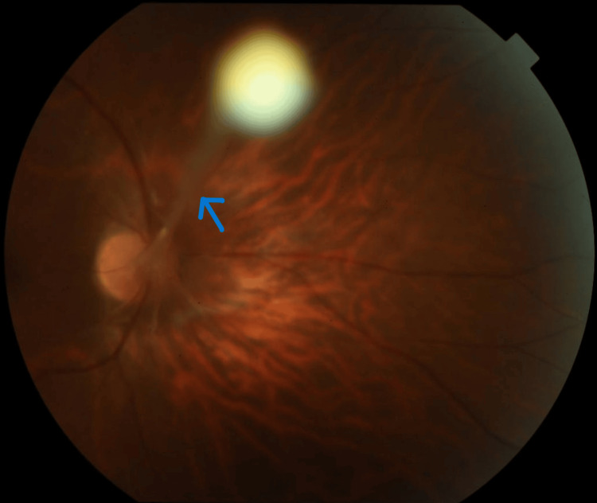
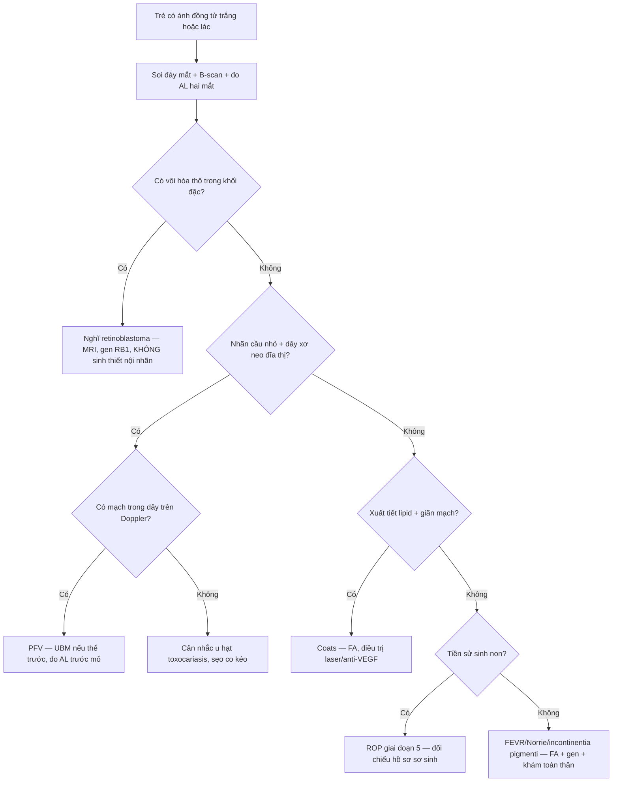
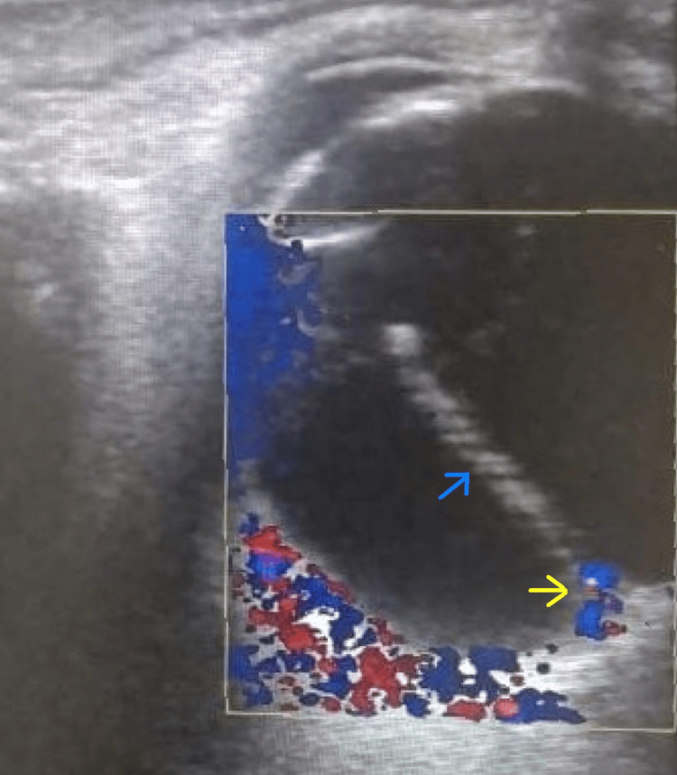
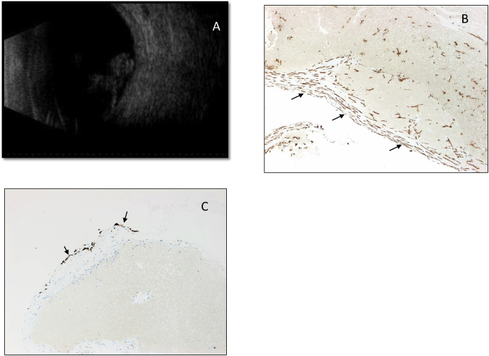

# 413 — Tồn tại tuần hoàn bào thai (PFV/PHPV): dây xơ dịch kính + nhãn cầu nhỏ / Persistent fetal vasculature

**Tags:** `pattern:leukocoria` `pattern:day-xo-dich-kinh` `pattern:nhan-cau-nho` `vung:nhan-cau` `vung:tre-em` `protocol:B-scan` `protocol:UBM` `protocol:Doppler-mau` `protocol:MRI-hoc-mat`
**Mức chắc chắn (certainty):** tổng hợp y văn (literature synthesis) — tổng hợp từ y văn mở 2020–2026 (Cureus 2024, Ophthalmol Ther 2025, Am J Ophthalmol Case Rep 2020, Ophthalmol Ther 2023, Int J Ophthalmol 2023); có gắn **hình thái ca nguyên văn** (ảnh đáy mắt, siêu âm Doppler, B-scan + hoá mô miễn dịch) nhưng nội dung nhóm tự biên.

## 1. Tổng quan — dây xơ "không chịu chết" của hệ hyaloid

- **Bệnh học (pathology):** trong bào thai, **động mạch hyaloid (hyaloid artery)** chạy từ đĩa thị tới **bao thể thủy tinh (posterior lens capsule)**, nuôi **mạng mạch bao thể thủy tinh (tunica vasculosa lentis)** và **dịch kính nguyên thủy (primary vitreous)**. Bình thường chuỗi này **thoái triển bằng apoptosis** trong tam cá nguyệt 2–3 (động mạch hyaloid thoái triển khoảng tuần 8–9, mạng mạch bao thể thủy tinh tới khoảng tuần 28–35). **PFV (persistent fetal vasculature; tên cũ "PHPV" — persistent hyperplastic primary vitreous, nay không dùng)** = chuỗi thoái triển **không hoàn tất** → còn **dây xơ–mạch (fibrovascular stalk)** dính đĩa thị với mặt sau thể thủy tinh, kèm **màng sau thể thủy tinh** và **mô xơ trong dịch kính**.
- **TẠI SAO ra hình ảnh (theo Argon):**
  - **Tăng hồi âm trên B-scan:** dây xơ là **collagen đặc + myofibroblast (SMA dương) + tế bào glia (GFAP dương)** — mô đặc, nhiều giao diện phản xạ nên **tăng hồi âm rõ**, khác dịch kính trong (trống âm). Vì là **mô xơ–cơ**, không phải canxi, nên **KHÔNG có bóng lưng kiểu vôi hóa** như retinoblastoma.
  - **Có tín hiệu mạch trên Doppler màu:** trong dây xơ còn **mao mạch/động mạch hyaloid tồn dư** → phổ **động mạch** trong dây. Đây là điểm phân biệt với **dải xơ vô mạch** (toxocariasis, sẹo) và với **màng co kéo vô mạch của FEVR**.
  - **Nhãn cầu nhỏ (microphthalmia):** mô xơ–mạch chiếm chỗ trong dịch kính + thể thủy tinh bị kéo/đục sớm → **giảm phát triển thể tích nhãn cầu**; trong cohort phẫu thuật PFV, **trục nhãn cầu (axial length, AL) trung vị 17 mm ở nhóm bong võng mạc vs 20 mm ở nhóm không bong** (p = 0,002) — AL ngắn là **yếu tố nguy cơ bong võng mạc hậu phẫu**.
  - **Đục thể thủy tinh + glaucoma:** màng xơ sau thể thủy tinh co kéo bao sau → đục thể thủy tinh; **mỏm thể mi dài ra (elongated ciliary processes)** bị kéo về trung tâm → góc đóng, **glaucoma** (25% bệnh nhân / 65% mắt trong một cohort 76 mắt).
  - **Xuất huyết dịch kính:** mạch trong dây xơ dễ vỡ (tự phát hoặc sau chấn thương nhẹ) → máu trong dây xơ tổ chức hóa, **hemosiderin** trong mô (đã chứng minh trên hoá mô miễn dịch).
- **Ngưỡng định lượng cần nhớ:**
  - **Một bên tới ~90%**; thể **hai bên ~10%** (gợi ý khám sàng lọc và nghĩ hội chứng — Norrie, incontinentia pigmenti, OFCD/BCOR).
  - Phân thể theo giải phẫu: **thuần trước 24%, thuần sau 12%, phối hợp 60%** (một nguồn khác: **phối hợp 74% / trước 26%** ở cohort phẫu thuật) — **thể phối hợp là hay gặp nhất**.
  - Tuổi mổ trung vị trong cohort lớn: **6,0 tháng** (khoảng 0,7–82 tháng); **37% mắt PFV sau/phối hợp đạt thị lực tốt hơn "đếm ngón tay"**.
  - Sau mổ đục thể thủy tinh ở PFV: **đường vào giác mạc (corneal) giảm nguy cơ bong võng mạc so với pars plicata — OR 0,08 (95% CI 0,01–0,6), p = 0,011**.

## 2. Mẫu hình + chẩn đoán phân biệt theo vị trí (gamut)

- **PFV thể TRƯỚC (anterior):** **đục thể thủy tinh bẩm sinh** + **màng xơ sau thể thủy tinh** + **mỏm thể mi dài, kéo về trung tâm** + **tiền phòng nông** + **glaucoma** + nhãn cầu nhỏ. Trên UBM: dải xơ nối bao sau thể thủy tinh với mỏm thể mi.
- **PFV thể SAU (posterior):** **dây xơ từ đĩa thị ra trước** vào dịch kính, **nếp gấp võng mạc (retinal fold)**, **giảm sản hoàng điểm/đĩa thị**, **bong võng mạc co kéo**. Trên B-scan: dây tăng hồi âm **neo vào đĩa thị** — đây là dấu định vị mạnh nhất.
- **PFV thể PHỐI HỢP (combined):** cả hai — hay gặp nhất, tiên lượng thị lực kém nhất.
- **Biến thể "PFV sau thể cận thị" (myopic posterior PFV):** người **trẻ lớn/người lớn**, một bên, **cận thị lệch khúc xạ (anisometropic amblyopia)**, dây xơ mảnh, **thị lực còn tốt** — dễ bị bỏ qua vì không leukocoria rầm rộ. **Không loại PFV chỉ vì bệnh nhân đã lớn.**
- **Gamut "ánh đồng tử trắng (leukocoria) ở trẻ" — 4 trục phân loại:** (1) **có vôi hóa thô + khối đặc** → retinoblastoma; (2) **nhãn cầu nhỏ + dây xơ từ đĩa thị** → PFV; (3) **xuất tiết lipid + giãn mạch** → Coats; (4) **tiền sử sinh non + ranh giới mạch vô mạch ngoại vi** → ROP 5. Trục phụ: **một bên + đủ tháng + không vôi hóa** nghiêng PFV/Coats/FEVR; **hai bên + điếc/chậm phát triển** nghiêng Norrie/incontinentia pigmenti.

## 3. Bảng so sánh phân biệt (ma trận đối chiếu)

| Thực thể (entity) | Hình ảnh điển hình | Chốt vào (rule-in) | Chốt loại (rule-out) | Gợi ý xác nhận |
|---|---|---|---|---|
| **PFV / PHPV** | **Dây xơ tăng hồi âm từ đĩa thị → bao sau thể thủy tinh**, **nhãn cầu nhỏ (AL ngắn)**, có **mạch trong dây trên Doppler**, đục thể thủy tinh, mỏm thể mi dài; **không vôi hóa** | **Dây xơ neo đĩa thị + nhãn cầu nhỏ + một bên + không vôi hóa** | **Vôi hóa thô trong khối** → RB; **xuất tiết lipid lan tỏa** → Coats | B-scan + Doppler màu; UBM thể trước; MRI hốc mắt khi cần loại RB |
| **Retinoblastoma** | **Khối đặc trong nhãn cầu + vôi hóa thô (> 90% ca)**, có thể **gieo rắc dịch kính (seeding)**, calci hóa thành đám | **Vôi hóa thô + khối đặc + tuổi < 5 (trung vị 18–24 tháng)** | **Nhãn cầu nhỏ + dây xơ mảnh không khối** → PFV | CT/MRI (ưu tiên MRI), **không sinh thiết nội nhãn**, gen *RB1* |
| **Coats disease** | **Giãn mạch–teo mao mạch + xuất tiết lipid dưới võng mạc**, bong võng mạc xuất tiết; **không khối đặc, không vôi hóa** | **Nam, một bên, xuất tiết lipid + telangiectasia** | **Khối đặc có mạch trong lòng** → u | FA (telangiectasia, vô mạch ngoại vi), siêu âm |
| **ROP giai đoạn 5** | Bong võng mạc toàn phần, màng co kéo, **tiền sử sinh non/nuôi oxy** | **Sinh non + bệnh cảnh oxy + ranh giới mạch–vô mạch** | **Đủ tháng + dây xơ đĩa thị** → PFV | Hồ sơ sơ sinh, FA |
| **FEVR** | Vô mạch ngoại vi + tân mạch/bong co kéo, **thường hai bên**, tiền sử gia đình | **Hai bên + gia đình + vô mạch ngoại vi** | Một bên + dây xơ đĩa thị → PFV | FA, gen *FZD4/LRP5/TSPAN12/NDP* |
| **Toxocariasis nội nhãn** | **U hạt ngoại vi + dải xơ co kéo tới đĩa thị**, viêm dịch kính; **dây vô mạch** | **U hạt + dải co kéo + ELISA *Toxocara* (+)** | Dây xơ có mạch, từ đĩa thị ra trước → PFV | ELISA, B-scan/UBM |
| **Norrie / incontinentia pigmenti** | Bong võng mạc hai bên sớm, **cuống giống PFV**, "pumpkin" lesion | **Hai bên + điếc/chậm phát triển (Norrie) hoặc da–răng–tóc (IP)** | Một bên, không toàn thân → PFV đơn độc | Gen *NDP*/*IKBKG*, MRI não, tai mũi họng |

*Đáy mắt màu: **dây xơ (mũi tên xanh)** chạy từ **đĩa thị về phía trước** vào dịch kính — trục định vị của PFV thể sau. Nguồn: Shrivastava AK et al., *Cureus* 2024, PMC11103449 Fig. 2, **CC BY 4.0**.*

### Ba dấu hiệu "chốt" trên hình ảnh
- **Neo đĩa thị (disc-anchored stalk):** dây xơ **bắt đầu từ đĩa thị** — khác màng sau thể thủy tinh đơn thuần và khác dải co kéo từ **u hạt ngoại vi** (toxocariasis).
- **Một nhãn cầu nhỏ hơn bên đối diện (AL ngắn):** đo AL cả hai mắt; chênh lệch **≥ 1 mm** đã có ý nghĩa định hướng, và **AL càng ngắn càng nguy cơ bong võng mạc** (17 vs 20 mm).
- **Tín hiệu mạch trong dây (Doppler):** chứng minh **mô mạch tồn dư**, không phải sẹo xơ vô mạch.

## 4. Protocol chụp + phân loại & ngưỡng xử trí

- **Khám dưới mê (examination under anesthesia, EUA)** là chuẩn vàng ở trẻ: đo **nhãn áp**, **AL**, soi đáy mắt 360°, **siêu âm B-scan**, **UBM**.
- **Siêu âm B-scan (đầu dò 10–12 MHz, qua mí):** tìm dây xơ neo đĩa thị, nếp gấp võng mạc, bong võng mạc, xuất huyết; **đo AL** hai mắt cùng lúc.
- **UBM (35–50 MHz):** bắt buộc khi nghi **thể trước** — thấy màng xơ sau thể thủy tinh, **mỏm thể mi dài**, tiền phòng nông, góc đóng.
- **Doppler màu:** xác nhận **mạch trong dây**; đồng thời đo **dòng chảy động mạch mắt** nếu nghi thiếu máu nhãn cầu.
- **MRI hốc mắt (không cản từ):** khi cần **loại retinoblastoma** (khối đặc, vôi hóa thấy trên CT nhưng **nhạy từ tính "blooming" trên MRI**), đánh giá lan ngoài nhãn cầu. **CT chỉ khi câu hỏi duy nhất là vôi hóa** và luôn cân nhắc ALARA ở trẻ.
- **Phân loại dùng trong thực hành (không phải RADS):** **trước / sau / phối hợp** theo vị trí mô tồn dư, kèm 3 mức độ nặng: **nhẹ (dây mảnh, thị lực còn)** — **trung bình (đục thể thủy tinh, màng sau thể thủy tinh)** — **nặng (bong võng mạc co kéo, glaucoma)**.
- **Ngưỡng xử trí:**
  - **Đục thể thủy tinh che trục thị giác + thể trước** → **phẫu thuật sớm** (lensectomy ± vitrectomy); cohort lớn mổ trung vị **6 tháng tuổi**, và **mổ sớm + đo AL trước mổ** là yếu tố tiên lượng.
  - **Đường vào: ưu tiên giác mạc (corneal) khi có thể** — giảm bong võng mạc hậu phẫu (**OR 0,08**); **tránh pars plicata ở mắt AL rất ngắn** vì nguy cơ bong võng mạc cao (AL 17 vs 20 mm).
  - **Bong võng mạc co kéo** → vitrectomy; **glaucoma** → kiểm soát nhãn áp (thuốc, có thể phẫu thuật lọc).
  - **Nhược thị** → chỉnh khúc xạ + che/bịt mắt sau khi giải phóng trục thị giác; đây là phần quyết định thị lực chức năng.
  - **Ức chế VEGF nội dịch kính**: chỉ có **báo cáo ca**, **chưa có ngưỡng/khuyến cáo** — không dùng thay phẫu thuật.

## 5. Biến thể bình thường và cạm bẫy

- **Cạm bẫy số 1 — PFV bị enucleate vì "nghi retinoblastoma":** cả hai đều **leukocoria một bên ở trẻ**. Chốt loại RB: **không vôi hóa thô, không khối đặc, nhãn cầu nhỏ, dây xơ neo đĩa thị**. **Tuyệt đối không sinh thiết xuyên nhãn cầu** khi chưa loại RB (nguy cơ gieo rắc).
- **Cạm bẫy số 2 — dây xơ dày giả "bong võng mạc":** trên B-scan một mặt cắt, dây xơ đặc có thể trông như **màng bong võng mạc hình phễu**. Phân biệt: **neo vào đĩa thị**, **có mạch trên Doppler**, **nhãn cầu nhỏ**, và **không thấy võng mạc tách rời ở ngoại vi** trên các mặt cắt khác.
- **Cạm bẫy số 3 — bỏ sót PFV "thể nhẹ" ở trẻ lớn:** PFV sau thể **cận thị** có thể chỉ biểu hiện **lệch khúc xạ + nhược thị**, dây xơ mảnh; nếu không đo AL và soi đáy mắt kỹ sẽ bị chẩn đoán nhầm "nhược thị vô căn".
- **Cạm bẫy số 4 — thuật ngữ:** **"PHPV" là tên cũ**, chỉ mô tả phần trước; dùng **PFV** để không bỏ sót tổn thương phía sau (thể phối hợp 60–74%).
- **Cạm bẫy số 5 — xuất huyết dịch kính che dấu:** máu trong dịch kính có thể **che dây xơ**; sau khi máu tan/được rửa, dây xơ mới lộ — nếu chỉ thấy "xuất huyết dịch kính không rõ nguyên nhân" ở trẻ, **chụp lại B-scan và tìm dây xơ neo đĩa thị**.
- **Biến thể bình thường dễ nhầm:** **dư tàn mạch hyaloid nhỏ (hyaloid remnant) dạng "nhú" ở đĩa thị** hoặc **nang màng bồ đào nhỏ** — không có dây xơ dài, không nhãn cầu nhỏ, thị lực bình thường; **theo dõi, không can thiệp**.
- **Bẫy hệ thống:** PFV **hai bên** hoặc kèm **dị tật toàn thân** → tìm **Norrie (*NDP*)**, **incontinentia pigmenti (*IKBKG*)**, **OFCD (*BCOR*)**; khám da, răng, tim, thính lực và tư vấn di truyền.

## 6. Tự lượng giá — Blind Quiz

**Ca 1 — Bé trai 6 tháng, ánh đồng tử trắng mắt phải, lác ngoài. Nhìn ảnh đáy mắt trước, mô tả dây xơ đi từ đâu tới đâu.**

- Gợi ý lâm sàng (clinical context): trẻ **đủ tháng**, không tiền sử sinh non/oxy, một bên.
- Câu hỏi: Dây xơ **neo ở đâu**? Ba chẩn đoán phân biệt? Dấu hiệu nào **loại retinoblastoma**?

<b>Bấm để hiện đáp án (findings + chẩn đoán)</b>

- Dấu hiệu (findings): **dây xơ (mũi tên xanh) xuất phát từ đĩa thị**, chạy về phía trước vào dịch kính; đĩa thị và mạch võng mạc bị kéo.
- Chẩn đoán (diagnosis): **PFV thể sau** (dây xơ–mạch của hệ hyaloid tồn tại). Cơ chế: chuỗi thoái triển hyaloid không hoàn tất → mô xơ–cơ–glia đặc, tăng hồi âm, **có mạch**.
- Loại RB: **không có khối đặc vôi hóa thô**, có **dây xơ neo đĩa thị**, nhãn cầu nhỏ. Cần đo AL + B-scan + Doppler; MRI nếu còn nghi ngờ.
- Nguồn ảnh: Shrivastava AK et al., *Cureus* 2024, PMC11103449 Fig. 2, CC BY 4.0.

**Ca 2 — Cùng bệnh nhi, siêu âm hốc mắt có Doppler màu. Dây tăng hồi âm trong dịch kính có phải "màng" vô mạch không?**

- Câu hỏi: Dấu hiệu nào chứng minh đây là **mô mạch tồn dư** chứ không phải sẹo/dải xơ vô mạch? Đo gì thêm để tiên lượng mổ?

<b>Bấm để hiện đáp án (findings + chẩn đoán)</b>

- Dấu hiệu (findings): **dây tăng hồi âm chạy từ đĩa thị ra trước (mũi tên xanh)**; **tín hiệu màu trong dây và ở phần sau (mũi tên vàng)** = có dòng chảy.
- Chẩn đoán (diagnosis): **PFV có mạch trong dây** — khác dải xơ vô mạch (toxocariasis, sẹo) và màng co kéo vô mạch (FEVR).
- Đo thêm: **AL hai mắt** (AL ngắn → nguy cơ bong võng mạc hậu phẫu cao: 17 vs 20 mm), nhãn áp, UBM tìm mỏm thể mi dài.
- Nguồn ảnh: Shrivastava AK et al., *Cureus* 2024, PMC11103449 Fig. 3, CC BY 4.0.

**Ca 3 — Bệnh nhi 1 tuổi, dây xơ tới sát bao sau thể thủy tinh, có xuất huyết dịch kính. B-scan + hoá mô miễn dịch của dây xơ sau mổ.**

- Câu hỏi: Vì sao dây xơ **tăng hồi âm mạnh** và **co kéo**? Hai dấu ấn miễn dịch nào xác nhận thành phần mô?

<b>Bấm để hiện đáp án (findings + chẩn đoán)</b>

- Dấu hiệu (findings): **(A)** B-scan — **dải xơ neo vào đĩa thị**, kéo dài ra trước; **(B)** **SMA dương** ở tế bào hình thoi (myofibroblast) trong dây; **(C)** **GFAP dương khu trú** ở bờ ngoài (tế bào glia). Chỉ số **Ki-67 thấp**.
- Chẩn đoán (diagnosis): **PFV thể sau kèm xuất huyết dịch kính**. Cơ chế: **myofibroblast co kéo + glia** → dây đặc, tăng hồi âm, gây co kéo võng mạc; máu trong dây tổ chức hóa (hemosiderin).
- Phản biện nguồn: đây là **3 ca** (1 ca PFV + 2 ca sau chấn thương tù), không đại diện tỷ lệ quần thể; dùng để minh họa **cơ chế mô học**, không dùng làm tiêu chuẩn chẩn đoán.
- Nguồn ảnh: Alsarhani W et al., *Am J Ophthalmol Case Rep* 2020, PMC7256462 Fig. 2, **CC BY-NC-ND 4.0** (giữ nguyên bản, không cắt/ghép).

## Bài liên quan chéo
- [412 – U trong nhãn cầu: RB vs melanoma vs Coats vs PHPV](../412-u-trong-nhan-cau/lesson.md)
- [450 – Mắt nhi: ROP, Coats, PHPV](../450-mat-nhi/lesson.md)
- [457 – Bệnh "giả ROP" ở trẻ đủ tháng: FEVR, Norrie, IP, Coats](../457-benh-gia-rop-tre-du-thang/lesson.md)
- [466 – Toxocariasis nội nhãn: u hạt + dây co kéo](../466-toxocariasis-noi-nhan/lesson.md)
- [456 – Bệnh võng mạc trẻ sinh non (ROP)](../456-benh-vong-mac-tre-sinh-non/lesson.md)
- [411 – Siêu âm nhãn cầu](../411-sieu-am-nhan-cau/lesson.md)

## Ảnh
- `images/413_PFV-stalk-fundus_PMC11103449-Fig2-CCBY.jpg` — CC BY 4.0 (cho phép dẫn xuất; bài này dùng nguyên bản).
- `images/413_PFV-stalk-doppler_US_PMC11103449-Fig3-CCBY.jpg` — CC BY 4.0.
- `images/413_PFV-Bscan_PMC7256462-Fig2-CCBYNCND.jpg` — CC BY-NC-ND 4.0 (giữ nguyên bản).
- Nguồn + giấy phép từng ảnh: `images/CREDITS.md`; link gốc: `sources.md`.

> Không dùng để chẩn đoán độc lập khi chưa có người hướng dẫn.
