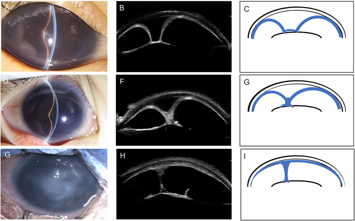
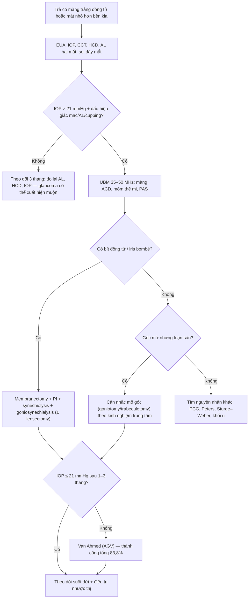
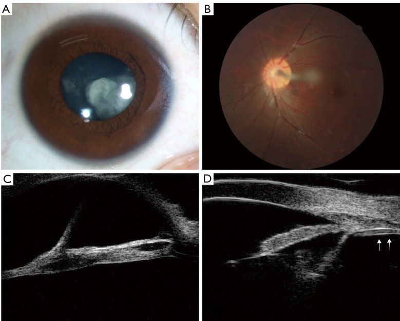
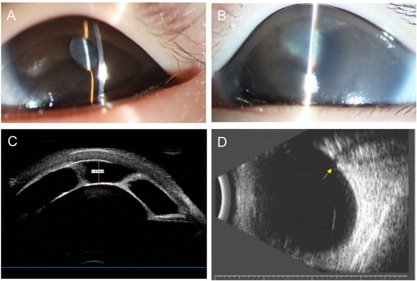
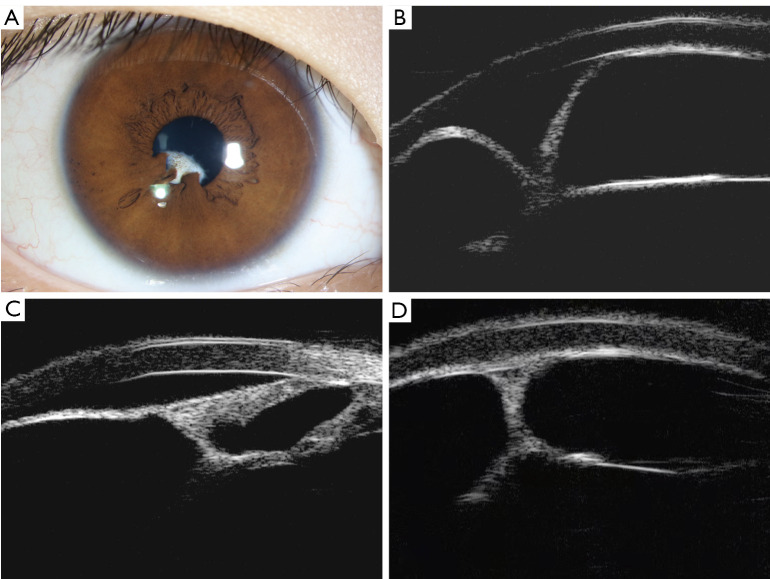
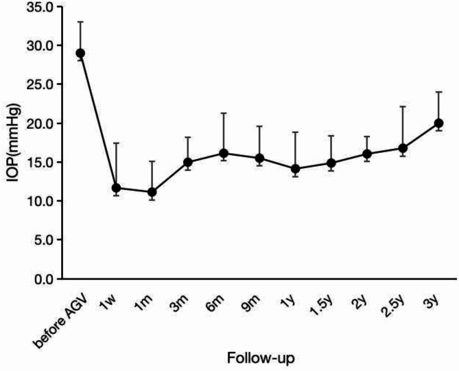

# 414 — Glaucoma & nhãn cầu nhỏ trong PFV: bẫy "mắt bé thì không thể tăng nhãn áp" / Glaucoma in persistent fetal vasculature

**Tags:** `pattern:nhan-cau-nho` `pattern:tang-nhan-ap` `pattern:manh-xo-dong-tu` `pattern:tien-phong-nong` `vung:nhan-cau` `vung:tien-phong` `vung:tre-em` `score:CFPMSG-UBM` `protocol:UBM` `protocol:B-scan` `protocol:do-nhan-ap`
**Mức chắc chắn (certainty):** tổng hợp y văn (literature synthesis) — tổng hợp từ cohort lớn 2021–2025 (Front Med 2021, Ophthalmol Ther 2025, BMC Ophthalmol 2025, Clin Ophthalmol 2020) kèm **hình thái ca nguyên văn** (ảnh tiền phòng + UBM + B-scan); số liệu do nhóm tự đối chiếu giữa các bài, không phải ca đơn lẻ.

## 1. Tổng quan — vì sao một mắt VỐN NHỎ lại có thể tăng nhãn áp

- **Bệnh học (pathology):** PFV (persistent fetal vasculature, tên cũ PHPV) là hệ **động mạch hyaloid – mạng mạch bao thể thủy tinh** không thoái triển. Thể **TRƯỚC (anterior)** để lại **màng xơ–mạch sau thể thủy tinh (retrolental fibrovascular membrane)** dính bao sau thể thủy tinh và **mỏm thể mi (ciliary processes)**. Màng xơ co rút + dính đồng tử **360°** → **bít đồng tử (pupillary block)** → **mống mắt phồng (iris bombé)** → **dính góc trước ngoại vi (peripheral anterior synechiae, PAS)**. Một thể rất giống PFV trước được gọi là **màng đồng tử xơ–mạch bẩm sinh (congenital fibrovascular pupillary membrane, CFPM)**; hoá mô học gần đây xếp CFPM là **một biến thể của PFV**, và khi CFPM gây tăng nhãn áp thì gọi là **CFPMSG** — đây là bệnh cảnh chính của bài này.
- **BA cơ chế tăng nhãn áp chồng lên nhau (P–A–C):**
  1. **P — bít đồng tử (pupillary block):** màng che kín đồng tử + dính sau đồng tử toàn chu vi → mống mắt bị đẩy ra trước như "cái dù" (**iris bombé**), góc bị **PAS** bít từ ngoại vi vào. Trong cohort 32 mắt CFPMSG, **tất cả** đều có iris bombé + PAS, **87,5%** có lệch đồng tử (corectopia).
  2. **A — loạn sản góc (angle dysgenesis):** mô nguyên bào thần kinh mào (neural crest) vào tiền phòng không bình thường → thành phần **góc mở nhưng chức năng kém**; đây là lý do một số mắt vẫn tăng nhãn áp dù đã giải phóng bít đồng tử.
  3. **C — kéo thể mi (ciliary traction):** mỏm thể mi **dài ra, bị dây xơ kéo về trung tâm**, cuộn vào cùng **dây chằng treo (zonules) – thể thủy tinh – mống mắt** (ảnh UBM: "entwining of ciliary processes, zonules, lens and iris"). Thể mi bị kéo ra trước làm **hoàng điểm–thủy tinh thể–mống mắt dịch ra trước**, tiền phòng nông thêm; kéo quá mức có thể gây **nhược trương (hypotony)** thay vì tăng áp — nên không phải mọi mắt PFV đều tăng nhãn áp.
- **TẠI SAO nhãn cầu nhỏ mà vẫn tăng áp — nghịch lý cần hiểu:** PFV làm nhãn cầu **kém phát triển** (microphthalmia), nhưng ở trẻ **củng mạc – giác mạc còn đàn hồi**, nhãn áp cao làm nhãn cầu **giãn ra (buphthalmos)**: trục nhãn cầu (axial length, AL) dài lên, đường kính giác mạc (horizontal corneal diameter, HCD) tăng, **giác mạc dày lên** và có thể có **vết rạn Haab (Haab striae)**. Vì vậy mắt PFV có thể **ngắn hơn mắt lành về giải phẫu nhưng lại DÀI HƠN mắt lành khi đã có glaucoma** — so sánh hai mắt mới là chốt, không so với "mắt nhỏ" bằng cảm giác.
- **Số liệu định lượng phải nhớ (cohort 32 mắt CFPMSG, so mắt bệnh / mắt lành):**

| Thông số | Mắt bệnh | Mắt lành | Ý nghĩa |
|---|---|---|---|
| Nhãn áp (IOP) | **30,1 ± 6,6 mmHg** | 14,6 ± 3,0 | Tăng áp thực sự, không do kích thích |
| Trục nhãn cầu (AL) | **22,7 ± 1,8 mm** | 19,3 ± 1,5 | Dài hơn **3,4 mm** = đã giãn do glaucoma |
| Đường kính giác mạc (HCD) | **12,3 ± 0,9 mm** | 10,8 ± 0,4 | Giác mạc to ra (buphthalmos) |
| Độ dày trung tâm giác mạc (CCT) | **629,3 ± 110,7 µm** | 528,3 ± 34,9 | Dày hơn **101 µm** — làm nhãn áp đo bị **cao giả** |
| Độ sâu tiền phòng (ACD) | **1,50 ± 0,99 mm** | 2,19 ± 0,33 | Tiền phòng nông — chốt của cơ chế đóng góc |
| Bệnh lý thị thần kinh glaucoma | **22/32 = 68,8%** | — | Tổn thương đã có ngay lúc chuyển đến |

- **Dịch tễ – ngưỡng:** trong cohort phẫu thuật PFV **76 mắt / 74 bệnh nhân**, glaucoma gặp ở **25% bệnh nhân và 65% số mắt**; sau mổ PFV (lensectomy/vitrectomy) glaucoma xuất hiện ở **10–30%** mắt, có thể **nhiều năm sau mổ**. Tuổi khởi phát glaucoma trong CFPMSG: **trung vị 3,0 tháng** (0–24 tháng), tuổi phát hiện bệnh **trung vị 0 tháng** (0–24) — nghĩa là **glaucoma đến rất sớm, ngay trong năm đầu**.
- **TẠI SAO UBM là phương thức đúng (vật lý):** UBM dùng đầu dò **35–50 MHz**, bước sóng trong mô ~30 µm cho **phân giải trục ~50 µm**, **độ xuyên ~4–5 mm** — đủ để thấy màng xơ, mỏm thể mi, góc, dây chằng sau **giác mạc đục/hẹp đồng tử** (ánh sáng của OCT/as OCT bị chặn bởi phù – sẹo giác mạc và mống mắt; MRI phân giải ~0,3–1 mm nên không thấy được màng mỏng). Trên UBM, màng xơ **tăng hồi âm**, **không có bóng lưng** (không phải canxi) — khác khối retinoblastoma vôi hóa thô.

## 2. Mẫu hình + chẩn đoán phân biệt theo vị trí (gamut)

- **Mẫu hình 1 — "nhãn cầu nhỏ + nhãn áp cao":** PFV/CFPM thể trước (hay gặp nhất ở trẻ có màng trắng đồng tử), glaucoma bẩm sinh nguyên phát (PCG), dị tật Peters, aniridia, hội chứng Sturge–Weber, retinoblastoma gây glaucoma thứ phát (hiếm), bệnh Coats giai đoạn muộn, FEVR.
- **Mẫu hình 2 — "màng trắng ở đồng tử":** CFPM/PFV trước (màng **dày, có mạch, dính mống mắt, co kéo**) vs **đục thể thủy tinh bẩm sinh** (trắng nhưng **trong bao**, không có mạch màng) vs **màng đồng tử tồn tại (persistent pupillary membrane)** (mảnh, mỏng, **không glaucoma, không dính 360°**) vs **leukocoria do retinoblastoma** (khối đặc sau thể thủy tinh, vôi hóa) vs **màng fibrin sau viêm** (bối cảnh viêm, đáp ứng corticoid).
- **Mẫu hình 3 — "tăng nhãn áp một bên ở trẻ, mắt kia bình thường":** PFV/CFPM một bên, PCG một bên (hiếm — PCG thường hai bên), glaucoma sau mổ đục thể thủy tinh, glaucoma do corticoid tra dài, khối u tiền phòng.
- **Gamut theo cơ chế (nhớ P–A–C–E):** **P**upillary block (CFPM/PFV trước, màng fibrin, đục thể thủy tinh phồng) – **A**ngle dysgenesis (PCG, Peters, aniridia, PFV) – **C**iliary traction (PFV kéo thể mi, có thể gây **nhược trương**) – **E**levated episcleral venous pressure (Sturge–Weber, fistula xoang hang). Bốn cơ chế này quyết định **mổ gì**: giải phóng bít đồng tử ≠ mở góc ≠ hạ áp bằng van ≠ điều trị bệnh mạch nền.

## 3. Bảng so sánh phân biệt (ma trận đối chiếu)

| Thực thể (entity) | Hình ảnh điển hình | Chốt vào (rule-in) | Chốt loại (rule-out) | Gợi ý xác nhận |
|---|---|---|---|---|
| **PFV/CFPM thể trước có glaucoma (CFPMSG)** | **Màng xơ trắng sau thể thủy tinh + dính đồng tử 360° + iris bombé + PAS**, ACD nông (**1,50 mm**), AL **dài hơn mắt lành 3,4 mm**, HCD to, CCT dày | **Màng xơ dính đồng tử + mỏm thể mi dài/cuộn vào màng trên UBM + AL–HCD lệch so mắt lành** | **Không có màng/dính đồng tử; hai bên đối xứng** → PCG/dị tật khác | UBM 35–50 MHz (phân loại U/Y/không tiền phòng), B-scan đo AL + cupping |
| **Glaucoma bẩm sinh nguyên phát (PCG)** | Giác mạc đục lan tỏa, **HCD > 12 mm**, **AL dài**, vỡ Descemet (Haab), **góc mở nhưng dị sản**, thường **hai bên**, không màng đồng tử | **Hai bên + không màng + HCD/AL tăng + chảy nước mắt – sợ sáng** | **Màng xơ đồng tử + một bên** → PFV/CFPM | Đo HCD, AL, UBM góc; theo dõi đáp ứng mổ góc |
| **Dị tật Peters** | **Đục giác mạc trung tâm** + **dính mống mắt–giác mạc trung tâm**, tiền phòng nông trung tâm, có thể glaucoma | **Đục trung tâm + dính mống mắt vào mặt sau giác mạc** | Màng đồng tử + giác mạc trong → CFPM | UBM (mất liên tục Descemet), khám toàn thân (hội chứng) |
| **Aniridia** | **Không mống mắt** (thiểu sản rễ), lộ mỏm thể mi, **glaucoma 50–75%**, giác mạc có thể đục | **Thiếu mống mắt + tiền sử gia đình + PAX6** | Còn mống mắt bình thường → không phải aniridia | Đèn khe, UBM góc, khám toàn thân (WAGR) |
| **Sturge–Weber** | **U máu mặt (port-wine) + u máu màng não**, glaucoma do **tăng áp tĩnh mạch thượng củng mạc**, có thể buphthalmos | **U máu mặt cùng bên + mạch máu thượng củng mạc giãn** | Không u máu mặt, không giãn mạch thượng củng mạc | Khám da, MRI não, đo áp lực tĩnh mạch |
| **Retinoblastoma gây glaucoma thứ phát** | **Khối đặc trong nhãn cầu + vôi hóa thô**, có thể giả viêm, góc đóng do khối đẩy | **Vôi hóa thô + khối đặc + tuổi < 5 (trung vị 18–24 tháng)** | **Màng xơ mảnh + dây xơ neo đĩa thị + không vôi hóa** → PFV | MRI hốc mắt (ưu tiên), **không sinh thiết nội nhãn** |
| **PFV không glaucoma (chỉ nhãn cầu nhỏ)** | Dây xơ/màng nhưng **ACD còn, không PAS, IOP bình thường**, AL ngắn so tuổi | **IOP ≤ 21 + không đổi AL/HCD theo thời gian** | **AL tăng nhanh + HCD tăng + CCT dày** → đã có glaucoma | Đo AL–HCD–IOP mỗi 3 tháng trong năm đầu |

*A–C: độ I "U" — bít đồng tử + iris bombé + PAS nhưng còn tiền phòng trung tâm. D–F: độ II "Y" — dính mống mắt vào màng, tiền phòng rất nông. G–I: độ III — mống mắt áp sát giác mạc, **không đo được tiền phòng**. Nguồn: Zhu Y et al., *Front Med (Lausanne)* 2021, PMC8581037 Fig. 1, **CC BY 4.0**.*

### Ba dấu hiệu "chốt" trên hình ảnh
- **Màng xơ che đồng tử + dính 360°:** thấy trên đèn khe và UBM; nếu chỉ thấy "đục thể thủy tinh" mà bỏ màng thì sẽ mổ sai (lensectomy đơn thuần không giải phóng bít đồng tử).
- **ACD nông không cân xứng:** đo UBM ở 3, 6, 9, 12 giờ; độ I còn **1,97 mm**, độ II **1,34 mm**, độ III **0 mm** — càng nông càng nặng và càng dễ có PAS.
- **AL/HCD lệch so mắt lành:** chênh AL **≥ 1 mm** đã đáng lưu ý; **AL < 15 mm hoặc chênh ≥ 3,5 mm** là yếu tố tiên lượng thị lực xấu (không phải chỉ số quyết định mổ).

## 4. Protocol chụp + phân loại & ngưỡng xử trí

- **Khám dưới mê (examination under anesthesia, EUA) — chuẩn vàng:** đo **IOP** (Tono-Pen/Perkins, đo sớm khi mê nông), **CCT**, **HCD** bằng compa, **AL hai mắt** (A-scan), soi góc khi giác mạc trong, soi đáy mắt/đĩa thị, khúc xạ.
- **Siêu âm B-scan 10–12 MHz:** đo AL, tìm **dây xơ neo đĩa thị**, **lõm đĩa thị (cupping)** — trong ca minh họa, B-scan thấy **lõm đĩa thị rõ** ở trẻ 4 tháng; đồng thời loại bong võng mạc/nếp gấp.
- **UBM 35–50 MHz (bắt buộc):** mặt cắt **trục + ly tâm tại 3, 6, 9, 12 giờ**, đo **ACD trung tâm**, độ dày màng, vị trí/độ dài **mỏm thể mi**, độ mở góc, PAS. Phân loại **CFPMSG độ I–III** theo hình dạng mống mắt (bảng dưới) — độ càng cao, IOP càng cao và tiền phòng càng nông.
- **Chẩn đoán glaucoma ở trẻ (tiêu chuẩn dùng trong cohort PFV):** **IOP > 21 mmHg** + **ít nhất một** dấu hiệu: phù/đục/dày/vascularize/sẹo giác mạc, **buphthalmos**, **vết rạn Haab**, **AL dài ra tiến triển**, hoặc **lõm đĩa thị**. Chỉ IOP đơn thuần **không đủ** vì trẻ có thể sợ hãi/kích thích khi đo.
- **Phân độ CFPMSG (UBM) — ngưỡng định lượng:**

| Độ (UBM) | Hình mống mắt | ACD | IOP lúc chuyển đến | Tỷ lệ |
|---|---|---|---|---|
| I | "U" — bít đồng tử, iris bombé, PAS, còn tiền phòng trung tâm | **1,97 ± 0,92 mm** | **26,5 ± 5,1 mmHg** | **53%** |
| II | "Y" — dính mống mắt vào màng, bombé nặng | **1,34 ± 0,62 mm** | **33,8 ± 5,9 mmHg** | **34%** |
| III | Không tiền phòng (mống mắt–giác mạc áp sát) | **0 mm** | **35,2 ± 5,9 mmHg** | **13%** |

- **Ngưỡng xử trí:**
  - **Bước 1 — thuốc hạ nhãn áp:** chẹn beta tại chỗ ± ức chế carbonic anhydrase; **chỉ là cầu nối**, không có thử nghiệm ngẫu nhiên ở nhũ nhi, và **không giải quyết được bít đồng tử**.
  - **Bước 2 — giải phóng bít đồng tử (phẫu thuật tiền phòng):** **cắt màng (membranectomy) + cắt mống mắt ngoại vi (peripheral iridectomy) + gỡ dính sau đồng tử (synechiolysis) + gỡ dính góc (goniosynechialysis) ± tạo hình đồng tử**; nếu thể thủy tinh đục/không di động thì **lấy thể thủy tinh**. Đây là điều trị **nguyên nhân**, không phải chỉ hạ áp.
  - **Bước 3 — khi IOP vẫn không kiểm soát sau khi tiền phòng đã ổn định:** **van Ahmed (Ahmed glaucoma valve, AGV)**. Cohort 12 mắt CFPMSG: IOP **29,0 ± 4,0 → 18,7 ± 4,5 mmHg** sau **32 ± 16 tháng** (p < 0,001), số thuốc **3 → 1,5**, **thành công hoàn toàn 25% (3/12)**, **thành công có thuốc 58,3% (7/12)**, **tổng 83,8%**; ACD ổn định **3,21 → 3,40 mm** (p = 0,57).
  - **Bước 4 — phối hợp:** **nhược thị** (che/bịt mắt, chỉnh kính) sau khi giải phóng trục thị giác; theo dõi **suốt đời** vì glaucoma sau mổ PFV có thể xuất hiện **nhiều năm sau**.
  - **Lưu ý phẫu thuật:** mắt AL rất ngắn (< 15 mm) dễ **bong võng mạc hậu phẫu**; trong cohort PFV, đường vào **giác mạc** giảm nguy cơ bong so với **pars plicata** (**OR 0,08; 95% CI 0,01–0,6; p = 0,011**) và AL **17 vs 20 mm** ở nhóm có/không bong — xem bài 413.

## 5. Biến thể bình thường và cạm bẫy

- **Cạm bẫy 1 — "mắt nhỏ thì không thể glaucoma":** đây là bẫy chết người. Nhãn cầu PFV **vốn nhỏ**, nhưng glaucoma làm nó **giãn ra**; so với mắt lành, AL có thể **dài hơn 3,4 mm**. Ngược lại, **22% (7/32) mắt CFPMSG có HCD < 12 mm** và **57,1% trong số đó có AL trong khoảng bình thường theo tuổi** → glaucoma bị "che" bởi vẻ ngoài nhãn cầu nhỏ. Luôn đo **AL – HCD – CCT – IOP** và **so hai mắt**.
- **Cạm bẫy 2 — CCT dày làm IOP cao giả:** CCT mắt bệnh **629 µm** so với **528 µm** mắt lành; đo nhãn áp kiểu Goldmann trên giác mạc dày sẽ **cao hơn thực**. Nhưng đừng vì thế mà bỏ qua: ở đây có **lõm đĩa thị 68,8%** và **AL tăng** — bằng chứng tổn thương độc lập với con số IOP.
- **Cạm bẫy 3 — ép đầu dò UBM:** ấn đầu dò/cho tiếp âm quá mạnh sẽ **đẩy giác mạc vào mống mắt**, tạo "tiền phòng nông giả" và "góc đóng giả". Dùng **gel/nước muối**, để đầu dò **không tì**, đo lại 2 lần ở mỗi vị trí.
- **Cạm bẫy 4 — giác mạc đục che màng:** khi phù giác mạc nhiều, đèn khe chỉ thấy "giác mạc đục + đồng tử trắng mờ"; nếu không làm UBM sẽ chẩn đoán nhầm **PCG** và mổ góc trong khi nguyên nhân là **bít đồng tử**. UBM thấy màng + PAS là chốt.
- **Cạm bẫy 5 — bỏ qua tiến triển trong vài tuần:** ca minh họa đi từ **tiền phòng trung tâm bình thường lúc 3 tháng** sang **phù giác mạc + iris bombé + PAS 360°, ACD 1,47 mm lúc 4 tháng** — chỉ **1 tháng**. Trẻ có màng đồng tử phải được **hẹn lại sớm (2–4 tuần)**, không hẹn 6 tháng.
- **Cạm bẫy 6 — "hết glaucoma sau mổ":** glaucoma sau mổ PFV gặp ở **10–30%** và có thể xuất hiện **nhiều năm sau**; kể cả khi IOP ổn định, vẫn phải đo **AL/HCD/IOP mỗi 6–12 tháng** đến tuổi trưởng thành.
- **Cạm bẫy 7 — nhầm nhược trương với thành công:** kéo thể mi quá mức có thể gây **nhược trương (hypotony)** với tiền phòng nông; IOP thấp + ACD nông + màng co kéo là **biến chứng**, không phải "kiểm soát tốt".
- **Cạm bẫy 8 — hiệu ứng thuốc mê:** ketamine/chloral hydrate làm **thay đổi IOP**; đo **cùng một điều kiện mê, cùng một thiết bị, cùng thời điểm** giữa các lần để so sánh có ý nghĩa.
- **Biến thể bình thường dễ nhầm:** **màng đồng tử tồn tại (persistent pupillary membrane)** — sợi mảnh bắc qua đồng tử, **không dính 360°, không co kéo, ACD bình thường**, không glaucoma → **theo dõi, không mổ**. **Lõm đĩa thị sinh lý ở trẻ** cũng có thể trông sâu trên B-scan; chỉ gọi cupping bệnh lý khi kèm **AL/HCD tăng hoặc IOP cao**.

## 6. Tự lượng giá — Blind Quiz

**Ca 1 — Bé trai 3 tháng, mắt phải nhỏ hơn, đồng tử trắng, chảy nước mắt. Nhìn UBM trước, mô tả màng và mỏm thể mi.**

- Gợi ý lâm sàng: một bên, đủ tháng, không chấn thương; mắt phải nhỏ hơn mắt trái.
- Câu hỏi: Màng xơ dính vào đâu? Vì sao tiền phòng nông? Ba chẩn đoán phân biệt và dấu hiệu nào trên UBM loại PCG?

<b>Bấm để hiện đáp án (findings + chẩn đoán)</b>

- Dấu hiệu (findings): **(A)** ảnh tiền phòng — **màng xơ sau thể thủy tinh**; **(B)** ảnh đáy mắt — **dây xơ–mạch từ đĩa thị**; **(C)** UBM — **mỏm thể mi, dây chằng treo, thể thủy tinh và mống mắt cuộn vào nhau** ("entwining"); **(D)** UBM — **dịch kính ngoại vi dày dính vào pars plana** (mũi tên trắng).
- Chẩn đoán (diagnosis): **PFV thể trước–phối hợp có màng xơ co kéo** — mỏm thể mi bị kéo ra trước làm tiền phòng nông; màng bít đồng tử gây thêm bít đồng tử. Cơ chế: mô xơ–mạch co rút + dính bao sau thể thủy tinh.
- Loại PCG: PCG **không có màng/dây xơ**, góc **mở nhưng loạn sản**, thường **hai bên**; ở đây có **màng + mỏm thể mi cuộn** → PFV.
- Nguồn ảnh: Xu Q et al., *Quant Imaging Med Surg* 2024, PMC11652062 Fig. 7, **CC BY-NC-ND 4.0** (nguyên bản, không cắt/ghép).

**Ca 2 — Cùng bệnh nhi, UBM 3 mặt cắt dọc trục. Phân độ nặng và cho biết vì sao độ III nguy hiểm nhất.**

- Câu hỏi: Ba kiểu mống mắt tương ứng độ nào? Kiểu nào có IOP cao nhất và tiền phòng nông nhất? Vì sao "không thấy tiền phòng" lại là cấp cứu?

<b>Bấm để hiện đáp án (findings + chẩn đoán)</b>

- Dấu hiệu (findings): **A–C = độ I ("U")**, còn tiền phòng trung tâm; **D–F = độ II ("Y")**, dính mống mắt vào màng, bombé nặng; **G–I = độ III**, **mống mắt áp sát giác mạc, ACD = 0**.
- Số liệu: IOP **26,5 / 33,8 / 35,2 mmHg**; ACD **1,97 / 1,34 / 0 mm**; tỷ lệ **53% / 34% / 13%**.
- Vì sao độ III cấp cứu: mống mắt–giác mạc áp sát toàn bộ → **không còn tiền phòng để can thiệp**, góc bị PAS hoàn toàn; IOP cao nhất nhóm và nguy cơ tổn thương thị thần kinh không hồi phục. Xử trí: giải phóng bít đồng tử + tái tạo tiền phòng, rồi tính van nếu còn tăng áp.
- Nguồn ảnh: Zhu Y et al., *Front Med (Lausanne)* 2021, PMC8581037 Fig. 1, **CC BY 4.0**.

**Ca 3 — Trẻ 4 tháng, ảnh chụp cách nhau 1 tháng. Điều gì đã thay đổi và tại sao phải mổ ngay?**

- Gợi ý lâm sàng: lúc 3 tháng giác mạc còn trong, tiền phòng trung tâm và ngoại vi bình thường; 1 tháng sau mắt đỏ, giác mạc mờ.
- Câu hỏi: Mô tả thay đổi ở (A)→(B). Trên UBM (C), ACD là bao nhiêu? B-scan (D) cho thấy gì?

<b>Bấm để hiện đáp án (findings + chẩn đoán)</b>

- Dấu hiệu (findings): **(A)** 3 tháng — màng trắng có mạch che đồng tử, **còn tiền phòng**; **(B)** 4 tháng — **phù giác mạc**, **iris bombé**, tiền phòng ngoại vi rất nông, **dính sau đồng tử 360°**; **(C)** UBM — màng xơ dính bao trước thể thủy tinh, **ACD trung tâm 1,47 mm**, PAS ngoại vi; **(D)** B-scan — **lõm đĩa thị rõ** (mũi tên vàng).
- Chẩn đoán (diagnosis): **CFPMSG tiến triển nhanh trong 1 tháng** — bít đồng tử hoàn toàn → đóng góc → tăng áp → giãn nhãn cầu và tổn thương thị thần kinh.
- Vì sao mổ ngay: **cửa sổ vài tuần** trước khi PAS thành sẹo và đĩa thị mất thêm sợi trục; chờ 3–6 tháng là mất thị lực không hồi phục. Sau mổ vẫn phải theo dõi glaucoma suốt đời.
- Nguồn ảnh: Zhu Y et al., *Front Med (Lausanne)* 2021, PMC8581037 Fig. 2, **CC BY 4.0**.

**Ca 4 — Bé gái 5 tháng, đồng tử trắng nhưng KHÔNG có dây xơ ra sau. UBM cho hình "U". Chẩn đoán và khác gì PFV thể sau?**

- Câu hỏi: Vì sao gọi là **CFPM** chứ không phải "đục thể thủy tinh"? Cơ chế tăng nhãn áp ở đây là gì?

<b>Bấm để hiện đáp án (findings + chẩn đoán)</b>

- Dấu hiệu (findings): **(A)** màng trắng ở đồng tử, có sợi dính vào rìa mống mắt; **(B–D)** UBM — bít đồng tử hoàn toàn, **iris bombé "U" → "Y" → không tiền phòng**, dính góc ngoại vi.
- Chẩn đoán (diagnosis): **CFPM (biến thể PFV thể trước)** gây **CFPMSG**. Tăng nhãn áp do **bít đồng tử + đóng góc**, không phải do khối u hay đục thể thủy tinh đơn thuần.
- Khác PFV thể sau: không có dây xơ neo đĩa thị, tổn thương **khu trú ở tiền phòng**; tiên lượng thị lực tốt hơn nếu giải phóng sớm, nhưng **tái phát màng** và **glaucoma** là hai vấn đề chính.
- Nguồn ảnh: Xu Q et al., *Quant Imaging Med Surg* 2024, PMC11652062 Fig. 8, **CC BY-NC-ND 4.0** (nguyên bản).

**Ca 5 — Sau khi tái tạo tiền phòng, IOP vẫn 29 mmHg dù đã 3 thuốc. Đặt van Ahmed: đọc đường IOP sau mổ.**

- Câu hỏi: IOP giảm bao nhiêu và kéo dài bao lâu? Tỷ lệ thành công? Vì sao không đặt van ngay từ đầu?

<b>Bấm để hiện đáp án (findings + chẩn đoán)</b>

- Dấu hiệu (findings): IOP **29,0 ± 4,0 mmHg trước mổ** → **18,7 ± 4,5 mmHg** ở lần theo dõi cuối **32 ± 16 tháng**; số thuốc **3 → 1,5**; đường cong giảm sâu 1 tuần rồi **ổn định 15–20 mmHg**.
- Chẩn đoán (diagnosis): **CFPMSG kháng trị sau tái tạo tiền phòng** — van Ahmed kiểm soát được nhưng **25% cần thêm thuốc** (thành công hoàn toàn 25%, có thuốc 58,3%, tổng 83,8%).
- Vì sao không đặt van đầu tay: nguyên nhân là **bít đồng tử**; đặt van khi chưa giải phóng màng sẽ **không sửa được cơ chế**, dễ tắc van và mất tiền phòng. Trình tự đúng: **giải phóng bít đồng tử → đo lại IOP → van nếu còn cao**.
- Nguồn ảnh: Zhu Y et al., *BMC Ophthalmol* 2025, PMC11954234 Fig. 1, **CC BY-NC-ND 4.0** (nguyên bản).

## Bài liên quan chéo
- [413 – PFV/PHPV: dây xơ dịch kính + nhãn cầu nhỏ](../413-PFV-PHPV-day-xo-the-thuy-tinh/lesson.md)
- [442 – Glaucoma: OCT & theo dõi](../442-glaucoma-OCT/lesson.md)
- [411 – Siêu âm nhãn cầu](../411-sieu-am-nhan-cau/lesson.md)
- [412 – U trong nhãn cầu: RB vs melanoma vs Coats](../412-u-trong-nhan-cau/lesson.md)
- [450 – Mắt nhi: ROP, Coats, PHPV](../450-mat-nhi/lesson.md)
- [458 – Di chứng & theo dõi dài hạn sau ROP (glaucoma góc đóng)](../458-di-chung-theo-doi-dai-han-sau-rop/lesson.md)
- [400 – Tổng quan Mắt & thị giác](../400-tong-quan-mat-thi-giac/lesson.md)

## Ảnh
- `images/414_PFV-UBM-ciliary_PMC11652062-Fig7-CCBYNCND.jpg` — CC BY-NC-ND 4.0 (nguyên bản).
- `images/414_CFPMSG-types-UBM_PMC8581037-Fig1-CCBY.jpg` — CC BY 4.0.
- `images/414_CFPMSG-progression_PMC8581037-Fig2-CCBY.jpg` — CC BY 4.0.
- `images/414_CFPM-membrane-UBM_PMC11652062-Fig8-CCBYNCND.jpg` — CC BY-NC-ND 4.0 (nguyên bản).
- `images/414_AGV-IOP_PMC11954234-Fig1-CCBYNCND.jpg` — CC BY-NC-ND 4.0 (nguyên bản).
- Nguồn + giấy phép từng ảnh: `images/CREDITS.md`; link gốc: `sources.md`.

> Không dùng để chẩn đoán độc lập khi chưa có người hướng dẫn.
