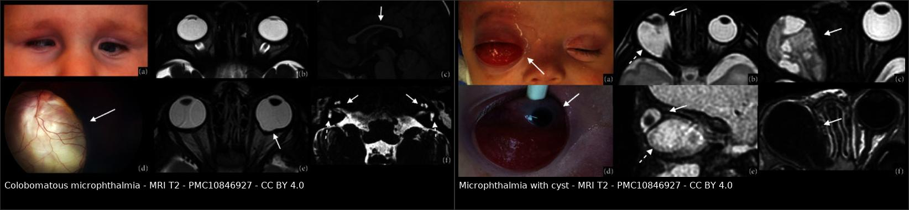
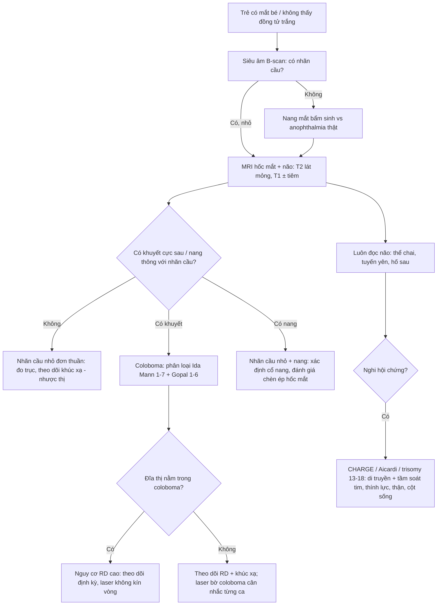
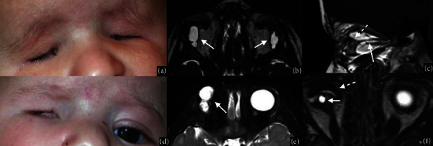
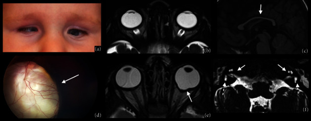
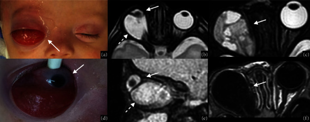

# 415 — Phổ nhãn cầu nhỏ – coloboma (microphthalmia–anophthalmia–coloboma, MAC): đọc MRI hốc mắt trên một mắt "bé mà vẫn còn cứu" / The MAC spectrum

**Tags:** `pattern:nhan-cau-nho` `pattern:khong-co-nhan-cau` `pattern:khuyet-hac-vong-mac` `pattern:nang-hong-mat` `vung:mat` `vung:nhan-cau` `vung:tre-em` `score:Ida-Mann` `score:Gopal` `protocol:MRI-hoc-mat` `protocol:B-scan`
**Mức chắc chắn (certainty):** tổng hợp y văn (literature synthesis) — tổng hợp 2 bài tổng quan mở (J Ophthalmol 2024 pictorial review MRI; Eye 2021 review coloboma) + 1 review quản lý sơ sinh (Ital J Pediatr 2025); số liệu do nhóm đối chiếu chéo giữa các bài, hình thái lấy từ chú thích Fig gốc.

## 1. Tổng quan — vì sao "một mắt bé" lại là ba bệnh khác nhau trên cùng một phổ

- **Bệnh học (pathology):** ba thực thể **nhãn cầu nhỏ (microphthalmia)**, **không nhãn cầu (anophthalmia)** và **khuyết hắc–võng mạc (chorioretinal coloboma)** là ba mức của **cùng một phổ bất thường tạo mắt** (MAC spectrum), do tổn thương rơi vào các thời điểm khác nhau của quá trình tạo mắt: tổn thương **rất sớm (tuần 3–4)** → **không nhãn cầu**; **muộn hơn** → **nhãn cầu nhỏ**; **tuần thứ 5–7** (khi **đường ráp bào thai — embryonic/optic fissure** phải đóng từ dưới lên) → **coloboma điển hình (typical coloboma)**, vì mép dưới–mũi của nhãn cầu còn hở, hắc mạc – võng mạc – mống mắt không khép kín.
- **Ngưỡng định lượng phải nhớ (đo bằng siêu âm A/B hoặc MRI):**
  - **Nhãn cầu nhỏ:** đường kính giác mạc **< 10 mm** và đường kính trước–sau **< 20 mm**, hoặc trục nhãn cầu **< −2 SD** so với tuổi, hoặc **< 2/3** đường kính bình thường, hoặc **< bách phân vị 5**.
  - **Nanophthalmos** (thể nặng, không kèm bất thường toàn thân): **trục nhãn cầu < 18 mm** + **giác mạc nhỏ (microcornea)**.
  - **Coloboma** chiếm **2%** mọi dị tật bẩm sinh; **không nhãn cầu 3/100.000** trẻ sinh sống; **nhãn cầu nhỏ 14/100.000**; **gộp hai thể 30/100.000**; **coloboma 2–19/100.000**; dị tật mắt bẩm sinh gây **15–20%** ca mù ở trẻ nhũ nhi.
- **TẠI SAO phải là MRI, và tại sao tín hiệu lại "đọc được" (vật lý):**
  - **Dịch kính – thủy dịch > 98% là nước** → **T2 rất sáng, T1 rất tối**; đây là "bóng đèn" để **đo thể tích/đường kính nhãn cầu** trên T2.
  - **Thể thủy tinh giàu protein cấu trúc** → **T1 sáng, T2 tối**; nhãn cầu nhỏ thường kèm **thể thủy tinh to tương đối (relatively hard lens)**, nên trên T2 nhãn cầu nhỏ trông "đặc" hơn mắt lành — dễ đọc nhầm là khối.
  - **Hắc mạc (choroid) – thể mi:** **T1 sáng, T2 tối**, ngấm mạnh sau tiêm → mất "viền hắc mạc" ở **đáy coloboma** chính là **dấu chốt**: đáy coloboma là **xơ hóa (fibrous tissue)**, không có hắc mạc/mạch máu, nên **không ngấm thuốc** và **không có lớp trung gian T1 sáng**.
  - **Củng mạc – giác mạc (collagen)** → **tối trên cả T1 và T2**; **vôi hóa** (nếu có) → **tối trên mọi chuỗi xung** và **không có trên MRI đủ nhạy bằng CT** — vì thế **MRI không dùng để tìm vôi hóa** (khác retinoblastoma: vôi hóa thô là chốt của RB trên CT).
  - **Nang dịch trong hốc mắt:** T2 sáng đồng nhất, T1 tối, **thành mỏng, không ngấm** — nếu **có thành dày/ngấm/nốt trong nang** thì phải nghĩ tổn thương khác (u,viêm).
- **Vì sao CT vẫn có chỗ:** CT **liều thấp, không cần gây mê dài** để xác nhận **không có nhãn cầu** và **vôi hóa**, nhưng **MRI là chuẩn** cho mô mềm hốc mắt, **nang – nhãn cầu có thông nhau không**, và **não – thể chai – tuyến yên** (tổn thương đường giữa).
- **Lâm sàng – điều trị (định hướng cho bác sĩ CĐHA):** mục tiêu đầu đời là **kích thích hốc mắt phát triển** (conformer/expansion prosthesis) + **chỉnh khúc xạ – điều trị nhược thị** cho mắt còn chức năng; mắt nhỏ nặng/không nhãn cầu → **ghép mỡ–da (dermis-fat graft) + implant hốc mắt** khi lớn. Với coloboma, điều trị xoay quanh **biến chứng** (bong võng mạc, đục thể thủy tinh, CNV) chứ không "sửa" được dị tật.

## 2. Mẫu hình + chẩn đoán phân biệt theo vị trí (gamut)

- **Mẫu hình A — "không thấy nhãn cầu / nhãn cầu rất bé":** anophthalmia thật (không có mô mắt), **nhãn cầu nhỏ nặng (severe microphthalmia)** — trên MRI vẫn thấy **mô nhãn cầu dẹt** phía sau; **nang bẩm sinh mắt (congenital cystic eye)** — nang nhiều thùy **không có nhãn cầu bên trong**; **nhãn cầu nhỏ + nang (microphthalmia with cyst)** — **có nhãn cầu nhỏ VÀ nang thông với nó**.
- **Mẫu hình B — "nhãn cầu nhỏ + khuyết ở cực sau/dưới":** **coloboma điển hình** (khuyết hắc–võng mạc, thường dưới–mũi, có thể tới đĩa thị), **coloboma đĩa thị đơn độc**, **Morning Glory** (loa đĩa thị + mô thần kinh đệm trung tâm), **staphyloma quanh đĩa (peripapillary staphyloma)** — **đĩa thị BÌNH THƯỜNG** nằm trong hõm lồi ra sau.
- **Mẫu hình C — "khuyết mống mắt đơn độc":** coloboma mống mắt **điển hình (dưới–mũi)** vs **coloboma không điển hình** (do chấn thương/mổ, vị trí bất kỳ) vs **đứt cơ vòng mi do chấn thương** (bờ rách, không có "notch" bẩm sinh).
- **Mẫu hình D — "coloboma + bất thường toàn thân":** **CHARGE** (coloboma + tim + atresia choanae + chậm phát triển + bất thường sinh dục + tai/điếc, *CHD7*); **Aicardi** (coloboma + co giật + thể chai), **Joubert**, **Walker–Warburg**, **trisomy 13/18**, **16q22 deletion**; **hội chứng COACH/CHARGE-like**.
- **Gamut theo vị trí tổn thương (điều tra theo giải phẫu):**
  - **Tiền phòng – mống mắt:** coloboma mống mắt, **dính mống mắt – thể thủy tinh**, **glaucoma thứ phát** (góc loạn sản).
  - **Cực sau – đĩa thị:** coloboma hắc–võng mạc, coloboma đĩa, Morning Glory, **staphyloma sau**.
  - **Hốc mắt:** nang (với/không nhãn cầu), **hẹp hốc mắt** do nhãn cầu nhỏ, **mô mỡ – cơ trực** teo kèm.
  - **Não – đường giữa:** **thể chai**, **hố sau**, **tuyến yên** (khi coloboma + hội chứng) — đây là phần **bắt buộc** của MRI "mắt" ở trẻ có coloboma.

## 3. Bảng so sánh phân biệt (ma trận đối chiếu)

| Thực thể (entity) | Hình ảnh điển hình | Chốt vào (rule-in) | Chốt loại (rule-out) | Gợi ý xác nhận |
|---|---|---|---|---|
| **Nhãn cầu nhỏ đơn thuần (simple microphthalmia)** | Nhãn cầu **đồng dạng nhưng nhỏ**: T2 sáng đều, **không khuyết**, không nang; AP **< 20 mm**, CD **< 10 mm** | **Nhãn cầu nhỏ + hình dạng còn tròn đều + không có khuyết cực sau** | Có **khuyết cực sau/dưới** hoặc **nang thông với nhãn cầu** → thể phức tạp | Siêu âm A/B đo trục; MRI T2 đo 3 chiều; so **mắt lành** |
| **Nhãn cầu nhỏ – coloboma (complex)** | Nhãn cầu nhỏ + **khuyết cực sau rộng**, **hõm lồi ra sau**, **mất viền hắc mạc T1 sáng** tại đáy, **không ngấm thuốc** ở đáy | **Khuyết cực sau + mất liên tục củng mạc – hắc mạc + đĩa thị nằm trong/ngoài khuyết** | Khuyết **thành mỏng đều, có ngấm** → nghĩ nang/khối | MRI T1 ± tiêm + T2; OCT/afg nếu môi trường trong |
| **Nhãn cầu nhỏ + nang** | **Nhãn cầu nhỏ DẸT** + **nang T2 rất sáng** ở sau/dưới, **cổ nang thông với nhãn cầu** | **Thấy cổ nang nối với củng mạc** trên T2 mọi bình diện | **Không thấy nhãn cầu** trong nang → **nang mắt bẩm sinh** | MRI T2 mỏng (1–2 mm), B-scan |
| **Nang mắt bẩm sinh (congenital cystic eye)** | **Nang nhiều thùy**, **không có mô nhãn cầu** bên trong, không thấy thể thủy tinh | **Không có nhãn cầu + nang nhiều thùy** | **Có mô nhãn cầu dẹt** ở thành nang → nhãn cầu nhỏ + nang | MRI + mô bệnh sau cắt |
| **Coloboma hắc–võng mạc** | Đáy trắng/xơ **không có hắc mạc**, bờ có sắc tố, **mạch máu đi qua đáy**, thường **dưới–mũi** | **Đáy xơ không ngấm + mất lớp hắc mạc + bờ sắc tố + liên quan đĩa thị theo phân loại** | Đáy có **khối ngấm thuốc/nốt** → nghĩ CNV/u; **vôi hóa thô** → RB | Soi đáy mắt + OCT; MRI để loại u/nang |
| **Morning Glory** | **Loa đĩa thị hình phễu**, **búi mô đệm ở trung tâm**, mạch máu **tỏa thẳng**, **hõm sâu ra sau** | **Phễu đĩa thị + búi glia trung tâm + mạch tỏa thẳng** | Đĩa **bình thường trong hõm** → staphyloma quanh đĩa | MRI T2 (phễu + mất liên tục củng mạc), B-scan |
| **Staphyloma quanh đĩa** | **Đĩa thị bình thường** nằm trong **hõm lồi ra sau** rộng, không có "notch" mống mắt | **Đĩa nguyên vẹn + hõm quanh đĩa** | **Đĩa khuyết/mất mô đĩa** → coloboma đĩa | MRI/soi đáy mắt; OCT đĩa |
| **Coloboma mống mắt** | **"Notch" bờ đồng tử phía dưới–mũi**, có thể thấy **xích đạo thể thủy tinh**; thường **không thấy trên MRI** | **Khuyết mống mắt bẩm sinh đúng vị trí + bờ nhẵn** | Bờ **rách, không đều, có tiền sử chấn thương** → đứt cơ vòng mi | Sinh hiển vi; MRI chỉ để tìm tổn thương phối hợp |

*Trái: nhãn cầu nhỏ hai bên, cực sau **lồi ra thành khuyết** (mũi tên), trên T2 còn thấy **mất liên tục củng mạc ở cực dưới** trên mặt cắt vành. Phải: **nhãn cầu nhỏ dẹt + nang lớn** phía sau–dưới, **cổ nang thông với nhãn cầu**. Nguồn: J Ophthalmol 2024 (PMC10846927) Fig. 3 và Fig. 6, CC BY 4.0. Ảnh ghép letterbox, không crop.*

### Ba dấu hiệu định vị then chốt (đọc theo thứ tự)
1. **Đếm nhãn cầu:** có **hai nhãn cầu** không? Không → **anophthalmia / nang mắt bẩm sinh** (phân biệt bằng "có mô nhãn cầu trong nang hay không").
2. **Đo cực sau:** cực sau **lồi ra thành túi** hay **khuyết mất mô**? **Lồi + thành mỏng + thông với dịch kính** = coloboma/nang; **hõm quanh đĩa, đĩa nguyên** = staphyloma.
3. **Tìm viền hắc mạc T1 sáng:** viền này **mất ở đáy coloboma** và **còn ở staphyloma** — đây là dấu rẻ tiền nhưng ổn định nhất trên MRI không tiêm.

## 4. Protocol chụp + hệ phân độ

### 4.1. Protocol MRI hốc mắt trẻ (theo pictorial review 2024)
- **Chuỗi xung tối thiểu:** **T2 2D lát mỏng** (trục + vành) + **T1 trước tiêm** + **T1 fat-sat sau tiêm**; thêm **T2 3D CISS/FIESTA** khi cần thấy **dây thần kinh thị – nang – cổ nang**.
- **Thông số:** ảnh 2D trong mặt phẳng hốc mắt đặt **khe lát tối thiểu (minimal slice gap)**, **ma trận 448–512**, **FOV ~18–20 cm** → **độ phân giải trong mặt phẳng ~0,4 mm**.
- **Vùng phủ:** trục từ **khẩu cái cứng tới ~1 cm trên hốc mắt**; vành từ **thể thủy tinh tới giữa cầu não**; sagittal chếch **theo đường đi dây thần kinh thị**.
- **Bắt buộc chụp kèm não** khi có coloboma/hội chứng: tìm **bất thường đường giữa (thể chai, tuyến yên, hố sau)** — vì **15–30% coloboma có CHARGE** và nhiều hội chứng đường giữa đi kèm.
- **Siêu âm (B-scan) trước MRI:** đo **trục nhãn cầu**, xác nhận **nang**, phân biệt **mắt nhỏ** với **không nhãn cầu**; **không cần gây mê**.
- **CT:** chỉ khi cần **xương hốc mắt** (hẹp hốc, implant) hoặc **vôi hóa**; **không dùng CT làm chuẩn mô mềm**.

### 4.2. Phân độ coloboma hắc–võng mạc
- **Phân loại Ida Mann (1–7, theo mức lan tới đĩa thị và vị trí):** **type 1** coloboma **lan lên trên đĩa thị**; **type 2** lan tới **bờ trên đĩa**; **type 3** **dưới bờ dưới đĩa**; **type 4** **chỉ đĩa thị**; **type 5** **dưới đĩa, võng mạc trên và dưới bình thường**; **type 6** **chỉ có sắc tố ngoại vi**; **type 7** **chỉ ở ngoại vi**. Nặng nhất **type 1**, nhẹ nhất **type 6–7**.
- **Phân loại Gopal (1–6, theo tương quan đĩa thị – coloboma):** 1) đĩa **ngoài** coloboma, **bình thường**; 2) đĩa **ngoài** coloboma nhưng **loạn sản**; 3) đĩa **coloboma riêng**, coloboma chiếm **phần dưới đĩa**; 4) **đĩa bình thường nằm TRONG** coloboma; 5) đĩa coloboma **hòa vào** coloboma nhưng **phần trên đĩa còn rõ**; 6) đĩa coloboma **hòa hoàn toàn**, **không nhận ra mô đĩa**.
- **Nguy cơ bong võng mạc (RD) — con số quyết định theo dõi:** tỉ lệ RD trong coloboma hắc–võng mạc **2,4–47,5%** (loạt bệnh viện); **odds RD tăng 1,147 lần mỗi năm tuổi**, và **giảm 0,653 lần mỗi bậc Ida Mann** (coloboma càng nhẹ càng ít RD).
- **Cơ chế RD (để hiểu vì sao "laser dự phòng" khó):** 3 lỗ hổng phối hợp — **lỗ rách võng mạc ngoại vi**, **rách màng trung gian (intercalary membrane, ICM)**, và **toác tại "locus minoris resistentiae"** (vùng RPE tận cùng dính chặt lớp võng mạc ngoài ở bờ coloboma). **Laser dự phòng quanh bờ coloboma** (201 mắt, theo dõi 3 năm, 2 ca vẫn bong) **chưa có bằng chứng dài hạn**, nhất là khi **đĩa thị nằm trong coloboma** nên không thể laser kín vòng.

## 5. Biến thể bình thường và cạm bẫy

- **Microcornea ≠ microphthalmos:** **đường kính giác mạc nhỏ** nhưng **nhãn cầu bình thường** là một thực thể riêng (thường kèm **giác mạc phẳng – cornea plana**, glaucoma góc hẹp); **không được suy ra "mắt nhỏ" chỉ từ giác mạc nhỏ** — phải đo **trục nhãn cầu**.
- **Đĩa thị "giả coloboma":** **staphyloma quanh đĩa** và **đĩa loạn sản do cận thị cao** trông như coloboma; chốt loại = **đĩa thị còn nguyên vẹn, mô đĩa bình thường**, hõm nằm **quanh** đĩa chứ không **xuyên** đĩa.
- **Coloboma đĩa thị đơn độc dễ bị đọc là "glaucoma teo đĩa":** coloboma đĩa **hình tròn đồng tâm** + **viền quanh đĩa mỏng bất thường** rất giống **teo đĩa do glaucoma**; phân biệt bằng **bờ đĩa lệch tâm/khuyết mô đĩa**, **không có mất sợi thần kinh theo dải**, và **bối cảnh tuổi** (trẻ, nhãn áp bình thường).
- **Mắt nhỏ làm "giả khối":** thể thủy tinh **T2 tối** trong nhãn cầu nhỏ dễ bị đọc là **khối đặc/u**; so với **mắt lành** và dùng **T1 sáng của thể thủy tinh** để khẳng định.
- **Nang "vô tội" nhưng chèn hốc mắt:** nang lớn **đẩy lệch** mô hốc mắt và **hạn chế phát triển xương hốc mắt** — nang **càng lớn càng sớm** thì càng phải can thiệp sớm; đây là lý do **MRI có giá trị điều trị**, không chỉ chẩn đoán.
- **Cạm bẫy "thỏa mãn tìm kiếm":** đã thấy coloboma là **dừng** — trong khi việc **đọc não (thể chai, tuyến yên, hố sau)** mới là phần **thay đổi tiên lượng** (CHARGE, Aicardi).
- **Co giật + coloboma ở bé gái:** nghĩ **Aicardi** (thể chai không có/loạn sản + co giật kháng trị) — **MRI não là chốt**, không phải MRI mắt.

## 6. Tự lượng giá — Blind Quiz

**Ca 1 — Bé trai 1 tuổi, hai hốc mắt trũng, không thấy lòng đen. Nhìn ảnh lâm sàng trước, đoán rồi mới mở đáp án.**

- Gợi ý: không sờ thấy cầu mắt; có nang dưới kết mạc?
- Hỏi: có bao nhiêu nhãn cầu? Cấu trúc T2 sáng phía sau là gì? Chẩn đoán và bước tiếp theo?

<b>Bấm để hiện đáp án (findings + chẩn đoán)</b>

- **Findings:** hai hốc mắt **không có nhãn cầu**; trên T2 trục thấy **cấu trúc dạng nang hai bên** (mũi tên trắng) ở vị trí nhãn cầu; sagittal T1 thấy **mô mềm vô định hình** (mũi tên chấm) thay cho nhãn cầu.
- **Chẩn đoán:** **anophthalmia hai bên có nang** (anophthalmia with cysts) — nang xuất phát từ mô mắt thoái hóa, T2 sáng vì chứa dịch.
- **Vì sao:** không có mô nhãn cầu → T2 chỉ còn **dịch trong nang**; đây là đầu cực nặng của phổ MAC.
- **Bước tiếp:** MRI **toàn não** (đường giữa, thể chai), tầm soát **CHARGE** (tim, choanae, thính lực, sinh dục), **conformer – giãn hốc mắt sớm**.
- Nguồn ảnh: J Ophthalmol 2024 (PMC10846927) Fig. 2, CC BY 4.0.

**Ca 2 — Bé trai 1 tuổi, hội chứng vi mất đoạn 16q22, hai mắt nhỏ. Trong 2 mắt, mắt nào "phức tạp"?**

- Hỏi: mô tả cực sau hai nhãn cầu trên T2 trục; mặt cắt vành cho thêm gì? Gọi tên thể bệnh.

<b>Bấm để hiện đáp án (findings + chẩn đoán)</b>

- **Findings:** (a) hai mắt nhỏ, đồng tử hai bên; (b) T2 trục: **đường kính trước–sau và ngang giảm hai bên**; (e) T2 trục: **cực sau mắt trái lồi ra thành túi** (mũi tên) — khuyết; (f) T2 vành: **mất liên tục củng mạc – hắc mạc ở cực dưới** hai bên (mũi tên).
- **Chẩn đoán:** **nhãn cầu nhỏ thể phức tạp có coloboma (colobomatous microphthalmia)** hai bên, trên nền **hội chứng vi mất đoạn 16q22**.
- **Vì sao:** mép dưới–mũi (đường ráp bào thai) không khép → **khiếm khuyết thành củng mạc – hắc mạc** → cực sau **phình ra**; trên MRI **mất viền hắc mạc T1 sáng** tại đáy.
- **Ý nghĩa:** thể **phức tạp** có nguy cơ **bong võng mạc** và **glaucoma** cao hơn thể đơn thuần → theo dõi nhãn áp + đáy mắt định kỳ.
- Nguồn ảnh: J Ophthalmol 2024 (PMC10846927) Fig. 3, CC BY 4.0.

**Ca 3 — Bé gái 13 ngày tuổi, mắt phải "không có nhãn cầu", có khối đỏ dưới kết mạc. Khối đó là mắt hay nang?**

- Hỏi: tìm **nhãn cầu** và **nang**; có **cổ nang** nối hai cấu trúc không? Chẩn đoán phân biệt với "nang mắt bẩm sinh" dựa vào đâu?

<b>Bấm để hiện đáp án (findings + chẩn đoán)</b>

- **Findings:** (a) khối đỏ dưới kết mạc; (b, e) T2 trục/sagittal: **nhãn cầu nhỏ dẹt** (mũi tên trắng) **kèm nang lớn** (mũi tên chấm) **thông với nhãn cầu**; (d) soi dưới gây mê xác nhận; (c, f) ca đối chiếu **nang mắt bẩm sinh**: nang **nhiều thùy, KHÔNG có nhãn cầu** bên trong.
- **Chẩn đoán:** **nhãn cầu nhỏ kèm nang (microphthalmia with cyst)** mắt phải.
- **Chốt vào:** **thấy cổ nang nối nang với củng mạc** trên T2 nhiều bình diện.
- **Chốt loại nang mắt bẩm sinh:** **không có mô nhãn cầu/thể thủy tinh** bên trong nang, nang nhiều thùy.
- Nguồn ảnh: J Ophthalmol 2024 (PMC10846927) Fig. 6, CC BY 4.0.

## Bài liên quan chéo
- [400 – Tổng quan Mắt & thị giác](../400-tong-quan-mat-thi-giac/lesson.md)
- [411 – Siêu âm nhãn cầu](../411-sieu-am-nhan-cau/lesson.md) (B-scan đo trục, phân biệt mắt nhỏ/nang)
- [412 – U trong nhãn cầu](../412-u-trong-nhan-cau/lesson.md) (vôi hóa thô = retinoblastoma, không phải coloboma)
- [413 – PFV/PHPV: dây xơ dịch kính + nhãn cầu nhỏ](../413-PFV-PHPV-day-xo-the-thuy-tinh/lesson.md)
- [414 – Glaucoma & nhãn cầu nhỏ trong PFV](../414-glaucoma-va-nhan-cau-nho-o-pfv/lesson.md) (mắt nhỏ + tăng nhãn áp)

> Không dùng để chẩn đoán độc lập khi chưa có người hướng dẫn.
