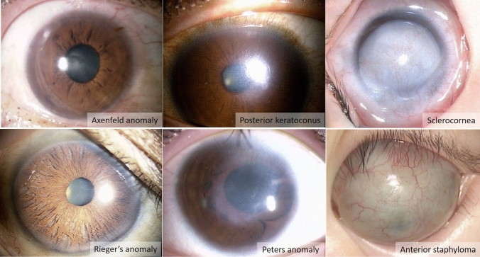
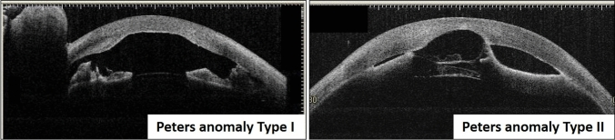
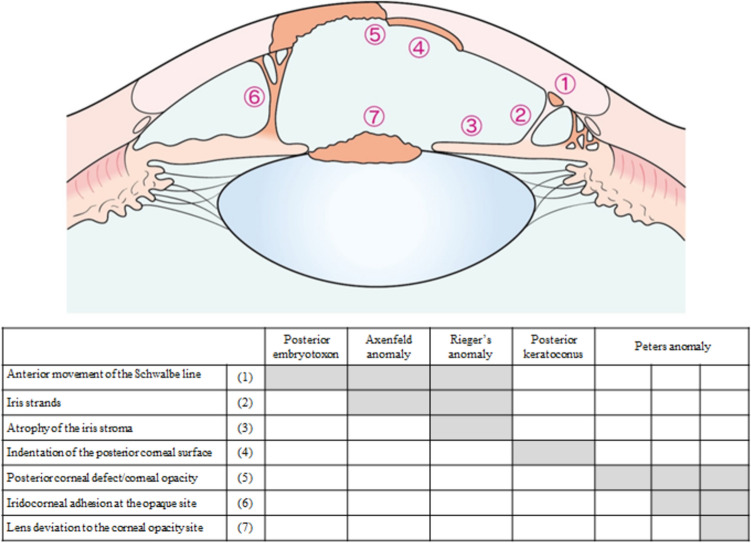
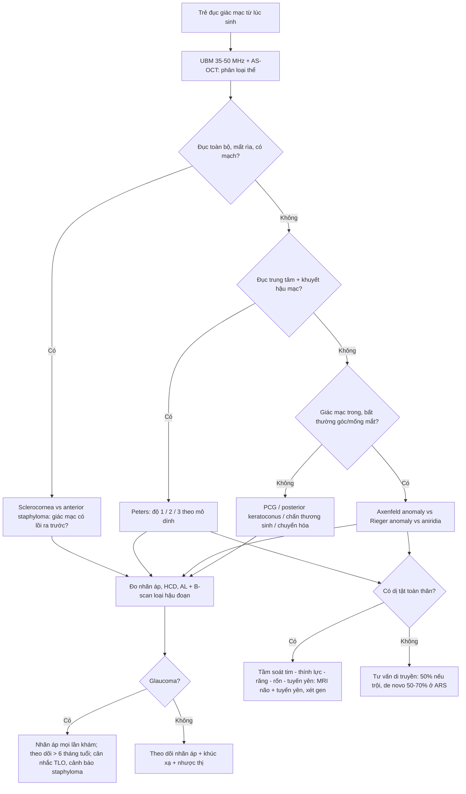
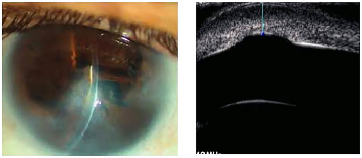
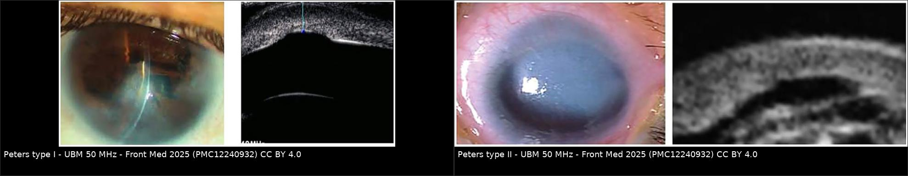
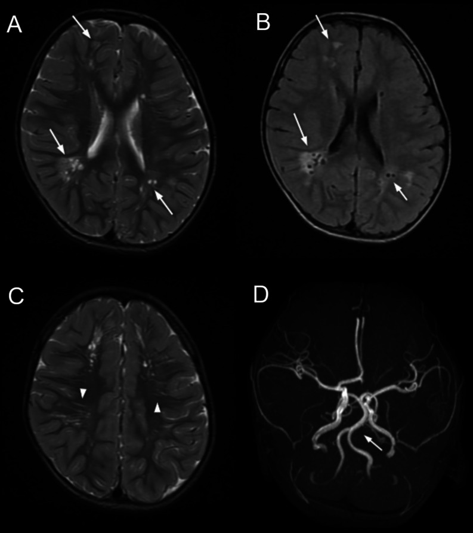
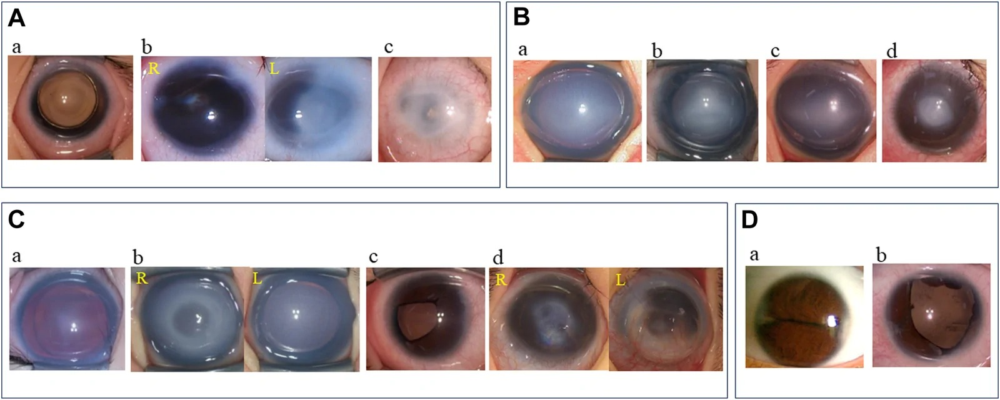

# 416 — Dị tật tiền phòng ở trẻ (Peters, Axenfeld–Rieger, sclerocornea): "đục giác mạc bẩm sinh" không phải một bệnh / Anterior segment dysgenesis

**Tags:** `pattern:duc-giac-mac` `pattern:dinh-mong-mat-giac-mac` `pattern:loi-goc-truoc` `pattern:di-tat-tien-phong` `vung:mat` `vung:giac-mac` `vung:tien-phong` `vung:tre-em` `score:Peters-I-II-III` `score:ASD-do-nang` `protocol:UBM` `protocol:AS-OCT` `protocol:MRI-nao`
**Mức chắc chắn (certainty):** tổng hợp y văn (literature synthesis) — tổng hợp **guideline Nhật 2026** (tiêu chuẩn chẩn đoán + phân độ nặng I–IV), cohort **46 trẻ Peters** (Front Med 2025), **31 mắt Peters** (J Clin Med 2023), **111 bệnh nhân / 194 mắt** (Ophthalmol Sci 2026) và ca ARS có tổn thương não trên MRI (Radiol Case Rep 2025). Số liệu đối chiếu chéo giữa các bài; hình thái đọc từ chú thích Fig gốc.

## 1. Tổng quan — vì sao "đục giác mạc bẩm sinh" là một PHỔ, không phải một bệnh

- **Bệnh học (pathology):** **dị tật tiền phòng (anterior segment dysgenesis, ASD)** là nhóm bất thường do **tế bào mào thần kinh (neural crest) di cư/vào tiền phòng sai** ở **làn sóng 2 và 3**, gây khiếm khuyết **giác mạc – mống mắt – góc**. Guideline Nhật 2026 xếp chung một phổ: **vòng Schwalbe ra trước (posterior embryotoxon)**, **Axenfeld anomaly** (vòng Schwalbe ra trước + dây mống mắt), **Rieger anomaly** (+ teo mô đệm mống mắt, lệch đồng tử), **posterior keratoconus**, **Peters anomaly**, **sclerocornea**, **anterior staphyloma**.
- **BA cơ chế gây mất thị lực (đọc theo thứ tự để không bỏ sót):**
  1. **Mờ trục quang học** → **nhược thị do che lấp (deprivation amblyopia)** ngay từ những tháng đầu; đây là lý do phải hành động sớm hơn mọi "chờ lớn".
  2. **Glaucoma thứ phát** do **loạn sản lưới bè – ống Schlemm**; xuất hiện **rất sớm hoặc nhiều năm sau**.
  3. **Bất thường toàn thân** (tim, thần kinh, tuyến yên, răng, rốn) — chỉ điểm hội chứng.
- **Ngưỡng định lượng phải nhớ:**

| Thông số | Con số | Ý nghĩa thực hành |
|---|---|---|
| Tỉ lệ **hai bên** | **~75%** (thống kê Nhật) | Khi một mắt Peters, **mắt kia cũng Peters ở ~50%**; **20–30%** có ASD khác (sclerocornea, anterior staphyloma) |
| Bất thường **toàn thân** | **20–30%** (Peters); **~60%** nếu tính chậm phát triển | Hai bên → nguy cơ hội chứng cao hơn một bên |
| **Glaucoma trong Peters** | **30–70%**; cohort 46 trẻ: **48,3%** (14/29 đo được) | Phải đo nhãn áp **mọi lần khám**, không chỉ lúc mới sinh |
| Glaucoma **theo độ nặng Peters** | **độ 1: 0% · độ 2: 52% · độ 3: 75%** (31 mắt) | Độ càng cao → đặt vấn đề glaucoma ngay |
| Glaucoma **theo tuổi** | **0–6 tháng: 26,7%** vs **> 6 tháng: 53,6%** (p = 0,03) | **Không được "kết luận an toàn" ở lần khám 3 tháng** |
| **Trục nhãn cầu / đường kính giác mạc ở Peters** | AL trung vị **20,84 mm (OD) / 20,19 mm (OS)**; HCD trung vị **11,5 mm** | **Có thể nằm trong giới hạn bình thường** — không loại trừ Peters, không dùng để theo dõi glaucoma một mình |
| **Glaucoma trong Axenfeld–Rieger** | **50–70%** | ARS là nguyên nhân hàng đầu glaucoma thứ phát ở trẻ bên cạnh PCG |
| Glaucoma trẻ em nói chung | **1/10.000–1/18.000** trẻ sinh sống | Nền để so sánh "hiếm nhưng không cực hiếm" |

- **TẠI SAO phải dùng UBM/OCT tiền phòng chứ không phải "nhìn rồi đoán" (vật lý):**
  - **Giác mạc đục chặn ánh sáng** → soi sinh hiển vi chỉ thấy "mờ trắng", **không thấy được bờ khuyết hậu mạc, dây mống mắt, hay thể thủy tinh có dính hay không**.
  - **UBM (35–50 MHz)**: bước sóng ngắn, **phân giải trục ~50 µm**, **xuyên ~4–5 mm** → đi **xuyên qua giác mạc đục** để thấy **mặt sau giác mạc, góc, mống mắt, thể thủy tinh, mỏm thể mi**. Đây là lý do guideline 2026 khuyến cáo **UBM để phân loại thể bệnh**.
  - **AS-OCT (~1310 nm, phân giải trục ~5–10 µm)**: **chi tiết hơn UBM** nhưng **xuyên kém** — chỉ đọc tốt khi **giác mạc còn tương đối trong** hoặc qua vùng trong; với giác mạc đục dày, tín hiệu tắt sớm.
  - **Siêu âm B-scan (10–15 MHz)**: chỉ để loại **bất thường hậu đoạn** (bong võng mạc, u) khi **không thể soi đáy mắt** — **không dùng để phân loại tiền phòng**.
- **Điều trị — điều guideline 2026 nói rõ (và hay bị làm ngược):** **ghép giác mạc xuyên (PKP) KHÔNG được khuyến cáo thường quy** ("weak: suggest not to implement") vì **tiên lượng dài hạn chưa rõ**, nguy cơ **tháo dịch kính – thủy tinh thể trong mổ** và **glaucoma thứ phát sau mổ**; các lựa chọn thay thế: **cắt mống mắt quang học (optical sector iridectomy)**, **giãn đồng tử**, **xoay giác mạc**. Khi buộc phải ghép, **tỉ lệ thất bại mảnh ghép ở trẻ cao hơn người lớn** rõ rệt.

## 2. Mẫu hình + chẩn đoán phân biệt theo vị trí (gamut)

- **Mẫu hình A — đục giác mạc TRUNG TÂM hình đĩa ("doughnut")**: **Peters anomaly** (khiếm khuyết hậu mạc trung tâm ± dây mống mắt = **type I**; ± **thể thủy tinh/cataract dính vào bờ khuyết = type II**); **posterior keratoconus** (hõm sau trung tâm, **giác mạc trong**); **loét/viêm giác mạc bẩm sinh**; **đục giác mạc do chấn thương sinh (forceps)**.
- **Mẫu hình B — đục TOÀN BỘ giác mạc, mất ranh giới rìa**: **sclerocornea** (giác mạc "hóa củng mạc", **không có rìa rõ**, có mạch máu mọc vào) vs **anterior staphyloma** (giác mạc **lồi ra trước**, dính mống mắt toàn bộ) vs **glaucoma bẩm sinh (PCG) giai đoạn muộn** (giác mạc to, **vết rạn Haab**, phù giác mạc).
- **Mẫu hình C — giác mạc TRONG nhưng bất thường góc/mống mắt**: **Axenfeld anomaly** (vòng Schwalbe ra trước + dây mống mắt), **Rieger anomaly** (teo mô đệm mống mắt, **lệch đồng tử – corectopia**, **đồng tử nhiều lỗ**), **aniridia/partial aniridia** (*PAX6*), **posterior embryotoxon đơn thuần** (biến thể lành tính).
- **Mẫu hình D — đục giác mạc + bất thường toàn thân**: **Peters plus** (khe hở môi – vòm, chậm phát triển, tim bẩm sinh, *B3GLCT/B3GALTL*), **Axenfeld–Rieger** (*PITX2* / *FOXC1*: **bất thường răng – thiểu sản men, dây rốn thừa, bất thường xương mặt, tổn thương tuyến yên**), **hội chứng 22q11.2**, **mucopolysaccharidosis** (đục giác mạc mờ đều hai bên + bất thường xương).
- **Gamut theo vị trí (dùng khi mô tả):** **trung tâm giác mạc** (Peters, posterior keratoconus) → **rìa/góc** (Axenfeld, Rieger, dây mống mắt) → **toàn giác mạc** (sclerocornea, staphyloma, PCG) → **thể thủy tinh** (Peters II: dính/cataract) → **não – tuyến yên** (ARS, Peters plus).

*Sáu kiểu hình trong cùng một phổ: **Axenfeld anomaly** (vòng Schwalbe ra trước + dây mống mắt), **posterior keratoconus** (hõm sau trung tâm), **sclerocornea** (đục toàn bộ, mất rìa, có mạch), **Rieger anomaly** (teo mô đệm, lệch đồng tử), **Peters anomaly** (đục trung tâm + dính), **anterior staphyloma** (giác mạc lồi, mỏng, có mạch). Nguồn: Jpn J Ophthalmol 2026 (PMC13091872) Fig. 1, CC BY 4.0.*

## 3. Bảng so sánh phân biệt (ma trận đối chiếu)

| Thực thể (entity) | Hình ảnh điển hình | Chốt vào (rule-in) | Chốt loại (rule-out) | Gợi ý xác nhận |
|---|---|---|---|---|
| **Peters type I** | **Đục trung tâm hình đĩa**, **khuyết hậu mạc** đúng vùng đục, **dây mống mắt** bắc từ bờ mống mắt tới bờ khuyết | **Khuyết hậu mạc trung tâm + dây mống mắt + thể thủy tinh KHÔNG dính** | **Thể thủy tinh dính vào bờ khuyết** → type II | UBM 35–50 MHz; AS-OCT nếu giác mạc trong |
| **Peters type II** | Như type I **+ thể thủy tinh (hoặc cataract) đi ra trước dính vào bờ khuyết**; tiền phòng nông | **Thể thủy tinh/cataract áp vào mặt sau giác mạc tại bờ khuyết** | **Không có mô thể thủy tinh ở bờ khuyết** → type I | UBM (chốt), AS-OCT; B-scan nếu đục dày |
| **Peters plus** | Peters + **khe hở môi/vòm, chậm phát triển, tim bẩm sinh**, đầu chi ngắn | **Peters + ≥ 1 bất thường hệ thống đặc trưng** | Chỉ có mắt, phát triển bình thường → Peters đơn thuần | Khám lâm sàng + di truyền (*B3GLCT*) |
| **Sclerocornea** | **Đục toàn bộ hoặc gần toàn bộ**, **mờ như củng mạc**, **mất rìa giác mạc – củng mạc**, **mạch máu mọc vào**, thường **hai bên**, **không tiến triển** | **Không xác định được rìa + mạch hóa + đục đều** | **Còn rìa rõ, đục khu trú trung tâm** → Peters; **giác mạc to + rạn Haab** → PCG | UBM (độ dày, góc), AS-OCT, khám toàn thân |
| **Anterior staphyloma** | **Giác mạc lồi ra trước thành khối**, mỏng, dính mống mắt **toàn bộ**, thường kèm **glaucoma** | **Lồi ra trước + mống mắt dính lan rộng + mất mô đệm** | **Không lồi, chỉ đục** → sclerocornea; **lồi ra SAU** → buphthalmos/PCG | UBM + đo trục; B-scan |
| **Axenfeld anomaly** | **Vòng Schwalbe ra trước** + **dây mống mắt** bắc qua góc; **giác mạc trong** | **Dây mống mắt tới vòng Schwalbe ra trước, góc còn mở một phần** | **Teo mô đệm + lệch đồng tử** → Rieger | Soi góc (gonioscopy) khi hợp tác; UBM ở trẻ |
| **Rieger anomaly/syndrome** | **Teo mô đệm mống mắt**, **corectopia**, **đồng tử nhiều lỗ**, vòng Schwalbe ra trước; ± **glaucoma 50–70%** | **Corectopia + teo mô đệm + bất thường góc** | **Mống mắt bình thường, chỉ có dây** → Axenfeld; **mất gần toàn bộ mống mắt** → aniridia | UBM/AS-OCT; **MRI não + tuyến yên**; khám răng – rốn |
| **Glaucoma bẩm sinh (PCG)** | **Giác mạc TO (buphthalmos)**, **phù giác mạc**, **rạn Haab**, **trục nhãn cầu dài**, nhãn áp cao | **Giác mạc to + rạn Haab + trục dài + nhãn áp cao** | **Giác mạc nhỏ/bình thường, không rạn, có khuyết hậu mạc** → Peters | Đo nhãn áp, HCD, AL; UBM góc |
| **Chấn thương sinh (forceps)** | **Đường rách tuyến tính** giác mạc/mống mắt, **một bên**, bờ sắc, có bối cảnh đẻ khó | **Rách dạng đường + tiền sử forceps** | **Khuyết tròn trung tâm bẩm sinh, không đường rách** → Peters | Bệnh sử + sinh hiển vi |

*AS-OCT: **type I** — khuyết hậu mạc trung tâm có **dây mống mắt** bắc tới bờ khuyết, mặt sau thể thủy tinh còn cách giác mạc; **type II** — **thể thủy tinh đi ra trước**, áp sát/đi vào bờ khuyết. Nguồn: Jpn J Ophthalmol 2026 (PMC13091872) Fig. 3, CC BY 4.0.*

*Sơ đồ + bảng: (1) vòng Schwalbe ra trước, (2) dây mống mắt, (3) teo mô đệm mống mắt, (4) hõm mặt sau giác mạc, (5) khuyết hậu mạc/đục giác mạc, (6) dính mống mắt–giác mạc tại chỗ đục, (7) thể thủy tinh ra trước. **Bảng là ma trận đọc nhanh**: mỗi thể bật đúng những ô tương ứng. Nguồn: Jpn J Ophthalmol 2026 (PMC13091872) Fig. 2, CC BY 4.0.*

### Đọc theo 7 dấu hiệu (thay cho "nhìn độ đục")
1. **Vòng Schwalbe ra trước?** → có: nghĩ **Axenfeld/Rieger**; không: đi tiếp.
2. **Dây mống mắt bắc qua góc/khuyết?** → vị trí dây quyết định **Axenfeld** (ra rìa) vs **Peters I** (tới bờ khuyết trung tâm).
3. **Teo mô đệm + corectopia?** → **Rieger**.
4. **Hõm mặt sau giác mạc (không đục)?** → **posterior keratoconus**.
5. **Đục trung tâm + khuyết hậu mạc?** → **Peters**.
6. **Dính mống mắt tại chỗ đục?** → xác nhận **Peters** (không phải loét/viêm).
7. **Thể thủy tinh ra trước/dính?** → **Peters II**.

## 4. Protocol chụp + hệ phân độ

### 4.1. Protocol hình ảnh (không cần gây mê dài)
- **UBM 35–50 MHz** là **bước 1** ở mọi trẻ đục giác mạc: đo **độ dày giác mạc**, **độ sâu tiền phòng (ACD)**, mô tả **bờ khuyết hậu mạc**, **dây mống mắt**, **quan hệ thể thủy tinh – bờ khuyết**, **góc**.
- **AS-OCT tiền phòng** khi giác mạc **còn trong vùng cần đọc**: phân giải cao hơn, thấy rõ **màng Descemet**, **dây**, **mức dính**.
- **B-scan 10–15 MHz** khi **không thể soi đáy mắt**: loại **bong võng mạc, u, bất thường dịch kính** trước khi mổ.
- **MRI não + tuyến yên** khi: **ARS** (tìm **tổn thương chất trắng quanh não thất, giãn khoang quanh mạch, dolichoectasia động mạch nền – thân nền**), **Peters plus** (bất thường đường giữa), **nghi hội chứng** — hình ảnh thần kinh **đổi tiên lượng và lịch theo dõi**, không chỉ để "cho đủ bộ".
- **Đo nhãn áp đúng cách ở trẻ:** **khi trẻ KHÔNG khóc** (khóc làm nhãn áp tăng giả), **đo HCD và AL cùng lúc**, so **hai mắt**, ghi rõ **thiết bị** (Perkins/Tono-Pen/iCare) — guideline nhấn mạnh **ngưỡng glaucoma ở trẻ khác người lớn**.

### 4.2. Ba hệ phân độ cần thuộc
- **Phân độ Peters (theo mô dính):** **độ 1** chỉ **khuyết hậu mạc**; **độ 2** khuyết + **dính mống mắt–giác mạc**; **độ 3** khuyết + **bất thường thể thủy tinh**. Nguy cơ glaucoma: **0% / 52% / 75%**; **trabeculotomy (TLO)** thành công **5/9 mắt**, và **3/4 ca thất bại có staphyloma giác mạc** (p = 0,0331).
- **Phân độ nặng ASD (guideline Nhật 2026):** **grade I** một bên, mắt kia lành; **grade II** hai bên, thị lực chỉnh kính mắt tốt hơn **≥ 0,3**; **grade III** hai bên, thị lực **0,1–0,3**; **grade IV** hai bên, thị lực **< 0,1**. **Quy tắc nâng bậc:** grade I–III mà **có glaucoma kèm thu hẹp thị trường mắt tốt hơn** → **nâng 1 bậc** (thị trường còn lại trong **20°** với optotype Goldmann I/4).
- **Tiêu chuẩn chẩn đoán "xác định" (guideline 2026):** **A. triệu chứng** (đục giác mạc **từ lúc sinh/nhũ nhi**, giảm thị lực, sợ ánh sáng) + **B. xét nghiệm** (đục toàn bộ/một phần; **dây từ mặt sau giác mạc tới mống mắt** hoặc **khuyết hậu mạc**) + **C. chẩn đoán phân biệt** (nhiễm trùng trong tử cung, chấn thương sinh, bệnh chuyển hóa, loạn dưỡng giác mạc bẩm sinh, glaucoma bẩm sinh, aniridia, limbal dermoid) + **D. biến chứng ngoài mắt** + **E. xét nghiệm gen** (đa số **không tiền sử gia đình**, nhưng có thể **trội/lặn**).
- **Gánh nặng di truyền (để quyết định xét gen):** chẩn đoán phân tử đạt **50,0%** ở ASD/aniridia và **37,5%** ở nhóm nhãn cầu nhỏ/không nhãn cầu (111 bệnh nhân); **194 mắt/97 bệnh nhân**: ASD **63,4%**, aniridia **35,1%**; **62,4%** mắt có biến chứng, **29,9%** bệnh nhân có bất thường toàn thân; **27,8%** có tiền sử gia đình (và **8/27** khác kiểu hình trong cùng gia đình). **Glaucoma tăng rõ ở *CYP1B1* và *FOXC1*; bất thường toàn thân hay gặp ở *FOXC1* và *PITX2*.**
- **ARS — con số để tư vấn:** glaucoma **50–70%**; **đột biến de novo 50–70%**; xét nghiệm gen **độ nhạy 35–40%, độ đặc hiệu ~95%**; con của người bệnh có **50%** nguy cơ.

## 5. Biến thể bình thường và cạm bẫy

- **Posterior embryotoxon đơn thuần là BIẾN THỂ LÀNH TÍNH** (vòng Schwalbe ra trước, **không dây mống mắt, không teo mô đệm, nhãn áp bình thường**) — gặp ở **người không có bệnh mắt**, nên **đừng gọi là "Axenfeld"** khi chỉ có một mình nó; Axenfeld cần **dây mống mắt bắc qua góc**.
- **HCD và AL bình thường KHÔNG loại trừ Peters:** cohort 46 trẻ cho **HCD trung vị 11,5 mm** và **AL 20,8 mm** — tức là **trong giới hạn bình thường**. Cạm bẫy hay gặp: "giác mạc 11,5 mm, trục 20,8 mm nên không phải mắt nhỏ/bất thường" → **sai**; phải đọc **hình thái mặt sau**.
- **Nhầm "đục giác mạc do glaucoma" với "dị tật":** PCG gây **phù giác mạc mờ đều + rạn Haab + giác mạc to**; đọc kỹ **kích thước giác mạc** và **rạn Haab** để không mổ sửa "dị tật" trên mắt đang cần hạ nhãn áp.
- **Sclerocornea ≠ đục giác mạc đơn thuần:** mất **ranh giới rìa** là dấu chốt; khi đã có **mạch hóa + mất rìa**, **ghép giác mạc có tiên lượng xấu** và **không nên hứa "mổ là sáng"**.
- **ARS bị bỏ sót phần NÃO:** trẻ ARS có thể có **tổn thương chất trắng quanh não thất, giãn khoang quanh mạch, dolichoectasia hệ sống – nền** trên MRI (ca 2 tuổi, *FOXC1*, cha và ông cũng bệnh). **Không đọc MRI não = bỏ mất phần ảnh hưởng tiên lượng**; kèm **bất thường tuyến yên** ở *PITX2*.
- **Không được kết luận "glaucoma âm" ở lần khám đầu:** tỉ lệ glaucoma **tăng từ 26,7% (0–6 tháng) lên 53,6% (> 6 tháng)**; trẻ **Peters độ 3** có **75%** nguy cơ → **lịch theo dõi phải kéo dài nhiều năm**, không phải một lần.
- **Cạm bẫy "thỏa mãn tìm kiếm" khi đã thấy bất thường mắt:** luôn hỏi **tim, thính lực, răng, rốn, phát triển** — vì **20–30%** (tới **~60%** nếu tính chậm phát triển) có bất thường toàn thân, và chính nó quyết định tiên lượng sống – phát triển.

## 6. Tự lượng giá — Blind Quiz

**Ca 1 — Bé 4 tháng, mắt phải có "đốm trắng" ở giữa giác mạc từ lúc sinh. Nhìn ảnh và UBM trước khi mở đáp án.**

- Gợi ý: đốm trắng **hình đĩa, ở trung tâm**; phần rìa giác mạc còn trong.
- Hỏi: mô tả **mặt sau giác mạc** trên UBM; có mô nào bắc qua khuyết? Xếp độ Peters?

<b>Bấm để hiện đáp án (findings + chẩn đoán)</b>

- **Findings:** đục **trung tâm hình đĩa**, mô đệm mống mắt quanh còn; UBM qua vùng đục cho thấy **khuyết mặt sau giác mạc ở trung tâm** với **dây mống mắt bắc tới bờ khuyết** (mũi tên), **mặt sau thể thủy tinh còn cách giác mạc**.
- **Chẩn đoán:** **Peters anomaly type I**.
- **Vì sao:** dây mống mắt tới bờ khuyết nhưng **không có thể thủy tinh dính** → type I; nếu thể thủy tinh đi ra trước áp vào bờ khuyết → **type II**.
- **Việc phải làm:** đo **nhãn áp khi trẻ không khóc**, **HCD, AL**, hẹn lại **sau 6 tháng** (glaucoma tăng rõ sau 6 tháng), đánh giá **nhược thị** và tầm soát toàn thân.
- Nguồn ảnh: Front Med 2025 (PMC12240932) Fig. 1, CC BY 4.0. *Lưu ý phản biện: chú thích gốc ghi "von Hippel ulcer" — mô tả hình ảnh trong bài dùng đúng thuật ngữ "khuyết hậu mạc trung tâm"; nhóm giữ nguyên chú thích nguồn, không sửa ảnh.*

**Ca 2 — Hai mắt cùng đục trung tâm nhưng một mắt nông tiền phòng. UBM khác nhau ở đâu?**

- Hỏi: ở mắt thứ hai, cấu trúc nào **đi ra trước**? Điều đó đổi xếp độ và kế hoạch mổ thế nào?

<b>Bấm để hiện đáp án (findings + chẩn đoán)</b>

- **Findings:** trái — khuyết hậu mạc + **dây mống mắt**, thể thủy tinh còn sau; phải — **thể thủy tinh/cataract đi ra trước**, áp vào **bờ khuyết hậu mạc**, **tiền phòng nông**.
- **Chẩn đoán:** trái **Peters type I**, phải **Peters type II**.
- **Vì sao quan trọng:** type II có **thể thủy tinh dính** → nguy cơ **glaucoma 75%** (độ 3), và **mọi can thiệp vào giác mạc đều có nguy cơ làm tổn thương thể thủy tinh** → phải có **UBM trước mổ**, chuẩn bị **tháo thể thủy tinh**; guideline 2026 **không khuyến cáo PKP thường quy**.
- Nguồn ảnh: Front Med 2025 (PMC12240932) Fig. 1–2, CC BY 4.0; ảnh ghép letterbox bằng `tools/make_composite.py`.

**Ca 3 — Bé trai 2 tuổi: ARS, đã mổ glaucoma; MRI não được chỉ định vì đau đầu/vận động chậm. Có gì trên MRI?**

- Hỏi: mô tả tổn thương trên T2/FLAIR; vì sao phải chụp MRI ở trẻ ARS?

<b>Bấm để hiện đáp án (findings + chẩn đoán)</b>

- **Findings:** trên T2 và FLAIR có **nhiều ổ tăng tín hiệu chất trắng hai bên** (mũi tên), **dải mảnh tăng tín hiệu** gợi ý **giãn khoang quanh mạch** (đầu mũi tên), kèm **dolichoectasia động mạch sống – nền**.
- **Chẩn đoán:** **tổn thương chất trắng + giãn khoang quanh mạch + dolichoectasia** trong **Axenfeld–Rieger do *FOXC1*** (cha và ông nội cũng bệnh).
- **Vì sao:** ARS là **bệnh lý mào thần kinh** → có thể kèm **bất thường thần kinh – mạch máu**; MRI **đổi lịch theo dõi và tư vấn gia đình** (trội, con có **50%** nguy cơ).
- **Bẫy:** các ổ chất trắng này **không phải di căn/viêm** và **không đặc hiệu**; đừng sinh thiết — hãy đặt trong bối cảnh **gen + khám thần kinh**.
- Nguồn ảnh: Radiol Case Rep 2025 (PMC12310057) Fig. 1, CC BY 4.0.

**Ca 4 — Một mắt đục trắng toàn bộ, không thấy rìa, có mạch máu mọc vào; mắt kia bình thường. Có nên hứa "ghép giác mạc là sáng"?**

- Hỏi: gọi tên tổn thương; vì sao tiên lượng ghép kém; kiểu hình ở hàng dưới (lệch đồng tử, teo mô đệm) gợi ý gen nào?

<b>Bấm để hiện đáp án (findings + chẩn đoán)</b>

- **Findings/chẩn đoán:** **sclerocornea** (đục toàn bộ, **mất ranh giới rìa**, mạch hóa, không tiến triển) — một trong 6 thể của phổ ASD.
- **Tiên lượng:** **rìa không xác định + mạch hóa + bệnh lý mắt phối hợp** → **kết quả ghép giác mạc kém**; di truyền **~50%** trường hợp; guideline **không khuyến cáo phẫu thuật thường quy**.
- **Hàng dưới hình (corectopia, teo mô đệm):** gợi ý **FOXC1/PITX2 (ARS)**; nếu **hai bên + thiếu mống mắt gần hoàn toàn** → ***PAX6*** (aniridia).
- **Việc phải làm:** UBM + đo nhãn áp + AL hai mắt; khám **răng – rốn – tim – thính lực**; xét gen theo panel ASD.
- Nguồn ảnh: Ophthalmol Sci 2026 (PMC13524468) Fig. 2, CC BY 4.0.

## Bài liên quan chéo
- [400 – Tổng quan Mắt & thị giác](../400-tong-quan-mat-thi-giac/lesson.md)
- [410 – Giải phẫu học mắt](../410-giai-phau-hoc-mat/lesson.md) (tiền phòng, góc, thể thủy tinh)
- [414 – Glaucoma & nhãn cầu nhỏ trong PFV](../414-glaucoma-va-nhan-cau-nho-o-pfv/lesson.md) (màng xơ đồng tử, UBM, phân độ góc)
- [415 – Phổ nhãn cầu nhỏ – coloboma](../415-phe-nhan-cau-nho-coloboma/lesson.md) (mắt nhỏ + tổn thương cực sau)
- [442 – Glaucoma trên OCT](../442-glaucoma-OCT/lesson.md) (theo dõi đĩa thị/RNFL khi đã thấy đáy mắt)

> Không dùng để chẩn đoán độc lập khi chưa có người hướng dẫn.
