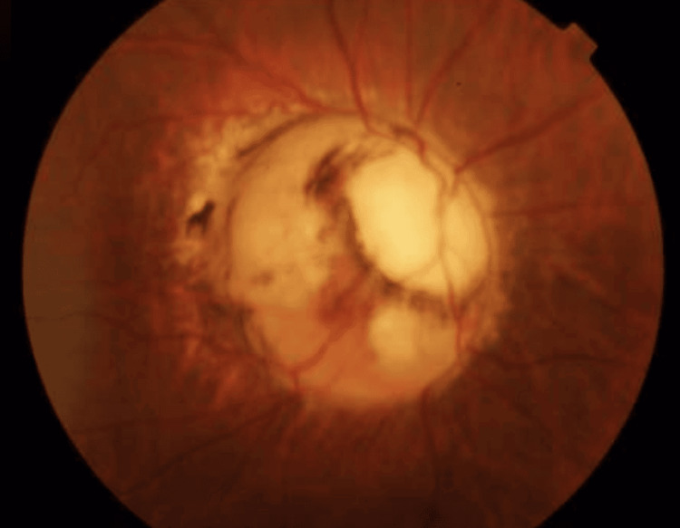
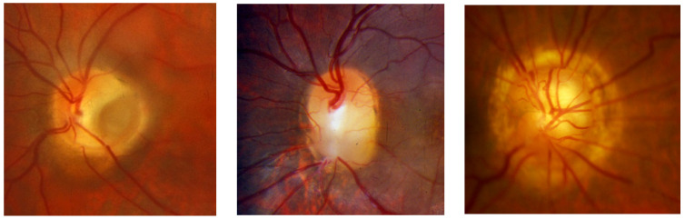
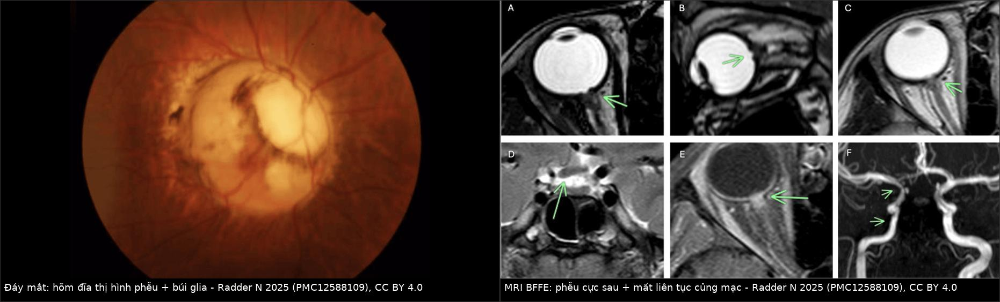
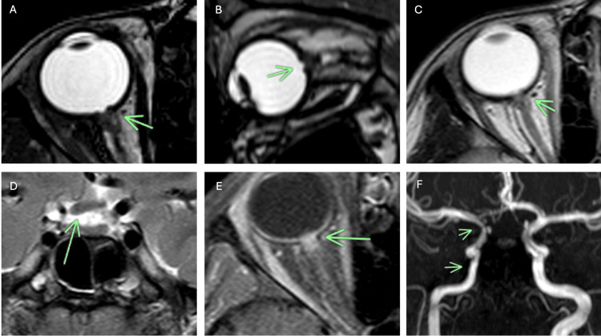
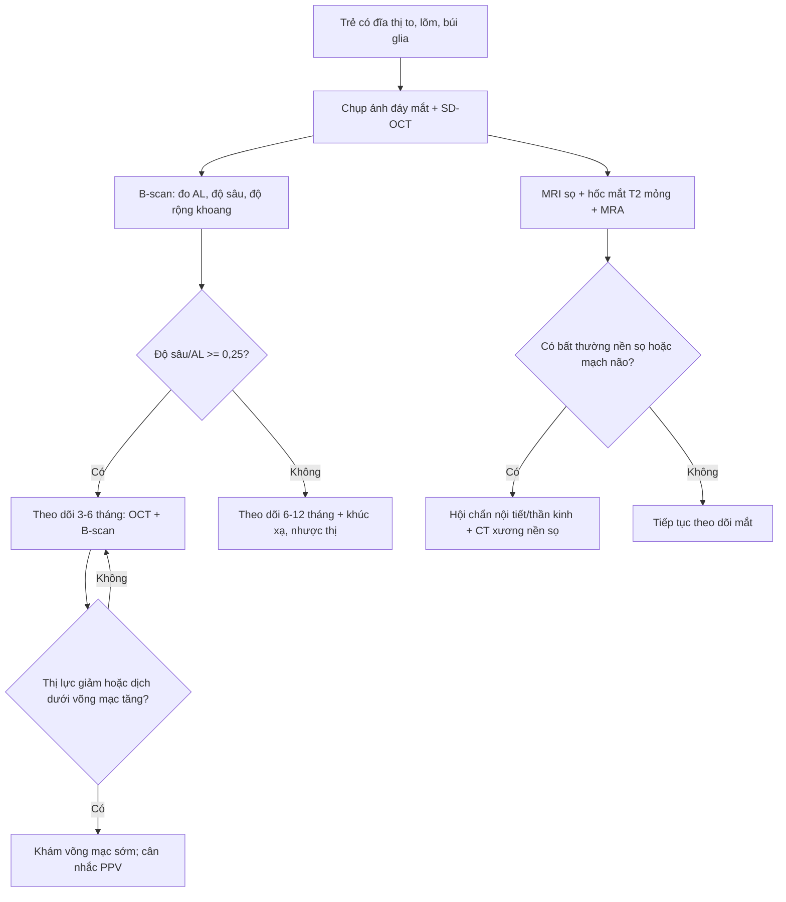
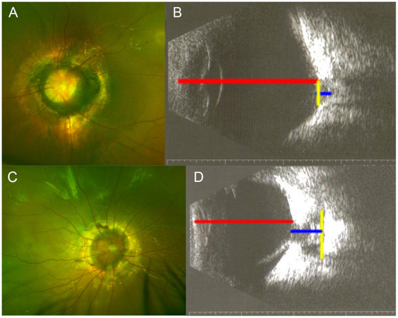
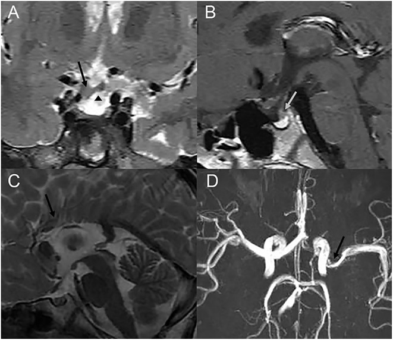

# 417 — Hội chứng Morning Glory: hõm đĩa thị hình phễu và bất thường nền sọ đường giữa / Morning glory disc anomaly (MGDA)

**Tags:** `pattern:hong-dia-thi` `pattern:di-tat-dia-thi` `pattern:khuyet-cuc-sau` `vung:mat` `vung:nhan-cau` `vung:tre-em` `vung:nen-so` `protocol:MRI-hoc-mat` `protocol:MRA` `protocol:B-scan`
**Mức chắc chắn (certainty):** tổng hợp y văn (literature synthesis) — tổng hợp 1 đoàn hệ 249 trẻ (271 mắt) có siêu âm định lượng, 1 ca MRI–MRA mô tả đủ bộ ba dấu hiệu, 1 tổng quan đa phương thức và 1 ca Moyamoya; số liệu lấy từ toàn văn, không lấy từ abstract.

## 1. Tổng quan — vì sao đĩa thị "nở như hoa" lại là bệnh của củng mạc sau và nền sọ

- **Bệnh học (pathology):** Morning Glory (MGDA) là dị tật **hõm đĩa thị có khoang** (cavitary disc anomaly): đĩa thị **to, lõm sâu hình phễu**, có **búi glia trắng ở trung tâm**, **mạch võng mạc tỏa tia từ mép đĩa** và **quầng sắc tố hắc–võng mạc quanh đĩa**. Tên gọi do Kindler 1970 vì giống hoa bìm bìm buổi sáng.

*Đáy mắt mắt phải của bệnh nhi 3 tuổi: đĩa **to và lõm**, **búi mô glia trắng** ở trung tâm, **mạch võng mạc tỏa đều ra mép**; võng mạc quanh đĩa bị nâng nhẹ. Nguồn: Radder N, Radder S, Cureus 2025 (PMC12588109) Fig. 1, CC BY 4.0.*
- **Cơ chế:** giả thuyết được ủng hộ nhất là **khiếm khuyết phát triển củng mạc sau và lá sàng** quanh cuống thị, kèm bất thường trung mô thứ phát; hệ quả là **củng mạc – hắc mạc – lá sàng mất liên tục tại chỗ đĩa thị đi vào nhãn cầu**, tạo **phễu lồi ra sau**. Các nghiên cứu OCT gần đây còn thấy **thông thương bất thường giữa khoang dưới nhện và khoang dưới võng mạc** — đây là cơ sở của **bong võng mạc thanh dịch** và của thể **co bóp (contractile)**.
- **TẠI SAO nhìn thấy trên từng phương thức (vật lý):**
  - **Củng mạc = collagen đặc** → **giảm tín hiệu trên mọi chuỗi xung T1/T2**; chỗ **mất liên tục củng mạc** hiện ra như **đoạn đứt của dải tối** quanh nhãn cầu. Đây là dấu chốt phân biệt với phễu do co kéo đơn thuần.
  - **Dịch não tủy (CSF) và dịch kính > 98% là nước** → **T2 rất sáng**; chuỗi **T2 nặng (BFFE/CISS/FIESTA), lát ≤ 1–2 mm** cho tương phản cao giữa **CSF sáng – củng mạc tối – dây thần kinh thị tối**, nên nhìn rõ **phễu, màng võng mạc nâng lên và khoang dưới nhện bị xóa**.
  - **Trên CT:** củng mạc **tăng đậm độ** so với dịch kính (dịch kính gần 0–10 HU), nên CT thấy **củng mạc dày/đứt** và đặc biệt **khiếm khuyết xương nền sọ** — nhưng CT không bằng MRI cho mô mềm hốc mắt.
  - **Siêu âm B-scan 10 MHz:** đo được **độ sâu – độ rộng khoang** và **trục nhãn cầu (axial length, AL)**; đây là phương tiện **định lượng nguy cơ bong võng mạc** rẻ và lặp lại được ở trẻ.
- **Ngưỡng định lượng phải nhớ (đoàn hệ 271 mắt MGDA, Zou 2021):**
  - **Tần suất ~3,6/100.000 trẻ**; **nữ:nam ≈ 2:1**; **hai bên 8,8%** (22/249).
  - **AL 20,25 ± 2,32 mm**; **độ sâu khoang 4,79 ± 2,07 mm**; **độ rộng khoang 5,69 ± 2,20 mm**; **tỷ lệ độ sâu/AL 0,24 ± 0,11**.
  - **Bong võng mạc (retinal detachment, RD): 129/271 mắt = 47,6%**; ở mắt có RD, **độ sâu 5,45 vs 4,24 mm**, **độ sâu/AL 0,28 vs 0,21** (p < 0,001).
  - **Tỷ lệ độ sâu/AL ≥ 0,25 → OR 2,101 (95% CI 1,469–3,003)** cho RD — ngưỡng hành động đơn giản nhất trên siêu âm.
  - **Thị lực kém < 2/200 ở 95/113 mắt (84%)** đo được; **PFV 28%**, **nhãn cầu nhỏ 15%**, **đục thể thủy tinh 8%**, **glaucoma thứ phát 1%**.
  - **Bất thường sọ não:** trong **75/249 trẻ** có MRI/MRA/CT, **8 trẻ (10,7%)** bất thường: **Moyamoya 1**, **hẹp động mạch não 3**, **bất sản thể chai 1**, **nang nhện 1**, **loạn sản tuyến yên 2**. Con số **"45% bất thường mạch máu não"** trong y văn là của **nhóm được chọn chụp mạch**, không dùng để tư vấn cho từng trẻ.

> **Phản biện trung thực:** tần suất bất thường nội sọ dao động rất mạnh giữa các báo cáo (10,7% trong đoàn hệ trên so với 20–45% trong các nhóm chuyên khoa thần kinh–mắt). Vì vậy khuyến cáo đúng là **chụp MRI não + MRA một lần cho mọi trẻ MGDA**, không phải dựa vào một con số phần trăm để quyết định.

## 2. Mẫu hình + chẩn đoán phân biệt theo vị trí (gamut)

- **Mẫu hình A — "đĩa thị to, lõm, có búi trắng và mạch tỏa tia":** Morning Glory điển hình; thể **co bóp** (đĩa thay đổi khi Valsalva/đổi tư thế); **hội chứng Morning Glory kèm PFV** (dây xơ từ đĩa tới bao sau thể thủy tinh).
- **Mẫu hình B — "hõm đĩa thị nhưng không có búi glia – mạch bình thường":** **coloboma đĩa thị** (bờ rõ, thường dưới–mũi, hay kèm coloboma mống mắt/hắc võng mạc); **hố đĩa thị (optic disc pit)** (hố nhỏ xám ở mép đĩa, thường thái dương); **staphyloma quanh đĩa** (đĩa **bình thường** nằm trong hõm lồi ra sau); **thể lai (hybrid cavitary disc anomaly)**.
- **Mẫu hình C — "đĩa thị bất thường + bệnh nền sọ/nội tiết":** **thoát vị não nền sọ (basal encephalocele)**, **bất sản thể chai**, **loạn sản tuyến yên/thiếu hormone tăng trưởng**, **Moyamoya/hẹp động mạch cảnh trong**, **nứt sọ mặt đường giữa**.
- **Gamut theo vị trí (điều tra theo giải phẫu):**
  - **Hốc mắt:** phễu cực sau, bong võng mạc thanh dịch/co kéo, PFV, nhãn cầu nhỏ, nang sau nhãn cầu.
  - **Vùng yên – trên yên:** thoát vị não nền sọ qua xương bướm, tuyến yên lạc chỗ, cuống tuyến yên bất thường.
  - **Đường giữa não:** thể chai, vách trong suốt, hố sau.
  - **Mạch máu não:** Moyamoya, hẹp đoạn xoang hang/trên yên của động mạch cảnh trong, giảm sản A1.
  - **Sọ mặt:** hẹp giữa mặt, sứt môi, dị tật mũi (khi có thoát vị não nền sọ).

## 3. Bảng so sánh phân biệt (ma trận đối chiếu)

| Thực thể (entity) | Hình ảnh điển hình | Chốt vào (rule-in) | Chốt loại (rule-out) | Gợi ý xác nhận |
|---|---|---|---|---|
| **Morning Glory (MGDA)** | Đĩa **to, lõm sâu hình phễu**, **búi glia trắng trung tâm**, **mạch tỏa tia từ mép**, quầng sắc tố quanh đĩa; MRI T2: **phễu + mất liên tục củng mạc** tại cuống thị | **Búi glia trung tâm + mạch tỏa tia + mất liên tục dải củng mạc tối trên T2** | Đĩa **bình thường nằm trong hõm** → staphyloma; **hố nhỏ một điểm** → optic disc pit | Soi đáy mắt + chụp ảnh; B-scan đo khoang; MRI T2 mỏng |
| **Coloboma đĩa thị (optic disc coloboma)** | **Hõm hình bát**, bờ rõ, thường **dưới–mũi**, **mạch bình thường**, không búi glia; hay kèm coloboma mống mắt/hắc–võng mạc | **Khuyết đĩa + khuyết hắc–võng mạc cùng phía + bờ sắc tố** | Có **búi glia + mạch tỏa tia** → MGDA; đĩa nguyên vẹn → staphyloma | Soi đáy mắt, OCT; gen *PAX2/CHD7* khi có hội chứng |
| **Hố đĩa thị (optic disc pit)** | **Hố nhỏ, xám, giới hạn rõ** ở mép đĩa (thường thái dương), phần còn lại của đĩa bình thường | **Hố khu trú một điểm + đĩa còn lại bình thường** | **Toàn bộ đĩa lõm hình phễu** → MGDA; khuyết bờ rõ → coloboma | OCT đĩa; theo dõi dịch dưới võng mạc hoàng điểm |
| **Staphyloma quanh đĩa (peripapillary staphyloma)** | **Đĩa thị bình thường** nằm trong **hõm lồi ra sau rộng**, không có khuyết mô đĩa | **Đĩa nguyên vẹn + hõm quanh đĩa + mạch đi qua bình thường** | **Mất mô đĩa/búi glia** → MGDA hoặc coloboma | MRI T2, OCT đĩa; so mắt lành |
| **PFV giả Morning Glory (pseudo-MGDA)** | Phễu do **dây xơ co kéo** từ đĩa tới bao sau thể thủy tinh; **có mạch trong dây** trên Doppler | **Dây xơ + nhãn cầu nhỏ + không có mất liên tục củng mạc kiểu MGDA** | **Mất liên tục củng mạc + búi glia đúng đĩa** → MGDA thật | Siêu âm Doppler, MRI; nội soi/ phẫu thuật |

*Trái → phải: **hố đĩa thị** (hố nhỏ, đĩa còn lại bình thường), **coloboma đĩa thị** (hõm bát, bờ rõ), **Morning Glory** (đĩa to, phễu, búi glia và mạch tỏa tia). Nguồn: Cennamo G và cs, *J Clin Med* 2024 (PMC10932420) Fig. 1, CC BY 4.0.*

*Trái: đáy mắt mắt phải — đĩa to, lõm, búi glia trắng, mạch tỏa tia. Phải: MRI BFFE trục/vành — **phễu cực sau**, **màng võng mạc nâng lên**, **mất liên tục củng mạc** tại cuống thị; các lát D–E còn cho thấy **mô bất thường quanh đoạn cuối dây thị và xóa khoang dưới nhện**, F là MRA với **hẹp động mạch cảnh trong cùng bên**. Nguồn: Radder N, Radder S, *Cureus* 2025 (PMC12588109) Fig. 1–2, CC BY 4.0. Ảnh ghép letterbox, không crop.*

### Ba dấu hiệu MRI của MGDA (đọc theo thứ tự)
1. **Phễu cực sau:** đĩa thị lõm sâu ra sau, **màng võng mạc nâng lên** quanh phễu — thấy rõ nhất trên **T2 nặng trục và vành**.
2. **Mất liên tục củng mạc – hắc mạc – lá sàng** tại chỗ dây thị đi vào nhãn cầu: dải **giảm tín hiệu** bị đứt; đây là dấu **phân biệt với coloboma đơn thuần**.
3. **Mô bất thường quanh đoạn cuối dây thị** (glia/xơ/mô hắc mạc lạc chỗ) **xóa khoang dưới nhện**, có thể **ngấm thuốc** sau tiêm — không được gọi là u.

## 4. Protocol chụp + phân tầng nguy cơ

- **Đáy mắt + chụp ảnh màu + SD-OCT đĩa/hoàng điểm** ở mọi ca nghi ngờ; OCT giúp tìm **dịch dưới võng mạc, lỗ ở mép phễu, màng trước võng mạc**.
- **Siêu âm B-scan 10 MHz (chuẩn hóa):** đo **AL tới mép khoang** (không cộng độ sâu khoang), **độ sâu tối đa**, **độ rộng tối đa**; tính **độ sâu/AL**. Đây là **ngưỡng phân tầng**: **≥ 0,25 → nguy cơ RD cao (OR 2,10)**, theo dõi sát 3–6 tháng/lần.
- **MRI sọ + hốc mắt (bắt buộc một lần):**
  - **T2 nặng BFFE/CISS/FIESTA, lát ≤ 1–2 mm**, trục + vành qua dây thị;
  - **T1 không/ có fat-sat trước và sau tiêm** (tìm mô lạc chỗ, loại u);
  - **MRA TOF** hoặc CTA nếu nghi hẹp mạch/Moyamoya;
  - **CT sọ lát mỏng** khi nghi **thoát vị não nền sọ** (cần thấy khuyết xương bướm).

*(A–E) MRI BFFE trục/vành qua hốc mắt: **phễu cực sau** (mũi tên), **võng mạc kế cận nâng lên**, **mô bất thường quanh đoạn xa dây thị xóa khoang dưới nhện**, **mất liên tục củng mạc**; (F) MRA: hẹp ICA phải và A1 phải giảm sản. Nguồn: Radder N, Radder S, Cureus 2025 (PMC12588109) Fig. 2, CC BY 4.0.*
- **Tầm soát nội tiết** khi MRI có bất thường tuyến yên/cuống: **GH, IGF-1, prolactin, TSH/fT4, cortisol sáng** — vì **thiếu GH** là bất thường nội tiết hay gặp nhất.
- **Sàng lọc di truyền:** MGDA **hầu như lẻ tẻ**, nguy cơ tái phát thấp; chỉ xét gen khi có **dị tật đường giữa/hội chứng** (CHARGE, PAX2...) — khác coloboma đĩa thị có thể di truyền.

## 5. Biến thể bình thường và cạm bẫy

- **Thể co bóp (contractile MGDA):** đĩa **thay đổi hình dạng khi đổi tư thế/Valsalva** — dễ bị đọc nhầm là **u hoặc giả phình**; cơ chế được giải thích bằng **dòng dịch qua thông thương dưới nhện–dưới võng mạc** hoặc cơ trơn lạc chỗ. Chụp **2 tư thế** và so sánh giúp tránh can thiệp oan.
- **Bẫy siêu âm:** nếu **cộng độ sâu khoang vào AL**, AL bị **dài giả** và tỷ lệ độ sâu/AL bị **thấp giả** → đánh giá nguy cơ RD sai. Luôn đo AL **tới mép khoang** như mô tả gốc.
- **Bẫy MRI:** lát **> 3 mm** hoặc **không có T2 nặng** làm mất dấu **đứt củng mạc**; phễu có thể bị bỏ qua nếu chỉ đọc mặt cắt trục thường quy.
- **Satisfaction of search:** thấy tổn thương mắt rồi dừng — **bỏ sót thoát vị não nền sọ, Moyamoya, u tuyến yên**. Đây là lý do **MRI não + MRA là một phần của chẩn đoán**, không phải "chụp thêm".
- **Nhầm coloboma ↔ Morning Glory:** coloboma có thể **di truyền/hội chứng** (PAX2, CHARGE) và có nguy cơ khác; MGDA **lẻ tẻ** — tư vấn di truyền sai nếu chỉ nhìn "đĩa lõm".
- **"Phù đĩa thị" ở trẻ":** phễu MGDA có thể bị đọc là **phù gai/viêm thị**; OCT và MRI phân biệt được.
- **Bong võng mạc thanh dịch tự khỏi rồi tái phát:** không được chọc dẫn lưu mù; cần OCT tìm lỗ/màng co kéo trước khi mổ.

## 6. Tự lượng giá — Blind Quiz

**Ca 1 — Bé gái 3 tuổi, mắt phải nhìn kém, lác ngoài 15 độ. Ba ảnh đáy mắt dưới đây là ba thể khác nhau.**

- Câu hỏi: Ảnh nào là Morning Glory? Ba dấu hiệu nào bắt buộc phải có? Hai thể còn lại khác ở điểm nào?

<b>Bấm để hiện đáp án</b>

- **Ảnh phải** là Morning Glory: đĩa **to – lõm sâu**, **búi glia trắng trung tâm**, **mạch tỏa tia từ mép**, quầng sắc tố quanh đĩa.
- **Ảnh trái** = hố đĩa thị: hố nhỏ khu trú, phần đĩa còn lại bình thường. **Ảnh giữa** = coloboma đĩa thị: hõm bát, bờ rõ, mạch bình thường, không búi glia.
- Nguồn: Cennamo G và cs, *J Clin Med* 2024 (PMC10932420) Fig. 1, CC BY 4.0.

**Ca 2 — Bé trai 2 tuổi, MGDA mắt trái. Siêu âm B-scan dưới đây (A–B không có bong võng mạc; C–D có bong võng mạc).**

- Câu hỏi: Đo gì trên ảnh? Tỷ lệ nào dự báo bong võng mạc? Vì sao AL phải đo tới mép khoang?

<b>Bấm để hiện đáp án</b>

- Đo **AL (đường đỏ)**, **độ sâu khoang (xanh)** và **độ rộng khoang (vàng)**; tính **độ sâu/AL**.
- **Độ sâu/AL ≥ 0,25 → OR 2,101 (95% CI 1,469–3,003)** cho bong võng mạc; ở đoàn hệ 271 mắt, **47,6% có bong võng mạc**, độ sâu trung bình **5,45 mm** ở nhóm bong so với **4,24 mm** ở nhóm không bong.
- AL phải đo **tới mép khoang**, không cộng độ sâu khoang — nếu cộng, AL dài giả và tỷ lệ nguy cơ thấp giả.
- Nguồn: Zou Y và cs, *Front Med* 2021 (PMC8818885) Fig. 2 và kết quả, CC BY 4.0.

**Ca 3 — Cùng đoàn hệ trên: 3 trẻ MGDA có bất thường trên MRI/MRA sọ (A–D).**

- Câu hỏi: A–D lần lượt là gì? Vì sao mọi trẻ MGDA cần MRI não + MRA dù mắt chỉ một bên?

<b>Bấm để hiện đáp án</b>

- **A–B:** T2 vành + T1 sagittal — **giao thoa thị dày**, **tuyến yên lạc chỗ**, **cuống tuyến yên bất thường** ở trẻ **thiếu hormone tăng trưởng**. **C:** **bất sản thân thể chai**. **D:** MRA — **hẹp đoạn M1 động mạch não giữa trái**.
- MGDA là bất thường **trung mô/đường giữa**, không chỉ của mắt: trong 75 trẻ có chụp sọ, **8 (10,7%)** có bất thường (Moyamoya, hẹp mạch, bất sản thể chai, nang nhện, loạn sản tuyến yên). Bỏ sót = bỏ lỡ **nguy cơ đột quỵ, thiếu hormone, viêm màng não do thoát vị não nền sọ**.
- Nguồn: Zou Y và cs, *Front Med* 2021 (PMC8818885) Fig. 4, CC BY 4.0.

## Bài liên quan chéo
- [400 – Tổng quan Mắt & thị giác](../400-tong-quan-mat-thi-giac/lesson.md)
- [415 – Phổ nhãn cầu nhỏ – coloboma (MAC)](../415-phe-nhan-cau-nho-coloboma/lesson.md)
- [411 – Siêu âm nhãn cầu](../411-sieu-am-nhan-cau/lesson.md)
- [413 – PFV/PHPV: dây xơ dịch kính](../413-PFV-PHPV-day-xo-the-thuy-tinh/lesson.md)
- [432 – Vùng yên & bất thường tuyến yên](../432-vung-yen/lesson.md)
- [652 – Đột quỵ mạch máu não ở trẻ: Moyamoya & viêm mạch](../652-dot-quy-mach-mau-nao-nhi-moyamoya-viem-mach/lesson.md)

> Không dùng để chẩn đoán độc lập khi chưa có người hướng dẫn.
