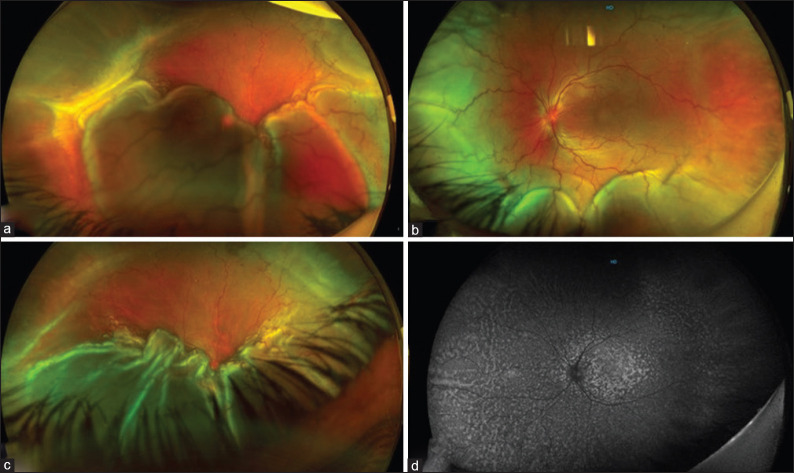
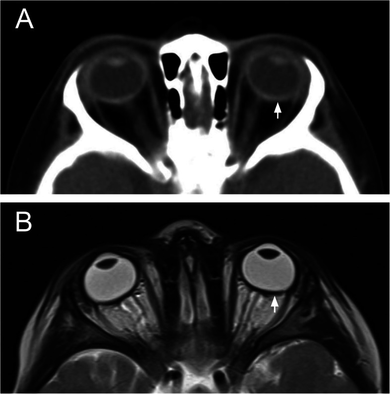
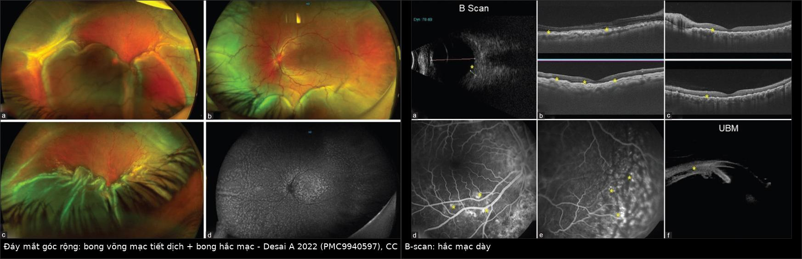
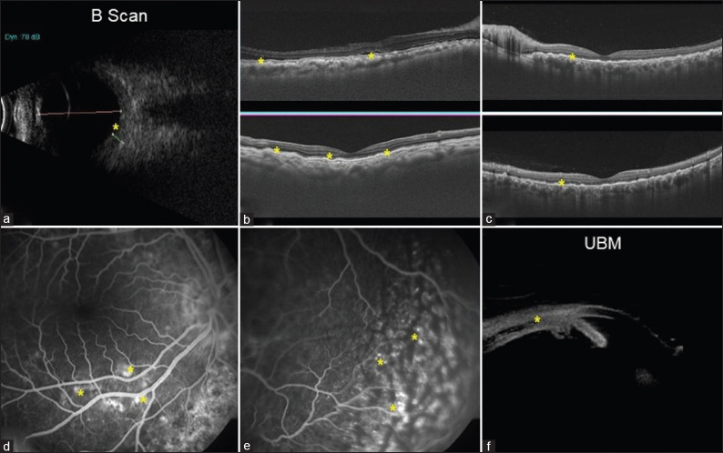
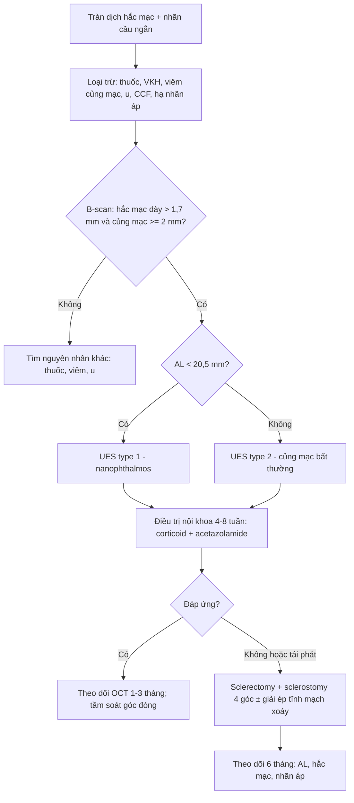
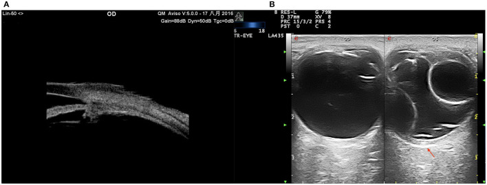

# 418 — Nanophthalmos & hội chứng tràn dịch hắc mạc: mắt nhỏ, củng mạc dày, dịch thoát không được / Nanophthalmos & uveal effusion syndrome (UES)

**Tags:** `pattern:nhan-cau-ngan` `pattern:cung-mac-day` `pattern:tran-dich-hac-mac` `pattern:bong-vong-mac-tiet-dich` `vung:mat` `vung:cung-mac` `vung:hac-mac` `vung:nhan-cau` `protocol:B-scan` `protocol:UBM` `protocol:MRI-hoc-mat` `protocol:OCT-EDI`
**Mức chắc chắn (certainty):** tổng hợp y văn (literature synthesis) — 1 đoàn hệ phẫu thuật 106 mắt (Front Med 2022), 1 loạt 25 mắt có thuật toán điều trị (Indian J Ophthalmol 2022), 1 ca CT–MRI nanophthalmos (BMC Ophthalmol 2020), 1 ca đơn (Case Rep Ophthalmol 2024), 1 tổng quan hệ thống về phẫu thuật củng mạc (Graefes Arch 2025) và 1 phân tích gộp glaucoma (2025). Số liệu lấy từ toàn văn/bảng, không lấy từ abstract.

## 1. Tổng quan — vì sao "mắt nhỏ" lại ứ dịch sau hắc mạc

- **Định nghĩa (phải nhớ bằng số):**
  - **Nanophthalmos:** **trục nhãn cầu (axial length, AL) < 20,5 mm** (một số tác giả dùng **< 20 mm**), kèm **viễn thị cao > +5 D** (tiêu chuẩn chọn bệnh hay dùng **> +7 D**) và/hoặc **giác mạc nhỏ (microcornea)**, **tiền phòng nông (ACD < 2,2 mm)**; mắt **nhỏ nhưng cấu trúc nhãn cầu về cơ bản đủ thành phần**.
  - **Nanophthalmos phức tạp (complex):** kèm dị tật khác (coloboma, PFV, hội chứng di truyền — *MFRP*, *PRSS56*, *TMEM98*, *MYRF*).
  - **Hội chứng tràn dịch hắc mạc (uveal effusion syndrome, UES):** **tràn dịch vào khoang trên hắc mạc (suprachoroidal)** gây **bong hắc mạc (choroidal detachment)** + **bong võng mạc tiết dịch (exudative retinal detachment)**, tái phát, **không có nguyên nhân viêm/u/toàn thân rõ** — là **chẩn đoán loại trừ**.
  - **Phân loại UES:** **type 1** — có nanophthalmos; **type 2** — AL bình thường nhưng **củng mạc bất thường**; **type 3** — AL và củng mạc bình thường (một số tác giả gộp type 2–3).
- **Cơ chế (pathophysiology) — TẠI SAO dịch ứ lại:**
  - Củng mạc nanophthalmos **dày, collagen xếp rối loạn, lắng đọng proteoglycan/GAG** → **tăng trở lực thoát dịch xuyên củng mạc** và **chèn ép tĩnh mạch xoáy (vortex veins)**.
  - Hệ quả: **ứ máu hắc mạc → tăng tính thấm → dịch protein cao vào khoang trên hắc mạc**; hắc mạc **dày** (trung bình **1,74 ± 0,38 mm** trên B-scan), củng mạc **dày 2,1–3,2 mm** trên siêu âm màu (color Doppler ultrasound).
  - Vòng xoắn bệnh sinh: hắc mạc dày + củng mạc cứng → **góc tiền phòng hẹp → glaucoma góc đóng**; mổ nội nhãn trên mắt này dễ **bùng phát tràn dịch và glaucoma ác tính**.
- **TẠI SAO nhìn thấy trên từng phương thức (vật lý):**
  - **CT:** củng mạc là **collagen đặc → tăng đậm độ** (khoảng 80–120 HU, cao hơn nhiều so với dịch kính 0–10 HU) → thấy **dải củng mạc dày** và **AL ngắn**. CT không cần gây mê dài nhưng có bức xạ.
  - **MRI T2:** củng mạc **giảm tín hiệu** (collagen ít proton tự do), **dịch (nước) tăng tín hiệu mạnh** → **dải tối dày** quanh nhãn cầu + **dịch sáng** dưới hắc mạc/dưới võng mạc; trên **T1**, củng mạc tối, **mỡ hốc mắt sáng** nên dễ đo độ dày củng mạc.
  - **Siêu âm B-scan 10 MHz:** dịch trên hắc mạc **không hồi âm**, đẩy hắc mạc vào trong → **bong hắc mạc hình vòm**; đo **độ dày hắc mạc** và **độ dày củng mạc**; đây là phương tiện **theo dõi điều trị** chính.
  - **UBM 35–50 MHz:** phân giải cao, thấy **phù thể mi, dịch quanh thể mi, góc tiền phòng hẹp** — nơi B-scan 10 MHz không đủ phân giải.
  - **OCT EDI (enhanced depth imaging):** đo **độ dày hắc mạc dưới hoàng điểm**, thấy **dịch dưới võng mạc, nếp gấp võng mạc, dải dưới võng mạc**; nhưng **không xuyên qua củng mạc dày** để đo củng mạc.
- **Ngưỡng định lượng phải nhớ:**
  - **Tần suất UES: 1,2/10.000.000 người/năm** (ước tính Anh) — bệnh rất hiếm nhưng **không được bỏ sót vì mù hai mắt**.
  - **Glaucoma ở nanophthalmos: 51,88% (95% CI 33,33–70,43)** — phân tích gộp **44 nghiên cứu, 1.397 mắt**; **AL càng ngắn càng nguy cơ** (meta-regression).
  - **Type 1:** AL **15,83 ± 1,45 mm**, viễn thị **+12,6 D**; **type 2:** AL **23,45 ± 1,68 mm** (Zhou 2022, 106 mắt).
  - **Phẫu thuật củng mạc:** **96,2% thành công sau 1 lần mổ**, **98,1% dính lại trong 6 tháng**, **100% sau 1–2 lần** (Zhou 2022).
  - **Ca minh họa:** nam 59 tuổi, **+17,25 D**, **AL 16,28 mm (P) / 16,12 mm (T)**, **hắc mạc dưới hoàng điểm 607/594 µm** — gấp đôi–ba lần bình thường.

## 2. Mẫu hình + chẩn đoán phân biệt theo vị trí (gamut)

- **Mẫu hình A — "nhãn cầu ngắn, tiền phòng nông, góc đóng":** nanophthalmos đơn thuần, **nanophthalmos + glaucoma góc đóng cấp/tái diễn**, **glaucoma ác tính sau mổ**.
- **Mẫu hình B — "bong hắc mạc + bong võng mạc tiết dịch, không đau":** **UES type 1** (nanophthalmos) hoặc **type 2** (AL bình thường, củng mạc dày); **bong hắc mạc tự phát**; **bong thanh dịch sau mổ nội nhãn**.
- **Mẫu hình C — "bong võng mạc tiết dịch hai bên + viêm":** **VKH (bệnh Vogt–Koyanagi–Harada)**, **viêm củng mạc sau (posterior scleritis)**, **viêm màng bồ đào** — có viêm, đau, dấu hiệu toàn thân.
- **Mẫu hình D — "dịch dưới hắc mạc do thuốc/thủ thuật":** **topiramate**, **acetazolamide**, **brimonidine**, **hydrochlorothiazide**; sau **phaco/trabeculectomy**; **hạ nhãn áp (hypotony)**; **rò động mạch cảnh – xoang hang (CCF)**.
- **Gamut theo vị trí:**
  - **Củng mạc:** dày bẩm sinh (nanophthalmos), viêm củng mạc sau, xơ hóa sau xạ, sau đai củng mạc.
  - **Khoang trên hắc mạc:** tràn dịch (UES, thuốc, sau mổ, viêm), máu (chấn thương), u (melanoma lan tỏa).
  - **Hắc mạc:** dày (pachychoroid, UES), u (melanoma, di căn, lymphoma), viêm (VKH).
  - **Võng mạc:** bong tiết dịch, nếp gấp hoàng điểm, **"leopard spot"** ở RPE (UES mạn).
  - **Thể mi/góc:** phù thể mi, góc hẹp, **glaucoma ác tính**.

*(a) Bong võng mạc tiết dịch; (b) bong võng mạc kèm bong hắc mạc; (c) nếp gấp võng mạc và thay đổi sắc tố RPE; (d) FAF "leopard spot". Nguồn: Desai A và cs, Indian J Ophthalmol 2022 (PMC9940597) Fig. 2, CC BY-NC-SA 4.0.*

## 3. Bảng so sánh phân biệt (ma trận đối chiếu)

| Thực thể (entity) | Hình ảnh điển hình | Chốt vào (rule-in) | Chốt loại (rule-out) | Gợi ý xác nhận |
|---|---|---|---|---|
| **Nanophthalmos + UES type 1** | **AL < 20,5 mm** + **giác mạc nhỏ** + **hắc mạc dày** + **củng mạc dày**; bong hắc mạc vòm + bong võng mạc tiết dịch; **"leopard spot"** ở RPE khi mạn | **AL ngắn + củng mạc ≥ 2 mm trên siêu âm + dịch trên hắc mạc, không viêm** | **AL bình thường + củng mạc mỏng** → không phải type 1; **có viêm/đau** → VKH/viêm củng mạc | B-scan + UBM + AL bằng IOL Master; OCT EDI; loại trừ nguyên nhân |
| **UES type 2 (không nanophthalmos)** | **AL ≥ 21 mm** nhưng **củng mạc dày, tĩnh mạch thượng củng mạc giãn**, bong hắc mạc/võng mạc tiết dịch tái phát | **Củng mạc dày + AL bình thường + không nguyên nhân khác** | **AL ngắn** → type 1; **viêm/toàn thân** → bệnh khác | Siêu âm màu đo củng mạc; B-scan; đáp ứng với mổ củng mạc |
| **VKH (bệnh Vogt–Koyanagi–Harada)** | **Bong võng mạc thanh dịch hai bên**, đĩa thị sung huyết, **hắc mạc dày lan tỏa**, tiền phòng có tế bào; **đau đầu, ù tai, cứng gáy** | **Bệnh cảnh viêm + tổn thương hai bên + đáp ứng corticoid nhanh** | **Không viêm, không đau, AL ngắn, củng mạc dày** → UES | Khám mắt + OCT/FA/ICGA; xét nghiệm viêm; hỏi triệu chứng toàn thân |
| **Viêm củng mạc sau (posterior scleritis)** | **Củng mạc/hắc mạc dày khu trú**, **dấu T (T-sign)** trên B-scan, dịch dưới võng mạc, **đau khi liếc** | **Đau + T-sign + dày củng mạc khu trú + đáp ứng NSAID/corticoid** | **Không đau, dày đối xứng, AL ngắn** → UES | B-scan, MRI hốc mắt; CRP/ESR; thử điều trị |
| **Tràn dịch do thuốc (topiramate...)** | **Cận thị cấp hai bên**, tiền phòng nông, **bong hắc mạc/võng mạc thanh dịch**, **AL không ngắn** | **Khởi phát sau khởi trị thuốc vài ngày–tuần + cận thị cấp + hết khi ngừng thuốc** | **AL < 20,5 mm + củng mạc dày** → nanophthalmos/UES | Hỏi thuốc; theo dõi sau ngừng; siêu âm |
| **Glaucoma ác tính sau mổ** | **Tiền phòng dẹt/flat + nhãn áp cao**, thể thủy tinh – mống mắt bị đẩy ra trước, **không có bong hắc mạc** | **Tiền phòng dẹt + IOP cao sau mổ nội nhãn** | **Có bong hắc mạc/dịch trên hắc mạc** → UES | UBM xác định thể mi, tiền phòng; hỏi mổ gần đây |

*CT trục (a): **củng mạc tăng đậm độ** (mũi tên trắng) và nhãn cầu ngắn; MRI T2 trục (b): **củng mạc giảm tín hiệu dày** (mũi tên trắng) — cùng một bệnh nhi 3 tuổi có **AL 18,1/18,3 mm**, giác mạc nhỏ, thể thủy tinh to. Nguồn: Hagedorn J và cs, *BMC Ophthalmol* 2020 (PMC7528587) Fig. 2, CC BY 4.0.*

*Trái: **bong võng mạc tiết dịch** + **bong hắc mạc** (b), **nếp gấp võng mạc và thay đổi sắc tố RPE** (c), FAF "leopard spot" (d). Phải: **B-scan** đo hắc mạc dày (a), **OCT** dịch dưới võng mạc và nếp gấp (b–c), **FFA** điểm rò (d–e), **UBM** dịch thể mi ngoại vi (f). Nguồn: Desai A và cs, *Indian J Ophthalmol* 2022 (PMC9940597) Fig. 2–3, CC BY-NC-SA 4.0. Ảnh ghép letterbox, không crop.*

### Ba câu hỏi định vị (đọc theo thứ tự)
1. **Nhãn cầu có ngắn thật không?** Đo **AL bằng quang học (IOL Master)** — không dựa vào B-scan vì đầu dò có thể **ấn giác mạc** làm AL ngắn giả.
2. **Củng mạc có dày không?** **Siêu âm màu/B-scan ≥ 2 mm** hoặc MRI T2 dải tối dày; nếu củng mạc mỏng → tìm nguyên nhân khác (thuốc, viêm, CCF).
3. **Có viêm hay không?** Đau, tiền phòng có tế bào, T-sign, triệu chứng toàn thân → **VKH/viêm củng mạc**, không phải UES.

## 4. Protocol chụp + thuật toán điều trị

- **Đo sinh trắc (bắt buộc):** **IOL Master/ Lenstar** — AL, ACD, độ dày thể thủy tinh, giác mạc ngang (WTW); **công thức IOL phải chọn loại phù hợp mắt cực ngắn** (Hoffer Q/Holladay 2), không dùng công thức mặc định.
- **Siêu âm:**
  - **B-scan 10 MHz:** hắc mạc dày, bong hắc mạc, bong võng mạc, dịch dưới võng mạc; đo **độ dày hắc mạc dưới hoàng điểm** và **độ dày củng mạc**.
  - **UBM 35–50 MHz:** độ dày thể mi, **dịch quanh thể mi**, **góc tiền phòng**, vị trí thể thủy tinh – mống mắt.
  - **Siêu âm màu (CDU):** đo **độ dày củng mạc 2,1–3,2 mm**, đánh giá tĩnh mạch xoáy.
- **OCT EDI:** độ dày hắc mạc, dịch dưới võng mạc, nếp gấp hoàng điểm; theo dõi đáp ứng điều trị.

*(a) B-scan: **hắc mạc dày**; (b–c) OCT: **dịch dưới võng mạc và nếp gấp**; (d–e) FFA: điểm rò; (f) UBM: **bong hắc mạc ngoại vi + phù thể mi**. Nguồn: Desai A và cs, *Indian J Ophthalmol* 2022 (PMC9940597) Fig. 3, CC BY-NC-SA 4.0.*
- **MRI hốc mắt** (khi cần): **T2 mỏng ≤ 2 mm** + **T1 ± fat-sat sau tiêm** — đo AL, độ dày củng mạc, loại u/viêm; **không dùng MRI để thay B-scan** trong theo dõi.
- **CT** chỉ khi nghi tổn thương xương/hốc mắt hoặc trẻ nhỏ không hợp tác; **hạn chế** vì bức xạ.
- **Loại trừ nguyên nhân thứ phát trước khi gọi UES:** thuốc (topiramate, acetazolamide, brimonidine, HCTZ), VKH, viêm củng mạc sau, u hắc mạc, CCF, hạ nhãn áp, sau mổ.

- **Thuật toán điều trị:**

- **Điều trị nội khoa:** corticoid tại chỗ/toàn thân, **acetazolamide**, **mannitol** khi nhãn áp cao; cycloplegic; điều trị góc đóng cấp.
- **Điều trị phẫu thuật:** **cắt củng mạc lá + mở củng mạc (lamellar sclerectomy + sclerostomy)** ở 4 góc, hoặc **giải ép tĩnh mạch xoáy**; chỉ định khi **không đáp ứng nội khoa hoặc tái phát**.
- **Trước mổ nội nhãn ở nanophthalmos:** tư vấn nguy cơ **tràn dịch hắc mạc, glaucoma ác tính, bong võng mạc**; cân nhắc **cắt củng mạc dự phòng** (bằng chứng còn hạn chế, chủ yếu ca loạt).

## 5. Biến thể bình thường và cạm bẫy

- **AL đo bằng B-scan bị ngắn giả:** đầu dò **ấn vào giác mạc** hoặc đo **lệch trục** → AL nhỏ hơn thật, dễ chẩn đoán quá mức nanophthalmos và **chọn sai công suất IOL**. Luôn đo lại bằng **quang học**.
- **Nhầm hắc mạc dày với "khối hắc mạc":** trên B-scan, hắc mạc dày đối xứng + không có ranh giới u; nếu **hồi âm thấp, bờ rõ, có mạch nuôi** → nghĩ u (melanoma/lymphoma), cần MRI.
- **Nhầm UES với VKH:** VKH **đau đầu, ù tai, cứng gáy, đĩa sung huyết, tiền phòng có tế bào**, đáp ứng corticoid rất nhanh; UES **không viêm**, củng mạc dày, AL ngắn.
- **Bỏ sót tràn dịch do thuốc:** bệnh nhân dùng **topiramate** có thể đến với **cận thị cấp hai bên** và tiền phòng nông; **ngừng thuốc** là điều trị chính, không mổ.
- **"Glaucoma ác tính" sau mổ:** **tiền phòng dẹt + nhãn áp cao** — khác UES (có dịch trên hắc mạc); xử trí bằng **atropine, cycloplegic, phá hủy thể mi** theo phác đồ, không chọc dịch.
- **Tái phát muộn:** UES có thể tái phát **nhiều năm** sau mổ; theo dõi dài hạn bằng OCT/B-scan, đừng coi là "đã khỏi".
- **Bỏ sót mắt thứ hai:** bệnh thường **hai bên không đối xứng**; khám và đo **cả hai mắt** ngay từ đầu.

## 6. Tự lượng giá — Blind Quiz

**Ca 1 — Bé trai 3 tuổi, đau đầu, nhìn kém; CT và MRI dưới đây.**

- Câu hỏi: Nhãn cầu có gì bất thường? Củng mạc tăng/giảm tín hiệu vì sao? Chẩn đoán và nguy cơ nhãn áp?

<b>Bấm để hiện đáp án</b>

- **Nhãn cầu ngắn** (AL 18,1 mm OD, 18,3 mm OS), **giác mạc nhỏ**, **thể thủy tinh to**; **củng mạc dày**: **tăng đậm độ trên CT** (a) và **giảm tín hiệu trên T2** (b) vì củng mạc là collagen đặc, ít nước.
- Chẩn đoán: **nanophthalmos** (kèm đột biến *MYRF* trong ca gốc); nguy cơ **glaucoma góc đóng** — bệnh nhi đã có cơn **53–60 mmHg**, đáp ứng thuốc.
- Nguồn: Hagedorn J và cs, *BMC Ophthalmol* 2020 (PMC7528587) Fig. 2, CC BY 4.0.

**Ca 2 — Bệnh nhân UES type 2: UBM (A) và siêu âm màu (B).**

- Câu hỏi: Mũi tên đỏ chỉ gì? Vì sao phải đo củng mạc chứ không chỉ đo hắc mạc?

<b>Bấm để hiện đáp án</b>

- (A) **UBM**: **phù/dịch thể mi**, củng mạc dày, góc tiền phòng hẹp. (B) **Siêu âm màu**: **bong hắc mạc hình vòm**, **củng mạc dày** (mũi tên đỏ).
- Củng mạc dày (2,1–3,2 mm) là **bản chất bệnh** (tăng trở lực thoát dịch xuyên củng mạc) và là **đích của phẫu thuật cắt củng mạc**; chỉ đo hắc mạc sẽ bỏ lỡ type 2 (AL bình thường nhưng củng mạc bất thường).
- Nguồn: Zhou N và cs, *Front Med* 2022 (PMC9218343) Fig. 7, CC BY 4.0.

**Ca 3 — Bệnh nhân 27 tuổi, UES type 1: đáy mắt góc rộng và B-scan/OCT.**

- Câu hỏi: Phân biệt **bong võng mạc tiết dịch** với **bong hắc mạc** trên ảnh. Bước tiếp theo là gì?

<b>Bấm để hiện đáp án</b>

- **Bong võng mạc tiết dịch:** màng võng mạc **di động, trong**, dịch dưới võng mạc; **bong hắc mạc:** vòm **đặc, dày**, màu nâu–xám, **không di chuyển theo tư thế** như võng mạc.
- **B-scan** (a) cho thấy **hắc mạc dày**; **OCT** (b–c) **dịch dưới võng mạc + nếp gấp**; **UBM** (f) **dịch thể mi ngoại vi**.
- Bước tiếp: **loại trừ nguyên nhân thứ phát**, đo AL/củng mạc, điều trị **corticoid ± acetazolamide**; nếu không đáp ứng → **cắt củng mạc + mở củng mạc** (96,2% thành công sau 1 lần mổ).
- Nguồn: Desai A và cs, *Indian J Ophthalmol* 2022 (PMC9940597) Fig. 2–3, CC BY-NC-SA 4.0.

## Bài liên quan chéo
- [400 – Tổng quan Mắt & thị giác](../400-tong-quan-mat-thi-giac/lesson.md)
- [405 – Pachychoroid quanh đĩa thị (PPS)](../405-pachychoroid-quanh-dia-thi-pps/lesson.md)
- [411 – Siêu âm nhãn cầu](../411-sieu-am-nhan-cau/lesson.md)
- [414 – Glaucoma & nhãn cầu nhỏ trong PFV](../414-glaucoma-va-nhan-cau-nho-o-pfv/lesson.md)
- [415 – Phổ nhãn cầu nhỏ – coloboma (MAC)](../415-phe-nhan-cau-nho-coloboma/lesson.md)
- [441 – OCT hoàng điểm](../441-OCT-hoang-diem/lesson.md)
- [442 – Glaucoma trên OCT](../442-glaucoma-OCT/lesson.md)
- [445 – Bong võng mạc](../445-bong-vong-mac/lesson.md)

## Ảnh
- Tên file: `418_<slug>_<Modality>_<SourceID>.jpg`; nguồn + giấy phép từng ảnh trong `images/CREDITS.md`.
- Ảnh từ **CC BY 4.0** và **CC BY-NC-SA 4.0**; ảnh ghép dùng `tools/make_composite.py` (letterbox, không crop).

> Không dùng để chẩn đoán độc lập khi chưa có người hướng dẫn.
