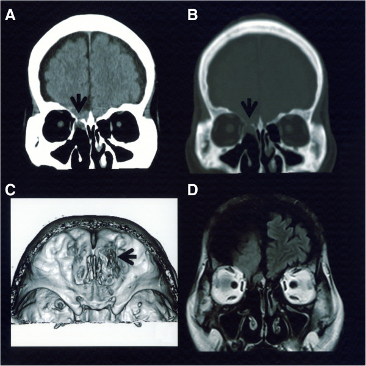
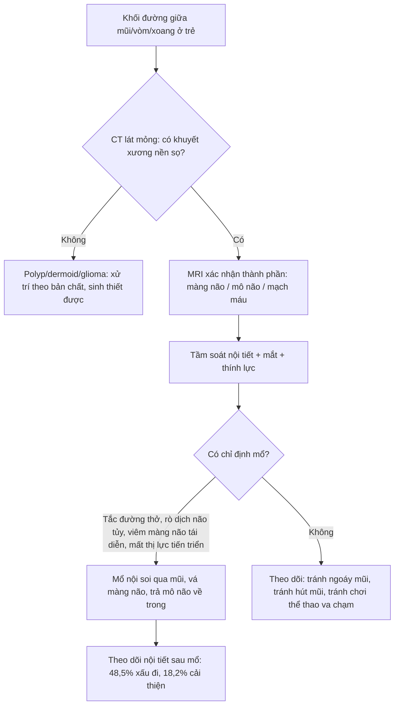
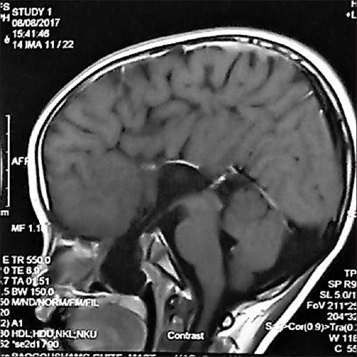
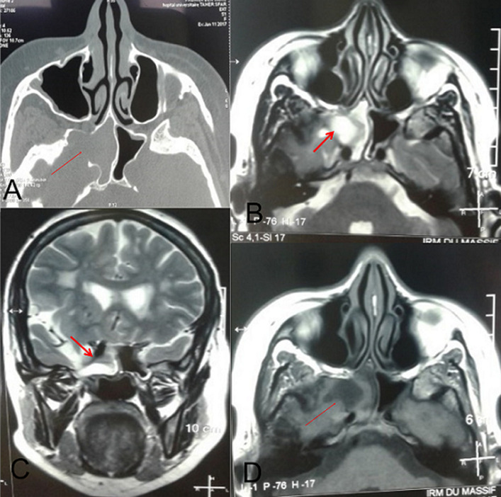

# 419 — Thoát vị não nền sọ ở trẻ (và thể ẩn ở người lớn) / Basal encephalocele in children (and the occult adult form)

**Tags:** `pattern:khuyet-nen-so` `pattern:thoat-vi-nao` `pattern:khoi-duong-giua` `pattern:ro-dich-nao-tuy` `vung:mat` `vung:nen-so` `vung:tre-em` `vung:xoang` `vung:o-mat` `protocol:CT-lat-mong` `protocol:MRI-hoc-mat` `protocol:MRA` `protocol:noi-soi`
**Mức chắc chắn (certainty):** tổng hợp y văn (literature synthesis) — 1 ca trẻ **10 tuổi** thoát vị não qua xoang bướm kèm sứt môi–hở hàm ếch đường giữa (PMC6440357), 1 ca **người lớn 66 tuổi** thể qua xương sàng (PMC3917367), 1 ca **người lớn** thoát vị màng não–não xoang bướm (PMC7755373), và 2 tổng quan hệ thống **49 ca** + **87 ca** thể qua sàn yên (PMC12770197, PMC13066751). Số liệu lấy từ toàn văn/abstract có số; câu suy luận ghi **[suy luận]**.

> **Vì sao bài này quan trọng:** đây là **khối "polyp" ở mũi/họng mà bên trong là NÃO** — **sinh thiết hay cắt bằng thìa là thủng màng não**. Trẻ thường đến với **sứt môi–hở hàm ếch đường giữa**, **chảy nước mũi trong**, **viêm màng não tái diễn**, **chậm phát triển hoặc thiếu hormone tuyến yên**; người lớn đến với **chảy dịch não tủy tự phát + viêm màng não lặp**. Điểm chốt hình ảnh **không phải "khối" mà là "khuyết xương + mô não/dịch não tủy liên tục với nội sọ"**.

## 1. Tổng quan bệnh học – cơ chế hình ảnh

- **Định nghĩa:** **thoát vị não nền sọ (basal encephalocele, BE)** = thoát vị **màng não ± mô não ± dịch não tủy** qua **khuyết xương nền sọ trước** (tấm sàng, xương sàng, thân xương bướm, sàn yên) vào **hốc mũi, xoang bướm, vòm họng hoặc hốc mắt**.
- **Phân loại theo vị trí khuyết xương (dùng trong thực hành):**
  1. **Qua xương sàng (transethmoidal)** — hay gặp ở **người lớn thể ẩn**, biểu hiện **chảy dịch não tủy tự phát + viêm màng não tái diễn**.
  2. **Qua xoang bướm / qua sàn yên (transsphenoidal / trans-sellar)** — hay ở **trẻ**, kèm **dị tật đường giữa mặt** và **rối loạn trục dưới đồi–yên**.
  3. **Qua khe ổ mắt–bướm (spheno-orbital)** — **lồi mắt, lồi mắt đập theo mạch**, giảm thị lực.
  4. **Qua vòm họng (nasopharyngeal)** — khối trong vòm, **tắc đường thở** khi bú/ngủ.
- **TẠI SAO xảy ra (mô bệnh học):** thuyết được chấp nhận rộng nhất là **"neuroschisis" sau khi ống thần kinh đóng** — một khiếm khuyết **trung mô nền sọ** tại điểm đóng cuối cùng của ống thần kinh để lại **khuyết xương + khiếm khuyết màng não**, mô não **bị đẩy ra theo nhịp mạch–hô hấp**. Vì cùng một "cửa sổ" phôi thai nằm ở **đường giữa mặt**, BE **gần như luôn đi kèm** dị tật đường giữa: **sứt môi/hở hàm ếch (Tessier 0)**, **hypertelorism**, **rãnh mũi rộng**, **thiểu sản thị thần kinh / hội chứng Morning Glory (bài [417](../417-hoi-chung-morning-glory/lesson.md))**, **bất sản thể chai**.
- **TẠI SAO thấy trên CT (vật lý):** xương nền sọ **dày 0,5–2 mm**, nên **cửa sổ xương (bone window) với lát 0,6–1 mm** mới thấy **khuyết xương + bờ xương cứng**; mô não thoát vị **đồng đậm độ với nhu mô não (30–40 HU)**, khác **polyp/dịch nhầy (5–25 HU)**. Cửa sổ mô mềm cho thấy khối **đồng đậm độ não**, **không vôi hóa**, **không phá hủy xương kiểu ác tính** — bờ khuyết **nhẵn, cứng**.
- **TẠI SAO thấy trên MRI (vật lý):** **dịch não tủy** (nước tự do) **T1 tối, T2 rất sáng, FLAIR tối**; **mô não** **T1 xám, T2 xám sáng, FLAIR xám** và **theo tín hiệu vỏ não**. Dấu chốt là **"dải dịch não tủy" (CSF cleft)** chạy **liên tục từ bể nền qua khuyết xương vào khối** — chỉ cần **một lát cắt vuông góc qua khuyết xương** là thấy. **DWI**: mô não **không hạn chế khuếch tán** (khác áp-xe); **T1 sau tiêm**: mô não **không ngấm thuốc** (khác u), chỉ **màng não** ngấm nhẹ.
- **Số liệu định lượng cốt lõi:**
  - **Tần suất BE: 1/35.000–40.000 trẻ sinh sống** (PMC3917367).
  - **Thể qua xoang bướm (TSE): < 5% tổng số BE, ước tính 1/700.000 trẻ sinh sống** (PMC6440357, dẫn Sanjari 2013).
  - **Thể qua sàn yên — 49 ca có triệu chứng được mổ (25 năm):** **tắc mũi 59,2%**, **rối loạn nội tiết 46,9%**, **rò dịch não tủy 30,6%**, **giảm thị lực 24,5%**; **69,4% được chẩn đoán ≤ 6 tuổi**; đường mổ **qua mũi 49,4%**; **81,8%** hết/cải thiện triệu chứng (PMC12770197).
  - **Rối loạn tuyến yên (87 ca, tổng quan 2):** **47,1%** có suy chức năng tuyến yên; trong **33 ca** có đánh giá trước–sau mổ: **48,5% xấu đi**, **18,2% cải thiện**, **33,3% không đổi** — nghĩa là **mổ có thể làm NẶNG thêm nội tiết** (PMC13066751).
  - **Ca trẻ 10 tuổi (PMC6440357):** sứt môi–hở hàm ếch **Tessier 0**, **khối đập theo mạch, mềm, màu niêm mạc bình thường** nhô ra từ vòm mũi qua khe hở khẩu cái; MRI: **bất sản thể chai, colpocephaly, mất vách trong suốt, não thất ba cao và giãn, thoát vị qua xương bướm**. Xử trí: **vá khẩu cái, để nguyên thoát vị**, mổ nội soi ở thập niên thứ hai.
  - **Ca người lớn 66 tuổi (PMC3917367):** **chảy nước mũi trong dai dẳng + viêm màng não tái diễn**; **chỉ số góc mắt (canthal index) 38,5** = hypertelorism; **lác mắt phải từ nhỏ**; CT thấy **mô não chui qua xương sàng phải**; xử trí **mở sọ trán–thái dương vá màng não bằng cân thái dương**.

## 2. Mẫu hình + chẩn đoán phân biệt theo vị trí (gamut)

**Câu hỏi 1 — khối nằm ở đâu?**

- **Trong hốc mũi (một bên, trên, sát trần):** thoát vị não, **glioma mũi (nasal glioma)**, **dermoid**, **polyp mũi–xoang**, **thoát vị màng não (meningocele)**.
- **Trong xoang bướm:** **thoát vị qua sàn yên**, **màng não–não xoang bướm**, **nang giữ niêm (mucocele)**, **u tuyến yên**, **nấm xoang**.
- **Trong vòm họng:** **thoát vị qua vòm (nasopharyngeal)**, **u nang ống giáp–lưỡi lạc chỗ**, **u mô thừa (teratoma)**, **u nguyên bào cơ vân**.
- **Trong hốc mắt:** **thoát vị qua khe ổ mắt–bướm**, **màng não–não hốc mắt**, **u màng não dây thị**, **giãn tĩnh mạch hốc mắt**.

**Câu hỏi 2 — có "cửa" thông với nội sọ không?**

- **Có khuyết xương + dải dịch não tủy/mô não liên tục** → **thoát vị não** (chẩn đoán xác định).
- **Không có khuyết xương, khối nằm ngoài và không liên tục** → **glioma mũi/dermoid/polyp** (glioma = **mô thần kinh lạc chỗ**, **không thông** với nội sọ).

**Câu hỏi 3 — có dị tật đường giữa đi kèm không?**

- **Sứt môi/hở hàm ếch, hypertelorism, rãnh mũi rộng, bất sản thể chai, thiểu sản thị thần kinh** → **ủng hộ mạnh BE bẩm sinh**, và phải **tầm soát nội tiết** trước khi can thiệp.

**Gamut theo tuổi (rất thực dụng):**

- **Trẻ < 6 tuổi:** dị tật đường giữa + **tắc mũi/hở hàm ếch** + **rối loạn nội tiết** → BE thể bướm/sàn yên (69,4% chẩn đoán ≤ 6 tuổi).
- **Người lớn:** **chảy dịch não tủy tự phát + viêm màng não tái diễn**, đôi khi chỉ có **hypertelorism/lác nhẹ** — thể ẩn qua xương sàng/bướm.

## 3. Bảng so sánh phân biệt (ma trận đối chiếu)

| Thực thể (entity) | Hình ảnh điển hình (CT / MRI) | Chốt vào (rule-in) | Chốt loại (rule-out) | Gợi ý xác nhận |
|---|---|---|---|---|
| **Thoát vị não nền sọ (BE)** | **Khuyết xương nền sọ bờ nhẵn, cứng**; khối **đồng đậm độ mô não (30–40 HU)**; MRI: **dải dịch não tủy liên tục** + mô não **theo tín hiệu vỏ**, **không ngấm thuốc** | **Khuyết xương + liên tục mô não/dịch não tủy với nội sọ** | **Không khuyết xương** → loại; **khối đặc ngấm thuốc, phá xương** → u | CT lát mỏng 0,6–1 mm + MRI T2/FLAIR + T1 sau tiêm |
| **Glioma mũi (nasal glioma)** | Khối **đặc, đồng tín hiệu não**, **KHÔNG có cuống xuyên xương**, có thể **dính da sống mũi** | **Mô não lạc chỗ nhưng không thông nội sọ** | **Có khuyết xương/cuống qua tấm sàng** → BE | MRI; **không sinh thiết mù** trước khi loại BE |
| **Dermoid mũi** | Khối **chứa mỡ (−40 đến −120 HU)**, có thể **vôi hóa**, **hốc mũi rộng**, dò ra da | **Mỡ + vôi hóa + đường dò da** | **Mô não/CSF** → BE | CT (mỡ/HU) + MRI fat-sat |
| **Polyp mũi–xoang / mucocele** | **Opacify xoang**, **dịch nhầy 5–25 HU**, **vỏ xoang mỏng ra nhưng còn liên tục**, **không có mô não** | **Dịch nhầy, không có thành phần nội sọ** | **Có mô não/CSF lọt vào** → BE | MRI T2 (nhầy sáng, não xám) + CT xương |
| **Ung thư xoang (SCC, u tuyến)** | **Phá xương bờ nham nhở**, khối **ngấm thuốc mạnh**, **hoại tử** | **Phá hủy xương ác tính + xâm lấn** | **Bờ xương nhẵn, không phá hủy** → lành/BE | CT + MRI + sinh thiết **sau khi loại BE** |
| **U màng não dây thị** | **Bọc dây thị ("tram-track")**, **ngấm thuốc mạnh**, có thể **vôi hóa** | **Dấu tram-track + ngấm thuốc dọc dây thị** | **Không có khuyết xương nền sọ** → loại BE | MRI hốc mắt + CT |

*(A) CT trục/coronal cửa sổ mô mềm: khối **đồng đậm độ mô não** chui qua xương sàng phải (mũi tên). (B) Cửa sổ xương: **khuyết xương bờ nhẵn** (mũi tên). (C) MRI T1 sau tiêm: mô não thoát vị **không ngấm thuốc**, phân biệt với u. (D) MRI T2: mô não **theo tín hiệu vỏ não**. Nguồn: Harada N và cs, *J Med Case Rep* 2014 (PMC3917367) Fig. 1, CC BY 4.0.*

## 4. Protocol chụp + hệ phân độ/điểm chuẩn hóa

**Bước 1 — CT nền sọ lát mỏng (bắt buộc):**
- **Lát 0,6–1 mm**, **cửa sổ xương + cửa sổ mô mềm**, **tái tạo đa bình diện (coronal + sagittal)** theo trục khuyết xương; ghi **vị trí, kích thước khuyết (mm)**, **bờ xương**, **thành phần khối (HU)**.

**Bước 2 — MRI nền sọ + hốc mắt:**
- **T2 FSE/FLAIR** (dịch não tủy vs mô não), **T1 không tiêm + sau tiêm**, **DWI** (loại áp-xe/u tế bào cao), **MRA/CTA** khi thể **qua khe ổ mắt–bướm** hoặc khối **đập theo mạch**. Ghi rõ **thành phần thoát vị**: **màng não đơn thuần (meningocele)** / **màng não + mô não (meningoencephalocele)** / **có tuyến yên–trục dưới đồi** / **có mạch máu lớn**.

**Bước 3 — đánh giá chức năng (không phải hình ảnh nhưng quyết định):**
- **Nội tiết:** GH, IGF-1, cortisol 8h, FT4/TSH, prolactin, ADH (natri/máu, áp lực thẩm thấu niệu) — vì **47,1%** có suy tuyến yên và **48,5% xấu đi sau mổ** (PMC13066751).
- **Mắt:** thị lực, thị trường, **đáy mắt tìm Morning Glory/thiểu sản thị**, khúc xạ.
- **Tai mũi họng:** nội soi tìm **cuống**, **nghiệm pháp Valsalva** (không làm khi nghi thoát vị lớn), xét nghiệm **beta-2 transferrin** dịch mũi nếu rò.

**Bước 4 — chỉ định và đường mổ (thuật toán):**

- **Đường mổ:** **nội soi qua mũi (transnasal endoscopic)** được ưu tiên (**49,4%** ca trong loạt 49 ca; **81,8%** hết/cải thiện) vì **đường mở sọ có tỷ lệ rối loạn trục dưới đồi–yên sau mổ cao** (PMC6440357 dẫn lại; PMC12770197). Với **trẻ có hở hàm ếch**, có thể **đi qua khe hở khẩu cái** hoặc **hoãn vá khẩu cái** tới khi sửa thoát vị.
- **Nguyên tắc vàng:** **không sinh thiết/cắt khối đập theo mạch, mềm, màu niêm mạc bình thường** khi chưa có CT nền sọ lát mỏng — **nguy cơ thủng màng não, rò dịch não tủy, viêm màng não**.

## 5. Biến thể bình thường và cạm bẫy

- **Biến thể bình thường dễ nhầm:** **xoang bướm có vách ngăn lệch, khuyết mỏng bẩm sinh ở sàn yên** (dehiscence) có thể **thấy trên CT mà không có thoát vị** — chỉ gọi thoát vị khi **MRI có mô não/dịch não tủy đi qua**.
- **Cạm bẫy 1 — "polyp mũi" ở trẻ có hở hàm ếch:** đây là **khối thoát vị**, không phải polyp; **sinh thiết = rách màng não**. Ca 10 tuổi (PMC6440357) được phát hiện **tình cờ trong mổ vá khẩu cái**.
- **Cạm bẫy 2 — chỉ đọc cửa sổ xương:** khuyết xương rất nhỏ (**1–3 mm**) có thể **bỏ sót trên lát 5 mm**; luôn **lát ≤ 1 mm + tái tạo coronal**.
- **Cạm bẫy 3 — nhầm với u vì "khối ngấm thuốc":** mô não thoát vị **không ngấm thuốc**, nhưng **màng não và tĩnh mạch quanh khối** ngấm → đừng kết luận u. **DWI** giúp loại áp-xe.
- **Cạm bẫy 4 — bỏ sót dị tật đi kèm:** **hypertelorism** đo bằng **chỉ số góc mắt (canthal index)** — ca 66 tuổi có **38,5**; **lác**, **thiểu sản thị**, **bất sản thể chai** đều là "chìa khóa" gợi bẩm sinh.
- **Cạm bẫy 5 — bỏ sót nội tiết:** **47,1%** có suy tuyến yên, nhưng **chỉ 28,7%** được đánh giá hormone đầy đủ (PMC13066751) — **không đo hormone = bỏ sót**.
- **Cạm bẫy 6 — "mổ xong là hết":** **48,5%** bệnh nhân **xấu đi về nội tiết sau mổ**; cần **theo dõi hormone định kỳ**, không hứa "mổ là khỏi".
- **Cạm bẫy 7 — hút mũi/đặt ống thông mũi ở trẻ có khối:** có thể **làm rách túi thoát vị** → rò dịch não tủy; dặn gia đình **không ngoáy/hút mũi**, tránh **thể thao va chạm**.

## 6. Tự lượng giá — Blind Quiz ngay trên trang tĩnh

**Ca 1 — bé trai 10 tuổi, sứt môi–hở hàm ếch đường giữa, khối đập theo mạch trong vòm miệng. Nhìn ảnh trước khi mở đáp án.**

- Gợi ý lâm sàng: sứt môi–hở hàm ếch **Tessier 0** đã vá lúc 6 tháng; nay **khó thở nhẹ**, **nói khó**; khám thấy **khối mềm, màu niêm mạc, đập theo mạch** nhô qua khe hở khẩu cái.
- Câu hỏi: (1) Khối này là gì và **vì sao tuyệt đối không sinh thiết**? (2) Dấu hiệu MRI nào chứng minh khối thông với nội sọ? (3) Ba dị tật não đi kèm trong ca này?

<b>Bấm để hiện đáp án (findings + chẩn đoán)</b>

- Dấu hiệu (findings): MRI T1 sau tiêm lát sagittal — **mô não và màng não đi qua khuyết xương bướm xuống vòm họng**, **không ngấm thuốc**; kèm **bất sản thể chai**, **colpocephaly**, **mất vách trong suốt**, **não thất ba cao**.
- Chẩn đoán (diagnosis): **thoát vị não qua xương bướm (transsphenoidal encephalocele)** trên nền **dị tật đường giữa**. Sinh thiết/cắt = **thủng màng não, rò dịch não tủy, viêm màng não**.
- Nguồn ảnh: Dutta I, Sharma GN, Singh KP. *Indian J Plast Surg* 2018 (PMC6440357) Fig. 2, CC BY-NC-SA 4.0.

**Ca 2 — nam 66 tuổi, chảy nước mũi trong dai dẳng và viêm màng não tái diễn. Tìm "cửa" thoát vị.**

- Gợi ý lâm sàng: không tiền sử chấn thương, không mổ; **lác mắt phải từ nhỏ**, khoảng cách hai mắt rộng.
- Câu hỏi: (1) Khuyết xương ở đâu, bờ xương ra sao? (2) Khối **đồng đậm độ gì** trên CT và **tín hiệu gì** trên MRI? (3) Vì sao nghĩ **bẩm sinh** dù bệnh nhân 66 tuổi?

<b>Bấm để hiện đáp án (findings + chẩn đoán)</b>

- Dấu hiệu (findings): **khuyết xương sàng phải bờ nhẵn**; khối **đồng đậm độ mô não (30–40 HU)** chui qua; MRI T1 sau tiêm **không ngấm thuốc**, T2 **theo tín hiệu vỏ não**; **chỉ số góc mắt 38,5** = hypertelorism.
- Chẩn đoán (diagnosis): **thoát vị não nền sọ thể qua xương sàng (transethmoidal basal encephalocele)** — thể ẩn ở người lớn, biểu hiện bằng **rò dịch não tủy + viêm màng não lặp**; **lác + hypertelorism** là dấu vết bẩm sinh.
- Nguồn ảnh: Harada N và cs, *J Med Case Rep* 2014 (PMC3917367) Fig. 1, CC BY 4.0.

**Ca 3 — người lớn, CT thấy xoang bướm phải mờ + tiêu bờ xương bên. Chẩn đoán nào bị bỏ sót?**

- Gợi ý lâm sàng: **đau đầu, chảy mũi**, không sốt; xoang bướm phải **mờ hoàn toàn**.
- Câu hỏi: (1) "Tiêu xương" ở đây là **phá hủy ác tính** hay **khuyết bẩm sinh**? (2) MRI thấy gì trong xoang? (3) Vì sao **không được nạo/sinh thiết xoang** trước khi loại trừ thoát vị?

<b>Bấm để hiện đáp án (findings + chẩn đoán)</b>

- Dấu hiệu (findings): CT trục — **mờ xoang bướm phải + khuyết bờ xương bên**; MRI — **mô não/màng não đi vào xoang**, **tín hiệu giống mô não**, không phải dịch nhầy thuần.
- Chẩn đoán (diagnosis): **thoát vị màng não–não xoang bướm (sphenoid meningoencephalocele)**; bờ xương **nhẵn** = lành/bẩm sinh, không phải ung thư.
- Nguồn ảnh: Hasnaoui M, Guizani R. *Pan Afr Med J* 2020 (PMC7755373) Fig. 1, CC BY 4.0.

## Bài liên quan chéo

- [417 – Hội chứng Morning Glory: hõm đĩa thị và bất thường nền sọ đường giữa](../417-hoi-chung-morning-glory/lesson.md)
- [432 – Vùng yên (sellar region)](../432-vung-yen/lesson.md)
- [3051 – Máu tụ tổ chức hóa xoang bướm](../3051-mau-tu-to-chuc-hoa-xoang-buom/lesson.md)

## Ảnh

- `419_thoat-vi-nao-nen-so_MRI_PMC6440357-F2.jpg` — MRI trẻ 10 tuổi, **CC BY-NC-SA 4.0**.
- `419_thoat-vi-nao-nen-so_CT-MRI_PMC3917367-F1.jpg` — CT + MRI người lớn, **CC BY 4.0**.
- `419_thoat-vi-nao-nen-so_CT-MRI_PMC7755373-F1.jpg` — CT + MRI xoang bướm, **CC BY 4.0**.
- Chi tiết nguồn/giấy phép: `images/CREDITS.md`; link gốc: `sources.md`.

> Không dùng để chẩn đoán độc lập khi chưa có người hướng dẫn.
