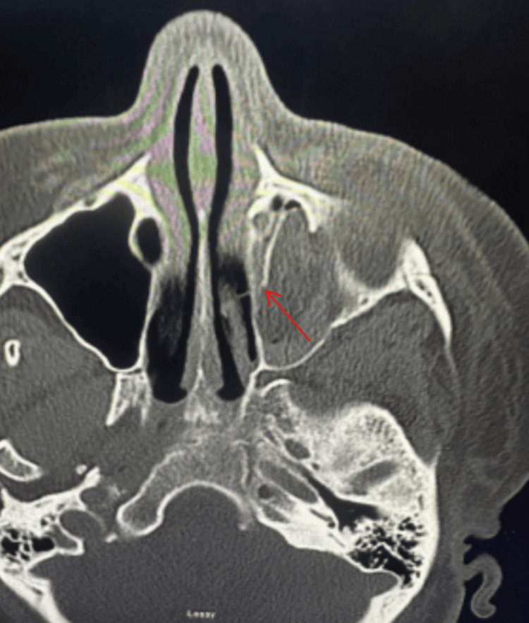
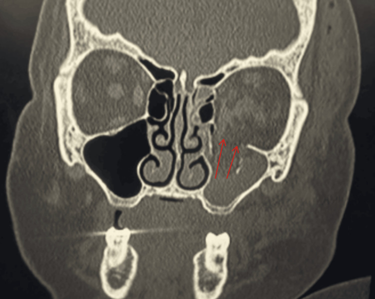

# 420 — Vỡ sàn hốc mắt & hội chứng khoang / Blow-out fracture & Orbital compartment syndrome

**Tags:** `pattern:vo-xuong` `vung:hoc-mat`
**Mức chắc chắn (certainty):** tổng hợp y văn (literature synthesis) — nhóm tự biên từ y văn mở, chưa gắn ca nguyên văn đơn lẻ.

## 1. Tổng quan — sàn vỡ vì mỏng + máu sau nhãn cầu ép thần kinh

- Chấn thương trực tiếp nhãn cầu → áp lực dồn xuống **sàn mỏng** → vỡ + mỡ/cơ thẳng dưới sa vào xoang hàm (giọt lệ/teardrop). TẠI SAO nhìn đôi dọc: cơ thẳng dưới kẹt → mắt không ngước được.
- **Hội chứng khoang (OCS):** máu sau nhãn cầu trong hốc xương kín → ép thần kinh thị/mạch. TẠI SAO mù nhanh: thiếu máu thần kinh thị không hồi phục sau 60–90 phút — **mở góc mắt ngoài (canthotomy/cantholysis) trong 2 giờ**.
- Ngưỡng: IOP **> 40 mmHg** + lồi mắt + cứng + giảm thị lực/vận nhãn = OCS lâm sàng, không chờ CT đủ liều.

## 2. Gamut chấn thương ổ mắt

- **Blow-out sàn:** giọt lệ + nhìn đôi dọc + tê má (thần kinh dưới ổ mắt) — kẹt cơ thì mổ.
- **Vỡ thành trong:** khí dưới da + xoang sàng mờ — dặn xì mũi nhẹ (khí ép vào thêm).
- **Trapdoor trẻ em:** vỡ ít + kẹt nhiều + nôn + nhịp chậm (phản xạ mắt-tim) — mổ sớm.
- **OCS/máu sau nhãn cầu:** lồi mắt + IOP cao + cứng — canthotomy 2 giờ.

## 3. Bảng so sánh

| Thực thể (entity) | Hình ảnh điển hình (CT) | Chốt vào (rule-in) | Chốt loại (rule-out) | Gợi ý xác nhận |
|---|---|---|---|---|
| Blow-out + kẹt cơ | **Giọt lệ sàn + cơ sa + nhìn đôi dọc** | **Kẹt cơ + hạn chế ngước** | Không kẹt + vận nhãn tốt → theo dõi | CT coronal, mổ giải phóng |
| OCS | **Máu sau nhãn cầu + lồi mắt + IOP > 40** | **IOP cao + cứng + giảm thị/vận nhãn** | IOP thường + vận nhãn tốt → chưa OCS | Canthotomy 2 giờ, không chờ |
| Vỡ thành trong | Khí + xoang sàng mờ | **Khí dưới da + chấn thương mũi** | Không khí + không vỡ → phù nề đơn thuần | Kháng sinh nếu xoang mờ nhiễm trùng |
| Trapdoor trẻ | Vỡ mờ + kẹt rõ + nôn/bradycardia | **Trẻ + nôn + nhịp chậm + nhìn đôi** | Người lớn + không kẹt → vỡ thường | Mổ sớm (cơ thiếu máu nhanh) |

## 4. Protocol CT ổ mắt chấn thương

- CT lát mỏng ≤ 1 mm + **coronal/sagittal MPR** (sàn/giọt lệ chỉ rõ coronal).
- Đo IOP + khám vận nhãn/thị lực trước CT khi nghi OCS (đừng để máy CT làm trễ canthotomy).
- Mổ: kẹt cơ + nhìn đôi kéo dài, trapdoor trẻ, OCS sau canthotomy ổn định.

## 5. Cạm bẫy

- **Máu xoang hàm** sau chấn thương = gợi vỡ sàn — đừng đọc viêm xoang.
- **Trắng mắt (white-eyed)** trẻ: ngoài bình thường nhưng kẹt nặng — tin triệu chứng hơn ảnh.
- **Xì mũi mạnh** sau vỡ trong → khí ép thêm + viêm — dặn BN tuyệt đối.

## 6. Tự lượng giá — Blind Quiz

**Ca 1 — Tai nạn, lồi mắt trái + IOP 46 + giảm vận nhãn. Đọc CT axial.**

- Hỏi: máu ở đâu? Cơ nào kẹt? Chẩn đoán + xử trí trong bao lâu?

<b>Bấm để hiện đáp án</b>

- **Máu sau nhãn cầu trái + kẹt cơ thẳng dưới → OCS** trên nền vỡ sàn (đối chiếu coronal dưới) — **canthotomy/cantholysis trong 2 giờ**, không chờ chuyển viện.
- Nguồn: Brotzman et al., Cureus 2026 Fig. 1, CC BY 4.0.

**Ca 2 — Vỡ sàn + vỡ thành trong cùng BN:**

<b>Bấm để hiện đáp án</b>

- **Vỡ sàn trái (mỡ/cơ sa + xoang mờ) + vỡ thành trong (lamina)** — đánh giá kẹt cơ + vận nhãn quyết định mổ.
- Nguồn: Brotzman et al., Fig. 2, CC BY 4.0.

## Bài liên quan chéo
- [400 – Tổng quan Mắt](../400-tong-quan-mat-thi-giac/lesson.md)
- [410 – Giải phẫu hốc mắt](../410-giai-phau-hoc-mat/lesson.md) (cơ thẳng dưới)
- [421 – Lồi mắt Graves](../421-loi-mat-Graves/lesson.md) (lồi mắt không chấn thương)

> Không dùng để chẩn đoán độc lập khi chưa có người hướng dẫn.
