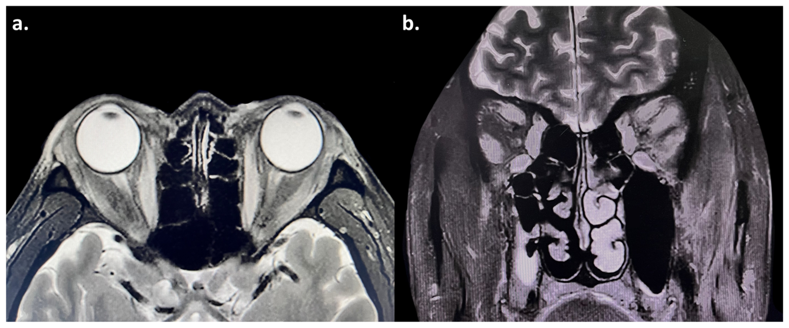

# 421 — Lồi mắt Graves / Thyroid eye disease (TED)

**Tags:** `pattern:loi-mat` `vung:hoc-mat`
**Mức chắc chắn (certainty):** tổng hợp y văn (literature synthesis) — nhóm tự biên từ y văn mở, chưa gắn ca nguyên văn đơn lẻ.

## 1. Tổng quan — cơ phì đại chừa gân + T2 sáng = hoạt tính

- TED: tự miễn thụ thể TSH → thâm nhiễm cơ vận nhãn + mỡ. TẠI SAO **thân cơ to mà gân bình thường (tendon-sparing)**: viêm đầu cơ (belly), khác giả u/viêm lan cả gân.
- **T2 sáng = viêm hoạt tính** (đáp ứng steroid); T2 tối + xơ = mạn (mổ giảm áp/chỉnh lác). CAS ≥ 3/7 = hoạt tính (đau sau nhãn, đỏ mi/kết mạc, sưng mi, sưng caruncle).
- Ngưỡng: lồi (Hertel) chênh > 2 mm hoặc > 21 mm; TRAb/TSI (+) củng cố; giữ bình giáp (cả cường lẫn suy đều làm nặng mắt).

## 2. Gamut lồi mắt + cơ to

- **Graves/TED:** 2 bên (lệch cũng có), thân cơ to chừa gân, T2 sáng, TRAb (+), tuyến giáp bệnh.
- **Giả u viêm (pseudotumor):** 1 bên, **cả gân**, đau nhiều, đáp ứng steroid nhanh.
- **Cellulitis sau vách:** sốt + viêm xoang kề + phù lan, trẻ em — kháng sinh, áp-xe dẫn lưu.
- **U (lymphoma/meningioma):** khối khu trú, không viêm, tiến triển chậm.

## 3. Bảng so sánh

| Thực thể (entity) | Hình ảnh điển hình (CT/MRI) | Chốt vào (rule-in) | Chốt loại (rule-out) | Gợi ý xác nhận |
|---|---|---|---|---|
| Graves/TED | **Thân cơ to + gân thường**, T2 sáng, 2 bên | **Chừa gân + TRAb (+) + CAS ≥ 3** | Cả gân + đau dữ → giả u | TRAb, CAS, giữ bình giáp |
| Giả u viêm | **Cả gân + cơ**, 1 bên, đau | **Đau + 1 bên + đáp ứng steroid 48h** | Chừa gân 2 bên → Graves | Steroid thử + MRI |
| Cellulitis | Phù lan + xoang mờ + sốt | **Sốt + viêm xoang kề + trẻ** | Không sốt + mạn → TED/giả u | Kháng sinh TM, CT tìm áp-xe |
| Đỉnh chèn ép | Cơ to chèn TK thị đỉnh + giảm thị lực | **Giảm thị + RAPD + đỉnh đặc** | Thị lực tốt → chưa chèn ép | Mổ giảm áp cấp cứu |

## 4. Protocol

- **CT/MRI hốc mắt:** đo cơ (thân/gân), T2 fatsat (hoạt tính), đỉnh (chèn ép), tuyến lệ.
- CAS mỗi lần khám (7 điểm); Hertel; thị lực + thị trường + RAPD (chèn ép).
- Điều trị theo hoạt tính: hoạt tính → steroid/ức chế miễn dịch (teprotumumab); mạn → mổ (giảm áp, lác, mi).

## 5. Cạm bẫy

- **ICI (pembrolizumab/nivolumab)** cũng gây lồi mắt giống Graves (kể cả bình giáp, TRAb âm) — hỏi thuốc ung thư.
- **Giảm liều steroid sớm → tái phát** (bệnh trong ca gốc tái khi giảm liều) — giảm dần + theo dõi TRAb.
- **Suy giáp cũng làm nặng mắt** — giữ bình giáp suốt quá trình, không chỉ chữa cường.

## 6. Tự lượng giá — Blind Quiz

**Ca 1 — Nam 57 tuổi sau pembrolizumab, lồi 2 bên + đau + song thị. Đọc MRI.**

- Hỏi: cơ nào to? Gân có to không? T2 sáng hay tối? CAS và chẩn đoán?

<b>Bấm để hiện đáp án</b>

- **Phì đại nhiều cơ 2 bên (trong/trên/dưới/ngoài) + T2 sáng + chừa gân** → **Graves hoạt tính (CAS 5/7)** sau pembrolizumab, TRAb (+). Điều trị: steroid + ức chế miễn dịch (thận trọng vì ung thư), giảm liều chậm.
- Nguồn: Pan et al., Diagnostics 2025 Fig. 2, CC BY 4.0.

**Ca 2 — Đau mắt dữ 1 bên + cơ to cả gân + đáp ứng steroid 2 ngày:** Graves hay giả u? *(Bảng mục 3.)*

<b>Bấm để hiện đáp án</b>

- **Giả u viêm:** 1 bên + cả gân + đau + đáp ứng nhanh — khác Graves (chừa gân, 2 bên, TRAb).

## Bài liên quan chéo
- [400 – Tổng quan Mắt](../400-tong-quan-mat-thi-giac/lesson.md)
- [410 – Giải phẫu hốc mắt](../410-giai-phau-hoc-mat/lesson.md) (thân/gân cơ)
- [420 – Vỡ sàn hốc mắt](../420-vo-san-hoc-mat/lesson.md) (lồi mắt chấn thương)

> Không dùng để chẩn đoán độc lập khi chưa có người hướng dẫn.
