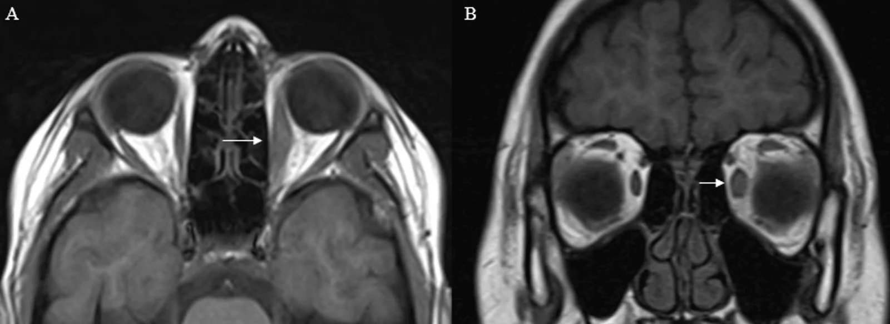

# 422 — Cellulitis vs giả u viêm / Orbital cellulitis vs Pseudotumor (myositis)

**Tags:** `pattern:viem-hoc-mat` `vung:hoc-mat`
**Mức chắc chắn (certainty):** tổng hợp y văn (literature synthesis) — nhóm tự biên từ y văn mở, chưa gắn ca nguyên văn đơn lẻ.

## 1. Tổng quan — gân là ranh giới + đáp ứng steroid 48 giờ

- **Viêm cơ vô căn (myositis/giả u):** phì đại cơ hình thoi **CẢ GÂN (tendon-involving)**, đau khi vận nhãn, đáp ứng steroid **nhanh 24–48 giờ**. Định lượng: cơ dày gấp ~2× bên lành (7,4 vs 3,8 mm trong ca dưới).
- **Cellulitis sau vách:** sốt + viêm xoang kề + phù lan, trẻ em — kháng sinh TM; áp-xe (mức dịch-khí) thì dẫn lưu.
- TẠI SAO kháng sinh không đỡ thì nghĩ giả u: viêm vô khuẩn không đáp ứng kháng sinh; sốt + xoang mờ + bạch cầu tăng ủng hộ nhiễm khuẩn.

## 2. Gamut mắt đỏ đau + cơ to/sưng hốc mắt

- **Cellulitis:** sốt + xoang mờ + trẻ + phù lan — kháng sinh, tìm áp-xe.
- **Giả u/myositis:** đau vận nhãn + cả gân + không sốt/xoang sạch — steroid.
- **Graves:** chừa gân + 2 bên + TRAb (bài 421).
- **IgG4/sarcoid/GPA:** tuyến lệ + đa cơ quan + IgG4/ACE/ANCA (nối bài 424/451).

## 3. Bảng so sánh

| Thực thể (entity) | Hình ảnh (CT/MRI) | Chốt vào (rule-in) | Chốt loại (rule-out) | Gợi ý xác nhận |
|---|---|---|---|---|
| Giả u/myositis | **Cả gân**, 1 cơ/bên, không xoang mờ | **Đau vận nhãn + cả gân + đáp ứng steroid 48h** | Sốt + xoang mờ → cellulitis | Steroid + MRI lại |
| Cellulitis | Phù lan + xoang mờ + **áp-xe (mức dịch)** | **Sốt + xoang + bạch cầu tăng** | Không sốt + xoang sạch + không đỡ KS → giả u | Kháng sinh TM, dẫn lưu áp-xe |
| Graves | **Chừa gân**, 2 bên, T2 sáng | **Chừa gân + TRAb** (bài 421) | **Trực ngoài đơn độc (I'M SLOW) hoặc cả gân + đau → giả u/lymphoma** | (bài 421) |
| IgG4 | Tuyến lệ + cơ + đa cơ quan | **IgG4 máu/mô + đa cơ quan** | Đơn cơ cấp + đáp ứng nhanh → giả u | IgG4, sinh thiết |

*T1 axial/coronal: cơ thẳng trong trái to cả gân. Nguồn: Flindris et al., Cureus 2026 Fig. 4, CC BY 4.0.*

## 4. Protocol

- **CT/MRI hốc mắt:** cơ (thân/gân), xoang (mờ/áp-xe), đỉnh, tuyến lệ; đo dày cơ 2 bên (mm).
- Không sốt + xoang sạch + cơ to cả gân → steroid sớm (đừng kháng sinh kéo dài vô ích).
- Áp-xe/biến chứng nội sọ: hội chẩn TMH + ngoại thần kinh.

## 5. Cạm bẫy

- **Trẻ em cellulitis giả u và ngược lại:** trẻ sốt + xoang mờ = cellulitis đến khi chứng minh ngược lại (nguy hiểm hơn nếu bỏ sót).
- **Lymphoma/nhiễm nấm** giả viêm mạn — không đáp ứng steroid + tuổi già/suy giảm MD → sinh thiết.
- **Graves 1 bên giai đoạn sớm** giả u — TRAb + theo dõi bên kia.

## 6. Tự lượng giá — Blind Quiz

**Ca 1 — Đau vận nhãn + cơ thẳng trong trái to. Đo và kết luận.**

- Hỏi: dày bao nhiêu vs bên lành? Gân có to không? Xoang có mờ không? Chẩn đoán + thuốc gì?

<b>Bấm để hiện đáp án</b>

- **Viêm cơ vô căn:** 7,4 vs 3,8 mm + cả gân + xoang sạch + không sốt — steroid đáp ứng 48 giờ (khác cellulitis).
- Nguồn: Flindris et al., Fig. 4, CC BY 4.0.

**Ca 2 — Trẻ sốt + sưng mi + xoang hàm mờ + phù lan:** kháng sinh hay steroid đầu? Vì sao? *(Bảng mục 3.)*

<b>Bấm để hiện đáp án</b>

- **Cellulitis:** kháng sinh TM đầu (sốt + xoang + trẻ) — tìm áp-xe để dẫn lưu; steroid chỉ khi loại trừ nhiễm khuẩn.

## Bài liên quan chéo
- [400 – Tổng quan Mắt](../400-tong-quan-mat-thi-giac/lesson.md)
- [410 – Giải phẫu hốc mắt](../410-giai-phau-hoc-mat/lesson.md) (thân/gân cơ)
- [421 – Lồi mắt Graves](../421-loi-mat-Graves/lesson.md) (chừa gân)
- [424 – Tuyến lệ (dự kiến)](../424-tuyen-le/lesson.md) (IgG4)

> Không dùng để chẩn đoán độc lập khi chưa có người hướng dẫn.
