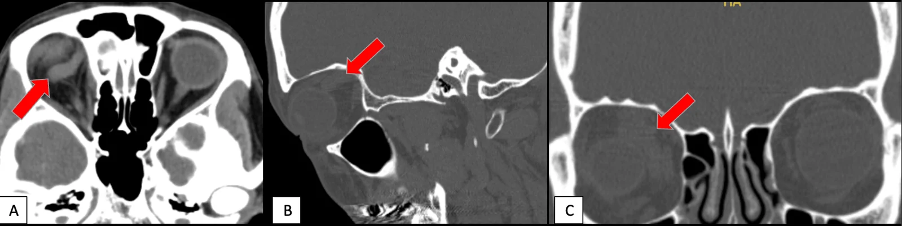
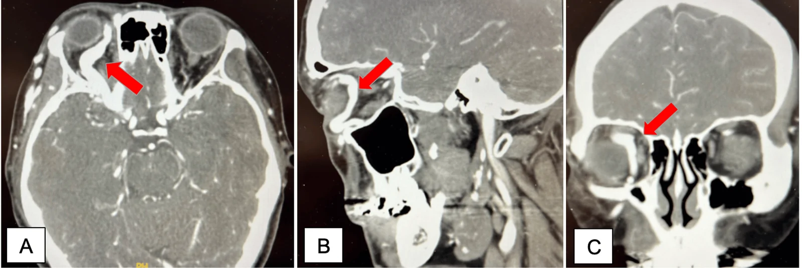

# 423 — Fistula xoang hang vs huyết khối / CCF vs Cavernous thrombosis

**Tags:** `pattern:mach-xoang-hang` `vung:xoang-hang`
**Mức chắc chắn (certainty):** tổng hợp y văn (literature synthesis) — nhóm tự biên từ y văn mở, chưa gắn ca nguyên văn đơn lẻ.

## 1. Tổng quan — máu ĐM vào xoang TM + tiếng thổi là chốt

- Fistula ĐM cảnh–xoang hang: trực tiếp dòng cao (chấn thương vỡ nền sọ ~4%, nam trẻ) vs gián tiếp dòng thấp (tự phát, nữ lớn tuổi, mô liên kết).
- TẠI SAO mắt đỏ + lồi + tiếng thổi: tăng áp TM ổ mắt (giãn TM mắt trên) + ứ máu; liệt III/IV/VI do dây đi trong xoang hang.
- Ngưỡng: DSA là tiêu chuẩn vàng + nút mạch cùng lúc (coil/bóng, giữ dòng ĐM cảnh trong).

## 2. Gamut mắt đỏ + lồi + tiếng thổi

- **CCF trực tiếp:** chấn thương + đột ngột + tiếng thổi — nút mạch cấp cứu.
- **CCF gián tiếp:** tự phát âm ỉ + đỏ mắt mạn — theo dõi/nút chọn lọc.
- **Huyết khối xoang hang:** sốt + nhiễm trùng mặt/xoang + nhiều dây TK + lan 2 bên — kháng sinh + kháng đông.
- **Graves/cellulitis:** cơ/xoang đặc trưng, không tiếng thổi (bài 421/422).

## 3. Bảng so sánh

| Thực thể (entity) | Hình ảnh (CTA/DSA) | Chốt vào (rule-in) | Chốt loại (rule-out) | Gợi ý xác nhận |
|---|---|---|---|---|
| CCF trực tiếp | **SOV giãn + đổ đầy sớm xoang** + chấn thương | **Tiếng thổi + SOV giãn + chấn thương** | Sốt + lan 2 bên → huyết khối | DSA + nút mạch |
| CCF gián tiếp | SOV giãn nhẹ + đỏ mạn | **Tự phát + âm ỉ** | Đột ngột + chấn thương → trực tiếp | Theo dõi/nút mạch |
| Huyết khối XH | **Khuyết thuốc xoang** + sốt + lan 2 bên | **Sốt + nhiễm trùng + nhiều dây TK** | Tiếng thổi → fistula | Kháng sinh + kháng đông |

*CT: giãn TM mắt trên phải. Nguồn: Cochrane et al., Cureus 2026 Fig. 2, CC BY 4.0.*

*CTA: đổ đầy sớm + varices mặt. Nguồn: Cochrane et al., Fig. 3, CC BY 4.0.*

## 4. Protocol

- **CT/CTA đầu-mặt-cổ:** SOV + đổ đầy sớm + varices + lồi mắt.
- **DSA + nút mạch** (giữ dòng ĐM cảnh); theo dõi hết tiếng thổi + xẹp SOV.
- Huyết khối: kháng sinh + kháng đông + dẫn lưu ổ nhiễm.

## 5. Cạm bẫy

- **Mắt đỏ mạn tưởng dị ứng** 2 tháng (ca gốc: cetirizine + steroid không đỡ) — nghe tiếng thổi mọi đỏ mắt 1 bên kéo dài.
- **Không chấn thương vẫn có CCF** (EDS, loạn sản sợi-cơ) — hỏi mô liên kết + gia đình (cha vỡ phình).
- **Biến chứng muộn:** tăng nhãn áp góc đóng, XH dịch kính, bong võng mạc, XH nội sọ — đừng chờ.

## 6. Tự lượng giá — Blind Quiz

**Ca 1 — Sưng quanh mắt phải 2 tháng + nhìn mờ + đau vận nhãn + tiếng thổi. Đọc CT/CTA.**

- Hỏi: TM nào giãn? Chẩn đoán? Bước vàng tiếp theo?

<b>Bấm để hiện đáp án</b>

- **CCF trực tiếp dòng cao:** SOV giãn + đổ đầy sớm — DSA + nút mạch coil (hết triệu chứng).
- Nguồn: Cochrane et al., Fig. 2–3, CC BY 4.0.

**Ca 2 — Sốt + sưng 2 mắt + liệt nhiều dây sau nhọt mặt:** fistula hay huyết khối? *(Bảng mục 3.)*

<b>Bấm để hiện đáp án</b>

- **Huyết khối xoang hang:** sốt + nhiễm trùng + lan 2 bên — kháng sinh + kháng đông.

## Bài liên quan chéo
- [400 – Tổng quan Mắt](../400-tong-quan-mat-thi-giac/lesson.md)
- [421 – Lồi mắt Graves](../421-loi-mat-Graves/lesson.md) (lồi không mạch)
- [460 – Can thiệp mạch (đã có)](../460-can-thiep-mat/lesson.md) (nút mạch)

> Không dùng để chẩn đoán độc lập khi chưa có người hướng dẫn.
