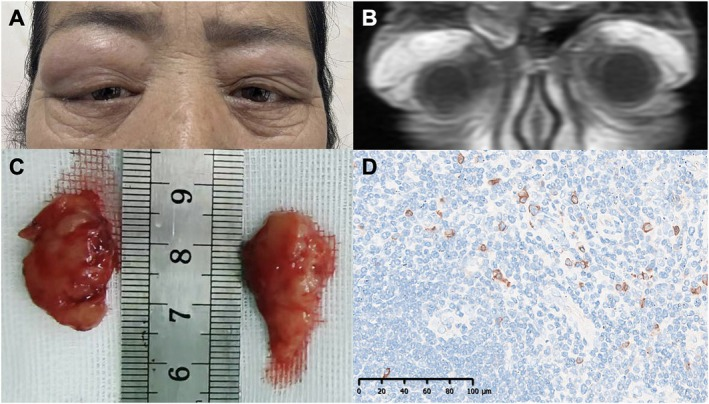

# 424 — Tuyến lệ: viêm vs u / Dacryoadenitis vs Lacrimal gland tumors

**Tags:** `pattern:tuyen-le` `vung:hoc-mat`
**Mức chắc chắn (certainty):** tổng hợp y văn (literature synthesis) — nhóm tự biên từ y văn mở, chưa gắn ca nguyên văn đơn lẻ.

## 1. Tổng quan — tuyến lệ trên-ngoài + IgG4 là thủ phạm hệ thống

- Tuyến lệ nằm trên-ngoài ổ mắt; to ra do viêm (IgG4, sarcoid, Sjögren, GPA) hoặc u (pleomorphic adenoma, adenoid cystic carcinoma).
- **IgG4:** sưng **không đau 2 bên** + IgG4 máu tăng (≥ 135 mg/dL) + > 10 tương bào IgG4/HPF + đa cơ quan (tụy, sau phúc mạc). TẠI SAO sinh thiết khi không điển hình: lymphoma cũng to tuyến lệ 2 bên — mô bệnh phân biệt.
- Ngưỡng: IgG4 máu ≥ 135 mg/dL gợi ý; > 10 tế bào/HPF + tỷ lệ IgG4/IgG > 40% củng cố.

## 2. Gamut tuyến lệ to

- **IgG4:** không đau + 2 bên + đa cơ quan + đáp ứng steroid (tái phát khi giảm liều).
- **Sarcoid/Sjögren:** khô mắt/miệng + hạch + ACE/hạch — song hành toàn thân.
- **Pleomorphic adenoma:** 1 bên + lâu năm + xương lõm (không hủy) — mổ nguyên khối (sinh thiết rạch gây gieo rắc).
- **Adenoid cystic carcinoma:** 1 bên + đau + lan quanh TK + hủy xương — ác tính, mổ rộng + xạ.

## 3. Bảng so sánh

| Thực thể (entity) | Hình ảnh | Chốt vào (rule-in) | Chốt loại (rule-out) | Gợi ý xác nhận |
|---|---|---|---|---|
| IgG4 | **To 2 bên + không đau** + đa cơ quan | **IgG4 máu + mô bệnh + đáp ứng steroid** | Đau + 1 bên cấp → viêm cấp/u | IgG4, sinh thiết khi không điển hình |
| Pleomorphic | **1 bên + lâu năm + xương lõm không hủy** | **Lành tính lâu + xương lõm** | Hủy xương + đau → ác tính | Mổ nguyên khối, cấm sinh thiết rạch |
| ACC | **1 bên + đau + hủy xương + lan TK** | **Đau + hủy xương + lan quanh TK** | Không đau + xương lõm → pleomorphic | Mổ rộng + xạ bổ trợ |
| Viêm cấp | Đau + 1 bên + sốt/viêm kề | **Đau + cấp + viêm kề** | Không đau + 2 bên + mạn → IgG4 | Kháng sinh + tìm ổ |

*Lâm sàng + MRI coronal tuyến lệ to 2 bên + mô bệnh IgG4. Nguồn: Song et al., Clin Case Rep 2026, CC BY 4.0.*

## 4. Protocol

- **CT/MRI hốc mắt:** tuyến lệ (1/2 bên), xương (lõm vs hủy), TK, xoang.
- IgG4 máu + toàn thân (tụy, thận, sau phúc mạc) khi 2 bên không đau.
- Nghi u: **mổ nguyên khối** (pleomorphic) — cấm sinh thiết rạch gieo rắc.

## 5. Cạm bẫy

- **Lymphoma tuyến lệ** giả IgG4 (2 bên không đau) — không đáp ứng steroid + tuổi già → sinh thiết.
- **Sinh thiết rạch pleomorphic** gieo rắc tái phát ác tính hóa — nguyên khối từ đầu.
- **Khô mắt Sjögren** che lấp — hỏi khô miệng + anti-SSA/SSB.

## 6. Tự lượng giá — Blind Quiz

**Ca 1 — Nữ 56 tuổi sưng mi trên 2 bên không đau 3 năm. Đọc ảnh + IgG4 450.**

- Hỏi: tuyến lệ to mấy bên? Đau không? IgG4 bao nhiêu? Chẩn đoán + vì sao phải sinh thiết?

<b>Bấm để hiện đáp án</b>

- **IgG4 dacryoadenitis:** 2 bên không đau + IgG4 450 + > 70 tương bào/HPF — sinh thiết loại lymphoma + steroid (tái phát khi giảm liều thì duy trì).
- Nguồn: Song et al., CC BY 4.0.

**Ca 2 — Khối tuyến lệ 1 bên 10 năm + xương lõm không hủy:** sinh thiết rạch hay mổ nguyên khối? *(Bảng mục 3.)*

<b>Bấm để hiện đáp án</b>

- **Pleomorphic:** mổ nguyên khối — sinh thiết rạch gieo rắc.

## Bài liên quan chéo
- [400 – Tổng quan Mắt](../400-tong-quan-mat-thi-giac/lesson.md)
- [410 – Giải phẫu hốc mắt](../410-giai-phau-hoc-mat/lesson.md) (tuyến lệ trên-ngoài)
- [422 – Giả u viêm](../422-viem-gia-u/lesson.md) (IgG4 đa cơ quan)

> Không dùng để chẩn đoán độc lập khi chưa có người hướng dẫn.
