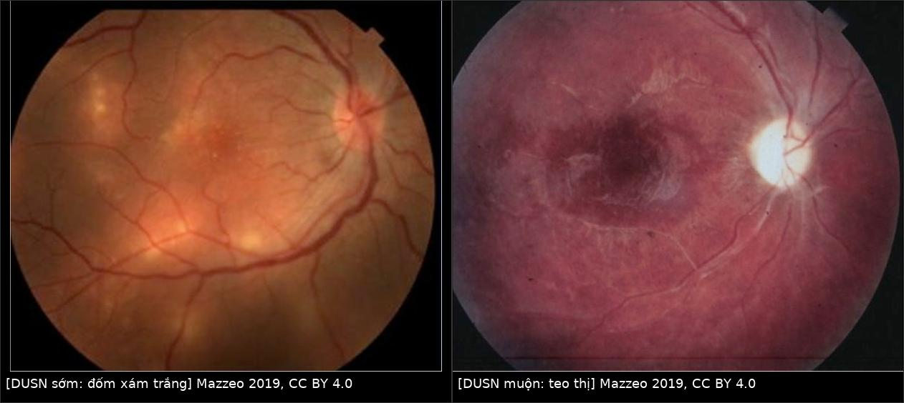
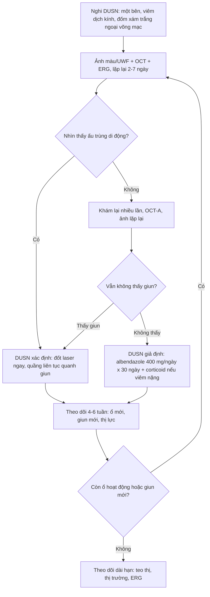
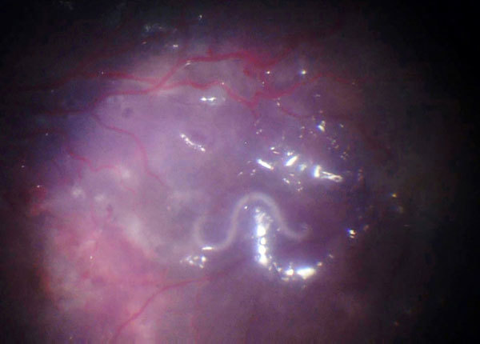
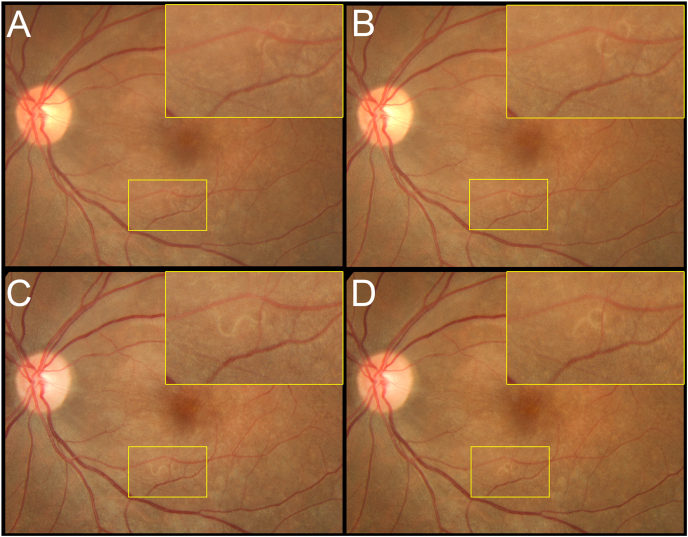
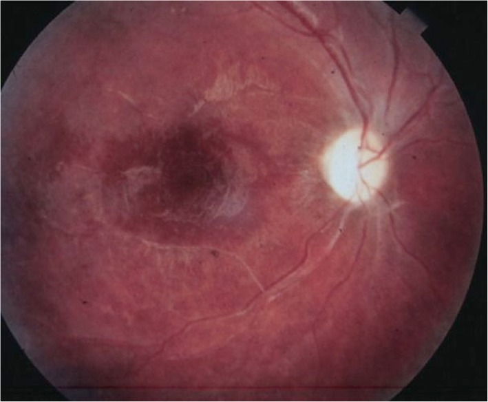
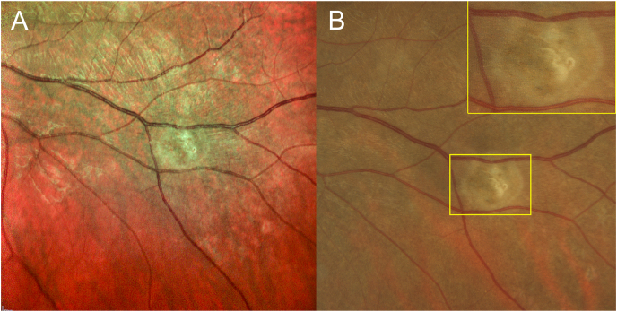

# 425 — DUSN (viêm thần kinh võng mạc cấp lan toả một bên) & ấu trùng di động dưới võng mạc / Diffuse unilateral subacute neuroretinitis (DUSN)

**Tags:** `pattern:viem-vong-mac` `pattern:ton-thuong-ngoai-vong-mac` `pattern:teo-thi` `pattern:mat-mot-ben` `vung:vong-mac` `vung:dich-kinh` `vung:mat` `vung:tre-em` `protocol:FA` `protocol:ICG` `protocol:OCT` `protocol:OCT-A` `protocol:ERG` `protocol:laser` `protocol:albendazole`
**Mức chắc chắn (certainty):** tổng hợp y văn (literature synthesis) — bài tổng quan **20 ca/121 ca** của Mazzeo 2019 (PMC6934636), đoàn hệ SD-OCT **8 mắt** (PMC3155787) và **10 mắt** (PMC4051808), cùng **4 ca nguyên văn có ảnh** (PMC5324813, PMC8170075, PMC12178403, PMC6157124). Câu nào là suy luận được ghi **[suy luận]**.

> **Vì sao bài này quan trọng:** [466](../466-toxocariasis-noi-nhan/lesson.md) đã đặt DUSN vào ma trận của **u hạt toxocariasis**, nhưng chỉ ở mức **một hàng phân biệt**. DUSN là **bệnh cảnh riêng**: **một bên**, **trẻ/người trẻ khoẻ mạnh**, **viêm dịch kính + đốm xám trắng ngoại võng mạc di chuyển theo con giun**, rồi **teo thị không hồi phục**. Chốt chẩn đoán duy nhất là **nhìn thấy ấu trùng** — nhưng chỉ thấy ở **25–40%** ca (PMC6934636; 121 ca của Garcia Filho: **~40%**). Nghĩa là **60–75% ca không có giun để đốt laser**, và đó là lý do phải phân biệt rõ **DUSN xác định (confirmed) vs DUSN giả định (presumed)** trước khi quyết định albendazole.

## 1. Tổng quan bệnh học – cơ chế hình ảnh

- **Bệnh học (pathology):** ấu trùng giun tròn (nematode) **di chuyển trong khoảng dưới võng mạc** của một mắt. Tác nhân được đề xuất nhiều nhất: *Toxocara canis*, ***Baylisascaris procyonis*** (gấu mèo) và ***Ancylostoma caninum*** (giun móc chó); **không có một loài duy nhất** — DUSN được xem là **kết cục chung của nhiều loài giun**, nên hình thái và dịch tễ khác nhau theo vùng (PMC6934636).
- **Kích thước ấu trùng là dấu vết dịch tễ:** giun **nhỏ 400–700 µm** ở đông nam Hoa Kỳ và Nam Mỹ; giun **lớn 1.500–2.000 µm** ở bắc Trung Tây Hoa Kỳ; khoảng chung **400–2.000 µm**. Giun **lớn** thường để lại **dải sắc tố RPE thô ráp dọc đường đi**, giun **nhỏ** để lại **sẹo teo hắc–võng mạc khu trú** (Gass & Braunstein, trong PMC6934636).
- **TẠI SAO tổn thương "di chuyển" và "biến mất" (evanescent):** đốm xám-trắng **không phải** mô giun mà là **phản ứng viêm quanh vị trí giun đang đứng**. Giun bò sang vùng khác → ổ viêm cũ **mờ đi**, ổ mới **mọc lên** ở nơi khác. Vì vậy **chụp lại sau vài ngày là một "nghiệm pháp hình ảnh"**: tổn thương **đổi chỗ** = bằng chứng gián tiếp của ấu trùng đang di động.
- **TẠI SAO mất thị lực nặng và không hồi phục:** hai cơ chế cộng lại — **(1) độc tố/dịch tiết của giun** phá lớp võng mạc ngoài (tế bào quang thụ + biểu mô sắc tố), **(2) phản ứng miễn dịch của vật chủ** (bạch cầu ái toan, đại thực bào, tăng sinh thần kinh đệm) lan **toàn bộ các lớp võng mạc** → **mất tế bào hạch** rồi **teo thị**. Đây là lý do bệnh được gọi là **"bệnh võng mạc do giun nhiễm độc – tự miễn" (toxic autoimmune nematode retinopathy)**.
- **TẠI SAO OCT là chốt cơ chế:** tổn thương ở **lớp võng mạc ngoài** trước, nên OCT thấy **mất/gián đoạn dải ellipsoid (EZ) và dải xen kẽ (IZ)**, tăng hồi âm khu trú xuyên võng mạc tại nơi giun đứng, và **đường hầm dưới võng mạc (Garcia's sign)** — khoang trống/hyperreflective line nơi giun đã bò qua. Về muộn: **mỏng toàn bộ các lớp võng mạc**.
  - **Số đo (8 mắt DUSN, Cirrus SD-OCT; PMC3155787):** **RNFL trung bình 80,25 µm ở mắt bệnh vs 104,75 µm ở mắt lành**; **CMT 205,5 vs 255,13 µm**; **giai đoạn muộn RNFL 74,83 µm vs giai đoạn sớm 96,5 µm** — mỏng dần theo thời gian.
  - **Số đo (10 mắt, EDI-OCT; PMC4051808):** mỏng võng mạc và RNFL **có ý nghĩa (p = 0,004 và p = 0,002)**, nhưng **độ dày hắc mạc KHÔNG khác** (p = 0,262) — tổn thương **thuộc võng mạc**, dù hắc mạc có tham gia viêm trên ICG.
- **TẠI SAO FA/ICG cho hình ảnh khác nhau:** ổ viêm hoạt động **chặn** ánh huỳnh quang nền → **giảm huỳnh quang (hypofluorescence)** sớm, sau đó **nhuộm (staining)**; về muộn, RPE mất sắc tố → **khiếm khuyết cửa sổ (window defect)**. Trên **ICG**, các **đốm tối giảm huỳnh quang** phản ánh **thâm nhiễm hắc mạc** chặn thuốc nhuộm, và đốm **còn tối ở thì muộn** gợi tổn thương **toàn chiều dày** (PMC6934636).
- **TẠI SAO ERG "âm" (negative ERG):** tế bào lưỡng cực và võng mạc trong bị tổn thương → **sóng b giảm nhiều hơn sóng a**; ERG bất thường **ngay cả giai đoạn sớm**, trong khi **EOG bình thường ở ~50%** ca — tổ hợp **ERG bất thường + EOG bình thường** chỉ điểm bệnh **biểu mô thần kinh**, và **ERG hiếm khi mất hoàn toàn** (khác thoái hoá sắc tố võng mạc).
- **TẠI SAO OCT-A có thể "bắt" được giun:** giun **không có hệ mạch** → trên OCT-A **không có tín hiệu dòng chảy**. Một "khuyết" không tưới máu **di chuyển giữa hai lần chụp** là dấu hiệu gián tiếp rất mạnh; giun **đã chết/nằm im** có thể **không thấy** (PMC6934636, PMC5722164).
- **Số liệu định lượng cốt lõi:**
  - **Nhìn thấy ấu trùng:** **25–40%** ca (PMC6934636; PMC6157124 dẫn 25–40%); **không thấy 60–75%** (PMC8170075); loạt **121 bệnh nhân**: **~40%** (PMC6934636).
  - **Thị lực:** giai đoạn sớm **~một nửa bệnh nhân < 20/200**; giai đoạn muộn **≥ 80% ≤ 20/200** (PMC6934636).
  - **Tuổi:** đa số **< 20 tuổi**, trẻ khoẻ mạnh, **một bên** (hiếm hai bên).
  - **Huyết thanh:** ELISA *T. canis* **dương 47,62%** trong loạt **23 ca** của Oréfice; **2 ca có giun sống lại ELISA âm** — huyết thanh **không dùng để loại trừ** (PMC6934636).

## 2. Mẫu hình + chẩn đoán phân biệt theo vị trí và giai đoạn (gamut)

**Câu hỏi trung tâm không phải "có viêm võng mạc không" mà "có con giun trong khoang dưới võng mạc không, và nó đang ở đâu".**

- **A. Giai đoạn SỚM — gamut theo tổn thương chính:**
  - **Viêm dịch kính + phù đĩa thị một bên** ("giả viêm thần kinh thị") → DUSN, **viêm thần kinh thị thật**, neuroretinitis do *Bartonella*, bệnh mèo cào.
  - **Đốm xám-trắng ngoại võng mạc rải rác một vùng** → DUSN, **MEWDS**, **APMPPE**, **viêm hắc mạc đa ổ (MFC)**, **toxoplasmosis**, **toxocariasis**.
  - **Viêm mạch võng mạc + xuất tiết quanh tĩnh mạch** → DUSN, Behçet, sarcoid, *Toxocara*.
- **B. Giai đoạn MUỘN — gamut "giả thoái hoá sắc tố / mạch máu":**
  - **Mạch máu hẹp + teo thị + sắc tố lốm đốm MỘT BÊN** → DUSN, **thoái hoá sắc tố võng mạc một bên (unilateral RP)**, **tắc mạch võng mạc cũ**, **bệnh võng mạc do xạ**, **chấn thương cũ**.
  - **Sắc tố dạng "xương" (bone spicule) đối xứng hai bên + không viêm dịch kính** → RP thật, **không phải DUSN**.
- **C. Gamut theo VỊ TRÍ con giun (khi nhìn thấy):** **dưới võng mạc cạnh hoàng điểm** (khó đốt laser vì sợ tổn thương hoàng điểm) · **dưới võng mạc ngoại vi** (vị trí lý tưởng để đốt) · **trước võng mạc/trên màng giới hạn trong (ILM)** · **trong dịch kính** · **nhiều giun cùng mắt** (ca trẻ 8 tuổi không đáp ứng điều trị, PMC6157124).
- **D. Hai nhãn phải dùng đúng:** **DUSN xác định (confirmed)** = có triệu chứng điển hình **+ nhìn thấy ấu trùng**; **DUSN giả định (presumed)** = có triệu chứng điển hình **nhưng không thấy ấu trùng**. Chỉ nhãn **confirmed** mới có chỉ định đốt laser chắc chắn.

## 3. Bảng so sánh phân biệt (ma trận đối chiếu)

| Thực thể (entity) | Hình ảnh điển hình | Chốt vào (rule-in) | Chốt loại (rule-out) | Gợi ý xác nhận |
|---|---|---|---|---|
| **DUSN xác định (confirmed)** | Đốm xám-trắng ngoại võng mạc **đổi vị trí** giữa hai lần chụp; **một sợi giun trắng di động** dưới võng mạc | **Nhìn thấy ấu trùng di động** trong khoang dưới võng mạc/dịch kính | Không thấy giun sau nhiều lần khám → chuyển sang nhãn **giả định** | Soi đáy mắt giãn đồng tử + **ảnh màu/UWF lặp lại**; OCT qua tổn thương; đốt laser ngay khi thấy |
| **DUSN giả định (presumed)** | Một bên: viêm dịch kính nhẹ–vừa + đốm xám-trắng ngoại võng mạc + RPE lốm đốm; **ERG âm** | **Bộ ba một bên + đốm di chuyển + ERG âm**, loại trừ nguyên nhân khác | Có u hạt bờ rõ + dây co kéo → toxocariasis; hai bên + không viêm → MFC/RP | Albendazole **400 mg/ngày × 30 ngày**; chụp lại 4–6 tuần |
| **Toxocariasis nội nhãn (OLM)** | **U hạt bờ rõ** thường **ngoại vi (90% thái dương)** + **dây xơ co kéo tới đĩa thị**; có thể bong võng mạc co kéo | **Trẻ + u hạt + dây co kéo + ELISA *Toxocara* (+)** | Không u hạt, có giun di động tự do → DUSN | ELISA huyết thanh **Se 91%/Sp 90%**; siêu âm/UBM khi đục môi trường |
| **MEWDS** | Nữ trẻ cận thị, **một bên**, nhiều **đốm trắng mờ nhỏ** quanh hoàng điểm, **không viêm dịch kính** | **Đốm trắng + đĩa thị bình thường + tự khỏi 6–12 tuần** | Viêm dịch kính rõ + teo thị tiến triển → DUSN | Theo dõi 4–8 tuần; OCT-A/FA nếu cần |
| **APMPPE** | **Mảng placoid** mức RPE, **hai bên**, thường sau nhiễm siêu vi | **Placoid hai bên + tự khỏi**, không đốm di động | Một bên + tổn thương **đổi chỗ** → DUSN | FA: giảm huỳnh quang sớm, nhuộm muộn |
| **Viêm hắc mạc đa ổ (MFC)** | **Hai bên**, sẹo đục lỗ (punched-out) + tân mạch hắc mạc, cận thị | **Sẹo cũ hai bên + CNV** | Một bên, không sẹo cũ → DUSN | FA/OCT-A; theo dõi tân mạch |
| **Toxoplasmosis** | Ổ viêm **bờ nham nhở cạnh sẹo cũ**, viêm dịch kính **dày** | **Sẹo cũ + ổ hoạt động sát bờ** | Không sẹo cũ, tổn thương lan theo đường giun → DUSN | IgG/IgM *Toxoplasma*; PCR dịch nội nhãn |
| **Thoái hoá sắc tố võng mạc một bên** | **Sắc tố xương** + mạch hẹp + teo thị, **hai bên** (một bên rất hiếm) | **Hai bên + tiền sử gia đình + ERG giảm toàn bộ** | Một bên + viêm dịch kính + ERG **âm** → DUSN | ERG/EOG, thị trường, di truyền |
| **Viêm thần kinh thị** | Phù đĩa thị đơn thuần, **không đốm võng mạc ngoại vi** | **Đau khi liếc + RAPD + MRI hốc mắt** | Có đốm ngoại võng mạc + viêm dịch kính → DUSN | MRI thần kinh thị; theo dõi |

*Trái: **đốm xám-trắng ngoại võng mạc rải rác** (giai đoạn sớm). Phải: **đĩa thị nhợt, mạch máu hẹp, sắc tố lốm đốm** (giai đoạn muộn). Nguồn: Mazzeo TJMM et al., J Ophthalmic Inflamm Infect 2019 (PMC6934636), CC BY 4.0; ảnh ghép letterbox, không crop.*

### Dấu hiệu chốt trên từng phương thức
- **OCT:** **Garcia's sign** — đường hầm dưới võng mạc; **mất dải EZ/IZ** tại ổ viêm; sợi giun là **cấu trúc tăng hồi âm thẳng/cuộn** nằm **dưới** võng mạc (không phải trong dịch kính).
- **OCT-A:** khuyết tín hiệu **không có dòng chảy, di động** giữa hai lần chụp (giun không có mạch).
- **FA:** giảm huỳnh quang ổ hoạt động → nhuộm; **window defect** muộn do mất RPE; rò đĩa thị.
- **ICG:** **đốm tối** do thâm nhiễm hắc mạc; còn tối thì muộn = tổn thương toàn chiều dày.
- **ERG:** **sóng b giảm > sóng a** ("negative ERG") — không đặc hiệu nhưng rất gợi ý khi một bên.

## 4. Protocol chụp + tiêu chuẩn điều trị

- **Khám và chụp (thứ tự thực hành):**
  1. **Soi đáy mắt giãn đồng tử** toàn bộ chu biên (giun hay ở ngoại vi) + **đèn khe** đánh giá viêm dịch kính.
  2. **Ảnh màu/UWF từng mắt**, chụp **lặp lại cách 2–7 ngày** ở ca nghi ngờ — mục tiêu là **bắt tổn thương đổi chỗ** hoặc **con giun di chuyển**.
  3. **SD-OCT đường cắt qua hoàng điểm và qua ổ tổn thương** (line raster 5–9 µm) tìm **Garcia's sign**, mất EZ, sợi giun.
  4. **OCT-A** (nếu có) để tìm khuyết dòng chảy di động; **FA ± ICG** khi chưa rõ chẩn đoán hoặc nghi tổn thương hắc mạc.
  5. **ERG/EOG + thị trường** (Goldmann/Humphrey 30°) — nền tảng theo dõi chức năng.
  6. **Siêu âm B-scan** khi môi trường đục (viêm dịch kính dày, đục thể thủy tinh); **handheld OCT** ở trẻ nhỏ không phối hợp [suy luận từ thực hành nhi].
- **Protocol đốt laser (khi thấy giun):** đốt **ngay trong cùng buổi** vì giun di động; **đốt bao quanh con giun một quầng liên tục** để chặn đường chạy; nếu giun **sát hoàng điểm**, dùng **ánh sáng đèn khe/chiếu sáng nhẹ để "đuổi" giun ra ngoại vi** rồi đốt (giun sợ ánh sáng); hệ **laser dẫn đường + camera hồng ngoại** (ví dụ Navilas 577s, bước sóng 577 nm) giúp định vị khi giun **né ánh sáng nhìn thấy** (PMC11294691). **Không có thông số công suất/đường kính chuẩn trong y văn** — mục tiêu là phản ứng đốt **liên tục, bao trùm thân giun**, tránh trung tâm hoàng điểm.
- **Điều trị nội khoa khi KHÔNG thấy giun (DUSN giả định):** **albendazole 400 mg/ngày × 30 ngày**, uống **cùng bữa ăn béo** (tăng hấp thu); loạt **12 bệnh nhân Brazil** cải thiện thị lực/thị trường/viêm; **4 ca có giun nhìn thấy thì giun bất động trong những tuần đầu** (PMC6934636). Liều 30 ngày **suy từ phác đồ neurocysticercosis**, **chưa có thử nghiệm so sánh** — bằng chứng mức thấp.
- **Corticoid:** dùng **hỗ trợ** khi viêm dịch kính dày (uống hoặc **triamcinolone nội nhãn**): tiêm triamcinolone làm **môi trường trong hơn sau 10 ngày** và giúp **phát hiện giun để đốt laser** (PMC4860977). Corticoid **không thay** thuốc diệt giun.
- **Theo dõi:** khám + ảnh + OCT lại **4–6 tuần**, sau đó **3 tháng/lần trong năm đầu**; mục tiêu là **không còn ổ viêm mới**, **không còn giun di động**, và **thị lực/thị trường không xấu thêm**. Tái phát/ổ mới sau laser → **tìm giun thứ hai** trước khi kết luận thất bại điều trị (ca trẻ 8 tuổi, PMC6157124).

## 5. Biến thể bình thường và cạm bẫy

- **"Không thấy giun" KHÔNG loại trừ DUSN:** giun chỉ thấy ở **25–40%** ca; bỏ sót vì giun **né ánh sáng**, nằm ngoại vi, hoặc bị viêm dịch kính che. Phải khám **nhiều lần, nhiều tư thế**, chụp ảnh lặp lại.
- **Giun chạy giữa lúc khám và lúc đốt laser:** luôn **chụp ảnh đánh dấu vị trí** ngay trước khi đốt; dùng **camera hồng ngoại/laser dẫn đường** vì giun **sợ ánh sáng nhìn thấy** (PMC11294691).
- **Chẩn đoán nhầm thành viêm thần kinh thị:** phù đĩa thị một bên + giảm thị lực → **corticoid đơn thuần** mà không diệt giun; bệnh vẫn tiến triển và **teo thị** xảy ra. Luôn **soi đáy mắt ngoại vi** trước khi chốt "viêm thần kinh thị".
- **Chẩn đoán nhầm giai đoạn muộn thành bệnh mạch máu/RP:** **một bên + viêm dịch kính nhẹ + ERG âm** nghiêng về DUSN; **hai bên + sắc tố xương + không viêm** nghiêng về RP.
- **Bạch cầu ái toan và huyết thanh không đáng tin:** ELISA *T. canis* chỉ dương **47,62%**; **2 ca có giun sống vẫn âm** — **không dùng kết quả âm để loại trừ**.
- **DUSN hiếm nhưng có thể HAI BÊN** và có thể **nhiều giun một mắt** — ca trẻ 8 tuổi vẫn có ổ viêm mới dù đã laser + tẩy giun + ức chế miễn dịch (PMC6157124); đừng mặc định "một giun, một lần đốt là xong".
- **Tổn thương có thể bị bỏ qua trên FA** khi bị màng xơ/viêm che — FA bình thường không loại trừ; **OCT qua vùng nghi ngờ** là bổ sung bắt buộc.
- **Sắc tố đường đi ≠ sắc tố bẩm sinh:** dải sắc tố **thô ráp theo đường bò** của giun lớn dễ bị đọc thành "vết sẹo cũ" và bỏ qua bệnh đang hoạt động.

## 6. Tự lượng giá — Blind Quiz ngay trên trang tĩnh

**Ca 1 — Bé trai 10 tuổi, giảm thị lực một mắt, đáy mắt có "con giun"**

- Gợi ý lâm sàng: trẻ khoẻ mạnh, một mắt, không đau; đáy mắt có tổn thương trắng lốm đốm quanh hoàng điểm.
- Câu hỏi: Cấu trúc trắng dài khoảng 10 mm là gì? Nó nằm ở khoang nào? Đây là **DUSN xác định hay giả định**?

<b>Bấm để hiện đáp án (findings + chẩn đoán)</b>

- **Dấu hiệu:** một **ấu trùng giun móc *Ancylostoma ceylanicum* dài ~10 mm**, uốn cong, nằm trong **khoảng dưới võng mạc**; quanh nó có **đốm trắng lốm đốm** của phản ứng viêm ngoại võng mạc.
- **Chẩn đoán:** **DUSN xác định (confirmed)** — vì **nhìn thấy ấu trùng**; đốm trắng là phản ứng quanh giun, không phải mô giun.
- **Xử trí:** đốt laser bao quanh giun (nếu không sát hoàng điểm) ± albendazole; theo dõi ổ viêm mới.
- **Nguồn ảnh:** Poppert S et al., Emerg Infect Dis 2017;23(2) (PMC5324813) — **phạm vi công cộng (US Government work)**.

**Ca 2 — Nữ 37 tuổi, đột ngột giảm thị lực mắt trái còn đếm ngón tay**

- Gợi ý lâm sàng: trước đó làm vườn, **tiếp xúc phân gấu mèo**; mắt phải 20/20; không đau.
- Câu hỏi: Bốn khung ảnh (A–D) chứng minh điều gì? Vì sao đây là bằng chứng mạnh hơn một ảnh tĩnh?

<b>Bấm để hiện đáp án (findings + chẩn đoán)</b>

- **Dấu hiệu:** cùng một **sợi giun trắng** thay đổi vị trí/hình dạng qua 4 khung — **giun đang di chuyển trên bề mặt võng mạc (ILM)**; xung quanh có đốm trắng mờ.
- **Vì sao mạnh hơn ảnh tĩnh:** **chuyển động** loại trừ giả ảnh (phản xạ, sợi bông, mảnh dụng cụ) và xác nhận **vật sống trong mắt** — đúng định nghĩa **DUSN xác định**.
- **Xử trí:** **laser dẫn đường + camera hồng ngoại** đốt giun; albendazole hỗ trợ.
- **Nguồn ảnh:** Sodhi SK et al., Am J Ophthalmol Case Rep 2021 (PMC8170075), **CC BY 4.0**.

**Ca 3 — Người trẻ, một mắt, đĩa thị nhợt và mạch máu hẹp**

- Gợi ý lâm sàng: giảm thị lực tiến triển nhiều tháng ở một mắt, không đau, không bệnh toàn thân.
- Câu hỏi: Ba dấu hiệu chính? Chẩn đoán và vì sao **không** phải thoái hoá sắc tố võng mạc?

<b>Bấm để hiện đáp án (findings + chẩn đoán)</b>

- **Dấu hiệu:** **đĩa thị nhợt (teo thị)**, **động mạch võng mạc hẹp**, **sắc tố lốm đốm + mỏng võng mạc** quanh hoàng điểm; đây là **tam chứng giai đoạn muộn** của DUSN.
- **Chẩn đoán:** **DUSN giai đoạn muộn** — vì **một bên** + tiền sử viêm dịch kính/đốm di chuyển + **ERG âm**; **≥ 80%** bệnh nhân giai đoạn này có thị lực **≤ 20/200**.
- **Vì sao không phải RP:** RP điển hình **hai bên**, sắc tố **dạng xương**, **không viêm dịch kính**, ERG giảm **toàn bộ** chứ không "âm" đơn thuần.
- **Nguồn ảnh:** Mazzeo TJMM et al., J Ophthalmic Inflamm Infect 2019 (PMC6934636), **CC BY 4.0**.

**Ca 4 (tuỳ chọn) — Sau đốt laser, tổn thương trông thế nào?**

<b>Bấm để hiện đáp án</b>

- **Dấu hiệu:** **quầng đốt laser** (A: ảnh MultiColor; B: ảnh màu có ô phóng to) bao quanh **xác giun**; sau vài tuần thành **sẹo hắc–võng mạc khu trú**, không còn viêm hoạt động.
- **Ý nghĩa:** đốt laser **chặn đường di chuyển** và **giảm viêm do độc tố**; mục tiêu là **quầng đốt liên tục**, không phải "bắn trúng một điểm".
- **Nguồn ảnh:** Sodhi SK et al., Am J Ophthalmol Case Rep 2021 (PMC8170075), **CC BY 4.0**.

## Bài liên quan chéo
- [400 – Tổng quan Mắt & thị giác](../400-tong-quan-mat-thi-giac/lesson.md)
- [466 – Toxocariasis nội nhãn (u hạt + dây co kéo)](../466-toxocariasis-noi-nhan/lesson.md)
- [457 – Bệnh "giả ROP" ở trẻ đủ tháng (Coats/FEVR/Norrie)](../457-benh-gia-rop-tre-du-thang/lesson.md)
- [452 – Viêm hoại tử võng mạc (ARN/CMV/PORN)](../452-hoai-tu-vong-mac-ARN-CMV/lesson.md)
- [455 – Viêm mạch võng mạc do bệnh hệ thống (Behçet/lupus)](../455-behcet-lupus-mat/lesson.md)

> Không dùng để chẩn đoán độc lập khi chưa có người hướng dẫn.
