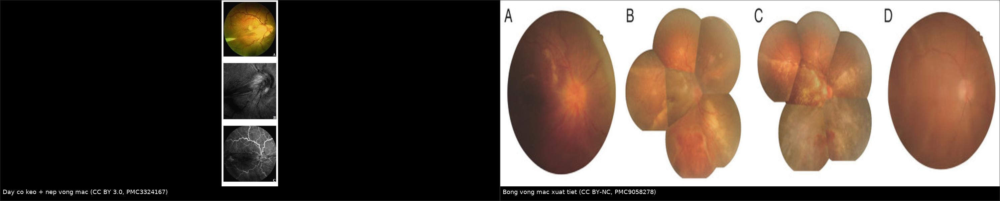
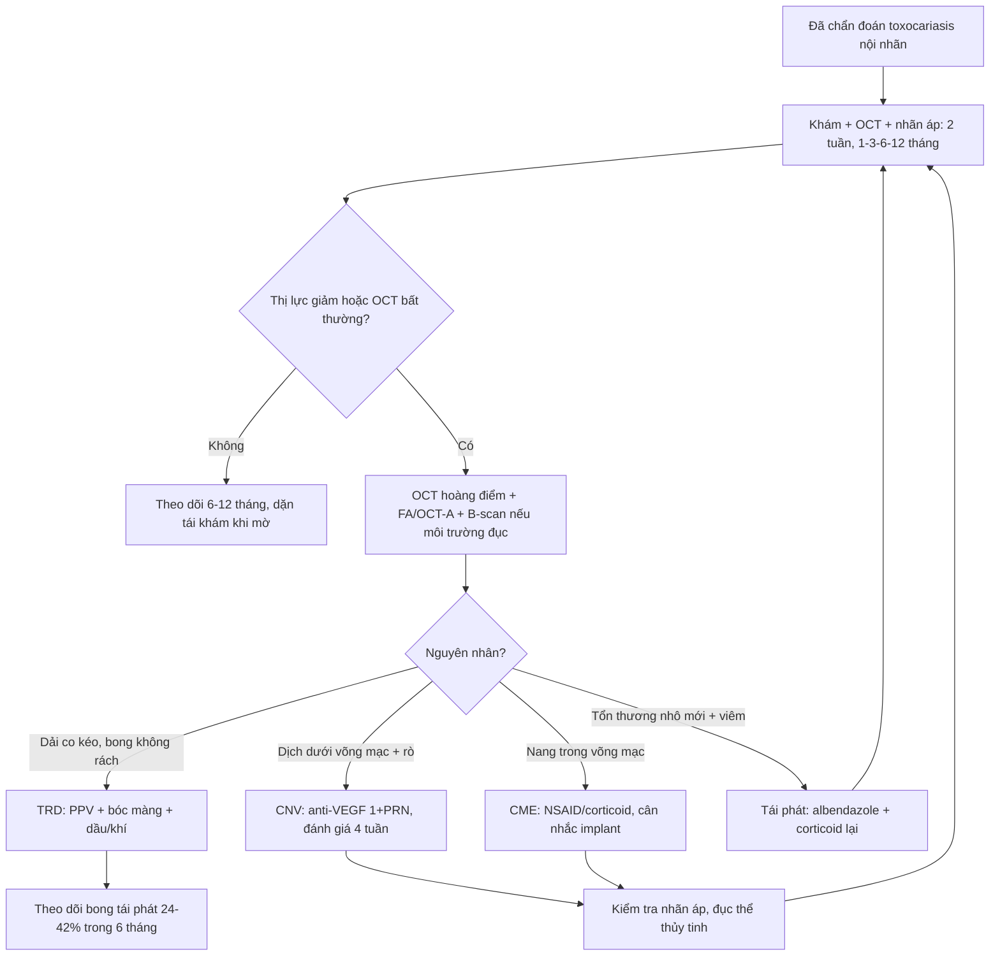
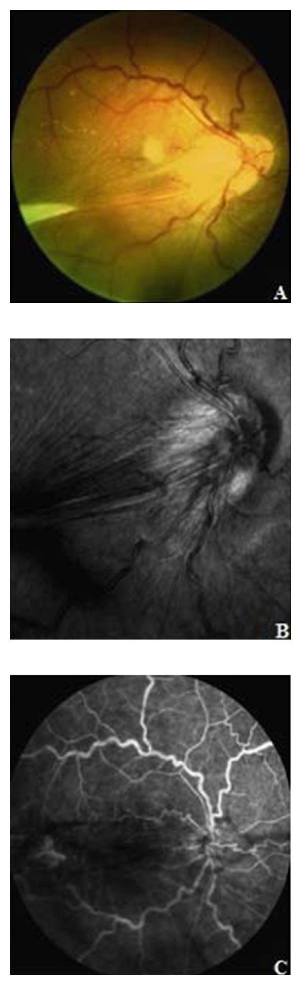
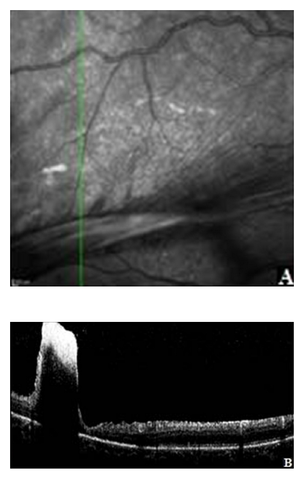
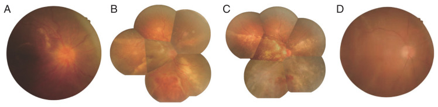
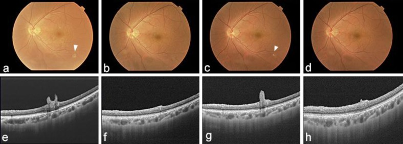

# 426 — Toxocariasis nội nhãn: theo dõi sau chẩn đoán & biến chứng muộn (CNV, bong võng mạc co kéo) / Ocular toxocariasis — long-term follow-up and late complications

**Tags:** `pattern:u-hat` `pattern:co-keo` `pattern:tan-mach-hac-mac` `pattern:bong-vong-mac` `vung:vong-mac` `vung:dich-kinh` `vung:mat` `vung:tre-em` `protocol:OCT` `protocol:OCT-A` `protocol:FA` `protocol:anti-VEGF` `protocol:PPV` `protocol:corticoid`
**Mức chắc chắn (certainty):** tổng hợp y văn (literature synthesis) — số liệu lấy từ **bài tổng quan 2014** (PMC4116038), **bài tổng quan kinh điển 2009** (PMC2659485), **loạt 10 bệnh nhân hai mắt** (PMC13627495), **loạt 33 mắt CNV trẻ em** (PMC8666601) và **3 ca nguyên văn có ảnh** (PMC3324167, PMC9058278, PMC3934803). Câu nào là suy luận được ghi **[suy luận]**.

> **Vì sao bài này quan trọng:** [466](../466-toxocariasis-noi-nhan/lesson.md) đã chốt **chẩn đoán** toxocariasis nội nhãn. Nhưng câu hỏi thật của bệnh nhi không phải "có phải giun không" mà là **"mắt này còn nguy hiểm bao lâu nữa"**. U hạt xơ hoá tiếp tục **co kéo** nhiều năm, viêm dịch kính mạn tiếp tục **kích thích tân mạch**, và bệnh **tái phát sau khi ngưng thuốc** — ca nguyên văn dưới đây tái phát **4 tháng** sau khi tổn thương đã "tan" (PMC3934803). Theo dõi sai nhịp = bỏ sót **bong võng mạc co kéo** và **CNV** ở đúng giai đoạn còn cứu được thị lực.

## 1. Tổng quan bệnh học – cơ chế hình ảnh

- **Bệnh học (pathology):** ấu trùng *Toxocara* chết/khu trú ở võng mạc → tổ chức hạt gồm **bạch cầu ái toan, đại thực bào, tế bào khổng lồ** rồi **xơ hoá bằng nguyên bào sợi** và **collagen**. Ba hệ quả muộn:
  1. **Co kéo (traction):** mô xơ co lại như sẹo, dính võng mạc vào dịch kính → **dải co kéo (traction band)** chạy từ u hạt tới đĩa thị, gây **nếp gấp võng mạc, màng trước võng mạc (ERM), bong võng mạc co kéo (TRD)**.
  2. **Tân mạch hắc mạc (CNV):** viêm mạn phá **biểu mô sắc tố (RPE) – màng Bruch**; thiếu oxy và cytokin viêm tăng **VEGF** → mạch máu hắc mạc mọc dưới võng mạc. Vì vậy **anti-VEGF là điều trị cơ chế**, không phải "chống viêm".
  3. **Viêm tồn dư:** u hạt vẫn hoạt động từng đợt → **phù hoàng điểm dạng nang (CME)**, **viêm dịch kính** tái diễn.
- **TẠI SAO OCT là công cụ theo dõi chính:** mô xơ co kéo tạo **lực kéo tiếp tuyến và vuông góc** — trên OCT thấy **nếp gấp các lớp trong võng mạc, màng tăng hồi âm trên ILM, khoảng trống dưới võng mạc**, và **mất dải ellipsoid (EZ)** tại vùng u hạt. CNV cho **vật liệu tăng hồi âm dưới võng mạc (SHRM) + dịch dưới võng mạc**; CNV hoạt động thì **dịch tái xuất hiện sau mỗi lần hết thuốc**.
- **TẠI SAO FA/OCT-A:** CNV **rò thuốc ở thì muộn** trên FA và có **mạng mạch tăng tín hiệu** trên OCT-A; sẹo xơ cũ chỉ **khiếm khuyết cửa sổ** (window defect), **không rò**. Phân biệt "sẹo sáng" với "CNV đang hoạt động" là điểm quyết định có tiêm hay không.
- **Số liệu định lượng cốt lõi:**
  - **Nguyên nhân giảm thị lực trong OT:** viêm dịch kính **52,6%**, **CME 47,4%**, **TRD 36,8%** (Pivetti-Pezzi 2009, PMC2659485) — nghĩa là **gần một nửa** mất thị lực do biến chứng **điều trị được**, không phải do u hạt.
  - **Tái phát viêm sau điều trị:** phối hợp **corticoid + albendazole** giảm tái phát **6 tháng còn 17,4%** so với **54,5%** khi chỉ dùng corticoid (Ahn 2014, PMC4116038).
  - **Bong võng mạc tái phát sau phẫu thuật dịch kính: 24–42%** do viêm tồn dư (PMC2659485).
  - **Mắt thứ hai:** trong loạt **10 bệnh nhân hai mắt** (tuổi **21 ± 15**), khởi phát **không đồng thì**; tỷ lệ **TRD tăng từ 25% ở mắt đến trước lên 60% ở mắt đến sau** (p = 0,016) (Gu 2026, PMC13627495).
  - **CNV ở trẻ em (mọi nguyên nhân, 33 mắt):** **97% là CNV type 2**, điều trị **1 mũi anti-VEGF + PRN** cần trung bình **1,40 ± 0,58 mũi**, **không ca nào tái phát** trong thời gian theo dõi; toxocariasis chiếm **1/30 bệnh nhân (3,3%)** (Zhang 2021, PMC8666601).

## 2. Mẫu hình + chẩn đoán phân biệt theo vị trí và cơ chế (gamut)

**Câu hỏi trung tâm: "thị lực giảm này do viêm còn hoạt động, do co kéo, hay do mạch máu mới?"** Mỗi câu trả lời là một cách điều trị khác nhau.

- **A. Hoàng điểm (macula) — giảm thị lực trung tâm:**
  - **CNV** (mờ trung tâm, biến dạng thị giác, OCT có dịch dưới võng mạc) → anti-VEGF.
  - **CME** (OCT: nang dịch trong võng mạc) → NSAID tại chỗ/corticoid; phân biệt CME do viêm với CME do thuốc.
  - **ERM co kéo** (nếp gấp + màng trên ILM) → theo dõi, mổ khi thị lực giảm tiến triển.
  - **U hạt hoàng điểm** (khối vàng–trắng tại hoàng điểm) → tiên lượng xấu vì phá tế bào quang thụ.
- **B. Ngoại vi / xích đạo — thường "im lặng" rồi bùng:**
  - **Dải co kéo → TRD** (bong võng mạc không rách, hình phễu/kéo) → mổ dịch kính + bóc màng.
  - **Nang võng mạc ngoại vi (peripheral retinal cyst)** — ca 2023 đo **2,6 mm và 2 mm**, thành mỏng, dễ bị đọc nhầm là bong võng mạc (PMC10397159).
  - **Rách do co kéo → bong võng mạc nguyên phát (rhegmatogenous)** — phải tìm lỗ rách, không chỉ bóc màng.
- **C. Toàn nhãn — bệnh cảnh muộn:**
  - **Viêm nội nhãn mạn** → đục thể thủy tinh, dính đồng tử, glôcôm tân mạch, teo nhãn cầu (phthisis).
  - **Corticoid kéo dài** → đục thể thủy tinh và **glôcôm do corticoid** (bài 1404) — bản thân điều trị cũng gây mù.
- **D. Kiểu tái phát cần nhận ra:** tổn thương **nhô ra từ bề mặt võng mạc vào dịch kính** xuất hiện lại sau khi đã phẳng — ca nguyên văn tái phát **4 tháng** sau khi ngưng phác đồ (PMC3934803). Kiểu này khác "sẹo cũ" (sẹo không nhô, không viêm).

## 3. Bảng so sánh phân biệt (ma trận đối chiếu)

| Thực thể (entity) | Hình ảnh điển hình | Chốt vào (rule-in) | Chốt loại (rule-out) | Gợi ý xác nhận |
|---|---|---|---|---|
| **CNV do toxocariasis** | Dưới võng mạc: **SHRM + dịch dưới võng mạc**; FA **rò thì muộn**; OCT-A có mạng mạch | **Dịch dưới võng mạc tái phát + rò trên FA + OCT-A có mạch** | Sẹo xơ phẳng, không rò, không dịch → chỉ theo dõi | OCT 4 tuần/lần khi đang tiêm; FA/OCT-A khi nghi |
| **Bong võng mạc co kéo (TRD)** | **Dải xơ từ u hạt tới đĩa thị**, võng mạc căng phễu, **không rách**, di động hạn chế trên B-scan | **Dải co kéo + bong võng mạc không rách** | Có lỗ rách + dịch di chuyển → bong nguyên phát | B-scan khi môi trường đục; OCT vùng hoàng điểm; mổ bóc màng |
| **Bong võng mạc xuất tiết** | Dịch dưới võng mạc **lan rộng, không rách**, có thể kèm xuất tiết; đĩa thị phù | **Dịch lan + không lỗ rách + đáp ứng corticoid/kháng viêm** | Dải co kéo rõ + bong khu trú → TRD | OCT, B-scan; theo dõi sau corticoid/kháng viêm |
| **CME** | Nang dịch **trong** võng mạc, mất foveal depression; FA **hoa hồng (petaloid)** | **Nang trong võng mạc + rò hoàng điểm** | Dịch **dưới** võng mạc đơn thuần → nghĩ CNV/xuất tiết | OCT từng lần khám; đo độ dày trung tâm |
| **ERM co kéo** | Màng tăng hồi âm **trên ILM** + nếp gấp; không dịch dưới võng mạc | **Màng trên ILM + nếp gấp + thị lực giảm tiến triển** | Có dải tới u hạt/đĩa thị → co kéo do u hạt | OCT; theo dõi 3–6 tháng; mổ khi chức năng giảm |
| **Tái phát u hạt** | Tổn thương **nhô vào dịch kính** + viêm dịch kính nhẹ; có thể kèm tăng bạch cầu ái toan | **Tổn thương nhô mới + viêm tái diễn sau khi đã phẳng** | Sẹo phẳng, không viêm, không nhô → di chứng | So ảnh cũ + OCT; ELISA IgG *Toxocara* |
| **Nang võng mạc ngoại vi** | Nang **thành mỏng, bờ rõ**, trong (2–2,6 mm), không dịch di chuyển | **Bờ rõ + không rách + không thay đổi theo tư thế** | Có rách/dịch di chuyển → bong võng mạc | UBM/siêu âm tần số cao; chụp lại 3 tháng |

*Trái: **dải co kéo từ u hạt tới đĩa thị + nếp gấp võng mạc**, FA rò từ tổn thương. Phải: **bong võng mạc xuất tiết** (A lúc vào, B–D sau tiêm dexamethasone: đĩa thị bớt phù, xuất tiết hấp thu, võng mạc phẳng lúc 8 tháng). Nguồn: Verallo 2012 (PMC3324167) CC BY 3.0 và Cai 2022 (PMC9058278) CC BY-NC; ảnh ghép letterbox, không crop.*

### Dấu hiệu chốt trên từng phương thức
- **OCT:** nếp gấp lớp trong + màng trên ILM (co kéo); **SHRM + dịch dưới võng mạc** (CNV); nang trong võng mạc (CME); mất EZ tại u hạt (tổn thương tế bào quang thụ).
- **FA:** **rò thì muộn** = mạch máu mới/viêm hoạt động; **khiếm khuyết cửa sổ** = sẹo RPE; **hoa hồng** = CME.
- **OCT-A:** mạng mạch dưới võng mạc **có tín hiệu dòng chảy** = CNV hoạt động; cần chụp lặp lại để phân biệt mạch mới với mạch hắc mạc bình thường.
- **B-scan:** dải tăng hồi âm **dính đĩa thị**, bong võng mạc **không rách**, nang ngoại vi; bắt buộc khi đục thể thủy tinh/viêm dịch kính dày.

## 4. Protocol theo dõi + điều trị biến chứng

- **Lịch theo dõi sau chẩn đoán [suy luận từ diễn tiến ca và khuyến cáo điều trị viêm mạn]:** khám + OCT **2 tuần** sau khi bắt đầu thuốc; sau đó **1 tháng, 3 tháng, 6 tháng, 12 tháng**, rồi **mỗi 6–12 tháng** nếu yên. Lý do theo dõi dài: tái phát đã ghi nhận **4 tháng** sau khi tổn thương phẳng (PMC3934803) và TRD tiến triển **nhiều năm** sau u hạt.
- **Mỗi lần khám tối thiểu:** thị lực có chỉnh kính, **nhãn áp** (vì corticoid), đèn khe (viêm tiền phòng, dính đồng tử), soi đáy mắt giãn đồng tử tới **tận chu biên**, **OCT hoàng điểm**. Nghi CNV/viêm hoạt động → **FA ± OCT-A**. Môi trường đục → **B-scan**.
- **Điều trị nhiễm giun + viêm (nền tảng):** **albendazole** phối hợp **corticoid**; liều theo Barisani-Asenbauer (dẫn trong PMC4116038): **người lớn 800 mg × 2/ngày, trẻ 400 mg × 2/ngày**, kèm corticoid; **5 bệnh nhân không tái phát trong 13,8 tháng**. Phác đồ của bài 466 (**albendazole 400 mg/ngày × 30 ngày**) là phác đồ khác của DUSN — **không trộn hai phác đồ**.
- **CNV:** **anti-VEGF nội nhãn theo 1 + PRN**, đánh giá lại **4 tuần/lần** bằng OCT; ở loạt CNV trẻ em (mọi nguyên nhân) trung bình **1,40 ± 0,58 mũi** là đủ kiểm soát, **không tái phát** (PMC8666601). Nếu CNV kèm co kéo nặng/đục dịch kính → **PPV kết hợp anti-VEGF** (ca toxocariasis trong loạt này được xử trí như vậy). Corticoid **không thay** anti-VEGF.
- **TRD:** **PPV 25–27G + bóc màng/giải phóng co kéo**, dùng **dầu silicon hoặc khí** tùy độ phức tạp; ca trẻ 11 tuổi dùng **25G + bóc màng + triamcinolone quanh nhãn 40 mg** cuối mổ để giảm viêm tồn dư (PMC13553358). Cảnh báo bệnh nhân **bong tái phát 24–42%** (PMC2659485) → theo dõi sát 6 tháng đầu sau mổ.
- **Bong xuất tiết/CME nặng:** **dexamethasone implant nội nhãn** đã được báo cáo làm **võng mạc phẳng, hết xuất tiết lúc 8 tháng** ở ca OT (PMC9058278); lựa chọn khác: corticoid uống/tiêm dưới Tenon, NSAID tại chỗ. Theo dõi **nhãn áp và đục thể thủy tinh** sau implant.
- **Không có hệ phân độ RADS riêng cho OT** — mô tả theo **3 thể** (viêm nội nhãn mạn / u hạt cực sau / u hạt ngoại vi) và **biến chứng chính** (CNV, TRD, CME, ERM).

## 5. Biến thể bình thường và cạm bẫy

- **"Mắt yên lặng = đã khỏi" là cạm bẫy nguy hiểm nhất:** u hạt xơ tiếp tục co kéo khi **không có viêm**; TRD có thể xuất hiện **nhiều năm** sau lần viêm cuối. Vẫn phải soi tới chu biên và chụp OCT định kỳ.
- **CNV bị che bởi viêm dịch kính:** thị lực giảm **không tương xứng** với độ đục môi trường → đừng chờ "hết viêm rồi tính"; **OCT/FA sớm** để không bỏ cửa sổ điều trị.
- **Điều trị corticoid đơn thuần:** tái phát **6 tháng 54,5%** so với **17,4%** khi phối hợp albendazole (PMC4116038) — corticoid giảm viêm nhưng **không diệt giun**.
- **Theo dõi quá ngắn:** ca nguyên văn phẳng sau **8 tháng** điều trị, **tái phát 4 tháng sau** đó với tổn thương nhô vào dịch kính, rồi phẳng sau **2 tháng albendazole đơn thuần** (PMC3934803) — lịch 3 tháng/lần trong năm đầu là tối thiểu.
- **Bỏ sót mắt thứ hai:** 10/10 ca hai mắt khởi phát **không đồng thì**, mắt đến sau có **TRD 60%** (PMC13627495) — khám **cả hai mắt** mỗi lần, kể cả khi mắt kia "bình thường".
- **Nhầm nang ngoại vi với bong võng mạc:** nang **2–2,6 mm thành mỏng, không rách** (PMC10397159); mổ nhầm nang không có chỉ định = làm tổn thương võng mạc lành.
- **Nhầm TRD với bong nguyên phát:** nếu không **bóc màng/giải phóng co kéo**, bơm dầu đơn thuần sẽ thất bại và bong lại — luôn tìm **dải xơ dính đĩa thị** trên B-scan/OCT.
- **Tác dụng phụ của chính điều trị:** corticoid kéo dài gây **glôcôm và đục thể thủy tinh**; trẻ nhỏ còn nguy cơ **nhược thị** — đo nhãn áp mỗi lần, khám khúc xạ định kỳ [suy luận từ thực hành nhi].

## 6. Tự lượng giá — Blind Quiz ngay trên trang tĩnh

**Ca 1 — Nữ 24 tuổi, người châu Á, nhìn mờ một mắt, đáy mắt có "dây trắng"**

- Gợi ý lâm sàng: không đau, không đỏ; không bệnh toàn thân; mắt còn lại bình thường.
- Câu hỏi: Cấu trúc dây trắng nối **khối tổn thương với đĩa thị** là gì? Nó gây biến chứng gì? Ba thăm khám cần làm ngay?

<b>Bấm để hiện đáp án (findings + chẩn đoán)</b>

- **Dấu hiệu:** (A) khối trắng ở vùng thái dương + **dải xơ chạy từ khối tới đĩa thị**, võng mạc hoàng điểm bị **kéo thành nếp**; (B) ảnh hồng ngoại cho thấy **co kéo đĩa thị**; (C) FA có **rò từ tổn thương** (viêm hoạt động/mạch máu).
- **Chẩn đoán:** **u hạt toxocariasis cực sau (posterior pole granuloma) có dải co kéo** — dải xơ không phải "mạch máu", mà là **mô xơ co kéo**; đây là cơ chế của **TRD** và nếp gấp hoàng điểm.
- **Việc cần làm:** OCT hoàng điểm (tìm nếp gấp/dịch), B-scan (bong võng mạc ẩn), FA/OCT-A (rò/CNV), ELISA *Toxocara*; theo dõi sát và tư vấn mổ nếu co kéo tiến triển.

- **OCT:** (A) ảnh hồng ngoại cho thấy **nếp gấp võng mạc**; (B) SD-OCT qua nếp gấp: **các lớp trong tăng hồi âm dày lại**, bên dưới là vùng **giảm/kém hồi âm** che mất các lớp võng mạc ngoài — tương ứng lực kéo của dải xơ.
- **Nguồn ảnh:** Verallo O et al., Case Rep Med 2012 (PMC3324167), **CC BY 3.0**.
- **Nguồn ảnh:** Verallo O et al., Case Rep Med 2012 (PMC3324167), **CC BY 3.0**.

**Ca 2 — Bé trai 13 tuổi, mắt phải mờ còn đếm ngón tay, đĩa thị phù, có xuất tiết quanh hoàng điểm**

- Gợi ý lâm sàng: không sốt; thị lực mắt phải chỉ còn đếm ngón tay; OCT hoàng điểm có **khoảng trống dưới võng mạc**; không thấy u hạt rõ.
- Câu hỏi: Đây là bong võng mạc **co kéo hay xuất tiết**? Vì sao không mổ ngay? Theo dõi bằng gì?

<b>Bấm để hiện đáp án (findings + chẩn đoán)</b>

- **Dấu hiệu:** (A) xuất tiết quanh hoàng điểm, **đĩa thị phù**, tĩnh mạch giãn ngoằn ngoèo, xuất huyết trước võng mạc; (B–D) sau tiêm dexamethasone: đĩa thị bớt phù, xuất huyết/xuất tiết hấp thu dần, **võng mạc phẳng lúc 8 tháng**.
- **Chẩn đoán:** **bong võng mạc xuất tiết** trong toxocariasis — dịch **lan, không rách, không có dải co kéo**; điều trị **kháng viêm** (implant dexamethasone) chứ không phải mổ dịch kính ngay.
- **Vì sao không mổ ngay:** mổ bong xuất tiết do viêm khi chưa kiểm soát viêm dễ **bong lại và tổn thương thêm**; mục tiêu là làm phẳng bằng kháng viêm trước.
- **Nguồn ảnh:** Cai Y et al., Korean J Parasitol 2022 (PMC9058278), **CC BY-NC**.

**Ca 3 — Nam 50 tuổi, đã điều trị 8 tháng, tổn thương "đã phẳng" rồi mờ lại**

- Gợi ý lâm sàng: đã ngưng thuốc 4 tháng; không đau; thị lực giảm lại; tổn thương ban đầu là u hạt cực sau có ấu trùng trong võng mạc.
- Câu hỏi: Tổn thương "nhô ra" trên OCT là sẹo cũ hay **tái phát**? Cần làm gì trước khi tăng corticoid?

<b>Bấm để hiện đáp án (findings + chẩn đoán)</b>

- **Dấu hiệu:** (a, e) tổn thương trắng **nhô từ bề mặt võng mạc vào dịch kính**; (b, f) tan sau 8 tháng điều trị; (c, g) **tái phát với tổn thương nhô mới sau 4 tháng**; (d, h) phẳng sau **2 tháng albendazole đơn thuần**.
- **Chẩn đoán:** **tái phát u hạt hoạt động**, không phải sẹo — sẹo xơ **không nhô** và không kèm viêm dịch kính.
- **Trước khi tăng corticoid:** loại trừ **CNV** (OCT-A/FA) và **nhiễm trùng khác**; nếu tái phát do giun còn sống → **albendazole + corticoid** theo phác đồ, không chỉ corticoid.
- **Nguồn ảnh:** Hashida N et al., Case Rep Ophthalmol 2014 (PMC3934803), **CC BY-NC**.

## Bài liên quan chéo
- [400 – Tổng quan Mắt & thị giác](../400-tong-quan-mat-thi-giac/lesson.md)
- [466 – Toxocariasis nội nhãn: chẩn đoán, 3 thể và điều trị ban đầu](../466-toxocariasis-noi-nhan/lesson.md)
- [425 – DUSN & ấu trùng di động dưới võng mạc](../425-dusn-au-trung-di-dong-duoi-vong-mac/lesson.md)
- [1410 – Lấy dầu silicon và dầu tồn lưu](../1410-lay-dau-silicone-va-dau-ton-luu/lesson.md) (mắt đã mổ dịch kính)
- [1418 – Phù hoàng điểm đáp ứng anti-VEGF](../1418-phu-hoang-diem-xa-khang-anti-vegf/lesson.md)
- [1404 – Biến chứng mạn của anti-VEGF và corticoid](../1404-bien-chung-man-anti-vegf/lesson.md)

## Ảnh
- Tên file: `426_slug_Modality_SourceID.jpg`; nguồn + giấy phép từng ảnh ở `images/CREDITS.md`.
- Ảnh composite `composite_cokep-vs-xuat-tiet.jpg` tạo bằng `tools/make_composite.py` (letterbox, không crop/kéo giãn) từ 2 ảnh CC BY/CC BY-NC.

> Không dùng để chẩn đoán độc lập khi chưa có người hướng dẫn.
