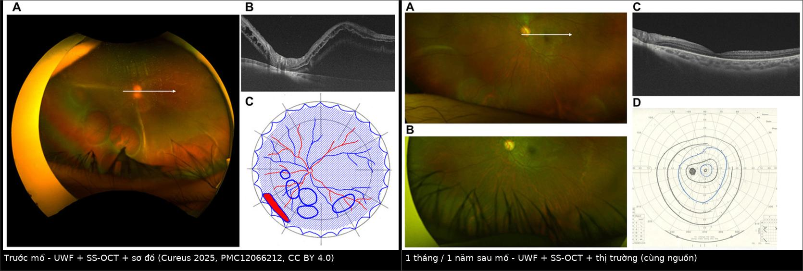
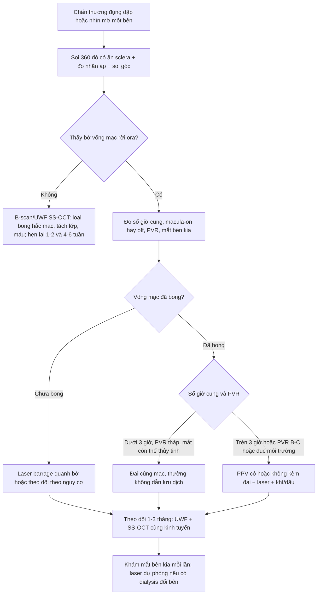
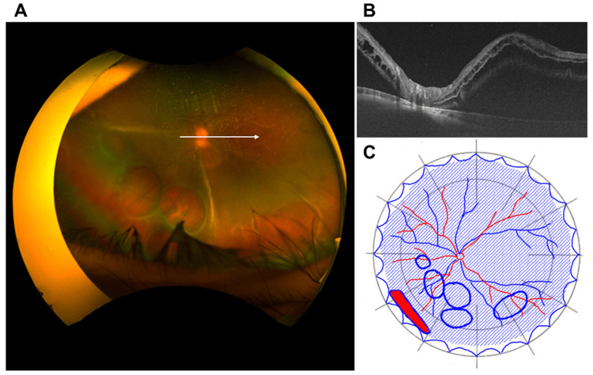
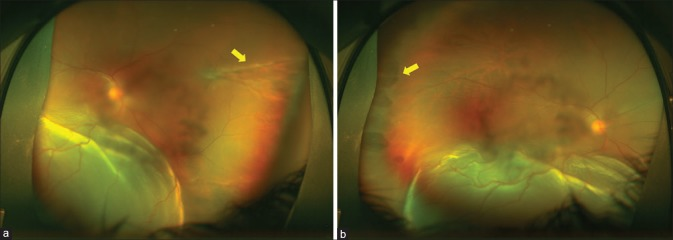
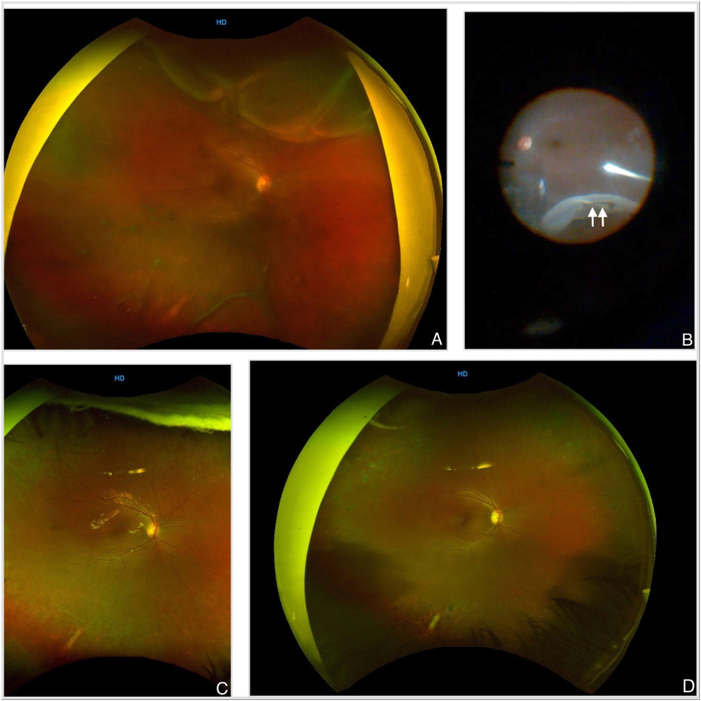
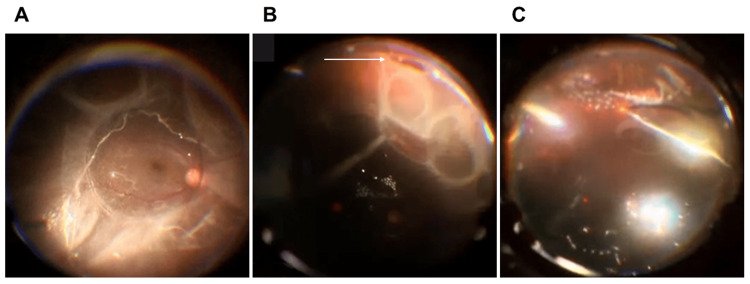
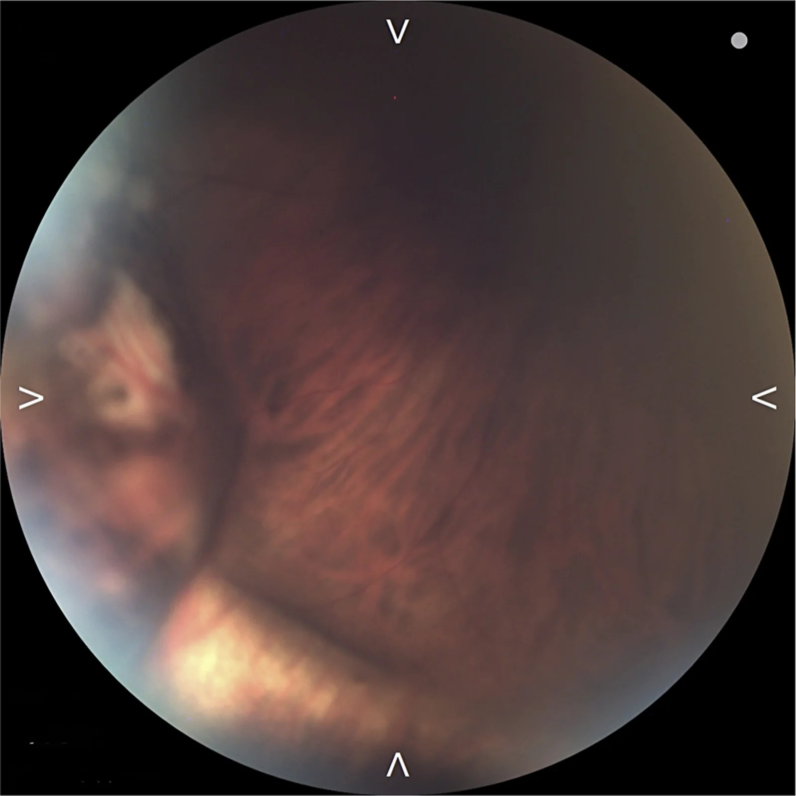

# 427 — Đứt chân võng mạc sau chấn thương đụng dập / Retinal dialysis

**Tags:** `pattern:dut-chan-vong-mac` `pattern:lo-rach-vong-mac` `pattern:bong-vong-mac` `pattern:chan-thuong-dung-dap` `pattern:ora-serrata` `vung:mat` `vung:vong-mac` `vung:ora-serrata` `protocol:soi-day-mat-an-sclera` `protocol:UWF` `protocol:UWF-SS-OCT` `protocol:sieu-am-B-scan` `score:clock-hours` `incidentaloma:khong`

**Mức chắc chắn (certainty):** tổng hợp y văn (literature synthesis) — dựng từ **ca hai bên + tổng quan 10 năm** (*Case Rep Ophthalmol* 2026, **PMC13688648**, CC BY-NC 4.0 — dùng 1 ảnh), **loạt 53 mắt do phẫu thuật viên võng mạc mới** (*Indian J Ophthalmol* 2025, **PMC11834908**, CC BY-NC-SA 4.0 — chỉ đọc số), **ca bong toàn bộ + nang võng mạc** (*Cureus* 2025, **PMC12066212**, CC BY 4.0 — dùng 3 ảnh + composite), **ca dialysis mũi + thoái hóa "đường bờ biển"** (*Indian J Ophthalmol* 2019, **PMC6727708**, CC BY-NC-SA 4.0 — dùng 1 ảnh), **ca dialysis tự phát trong viêm trung gian liên quan MS** (*Am J Ophthalmol Case Rep* 2025, **PMC11875825**, CC BY-NC-ND 4.0 — dùng 1 ảnh), **đoàn hệ mắt bên kia** (*J Clin Med* 2025, **PMC11721734**, CC BY 4.0 — chỉ đọc số), **135 mắt laser dự phòng định hướng SS-OCT** (*Bioengineering* 2025, **PMC12729268**, CC BY 4.0 — chỉ đọc số), **UWF SS-OCT tổn thương ngoại vi** (*Diagnostics* 2025, **PMC12650825**, CC BY 4.0 — chỉ đọc số) và **siêu cấu trúc vitreous base** (*BMC Ophthalmol* 2023, **PMC10283189**, CC BY 4.0 — chỉ đọc số). Nhóm **không có bệnh nhân của mình**; chỗ suy luận ghi **[suy luận]**. **Không ghi tên tác giả** — attribution dùng tạp chí + năm + PMCID.

> **Vị trí trong thư viện:** [445](../445-bong-vong-mac/lesson.md) chốt **bong võng mạc nói chung** (rách – co kéo – tiết dịch); [1481](../1481-lo-rach-vong-mac-laser-du-phong/lesson.md) chốt **lỗ rách cấp chưa bong**; [1518](../1518-tach-lop-vong-mac-ngoai-vi/lesson.md) chốt **vòm tách lớp ngoại vi**; [1479](../1479-bong-vong-mac-thanh-dich/lesson.md) chốt **bong thanh dịch không lỗ**; [1444](../1444-viem-mang-bo-dao-sau-chan-thuong/lesson.md) chốt **viêm tiền phòng sau chấn thương kín**. Bài này trả lời khoảng trống ở **bờ trước của võng mạc**: khi võng mạc **bong khỏi ora serrata** chứ không rách trong võng mạc — vì sao khó thấy, vì sao đến muộn, và khi nào laser, khi nào đai củng mạc.

> **Câu chốt — sáu con số phải thuộc:** **(1)** Dialysis chiếm **8–17%** toàn bộ bong võng mạc có lỗ (**PMC11834908**; tổng quan khác ghi **10–15%**, **PMC13688648**), nhưng chiếm **~75%** rách sau chấn thương và có mặt trong **tới 85%** bong võng mạc do chấn thương (**PMC13688648**). **(2)** Bệnh nhân rất trẻ: tuổi trung bình **20,77** (6–55), **73,6% nam**, **71,7%** có tiền sử chấn thương (**PMC11834908**). **(3)** Đến muộn là quy luật: triệu chứng trung bình **6,89 tháng**, **31,5%** ca chấn thương chỉ được chẩn đoán **> 1 năm** sau tai nạn, và **77,4% (41/53)** đã bong hoàng điểm khi đến (**PMC11834908**) — vì **không có PVD** nên không có nhá đèn/ruồi bay báo trước. **(4)** Đai củng mạc vẫn là chuẩn ở mắt còn thể thủy tinh: dính **84,9%** sau một mổ (**PMC11834908**), **87% → 97%** sau một/hai mổ trong loạt 52 mắt, dính lâu dài **77%** (**PMC13688648** dẫn Stoffelns). **(5)** PVR thấp (**5,6%**, Kennedy 72 mắt) vì **bờ sau dialysis dính chặt vitreous base** tạo hàng rào với tế bào RPE — đây là lý do tiên lượng tốt hơn bong võng mạc thường (**PMC13688648**). **(6)** **Phải soi 360° có ấn sclera**: dialysis **1 giờ cung** có thể chỉ lộ ra khi ấn sclera (**PMC6727708**), và **5/53** bệnh nhân có dialysis **mắt bên kia** (**PMC11834908**) — bỏ mắt thứ hai là lỗi hệ thống.

## 1. Tổng quan bệnh học – cơ chế hình ảnh (TẠI SAO)

### 1.1 Giải phẫu: ora serrata là điểm yếu có chủ đích

- **Ora serrata** là bờ trước của võng mạc cảm giác, nơi võng mạc **mỏng nhất**, mất lớp tế bào quang thụ và **dính chặt vào biểu mô thể mi** bằng một vùng gian bào đặc. Ngay phía sau ora là **vitreous base** — vùng dịch kính đặc nhất, bám cả **trước ora 1,5–2 mm** trên pars plana và **sau ora 3–5 mm** trên võng mạc (**PMC10283189**).
- Siêu cấu trúc cho thấy một bó collagen gọi là **ciliary body–choroid–retina connector (CB-C-R)**: nối **sợi dịch kính ở trong**, **biểu mô thể mi ở trước**, **võng mạc ngoại vi ở sau** và **tổ chức hắc mạc ở ngoài** (**PMC10283189**). Vì vậy khi chấn thương làm **avulsion vitreous base**, có thể xảy ra đồng thời **dialysis** và **bong biểu mô thể mi** — hai tổn thương cùng một cơ chế kéo, không phải hai bệnh.
- **TẠI SAO đứt ở ora mà không rách giữa võng mạc:** lực kéo tập trung tại mặt phân cách **võng mạc–ora–vitreous base**, nơi mô chuyển từ võng mạc thần kinh sang biểu mô thể mi; võng mạc ở đây **không có tế bào quang thụ** nên tổn thương không tạo ra "flash" kiểu PVD và cũng **không có nắp rách** (operculum) — chỉ có **đường disinsertion cong theo chu vi**.

### 1.2 Chấn thương đụng dập gây dialysis như thế nào

- Cơ chế kinh điển: nhãn cầu bị **ép theo trục trước–sau** rồi **giãn ra theo xích đạo** (globe expansion) trong vài mili giây; **vitreous base không co giãn** nên bị **bóc khỏi ora** — tạo dialysis, thường kèm **dập võng mạc**, **xuất huyết dịch kính**, **rách mống mắt**, **góc rẽ** **[suy luận cơ học từ giải phẫu CB-C-R, PMC10283189]**.
- Vị trí phản ánh hướng lực: trong nhóm chấn thương, **38,4%** dialysis ở **trên–mũi** và **25,6%** ở **dưới–thái dương** (**PMC11834908**); tổng quan ghi nhận **trên–mũi** là vị trí điển hình sau chấn thương (**PMC13688648**).
- **Thời điểm** rất quan trọng: trong **77 bệnh nhân** rách sau chấn thương, chẩn đoán **trong 6 tuần** cho tiên lượng thị lực tốt hơn rõ rệt so với chẩn đoán muộn (**PMC13688648** dẫn Johnston). Đây là cơ sở cho lịch khám lại sau chấn thương ở mục 4.

### 1.3 Vì sao bong võng mạc do dialysis tiến triển CHẬM — và vì sao bệnh nhân đến muộn

- Ba yếu tố cùng chiều:
  1. **Không có PVD** ở người trẻ → không có cơn nhá đèn/ruồi bay ồ ạt, dịch kính không hóa lỏng nhanh;
  2. **Bờ sau của dialysis dính vào vitreous base** — tổ chức này được cho là **hàng rào với sự di chuyển tế bào RPE**, nên **PVR thấp (5,6%)** (**PMC13688648** dẫn Kennedy);
  3. dịch dưới võng mạc tích tụ **từ từ theo trọng lực**, nên vùng bong lan dần mà thị lực trung tâm còn tốt một thời gian.
- Hệ quả thực hành: **triệu chứng trung bình 6,89 tháng**, **31,5%** ca chấn thương được chẩn đoán **> 1 năm** sau chấn thương, **77,4%** đã **bong hoàng điểm** khi đến (**PMC11834908**). Ca **29 tuổi** trong **PMC12066212** nhìn mờ **~2 năm** mới đi khám, vào viện với bong **toàn bộ** và BCVA **20/200**.
- **TẠI SAO PVR thấp lại quan trọng:** PVR là yếu tố quyết định thất bại của đai củng mạc; trong loạt 53 mắt, thành công một mổ ở PVR-C1 vẫn **80%** và giant dialysis **83,3%** (**PMC11834908**) — cao hơn nhiều so với bong võng mạc có PVR nặng.

### 1.4 Vì sao ảnh trông như vậy — từng modality

- **Soi đáy mắt giãn đồng tử + ấn sclera:** là **chuẩn vàng**. Dialysis hiện ra như **võng mạc "cụt" ở bờ ora**, bờ **cong theo chu vi**, **không có nắp**, có thể thấy **mạch máu chạy tới sát bờ rách** và **võng mạc bong trắng–xám** phía sau. Nếu **không ấn sclera**, vùng ora bị khuất sau pars plana → **dialysis 1 giờ cung có thể hoàn toàn vô hình** (**PMC6727708**).
- **UWF (ultra-widefield) màu:** chụp được **tới tận ora** ở nhiều hướng, cho **bản đồ 200°** để so sánh giữa các lần; nhưng vẫn cần **ấn sclera** để mở góc nhìn ra trước. Trong ca CCRD, UWF cho thấy **thoái hóa vùng mũi ~6 giờ cung** và vùng thái dương có **oral bays**, còn dialysis **1 giờ cung** chỉ xác nhận khi ấn sclera (**PMC6727708**).
- **Siêu âm B-scan:** dùng khi **đục thể thủy tinh/xuất huyết dịch kính** che đáy mắt. Võng mạc bong do dialysis cho **màng mỏng, di động, chạy tới ora**; **không thấy được bờ rách nhỏ** nhưng loại được **bong hắc mạc, khối u, màng co kéo**. Trong loạt 53 mắt, **3 mắt xuất huyết dịch kính** phải chờ **6 tuần** cho dịch kính trong rồi mới mổ (**PMC11834908**) — B-scan là công cụ theo dõi trong khoảng đó.
- **UWF SS-OCT (bước sóng ~1050 nm):** cắt được **qua vùng ora** và cho thấy **khoang dưới võng mạc tới bờ rách**, **co kéo dịch kính**, **dịch trong nang**, **độ dày võng mạc ngoại vi**. Đây là modality mô tả tổn thương ngoại vi tốt hơn soi thường (**PMC12650825**), và có thể **thay đổi quyết định laser**: trong **135 mắt** được chỉ định laser dự phòng theo soi đáy mắt, **25,1%** không còn đủ tiêu chuẩn khi SS-OCT không thấy co kéo/dịch (**PMC12729268**).
- **OCT hoàng điểm:** xác định **macula-on/off** và dịch dưới võng mạc trung tâm; **không** thay thế soi chu biên.
- **Nang võng mạc:** gặp ở **1–3%** mắt RRD; trong ca **PMC12066212**, nang nằm sau dialysis và **tự hết sau mổ** dù không lấy hết dịch — nang là **dấu của bong kéo dài**, không phải lý do để thao tác thêm vào võng mạc.

### 1.5 Thể tự phát: vì sao lại ở dưới–thái dương

- Ở nhóm **không chấn thương**, **66,7%** dialysis nằm ở **dưới–thái dương** (**PMC11834908**) — ngược hẳn nhóm chấn thương. Tổng quan cũng ghi **~75%** dialysis ở **dưới–thái dương** trong các loạt lớn (**PMC13688648** dẫn Kennedy).
- Giải thích được đề xuất: **thoái hóa hắc mạc–võng mạc ngoại vi** và **oral bays** làm yếu vùng ora; ca **25 tuổi** không chấn thương có **coastline-like chorioretinal degeneration (CCRD)** **~6 giờ cung** cùng bên với dialysis **trên–mũi 1 giờ cung**, và **mắt bên kia** cũng có CCRD → gợi ý **yếu tố nền hai bên** (**PMC6727708**).
- Ở **viêm trung gian liên quan MS**, cơ chế là **co kéo vitreous base** kèm **mỏng võng mạc ngoại vi do thiếu máu**, gây dialysis **tuần tự hai mắt** dù không chấn thương (**PMC11875825**) — đây là lý do phải **soi chu biên ở mọi viêm trung gian**, không chỉ ở bệnh nhân chấn thương.

## 2. Mẫu hình + chẩn đoán phân biệt theo vị trí (gamut)

### 2.1 Bốn mẫu hình của cùng một tổn thương

1. **Dialysis chấn thương điển hình:** nam trẻ, **trên–mũi**, **< 3 giờ cung**, kèm dập võng mạc/xuất huyết dịch kính/góc rẽ; bong tiến triển chậm.
2. **Dialysis tự phát / vô căn (bilateral idiopathic retinal dialysis — BIRD):** **dưới–thái dương**, thường **một bên khi đến** nhưng **mắt bên kia có thể đã có dialysis** (**5/53**) — phải khám mắt lành (**PMC11834908**).
3. **Giant retinal dialysis:** **> 3 giờ cung**, trong loạt 53 mắt **6 ca, 100% do chấn thương**, hay kèm **PVR-B/C1**; vẫn có thể đai củng mạc (**5/6 thành công**) nhưng khó hơn (**PMC11834908**).
4. **Dialysis trên nền bệnh ngoại vi:** **CCRD/oral bays** (**PMC6727708**) hoặc **viêm trung gian/co kéo vitreous base** (**PMC11875825**) — tổn thương **không có tiền sử chấn thương**, dễ bị bỏ qua vì "không có lý do".

### 2.2 Vị trí quyết định cách đọc

- **Trên–mũi:** nghĩ **chấn thương**; kiểm tra **góc rẽ, nhãn áp, đồng tử, thể thủy tinh** cùng lúc.
- **Dưới–thái dương:** nghĩ **tự phát**; soi **mắt bên kia** và tìm **thoái hóa ngoại vi/oral bays**.
- **Vùng mũi + thoái hóa bờ lượn sóng:** nghĩ **CCRD**; phân biệt với **paving stone** (đám rải rác, bờ có sắc tố) và **oral bay bán phần** (**PMC6727708**).
- **Bờ rách nằm trong võng mạc, có nắp:** **không phải dialysis** — đó là **lỗ rách do PVD** (horseshoe) hoặc **giant retinal tear**.

### 2.3 Gamut chẩn đoán phân biệt

- **Retinal dialysis** (chấn thương/tự phát/giant) — bờ ở **ora**, không nắp.
- **Horseshoe tear** — có **nắp/operculum**, thường kèm **PVD**, ở xích đạo/chỗ bám mạch.
- **Giant retinal tear (GRT)** — rách **≥ 90°** (≥ 3 giờ cung) nhưng **bờ nằm trong võng mạc**, thường có **PVD**, võng mạc bờ rách **cuộn ra sau**; khác dialysis ở **vị trí bờ** và **cơ chế**.
- **Tách lớp võng mạc ngoại vi (retinoschisis) + rách lớp ngoài** — vòm **trong suốt**, **cột Müller**, **không có đường disinsertion** (bài 1518).
- **Lỗ teo trong thoái hóa dạng lưới (lattice)** — **dải teo phẳng**, lỗ nhỏ trong dải, không ở ora.
- **Oral bay / enclosed oral bay** — **biến thể bình thường**: vùng pars plana ciliary epithelium lấn ra sau, bờ **nhẵn, không có võng mạc bong**; **không laser**.
- **Bong thanh dịch/exudative** — dịch **di chuyển theo tư thế**, **không lỗ**, tìm u/viêm/CSC (bài 1479).
- **Bong hắc mạc** — vòm **dày, nhẵn, không dính đĩa thị**, bối cảnh hạ nhãn áp/sau mổ.
- **Bong biểu mô thể mi / khe thể mi** — hạ nhãn áp, tiền phòng nông, **không phải bong võng mạc**; nhưng có thể **cùng tồn tại** sau chấn thương do avulsion vitreous base (**PMC10283189**).

### 2.4 Ba câu hỏi cho mọi rách ngoại vi

1. **Bờ rách nằm ở đâu** — tại ora (dialysis) hay trong võng mạc (horseshoe/GRT)?
2. **Có nắp/operculum và PVD không** — có → cơ chế co kéo; không → cơ chế bóc tách tại bờ.
3. **Dịch dưới võng mạc lan tới đâu** — chưa bong, bong khu trú, đe dọa hoàng điểm, hay macula-off?

## 3. Bảng so sánh phân biệt (ma trận đối chiếu)

| Thực thể (entity) | Hình ảnh điển hình (soi ấn sclera / UWF / OCT / B-scan) | Chốt vào (rule-in) | Chốt loại (rule-out) | Gợi ý xác nhận |
|---|---|---|---|---|
| **Dialysis chấn thương** | Võng mạc **cụt tại ora**, bờ **cong theo chu vi**, **không nắp**; trên–mũi; kèm dập võng mạc/xuất huyết dịch kính | **Bờ rách = ora** + **tiền sử chấn thương đụng dập** + không PVD | **Có nắp/operculum** → horseshoe; **bờ trong võng mạc** → GRT | Soi 360° ấn sclera; vẽ sơ đồ giờ cung; B-scan nếu đục môi trường |
| **Dialysis tự phát (BIRD)** | **Dưới–thái dương**, một bên khi đến; mắt bên kia có thể có dialysis; thoái hóa ngoại vi/oral bays | **Không chấn thương + dưới–thái dương + mắt bên kia có tổn thương** | **Có tiền sử chấn thương rõ** → thể chấn thương | Soi **hai mắt** 360°; UWF lưu ảnh; hẹn khám mắt lành |
| **Giant retinal dialysis** | **> 3 giờ cung**, có thể tới nửa chu vi; võng mạc bong rộng, PVR sớm | **Đo > 3 giờ cung** + toàn bộ do chấn thương trong loạt 53 mắt | **< 1–2 giờ cung** → dialysis thường | Đo trên sơ đồ; đánh giá PVR; cân nhắc PPV ± đai |
| **Horseshoe tear** | **Nắp võng mạc** hình móng ngựa, thường ở xích đạo, kèm **PVD**, nhá đèn/ruồi bay | **Nắp/operculum + PVD + triệu chứng cấp** | **Bờ ở ora, không nắp** → dialysis | Soi 360°; OCT qua bờ rách |
| **Giant retinal tear (GRT)** | Rách **≥ 90°**, bờ **trong võng mạc**, võng mạc bờ rách **cuộn**, hay có PVD | **≥ 90° + bờ không ở ora** | **Bờ disinsertion tại ora** → giant dialysis | Soi ấn sclera; UWF; đánh giá hoàng điểm |
| **Retinoschisis + rách lớp ngoài** | Vòm **trong suốt**, **cột Müller**, rách lớp ngoài nhỏ; **không disinsertion** | **Cột Müller + mạch trong lá trong** (bài 1518) | **Bờ rách tại ora** → dialysis | UWF-OCT/SS-OCT chu biên |
| **Lỗ teo trong lattice** | **Dải teo phẳng**, đường gạch, lỗ nhỏ trong dải; không ở ora | **Dải teo + lỗ trong dải** | **Bờ rách tại ora** → dialysis | Soi 360°; OCT nếu nghi lỗ |
| **Oral bay / enclosed oral bay (bình thường)** | Vùng pars plana **lấn ra sau**, bờ **nhẵn**, có thể **võng mạc bắc cầu**; **không bong** | **Bờ nhẵn + không dịch dưới võng mạc + hai bên đối xứng** | **Có bong/dịch + bờ rách** → dialysis | Soi ấn sclera; so hai mắt; không laser |
| **Coastline-like CCRD** | Dải **bờ lượn sóng**, **giảm sắc tố bờ**, lộ mạch hắc mạc; có thể 6 giờ cung, hai mắt | **Bờ lượn sóng + không nâng võng mạc** | **Có disinsertion/bong** → dialysis trên nền CCRD | UWF + FAF; soi ấn sclera toàn chu vi |
| **Bong hắc mạc** | Vòm **dày, nhẵn**, **không dính đĩa thị**, kissing choroidals; B-scan hồi âm dày | **Không dính đĩa thị + hạ nhãn áp/sau mổ** | **Màng mỏng tới ora, có bờ rách** → bong võng mạc | B-scan/UBM; đo nhãn áp |

*Trái: trước mổ — UWF cho thấy bong võng mạc toàn bộ, SS-OCT xác nhận bong hoàng điểm, sơ đồ đánh dấu **dialysis vùng mũi–dưới** (đỏ) và nang võng mạc (xanh). Phải: 1 tháng và 1 năm sau phaco + đai + PPV — võng mạc dính, SS-OCT hoàng điểm phục hồi, thị trường còn thu hẹp nhưng không tương ứng vùng nang. Nguồn: *Cureus* 2025 (PMC12066212), Fig. 1 và Fig. 3, CC BY 4.0 — ghép letterbox bằng `make_composite.py`, không crop/kéo giãn.*

### 3.1 Dấu hiệu đọc chuẩn trên ảnh

- **Đường disinsertion:** bờ võng mạc **mất liên tục với ora**, chạy **song song chu vi**; càng lớn càng dễ thấy **võng mạc cuộn nhẹ ra sau**.
- **Sắc tố ở bờ rách:** dấu **mạn tính** — trong ca viêm trung gian, sắc tố bờ rách giúp lộ dialysis khi soi trong mổ (**PMC11875825**); sắc tố **không** đồng nghĩa với lành.
- **Phân bố dịch:** theo trọng lực; bong **dưới** nhiều hơn khi dialysis ở trên, hoặc lan **ra sau** khi dialysis ở dưới.
- **Mắt bên kia:** luôn chụp UWF và soi ấn sclera; **5/53** có dialysis đối bên (**PMC11834908**) và **13,7%** bệnh nhân RRD phát triển bong mắt bên trong đoàn hệ 348 người (**PMC11721734**).

## 4. Protocol chụp + hệ phân độ/ngưỡng xử trí

### 4.1 Protocol tối thiểu

- **Soi đáy mắt giãn đồng tử 360° có ấn sclera** ở **mọi** bệnh nhân chấn thương đụng dập, kể cả khi thị lực bình thường; ghi **sơ đồ giờ cung**, khoảng cách tới ora, **số ổ dialysis**, **macula-on/off**, **PVR**, **mắt bên kia**.
- **Đo nhãn áp + soi góc (gonioscopy)** ở mắt chấn thương: **28,9% (11/38)** có **góc rẽ**, và **6/11** trong số đó có **nhãn áp > 20 mmHg** lúc đến (**PMC11834908**) — góc rẽ là bệnh cảnh **theo dõi dài hạn**, không phải chẩn đoán hình ảnh của dialysis nhưng cùng cơ chế chấn thương.
- **UWF màu ± FAF** ở lần đầu và mỗi lần tái khám; **chụp 7–9 hướng** nếu không có UWF.
- **B-scan** khi **đục thể thủy tinh, xuất huyết dịch kính, hẹp đồng tử**; lặp lại sau **2–6 tuần** nếu chưa nhìn được đáy mắt (trong loạt 53 mắt, 3 mắt chờ **6 tuần**, mổ ở **tuần 7**) (**PMC11834908**).
- **UWF SS-OCT** khi có máy: đo **chiều cao dịch dưới võng mạc**, **co kéo dịch kính tại bờ rách**, **nang nội võng mạc**, và **xác nhận có/không co kéo** trước khi chỉ định laser dự phòng — **25,1%** chỉ định laser thay đổi khi thêm SS-OCT (**PMC12729268**).
- **OCT hoàng điểm** trước mổ để xác định **macula-on/off** và sau mổ để theo dõi dịch/nang.
- **Khám mắt bên kia** trong cùng buổi; nếu chưa làm được (trẻ nhỏ), hẹn **khám dưới mê** và ghi vào phiếu.

### 4.2 Lịch khám lại sau chấn thương

- **Càng sớm càng tốt** sau chấn thương; nếu lần đầu chưa thấy tổn thương nhưng có **xuất huyết dịch kính/dập võng mạc**, hẹn lại **1–2 tuần**, rồi **4–6 tuần** — mốc **6 tuần** gắn với dữ liệu tiên lượng của Johnston (**77 bệnh nhân**, **PMC13688648**).
- Sau đó **3 tháng, 6 tháng, 1 năm** nếu có dialysis chưa bong hoặc đã laser; **hằng năm** nếu có **góc rẽ** (nguy cơ glôcôm muộn) **[suy luận từ dữ liệu góc rẽ, PMC11834908]**.
- **Dặn bệnh nhân:** mất thị trường/ánh sáng chớp **không phải** dấu hiệu bắt buộc; **so sánh thị trường hai mắt** bằng tay là cách tự phát hiện thực tế **[suy luận]**.

### 4.3 Phân độ thực hành (không có RADS cho dialysis)

| Biến | Phân tầng | Ý nghĩa xử trí |
|---|---|---|
| **Số giờ cung** | **< 1 giờ** (30°) · **1–3 giờ** · **> 3 giờ = giant** | Giant khó hơn, hay PVR; cân nhắc PPV ± đai (**PMC11834908**) |
| **Hoàng điểm** | **macula-on** · **macula-off** | Macula-off phổ biến khi đến (**77,4%**); mổ sớm khi còn bám **[suy luận]** |
| **PVR** | **A / B / C1** | PVR-C1 vẫn đai được (**80%**) nhưng cần theo dõi sát (**PMC11834908**) |
| **Dịch dưới võng mạc** | **chưa bong** · **khu trú** · **lan qua xích đạo** | Chưa bong → laser/theo dõi; lan nhanh → mổ |
| **Mắt bên kia** | **bình thường** · **dialysis chưa bong** · **đã bong** | Dialysis đối bên → **laser barrage dự phòng** (**PMC11834908**) |

### 4.4 Ngưỡng xử trí

- **Dialysis chưa bong, không triệu chứng, mắt bên kia bình thường:** **theo dõi** hoặc **laser barrage** quanh bờ — **chưa có RCT**; thực hành trong loạt 53 mắt là **laser dự phòng cho mắt bên kia có dialysis** (**PMC11834908**). Xem mục 7.
- **Dialysis + bong võng mạc, mắt còn thể thủy tinh:** **đai củng mạc** (tire/asymmetric + encircling, cryo/laser) là lựa chọn đầu tay; **không dẫn lưu dịch dưới võng mạc thường quy** — **87,5%** không cần, và **8,3%** ca có dẫn lưu bị **xuất huyết dưới võng mạc** (**PMC13688648** dẫn Sanaullah). Thành công một mổ **84,9%** (**PMC11834908**), **87%** trong loạt 52 mắt (**PMC13688648** dẫn Stoffelns).
- **Giant dialysis (> 3 giờ cung), PVR, đục môi trường, hoặc mắt pseudophakic:** **PPV ± đai**; trong loạt 53 mắt, giant vẫn đai được **5/6** nhưng PPV là lựa chọn khi **PVR-B/C** hoặc không quan sát được ora (**PMC11834908**).
- **Kết hợp đai + PPV** có kết quả thị lực **kém hơn đai đơn thuần** trong loạt 60 mắt (logMAR **1,08 vs 0,36**, p = 0,04), nhưng đây là **so sánh có chọn lọc** (nhóm kết hợp nặng hơn) — không dùng để kết luận PPV tệ hơn (**PMC13688648** dẫn Rohowetz).

### 4.5 Lưu đồ quyết định

## 5. Biến thể bình thường và cạm bẫy

- **Oral bay và enclosed oral bay** là **biến thể bình thường** của vùng ora (biểu mô thể mi lấn ra sau); bờ **nhẵn**, **không có dịch dưới võng mạc**, thường **hai bên**. Đừng laser chỉ vì "thấy bờ lạ" (**PMC6727708** mô tả cách phân biệt với oral bay bán phần).
- **Coastline-like CCRD** (bờ lượn sóng, viền giảm sắc tố, lộ mạch hắc mạc) **không phải rách**; nhưng nó là **dấu hiệu nền** ở bệnh nhân dialysis tự phát, và có thể **hai bên** — soi mắt kia trước khi kết luận "một bên" (**PMC6727708**).
- **Bỏ sót vì không ấn sclera:** đây là lỗi phổ biến nhất; dialysis **1 giờ cung** có thể chỉ thấy khi ấn sclera (**PMC6727708**). Nếu bệnh nhân không hợp tác/trẻ nhỏ → **khám dưới mê**.
- **Satisfaction of search:** thấy dialysis rồi dừng, không tìm **rách thứ hai** (một mắt trong loạt 53 có **2 dialysis**) và không khám **mắt bên kia** (**5/53 BIRD**) (**PMC11834908**).
- **Nhầm với horseshoe tear:** horseshoe có **nắp** và **PVD**; nếu laser như horseshoe mà bỏ qua **bờ rách tại ora**, dialysis vẫn tiếp tục mở rộng.
- **Nhầm với giant retinal tear:** GRT **≥ 90°** nhưng **bờ trong võng mạc**; gọi sai là dialysis dẫn tới chọn **đai đơn thuần** trong khi cần **PPV** **[suy luận từ khác biệt cơ chế]**.
- **Xuất huyết dịch kính che đáy mắt:** đừng mổ mù — **B-scan** và chờ dịch kính trong (**6 tuần** trong 3 mắt của loạt 53) (**PMC11834908**).
- **Dẫn lưu dịch dưới võng mạc theo thói quen:** **87,5%** không cần; dẫn lưu có thể gây **xuất huyết dưới võng mạc (8,3%)** và **kẹt võng mạc/dịch kính** (**PMC13688648**).
- **Cố lấy hết dịch trong nang võng mạc:** nang gặp ở **1–3%** RRD; để nguyên thì nang **tự hết** sau khi lỗ được đóng (**PMC12066212**).
- **Bỏ qua góc rẽ:** **28,9%** mắt chấn thương có góc rẽ, **6/11** nhãn áp > 20 mmHg; bệnh nhân có thể quay lại với **glôcôm muộn** nhiều năm sau **[suy luận về diễn tiến, dữ liệu góc rẽ từ PMC11834908]**.
- **Gọi "dialysis" cho bong biểu mô thể mi:** cùng cơ chế avulsion vitreous base nhưng **hạ nhãn áp, tiền phòng nông**, xử trí khác hẳn (**PMC10283189**).

## 6. Tự lượng giá — Blind Quiz

**Ca 1 — Nam 29 tuổi, nhìn mờ mắt trái khoảng 2 năm, không nhớ chấn thương; thị lực 20/200, nhãn áp 13 mmHg.**

- Gợi ý: A là UWF; B là SS-OCT theo đường trắng ở A; C là sơ đồ bong — **vùng đỏ** là lỗ, **vòng xanh** là nang.
- Câu hỏi: (1) Lỗ nguyên nhân nằm ở **vị trí nào** và **thuộc loại nào**? (2) Vì sao bệnh nhân có thể mất thị lực **2 năm** mà không đau? (3) Có cần lấy hết dịch trong các nang không?

<b>Bấm để hiện đáp án (findings + chẩn đoán)</b>

- **Findings:** A: bong võng mạc **toàn bộ**, võng mạc trắng–xám, nếp; vùng **mũi–dưới** có bờ võng mạc rời ora. B: **bong hoàng điểm** (khoang giảm phản xạ dưới võng mạc). C: **đỏ = dialysis vùng mũi–dưới**, **xanh = nhiều nang võng mạc** phía sau.
- **Chẩn đoán:** **bong võng mạc do retinal dialysis mũi–dưới**, kèm **nang võng mạc** do bong kéo dài (nang gặp ở **1–3%** RRD). Điều trị: **phaco + đai củng mạc + PPV + SF6**, laser quanh lỗ.
- **Vì sao 2 năm:** không có PVD → **không nhá đèn/ruồi bay**; dịch tích tụ chậm, vùng bong lan dần trong khi thị lực trung tâm còn dùng được một thời gian.
- **Nang:** **không cần lấy hết dịch** — nang tự hết sau khi lỗ được đóng; BCVA cuối **20/22**.
- Nguồn ảnh: *Cureus* 2025 (PMC12066212), Fig. 1, CC BY 4.0 — nguyên bản.

**Ca 2 — Nam 25 tuổi, mất thị lực đột ngột mắt phải 20 ngày, **không chấn thương**; mắt trái 6/6, anh trai sinh đôi bình thường.**

- Gợi ý: (a) là vùng mũi với **mũi tên vàng**; (b) là vùng thái dương của cùng mắt.
- Câu hỏi: (1) Dải bờ lượn sóng ở (a) là gì, và nó **có phải lỗ rách** không? (2) Lỗ thật nằm ở đâu và **thấy được nhờ thao tác nào**? (3) Vì sao phải soi **mắt trái** dù mắt trái 6/6?

<b>Bấm để hiện đáp án (findings + chẩn đoán)</b>

- **Findings:** (a) **coastline-like chorioretinal degeneration (CCRD)** vùng mũi, bờ lượn sóng, viền **giảm sắc tố**, lộ mạch hắc mạc, **~6 giờ cung**, **không nâng võng mạc**; bong võng mạc toàn bộ phía sau. (b) vùng thái dương có **enclosed oral bays**.
- **Chẩn đoán:** **bong võng mạc do dialysis trên–mũi 1 giờ cung**, trên nền **CCRD**. Dialysis **chỉ lộ khi ấn sclera**; CCRD **không phải lỗ** mà là **dấu hiệu nền** gợi ý cơ chế tự phát.
- **Mắt trái:** có **CCRD vùng thái dương** tương tự → tổn thương nền **hai bên**, cần theo dõi dù hiện không có dialysis; đây là lý do luôn khám mắt lành.
- **Điều trị:** đai củng mạc **tire 276**; **6 tuần** võng mạc dính, BCVA **6/24**.
- Nguồn ảnh: *Indian J Ophthalmol* 2019 (PMC6727708), Fig. 1, CC BY-NC-SA 4.0 — nguyên bản.

**Ca 3 — Nữ 29 tuổi, viêm trung gian hai bên liên quan đa xơ cứng, lần lượt bong võng mạc cả hai mắt.**

- Gợi ý: A là ảnh màu trước mổ; B là ảnh **trong mổ** với **hai mũi tên trắng**; C–D là sau mổ.
- Câu hỏi: (1) Hai mũi tên trắng chỉ cái gì, và **màu sắc ở bờ rách** nói lên điều gì? (2) Cơ chế gây dialysis ở bệnh nhân **không chấn thương** này là gì? (3) Vì sao phải khám chu biên ở **mọi** viêm trung gian?

<b>Bấm để hiện đáp án (findings + chẩn đoán)</b>

- **Findings:** A: bong võng mạc (màng trắng, nếp) với **dialysis ngoại vi**; B: trong mổ, **sắc tố ở bờ rách (mũi tên trắng)** đánh dấu **dialysis mạn**; võng mạc ngoại vi **mỏng do thiếu máu**. C–D: sau **PPV 25G + laser 360° + dầu silicon**, rồi sau rút dầu — võng mạc dính.
- **Chẩn đoán:** **dialysis tự phát do co kéo tại vitreous base** trong viêm trung gian liên quan MS, kèm **mỏng võng mạc ngoại vi do thiếu máu**; bong **tuần tự hai mắt**.
- **Vì sao khám chu biên:** viêm trung gian gây co kéo vitreous base và thiếu máu ngoại vi — **dialysis không cần chấn thương**; bỏ qua chu biên là bỏ lỡ lỗ nguyên nhân.
- Nguồn ảnh: *Am J Ophthalmol Case Rep* 2025 (PMC11875825), Fig. 2, CC BY-NC-ND 4.0 — nguyên bản, không crop/ghép.

**Ca 4 — Cùng bệnh nhân Ca 1, ảnh trong mổ: tìm lỗ nguyên nhân trước khi laser.**

- Gợi ý: B là ảnh sau khi ép hoàng điểm bằng PFCL; chú ý **mũi tên trắng** ở rìa ảnh.
- Câu hỏi: (1) Mũi tên chỉ tổn thương gì? (2) Vì sao phải tìm và laser **quanh bờ** thay vì laser toàn bộ vùng bong? (3) Sau mổ cần theo dõi gì ở mắt bên kia?

<b>Bấm để hiện đáp án (findings + chẩn đoán)</b>

- **Findings:** B: **dialysis vùng mũi–dưới** (mũi tên trắng), bờ võng mạc rời ora; C: sau trao đổi dịch–khí, **laser quanh lỗ**.
- **Chẩn đoán:** dialysis là **lỗ nguyên nhân**; laser chỉ đặt **quanh bờ rách** để tạo dính hắc mạc–võng mạc, không đốt vào võng mạc đang bong.
- **Theo dõi mắt bên kia:** soi 360° ấn sclera + UWF; nếu có dialysis chưa bong → **laser barrage** theo thực hành trong loạt 53 mắt (**5/53 BIRD**); nếu không → theo dõi định kỳ (**PMC11834908**).
- Nguồn ảnh: *Cureus* 2025 (PMC12066212), Fig. 2, CC BY 4.0 — nguyên bản.

**Ca 5 — Mắt trái 10 năm sau đai củng mạc vì dialysis: đọc gờ đai và bờ võng mạc.**

- Gợi ý: ảnh chụp vùng **mũi–dưới**, có **gờ nổi** hình cung ở bờ dưới–trái.
- Câu hỏi: (1) Gờ nổi là gì? (2) Võng mạc có tái bong không? (3) Vì sao vẫn phải khám định kỳ dù đã 10 năm?

<b>Bấm để hiện đáp án (findings + chẩn đoán)</b>

- **Findings:** gờ nổi hình cung = **đai củng mạc (scleral buckle)** tạo indentation; võng mạc **dính**, không thấy **màng bong, lỗ mới, co kéo**.
- **Chẩn đoán:** **dialysis đã điều trị bằng đai, dính bền 10 năm**; đây là kết cục thuận lợi điển hình của dialysis ở người trẻ còn thể thủy tinh.
- **Vì sao vẫn theo dõi:** mắt bên kia có thể có dialysis (**5/53**), và mắt đã mổ vẫn có nguy cơ **lỗ mới/PVR**; khám **hằng năm** hoặc khi có triệu chứng.
- Nguồn ảnh: *Case Rep Ophthalmol* 2026 (PMC13688648), Fig. 4, CC BY-NC 4.0 — nguyên bản.

## 7. Câu hỏi nghiên cứu & điểm chưa đồng thuận (tính đến 11/2026)

1. **[Tranh cãi] Ở mắt có dialysis CHƯA bong (kể cả mắt bên kia), laser barrage dự phòng có giảm nguy cơ bong võng mạc hay chỉ tạo thêm sẹo vô ích?**
   - **Đã biết:** trong loạt 53 mắt, **5 bệnh nhân** có dialysis mắt bên kia và đều được **laser barrage dự phòng** (**PMC11834908**); đoàn hệ **348 bệnh nhân** cho thấy **laser dự phòng mắt bên kia giảm tỷ lệ RRD đối bên** (p = 0,0001), nhưng **không** giảm khi chỉ có **lattice đơn thuần** (**PMC11721734**); **25,1%** chỉ định laser thay đổi khi thêm **SS-OCT** (**PMC12729268**).
   - **Chưa rõ:** chưa có **RCT** riêng cho dialysis; chưa rõ **ngưỡng giờ cung**, **số hàng laser**, **khoảng cách tới bờ** và **thời điểm** laser tối ưu; dữ liệu mắt bên kia trộn nhiều loại tổn thương.
   - **Hướng nghiên cứu:** đoàn hệ tiến cứu phân tầng theo **số giờ cung, co kéo trên SS-OCT, mắt bên kia**; so **laser vs theo dõi**; ghi nhận biến chứng laser (rách mới, xuất huyết).
   - **Nguồn:** PMC11834908 (2025); PMC11721734 (2025); PMC12729268 (2025).

2. **[Khác biệt thực hành] Với bong võng mạc do dialysis ở mắt còn thể thủy tinh, đai củng mạc đơn thuần hay PPV ± đai là lựa chọn đầu tay?**
   - **Đã biết:** đai đơn thuần đạt **84,9%** dính sau một mổ trong 53 mắt (**PMC11834908**) và **87% → 97%** sau một/hai mổ trong 52 mắt (**PMC13688648** dẫn Stoffelns); trong 60 mắt, nhóm **đai + PPV** có thị lực cuối **kém hơn** (logMAR **1,08 vs 0,36**, p = 0,04) nhưng đây là **so sánh có chọn lọc**; ca **PMC12066212** dùng **phaco + đai + PPV** và đạt **20/22**.
   - **Chưa rõ:** chưa có thử nghiệm ngẫu nhiên; chỉ định PPV khác nhau giữa trung tâm; **giant dialysis** và **PVR** chưa có ngưỡng thống nhất để chọn PPV thay vì đai.
   - **Hướng nghiên cứu:** RCT hoặc phân tích xu hướng theo **propensity score** phân tầng **giờ cung, PVR, thể thủy tinh**; so **đai vs PPV** với cùng tiêu chí chức năng và tái bong.
   - **Nguồn:** PMC11834908 (2025); PMC13688648 (2026); PMC12066212 (2025).

3. **[Khoảng trống] Sau chấn thương đụng dập, nên khám lại **khi nào** và bằng **modality nào** để phát hiện dialysis trước khi bong hoàng điểm?**
   - **Đã biết:** **31,5%** ca chấn thương được chẩn đoán **> 1 năm** sau tai nạn và **77,4%** đã **macula-off** khi đến (**PMC11834908**); chẩn đoán trong **6 tuần** cho tiên lượng tốt hơn (**PMC13688648** dẫn Johnston); **UWF SS-OCT** mô tả tốt hơn tổn thương ngoại vi và làm thay đổi **25,1%** chỉ định laser (**PMC12650825**, **PMC12729268**).
   - **Chưa rõ:** chưa có lịch khám lại được **kiểm chứng** (1–2 tuần, 4–6 tuần hay 3 tháng); chưa rõ **giá trị của SS-OCT lặp** ở bệnh nhân không triệu chứng; chưa rõ **tiêu chí hình ảnh** nào dự báo tiến triển từ dialysis chưa bong sang bong.
   - **Hướng nghiên cứu:** đoàn hệ tiến cứu sau chấn thương với **UWF + SS-OCT theo lịch cố định**, tính **tỷ lệ phát hiện**, **thời gian tới bong**, và **chi phí–hiệu quả** so với soi đáy mắt đơn thuần.
   - **Nguồn:** PMC11834908 (2025); PMC13688648 (2026); PMC12650825 (2025); PMC12729268 (2025).

## Bài liên quan chéo

- [400 – Tổng quan Mắt & thị giác](../400-tong-quan-mat-thi-giac/lesson.md)
- [445 – Bong võng mạc: rách vs co kéo vs tiết dịch + PVR](../445-bong-vong-mac/lesson.md) (khung nền của bong võng mạc)
- [1481 – Lỗ rách võng mạc cấp chưa bong: laser dự phòng hay theo dõi](../1481-lo-rach-vong-mac-laser-du-phong/lesson.md) (mặt "lỗ có nắp" của rách ngoại vi)
- [1518 – Tách lớp võng mạc ngoại vi so với bong võng mạc](../1518-tach-lop-vong-mac-ngoai-vi/lesson.md) (vòm trong suốt, cột Müller)
- [1479 – Bong võng mạc thanh dịch (không có lỗ)](../1479-bong-vong-mac-thanh-dich/lesson.md) (dịch dưới võng mạc không rách)
- [1444 – Viêm tiền phòng sau chấn thương kín](../1444-viem-mang-bo-dao-sau-chan-thuong/lesson.md) (cùng bối cảnh chấn thương đụng dập)
- [1447 – Rách thể mi sau MIGS/Yamane và khe thể mi](../1447-rach-the-mi-sau-migs-va-yamane/lesson.md) (hạ nhãn áp, tiền phòng nông — không phải dialysis)

## Ảnh

- Tên file: `427_dut-chan-vong-mac_<Modality>_<SourceID>.jpg`; nguồn + giấy phép từng ảnh trong `images/CREDITS.md`.
- Composite `composite_427_truoc-va-sau-mo.jpg` tạo bằng `tools/make_composite.py` (letterbox, không crop/kéo giãn), chỉ từ hai ảnh **CC BY 4.0** của **PMC12066212**.
- Ảnh **CC BY-NC-ND 4.0** (PMC11875825) giữ **nguyên bản**, không crop/ghép/đổi màu.
- Không dùng ảnh từ nguồn không rõ giấy phép.

> Không dùng để chẩn đoán độc lập khi chưa có người hướng dẫn.
