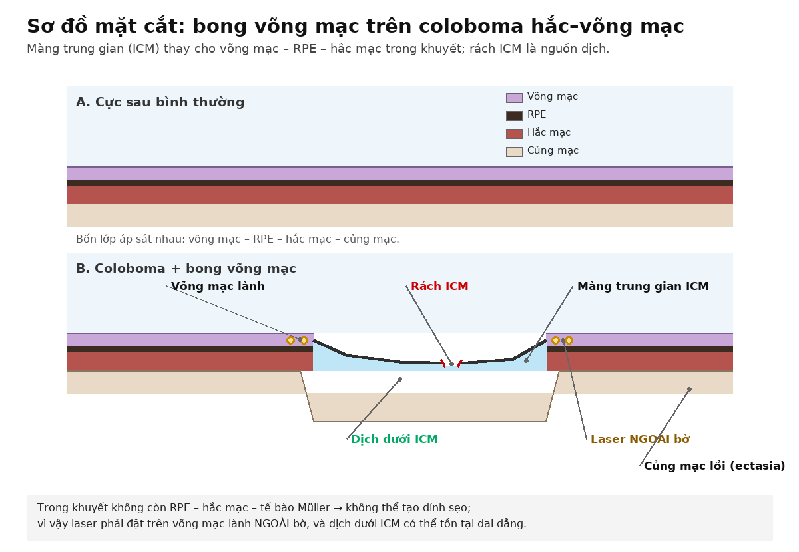
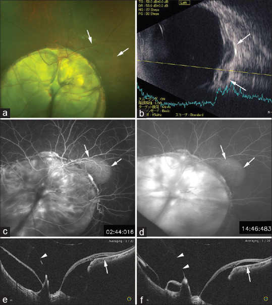
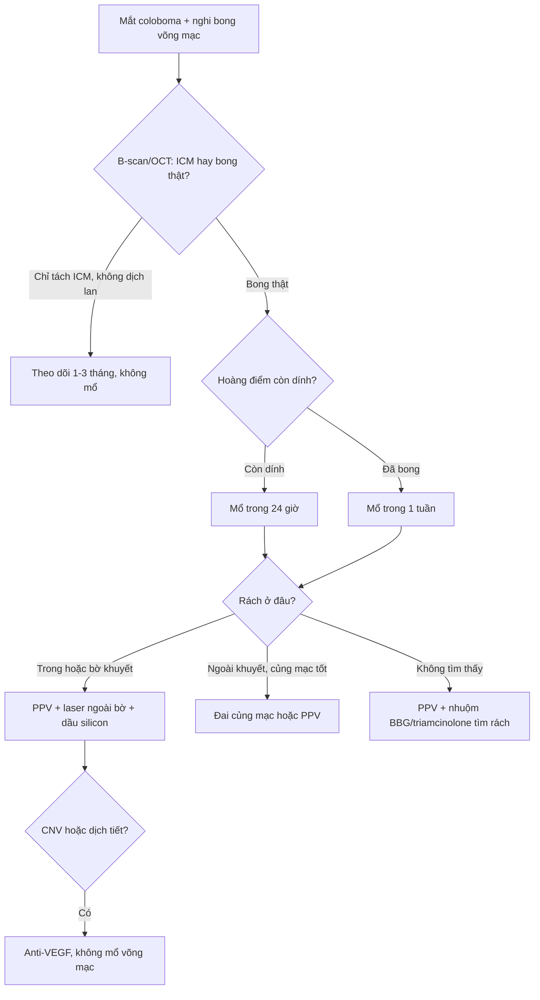
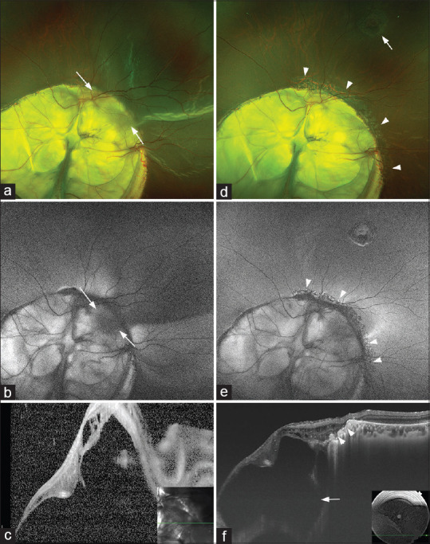

# 428 — Bong võng mạc trên coloboma hắc–võng mạc / Coloboma-associated retinal detachment

**Tags:** `pattern:bong-vong-mac` `pattern:khuyet-hac-vong-mac` `vung:mat` `vung:vong-mac` `protocol:sieu-am-B-scan` `protocol:UWF-OCT` `protocol:FA`
**Mức chắc chắn (certainty):** tổng hợp y văn (literature synthesis) — tổng hợp 1 bài tổng quan 2026, 1 tổng quan ảnh 2025, 4 loạt mổ và 2 bài OCT/mô bệnh; số liệu lấy từ toàn văn, các loạt có cỡ mẫu nhỏ được ghi rõ.

## 1. Tổng quan bệnh học – cơ chế hình ảnh

- **Coloboma hắc–võng mạc (chorioretinal coloboma)** là khuyết do **đường ráp bào thai (embryonic/optic fissure) không đóng kín** ở tuần 5–7, thường ở **dưới–mũi**, có thể lan tới **đĩa thị** và **hoàng điểm**. Tỉ lệ trong dân số khoảng **0,14%**; đa số mắt còn kèm bất thường khác: **coloboma mống mắt 71%**, **giác mạc nhỏ 45,1%**, **rung giật nhãn cầu 41,5%**, **lác 21,2%**, **nhãn cầu nhỏ 19,1%** (87,2% mắt có ít nhất một bất thường).
- **Mô bệnh quyết định mọi thứ:** trong khuyết **không có biểu mô sắc tố võng mạc (RPE), màng Bruch, hắc mạc và choriocapillaris**; võng mạc thần kinh được thay bằng **màng trung gian (intercalary membrane, ICM)**. Tại bờ khuyết có **tách kiểu schisis**: lớp võng mạc trong tiếp nối liền với ICM, lớp ngoài **quặt ngược ra sau** và dính vào RPE mép khuyết (Schubert và Gopal, trích trong bài tổng quan 2026). **SS-OCT** cho thấy ICM xuất phát từ **lớp sợi thần kinh (RNFL)** và **dính dịch kính** ở 3/5 mắt được khảo sát.
- **Vì sao bong võng mạc (RD) xảy ra ở chính mắt này:**
  1. **Dịch kính hóa lỏng sớm + dính chặt vào ICM** → lực kéo tập trung đúng chỗ màng mỏng nhất;
  2. **ICM không có RPE và tế bào Müller** → không có "keo sinh học" để dính lại, là **điểm yếu cơ học (locus minoris resistentiae)**;
  3. **Rách ICM** thường ở **bờ khuyết hoặc giữa khuyết**; dịch đi qua **lớp rối ngoài (outer plexiform layer)** vào khoang dưới võng mạc khi không bị hàng rào RPE chặn lại.
- **Hệ quả điều trị:** laser trong lòng khuyết **không thể tạo sẹo dính** vì thiếu RPE – hắc mạc – Müller; muốn bịt phải **đốt trên võng mạc lành NGOÀI bờ khuyết**. Đây là lý do kỹ thuật khác hẳn bong võng mạc rách thông thường.
- **Dịch tễ – ngưỡng cần nhớ:**
  - RD gặp ở **2,4–47,5%** mắt coloboma (khác biệt lớn do cách chọn mẫu);
  - nguy cơ tăng **1,147 lần mỗi năm tuổi** (theo dõi dọc ở trẻ);
  - ở **387 mắt trẻ**, nguy cơ chỉ **0,52%/mắt** và **0,78%/người** — nghĩa là **đa số trẻ coloboma không bong**;
  - trong **343 trẻ** có coloboma đoạn sau, **5%** bong, tuổi trung bình **6 tuổi**;
  - coloboma chiếm khoảng **0,5%** các ca bong võng mạc ở trẻ;
  - **8,1%** mắt có **bong võng mạc kết hợp bong hắc mạc** — bỏ sót thành phần hắc mạc dẫn tới mổ sai kế hoạch.
- **TẠI SAO hình ảnh học lại là chốt (vật lý từng modality):**
  - **Siêu âm B-scan (10–20 MHz):** dịch dưới võng mạc và dịch dưới ICM **trống âm**; màng ICM **hồi âm mảnh, di động**; củng mạc lồi tạo **hố đào (excavated staphyloma)** quanh đĩa thị. Vì ICM mỏng và cũng là "màng", nó **có thể giả làm bong võng mạc** trên B-scan — đây là cạm bẫy kinh điển.
  - **OCT (SS-OCT/UWF-OCT):** phân giải theo µm, thấy **tách schisis ở bờ**, **ICM liên tục**, **dịch dưới ICM** và **dính dịch kính**; độ phản xạ của ICM thấp hơn võng mạc lành.
  - **FA (fluorescein angiography):** khuyết RPE → **window defect**; bờ bong **tăng huỳnh quang**; **CNV rò rỉ** ở thì muộn.
  - **FAF (fundus autofluorescence):** vùng bong **tối** do mất sắc tố.
  - **CT/MRI:** khuyết thành sau nhãn cầu + **củng mạc lồi**, **mất dải T1 sáng của hắc mạc** tại đáy khuyết; T2 sáng do dịch kính/dịch dưới võng mạc. MRI cần khi **môi trường mờ** hoặc tìm **bất thường đường giữa** (CHARGE, thể chai).
- **Vì sao phải chụp nhiều modality:** rách ICM **khó thấy trên soi đáy mắt** vì thiếu tương phản màu; tới **27%** mắt không định vị được rách trước mổ, và **60%** ca tái bong có **rách chính ở vùng võng mạc lành** — tức là chỗ không ai nghĩ tới.

*Sơ đồ tự vẽ (CC0): bên trái là 4 lớp áp sát; bên phải là khuyết hắc–võng mạc với ICM, rách ICM, dịch dưới ICM, laser ngoài bờ và củng mạc lồi. Laser chỉ có hiệu lực khi đặt trên võng mạc lành ngoài bờ.*

## 2. Mẫu hình + chẩn đoán phân biệt theo vị trí (gamut)

- **Mẫu A — bong khu trú ở bờ khuyết:** thường **không triệu chứng**, phát hiện khi khám sàng lọc; UWF thấy **dải võng mạc trắng nối vào bờ coloboma**, OCT thấy **bong lớp trong nối với ICM tách**. Đây là mẫu dễ bị gọi nhầm là "tách ICM lành tính" hoặc bỏ qua.
- **Mẫu B — bong lan ra ngoài khuyết:** bệnh nhân đột ngột **màn che, ruồi bay tăng, chớp sáng**; bong có thể lan tới **hoàng điểm trong vài ngày** — đây là ca cần mổ sớm.
- **Mẫu C — rách NGOÀI coloboma:** **33,3%** mắt có rách ngoài khuyết (loạt 51 mắt); các loạt khác: **58,5%** rách trong khuyết (119 mắt), **16,1% trong / 38,7% ngoại vi / 9,7% cả hai** (loạt khác). Vì vậy **không được chỉ soi khuyết rồi kết luận**.
- **Mẫu D — bong kèm PVR/tái phát:** tái bong **27,6%** sau mổ đầu; **60%** ca tái phát có rách chính ở vùng võng mạc lành — phải tìm rách mới ngoài khuyết.
- **Mẫu E — bong tiết dịch do CNV:** **13,7%** mắt coloboma có **màng tân mạch hắc mạc (CNV)**; dịch dưới võng mạc **không có rách**, điều trị **anti-VEGF/laser**, không mổ võng mạc.
- **Mẫu F — bong kèm bong hắc mạc:** **8,1%** mắt; vòm hắc mạc **dày, không dính đĩa thị**, khác màng võng mạc mỏng dính đĩa thị.
- **Mẫu G — chỉ tách ICM/schisis, chưa bong thật:** màng ICM tách nhưng **không có dịch lan ra ngoài khuyết**, không có rách thật; theo dõi, **không mổ**.
- **Theo phân loại Ida Mann:** RD hay gặp ở **thể 1–3** (khuyết hắc mạc; có/không liên quan đĩa thị và hoàng điểm) — dùng để trao đổi với bác sĩ mắt, không thay thế mô tả giải phẫu trên ảnh.

## 3. Bảng so sánh phân biệt (ma trận đối chiếu)

| Thực thể (entity) | Hình ảnh điển hình | Chốt vào (rule-in) | Chốt loại (rule-out) | Gợi ý xác nhận |
|---|---|---|---|---|
| **Bong võng mạc trên coloboma (rách ICM)** | Màng võng mạc **nối liền bờ khuyết**, dịch dưới màng; OCT thấy tách schisis ở bờ + ICM liên tục; B-scan có màng trong hố đào | **Màng nối trực tiếp với bờ khuyết + rách ICM + dịch dưới ICM**; **không có RPE dưới đáy khuyết** | Màng **không nối với bờ khuyết**, dính đĩa thị, di động tự do → bong võng mạc thường | UWF + OCT bờ khuyết + B-scan; tìm rách ngoại vi 360° |
| **Tách ICM/schisis đơn thuần** | Màng mỏng trong khuyết, **không có dịch lan ra ngoài**, không rách thật | **Dịch khu trú trong khuyết, bờ ICM còn liên tục**, không có rách | Có **rách ICM** hoặc dịch lan ra ngoài bờ → bong thật | OCT lặp 1–3 tháng; so sánh với lần trước |
| **Bong võng mạc rách thông thường** | Màng võng mạc **dính đĩa thị**, có lỗ/horseshoe tear ngoại vi, không liên quan khuyết | **Lỗ rách + màng dính đĩa thị**, bờ khuyết bình thường | Màng nối vào bờ khuyết, không thấy lỗ ngoại vi → nghĩ coloboma | Soi 360° + ấn sclera; B-scan khi môi trường mờ |
| **Bong hắc mạc** | **Vòm dày, trơn, không dính đĩa thị**, có thể "kissing choroidals" | **Vòm dày không dính đĩa thị**; B-scan hồi âm dày | Màng mỏng, di động, dính đĩa thị → bong võng mạc | B-scan + OCT; phân biệt thanh dịch (trống âm) với máu (hồi âm) |
| **Bệnh lý hoàng điểm do hố đĩa thị (optic disc pit)** | Dịch dưới võng mạc **khu trú hoàng điểm**, nối với hố đĩa thị, **không có khuyết hắc–võng mạc rộng** | **Hố đĩa thị + dịch hoàng điểm**, bờ khuyết không điển hình | Khuyết hắc–võng mạc rộng, có ICM → coloboma | OCT hoàng điểm + đĩa thị; MRI khi cần |
| **CNV trên coloboma (bong tiết dịch)** | Dịch dưới võng mạc **không rách**, xuất huyết/dưới võng mạc, **mạng mạch trên FA** | **Rò rỉ trên FA + không rách**, dịch tiến triển | Có rách ICM + dịch lan → bong rách | FA/ICGA + OCT; anti-VEGF thử |
| **Staphyloma sau cực (cận thị nặng)** | **Lồi thành sau nhãn cầu**, võng mạc mỏng nhưng **không có khuyết hắc mạc bẩm sinh**, không có ICM | **Lồi thành sau + cận thị trục dài**, không có bờ khuyết sắc tố | Bờ khuyết rõ, mất hắc mạc tại đáy → coloboma | OCT + MRI/CT; đo trục nhãn cầu |

## 4. Protocol chụp + hệ phân độ/điểm chuẩn hóa

### 4.1 Protocol hình ảnh (thứ tự thực dụng)

1. **Ảnh đáy mắt siêu rộng (UWF) + FAF** mọi ca nghi bong: xác định bờ khuyết, vùng bong, so sánh hai mắt.
2. **B-scan 10–20 MHz** khi **môi trường mờ** (đục thể thủy tinh, xuất huyết dịch kính) hoặc để đo **củng mạc lồi/hố đào** và phân biệt **ICM với màng võng mạc thật**; đánh giá **động** (dynamic) để phân biệt màng căng với màng di động.
3. **SS-OCT/UWF-OCT** qua bờ khuyết: tìm **tách schisis**, **rách ICM**, **dịch dưới ICM**, **dính dịch kính**; đo chiều cao dịch và khoảng cách tới hoàng điểm.
4. **FA** khi nghi **CNV** hoặc cần xác định bờ bong: **window defect** ở khuyết, **tăng huỳnh quang bờ bong**, **rò rỉ thì muộn**.
5. **UBM** khi nghi tổn thương **thể mi/zonule** (coloboma thể thủy tinh, mất zonule) trước mổ.
6. **CT/MRI hốc mắt** khi môi trường mờ không cho phép OCT/US, hoặc tìm **bất thường đường giữa** (CHARGE, thể chai, tuyến yên); MRI **T2 fat-sat + T1 sau tiêm**, tránh MRI nếu nghi dị vật kim loại.

*Đáy mắt siêu rộng (a), siêu âm B (b), FA (c–d), OCT (e–f): bong khu trú nối với màng trung gian ở bờ khuyết, kéo dịch kính vào ICM giữa khuyết. Nguồn: Inoue I, Taiwan J Ophthalmol 2025 (PMC12456910), CC BY-NC-SA 4.0.*

### 4.2 Nguyên tắc phẫu thuật + kết quả định lượng

- **Rách trong/bờ khuyết:** **cắt dịch kính (PPV) + đốt laser quanh bờ trên võng mạc lành + bơm dầu silicon (SO) hoặc khí**; **đai củng mạc đơn thuần có tỉ lệ thành công thấp** với rách trong khuyết (khoảng **50%** trong loạt đai hai đường nan hoa), nên chỉ dùng cho **rách ngoài khuyết + củng mạc đủ tốt**.
- **Vì sao dầu silicon:** cần tamponade **dài hạn** vì sẹo dính quanh khuyết hình thành chậm; dầu **độ nhớt cao** giảm nhũ tương hóa; nhưng **dầu có thể chui vào khoảng dưới võng mạc qua khuyết** — đây là lý do một số tác giả ưu tiên khí ở ca chọn được.
- **Kết quả (các loạt nhỏ, không đồng nhất):**
  - 29 mắt: dính lại **72,4%** sau một mổ, **93,1%** cuối; **tái bong 27,6%**; **tăng nhãn áp 13,8%** khi còn dầu.
  - 51 mắt: thành công giải phẫu **85,7%**; **CNV 13,7%**.
  - Loạt hỗn hợp: tái bong **16,3%** với dầu so với **60%** với khí; sau rút dầu **15,6%** tái bong; dính cuối **81,2%**, thị lực **≥ 10/200 ở 69,4%**.
  - Tổng quan: thành công giải phẫu **> 80%**, nhưng thị lực **> 20/400 chỉ 35,7–78,4%** — tức là **cứu được võng mạc không đồng nghĩa cứu được thị lực**.
- **Laser dự phòng quanh bờ khuyết:** nghiên cứu không ngẫu nhiên **335 mắt**: bong **2,9%** ở nhóm đốt so với **24,1%** nhóm không đốt. Nhưng ở trẻ, nguy cơ nền chỉ **0,52%/mắt**, và laser gần **hoàng điểm/đĩa thị** có thể gây tổn thương — **quyết định từng ca**, không đại trà.

### 4.3 Sơ đồ xử trí

> Không có hệ phân độ RADS riêng cho coloboma; **phân loại Ida Mann** mô tả mức lan giải phẫu, còn **quyết định mổ dựa trên rách ICM, tình trạng hoàng điểm, PVR và môi trường trong suốt**.

## 5. Biến thể bình thường và cạm bẫy

- **ICM giả bong võng mạc trên B-scan:** màng ICM mỏng, hồi âm, nằm trong hố đào — nếu chỉ nhìn một mặt cắt tĩnh rất giống màng võng mạc. **Luôn đối chiếu OCT** và đánh giá **động**; ICM không dính đĩa thị và không có "màng võng mạc thật" ngoài khuyết.
- **Dịch dưới ICM tồn tại dai dẳng sau khi laser thành công:** OCT sau mổ vẫn thấy **khoang dịch dưới ICM** dù võng mạc ngoài đã dính. **Không mổ lại chỉ vì dịch này** — đây là dịch trong khuyết, không phải bong tái phát; đốt thêm vào ICM vô ích và nguy hiểm.
- **Bỏ sót rách ngoài khuyết:** **33,3%** rách nằm ngoài khuyết và **60%** ca tái phát có rách ở vùng lành — phải soi **360° + ấn sclera**, không chỉ tập trung vào khuyết.
- **Dầu silicon thiếu thể tích (underfill):** nhãn cầu coloboma có hình dạng bất thường → dầu không phủ kín vùng rách dù "đã bơm đầy"; kiểm tra bằng **OCT/soi đáy mắt tư thế** và bổ sung.
- **Dầu silicon vào khoảng dưới võng mạc qua khuyết:** có thể thấy **bọt dầu dưới võng mạc** — không phải bong tái phát; ghi nhận và theo dõi, tránh can thiệp lặp.
- **Laser qua bó hoàng điểm–đĩa thị:** khi coloboma lan tới đĩa thị, đốt laser có thể **tổn thương lớp sợi thần kinh**; đốt **giới hạn ở bờ chức năng**, công suất vừa, tránh bó mạch.
- **CNV giả bong:** **13,7%** mắt coloboma có CNV; dịch **không có rách**, FA có rò rỉ — điều trị **anti-VEGF**, không mổ võng mạc.
- **Bong hắc mạc kèm theo:** **8,1%** mắt; vòm dày **không dính đĩa thị**. Nếu chỉ thấy "màng" trên B-scan mà bỏ qua thành phần hắc mạc, kế hoạch mổ sai (cần dẫn lưu hắc mạc, không chỉ laser võng mạc).

## 6. Tự lượng giá — Blind Quiz

**Ca 1 — Nam 26 tuổi, mắt trái, khám sàng lọc không triệu chứng; 1 năm sau đột ngột mờ mắt.**

- Gợi ý: ảnh (a) là đáy mắt siêu rộng thì đầu; (c) là OCT lúc mờ mắt; (d)–(f) là sau can thiệp.
- Câu hỏi: (1) Mô tả màng bong và mối liên hệ với bờ khuyết. (2) Vì sao laser được đặt **quanh bờ khuyết** mà không đặt trong lòng khuyết? (3) OCT sau mổ còn dịch dưới ICM — có cần mổ lại không?

<b>Bấm để hiện đáp án (findings + chẩn đoán)</b>

- **Findings:** (a) bong võng mạc lan rộng nối vào **bờ khuyết hắc–võng mạc**; (c) OCT cho thấy **võng mạc tách nối với màng trung gian (ICM)** — rách nằm ở vùng ICM/bờ khuyết. (d) sau **PPV + laser quanh bờ**, võng mạc dính lại nhờ **sẹo laser trên võng mạc lành**; (f) OCT còn **dịch dưới ICM** nhưng võng mạc ngoài đã dính.
- **Chẩn đoán:** bong võng mạc trên coloboma do **rách ICM** — không phải bong rách thông thường.
- **Vì sao laser ngoài bờ:** trong khuyết **không có RPE, hắc mạc, tế bào Müller** → không thể tạo dính sẹo; đốt trong khuyết chỉ làm tổn thương ICM mỏng.
- **Dịch dưới ICM:** là dịch khu trú trong khuyết, **không đồng nghĩa tái bong**; theo dõi bằng OCT, không mổ lại chỉ vì dịch.
- **Nguồn ảnh:** Inoue I, Taiwan J Ophthalmol 2025 (PMC12456910), CC BY-NC-SA 4.0.

**Ca 2 — Cùng bệnh nhân ở thì đầu: đọc đa phương thức trước khi quyết định.**

- Gợi ý: (a) đáy mắt siêu rộng; (b) siêu âm B; (c–d) FA; (e–f) OCT.
- Câu hỏi: (1) B-scan cho thấy gì quanh đĩa thị? (2) FA đóng góp gì? (3) OCT giúp phân biệt **ICM tách** với **bong võng mạc thật** như thế nào?

<b>Bấm để hiện đáp án (findings + chẩn đoán)</b>

- **Findings:** (a) bong **khu trú** nối vào bờ khuyết, chưa lan xa; (b) siêu âm B có **hố đào/củng mạc lồi (excavated staphyloma)** quanh đĩa thị và **màng mảnh trong hố**; (c–d) FA có **tăng huỳnh quang ở bờ khuyết** tương ứng vùng bong, thì muộn là **window defect**; (e–f) OCT thấy **bong lớp trong nối với ICM tách ở bờ**, kèm **dính dịch kính vào ICM giữa khuyết**.
- **Chẩn đoán:** bong võng mạc khu trú liên quan coloboma, cơ chế **rách/tách ICM**; B-scan một mình dễ gọi nhầm ICM là bong võng mạc — **OCT là chốt**.
- **Ý nghĩa:** ca này minh họa **giá trị của chụp nhiều modality** trước khi chọn theo dõi hay mổ.
- **Nguồn ảnh:** Inoue I, Taiwan J Ophthalmol 2025 (PMC12456910), CC BY-NC-SA 4.0.

## 7. Câu hỏi nghiên cứu & điểm chưa đồng thuận (tính đến 11/2026)

1. **[Tranh cãi] Ở trẻ có coloboma hắc–võng mạc chưa bong, laser dự phòng quanh bờ có giảm nguy cơ bong võng mạc nhiều hơn nguy cơ tổn thương võng mạc/hoàng điểm do laser không?**
   - **Đã biết:** nghiên cứu không ngẫu nhiên 335 mắt cho thấy bong **2,9%** ở nhóm đốt so với **24,1%** nhóm không đốt; nhưng ở 387 mắt trẻ, nguy cơ nền chỉ **0,52%/mắt**.
   - **Chưa rõ:** chưa có RCT; lợi ích tuyệt đối ở trẻ nguy cơ thấp rất nhỏ, trong khi laser gần hoàng điểm/đĩa thị có thể gây mất thị lực.
   - **Hướng nghiên cứu:** RCT hoặc registry tiến cứu phân tầng theo kích thước khuyết, liên quan đĩa thị/hoàng điểm và tuổi.
   - **Nguồn:** PMC13675232 (2026); PMC4058624 (2014); DOI 10.1016/j.ophtha.2021.07.034 (2022).

2. **[Khoảng trống] Ở mắt coloboma có bong võng mạc do rách ICM, dầu silicon hay khí là tamponade tối ưu, và thời điểm rút dầu nào ít tái bong nhất?**
   - **Đã biết:** tái bong **16,3%** với dầu so với **60%** với khí trong một loạt; sau rút dầu **15,6%** tái bong; tổng quan ghi nhận tái bong sau rút dầu tới **27,3%**.
   - **Chưa rõ:** các loạt khác nhau về cỡ khuyết, PVR, thời gian theo dõi; chưa có thử nghiệm so sánh trực tiếp dầu độ nhớt cao với khí.
   - **Hướng nghiên cứu:** RCT đa trung tâm so sánh tamponade và lịch rút dầu, outcome gồm dính võng mạc 12 tháng và thị lực.
   - **Nguồn:** PMC12456910 (2025); PMC7904408 (2021); PMC13675232 (2026).

3. **[Khác biệt thực hành] Sau khi võng mạc đã dính, có nên can thiệp vào khoang dịch dưới ICM dai dẳng — cắt ICM, dùng keo fibrin hay chỉ theo dõi?**
   - **Đã biết:** một số nhóm **chủ động cắt ICM** để giảm lực kéo; một số dùng **keo fibrin** bịt rách; nhiều nhóm chỉ **theo dõi** vì dịch dưới ICM không phải bong thật.
   - **Chưa rõ:** tiêu chuẩn chọn ca và tỉ lệ tái bong/thị lực giữa ba cách chưa được so sánh; ca báo cáo đơn lẻ không đủ kết luận.
   - **Hướng nghiên cứu:** nghiên cứu đoàn hệ tiến cứu ghi nhận tổn thương ICM, can thiệp và kết cục; thống nhất định nghĩa "dịch dưới ICM" trên OCT.
   - **Nguồn:** PMC12456910 (2025); PMC11727969 (2024); PMC7904408 (2021).

## Bài liên quan chéo

- [415 – Phổ nhãn cầu nhỏ – coloboma (MAC)](../415-phe-nhan-cau-nho-coloboma/lesson.md) (giải phẫu, MRI hốc mắt, phân loại)
- [445 – Bong võng mạc: rách/co kéo/tiết dịch + PVR](../445-bong-vong-mac/lesson.md) (nguyên lý chung)
- [427 – Đứt chân võng mạc sau chấn thương đụng dập](../427-dut-chan-vong-mac-sau-chan-thuong/lesson.md) (bong ngoại vi, dialysis)
- [1484 – Bong hắc mạc sau mổ mắt](../1484-bong-hac-mac-sau-mo-mat/lesson.md) (phân biệt vòm dày không dính đĩa thị)
- [1469 – Bong võng mạc có lỗ sau tiêm nội nhãn](../1469-bong-vong-mac-co-lo-sau-tiem-noi-nhan/lesson.md) (bong rách trong bối cảnh thủ thuật)

## Ảnh

- `images/428_coloboma-RD_Fundus-TJO-PMC12456910-f1.jpg` — Fig. 1, Inoue I, Taiwan J Ophthalmol 2025, CC BY-NC-SA 4.0.
- `images/428_coloboma-RD_Fundus-TJO-PMC12456910-f2.jpg` — Fig. 2, cùng bài, CC BY-NC-SA 4.0.
- `images/428_coloboma-RD_SoDo_CC0.png` — sơ đồ tự vẽ, CC0 1.0.
- Chi tiết từng ảnh: `images/CREDITS.md`.

> Không dùng để chẩn đoán độc lập khi chưa có người hướng dẫn.
