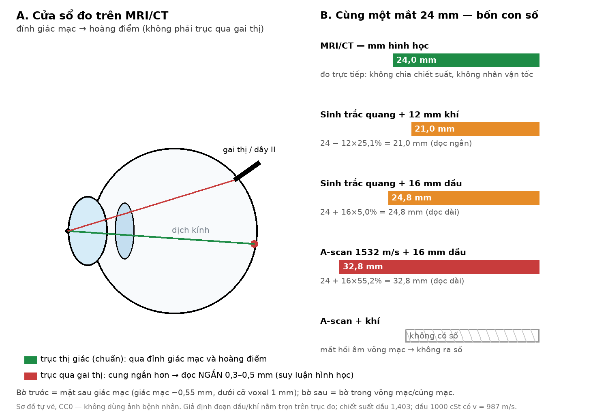
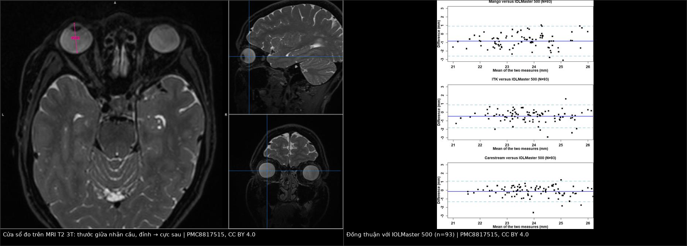
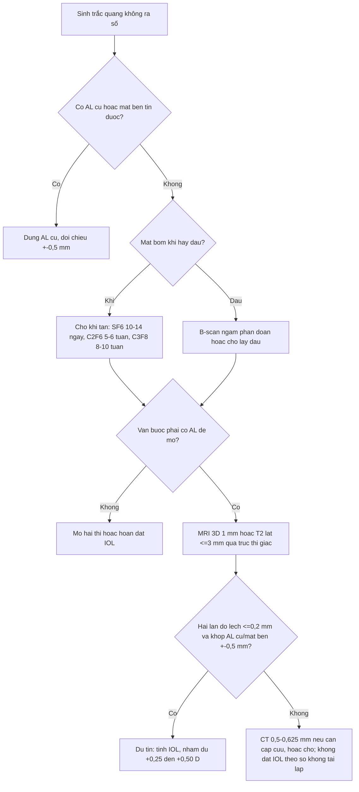
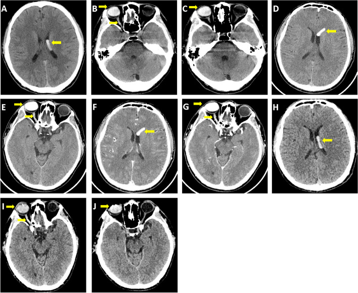

# 429 — Đo trục nhãn cầu bằng MRI/CT khi sinh trắc quang và A-scan đều thất bại / Axial length by MRI or CT when optical biometry and A-scan fail

**Tags:** `pattern:al-gia` `pattern:sinh-trac-that-bai` `vung:mat` `vung:hoc-mat` `anatomy:giac-mac` `anatomy:hoang-diem` `anatomy:vong-mac` `protocol:MRI-hoc-mat` `protocol:CT-hoc-mat` `protocol:B-scan` `score:Barrett-Universal-II`
**Mức chắc chắn (certainty):** tổng hợp y văn (literature synthesis) — số liệu từ **93 người** MRI não so IOLMaster 500 (BMC Ophthalmol 2022, PMC8817515), **32 người** MRI chuỗi fully-refocused steady-state so IOLMaster 500 (Int Ophthalmol 2021, PMID 33619690), **1.245 người** MRI 1 mm³ tự động (PLoS One 2026, PMC13327317), **12 mắt** CT trước lấy dầu silicone (Br J Ophthalmol 2002, PMC1770965), **1 ca** dầu trong não thất (BMC Ophthalmol 2025, PMC11883950). Câu nào là suy luận vật lý/hình học được ghi **[suy luận]** ngay tại chỗ.

> **Vì sao bài này quan trọng:** [1477](../1477-sinh-trac-iol-mat-bom-dau-silicone/lesson.md) đã chốt **dầu silicone làm sinh trắc quang đọc DÀI ~0,80 mm** và A-scan đọc dài tới **+55%**; [1490](../1490-sinh-trac-iol-mat-bom-khi/lesson.md) chốt **bóng khí làm sinh trắc quang đọc NGẮN 25,1%** và **A-scan qua khí mất hồi âm**. Cả hai bài đều kết thúc bằng "chờ" hoặc "dùng AL cũ". Nhưng có nhóm bệnh nhân **không còn AL cũ, không chờ được, và không đo lại được**: giác mạc đục dày + thể thủy tinh đục cả hai mắt, mắt bơm khí/dầu chưa tan, trẻ không cố định mắt, tuyến trước không có máy sinh trắc. Với nhóm này, **MRI/CT là cây thước thứ ba** — và điều quan trọng là hiểu **cái sai của nó khác hẳn cái sai của hai cây thước kia**: nó không bị chiết suất hay vận tốc âm làm lệch, nhưng **bờ đo mờ theo voxel và trục đo dễ đặt nhầm**. Đặt IOL theo một AL sai **0,5 mm** là lệch khúc xạ **~1,4 D** — đủ để phải mổ lại đổi IOL.

## 1. Tổng quan — ba cây thước, ba giả định khác nhau

- **Sinh trắc quang (partial coherence interferometry — PCI, hoặc swept-source OCT — SS-OCT)** đo **quang trình** rồi chia cho **chiết suất nhóm quy ước của dịch kính n = 1,336**. **Siêu âm A-scan** đo **thời gian bay** rồi nhân với **vận tốc quy ước 1532 m/s**. Cả hai đều ngầm giả định khoang sau thể thủy tinh **chứa dịch kính**.
- **MRI và CT đo trực tiếp độ dài hình học (mm)** — không có chiết suất, không có vận tốc âm. Vì vậy **dầu silicone hay bóng khí KHÔNG làm số đo bị lệch theo một hằng số** như ở hai phương pháp kia. Đây là lý do duy nhất khiến MRI/CT đáng dùng trong đúng nhóm bệnh nhân này [vật lý].
- **Nhưng sai số chỉ đổi chỗ, không mất đi.** Ba nguồn sai của MRI/CT: **(1) bờ đo** — giác mạc dày **~0,55 mm**, mỏng hơn cả voxel 1 mm, nên máy không "thấy" bờ trước mà người đọc phải chọn (mặt sau giác mạc hay mặt trước?); **(2) trục đo** — trục thị giác qua **hoàng điểm** khác trục qua **gai thị**; **(3) độ phân giải** — 0,7–1 mm mỗi voxel so với **0,01 mm** của IOLMaster.
- **Định lượng "cùng một mắt, bốn con số":** với nhãn cầu thật **24,0 mm**, bơm **12 mm khí** thì sinh trắc quang đọc **21,0 mm** (**−25,1%** đoạn khí); bơm **16 mm dầu** thì sinh trắc quang đọc **24,8 mm** (**+5,0%**, tức **+0,80 mm**) còn A-scan để vận tốc mặc định đọc **32,8 mm** (**+55,2%**). MRI/CT vẫn ra **24,0 mm** [suy luận số học từ hằng số 1,336 / 1,403 / 1532 / 987 m/s, đúng bằng các sai số đã đo ở bài 1477 và 1490].
- **Lan truyền sang khúc xạ:** **0,1 mm AL ≈ 0,28 D** (ngưỡng dùng chung của dòng sinh trắc). Nghĩa là: **0,4 mm ≈ 1,1 D**; **0,5 mm ≈ 1,4 D**; **0,8 mm ≈ 2,2 D** [suy luận số học]. Đây là thước đo để phán "số MRI này có đủ tin để đặt IOL không".
- **Vì sao đây là việc của CĐHA:** chỉ người đọc ảnh mới quyết định **đặt thước ở đâu, trên lát nào, cửa sổ nào**. Một AL đo trên MRI não 4 mm (không qua hoàng điểm, bờ sau là "bờ củng mạc ngoài") có thể lệch **hàng milimét** mà vẫn "trông hợp lý" trên ảnh.

*Sơ đồ tự vẽ (CC0): (A) cửa sổ đo chuẩn là **đỉnh giác mạc → hoàng điểm**, không phải trục qua gai thị (cung ngắn hơn **0,3–0,5 mm** [suy luận hình học]); (B) bốn con số trên cùng một mắt 24 mm khi có 12 mm khí hoặc 16 mm dầu. Giả định đoạn dầu/khí nằm trọn trên trục đo.*

## 2. Mẫu hình + chẩn đoán phân biệt theo **lý do thất bại** (gamut)

**Câu hỏi trung tâm không phải "chụp MRI hay CT" mà "vì sao không đo được, và còn cách nào rẻ hơn".** Sáu bệnh cảnh, sáu quyết định:

- **A. Đục cả hai môi trường (giác mạc dày + thể thủy tinh đục) — sinh trắc quang không có tín hiệu, A-scan không có đỉnh võng mạc rõ.** Đây là chỉ định **kinh điển** của MRI/CT: không có gì để chờ, không có AL cũ. Ưu tiên **MRI T2 lát ≤3 mm qua trục thị giác**; CT chỉ khi MRI chống chỉ định/không có.
- **B. Mắt còn bóng khí (SF6/C2F6/C3F8).** Sinh trắc quang đọc ngắn **25,1%** đoạn khí, A-scan mất hồi âm (bài 1490). **Chờ là lựa chọn số một** (SF6 **10–14 ngày**, C2F6 **5–6 tuần**, C3F8 **8–10 tuần**). MRI chỉ dùng khi **buộc phải có AL ngay** — và phải nhớ khí **không có proton** nên là **vùng trống tín hiệu**, mặt phân cách khí–dịch còn gây mất tín hiệu cục bộ [suy luận vật lý].
- **C. Mắt bơm dầu silicone.** MRI/CT **không bị +5,0%/+55,2%** vì đo hình học — nhưng **dầu cũng không có proton** (MRI: trống tín hiệu, dễ nhầm bờ) và **dầu rất "sáng" trên CT**: **106–139 HU**, so với máu **50–90 HU** (BMC Ophthalmol 2025, PMC11883950). Tức là trên CT, nhãn cầu bơm dầu **tăng đậm độ**, và bờ sau dễ bị đọc thành "dày, xơ, vôi".
- **D. Mắt không cố định/không hợp tác (trẻ nhỏ, rung giật nhãn cầu, co quắp mi).** Sinh trắc quang cần **cố định thị giác**; MRI/CT không cần. Nhưng **mắt nhìn lệch ngang làm trục đo chéo** — trong một nghiên cứu 1.245 người, **549 người bị loại vì mặt phẳng/cử chỉ mắt không đạt** (PLoS One 2026, PMC13327317), tức đây là yếu tố quyết định chất lượng, không phải chi tiết phụ.
- **E. Đã có AL trước đó (trước bơm dầu/khí, trước khi giác mạc đục thêm).** **Đây là phương án bị bỏ qua nhiều nhất**: AL bền theo thời gian (ICC **0,97** sau 2 năm, bài 1490 dẫn PMC6203743). Trước khi đặt máy chụp, hãy **lục hồ sơ sinh trắc cũ** — rẻ hơn, chính xác hơn mọi phép đo trên ảnh.
- **F. Chấn thương, nghi vỡ nhãn cầu, dị vật.** Ở đây CT là **modality đầu tay** vì lý do khác hẳn (xương, dị vật, khí trong ổ mắt — bài [449](../449-chan-thuong-mat-dich-vat/lesson.md)), và AL chỉ là thông tin thứ cấp đo được trên chính lát CT đó.

**Gamut "vì sao số đo trên ảnh vẫn sai" (theo cơ chế):**

| Cơ chế | Dấu hiệu nhận ra | Hướng sai |
|---|---|---|
| Bờ trước chọn sai (giác mạc ~0,55 mm < voxel 1 mm) | Thước bắt đầu ở **mặt trước** giác mạc thay vì mặt sau | **Dài giả** ~0,5 mm (**~1,4 D**) [suy luận] |
| Trục qua gai thị thay vì hoàng điểm | Đường đo đi vào **đĩa thị**, không vào điểm tối trung tâm hoàng điểm | **Ngắn giả** **0,3–0,5 mm** [suy luận hình học] |
| Lát 4 mm + gap 1,2 mm (MRI não thường quy) | Không có lát nào chứa **cung dài nhất** của nhãn cầu | **Ngắn giả**, thay đổi theo lần chụp |
| Đầu nghiêng, mắt nhìn lệch ngang | Nhãn cầu không nằm trọn trong mặt phẳng cắt | **Ngắn giả**, khó tái lập |
| Dầu/khí không có proton (MRI) | Vùng **trống tín hiệu** trong khoang dịch kính, bờ sau "biến mất" | Không xác định bờ → **sai không đoán được chiều** |
| Dầu silicone 106–139 HU (CT) | Nhãn cầu **tăng đậm độ**, viền sau trông dày | Đọc nhầm **bờ củng mạc ngoài** hoặc "xơ/vôi" → **sai chiều tùy cửa sổ** |
| Cửa sổ hẹp trên CT | Bờ võng mạc–dịch kính **mất tương phản**, chỉ còn xương và dầu | Người đọc tự "vẽ" bờ → **không tái lập** |

## 3. Bảng so sánh phân biệt (ma trận đối chiếu)

*Trái: MRI T2 3T (lát 4 mm, in-plane 0,7 × 0,7 mm) — thước đặt giữa nhãn cầu từ đỉnh tới cực sau; đây **không** phải trục thị giác qua hoàng điểm. Phải: Bland–Altman so IOLMaster 500 trên **93 người** — lệch trung bình **−0,1 mm (Carestream)**, **−0,5 mm (ITK)**, **−0,8 mm (Mango)**, giới hạn đồng thuận trải **0,9 đến −2,6 mm**. Ảnh ghép letterbox, không crop/kéo giãn; nguồn: BMC Ophthalmol 2022 (PMC8817515), CC BY 4.0.*

| Thực thể (entity) | Hình ảnh/chỉ số điển hình | Chốt vào (rule-in) | Chốt loại (rule-out) | Gợi ý xác nhận |
|---|---|---|---|---|
| **Sinh trắc quang (PCI/SS-OCT)** | AL/QS hiện ngay, độ phân giải **0,01 mm**; sai số **0,1 mm ≈ 0,28 D** | **Máy ra số + QS đạt + 3 lần lệch ≤ 0,1 mm** | **Không ra số / QS không đạt** ở mắt đục dày, bơm khí, bơm dầu ([1477](../1477-sinh-trac-iol-mat-bom-dau-silicone/lesson.md), [1490](../1490-sinh-trac-iol-mat-bom-khi/lesson.md)) | So với AL cũ; đo lại sau khi hết khí/dầu |
| **A-scan tiếp xúc (vận tốc 1532 m/s)** | Đỉnh giác mạc–thủy tinh–võng mạc; **không có đỉnh võng mạc** khi có khí | **Có đỉnh võng mạc rõ, lặp lại được, mắt không bơm khí** | **Dầu 1000 cSt mà để 1532 m/s** → đọc **+55%** (31,8 mm ở mắt 24 mm) | Đặt vận tốc riêng cho dầu, hoặc bỏ |
| **B-scan ngâm phân đoạn (immersion, segmented)** | Đo riêng đoạn trước và đoạn dầu, chỉ đổi vận tốc đoạn dầu | **Môi trường đục nhưng còn bờ võng mạc trên B-scan**; ở 31 mắt cận thị rất cao: AL **30,46 vs 30,42 mm** sau lấy dầu (**p = 0,542**) | **Không xác định được bờ sau** (khí, dầu nhũ tương, bong hắc mạc) | So AL trước/sau lấy dầu; đây là **phương án dự phòng rẻ nhất** |
| **MRI T2 lát ≤3 mm (hoặc 3D 1 mm)** | Đo **mm hình học**; 93 người: lệch trung bình **−0,1 mm** (phần mềm tốt nhất), **−0,8 mm** (phần mềm kém), **giới hạn đồng thuận 0,9…−2,6 mm** | **Hai lần đo lệch ≤ 0,2 mm**, **mắt nhìn thẳng**, **lát qua đỉnh–hoàng điểm**, khớp AL cũ/mắt bên **±0,5 mm** | **Lệch > 0,5 mm** so với AL cũ/mắt bên; mặt phẳng không qua hoàng điểm; mắt nhìn lệch ngang | Đo 2–3 lần trên **hệ thống 3D reformat** (không tin ảnh 2D 4 mm) |
| **MRI chuỗi fully-refocused steady-state (FRSS)** | AL LoA **0,019 ± 0,383 mm** ở 32 người; ACD **0,016 ± 0,266 mm**; trong cùng người **0,000 ± 0,157 mm** | **Dùng để mô tả/so sánh**, không để tính công suất | Tác giả kết luận **không khuyến cáo cho tính công suất IOL** vì độ biến thiên | Chỉ dùng khi không còn lựa chọn, và phải ghi rõ nguồn số |
| **CT hốc mắt (0,5–0,625 mm, MPR)** | Nhãn cầu hình cầu, dầu **106–139 HU**; đo trên MPR qua trục | **Cần AL "tức thời" ở chấn thương**, hoặc MRI chống chỉ định | **12 mắt dầu silicone: chỉ 50% trong ±1 D, 75% trong ±2 D**; 3 mắt sai > 2 D **đều có AL ≥ 27 mm** | Không dùng CT để "tối ưu" khúc xạ ở mắt dài; dùng cho mục đích cấp cứu |
| **Mượn AL mắt bên** | Hai mắt chênh **< 0,3 mm** khi cân xứng | **Mắt bên lành, không băng/đai, không cận thị lệch** | Lệch khúc xạ **> 1 D**, đã đặt đai củng mạc, cận thị một bên | MedAE **1,02–1,08 D** so với **0,42 D** khi có AL chính mắt (bài 1477) — chỉ là lựa chọn cuối |

### Ba con số cần nhớ của bài này

- **−0,1 mm** — lệch trung bình tốt nhất giữa MRI (phần mềm Carestream) và IOLMaster 500 trên **93 người**; đây là **mức sàn** của phương pháp, không phải "sai số bằng 0".
- **0,9 đến −2,6 mm** — giới hạn đồng thuận của cùng nghiên cứu đó: nghĩa là **một cá nhân có thể lệch tới 2,6 mm** dù trung bình đẹp (**~7 D**).
- **50%** — tỉ lệ mắt bơm dầu đạt **±1 D** khi AL lấy từ CT (12 mắt); **97,2%** là tỉ lệ mắt thường đạt ±1 D khi sinh trắc đúng cách (Semin Ophthalmol 2019, PMID 31257972).

## 4. Protocol + ngưỡng + sơ đồ quyết định

### 4.1. MRI — trình tự đo (không nhảy bước)

1. **Chọn chuỗi:** ưu tiên **3D T1 hoặc T2 đẳng hướng 1 mm³** (176 lát, FOV 256 mm — thông số của nghiên cứu 1.245 người, PLoS One 2026) để có thể **reformat theo trục thị giác**; nếu chỉ có 2D thì **lát ≤ 3 mm, không gap** (nghiên cứu 2022 dùng **4 mm + gap 1,2 mm**, in-plane 0,7 × 0,7 mm và chính tác giả ghi nhận **cung dài nhất có thể rơi vào gap**).
2. **Tư thế:** đầu thẳng, **mắt nhìn thẳng về phía trước**, nhắm mắt tự nhiên; loại các trường hợp **nhìn lệch ngang** (đây là tiêu chí loại của nghiên cứu lớn).
3. **Định vị nhãn cầu:** xác định tâm nhãn cầu trên **3 mặt phẳng trực giao**, rồi đặt lại mặt phẳng cắt **qua đỉnh giác mạc và hoàng điểm** (reformat), không đo trên lát ngang ngẫu nhiên.
4. **Đặt thước:** bờ trước = **mặt sau giác mạc**; bờ sau = **bờ trong võng mạc/củng mạc tại hoàng điểm**. Định nghĩa "mặt sau giác mạc → cực sau nhãn cầu" là định nghĩa chuẩn của các pipeline tự động, vì **bề dày giác mạc và võng mạc gần như triệt tiêu nhau** (PLoS One 2026).
5. **Đo 2–3 lần, ghi cả 3 số**, lấy trung bình; chỉ chấp nhận khi **chênh ≤ 0,2 mm** (tương ứng độ lặp lại trong cùng người **0,000 ± 0,157 mm** của chuỗi FRSS).
6. **Đối chiếu chéo:** AL cũ, AL mắt bên, hình dạng nhãn cầu (có **staphyloma** không — mắt cận thị cao là nhóm **hay bị đọc ngắn** trước mổ).

### 4.2. CT — chỉ khi có lý do

- **Kỹ thuật:** xoắn ốc **0,5–0,625 mm**, tái tạo **MPR** theo trục nhãn cầu; đọc trên **hai cửa sổ** (mô mềm và cửa sổ rộng) vì bờ võng mạc–dịch kính mất tương phản ở cửa sổ hẹp.
- **Chỉ định hẹp:** chấn thương/vỡ nhãn cầu, dị vật, MRI chống chỉ định, hoặc cần AL **trong vài giờ**. **Không** dùng CT như bước "chính xác hóa" khúc xạ ở mắt dài: ở **12 mắt bơm dầu**, sai số **> 2 D** rơi đúng vào nhóm **AL ≥ 27 mm** (Br J Ophthalmol 2002, PMC1770965).
- **Liều:** thể thủy tinh là cơ quan nhạy cảm với bức xạ, không có ngưỡng "an toàn tuyệt đối" — **ALARA**, và MRI thay thế được thì thay.

### 4.3. Ngưỡng dùng để quyết định (bảng sống còn)

| Chỉ số | Ngưỡng | Ý nghĩa thực hành |
|---|---|---|
| Sai số AL → khúc xạ | **0,1 mm ≈ 0,28 D** | **0,4 mm ≈ 1,1 D**; **0,5 mm ≈ 1,4 D**; **0,8 mm ≈ 2,2 D** [suy luận] |
| Chênh giữa 2 lần đo MRI | **≤ 0,2 mm** | Trên ngưỡng này → **không dùng số đó để tính công suất** |
| Chênh AL MRI với AL cũ/mắt bên | **≤ 0,5 mm** | **> 0,5 mm** → ưu tiên chờ/lấy dầu/lấy khí, hoặc **mổ hai thì** |
| Giới hạn đồng thuận MRI vs IOLMaster | **0,9 … −2,6 mm** | Tư vấn bệnh nhân: **có thể lệch tới ~2 D**, không hứa emmetropia |
| CT ở mắt bơm dầu | **50% ±1 D; 75% ±2 D** | Chỉ dùng khi không còn cách nào khác |
| CT khi **AL ≥ 27 mm** | **Toàn bộ 3 mắt sai > 2 D** nằm ở nhóm này | Mắt cận thị cao: **không tin CT** |
| Thời gian chờ khí (nếu chờ được) | **SF6 10–14 ngày · C2F6 5–6 tuần · C3F8 8–10 tuần** | Rẻ hơn và chính xác hơn mọi phép đo trên ảnh (bài 1490) |
| Khi đã quyết đặt IOL theo AL "không hoàn hảo" | Nhắm **dư +0,25 đến +0,50 D** | Sai số cận thị dễ sửa hơn viễn thị; và **cảnh báo trước** khả năng đổi IOL |

### 4.4. Sơ đồ quyết định

## 5. Biến thể bình thường và cạm bẫy

- **Cạm bẫy #1 — trục qua gai thị.** Trên lát ngang thường quy, "đường dài nhất" của nhãn cầu rất dễ đi vào **đĩa thị** thay vì **hoàng điểm**. Cung này **ngắn hơn** cung qua hoàng điểm **0,3–0,5 mm** [suy luận hình học] — đúng bằng **1–1,4 D**. Cách tránh: reformat qua **điểm tối trung tâm hoàng điểm**, hoặc nếu không thấy hoàng điểm thì **ghi rõ là trục gai thị** và hạ độ tin.
- **Cạm bẫy #2 — lát quá dày + gap.** Bộ MRI não 4 mm/1,2 mm gap không đảm bảo chứa **cung dài nhất**; đo trên 2D còn phụ thuộc **góc đầu**. Nếu chỉ có bộ ảnh đó, coi AL là **ước lượng**, không phải số để đặt IOL.
- **Cạm bẫy #3 — bờ trước.** Giác mạc **~0,55 mm**, dưới độ phân giải 1 mm: người đọc có thể bắt đầu ở **mặt trước** giác mạc → **dài giả ~0,5 mm**. Quy ước: **mặt sau giác mạc**.
- **Cạm bẫy #4 — CT ở mắt bơm dầu.** Dầu silicone **106–139 HU** (máu **50–90 HU**), nên nhãn cầu **tăng đậm độ** và viền sau trông dày. Đây là lý do **"dày củng mạc" trên CT mắt bơm dầu thường chỉ là dầu** — và cũng là lý do **không được đọc "tăng đậm độ trong nhãn cầu" là xuất huyết**.
- **Cạm bẫy #5 — tín hiệu trống trên MRI.** Cả **khí** và **dầu silicone** đều **không có proton di động** → vùng **trống tín hiệu**; mặt phân cách với dịch còn gây **dịch chuyển hóa học 1–2 pixel** [suy luận vật lý]. Vì vậy "thấy nhãn cầu đen" **không** đồng nghĩa đo được bờ sau.
- **Cạm bẫy #6 — thoả mãn tìm kiếm (satisfaction of search).** Đo được AL rồi dừng, bỏ qua **bong võng mạc, khối nội nhãn, vỡ nhãn cầu** — những thứ làm **hoãn mổ đặt IOL** hoàn toàn.
- **Cạm bẫy #7 — K cũng không tin được.** Nếu giác mạc đục dày thì **keratometry** cũng sai; **AL đẹp không cứu được công suất IOL** khi K mù mờ. Trong tình huống đó, cân nhắc **mổ hai thì** hoặc **IOL công suất "an toàn"** thay vì chạy theo emmetropia.

*CT sọ không cản quang ở bệnh nhân đã bơm dầu silicone mắt phải: **nhãn cầu và dây thị giác phải tăng đậm độ** (dầu 106–139 HU), kèm khối tăng đậm độ **không phụ thuộc** trong não thất trái — ban đầu bị đọc là xuất huyết nội sọ, sau xác định là **dầu silicone di chuyển**. Ảnh nguyên bản, không chỉnh sửa: BMC Ophthalmol 2025 (PMC11883950), CC BY-NC-ND 4.0.*

## 6. Tự lượng giá — Blind Quiz

**Ca 1 — Nam 58 tuổi, mắt phải đã bơm dầu silicone 2 năm, nay đục thể thủy tinh nặng; sinh trắc quang không ra số, A-scan chỉ có đỉnh giác mạc. CT sọ được chỉ định vì lý do khác.**

- Gợi ý: bệnh nhân cần phẫu thuật phaco + lấy dầu; tuyến trước hỏi "AL bao nhiêu".
- Câu hỏi: (1) Vì sao nhãn cầu phải **tăng đậm độ**? (2) Có nên đo AL trên chính lát CT này để tính công suất IOL không? (3) Nêu 2 phương án tốt hơn.

<b>Bấm để hiện đáp án (findings + chẩn đoán)</b>

- **Findings:** nhãn cầu phải **tăng đậm độ đồng nhất**, dây thị giác phải cũng tăng đậm độ; không có mức dịch–dầu rõ; kèm khối tăng đậm độ **không phụ thuộc** trong não thất trái.
- **Chẩn đoán:** **dầu silicone nội nhãn** (đậm độ **106–139 HU**, cao hơn máu **50–90 HU** vì có nguyên tử silic), và **dầu di chuyển vào não thất** — không phải xuất huyết.
- **Không nên** đo AL trên lát CT này để tính công suất: nghiên cứu **12 mắt** bơm dầu cho thấy chỉ **50% trong ±1 D**, **75% trong ±2 D**, và **cả 3 mắt sai > 2 D đều có AL ≥ 27 mm** (Br J Ophthalmol 2002, PMC1770965).
- **Tốt hơn:** (1) **B-scan ngâm phân đoạn** với vận tốc riêng cho dầu, hoặc (2) **chờ lấy dầu rồi đo lại** (mổ hai thì) — và nếu buộc phải mổ một thì, **dùng AL cũ trước khi bơm dầu** nếu có.
- Nguồn ảnh: BMC Ophthalmol 2025 (PMC11883950), CC BY-NC-ND 4.0.

**Ca 2 — Nữ 71 tuổi, đục thể thủy tinh cả hai mắt, giác mạc thoái hóa dày; sinh trắc quang báo lỗi, A-scan không có đỉnh võng mạc. Khoa chụp làm MRI não T2.**

- Câu hỏi: (1) Đường đo trong ảnh trái đi qua **hoàng điểm** hay **gai thị**? (2) Đọc giới hạn đồng thuận ở ảnh phải: sai số lớn nhất có thể là bao nhiêu, tương đương bao nhiêu D? (3) Với kết quả này, có đặt IOL ngay không?

<b>Bấm để hiện đáp án (findings + chẩn đoán)</b>

- **Findings:** ảnh trái — thước chạy từ **đỉnh giác mạc tới cực sau**, đặt **giữa nhãn cầu** trên lát ngang; **không** chứng minh đường đi qua hoàng điểm (lát 4 mm, không reformat). Ảnh phải — lệch trung bình **−0,1 mm** (phần mềm tốt nhất) nhưng **giới hạn đồng thuận trải 0,9 đến −2,6 mm**.
- **Tính toán:** **2,6 mm × 2,8 D/mm ≈ 7,3 D** ở cực xấu nhất; với **0,5 mm** đã là **~1,4 D**.
- **Quyết định:** chỉ dùng khi **hai lần đo lệch ≤ 0,2 mm** và **khớp AL cũ/mắt bên ±0,5 mm**; nếu không → **reformat 3D qua trục thị giác**, đo lại, hoặc **mổ hai thì**. Nhắm **dư +0,25 đến +0,50 D** và **tư vấn trước** khả năng lệch khúc xạ.
- Nguồn ảnh: BMC Ophthalmol 2022 (PMC8817515), CC BY 4.0 (ảnh ghép letterbox).

**Ca 3 — Bé 7 tuổi, rung giật nhãn cầu, không hợp tác; cần AL để tính IOL sau chấn thương. Khoa chụp có MRI 1 mm³.**

- Câu hỏi: (1) Vì sao MRI/CT **không** bị lỗi như sinh trắc quang ở mắt bơm dầu/khí? (2) Hai điều kiện bắt buộc để tin số đo trên MRI 1 mm³? (3) Nếu MRI không đạt điều kiện, bước tiếp theo?

<b>Bấm để hiện đáp án (findings + chẩn đoán)</b>

- **Vì sao:** MRI/CT đo **độ dài hình học (mm)** — không chia cho chiết suất **1,336**, không nhân với **1532 m/s**, nên dầu (**n = 1,403**, **987 m/s**) và khí (**n ≈ 1,000**) **không tạo sai số hệ thống**.
- **Hai điều kiện:** (1) **mặt phẳng cắt qua đỉnh giác mạc – hoàng điểm** (reformat, không dùng lát ngang ngẫu nhiên) và **mắt nhìn thẳng**; (2) **hai lần đo lệch ≤ 0,2 mm**, khớp AL cũ/mắt bên **±0,5 mm**.
- **Nếu không đạt:** chuyển **B-scan ngâm phân đoạn** (nếu còn bờ võng mạc), hoặc **hoãn đặt IOL** — với trẻ, cân nhắc **để aphakia** rồi đặt IOL thì hai khi đã đo được AL đáng tin.
- Nguồn: sơ đồ tự vẽ, CC0.

## Bài liên quan chéo
- [451 – Biểu hiện mắt của bệnh hệ thống](../451-he-thong-mat/lesson.md) (tổng quan hệ Mắt)
- [1477 – Sinh trắc và công suất IOL ở mắt bơm dầu silicone](../1477-sinh-trac-iol-mat-bom-dau-silicone/lesson.md) (đọc dài +0,80 mm; công thức chiết suất)
- [1490 – Sinh trắc và công suất IOL khi mắt còn bóng khí](../1490-sinh-trac-iol-mat-bom-khi/lesson.md) (đọc ngắn 25,1%; lịch chờ khí tan)
- [1462 – Sinh trắc IOL sau ghép giác mạc](../1462-sinh-trac-iol-sau-ghep-giac-mac/lesson.md) (K sai khi giác mạc méo)
- [411 – Siêu âm nhãn cầu](../411-sieu-am-nhan-cau/lesson.md) (B-scan: kỹ thuật và cạm bẫy)
- [430 – Đường thị giác](../430-duong-thi-giac/lesson.md) (trục thị giác, hoàng điểm, giao thoa)
- [449 – Chấn thương mắt và dị vật](../449-chan-thuong-mat-dich-vat/lesson.md) (CT là modality đầu tay)

## Ảnh
- `429_do-truc-nhan-cau_Sodo_CC0.png` — sơ đồ tự vẽ, **CC0**.
- `429_do-truc-nhan-cau_MRI_BMC2022-Fig1.jpg`, `429_do-truc-nhan-cau_MRI_BMC2022-Fig2.jpg`, `composite_429_cua-so-do-va-dong-thuan.jpg` — BMC Ophthalmol 2022 (PMC8817515), **CC BY 4.0**, ảnh ghép letterbox.
- `429_do-truc-nhan-cau_CT_BMC2025-Fig1.jpg` — BMC Ophthalmol 2025 (PMC11883950), **CC BY-NC-ND 4.0**, nguyên bản, không crop/ghép.
- Nguồn và giấy phép từng file: `images/CREDITS.md`; link bài gốc: `sources.md`.

> Không dùng để chẩn đoán độc lập khi chưa có người hướng dẫn.
