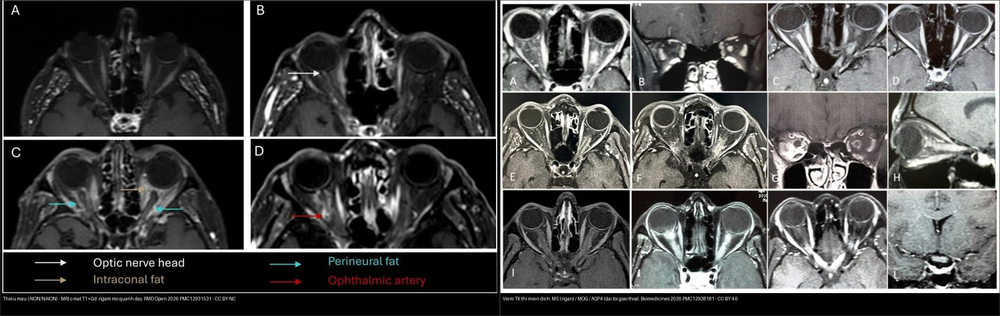
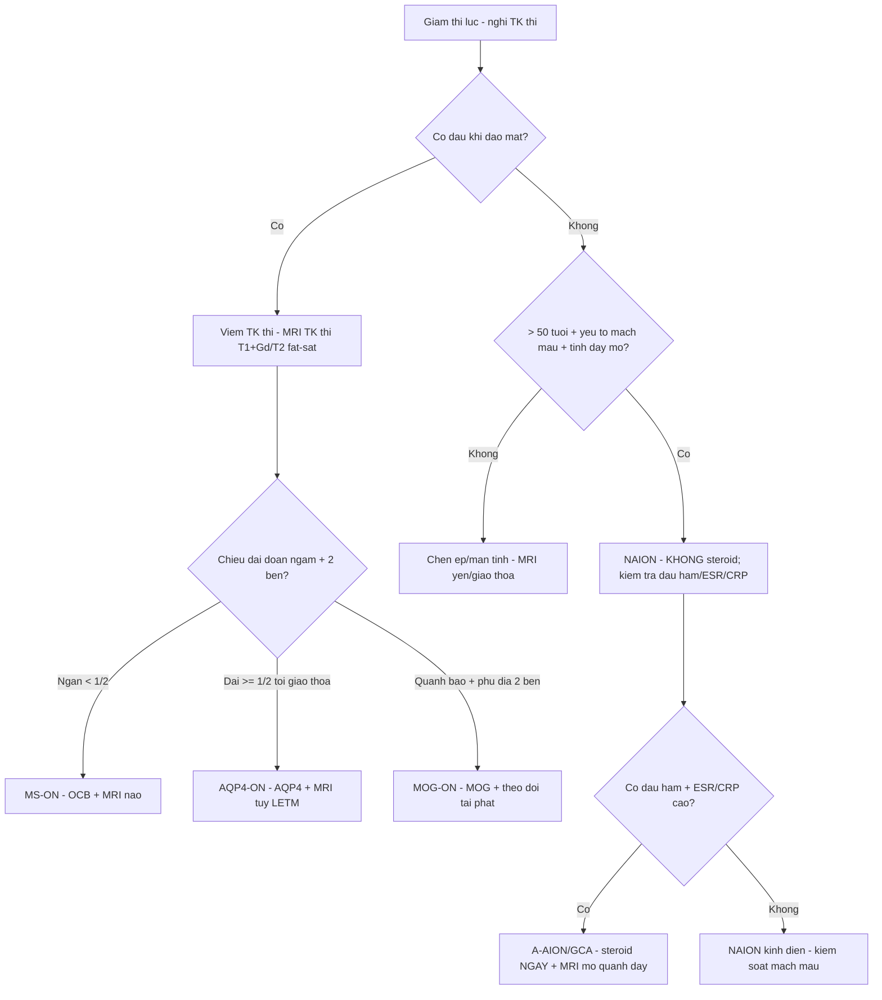
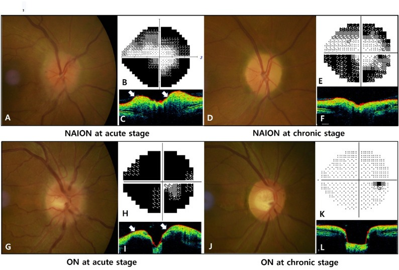
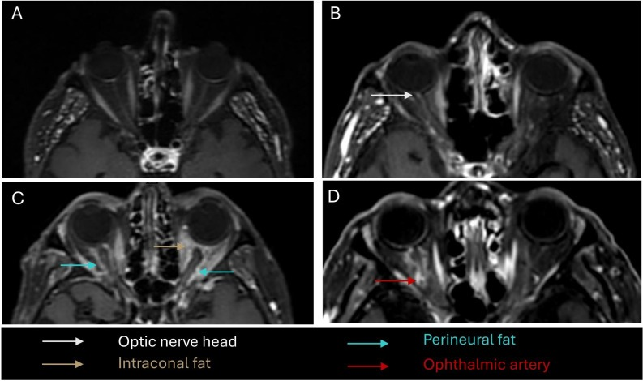
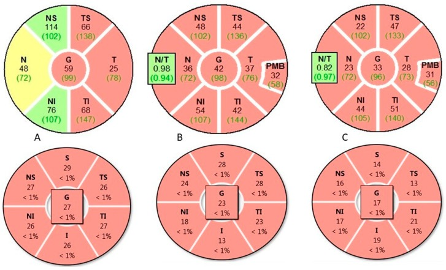

# 430 — Đường thị giác: viêm vs thiếu máu vs chèn ép / Optic neuritis vs NAION

**Tags:** `pattern:viem-TK-thi` `vung:than-kinh-thi` `score:GCL` `protocol:MRI-hoc-mat` `protocol:OCT-thi-truong`
**Mức chắc chắn (certainty):** tổng hợp y văn (literature synthesis) — nhóm tự biên từ y văn mở (Biomedicines 2026 CC BY + BMC Ophthalmol 2026 CC BY-NC-ND + RMD Open 2026 CC BY-NC + Cureus 2026 CC BY), chưa gắn ca nguyên văn đơn lẻ.

## 1. Tổng quan — đau khi đảo mắt + 3 hội chứng kháng thể

- **Viêm TK thị (optic neuritis, ON)** là một **nhóm bệnh sinh học khác nhau**, không phải một bệnh: phân biệt bằng **chiều dài tổn thương MRI + mẫu tổn thương võng mạc trên OCT + kháng thể**. Từ ONTT (1992) đến nay, paradigm đã chuyển từ "ON = MS" sang **ON do kháng thể** (AQP4-ON, MOG-ON, thể âm tính kép).
- **Viêm TK thị điển hình (MS-ON):** đau khi đảo mắt + giảm thị lực **1 bên** + ám điểm trung tâm; MRI **đoạn ngấm NGẮN (< 1/2 chiều dài TK, thường < 10–15 mm)** + **OCB dịch não tủy (+)**; đáp ứng steroid TM liều cao và **thường hồi phục tốt**.
- **NMOSD (AQP4+):** tổn thương **DÀI (≥ 1/2 chiều dài, tới giao thoa)**, **2 bên**, kèm **tủy dài (LETM)** + **area postrema** (nôn, nấc); tiên lượng **nặng** — **mất GCL sớm và nặng nhất trong 3 nhóm**, tái phát, cần **rituximab** dự phòng.
- **MOGAD:** **2 bên + phù đĩa + viêm quanh bao (perineural)**, trẻ; **bảo tồn GCL tương đối tốt hơn AQP4**; đáp ứng tốt, cần **theo dõi tái phát**.
- **NAION (thiếu máu, không viêm):** > 50 tuổi + yếu tố mạch máu + **KHÔNG đau** + phù đĩa + tỉnh dậy đã mờ; **chiếm ~90% ca AION**, không steroid.
- **AION do GCA (A-AION):** cấp cứu mù — **nhợt trắng phấn + đau hàm + 2 bên**; MRI ổ mắt giúp phân biệt nhanh (bài 435).
- **Ngưỡng định lượng nằm lòng:**
  - **Chiều dài đoạn ngấm:** MS-ON **ngắn** (< 1/2 chiều dài TK) vs AQP4-ON **dài** (≥ 1/2, tới giao thoa) vs MOG-ON **quanh bao/nhiều mô hốc mắt**.
  - **NAION vs ON — phù đĩa không phân biệt được bằng tốc độ:** thời gian phù **NAION 1,5 ± 0,6 tháng** vs **ON 1,3 ± 0,7 tháng**; pRNFLT lúc chẩn đoán **NAION 215,7 ± 57,6 µm** vs **ON 199,1 ± 60,4 µm**, **không khác biệt có ý nghĩa** — **tốc độ tan phù KHÔNG dùng để phân biệt** (BMC Ophthalmol 2026).
  - **A-AION vs NA-AION trên MRI ổ mắt:** ngấm **mỡ quanh dây thần kinh (perineural fat) 90,9% vs 22,2% (p = 0,005)**; ngấm **mỡ sau nhãn cầu 100% vs 11,1%**; ngấm **động mạch mắt 72,7% vs 22,2%** (RMD Open 2026) → **ngấm lan ra mô mỡ = nghĩ GCA**.
  - **Steroid cấp:** methylprednisolone **1 g/ngày × 3–5 ngày**; NMOSD kháng steroid → **thay huyết tương sớm (5 đợt)**.

## 2. Gamut giảm thị lực cấp + TK thị

- **Theo triệu chứng chốt:** **đau khi đảo mắt + hồi phục từng đợt → viêm**; **không đau + tỉnh dậy đã mờ (> 50 tuổi) → thiếu máu**; **không đau + tiến triển chậm + mạn → chèn ép**.
- **Theo MRI chiều dài ngấm:** ngắn = MS-ON; dài tới giao thoa = AQP4-ON; quanh bao + phù đĩa + 2 bên = MOG-ON; **ngấm mỡ quanh dây/mô hốc mắt = A-AION (GCA)**.
- **Theo OCT:** **mất GCL sớm–nặng = AQP4-ON**; **bảo tồn tương đối = MOG-ON**; **RNFL mỏng thái dương muộn = viêm/DOA/độc chất (bài 434/439)**.
- **Theo cơ chế:** **khử myelin/miễn dịch** (MS, MOGAD) · **hoại tử tế bào hình sao (astrocytopathy)** (AQP4) · **thiếu máu động mạch đốt sống sau/ngắn** (NAION, GCA) · **chèn ép cơ học** (u, dày màng não).

## 3. Bảng so sánh phân biệt (ma trận đối chiếu)

| Thực thể (entity) | Hình ảnh điển hình (MRI/OCT/đáy mắt) | Chốt vào (rule-in) | Chốt loại (rule-out) | Gợi ý xác nhận |
|---|---|---|---|---|
| **MS-ON** | Ngấm **ngắn, khu trú** (axial + coronal), 1 bên; RNFL/GCL mất **vừa** | **Đau khi liếc + đoạn ngắn + trẻ + OCB (+)** | Dài + 2 bên + AQP4 (+) → NMOSD | Steroid TM; MRI não (tổn thương Dawson) |
| **AQP4-ON (NMOSD)** | Ngấm **DÀI ≥ 1/2 TK, tới giao thoa**, hay 2 bên; kèm LETM + area postrema; **mất GCL sớm–nặng nhất** | **AQP4 (+) + LETM + nôn nấc + 2 bên/dài** | Ngắn + OCB (+) đơn thuần → MS | Thay huyết tương sớm + rituximab |
| **MOG-ON (MOGAD)** | **2 bên + phù đĩa + viêm quanh bao (perineural)**; **bảo tồn GCL tương đối** | **Phù đĩa + trẻ + 2 bên + đáp ứng tốt + kháng MOG (+)** | Không phù đĩa + dài tới giao thoa → NMOSD | Kháng MOG; steroid + theo dõi tái phát |
| **NAION (thiếu máu)** | Phù đĩa + **không ngấm TK**; **không đau**; **pRNFLT ~216 µm** lúc đầu, tan phù **~1,5 tháng** | **> 50 tuổi + không đau + đĩa phù + disc-at-risk (C/D nhỏ mắt kia)** | Đau + ngấm TK/mỡ → viêm/GCA | Kiểm soát mạch máu; **không steroid** |
| **A-AION (GCA)** | Ngấm **mỡ quanh dây thần kinh + mỡ sau nhãn cầu + động mạch mắt**; đĩa **nhợt trắng phấn**, 2 bên | **GCA: đau hàm + ESR/CRP cao + mỡ quanh dây ngấm (90,9% vs 22,2%)** | Ngấm khu trú ngắn, không mỡ quanh dây → NAION/MS | **Steroid NGAY** (bài 435); sinh thiết động mạch thái dương |
| **Chèn ép (u/meningioma)** | Khối đè giao thoa/TK + tiến triển chậm; **bán manh bít** | **Không đau + mạn + khối trên MRI** | Cấp + đau + ngấm → viêm/mạch | MRI yên/giao thoa có tiêm (bài 431/432) |

*Trái: **AION/NAION trên MRI ổ mắt T1+Gd** — (A) NAION bình thường, (B) ngấm **đầu TK thị**, (C, D) **ngấm mỡ quanh dây + mỡ sau nhãn cầu + động mạch mắt** (A-AION/GCA) — RMD Open 2026, PMC12931531 Fig. 2, CC BY-NC 4.0. Phải: **viêm TK thị miễn dịch trên MRI T1+Gd** — MS **ngắn** (A, B) / MOG **(C–F)** / AQP4 **dài tới giao thoa** — Biomedicines 2026, PMC12938181 Fig. 3, CC BY 4.0. Ảnh ghép letterbox.*

**Quiz composite:** che nhãn, hỏi bên nào là **bệnh mạch máu (không steroid, trừ khi GCA)**, bên nào cần **kháng thể AQP4/MOG**?

<b>Bấm để hiện đáp án</b>

- **Bên trái (thiếu máu AION/NAION):** **ngấm mỡ quanh dây/mỡ sau nhãn cầu → nghĩ GCA (steroid NGAY)**; nếu chỉ ngấm đầu TK thị hoặc bình thường + không đau → **NAION, không steroid**.
- **Bên phải (viêm miễn dịch):** đo **chiều dài ngấm** để phân nhóm — **ngắn = MS-ON**, **dài tới giao thoa = AQP4-ON**, **quanh bao/phù đĩa = MOG-ON** → xét **AQP4 + MOG** trước khi chọn điều trị dự phòng.

### Vì sao OCT lại "chấm điểm" bệnh sinh ba nhóm viêm
- Vì **thân tế bào hạch (GCL)** là **thân tế bào thần kinh**; tế bào hình sao (astrocyte) bị phá (AQP4) làm **mất GCL sớm và nặng**; còn MOG/khử myelin **bảo tồn sợi trục tương đối** → **GCL mất ít hơn**.
- Hệ quả lâm sàng: cùng "viêm TK thị" nhưng **AQP4-ON tiên lượng nặng nhất**, cần **thay huyết tương sớm** nếu kháng steroid; **MOG-ON** cần **theo dõi tái phát** dù hồi phục tốt.

## 4. Protocol chụp + phân tầng xử trí

- **MRI TK thị (bắt buộc):** **T1 fat-sat sau tiêm + T2 fat-sat 2 bình diện (axial + coronal)**, **lát mỏng ≤ 2–3 mm**; đo **chiều dài đoạn ngấm** (mm) + tìm **ngấm mỡ quanh dây/mô hốc mắt**. Kèm **MRI não** (Dawson — nghi MS) + **MRI tủy** (**LETM ≥ 3 thân đốt** — nghi NMOSD).
- **OCT:** **vòng RNFL quanh đĩa + GCL/GCC hoàng điểm** — đo **µm**; mất GCL sớm → gợi **AQP4**.
- **Kháng thể + dịch não tủy:** **AQP4-IgG (cell-based)**, **MOG-IgG**, **OCB** (hỗ trợ MS).
- **Chọc dò khi có phù đĩa 2 bên:** đo **bề dày vỏ thần kinh thị (ONSD)** cách nhãn cầu **3 mm: > 5,5–5,8 mm** = tăng áp lực nội sọ (bài 433).
- **Xử trí:** viêm cấp → **methylprednisolone 1 g/ngày × 3–5 ngày**; **NMOSD kháng → thay huyết tương 5 đợt**; **NAION → không steroid**; **A-AION/GCA → steroid liều cao NGAY, không chờ xác nhận** (bài 435).

## 5. Cạm bẫy

- **Đĩa thị bình thường không loại trừ viêm sau nhãn cầu** (60–70% NMOSD) — MRI mới quyết định.
- **NAION cho steroid vô ích + nguy cơ** — phân biệt đau/không đau + ngấm mỡ quanh dây từ đầu.
- **Thuốc MS (interferon, fingolimod...) làm nặng NMOSD** — chốt **AQP4** trước khi điều trị duy trì.
- **Tốc độ tan phù đĩa KHÔNG phân biệt NAION vs ON** (1,5 ± 0,6 vs 1,3 ± 0,7 tháng; pRNFLT ~216 vs ~199 µm) — **nhưng** đây vẫn là cơ sở để **không hứa phân biệt bằng diễn tiến**; dùng đau + MRI.
- **Bề dày phù đĩa càng lớn → thời gian phù càng dài** ở cả hai bệnh — đừng tưởng phù kéo dài là "chưa lành".
- **Đừng quên chèn ép** trong teo thị tiến triển chậm không đau (bán manh 2 thái dương → MRI yên/giao thoa).

## 6. Tự lượng giá — Blind Quiz

**Ca 1 — Bé trai nôn nấc 7 ngày + yếu chân + mờ mắt. Đọc MRI TK thị (T1 + Gd), 2 bên:**

- Hỏi: ngấm ở đâu? Đĩa thị có phù không? Kèm tủy dài + nôn nấc → hội chứng nào? Kháng thể nào?

<b>Bấm để hiện đáp án (findings + chẩn đoán)</b>

- Dấu hiệu (findings): **ngấm TK thị sau nhãn cầu 2 bên**, đĩa thị bình thường, kèm **tủy dài** + **area postrema**.
- Chẩn đoán (diagnosis): **NMOSD AQP4(+)** — điều trị **steroid TM + thay huyết tương sớm + rituximab** dự phòng (khác MS/MOGAD).
- Nguồn ảnh: Espinel-Porras et al., Cureus 2026 (PMC13499930) Fig. 4, CC BY 4.0.

**Ca 2 — Ông 65 tuổi tăng HA, tỉnh dậy mờ 1 mắt, KHÔNG đau, đĩa phù. Đáy mắt + thị trường (nửa trên ảnh = NAION):**

- Hỏi: viêm hay thiếu máu? Steroid không? Dấu hiệu nào chốt?

<b>Bấm để hiện đáp án (findings + chẩn đoán)</b>

- Dấu hiệu (findings): **đĩa phù** + khuyết thị trường **nửa trên/nửa dưới (altitudinal)**; pRNFLT lúc đầu ~216 µm, phù tan ~1,5 tháng.
- Chẩn đoán (diagnosis): **NAION** — vì **> 50 tuổi + không đau + yếu tố mạch máu**; **KHÔNG steroid**, kiểm soát mạch máu.
- Chốt: **không đau** giúp tách khỏi viêm; nếu **đau + ngấm mỡ quanh dây** → nghĩ GCA/viêm.
- Nguồn ảnh: Moon JW et al., BMC Ophthalmol 2026 (PMC13348820) Fig. 1, CC BY-NC-ND 4.0 (nguyên bản).

**Ca 3 — Cụ bà 72 tuổi đau hàm, ESR/CRP cao, mờ mắt 1 bên rồi 2 bên, đĩa nhợt. MRI ổ mắt T1+Gd:**

- Hỏi: bên nào nghĩ GCA? Dấu hiệu MRI chốt? Xử trí ngay là gì?

<b>Bấm để hiện đáp án (findings + chẩn đoán)</b>

- Dấu hiệu (findings): **ngấm mỡ quanh dây thần kinh thị (perineural fat)** + **mỡ sau nhãn cầu** + **động mạch mắt** — nhóm A-AION; ca NAION chỉ ngấm đầu TK thị hoặc bình thường.
- Định lượng: **mỡ quanh dây 90,9% vs 22,2% (p = 0,005)**; **mỡ sau nhãn cầu 100% vs 11,1%**.
- Chẩn đoán/xử trí: **A-AION do GCA** → **steroid liều cao NGAY** (không chờ sinh thiết) để cứu mắt kia (bài 435).
- Nguồn ảnh: Brenac G et al., RMD Open 2026 (PMC12931531) Fig. 2, CC BY-NC 4.0.

**Ca 4 — Ba nhóm viêm TK thị miễn dịch, đọc OCT RNFL (bánh xe trên) + GCL (dưới):**

- Hỏi: nhóm nào mất GCL **sớm–nặng nhất**? Nhóm nào **bảo tồn tương đối**? Vì sao?

<b>Bấm để hiện đáp án (findings + chẩn đoán)</b>

- Đọc: (A) MS-ON, (B) MOG-ON, (C) **AQP4-ON**; hàng trên = **RNFL quanh đĩa**, hàng dưới = **GCL hoàng điểm**.
- **AQP4-ON mất GCL sớm–nặng nhất**; **MOG-ON bảo tồn tương đối**; MS-ON trung bình — vì AQP4 (**astrocytopathy**) phá tế bào hình sao → chết RGC mạnh; MOG/khử myelin bảo tồn sợi trục hơn.
- Chốt xử trí: AQP4 → **thay huyết tương sớm nếu kháng steroid + rituximab**; MOG → **theo dõi tái phát**.
- Nguồn ảnh: Lana-Peixoto MA et al., Biomedicines 2026 (PMC12938181) Fig. 4, CC BY 4.0.

**Ca 5 — Ghép đối chiếu: bên nào là thiếu máu (AION/NAION), bên nào là viêm miễn dịch (xét AQP4/MOG)?**

<b>Bấm để hiện đáp án (findings + chẩn đoán)</b>

- Trái = **thiếu máu (AION/NAION)** — ngấm **mỡ quanh dây/mỡ sau nhãn cầu = nghĩ GCA (steroid NGAY)**; chỉ ngấm đầu TK thị/bình thường + không đau = **NAION, không steroid**.
- Phải = **viêm miễn dịch** (MRI T1+Gd, đo chiều dài ngấm để phân MS/MOG/AQP4).
- Chốt: **đau/không đau** + **chiều dài ngấm** + **kháng thể** là ba trục phân loại.

## Bài liên quan chéo
- [400 – Tổng quan Mắt](../400-tong-quan-mat-thi-giac/lesson.md)
- [431 – U TK thị](../431-u-than-kinh-thi/lesson.md) (chèn ép mạn)
- [432 – Vùng yên](../432-vung-yen/lesson.md) (bán manh 2 thái dương)
- [433 – Phù đĩa thị vs drusen](../433-phu-dia-thi-drusen/lesson.md) (phù thật vs giả phù; IIH; ONSD)
- [434 – Teo thị độc–chuyển hóa & LHON](../434-teo-thi-than-kinh-thi-doc-va-LHON/lesson.md) (teo thị 2 bên không đau)
- [435 – GCA & AAION vs NAION](../435-gca-va-naion-aion/lesson.md) (cấp cứu mù > 50 tuổi)
- [439 – Teo thị di truyền (DOA/Wolfram)](../439-teo-thi-di-truyen/lesson.md) (chẩn đoán phân biệt teo thị 2 bên)

## Ảnh
- `430_viem-TK-thi_MRI_PMC-Espinel-CCBY40.webp` — Espinel-Porras et al., Cureus 2026 (PMCID: PMC13499930) Fig. 4, CC BY 4.0.
- `430_viem-TK-thi-the-mien-dich_MRI_PMC12938181-Fig3-CCBY.jpg`, `430_viem-TK-thi_RNFL-MOG-AQP4_OCT_PMC12938181-Fig4-CCBY.jpg` — Lana-Peixoto MA et al., Biomedicines 2026 (PMCID: PMC12938181), CC BY 4.0.
- `430_NAION-vs-ON_do-day-mat-TVF_PMC13348820-Fig1-CCBYNCND.jpg` — Moon JW et al., BMC Ophthalmol 2026 (PMCID: PMC13348820), CC BY-NC-ND 4.0 (nguyên bản, không tạo tác phẩm phái sinh).
- `430_AION-NAION-hoc-mat_MRI_PMC12931531-Fig2-CCBYNC.jpg` — Brenac G et al., RMD Open 2026 (PMCID: PMC12931531), CC BY-NC 4.0.
- `composite_thieu-mau-vs-viem.jpg` — ảnh ghép letterbox (PMC12931531 Fig. 2 + PMC12938181 Fig. 3), CC BY-NC 4.0 (do thành phần BY-NC).
- Chi tiết giấy phép từng ảnh trong `images/CREDITS.md`. AuntMinnie: chỉ dẫn link, không tải.

> Không dùng để chẩn đoán độc lập khi chưa có người hướng dẫn.
