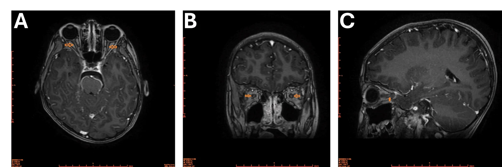

# 430 — Đường thị giác: viêm vs thiếu máu vs chèn ép / Optic neuritis vs NAION

**Tags:** `pattern:viem-TK-thi` `vung:than-kinh-thi`
**Mức chắc chắn (certainty):** tổng hợp y văn (literature synthesis) — nhóm tự biên từ y văn mở, chưa gắn ca nguyên văn đơn lẻ.

## 1. Tổng quan — đau khi đảo mắt + 3 hội chứng kháng thể

- **Viêm TK thị điển hình (MS):** đau khi đảo mắt + giảm thị lực 1 bên + ám điểm trung tâm + **STIR/T2 sáng + ngấm thuốc đoạn ngắn**, đáp ứng steroid TM liều cao.
- **NMOSD (AQP4+):** 2 bên/dài + tủy dài (LETM) + area postrema (nôn nấc) — tái phát nặng, rituximab dự phòng.
- **MOGAD:** 2 bên + phù đĩa + quanh TK (perineural) — đáp ứng tốt, tiên lượng khá hơn.
- **NAION (thiếu máu):** > 50 tuổi + mạch máu + **KHÔNG đau** + đĩa phù + tỉnh dậy đã mờ — steroid không có tác dụng, chống đông không chỉ định thường quy.
- Ngưỡng: methylprednisolone **1 g/ngày × 3–5 ngày** viêm cấp; NMOSD kháng steroid → thay huyết tương (5 đợt).

## 2. Gamut giảm thị lực cấp + TK thị

- **Viêm MS:** trẻ + đau đảo mắt + đoạn ngắn + OCB (+) — steroid, theo dõi MS.
- **NMOSD:** dài + 2 bên + tủy/area postrema + AQP4 (+) — steroid + thay huyết tương + rituximab.
- **MOGAD:** phù đĩa + quanh TK + trẻ — steroid đáp ứng tốt.
- **NAION:** già + mạch máu + không đau + đĩa phù — kiểm soát mạch máu, không steroid.
- **Chèn ép (u tuyến yên/meningioma):** tiến triển chậm + không đau + giao thoa (bài 431/432).

## 3. Bảng so sánh

| Thực thể (entity) | Hình ảnh (MRI) | Chốt vào (rule-in) | Chốt loại (rule-out) | Gợi ý xác nhận |
|---|---|---|---|---|
| Viêm MS | **Ngấm ngắn + đau đảo mắt + OCB** | **Đau + đoạn ngắn + trẻ** | Dài + 2 bên + AQP4 → NMOSD | Steroid TM + MRI não (Dawson) |
| NMOSD | **Dài + 2 bên + tủy dài + area postrema** | **AQP4 (+) + LETM + nôn nấc** | Ngắn + OCB → MS | Thay huyết tương + rituximab |
| MOGAD | **Phù đĩa + quanh TK** | **Phù đĩa + trẻ + đáp ứng tốt** | Không phù đĩa + dài → NMOSD | Kháng MOG, steroid |
| NAION | **Đĩa phù + không ngấm TK**, già mạch máu | **> 50t + không đau + mạch máu** | Đau + ngấm TK → viêm | Không steroid; mạch máu |
| Chèn ép | Khối đè giao thoa/TK + tiến triển chậm | **Không đau + mạn + khối** | Cấp + đau → viêm/mạch | (bài 431/432) |

*Ngấm TK thị sau nhãn cầu 2 bên (đĩa thị bình thường) + tủy dài + area postrema — NMOSD AQP4(+). Nguồn: Espinel-Porras et al., Cureus 2026, CC BY 4.0.*

## 4. Protocol MRI TK thị

- **STIR/fatsat + T1 cản quang 3 bình diện** (ngấm đoạn nào, dài bao nhiêu) + MRI não (Dawson/MS) + tủy (LETM) khi nghi NMOSD.
- Kháng thể: AQP4 + MOG (cell-based) + OCB dịch não tủy.
- Cấp: steroid TM 1 g × 3–5 ngày; NMOSD kháng → thay huyết tương sớm (đừng chờ).

## 5. Cạm bẫy

- **Đĩa thị bình thường không loại trừ viêm sau nhãn cầu** (60–70% NMOSD) — MRI mới quyết định.
- **NAION cho steroid** vô ích + nguy cơ — phân biệt đau/không đau từ đầu.
- **Thuốc MS (interferon...) làm nặng NMOSD** — chốt kháng thể trước khi điều trị duy trì.

## 6. Tự lượng giá — Blind Quiz

**Ca 1 — Bé trai nôn nấc 7 ngày + yếu chân + mờ mắt. Đọc MRI TK thị.**

- Hỏi: ngấm ở đâu? Đĩa thị có phù không? Kèm tủy dài + nôn nấc → hội chứng nào? Kháng thể nào?

<b>Bấm để hiện đáp án</b>

- **NMOSD AQP4(+):** ngấm sau nhãn cầu 2 bên + đĩa bình thường + LETM + area postrema — steroid + thay huyết tương + rituximab (khác MS/MOGAD).
- Nguồn: Espinel-Porras et al., Fig. 4, CC BY 4.0.

**Ca 2 — Ông 65 tuổi tăng HA, tỉnh dậy mờ 1 mắt, không đau, đĩa phù:** viêm hay thiếu máu? Steroid không? *(Bảng mục 3.)*

<b>Bấm để hiện đáp án</b>

- **NAION:** già + mạch máu + không đau + đĩa phù — không steroid, kiểm soát mạch máu.

## Bài liên quan chéo
- [400 – Tổng quan Mắt](../400-tong-quan-mat-thi-giac/lesson.md)
- [431 – U TK thị (dự kiến)](../431-u-than-kinh-thi/lesson.md) (chèn ép mạn)
- [432 – Vùng yên (dự kiến)](../432-vung-yen/lesson.md) (giao thoa)

> Không dùng để chẩn đoán độc lập khi chưa có người hướng dẫn.
