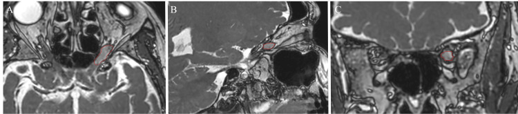

# 431 — U thần kinh thị: glioma vs meningioma / Optic glioma vs Sheath meningioma

**Tags:** `pattern:u-TK-thi` `vung:than-kinh-thi`
**Mức chắc chắn (certainty):** tổng hợp y văn (literature synthesis) — nhóm tự biên từ y văn mở, chưa gắn ca nguyên văn đơn lẻ.

## 1. Tổng quan — trong trục vs quanh trục + tram-track

- **Glioma TK thị:** TRONG trục TK (trẻ + NF1), phình hình thoi (fusiform), gập khúc (kink) — mổ = mù (cắt cả TK), xạ khi tiến triển.
- **Meningioma bao TK (ONSM):** QUANH trục TK (già), **tram-track (2 đường ngấm quanh TK đen)** + vôi hóa — xạ lập thể (SRS) là chuẩn, mổ = mù.
- TẠI SAO phân biệt sống còn: glioma mổ cắt TK (mất thị lực hoàn toàn), ONSM xạ giữ TK; chẩn đoán nhầm = mù oan.
- Số: ONSM ~2% u ổ mắt; SRS kiểm soát ~96–100%, thị lực cải thiện ≥ 50% nếu thị lực trước xạ còn tốt.

## 2. Gamut khối quanh TK thị

- **Glioma (trẻ NF1):** fusiform + kink + trong trục — theo dõi/xạ khi tiến triển.
- **ONSM (già):** tram-track + vôi hóa + quanh trục — SRS (25 Gy/5 phân liều mẫu).
- **Viêm (sarcoid/GPA):** ngấm TK + toàn thân — steroid/sinh thiết.
- **Lymphoma:** ngấm + tuổi già + ngoài ổ mắt — sinh thiết.

## 3. Bảng so sánh

| Thực thể (entity) | Hình ảnh (MRI) | Chốt vào (rule-in) | Chốt loại (rule-out) | Gợi ý xác nhận |
|---|---|---|---|---|
| Glioma | **Fusiform + kink, TRONG trục**, trẻ NF1 | **Trẻ + NF1 + fusiform** | Quanh trục + vôi hóa → ONSM | Theo dõi/xạ khi tiến triển |
| ONSM | **Tram-track + vôi hóa, QUANH trục**, già | **Tram-track + già + tiến triển chậm** | Trong trục + trẻ → glioma | SRS (tránh mổ cắt TK) |
| Viêm TK | Ngấm + đau + toàn thân | **Đau + cấp + đáp ứng steroid** (bài 430) | Không đau + mạn + tram-track → u | (bài 430) |

*SSFP: tổn thương ngấm quanh TK thị trái gần đỉnh + giãn bao. Nguồn: Chaga et al., Cureus 2025 Fig. 1, CC BY 4.0.*

## 4. Protocol MRI TK thị-u

- **T1/T2 fatsat + cản quang 3 bình diện + GRE (vôi hóa)** — trong vs quanh trục là lát cắt quyết định.
- SRS ONSM: 25 Gy/5 phân liều mẫu, giới hạn TK/giao thoa (D0.035cc), theo dõi thị lực + thể tích (giảm 44% mẫu).
- Glioma NF1: theo dõi định kỳ, xạ khi đe dọa thị lực còn lại.

## 5. Cạm bẫy

- **Sinh thiết/mổ ONSM = mù** — chẩn đoán hình ảnh + SRS, không mổ lấy mô thường quy.
- **Glioma người lớn** hiếm nhưng ác tính hơn trẻ — đừng chủ quan tuổi.
- **Vôi hóa TK thị** cũng gặp viêm mạn/lao — bối cảnh + tram-track quyết định.

## 6. Tự lượng giá — Blind Quiz

**Ca 1 — Nữ 68 tuổi lồi mắt + đau, khối ngấm quanh TK thị trái. Đọc MRI.**

- Hỏi: trong hay quanh trục? Tram-track có không? Mổ hay xạ? Vì sao?

<b>Bấm để hiện đáp án</b>

- **ONSM:** quanh trục + giãn bao — **SRS (không mổ)**, giảm 44% thể tích mẫu; mổ cắt TK = mù.
- Nguồn: Chaga et al., Fig. 1, CC BY 4.0.

**Ca 2 — Bé NF1 + khối fusiform trong trục TK thị:** glioma hay ONSM? Xử trí? *(Bảng mục 3.)*

<b>Bấm để hiện đáp án</b>

- **Glioma:** trẻ NF1 + trong trục + kink — theo dõi, xạ khi tiến triển đe dọa thị lực.

## Bài liên quan chéo
- [400 – Tổng quan Mắt](../400-tong-quan-mat-thi-giac/lesson.md)
- [430 – Đường thị giác](../430-duong-thi-giac/lesson.md) (viêm cấp)
- [460 – Can thiệp + xạ (dự kiến)](../460-can-thiep-mat/lesson.md) (SRS)

> Không dùng để chẩn đoán độc lập khi chưa có người hướng dẫn.
