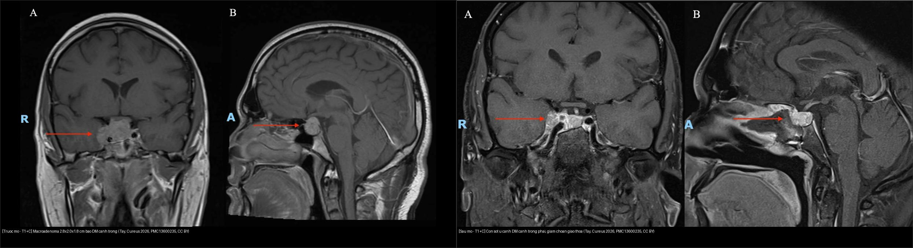
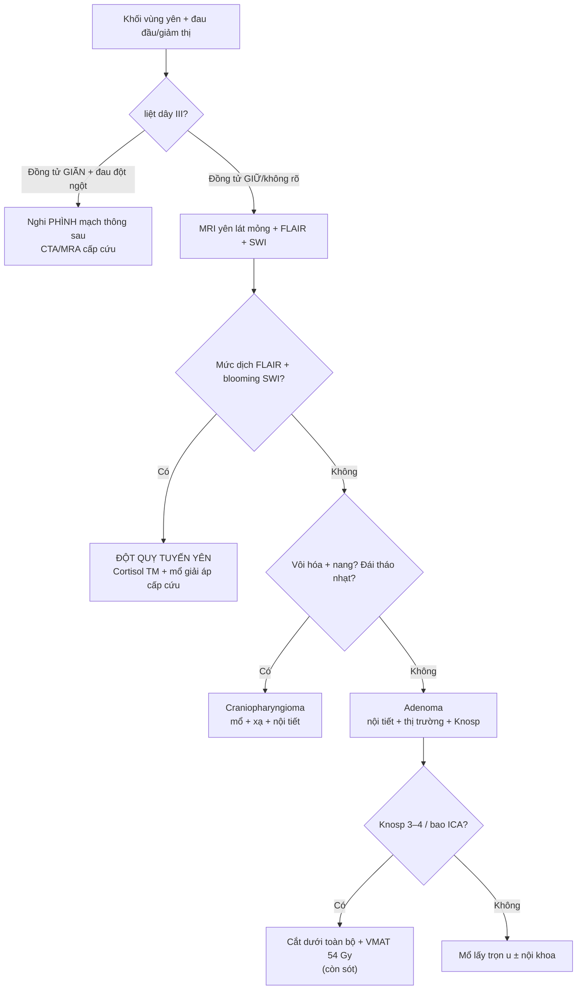
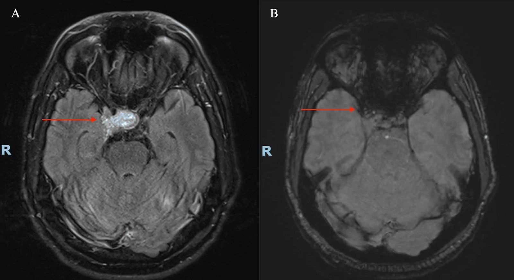
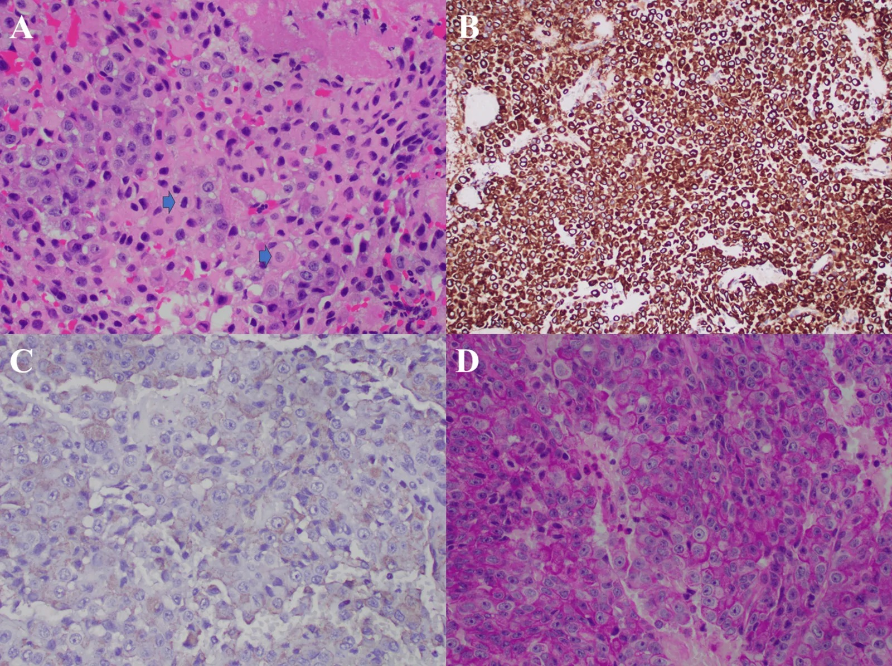

# 432 — Vùng yên-giao thoa: adenoma vs đột quỵ tuyến yên / Sellar masses & Apoplexy

**Tags:** `pattern:khoi-yen` `vung:giao-thoa` `pattern:dot-quy-tuyen-yen` `protocol:MRI-yen`
**Mức chắc chắn (certainty):** tổng hợp y văn (literature synthesis) — nhóm tự biên từ y văn mở (Europe PMC/PMC, Cureus, CC BY) + ca minh họa có giấy phép; không phải ca nguyên văn đơn lẻ.

> **Câu chốt lâm sàng:** khối vùng yên + **đau đầu dữ đột ngột + liệt dây III** = nghĩ **đột quỵ tuyến yên (pituitary apoplexy)** cho tới khi loại trừ; nếu **liệt III kèm đồng tử giãn** thì **loại phình động mạch thông sau trước tiên** (CTA/MRA cấp cứu).

## 1. Tổng quan — bán manh thái dương + đột quỵ tuyến yên

- **Adenoma tuyến yên:** u biểu mô tuyến yên (PitNET), chèn ép giao thoa thị từ **dưới** → **bán manh thái dương hai bên (bitemporal hemianopia)** do các sợi bắt chéo (decussating) của võng mạc mũi bị tổn thương trước. Phân theo kích thước: **vi tuyến (microadenoma) < 10 mm** (thường tiết prolactin — PRL) vs **macro ≥ 10 mm** (không tiết + chèn ép, hoặc tiết GH/ACTH).
- **Đột quỵ tuyến yên (pituitary apoplexy):** **xuất huyết/nhồi máu trong u**, biến chứng **2–12%** adenoma tuyến yên; tam chứng kinh điển **đau đầu dữ đột ngột + nôn + giảm thị/liệt vận nhãn**, kèm **suy thượng thận cấp** (đe dọa tính mạng) → **cortisol tĩnh mạch NGAY + mổ giải áp cấp cứu qua xoang bướm**.
- **TẠI SAO MRI thấy máu (theo Argon):** sản phẩm giáng hóa hemoglobin (deoxyhemoglobin → methemoglobin nội bào) → trên **đuôi tín hiệu bất đồng (heterogeneous)** có thể thấy **mức dịch–dịch (fluid level) trên FLAIR** (huyết thanh nổi trên huyết khối lắng) và **hiệu ứng "nở hoa" (blooming artifact) trên SWI/T2\*** — do **deoxyhemoglobin/hemosiderin gây bất đồng cảm ứng từ (susceptibility)** làm mất tín hiệu lan rộng. Đây là **hai dấu hiệu "khóa" chẩn đoán đột quỵ**.
- **Số liệu định lượng ca minh họa (dưới đây):** macroadenoma **2,8 × 2,0 × 1,8 cm**, **bao động mạch cảnh trong (ICA) hai bên + lan xoang hang**, đột quỵ dạng **nhồi máu xuất huyết**; mô bệnh **Crooke cell adenoma (CCA)**; mổ nội soi qua xoang bướm **cắt dưới toàn bộ (subtotal)** vì bao ICA hai bên; **VMAT 54 Gy/30 phân liều** khi còn sót.
- **Crooke cell adenoma (CCA) — vì sao đáng nhớ:** là PitNET tế bào corticotroph **hung hãn nhất**: **macro 81%**, **tái phát sau mổ 56%**, **xâm lấn 71–81%**, **lan trên yên 64%**, **xâm lấn xoang hang 46%**; thường **"câm" nội tiết** (endocrinologically silent) → **không có hội chứng Cushing để cảnh báo**, nên dễ chẩn đoán muộn. Ca dưới đây là **ca thứ 10** trong y văn CCA kèm đột quỵ.

## 2. Gamut khối vùng yên + liệt dây III

- **Theo vị trí tương quan giao thoa:**
  - **Dưới giao thoa (adenoma):** đẩy giao thoa **lên trên** → bán manh thái dương, u to đều, giao thoa căng nằm vắt trên u.
  - **Trên giao thoa (craniopharyngioma, u màng não củ yên/planum, u tế bào mầm):** đẩy giao thoa **xuống** → thường kèm **đái tháo nhạt**, vôi hóa/nang.
  - **Trong xoang hang (schwannoma, u màng não, di căn):** liệt các dây III/IV/V1–V2, không hiếm khi "giả adenoma".
- **Theo nội dung khối:** đặc ngấm đồng nhất (adenoma); **vôi hóa + nang** (craniopharyngioma — 2 đỉnh tuổi: 5–14 và > 50); **nang giả (Rathke)**; **khối mỡ** (u quái, lipoma hệ thần kinh trung ương); **dịch mức + blooming** (đột quỵ).
- **Theo cấp/không cấp:** **đột quỵ tuyến yên** (đau dữ + liệt III + suy thượng thận) là **cấp cứu**; adenoma không tiết chèn ép là **bán cấp**.
- **Liệt dây III đơn độc — 3 nhóm chốt:** **nhồi máu thần kinh vi mạch (đồng tử GIỮ)** vs **phình động mạch thông sau (đồng tử GIÃN)** vs **đột quỵ tuyến yên/u xâm lấn xoang hang (thường kèm tổn thương dây khác)**. **Quy tắc đồng tử: giãn = nguy hiểm mạch máu**.
- **Gợi nhớ SATCHMO / vùng yên:** **S**ellar adenoma, **A**poplexy, **T**eratoma/germ cell, **C**raniopharyngioma, **H**ypophysitis, **M**eningioma, **O**ther (Rathke cyst, metastasis, aneurysm).

## 3. Bảng so sánh phân biệt (ma trận đối chiếu)

| Thực thể (entity) | Hình ảnh điển hình (MRI) | Chốt vào (rule-in) | Chốt loại (rule-out) | Gợi ý xác nhận |
|---|---|---|---|---|
| **Adenoma (thường)** | Khối đặc từ yên, **nâng giao thoa**, ngấm; T1 đồng tín hiệu, T2 trung tính/sáng; bờ rõ | **Bán manh thái dương + hội chứng nội tiết** (PRL/GH/ACTH) | **Mức dịch + blooming cấp → đột quỵ**, không phải u thường | Nội tiết đầy đủ + thị trường (perimetry) + MRI yên lát mỏng |
| **Đột quỵ tuyến yên** | **Mức dịch–dịch trên FLAIR** (fluid–fluid level) + **blooming trên SWI/T2\***; u to nhanh, tín hiệu hỗn hợp | **Đau đầu dữ đột ngột + liệt III + giảm thị cấp + suy thượng thận** | Thiếu máu cấp tính + không đau/không liệt → u thường tiến triển chậm | **Cortisol TM + mổ nội soi giải áp cấp cứu** (không chờ MRI xong) |
| **Craniopharyngioma** | **Vôi hóa thô + nang** trên yên; hai đỉnh tuổi (trẻ 5–14 & già > 50) | **Vôi hóa + nang + đái tháo nhạt + suy yên** | Không vôi hóa + người lớn + ngấm đồng nhất → adenoma | Canxi máu/điện giải + nội tiết; mô bệnh |
| **Phình động mạch thông sau** | Không thấy trên MRI thường quy; túi phình có dòng xoáy | **Liệt III kèm ĐỒNG TỬ GIÃN + đau + khởi phát đột ngột** | Đồng tử giữ + nhồi máu vi mạch → không phải phình | **CTA/MRA cấp cứu** song song MRI |
| **Crooke cell adenoma (biến thể)** | **Macroadenoma xâm lấn** (xoang hang 46%, trên yên 64%), **"câm" nội tiết** | **U xâm lấn lớn + không hội chứng Cushing** | U nhỏ, tăng ACTH rõ → adenoma corticotroph thường | Mô bệnh **+ nhuộm tối thiểu** trên mô còn sống (khối hoại tử dễ âm giả) |

*Trái — trước mổ (T1W sau tiêm): macroadenoma 2,8 × 2,0 × 1,8 cm bao động mạch cảnh trong (ICA) và lan xoang hang. Phải — sau mổ: còn sót u cạnh ICA phải, giảm chèn ép giao thoa. Nguồn: Tay EZY et al., Cureus 2026, PMC13600235 (CC BY 4.0). Ảnh ghép letterbox, giữ nguyên tỷ lệ.*

### Dấu hiệu chốt đọc ảnh (theo từng chuỗi xung)
- **T1W sau tiêm (coronal + sagittal):** u đặc ngấm kém–trung bình bao quanh ICA; ghi **quan hệ với giao thoa (đẩy lên/xuống)**, **bao ICA**, **lan xoang hang**, số đo 3 chiều (mm).
- **T2W/FLAIR:** **mức dịch–dịch** trong u = chảy máu trong u đang lắng (đột quỵ).
- **SWI/T2\*:** **blooming** vùng yên = sản phẩm máu (deoxyhemoglobin/hemosiderin) — chốt đột quỵ.
- **Nội tiết đầy đủ** trước mổ: PRL, GH/IGF-1, ACTH/cortisol, TSH/FT4, FSH/LH; **cortisol TM nếu nghi suy thượng thận** (không chờ kết quả để chờ mổ).

## 4. Protocol MRI yên + phân độ

- **Protocol:** MRI yên **lát mỏng 2–3 mm** (coronal + sagittal T1W trước/sau tiêm động — dynamic nếu nghi vi tuyến), **T2W**, **FLAIR** và **SWI/T2\*** (máu); **thị trường (perimetry)** + **nội tiết đầy đủ** trước mổ.
- **Phân độ xâm lấn xoang hang (Knosp 0–4):** Knosp 3–4 (vượt qua đường nối tâm ICA hai bên / bao quanh ICA) → khả năng **không cắt hết được** cao, cần cân nhắc **xạ bổ trợ**. Phân độ Hardy–Wilson cho tầng trên yên/xoang bướm.
- **Xử trí:**
  - **Đột quỵ tuyến yên:** **cortisol TM + mổ nội soi qua xoang bướm giải áp cấp cứu** (giảm thị nặng/liệt vận nhãn/rối loạn tri giác = chỉ định mổ rõ).
  - **Còn sót/xâm lấn:** **xạ (VMAT 54 Gy/30 phân liều)** ± thuốc (dopamine agonist nếu PRL cao).
  - **Theo dõi:** MRI **3–6 tháng/lần trong 2 năm đầu**, rồi thưa dần; theo dõi nội tiết thay thế.

## 5. Biến thể bình thường và cạm bẫy

- **Cạm bẫy 1 — liệt III + giãn đồng tử:** nghĩ **phình mạch** trước khi nghĩ u yên — **CTA/MRA cấp cứu song song MRI**; vỡ túi phình = tử vong nhanh.
- **Cạm bẫy 2 — suy thượng thận cấp** sau đột quỵ "giết người thầm lặng" — **cortisol TM trước mổ**, không trì hoãn vì chờ chẩn đoán hình ảnh.
- **Cạm bẫy 3 — CCA "câm" nội tiết vẫn ác tính mô học:** **mô bệnh + Ki-67** quyết định theo dõi/xạ, **không dựa vào hormone**; khối **hoại tử nặng dễ cho miễn dịch âm giả** → cần **nhuộm tối thiểu trên mô còn sống** (bài học từ ca CCA).
- **Cạm bẫy 4 — "u yên" có thể KHÔNG phải adenoma:** **hypophysitis** (sau miễn dịch trị liệu/ipilimumab, mang thai) ngấm và dày cuống yên — **thử cortisol/steroid, không mổ ngay**; **nang Rathke** tín hiệu T1 sáng (protein) dễ nhầm đột quỵ.
- **Cạm bẫy 5 — không loại trừ đột quỵ khi chỉ thấy "u to":** mức dịch/blooming có thể mảnh; nếu bệnh cảnh cấp phù hợp, **điều trị như đột quỵ** dù ảnh chưa đặc hiệu.
- **Biến thể bình thường:** **yên rỗng (empty sella)** — dịch DNT lấp yên, tuyến dẹt ra sau — **không phải u**; **dịch nang Rathke nhỏ** không triệu chứng chỉ theo dõi.

## 6. Tự lượng giá — Blind Quiz (ảnh trơn ngoài, đáp án trong)

**Ca 1 — Nam đau đầu dữ + liệt III phải + giảm thị. Đọc T1W sau tiêm.**

- Hỏi: khối ở đâu, kích thước bao nhiêu? Bao cấu trúc nào? Giao thoa bị gì?

<b>Bấm để hiện đáp án</b>

- **Macroadenoma ~2,8 × 2,0 × 1,8 cm** từ yên **lan xoang hang phải + bao động mạch cảnh trong (ICA)**, **nâng/nén giao thoa** → bán manh thái dương + liệt dây III.
- Bước tiếp theo: tìm **dấu hiệu đột quỵ** (mức dịch FLAIR + blooming SWI) và **cortisol TM trước mổ**.
- **Nguồn ảnh:** Tay EZY et al., Cureus 2026 (PMC13600235) — CC BY 4.0.

**Ca 2 — Cùng bệnh nhân, thêm 2 chuỗi xung. Đột quỵ tuyến yên?**

- Hỏi: hai dấu hiệu nào chốt **chảy máu trong u**? Vì sao SWI có "blooming"?

<b>Bấm để hiện đáp án</b>

- (A) **FLAIR axial: mức dịch–dịch trong khối yên** (huyết thanh nổi trên huyết khối lắng); (B) **SWI: "blooming" vùng yên**.
- Cơ chế: **deoxyhemoglobin/hemosiderin gây bất đồng cảm ứng từ** → mất tín hiệu lan rộng trên SWI/T2\*. Đây là **dấu hiệu khóa của đột quỵ tuyến yên** → **mổ giải áp cấp cứu**.
- **Nguồn ảnh:** Tay EZY et al., Cureus 2026 (PMC13600235) — CC BY 4.0.

**Ca 3 — Mô bệnh sau mổ: vì sao quan trọng dù nội tiết "câm"?**

- Hỏi: hình thái tế bào gợi ý gì về độ ác tính? Vì sao không thể dựa vào hormone?

<b>Bấm để hiện đáp án</b>

- H&E: **tế bào đa giác, nhân nổi rõ, bào tương hyalin quanh nhân** — **Crooke cell adenoma (CCA)**, biến thể corticotroph **hung hãn** (tái phát 56%, xâm lấn 71–81%).
- **"Câm" nội tiết** → không có Cushing để cảnh báo; **chỉ mô bệnh + Ki-67** định hướng theo dõi/xạ. Khối **hoại tử nặng dễ cho miễn dịch âm giả** → nhuộm tối thiểu trên **mô còn sống**.
- **Nguồn ảnh:** Tay EZY et al., Cureus 2026 (PMC13600235) — CC BY 4.0.

## Bài liên quan chéo
- [400 – Tổng quan Mắt](../400-tong-quan-mat-thi-giac/lesson.md)
- [430 – Đường thị giác](../430-duong-thi-giac/lesson.md) (giao thoa)
- [431 – U thần kinh thị](../431-u-than-kinh-thi/lesson.md) (chèn ép thần kinh thị)
- [218 – Thoát vị não & úng thủy](../218-thoat-vi-nao-ung-thuy/lesson.md) (hiệu ứng choán chỗ nội sọ)

## Ảnh
- Tên file `NNN_slug_Modality_SourceID.jpg`; nguồn + giấy phép từng ảnh ở `images/CREDITS.md`.
- Ảnh ghép đối chiếu: `images/composite_truoc-mo-vs-sau-mo.jpg` (letterbox, giữ nguyên tỷ lệ).
- Nguồn đầy đủ (link gốc) ở `sources.md`.

> Không dùng để chẩn đoán độc lập khi chưa có người hướng dẫn.
