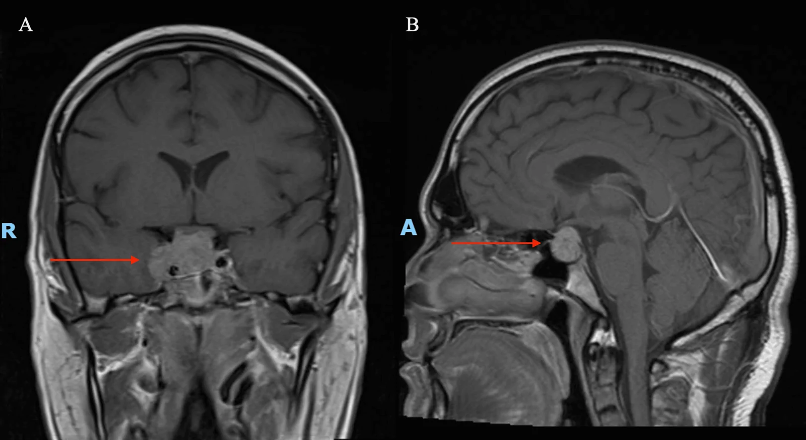
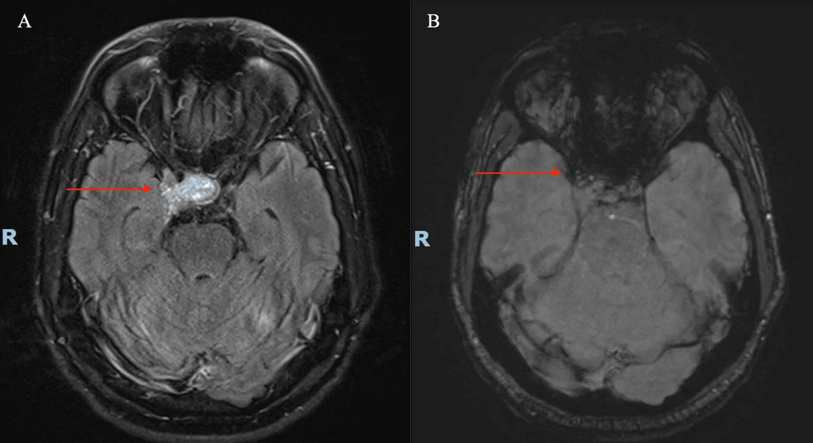

# 432 — Vùng yên-giao thoa: adenoma vs đột quỵ tuyến yên / Sellar masses & Apoplexy

**Tags:** `pattern:khoi-yen` `vung:giao-thoa`
**Mức chắc chắn (certainty):** tổng hợp y văn (literature synthesis) — nhóm tự biên từ y văn mở, chưa gắn ca nguyên văn đơn lẻ.

## 1. Tổng quan — bán manh thái dương + đột quỵ tuyến yên

- **Adenoma tuyến yên:** chèn ép giao thoa từ dưới → **bán manh thái dương 2 bên (bitemporal hemianopia)**; micro < 10 mm (PRL) vs macro ≥ 10 mm (không tiết + chèn ép).
- **Đột quỵ tuyến yên (apoplexy):** chảy máu/nhồi máu trong u (2–12% adenoma) — đau đầu dữ + liệt dây III + giảm thị cấp + suy thượng thận — **mổ giải áp cấp cứu** qua xoang bướm.
- TẠI SAO MRI thấy máu: mức dịch (FLAIR) + blooming (SWI) trong u; T1 cản quang: u ngấm + bao ĐM cảnh trong.
- Số: macroadenoma 2,8 cm trong ca dưới + bao ĐM cảnh 2 bên; VMAT 54 Gy/30 phân liều khi còn sót.

## 2. Gamut khối vùng yên + liệt dây III

- **Adenoma không tiết:** bán manh thái dương + suy yên dần — mổ nội soi + xạ bổ trợ.
- **Đột quỵ tuyến yên:** đau đầu dữ + liệt III + giảm thị cấp trên nền u — mổ cấp cứu + thay thế cortisol.
- **Craniopharyngioma:** vôi hóa + nang (trẻ + già 2 đỉnh), trên yên — mổ + xạ, đái tháo nhạt.
- **Phình ĐM thông sau:** liệt III + đồng tử giãn + đau — CTA/MRA cấp cứu (vỡ = tử vong).

## 3. Bảng so sánh

| Thực thể (entity) | Hình ảnh (MRI) | Chốt vào (rule-in) | Chốt loại (rule-out) | Gợi ý xác nhận |
|---|---|---|---|---|
| Adenoma | **Nâng giao thoa + bao ĐM cảnh**, ngấm | **Bán manh thái dương + nội tiết** | Mức dịch + blooming cấp → đột quỵ | Nội tiết đầy đủ + thị trường |
| Đột quỵ yên | **Mức dịch FLAIR + blooming SWI** trong u + liệt III cấp | **Đau dữ + liệt III + giảm thị cấp** | Không máu + mạn → u thường | Mổ cấp cứu + cortisol |
| Craniopharyngioma | **Vôi hóa + nang** trên yên, 2 đỉnh tuổi | **Vôi hóa + nang + đái tháo nhạt** | Không vôi hóa + người lớn → adenoma | Canxi + nội tiết |
| Phình thông sau | Túi phình + liệt III đồng tử giãn | **Liệt III + giãn đồng tử + đau** | Không túi phình → u yên | CTA/MRA cấp cứu |

*T1 cản quang coronal/sagittal. Nguồn: Tay et al., Cureus 2026 Fig. 1, CC BY 4.0.*

*FLAIR mức dịch + SWI blooming trong u. Nguồn: Tay et al., Fig. 2, CC BY 4.0.*

## 4. Protocol MRI yên

- **T1/T2 coronal lát mỏng + cản quang động + SWI** (máu) + thị trường + nội tiết đầy đủ trước mổ.
- Đột quỵ: cortisol TM + mổ nội soi cấp cứu (giải áp giao thoa + cầm máu).
- Còn sót sau mổ: xạ (VMAT 54 Gy/30 mẫu) + MRI 3–6 tháng 2 năm đầu.

## 5. Cạm bẫy

- **Liệt III + giãn đồng tử** nghĩ phình trước khi nghĩ u yên — CTA/MRA song song MRI.
- **Suy thượng thận cấp** sau đột quỵ giết người thầm lặng — cortisol TM trước mổ.
- **U yên "câm" nội tiết vẫn ác tính mô học** (Crooke) — mô bệnh + Ki-67 quyết định theo dõi, không phải hormone.

## 6. Tự lượng giá — Blind Quiz

**Ca 1 — Nam 41 tuổi đau đầu dữ + liệt III phải + giảm thị. Đọc MRI.**

- Hỏi: u bao nhiêu cm? Bao cấu trúc nào? Giao thoa bị gì? Đột quỵ ở ảnh nào?

<b>Bấm để hiện đáp án</b>

- **Macroadenoma 2,8 cm + bao ĐM cảnh 2 bên + nâng giao thoa**; đột quỵ xác nhận ở ảnh FLAIR/SWI dưới (mức dịch + blooming) → mổ cấp cứu + cortisol + xạ bổ trợ (còn sót).
- Nguồn: Tay et al., Fig. 1–2, CC BY 4.0.

**Ca 2 — Đau đầu dữ + liệt III giãn đồng tử + MRI chưa có:** u yên hay phình? Làm gì đầu? *(Bảng mục 3.)*

<b>Bấm để hiện đáp án</b>

- **Nghĩ phình thông sau trước:** CTA/MRA cấp cứu (vỡ = tử vong) song song chuẩn bị MRI yên.

## Bài liên quan chéo
- [400 – Tổng quan Mắt](../400-tong-quan-mat-thi-giac/lesson.md)
- [430 – Đường thị giác](../430-duong-thi-giac/lesson.md) (giao thoa)
- [431 – U TK thị](../431-u-than-kinh-thi/lesson.md) (chèn ép TK)

> Không dùng để chẩn đoán độc lập khi chưa có người hướng dẫn.
