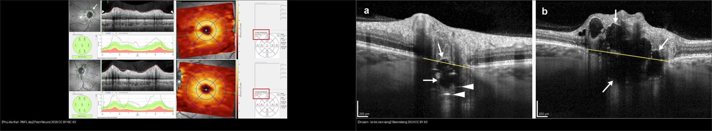
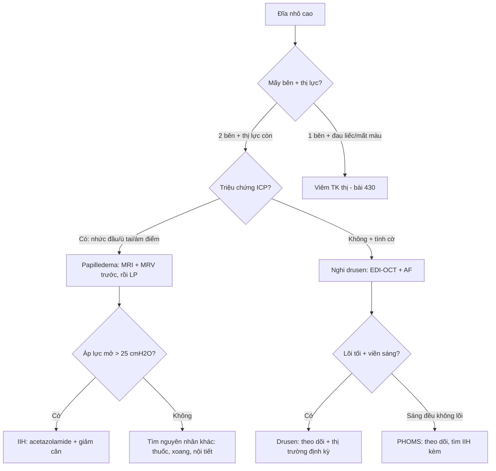
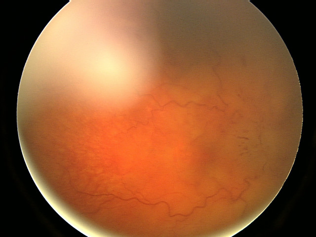
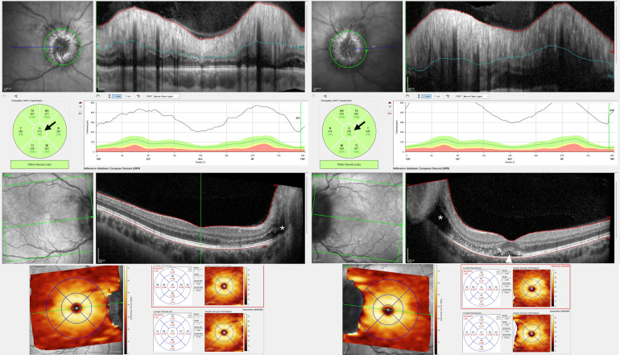
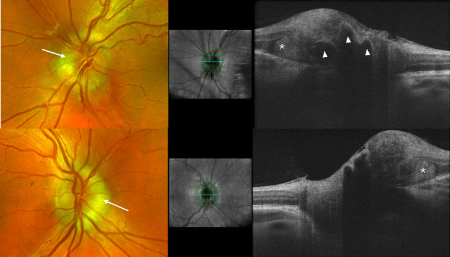

# 433 — Phù đĩa thị vs drusen đĩa: Frisén, IIH & PHOMS / Papilledema vs disc drusen

**Tags:** `pattern:phu-dia-thi` `vung:dia-thi` `score:Frisen` `protocol:OCT-dia-thi`
**Mức chắc chắn (certainty):** tổng hợp y văn (literature synthesis) — nhóm tự biên từ 2 nghiên cứu mở (Pract Neurol 2026 CC BY-NC 4.0 + Neuro-Ophthalmology 2024 CC BY 4.0) và ảnh CC BY Wikimedia, chưa gắn ca nguyên văn đơn lẻ.

## 1. Tổng quan — phù thật do áp lực, giả phù do canxi + số RNFL nằm lòng

- **Papilledema (phù đĩa thị):** phù đĩa do **tăng áp lực nội sọ (ICP)** — theo định nghĩa luôn **2 bên** (có thể không đối xứng), thị lực trung tâm còn tốt sớm (chỉ giãn điểm mù). TẠI SAO áp lực sọ làm phù mắt: áp lực dịch não tủy truyền theo bao sợi thị vào nhãn cầu, ứ trệ vận chuyển sợi trục (axoplasmic stasis) → sợi thần kinh phù.
- **Drusen đĩa (optic disc drusen, ODD):** lắng đọng canxi đầu thần kinh thị, gặp **~2% dân số**, hay gia đình (8/13 gia đình có ≥ 2 người — Steensberg 2024). TẠI SAO nhìn giống phù: drusen đội đĩa nhô lên + che lõm — nhưng **không có rò rỉ, không sung huyết thật**, mạch máu nét (không bị phù che).
- Số nằm lòng (Lowe 2026, Pract Neurol, OCT Heidelberg): phù nhẹ RNFL trung bình **155–168 µm**; phù đe dọa thị lực **413–550 µm + dịch trong võng mạc lan từ đĩa + dịch dưới hoàng điểm** — thấy 3 dấu này là mổ/chọc dịch cấp, không hẹn.
- Số IIH: chọc dịch chẩn đoán khi **áp lực mở > 25 cmH2O** (người lớn); điều trị acetazolamide + **giảm cân** (giảm ~6–10% cân nặng đã cải thiện rõ).

## 2. Gamut đĩa nhô cao — 4 câu hỏi trước khi chọc dịch

- **Nhức đầu buổi sáng + ù tai mạch đập + ám điểm thoáng qua khi gắng sức + 2 bên:** papilledema/IIH (nữ trẻ béo phì) — MRI + MRV rồi mới chọc dịch.
- **Tình cờ soi thấy đĩa nhô + thị lực bình thường + gia đình có người bị:** drusen — EDI-OCT tìm lõi tối + tự phát sáng (autofluorescence).
- **Mờ 1 bên + đau khi liếc + màu sắc nhạt sớm:** viêm thị thần kinh (bài 430) — không phải papilledema (papilledema giữ màu sắc đến muộn).
- **Mù 1 bên kiểu rèm + đĩa phù nhạt + tuổi mạch máu:** NAION — mất thị trường altitudinal, đĩa nhỏ crowded (khác drusen: không có lõi canxi OCT).
- **Đĩa nhô + PHOMS + không rò rỉ:** giả phù lành — theo dõi, đừng chọc dịch oan.

## 3. Bảng so sánh phân biệt (ma trận đối chiếu)

| Thực thể (entity) | Hình ảnh điển hình | Chốt vào (rule-in) | Chốt loại (rule-out) | Gợi ý xác nhận |
|---|---|---|---|---|
| Papilledema (IIH) | **2 bên + sung huyết + che mạch + RNFL dày** | **Triệu chứng ICP + 2 bên + rò rỉ** | 1 bên + đau liếc → viêm; lõi canxi → drusen | MRI/MRV → LP > 25 cmH2O |
| Drusen đĩa | **Lõi tối + viền sáng (EDI-OCT) + tự phát sáng**, thị lực tốt | **ODDS: lõi tối + viền sáng toàn/bán phần** | RNFL dày lan tỏa + rò rỉ → phù thật | EDI-OCT + AF + thị trường |
| PHOMS | **Sáng toàn bộ (không lõi tối)**, cạnh đĩa | **Sáng đều + không viền** | Lõi tối → drusen | Theo dõi (hay đi kèm papilledema/IIH) |
| Viêm TK thị | Phù 1 bên + **đau liếc + mất màu sớm** | **Đau + RAPD + MRI ngấm TK** | 2 bên + giữ màu → papilledema | (bài 430) |
| NAION | Phù nhạt 1 bên + **khuyết altitudinal + đĩa nhỏ** | **Mù rèm + yếu tố mạch máu** | Trẻ + 2 bên → IIH | ESR/CRP loại GCA nếu > 50 tuổi |

*Trái: papilledema nhẹ, RNFL 155–168 µm (Lowe et al., Pract Neurol 2026 Fig. 3, CC BY-NC 4.0). Phải: drusen sâu (a) + nông (b), lõi tối + viền sáng, đường vàng = BMO (Steensberg et al., Neuro-Ophthalmology 2024 Fig. 1, CC BY 4.0). Ảnh ghép letterbox, kế thừa CC BY-NC 4.0.*

**Quiz composite:** che 2 nhãn, hỏi bên nào phải MRI + chọc dịch?

<b>Bấm để hiện đáp án</b>

- Trái = **papilledema** — RNFL dày lan tỏa do ứ trệ sợi trục → **MRI/MRV loại u–huyết khối xoang rồi chọc dịch** (đừng chọc khi chưa MRI!).
- Phải = **drusen** — lõi tối + viền sáng, không phù lan tỏa → EDI-OCT + theo dõi, không chọc dịch.
- Chung 1 mắt vẫn có thể vừa drusen vừa phù (Lowe Fig. 6) — soi lại sau điều trị mới ngã ngũ.

### Drusen vs PHOMS trên OCT — cặp hay nhầm nhất khi soi không rõ
- **Drusen (ODDS Consortium):** **lõi tối (signal-poor) + viền sáng toàn/bán phần**, có thể kèm đường tăng sáng — vôi thật.
- **PHOMS:** khối bầu dục cạnh đĩa, **sáng toàn bộ từ trong ra ngoài**, không lõi tối — bó sợi phồng, không phải vôi.
- Cạm bẫy: **~50% drusen chôn sâu (buried)** — soi đáy mắt không thấy, chỉ EDI-OCT mới bắt được; soi "sạch" không loại được drusen.

## 4. Protocol chụp + thang Frisén + xử trí IIH

- **OCT đĩa thị:** vòng RNFL quanh đĩa + lát cắt qua đĩa (tìm lõi tối/viền sáng) + GCL hoàng điểm (teo muộn sau phù nặng — GCL mỏng = đã mất sợi vĩnh viễn).
- **Thang Frisén 0–5:** 0 bình thường → 1 quầng chữ C → 2 quầng vòng → 3 che ≥ 1 đoạn mạch → 4 che toàn bộ đĩa → 5 che + nếp võng mạc–hắc mạc — ghi độ mọi lần tái khám để so đáp ứng.
- **Papilledema nghi ngờ:** **MRI não + MRV xoang tĩnh mạch trước** (loại u, não úng thủy, huyết khối xoang) → rồi mới chọc dịch đo áp lực mở; máu: loại thuốc (tetracycline, vitamin A, lithium), nội tiết.
- **IIH xác định:** acetazolamide + giảm cân + điều trị bệnh nền; thị trường xấu dần dù thuốc tối đa → chuyển phẫu thuật (stent xoang, fenestration bao thị, shunt).
- **Tự phát sáng (autofluorescence):** drusen nông sáng rực — nghiệm pháp 30 giây phân drusen/phù tại phòng khám.

## 5. Biến thể bình thường và cạm bẫy

- **Đĩa nhỏ crowded viễn thị:** nhô + sung huyết sinh lý, không lõm — OCT RNFL bình thường + không rò rỉ là chốt lành, đừng chọc dịch.
- **Mất mạch đập tĩnh mạch tự nhiên:** 20% dân số bình thường không có — vắng mặt không kết luận tăng ICP; nhưng **đang có mà mất đi** mới đáng lo.
- **Chọc dịch trước MRI:** tắc nghẽn (u) + chọc dịch = tụt kẹt — MRI/MRV luôn trước LP, không bao giờ đảo.
- **Overdiagnosis IIH:** dán nhãn papilledema cho đĩa crowded rồi chọc dịch + acetazolamide oan — OCT + thị trường + hỏi kỹ triệu chứng trước mọi LP.
- **GCL mỏng sau phù nặng:** phù xẹp tưởng khỏi nhưng GCL đã teo = sợi chết vĩnh viễn — theo GCL chứ không chỉ RNFL khi đánh giá di chứng.
- **Drusen + phù cùng tồn tại:** drusen không miễn trừ papilledema — soi lại sau điều trị ICP, drusen còn, phù xẹp mới ngã ngũ.

## 6. Tự lượng giá — Blind Quiz

**Ca 1 — Nữ 28 tuổi béo phì, nhức đầu sáng + ù tai. Đáy mắt 2 bên như này, Frisén mấy?**

- Hỏi: đĩa sung huyết + che mạch mấy bên? Frisén mấy? Việc cấm kỵ trước chọc dịch?

<b>Bấm để hiện đáp án (findings + chẩn đoán)</b>

- Dấu hiệu (findings): **đĩa phù nề sung huyết 2 bên, bờ mờ, che mạch** (ảnh gốc chất lượng hạn chế nhưng phù rõ).
- Chẩn đoán (diagnosis): **papilledema nặng (Frisén 4–5)** trong bệnh cảnh nghi IIH — vì 2 bên + triệu chứng ICP ở nữ trẻ béo phì.
- Cấm kỵ: **chọc dịch trước MRI/MRV** — phải loại u + huyết khối xoang trước, rồi LP đo áp lực mở (> 25 cmH2O chẩn đoán IIH).
- Nguồn ảnh: Bansal et al., CC BY 2.0 via Wikimedia Commons.

**Ca 2 — OCT đĩa thị RNFL 550 µm + dịch lan vào hoàng điểm. Mức nào, xử trí giờ nào?**

- Hỏi: RNFL bao nhiêu? 3 dấu đe dọa thị lực? Có được hẹn tái khám thường không?

<b>Bấm để hiện đáp án (findings + chẩn đoán)</b>

- Dấu hiệu (findings): RNFL trung bình **413–550 µm** + **dịch trong võng mạc lan từ đĩa** + **dịch dưới hoàng điểm**, GCL còn nguyên (chưa teo — vẫn cứu được!).
- Chẩn đoán (diagnosis): **papilledema đe dọa thị lực (sight-threatening)** — vì đủ bộ 3 dấu nặng.
- Xử trí: **cấp cứu ICP (thuốc tối đa ± phẫu thuật), không hẹn thường** — GCL còn nguyên nghĩa là can thiệp kịp vẫn giữ được thị lực.
- Nguồn ảnh: Lowe et al., Pract Neurol 2026 Fig. 4 (PMC13479234), CC BY-NC 4.0 (dùng nguyên bản).

**Ca 3 — Thiếu niên soi tình cờ đĩa nhô, thị lực 10/10. OCT này là phù hay drusen?**

- Hỏi: mũi tên trắng vs đầu mũi tên trắng khác nhau gì? Có cần chọc dịch không?

<b>Bấm để hiện đáp án (findings + chẩn đoán)</b>

- Dấu hiệu (findings): **PHOMS sáng toàn bộ (mũi tên)** + **drusen lõi tối–viền sáng (đầu mũi tên)** — thị lực bình thường, không rò rỉ.
- Chẩn đoán (diagnosis): **giả phù do drusen + PHOMS (pseudopapilledema)** — vì đủ tiêu chuẩn ODDS, không triệu chứng ICP.
- Xử trí: **không chọc dịch** — EDI-OCT + tự phát sáng + thị trường định kỳ (drusen là yếu tố nguy cơ NAION về sau).
- Nguồn ảnh: Lowe et al., Pract Neurol 2026 Fig. 5 (PMC13479234), CC BY-NC 4.0 (dùng nguyên bản).

## Bài liên quan chéo
- [400 – Tổng quan Mắt](../400-tong-quan-mat-thi-giac/lesson.md)
- [430 – Đường thị giác](../430-duong-thi-giac/lesson.md) (viêm vs NAION vs phù)
- [431 – U TK thị](../431-u-than-kinh-thi/lesson.md) (chèn ép gây phù đĩa)
- [432 – Vùng yên](../432-vung-yen/lesson.md) (u yên–tăng ICP)
- [442 – Glaucoma](../442-glaucoma-OCT/lesson.md) (RNFL: dày trong phù vs mỏng trong glaucoma)

## Ảnh
- `433_papilledema-nang_Fundus_Wikimedia-Bansal-CCBY20.jpg` — Bansal et al., CC BY 2.0 via Wikimedia Commons.
- `433_papilledema-nhe_OCT_PMC13479234-Fig3-CCBYNC40.jpg`, `433_papilledema-nang_OCT_PMC13479234-Fig4-CCBYNC40.jpg`, `433_drusen-PHOMS_OCT_PMC13479234-Fig5-CCBYNC40.jpg` — Lowe et al., Pract Neurol 2026 (PMCID: PMC13479234), CC BY-NC 4.0 (dùng nguyên bản, phi thương mại).
- `433_drusen-ODD_OCT_PMC12409904-Fig1-CCBY.jpg` — Steensberg et al., Neuro-Ophthalmology 2024 (PMCID: PMC12409904), CC BY 4.0.
- Chi tiết giấy phép từng ảnh trong `images/CREDITS.md`. AuntMinnie: chỉ dẫn link, không tải.

> Không dùng để chẩn đoán độc lập khi chưa có người hướng dẫn.
