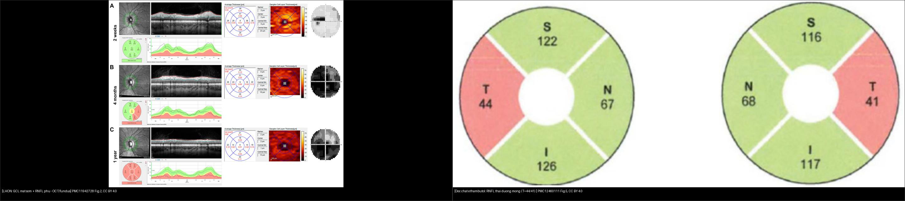
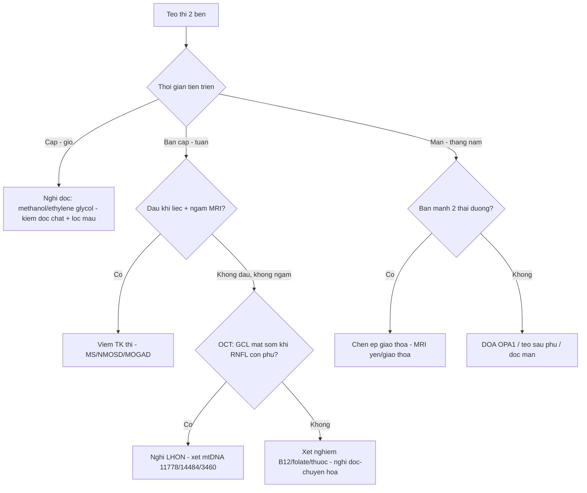
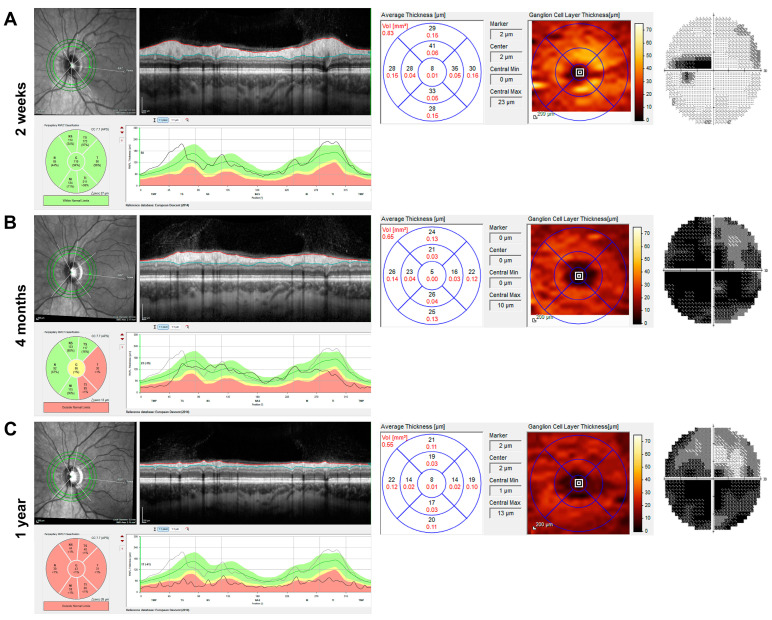
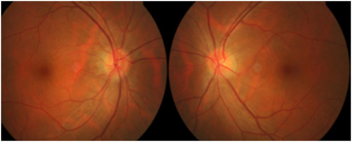
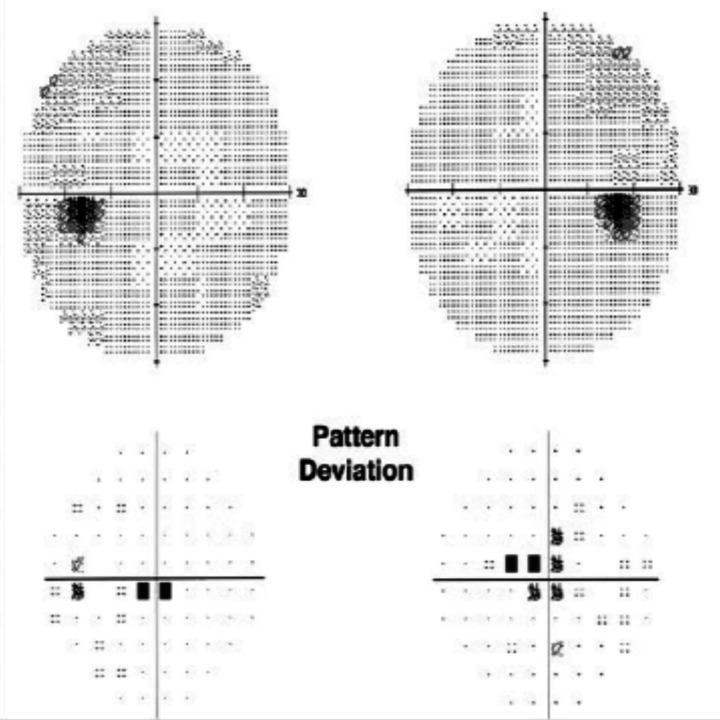
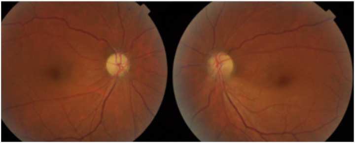
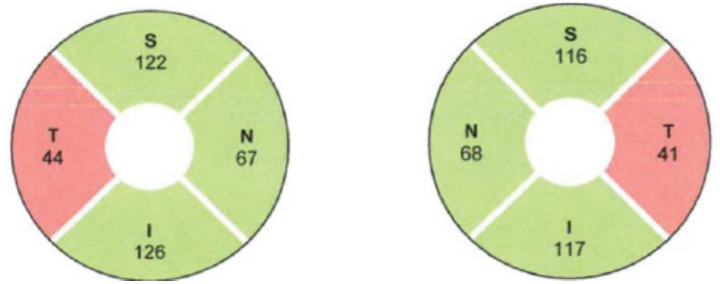
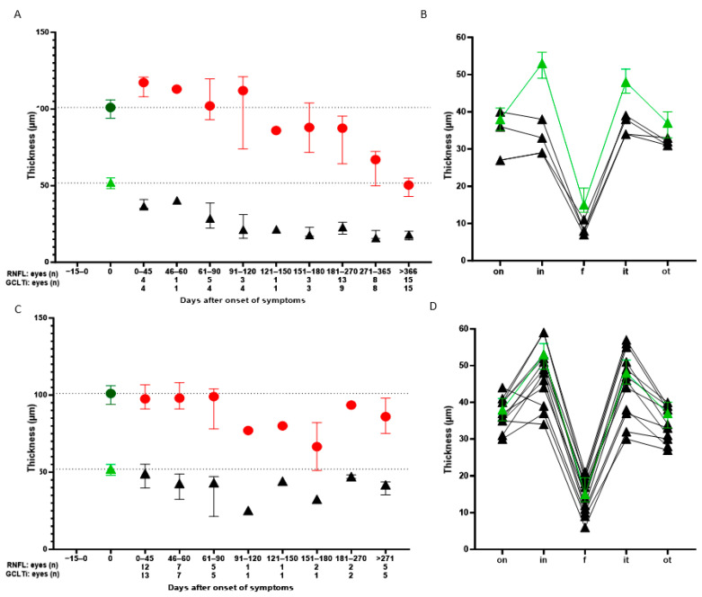

# 434 — Bệnh thần kinh thị do độc–chuyển hóa & LHON: tiếp cận teo thị 2 bên / Toxic–metabolic optic neuropathy & LHON

**Tags:** `pattern:teo-thi` `vung:than-kinh-thi` `score:GCL` `protocol:OCT-thi-truong` `protocol:MRI-hoc-mat`
**Mức chắc chắn (certainty):** tổng hợp y văn (literature synthesis) — nhóm tự biên từ 3 nghiên cứu mở (JCM 2025 CC BY 4.0 + Front Neurol 2025 CC BY 4.0 + JOII 2026 CC BY 4.0), chưa gắn ca nguyên văn đơn lẻ.

## 1. Tổng quan — vì sao sợi trục thị chết, và số nào nằm lòng

- **Tế bào hạch võng mạc (retinal ganglion cell, RGC)** là neuron có **nhu cầu năng lượng rất cao**: sợi trục không myelin ở phần trong nhãn cầu dài ~1 mm nhưng tiêu thụ ATP lớn để chạy bơm ion và vận chuyển sợi trục. **Ty thể (mitochondria)** là nhà máy ATP → chuỗi hô hấp hỏng → chết RGC. Vì thế teo thị 2 bên là **bệnh của ty thể** ở phần lớn ca di truyền và độc chất.
- **LHON (Leber hereditary optic neuropathy):** đột biến **mtDNA phức hợp I (complex I)** → giảm ATP + tăng gốc tự do; **bó nhúi hoàng điểm (papillomacular bundle)** — bó sợi mảnh, nhiều ty thể — chết trước → **ám điểm trung tâm–manh điểm (cecocentral scotoma)**. Di truyền **theo dòng mẹ**, thâm nhập **không hoàn toàn**.
- **Độc–chuyển hóa:** **ethambutol** tạo chelate + độc ty thể (liều cao); **methanol** biến thành **acid formic** ức chế trực tiếp cytochrome oxidase (phức hợp IV) → toan chuyển hóa + mù nặng; **thiếu B12/folate/thiamin/đồng** làm tổn thương myelin + sợi trục (kèm tủy sau).
- **TẠI SAO OCT hoàng điểm chốt hơn soi đáy mắt:** GCL là **thân tế bào**; thân chết trước, sợi trục mất theo kiểu Waller về sau. Số từ nghiên cứu mở (JCM 2025, PMC11942728, 9 LHON vs 20 ON): **RNFL phù nhiều hơn ở LHON trong 60 ngày đầu**, **GCLT giảm mạnh ngày 0–45** (sớm hơn RNFL), sau **ngày 120 RNFL giảm liên tục và nặng ở LHON** trong khi RNFL của viêm thị **chững lại** — đây là **chốt phân biệt LHON vs viêm thị (ON)**.
- **Số nằm lòng khác:** LHON tần suất **~1/30.000–1/50.000**, khởi phát đỉnh **15–35 tuổi** (đa số 20–30), **nam:nữ ≈ 4:1**; **3 đột biến chính** chiếm ~90–95%: **m.11778G>A (~70%, tiên lượng xấu nhất)**, **m.14484T>C** (phục hồi tốt nhất ~37–58%) và **m.3460G>A**. Ethambutol gây độc **phụ thuộc liều, đặc biệt > 15 mg/kg/ngày**, khởi phát **~3–6 tháng**. B12 **< 200 pg/mL** (kèm MMA/homocysteine tăng). Methanol độc khi **> 20 mg/dL**.

## 2. Mẫu hình + chẩn đoán phân biệt theo vị trí (gamut)

- **Câu hỏi lọc 1 — thời gian:** cấp (giờ–ngày: ngộ độc methanol/ethylene glycol, thiếu máu thị) · bán cấp (tuần: LHON, độc chất, viêm, chèn ép) · mạn (tháng–năm: DOA, teo sau phù, do độc mạn).
- **Câu hỏi lọc 2 — định khu theo thị trường:** **ám điểm trung tâm–manh điểm** = tổn thương bó nhúi (LHON, độc–chuyển hóa, thiếu máu thị) · **bán manh 2 thái dương** = giao thoa/yên (u tuyến yên) · **khuyết mũi** 2 bên = tổn thương bắt chéo muộn · thu hẹp đồng tâm 2 bên = teo lan tỏa (bẩm sinh, teo sau phù kéo dài).
- **Gamut teo thị 2 bên:** **di truyền** (LHON, DOA/OPA1, Wolfram) · **độc–chuyển hóa** (ethambutol, isoniazid, linezolid, amiodarone, methanol, ethylene glycol, rượu–thuốc lá, thiếu B12/folate/thiamin/đồng) · **viêm** (xơ cứng rải rác — MS, NMOSD, MOGAD, MOG) · **chèn ép** (u tuyến yên, dày màng não, u giao thoa) · **sau ứ nước** (teo sau phù đĩa/IIH) · **khác** (bệnh thần kinh thị do thiếu máu–truyền máu, sau xạ trị, thâm nhiễm/ung thư màng não).
- Gợi nhớ độc–chuyển hóa **"B–E–T–M":** **B**12/folate/thiamin/đồng · **E**thambutol · **T**obacco–alcohol · **M**ethanol/ethylene glycol. Ngộ độc xếp **theo tổn thương bắt đối xứng thái dương** (đĩa nhợt thái dương), LHON xếp **theo bó nhúi**.

## 3. Bảng so sánh phân biệt (ma trận đối chiếu)

| Thực thể (entity) | Hình ảnh điển hình | Chốt vào (rule-in) | Chốt loại (rule-out) | Gợi ý xác nhận |
|---|---|---|---|---|
| LHON | **Giả phù đĩa** sớm → nhợt; **GCL mất sớm 0–45 ngày** khi RNFL còn phù, RNFL giảm nặng sau 120 ngày; **ám điểm trung tâm–manh điểm** | **Nam trẻ 15–35 + 2 bên không đau + thâm nhập dòng mẹ; GCL/RNFL lệch pha** | Đau khi liếc + ngấm MRI + dịch tủy → viêm thị | **mtDNA m.11778G>A / 14484T>C / 3460G>A** |
| Độc–chuyển hóa (ethambutol, B12, rượu–thuốc lá) | Đĩa **sung huyết sớm → nhợt thái dương**; **RNFL thái dương mỏng**; ám điểm trung tâm; thị lực giảm từ từ 2 bên | **Tiền sử thuốc/liều (ethambutol > 15 mg/kg/ngày) hoặc thiếu dinh dưỡng; tổn thương thái dương đối xứng** | Không dùng thuốc/không thiếu; ngấm MRI → viêm | Ngưng thuốc; **B12 < 200 pg/mL**, MMA/homocysteine tăng |
| Viêm thị 2 bên (MS/NMOSD/MOGAD) | **Ngấm cản quang + T2 sáng** thần kinh thị, RNFL **không phù bằng LHON**; đau, RAPD, giảm màu sớm | **Đau khi liếc + ngấm MRI + hồi phục từng đợt** | Không đau, không ngấm, tiến triển không hồi phục → nghi LHON/độc | Kháng thể **AQP4/MOG**, MRI sọ–tủy |
| Chèn ép giao thoa | **Bán manh 2 thái dương** + **teo dải băng (band atrophy)** đĩa; giảm thị lực 2 bên tiến triển | **Bán manh 2 thái dương** + giảm thị lực 2 bên | Ám điểm trung tâm đơn thuần → không phải giao thoa | **MRI yên/giao thoa** có tiêm |
| DOA (OPA1) | RNFL **thái dương mỏng** lan, đĩa nhợt thái dương, tiến triển **chậm từ nhỏ**; **di truyền trội** | **Tiền sử gia đình trội + khởi phát thời thơ ấu** | Cấp/bán cấp → LHON/viêm/độc | Giải trình tự **OPA1** |
| Teo sau ứ nước (IIH/post-papilledema) | Đĩa nhợt + **RNFL mỏng sau giai đoạn phù**, có triệu chứng tăng áp lực nội sọ | **Tiền sử papilledema/IIH + triệu chứng ICP** | Không có phù trước đó → nguyên nhân khác | MRI/MRV + áp lực mở (bài 433) |

*Trái: LHON đa phương thức (đáy mắt + OCT + bản đồ GCL + thị trường) tại 2 tuần, 4 tháng, 1 năm — GCL mất khi RNFL còn phù (PMC11942728 Fig. 2, CC BY 4.0). Phải: RNFL bánh xe, ô thái dương (T) tụt còn 44 µm/41 µm ở bệnh nhân ngộ độc ethambutol (PMC12460111 Fig. 5, CC BY 4.0). Ảnh ghép letterbox.*

**Quiz composite:** che 2 nhãn, hỏi vì sao bên trái phải xét gen còn bên phải chỉ cần ngưng thuốc?

<b>Bấm để hiện đáp án</b>

- Trái = **LHON** — GCL mất sớm dù RNFL còn phù, 2 mắt, người trẻ → **xét mtDNA** (m.11778/14484/3460), tư vấn dòng mẹ.
- Phải = **ngộ độc ethambutol** — RNFL thái dương mỏng đối xứng → **ngưng ethambutol**, bổ sung vitamin; theo dõi OCT hồi phục.
- Chung: cả hai đều là **teo thị bó nhúi 2 bên không đau** — khác nhau ở **tiền sử phơi nhiễm thuốc/đột biến ty thể**, không ở đáy mắt.

### Vì sao RNFL "phù" trong LHON mà thị lực lại mất — nghịch lý cần hiểu
- LHON khởi đầu bằng **phù sợi trục (axoplasmic stasis)** do năng lượng thiếu → soi đáy mắt thấy "giả phù đĩa" tưởng lành, nhưng **GCL đã chết** → thị lực mất trước khi đĩa nhợt.
- Vì vậy **đừng vội gọi "viêm thị" hay "teo thị lành"**: nếu **GCL mỏng hơn RNFL cho phép** trong tuần đầu, nghĩ LHON.
- Cạm bẫy: **RNFL phù + không ngấm MRI** thường bị gán nhãn viêm; **LHON hiếm khi ngấm** — MRI không ngấm là gợi ý LHON, không phải loại bỏ.

## 4. Protocol chụp + hệ điểm chuẩn hóa (OCT/GCL)

- **Khám nền:** thị lực, **thị giác màu (Ishihara/Farnsworth)** (mua sắc đỏ–xanh sớm ở độc chất/LHON), thị trường tự động **24-2**, phản xạ đồng tử (RAPD), soi đáy mắt.
- **OCT (chốt):** vòng **RNFL quanh đĩa** + **GCL hoàng điểm (macular GCL/GCC)** — đo **µm**, so bản đồ ETDRS; theo dõi **GCL mỏng dần**, không chỉ RNFL (bài 433/442).
- **MRI:** sọ + hốc mắt, **T1 fat-sat sau tiêm + T2 fat-sat** — loại u/chèn ép/viêm; **ngấm = viêm**, **không ngấm = nghi LHON/độc**.
- **Xét nghiệm:** B12, folate, homocysteine/**MMA**, đồng, kẽm, TSH, đường huyết, điện di Hb, ANA, **AQP4/MOG**, HIV, VDRL/TPHA; **độc chất máu (methanol/ethylene glycol)** khi cấp; **mtDNA** khi nghi LHON.
- **Ngưỡng & xử trí:** ethambutol **ngưng ngay** khi nghi (hồi phục tính bằng tuần–tháng); methanol → **fomepizol/ethanol + lọc máu** (không chờ xác nhận); LHON → **idebenone** (chứng cứ hạn chế) + tránh rượu/thuốc lá + **tầm soát người thân dòng mẹ**; thiếu B12 → bổ sung.
- **Theo dõi:** OCT RNFL/GCL + thị trường mỗi 1–3 tháng giai đoạn hoạt động; ghi **µm** và so bản đồ để phát hiện tiến triển.

## 5. Biến thể bình thường và cạm bẫy

- **RNFL mỏng theo tuổi:** giảm sinh lý **~0,2 µm/năm** — luôn so **bản đồ theo tuổi** (normative database), đừng gọi teo bệnh lý khi chỉ lệch nhẹ.
- **Đĩa nhỏ crowded** gây "giả phù" ở người viễn thị — phân biệt với phù thật bằng OCT + tự phát sáng (bài 433), tránh chọc dịch oan.
- **Mất đồng tử hơi giãn (RAPD) âm tính** không loại được bệnh 2 bên đối xứng — vì 2 mắt tổn thương ngang nhau, RAPD có thể âm.
- **MRI bình thường không loại được LHON/độc chất** — chẩn đoán dựa OCT + bệnh sử + gen, không dựa MRI âm.
- **"Teo thị do tuổi" hay "teo thị vô căn":** nhãn này dễ bỏ sót ethambutol/B12/LHON — luôn hỏi thuốc (ethambutol, linezolid, amiodarone) và dinh dưỡng.
- **Sàn GCL (floor effect):** GCL giảm tới một ngưỡng rồi chững — theo dõi tiếp bằng RNFL/thị trường để tránh tưởng "ổn định".

## 6. Tự lượng giá — Blind Quiz

**Ca 1 — Nam 25 tuổi, mất thị lực 2 bên không đau, tiến triển trong 2 tuần, ám điểm trung tâm. OCT dưới đây:**

- Hỏi: dấu hiệu nào mất SỚM (GCL hay RNFL)? Vì sao? Chẩn đoán + xét nghiệm chốt?

<b>Bấm để hiện đáp án (findings + chẩn đoán)</b>

- Dấu hiệu (findings): **bản đồ GCL hoàng điểm mất rõ ở 2 tuần** trong khi **RNFL còn phù** (đĩa chưa nhợt hẳn); qua 4 tháng → 1 năm **RNFL mỏng dần nặng**; thị trường mất **trung tâm–manh điểm**.
- Chẩn đoán (diagnosis): **LHON (m.11778G→A)** — vì nam trẻ, 2 bên không đau, **GCL chết sớm hơn RNFL** (nghịch lý "phù nhưng đã mất").
- Xét nghiệm chốt: **mtDNA (11778/14484/3460)** + tư vấn di truyền dòng mẹ + tầm soát người thân.
- Nguồn ảnh: JCM 2025 (PMC11942728) Fig. 2, CC BY 4.0.

**Ca 2 — Bệnh nhân lao đang dùng ethambutol 3 tháng, thị lực giảm 2 bên. Ảnh + thị trường:**

- Hỏi: đĩa thị ra sao? Thị trường mất kiểu gì? Xử trí ngay là gì?

<b>Bấm để hiện đáp án (findings + chẩn đoán)</b>

- Dấu hiệu (findings): **đĩa thị sung huyết (hyperemia)** 2 bên; **thị trường mất trung tâm 2 bên (central scotoma)** trên Humphrey.
- Chẩn đoán (diagnosis): **ngộ độc thị thần kinh do ethambutol** — vì tiền sử thuốc + tổn thương 2 bên đối xứng bó nhúi; giai đoạn sớm đĩa **sung huyết**, về sau **nhợt thái dương**.
- Xử trí: **ngưng ethambutol ngay** (thay bằng phác đồ an toàn), xét B12/folate; theo dõi OCT RNFL/GCL — hồi phục thường trong vài tuần–vài tháng.
- Nguồn ảnh: Front Neurol 2025 (PMC12460111) Fig. 1 & 3, CC BY 4.0 (Fig. do Sudhakar P et al.).

**Ca 3 — Hai bệnh nhân teo thị 2 bên tuần tự: (B) đĩa nhợt thái dương + (A) RNFL thái dương mỏng. Chẩn đoán?**

- Hỏi: mẫu hình teo? Vì sao ô thái dương (T) lại giảm chọn lọc? 3 chẩn đoán phân biệt?

<b>Bấm để hiện đáp án (findings + chẩn đoán)</b>

- Dấu hiệu (findings): **nhợt nhạt đĩa ưu thế thái dương** ở thì muộn; **RNFL bánh xe** cho thấy **ô thái dương (T) 44 µm và 41 µm** tụt chọn lọc so với mũi (N 67/68 µm) và trên/dưới (~117–126 µm).
- Chẩn đoán (diagnosis): **teo thị bó nhúi thái dương do ngộ độc/nutritional (ethambutol)** — vì bó nhúi (thái dương) chứa sợi mảnh nhạy độc → mất trước.
- 3 phân biệt: **LHON** (thêm OCT GCL + gen mtDNA), **DOA/OPA1** (tiền sử gia đình trội, khởi phát nhỏ), **teo sau phù đĩa** (hỏi tiền sử phù/IIH).
- Nguồn ảnh: Front Neurol 2025 (PMC12460111) Fig. 2 & 5, CC BY 4.0.

**Ca 4 — Ghép OCT: bên trái là LHON, bên phải là ngộ độc. Bên nào cần xét gen?**

<b>Bấm để hiện đáp án (findings + chẩn đoán)</b>

- Trái (LHON): **GCL mất sớm khi RNFL còn phù**, diễn tiến 2 tuần→1 năm; biểu đồ theo ngày cho thấy **RNFL giảm nặng tiếp diễn sau 120 ngày** → **xét mtDNA + tư vấn dòng mẹ**.
- Phải (ngộ độc ethambutol): **RNFL thái dương mỏng** đối xứng → **ngưng thuốc**, bổ sung vitamin, theo dõi.
- Chốt: cùng mẫu hình "teo thị bó nhúi 2 bên", phân biệt nhờ **GCL/RNFL lệch pha + tiền sử phơi nhiễm/gen**.
- Nguồn ảnh: PMC11942728 Fig. 2–3 + PMC12460111 Fig. 5, CC BY 4.0.

## Bài liên quan chéo
- [400 – Tổng quan Mắt](../400-tong-quan-mat-thi-giac/lesson.md)
- [430 – Đường thị giác](../430-duong-thi-giac/lesson.md) (viêm thị, NAION, định khu thị trường)
- [431 – U TK thị](../431-u-than-kinh-thi/lesson.md) (chèn ép thần kinh thị)
- [432 – Vùng yên](../432-vung-yen/lesson.md) (bán manh 2 thái dương — u tuyến yên)
- [433 – Phù đĩa thị vs drusen](../433-phu-dia-thi-drusen/lesson.md) (phù thật vs giả phù; IIH)
- [442 – Glaucoma OCT](../442-glaucoma-OCT/lesson.md) (RNFL/GCL mỏng — so cơ chế)
- [451 – Bệnh hệ thống ở mắt](../451-he-thong-mat/lesson.md) (thiếu B12, rượu–thuốc lá)

## Ảnh
- `434_lhon_Fundus-OCT_PMC11942728-Fig2-CCBY.jpg`, `434_lhon-tien-trien_OCT_PMC11942728-Fig3-CCBY.jpg` — JCM 2025 (PMCID: PMC11942728), CC BY 4.0.
- `434_ethambutol-sung-huyet_Fundus_PMC12460111-Fig1-CCBY.jpg`, `434_ethambutol-nhat_Fundus_PMC12460111-Fig2-CCBY.jpg`, `434_ethambutol-am-diem_TVF_PMC12460111-Fig3-CCBY.jpg`, `434_ethambutol-mong-thai-duong_OCT_PMC12460111-Fig5-CCBY.jpg`, `composite_teo-thi_LHON-vs-doc-chat.jpg` — Front Neurol 2025 (PMCID: PMC12460111), CC BY 4.0.
- Chi tiết giấy phép từng ảnh trong `images/CREDITS.md`. AuntMinnie: chỉ dẫn link, không tải.

> Không dùng để chẩn đoán độc lập khi chưa có người hướng dẫn.
