# 435 — Viêm động mạch tế bào khổng lồ (GCA) & thiếu máu thần kinh thị trước (AAION vs NAION): cấp cứu mù ở người > 50 tuổi / Giant cell arteritis & anterior ischemic optic neuropathy

**Tags:** `pattern:thieu-mau-dia-thi` `vung:than-kinh-thi` `score:ACR-EULAR-2022` `protocol:US-dong-mach-thai-duong` `protocol:TAB`
**Mức chắc chắn (certainty):** tổng hợp y văn (literature synthesis) — nhóm tự biên từ y văn mở 2022–2026 (Taiwan J Ophthalmol 2026 CC BY-NC-SA + Ann Indian Acad Neurol 2022 CC BY-NC-SA + Acta Ophthalmol 2026 CC BY + Diagnostics 2026 CC BY), chưa gắn ca nguyên văn đơn lẻ.

## 1. Tổng quan — vì sao đĩa "trắng phấn" khác đĩa "sung huyết", và số nào nằm lòng

- **Viêm động mạch tế bào khổng lồ (giant cell arteritis, GCA)** là **viêm mạch u hạt (granulomatous vasculitis) hệ thống** của động mạch cỡ lớn–trung bình, ưu thế **đầu–cổ (C-GCA)** hoặc **mạch lớn (LVV-GCA)**. Đây là **bệnh của người lớn tuổi**: gần như chỉ gặp **> 50 tuổi**, tần suất **tăng theo tuổi, đỉnh 70–80 tuổi**, **nữ gấp ~2 lần nam**, cao nhất ở **Bắc Âu (21,57/100.000 dân > 50 tuổi)**.
- **Cơ chế hình ảnh:** viêm u hạt + tăng sinh nội mạc → **hẹp/tắc lòng mạch**. Ở mắt, tổn thương **động mạch mi sau ngắn (short posterior ciliary arteries)** → nhồi máu **đầu thần kinh thị (anterior ischemic optic neuropathy)**. **TẠI SAO đĩa nhợt màu "trắng phấn" (chalky-white pallid):** nhồi máu **toàn bộ** đầu thị (không còn mô lành) làm phù nề đục, mất sắc hồng; ngược lại **NAION** chỉ nhồi máu **một phần (phân đoạn)** nên đĩa **sung huyết đỏ (congestive)** + **xuất huyết quanh đĩa** rõ hơn. Đây là khác biệt mô học nhìn ra bằng soi đáy mắt.
- **NAION** là **nguyên nhân hàng đầu mất thị lực thần kinh thị cấp ở người > 50**, KHÔNG do viêm mạch: cơ chế **hội chứng khoang tại đĩa thị có cấu trúc "chật" (disc-at-risk — tỷ lệ đĩa/lõm nhỏ, lõm C/D nhỏ)** → giảm tưới máu + phù sợi trục → tự làm nặng.
- **Vì sao phân biệt là cấp cứu:** mất thị lực do AAION **hiếm khi hồi phục**, và **mắt còn lại có nguy cơ bị trong vòng 1 tuần** nếu không điều trị; ngược lại cho NAION dùng **corticoid liều cao là vô ích và có hại**.

**Ngưỡng định lượng nằm lòng:**
- **AAION = 80–85%** các ca mất thị lực trong GCA; **ION gặp ở tới 20%** bệnh nhân GCA; **PION (thể sau) chiếm tới 7%** ca mất thị lực cấp trong GCA (đĩa **bình thường** lúc đầu).
- Thị lực AAION thường rất kém: **> 60% thấy < 20/200** (NAION: ~½ thấy ≥ 20/64, **1/3 < 20/200**).
- **ESR (máu lắng)** dùng **phương pháp Westergren**, ngưỡng kinh điển **> 50 mm/h** (1 trong 5 tiêu chuẩn ACR 1990); giới hạn trên ước tính **= tuổi/2 (nam)**, **= (tuổi + 10)/2 (nữ)**. **CẢNH BÁO: ESR bình thường ở tới 30% ca GCA có sinh thiết dương**.
- **CRP nhạy hơn ESR** (không phụ thuộc tuổi/giới); **tiểu cầu tăng** có **giá trị tiên đoán dương ~87%** cho sinh thiết dương.
- **NAION:** tần suất **~10,3/100.000/năm**, trung vị khởi phát **72 tuổi**; **~50% có tăng huyết áp, ~25% đái tháo đường**; ngưng thở khi ngủ do tắc nghẽn làm tăng nguy cơ.
- **Fluorescein (FA):** chậm đổ đầy hắc mạc từng vùng **kéo dài 45–60 giây** là dấu hiệu **đặc hiệu cho AAION/GCA**.

## 2. Mẫu hình + chẩn đoán phân biệt theo vị trí (gamut)

- **Câu hỏi lọc 1 — tuổi:** **> 50 tuổi + phù đĩa cấp = nghĩ mạch máu/thiếu máu (AAION, NAION)** trước tiên; người trẻ → **viêm thị (optic neuritis)**.
- **Câu hỏi lọc 2 — đau:** **đau khi đảo mắt** = viêm thị; **không đau, tỉnh dậy đã mờ 1 mắt** = NAION; **không đau + triệu chứng hệ thống (đau đầu, đau hàm)** = AAION/GCA.
- **Câu hỏi lọc 3 — một bên hay hai bên đồng thời:** **2 bên đồng thời hoặc tiến triển trong vài ngày** = gần như chắc **GCA**.
- **Gamut phù đĩa cấp ở người > 50:** **AAION (GCA)** · **NAION** · **PION** (đĩa bình thường, 7%) · phù đĩa do **tăng áp lực nội sọ (bài 433)** · **chèn ép/u** (bài 431/432) · **tắc động mạch trung tâm võng mạc (CRAO)** kèm/không kèm.
- **Cụm dấu hiệu "chốt sang GCA" (khác NAION):** 2 bên đồng thời · **cơn mù thoáng qua kiểu amaurosis fugax (tới 30%)** hoặc song thị thoáng qua · **đốm bông (cotton wool spots)** hoặc **tắc động mạch võng mạc (kể cả động mạch mi–võng mạc)** · **thiếu máu hắc mạc** trên FA — **không dấu nào điển hình trong NAION**.
- Gợi nhớ triệu chứng đầu–cổ của GCA: **đau đầu mới**, **đau hàm khi nhai (jaw claudication)**, **đau/loét da đầu**, **động mạch thái dương nổi nốt/giảm mạch**, **đau cơ–cứng vai cổ (PMR)**.

## 3. Bảng so sánh phân biệt (ma trận đối chiếu)

| Thực thể (entity) | Hình ảnh điển hình | Chốt vào (rule-in) | Chốt loại (rule-out) | Gợi ý xác nhận |
|---|---|---|---|---|
| **AAION / GCA** | Đĩa **nhợt "trắng phấn"**, phù toàn bộ; **đốm bông**, có thể tắc mạch võng mạc; FA **chậm đổ đầy hắc mạc 45–60 s**; **2 bên** hoặc sang nhanh | **> 50 tuổi + không đau + triệu chứng hệ thống (đau hàm/đầu) + ESR ≥ 50/CRP cao + 2 bên** | Triệu chứng hệ thống âm + ESR/CRP bình thường + sinh thiết/US âm → NAION | ESR/CRP **cấp cứu**, US halo, TAB, **điều trị ngay không chờ** |
| **NAION** | Đĩa **sung huyết đỏ**, phù **một phần/phân đoạn**, **xuất huyết quanh đĩa (tới ¾)**, **lõm C/D nhỏ ở mắt lành = disc-at-risk**; thị trường mất **kiểu độ cao (altitudinal)**, thường dưới | **> 50 + không đau + tỉnh dậy mờ 1 mắt + disc-at-risk mắt đối diện** | 2 bên + triệu chứng hệ thống/ESR cao → AAION | **Không steroid** (vô ích); kiểm soát mạch máu |
| **Viêm thị (optic neuritis)** | Đĩa có thể phù/không; **MRI T2 sáng + ngấm thuốc đoạn ngắn**, RAPD; **giảm màu nặng không tương xứng** | **Đau khi đảo mắt + trẻ + hồi phục từng đợt** | Không đau, > 50 tuổi, ESR cao → mạch máu | Steroid TM; AQP4/MOG; MRI não |
| **PION (GCA thể sau – cạm bẫy)** | **Đĩa BÌNH THƯỜNG** nhưng mất thị lực nặng cấp; vẫn có bối cảnh GCA | **> 50 + mất thị lực nặng mà đĩa bình thường + triệu chứng GCA** | Đĩa phù rõ + trẻ → viêm/mạch khác | **Vẫn phải điều trị GCA**; MRI loại chèn ép/viêm |
| **CRAO trong GCA** | **Điểm đỏ anh đào (cherry-red spot)**, võng mạc trắng đục lan tỏa | **Mù cấp không đau + đặc trưng CRAO ở người > 50** | — | Vẫn tìm GCA (một biểu hiện của cùng bệnh) |

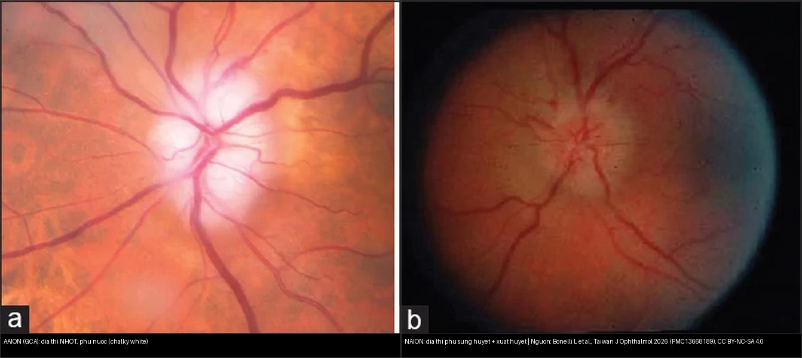
*Trái: AAION trong GCA — đĩa thị **nhợt màu "trắng phấn"** do nhồi máu toàn bộ đầu thị. Phải: NAION — đĩa **sung huyết**, phù một phần. Nguồn: Bonelli L et al., Taiwan J Ophthalmol 2026 (PMC13668189), CC BY-NC-SA 4.0. Ảnh ghép letterbox.*

**Quiz composite:** hai bệnh nhân đều > 60 tuổi, mờ mắt không đau, phù đĩa. Bên nào phải cấp cứu corticoid liều cao ngay?

<details><summary><b>Bấm để hiện đáp án</b></summary>

- **Trái = AAION (GCA) → cấp cứu:** bắt đầu **corticoid liều cao NGAY** (không chờ sinh thiết), vì mắt còn lại có thể mất trong **1 tuần**; kèm ESR/CRP + US động mạch thái dương/sinh thiết.
- **Phải = NAION → KHÔNG steroid:** điều trị vô ích và có hại; kiểm soát huyết áp/đái tháo đường/ngưng thở khi ngủ, giải thích tiên lượng và nguy cơ mắt đối diện **15–24% trong 5 năm**.
- Chốt phân biệt: **màu đĩa** (nhợt trắng phấn vs sung huyết) + **triệu chứng hệ thống** + **huyết học**.
</details>

## 4. Protocol chụp–chẩn đoán + hệ điểm chuẩn hóa (2022 ACR/EULAR) + xử trí

- **Bước 0 — cấp cứu lâm sàng:** nghi GCA ⇒ **lấy máu (ESR, CRP, CBC)** và **bắt đầu corticoid liều cao NGAY**, KHÔNG chờ kết quả hình ảnh/sinh thiết.
- **Siêu âm động mạch thái dương (EULAR first-line):** đầu dò **≥ 15–22 MHz**; **dấu quầng (halo sign)** = dày thành **giảm hồi âm** quanh lòng mạch; **dấu chèn ép (compression sign)** = mạch **KHÔNG xẹp** khi ép. Quét **cả ĐM thái dương + ĐM nách (axillary)** vì gộp hai vị trí cho **Se 88%, Sp 96%** (Bosch); thái dương đơn thuần thấp hơn. **Lưu ý: độ nhạy US giảm rõ sau ~4 ngày corticoid** ⇒ chụp càng sớm càng tốt. Dương tính giả (quầng) **~4–4,6%** (xơ vữa, lymphoma, IgG4, GPA...).
- **Sinh thiết động mạch thái dương (TAB):** **tiêu chuẩn vàng**, **độ đặc hiệu ~100%**, **độ nhạy 60–77%**; **trì hoãn tới 2 tuần sau khi dùng corticoid KHÔNG giảm độ nhạy** ⇒ không được lùi điều trị vì chờ sinh thiết. **ACR khuyến cáo đoạn mạch ≥ 1,5–2,5 cm**; **âm tính giả tới 13%** do **tổn thương cách quãng (skip lesions)** → nghi cao mà sinh thiết âm thì **cân nhắc sinh thiết bên đối diện**.
- **MRI hốc mắt/sọ:** **T1 fat-sat sau tiêm + T2 fat-sat** — tìm **dày/ngấm thành động mạch** và **ngấm bao thần kinh thị** (gợi ý GCA ở ca CRP âm/không điển hình).
- **FDG-PET/CT:** **viêm mạch lớn (aortitis, ĐM dưới đòn/nách)** — dùng khi US âm-không kết luận nhưng nghi cao, hoặc tìm tổn thương mạch lớn. **FA:** chậm đổ đầy hắc mạc **45–60 s**. **OCT:** tìm **PAMM (paracentral acute middle maculopathy)** — dấu hiệu vi mạch gợi ý GCA.
- **So sánh độ chính xác (GAME study, Hansen 2026):** US **Se 82%/Sp 90%** · FDG-PET/CT **Se 74%/Sp 100%** · TAB **Se 68%/Sp 100%**; khi US **không kết luận** thì **PET/CT nhạy hơn TAB (75% vs 38%)**. AUC tương đương (~0,84–0,87). ⇒ **chiến lược đa phương thức (multimodal)** trong **phòng khám nhanh (fast-track)**.

**Tiêu chuẩn phân loại 2022 ACR/EULAR GCA** — **bắt buộc: tuổi ≥ 50 lúc chẩn đoán**; **≥ 6 điểm = GCA**:
- **Điểm cộng thêm:** **mất thị lực đột ngột +3**; ESR tối đa **≥ 50 mm/h** hoặc CRP **≥ 10 mg/L** = **+3**; **sinh thiết dương hoặc dấu quầng trên US +5**; cứng khớp vai/cổ buổi sáng +2; đau hàm/lưỡi +2; đau đầu thái dương mới +2; đau da đầu +2; khám ĐM thái dương bất thường +2; **tổn thương ĐM nách hai bên +2**; **FDG-PET hoạt tính lan dọc ĐMC +2**.
- Đối chiếu ngoại kiểm (bệnh viện không học thuật): cắt **≥ 6** cho **AUC 0,96, Se 98%, Sp 57,5%**.

**Điều trị (cấp cứu):**
- **Prednisolone uống 1 mg/kg/ngày, không vượt 60–80 mg/ngày**, bắt đầu ngay.
- **Có mất thị lực (thoáng qua hoặc thật):** **methylprednisolone TM 0,25–1 g/ngày × 3–5 ngày** trước khi chuyển uống.
- **Giảm liều (theo EULAR):** **40–60 mg/ngày → 15–20 mg trong 2–3 tháng → đích < 5 mg/ngày sau 1 năm**; theo dõi tái phát + tác dụng phụ.
- **Tiết kiệm corticoid:** **tocilizumab** (kháng thụ thể IL-6, thử nghiệm GiACTA) — ACR khuyến cáo có điều kiện **phối hợp corticoid + tocilizumab** ở ca mới; **dự phòng Pneumocystis** bằng trimethoprim–sulfamethoxazole khi dùng corticoid liều cao + tocilizumab.
- **Theo dõi lâu dài:** nguy cơ **phình/tách thành ĐMC** và biến chứng mạch lớn; loãng xương do corticoid.

```mermaid
flowchart TD
  A[Nguoi > 50 tuoi: mo mat KHONG dau / phu dia thi] --> B{Dau khi dao mat?}
  B -->|Co| C[Viem thi (optic neuritis) - tre hon, ngam MRI]
  B -->|Khong| D{Trieu chung he thong: dau ham, dau dau, PMR, 2 ben dong thoi?}
  D -->|Co / nghi cao| E[Lay mau ESR-CRP-CBC + BAT DAU corticoid lieu cao NGAY]
  D -->|Khong| F[Xet thanh hinh: nho NAION, kiem tra disc-at-risk mat doi dien]
  E --> G[US dong mach thai duong + nach: halo / compression sign]
  G -->|Duong tinh| H[Chan doan GCA - tiep tuc dieu tri + duy tri tocilizumab]
  G -->|Am / khong ket luan| I[FDG-PET/CT hoac MRI thanh mach-hoc mat]
  I -->|Duong tinh| H
  I -->|Am + nghi cao| J[Sinh thiết dong mach thai duong >= 1,5-2,5 cm]
  J -->|Duong tinh| H
  J -->|Am nhung nghi cao| K[Can nhac sinh thiet doi ben; danh gia lai ACR/EULAR >= 6 diem]
  F --> L[NAION: KHONG steroid - kiem soat mach mau - tu van 15-24%/5 nam mat doi dien]
```

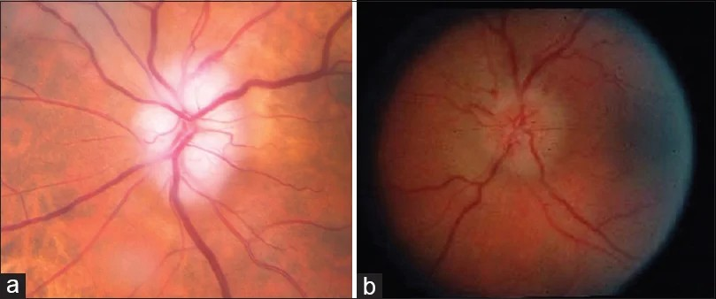
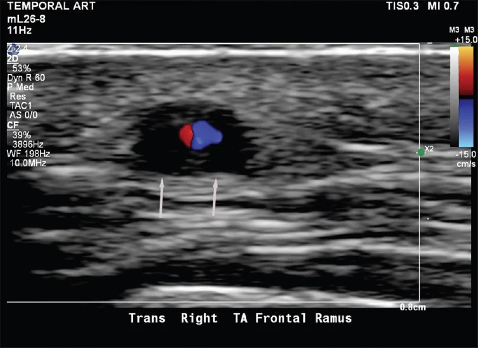
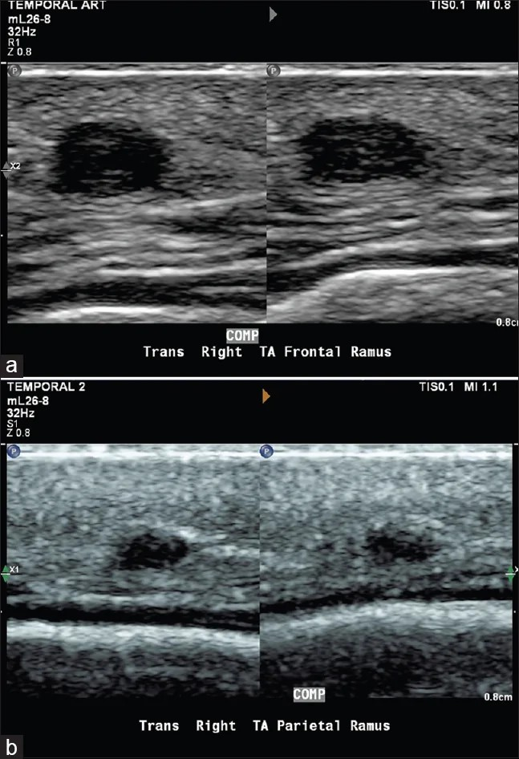
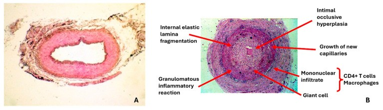
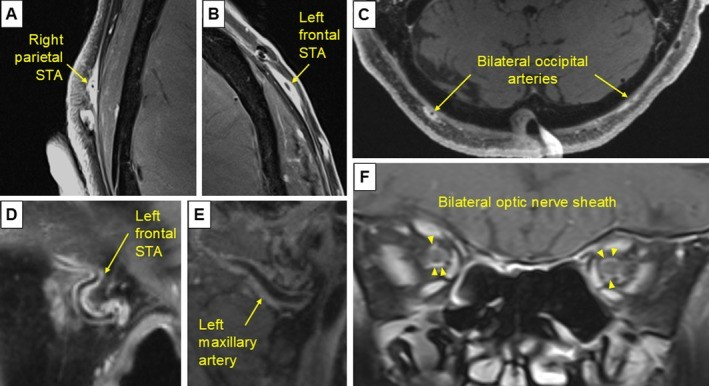
*Hàng 1: đáy mắt AAION (nhợt) vs NAION (sung huyết + xuất huyết tia). Hàng 2: **dấu quầng** (dày thành giảm hồi âm) và **dấu chèn ép** (mạch không xẹp) — Bonelli L et al., Taiwan J Ophthalmol 2026 (PMC13668189), CC BY-NC-SA 4.0. Hàng 3: mô bệnh học sinh thiết bình thường vs viêm mạch u hạt (gãy lá đàn hồi trong, tăng sinh nội mạc, tế bào khổng lồ) — Rodriguez-Pla A, Diagnostics 2026 (PMC12896486), CC BY 4.0. Hàng 4: MRI T1 sau tiêm ngấm thành ĐM thái dương/đỉnh/chẩm và **bao thần kinh thị hai bên** — Yang DL et al., ACR Open Rheumatol 2026 (PMC13147153), CC BY-NC-ND 4.0 (nguyên bản).*

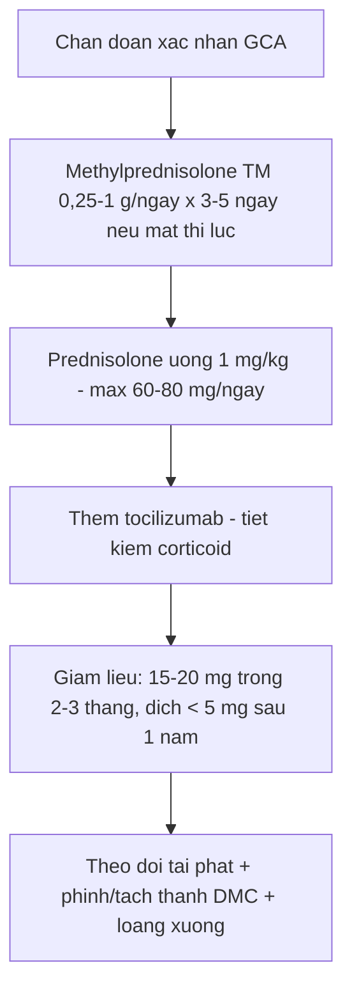

## 5. Biến thể bình thường và cạm bẫy

- **ESR/CRP bình thường KHÔNG loại trừ GCA (tới 30% sinh thiết dương có ESR bình thường)** — quyết định dựa **lâm sàng + hình ảnh**, "occult GCA" chỉ có mất thị lực mà không đau hàm/đầu.
- **Sinh thiết âm không loại trừ** (~13% âm tính giả do skip lesion) — **nghi cao thì điều trị và cân nhắc sinh thiết đối bên**.
- **Đừng chờ sinh thiết/hình ảnh mới dùng corticoid** — điều trị muộn = mù mắt thứ hai; đây là lỗi dễ mắc nhất.
- **Đĩa trắng phấn không phải lúc nào cũng rõ** — ca sớm/không điển hình có thể như NAION; dựa vào **bối cảnh hệ thống + huyết học + 2 bên**.
- **PION (đĩa bình thường) là cạm bẫy:** mất thị lực nặng mà đĩa trông lành vẫn có thể là GCA ⇒ không được trấn an.
- **Cho NAION dùng corticoid liều cao là sai** — vô ích, hại (đái tháo đường, loãng xương); **phẫu thuật giải ép thần kinh thị (IONDT) không có lợi, có thể hại**.
- **NAION tái phát:** cùng mắt **3–8%**, mắt đối diện **15–24% trong 5 năm** — tầm soát và kiểm soát yếu tố nguy cơ mạch máu.
- **Tránh bẫy "phù đĩa = phù đĩa do tăng áp lực nội sọ"**: ở người > 50 phù đĩa một bên cấp, thiếu máu đứng đầu danh sách, không mặc định IIH.

## 6. Tự lượng giá — Blind Quiz

**Ca 1 — Cụ bà 74 tuổi đau đầu thái dương mới + đau hàm khi nhai 2 tuần, nay đột ngột mờ mắt trái không đau. Đáy mắt:**
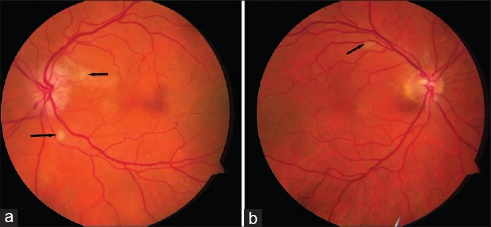

- Hỏi: mô tả đĩa thị? Dấu hiệu nào gợi ý **u hạt/viêm mạch** hơn NAION? Ba xét nghiệm cần làm ngay?

<details><summary><b>Bấm để hiện đáp án (findings + chẩn đoán)</b></summary>

- Dấu hiệu (findings): **đĩa thị nhợt "trắng phấn" (pallid/chalky-white edema)** ở mắt trái + **đốm bông (cotton wool spots)**; mắt đối diện **cũng có đốm bông** — bằng chứng **thiếu máu võng mạc hai bên**.
- Chẩn đoán (diagnosis): **AAION do GCA** — vì **> 50 tuổi + đau hàm/đau đầu + 2 bên + đốm bông** (những dấu này **không điển hình trong NAION**).
- Xét nghiệm/xử trí ngay: **ESR + CRP + CBC (tiểu cầu)**, **bắt đầu corticoid liều cao ngay**, rồi **US động mạch thái dương** và/hoặc **sinh thiết**.
- Nguồn ảnh: Bonelli L et al., Taiwan J Ophthalmol 2026 (PMC13668189) Fig. 3, CC BY-NC-SA 4.0.
</details>

**Ca 2 — Ông 62 tuổi đái tháo đường, tỉnh dậy mờ mắt phải không đau. Đáy mắt + thị trường:**
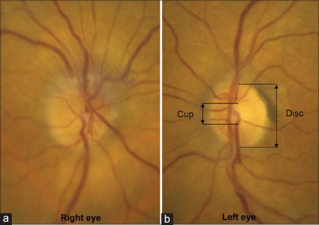
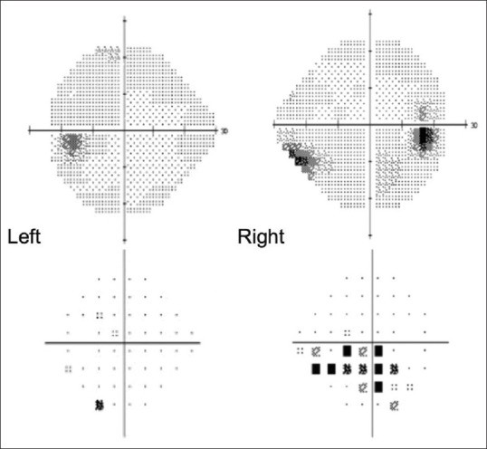

- Hỏi: dấu hiệu nào ở **mắt lành** giúp chốt chẩn đoán? Thị trường mất kiểu gì? Điều trị?

<details><summary><b>Bấm để hiện đáp án (findings + chẩn đoán)</b></summary>

- Dấu hiệu (findings): mắt phải **phù đĩa thị phân đoạn phía trên** (bệnh); **mắt trái lành có tỷ lệ lõm/đĩa nhỏ = disc-at-risk** (lõm C/D nhỏ). Thị trường mất **kiểu độ cao (altitudinal), ưu thế nửa dưới** mắt phải.
- Chẩn đoán (diagnosis): **NAION** — vì **> 50 + không đau + tỉnh dậy mờ 1 mắt + disc-at-risk ở mắt đối diện**; **không steroid**.
- Xử trí: kiểm soát **huyết áp/đái tháo đường/rối loạn lipid**, tầm soát **ngưng thở khi ngủ**; tư vấn nguy cơ **mắt đối diện 15–24% trong 5 năm**.
- Nguồn ảnh: Patil AD, Biousse V, Newman NJ, Ann Indian Acad Neurol 2022 (PMC9795705) Fig. 1–2, CC BY-NC-SA 4.0.
</details>

**Ca 3 — Cùng bệnh nhân nghi GCA, siêu âm động mạch thái dương dưới đây:**


- Hỏi: gọi tên dấu hiệu? Nó có thay thế sinh thiết không? Vì sao phải làm **sớm**?

<details><summary><b>Bấm để hiện đáp án (findings + chẩn đoán)</b></summary>

- Dấu hiệu (findings): **dấu quầng (halo sign)** — **dày thành mạch giảm hồi âm bao quanh lòng mạch** (mũi tên trắng), do phù/viêm thành. Nghiệm pháp xác nhận: **dấu chèn ép (compression sign)** — mạch **không xẹp** khi đè đầu dò.
- Ý nghĩa: US gộp **thái dương + nách** cho **Se 88%/Sp 96%**; thay thế TAB trong **chẩn đoán lâm sàng** ở bối cảnh phù hợp nhưng **không thay thế mô bệnh** khi cần loại trừ bệnh khác.
- Vì sao sớm: **độ nhạy US giảm rõ sau ~4 ngày corticoid** — chụp trước khi điều trị.
- Nguồn ảnh: Bonelli L et al., Taiwan J Ophthalmol 2026 (PMC13668189) Fig. 7, CC BY-NC-SA 4.0.
</details>

**Ca 4 — Bệnh nhân nghi GCA: sơ đồ chẩn đoán đa phương thức (Hansen 2026):**
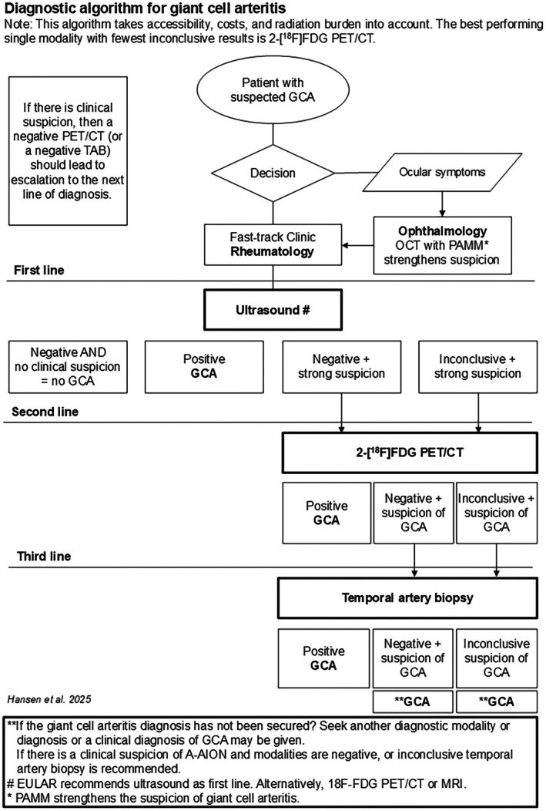

- Hỏi: đường đầu tiên (first-line) là gì? Nếu US âm nhưng nghi cao thì bước tiếp? Khi nào cần sinh thiết?

<details><summary><b>Bấm để hiện đáp án (findings + chẩn đoán)</b></summary>

- **Đường đầu tiên = siêu âm** (theo EULAR); **âm + nghi cao** (hoặc **không kết luận + nghi cao**) ⇒ **FDG-PET/CT** (đường hai); vẫn **không kết luận/nghi cao** ⇒ **sinh thiết động mạch thái dương** (đường ba).
- **Điểm quan trọng:** **âm nhưng lâm sàng nghi mạnh KHÔNG loại trừ GCA**; **không chờ kết quả mới điều trị**.
- Chốt từ GAME study: khi US **không kết luận**, **PET/CT nhạy hơn TAB** (75% vs 38%) — ủng hộ **cách tiếp cận đa phương thức ở phòng khám nhanh**.
- Nguồn ảnh: Hansen MS et al., Acta Ophthalmol 2026 (PMC13460362) Fig. 2, CC BY 4.0.
</details>

## Bài liên quan chéo
- [400 – Tổng quan Mắt](../400-tong-quan-mat-thi-giac/lesson.md)
- [430 – Đường thị giác: viêm vs thiếu máu](../430-duong-thi-giac/lesson.md) (NAION, viêm thị, AQP4/MOG)
- [433 – Phù đĩa thị vs drusen](../433-phu-dia-thi-drusen/lesson.md) (phù đĩa thật vs giả phù; IIH)
- [434 – Teo thị do độc–chuyển hóa & LHON](../434-teo-thi-than-kinh-thi-doc-va-LHON/lesson.md) (tiếp cận teo thị 2 bên)
- [444 – Tắc mạch võng mạc](../444-tac-mach-vong-mac/lesson.md) (CRAO — biểu hiện khác của GCA)
- [451 – Biểu hiện mắt của bệnh hệ thống](../451-he-thong-mat/lesson.md) (viêm mạch, ANCA)

## Ảnh
- `435_aaion-vs-naion_Fundus_PMC13668189-Fig2-CCBYNCSA.jpg`, `435_aaion-cotton-wool_Fundus_PMC13668189-Fig3-CCBYNCSA.jpg`, `435_halo-sign_US_PMC13668189-Fig7-CCBYNCSA.jpg`, `435_compression-sign_US_PMC13668189-Fig8-CCBYNCSA.jpg` — Bonelli L et al., Taiwan J Ophthalmol 2026 (PMCID: PMC13668189), CC BY-NC-SA 4.0.
- `435_naion-disc-at-risk_Fundus_PMC9795705-Fig1-CCBYNCSA.jpg`, `435_naion-thi-truong-humphrey_TVF_PMC9795705-Fig2-CCBYNCSA.jpg` — Patil AD, Biousse V, Newman NJ, Ann Indian Acad Neurol 2022 (PMCID: PMC9795705), CC BY-NC-SA 4.0.
- `435_flowchart-chan-doan_PMC13460362-Fig2-CCBY.jpg` — Hansen MS et al., Acta Ophthalmol 2026 (PMCID: PMC13460362), CC BY 4.0.
- `435_tab-histology_PMC12896486-Fig3-CCBY.jpg` — Rodriguez-Pla A, Diagnostics 2026 (PMCID: PMC12896486), CC BY 4.0.
- `435_mri-thanh-mach_PMC13147153-Fig2-CCBYNCND.jpg` — Yang DL et al., ACR Open Rheumatol 2026 (PMCID: PMC13147153), CC BY-NC-ND 4.0 (giữ nguyên bản, không ghép).
- `composite_AAION-vs-NAION.jpg` — ghép 2 panel của Fig. 2 (PMC13668189) bằng `tools/make_composite.py`.
- Chi tiết giấy phép từng ảnh trong `images/CREDITS.md`. AuntMinnie: chỉ dẫn link, không tải.

> Không dùng để chẩn đoán độc lập khi chưa có người hướng dẫn.
