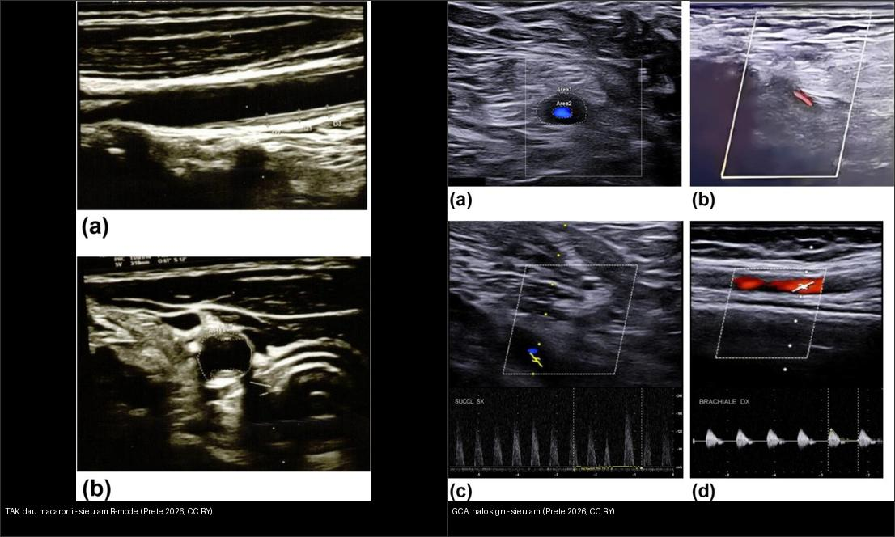
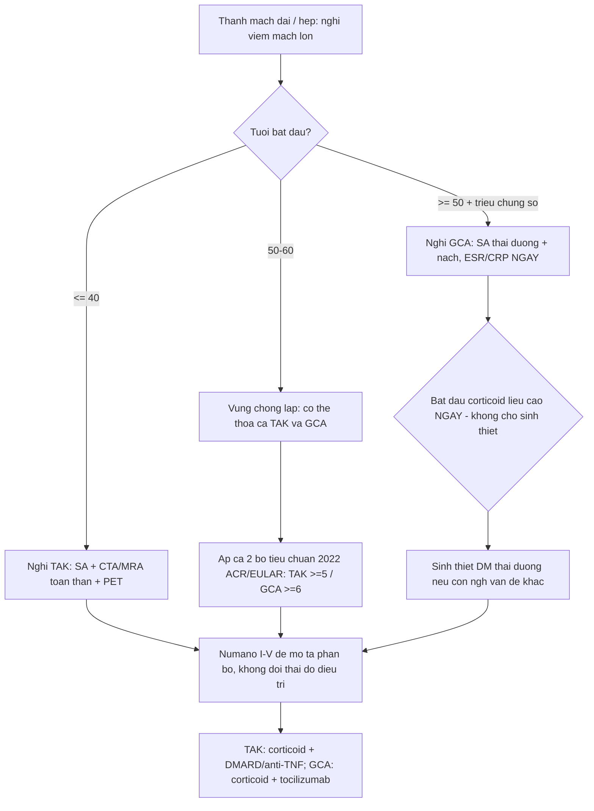
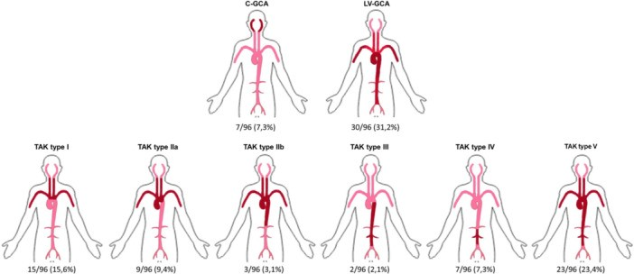
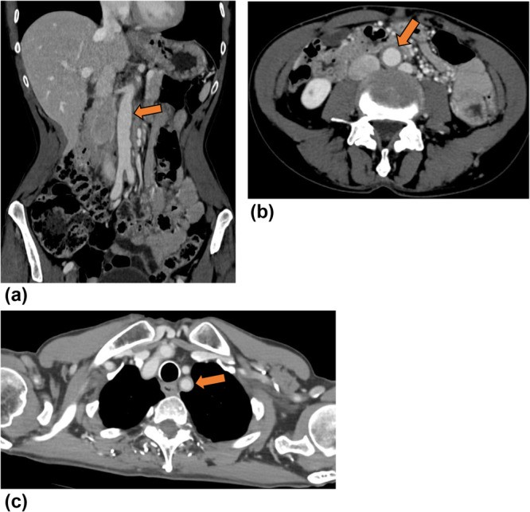
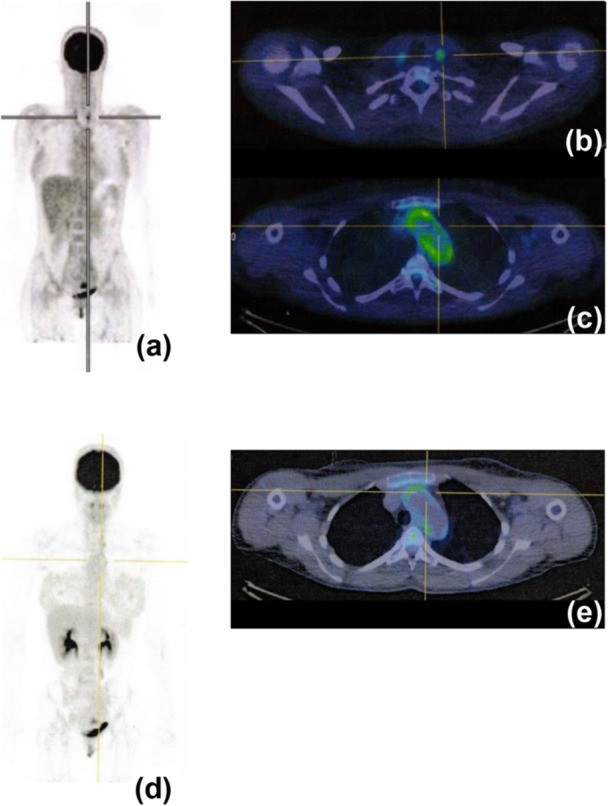
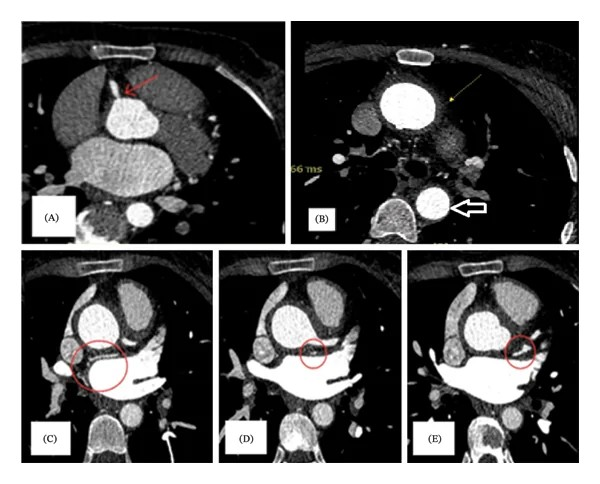
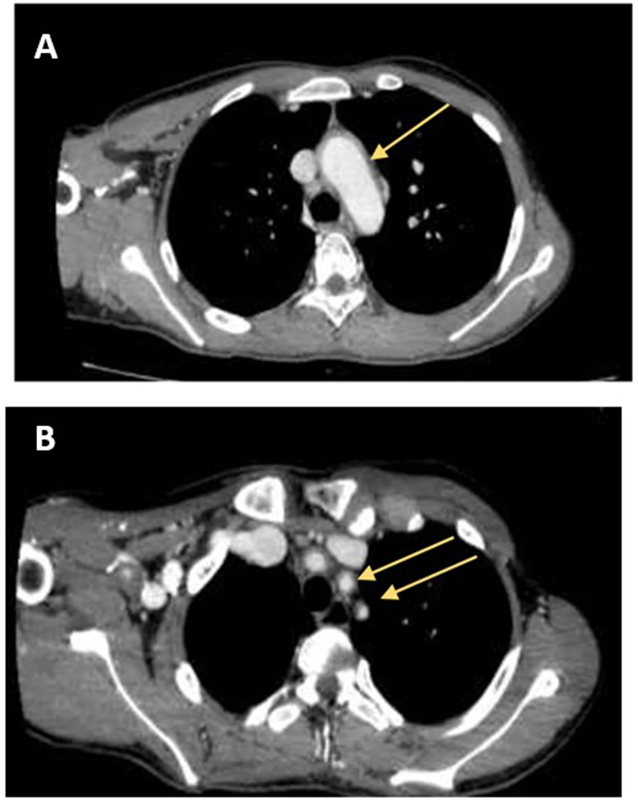
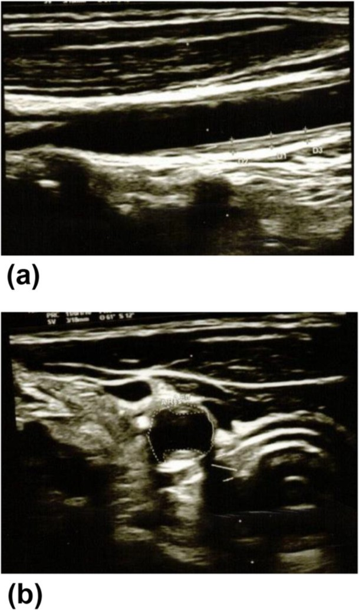
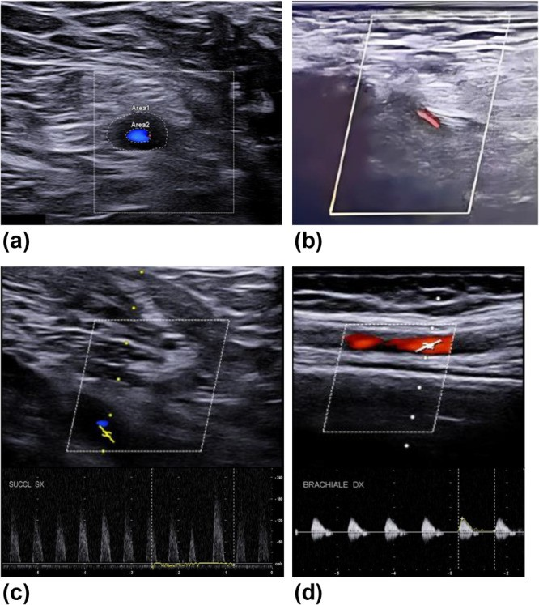
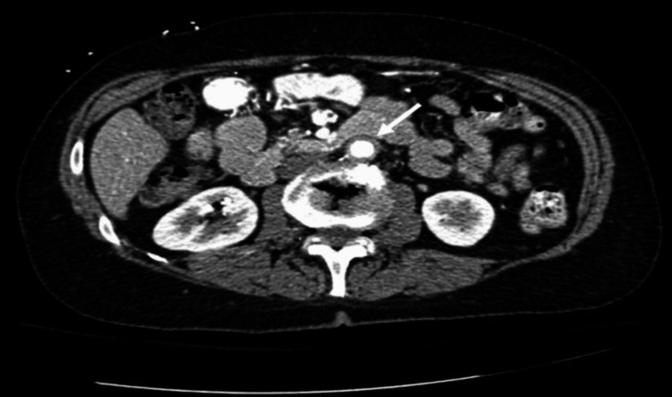

# 436 — Takayasu & viêm động mạch tế bào khổng lồ (viêm mạch lớn): phân biệt bằng tuổi + hình ảnh thành mạch / Takayasu arteritis vs giant cell arteritis (large-vessel vasculitis)

**Tags:** `pattern:day-thanh-mach` `vung:thanh-mach-lon` `score:ACR-EULAR-2022` `score:Numano` `protocol:CTA-MRA` `protocol:FDG-PET-CT`
**Mức chắc chắn (certainty):** tổng hợp y văn (literature synthesis) — nhóm tự biên từ y văn mở (Immun Inflamm Dis 2026 CC BY 4.0 + Cureus 2026 CC BY 4.0 + Case Rep Med 2026 CC BY 4.0 + Int Med Case Rep J 2026 CC BY-NC 4.0) và tiêu chuẩn phân loại 2022 ACR/EULAR, chưa gắn một ca nguyên văn đơn lẻ xuyên suốt.

## 1. Tổng quan — vì sao "tuổi" là chìa khóa, và thành mạch dày nghĩa là gì

- **Viêm mạch lớn (large-vessel vasculitis, LVV)** là nhóm viêm mạch tự miễn ảnh hưởng **động mạch chủ và các nhánh chính**. Ở người lớn, đây là **nhóm viêm mạch nguyên phát hay gặp nhất**, gồm 2 thực thể chính: **viêm động mạch Takayasu (Takayasu arteritis, TAK)** và **viêm động mạch tế bào khổng lồ (giant cell arteritis, GCA)**. Có ý kiến còn tranh luận liệu đây là 2 bệnh khác biệt hay 2 đầu của một phổ; **điểm phân biệt thực hành mạnh nhất là TUỔI**.
- **TAK = bệnh của người trẻ** (kinh điển **< 40 tuổi**, thường khởi phát 20–30 tuổi, **nữ nhiều hơn**), tổn thương **hẹp/tắc dài đoạn** của ĐMC và các nhánh, hay gặp ở Đông Á/Ấn Độ/Nam Mỹ — xưa gọi "bệnh không mạch (pulseless disease)" do mất mạch chi trên.
- **GCA = bệnh của người già** (gần như chỉ **> 50 tuổi**, đỉnh 70–80, **nữ ~2 lần nam**), chia 2 thể: **GCA sọ (cranial-GCA, C-GCA)** — động mạch thái dương, triệu chứng đầu–mắt; và **GCA mạch lớn (large-vessel GCA, LV-GCA)** — ĐMC, dưới đòn/nách, có thể **không có triệu chứng sọ**.
- **Cơ chế hình ảnh (TẠI SAO):** viêm u hạt **từ lớp áo ngoài tiến vào lớp áo giữa** (viêm mạch nuôi mạch — vasa vasorum) → **phù + thâm nhiễm tế bào viêm** (giai đoạn hoạt tính) → **tăng sinh nội mạc + xơ hóa** (giai đoạn mạn) → **hẹp, tắc, hoặc giãn/phình do phá hủy lớp giữa**.
  - **Siêu âm B-mode:** phù/viêm thành mạch giàu nước → **giảm hồi âm quanh lòng (dấu quầng "halo sign" của GCA)**; xơ/hyalin hóa mạn → **dày đều, tăng âm vừa (dấu "macaroni sign" của TAK)** — **hai giai đoạn mô bệnh khác nhau nên kiểu hồi âm khác nhau**, đây là chốt đọc siêu âm.
  - **CT (CTA):** thành mạch dày **ngấm thuốc** khi viêm hoạt tính; đo được **độ dày thành (mm)** và lòng mạch chính xác hơn SA.
  - **MRI (MRA):** **T2/STIR thành mạch sáng (phù)** + **ngấm gadolinium sau tiêm**; MRA dựng hình lòng mạch mà không cần tia X.
  - **¹⁸F-FDG PET/CT:** tế bào viêm tăng chuyển hóa glucose (**GLUT-1**) → **ngấm FDG dọc thành ĐMC/nhánh**; PET **phản ánh hoạt tính viêm** nên **thay đổi theo điều trị** (giảm sau khi kiểm soát bệnh), khác với tổn thương xơ cố định.
- **Ngưỡng định lượng nằm lòng:** **độ dày nội–trung mạc (intima–media) bình thường ≤ 0,9 mm**; trong TAK đo được **1,3–1,5 mm** một ví dụ (dày thành giảm lòng 35%); **dấu quầng thu hẹp lòng tới 80%** và **tốc độ đỉnh tâm thu (PSV) đoạn hẹp dưới đòn tới 180 cm/s** ở ca GCA (chỉ số tăng tốc = hẹp có ý nghĩa).
- **Dịch tễ từ cohort 96 ca Ý (Prete 2026):** TAK **59 ca**, tuổi khởi phát **trung vị 32 (IQR 22,75–46,25)**; GCA **37 ca (30 LV-GCA + 7 C-GCA)**, tuổi khởi phát **trung vị 75 (IQR 69–78)**, p < 0,001. TAK: **nữ nhiều hơn (p = 0,001)**, thời gian từ khởi phát đến chẩn đoán **lâu hơn (p = 0,029)**, triệu chứng toàn thân – tim mạch – thận – da nhiều hơn. GCA: nam = nữ, **đau cơ–cứng vai cổ (PMR), tăng huyết áp, đái tháo đường** nhiều hơn; **sinh thiết ĐM thái dương dương chỉ 18,9%** (7/37) vì phần lớn là thể mạch lớn.

## 2. Mẫu hình + chẩn đoán phân biệt theo vị trí (gamut)

**Câu hỏi lọc 1 — TUỔI, rồi mới tới hình ảnh:**
- **< 40 tuổi** + thành mạch dày/hẹp/tắc nhiều nhánh → **TAK**.
- **50–60 tuổi** = **vùng chồng lấp** (2022 ACR/EULAR: TAK yêu cầu tuổi **≤ 60**, GCA yêu cầu **≥ 50**) → có thể thỏa **cả hai**.
- **> 60 tuổi** + triệu chứng sọ (đau đầu, đau hàm, mờ mắt) → **GCA**.

**Gamut "thành mạch lớn dày / hẹp" theo cơ chế:**
- **Viêm tự miễn:** TAK · C-GCA · LV-GCA · **aortitis do IgG4** (kèm hẹp nhánh + viêm tụy/viêm thận mạn) · **bệnh Erdheim–Chester** (dày thành ĐMC "hairy kidneys") · **viêm mạch ANCA** (thể ít gặp).
- **Nhiễm khuẩn:** **aortitis nhiễm khuẩn (mycotic)** — thường túi phình/thành mỏng, sốt; **giang mai ĐMC** — dày thành + phình lên cao.
- **Không viêm (bắt chước):** **xơ vữa động mạch** (canxi hóa, không ngấm kiểu viêm, phân bố ngã ba), **tăng huyết áp lâu năm** (thành dày nhẹ đồng tâm không viêm), **loạn sản cơ–xơ (fibromuscular dysplasia)** — "chuỗi hạt" ở người trẻ **không viêm**, **bất thường sau xạ/mổ**.
- **Phân bố gợi ý (xem ảnh Fig 1):** tổn thương **cung ĐMC + các nhánh + dài đoạn** thiên về **TAK**; **phân bố "có hệ thống", có thể có đoạn thái dương** nghĩ **GCA**; **ĐMC bụng + thận/thân tạng** có ở cả LV-GCA và TAK thể IV.

## 3. Bảng so sánh phân biệt (ma trận đối chiếu)

| Thực thể (entity) | Hình ảnh điển hình | Chốt vào (rule-in) | Chốt loại (rule-out) | Gợi ý xác nhận |
|---|---|---|---|---|
| **TAK** | US: **"macaroni sign"** — dày thành đều, **tăng âm vừa**, IMT 1,3–1,5 mm (bình thường ≤ 0,9 mm); CTA/MRA: **hẹp/tắc dài đoạn**, thành dày, có thể phình; PET: ngấm FDG thành mạch | **Người trẻ (< 40, hoặc ≤ 60) + giảm/mất mạch chi + chênh HA hai tay ≥ 20 mmHg + tổn thương ĐMC–dưới đòn–cảnh** | Tuổi > 60 + triệu chứng sọ rõ + quầng ĐM thái dương → nghĩ GCA | ACR/EULAR 2022 **≥ 5 điểm** (Se 93,8%/Sp 99,2%, AUC 0,97); CTA + MRA + PET |
| **C-GCA** | US: **"halo sign"** — dày thành **giảm hồi âm** quanh lòng ĐM thái dương/nách, **không xẹp khi đè (compression sign)**; mất độ nhạy sau ~4 ngày corticoid | **> 50 tuổi + đau đầu mới/đau hàm + mờ mắt + ESR/CRP cao** | Người trẻ + giảm mạch chi + phân bố nhiều nhánh dài → TAK | ACR/EULAR 2022 **≥ 6 điểm**; US fast-track; sinh thiết ĐM thái dương (Sp ~100%) |
| **LV-GCA** | CTA: **thành ĐMC–nhánh dày đồng tâm, ngấm** (aorta bụng + cung); PET/CT: **ngấm FDG lan tỏa thành mạch lớn**; TAB có thể **âm** | **> 50 tuổi + PMR/tăng HA/ĐTĐ + tổn thương ĐMC mới** | Tổn thương **canxi hóa ngã ba, không ngấm** → xơ vữa | FDG-PET/CT (Se 74%/Sp 100%); MRI T2/ngấm thành mạch |
| **Aortitis nhiễm khuẩn (mycotic)** | Túi phình/thành mỏng, khí mô mềm quanh, **phản ứng viêm quanh mạch rõ**; phát triển nhanh (cm/tuần) | **Sốt + đau lưng + phình mới mọc nhanh + cấy máu (+)** | Thành dày xơ đều, không sốt → viêm mạch | Cấy máu, kháng sinh, theo dõi kích thước sát |
| **Xơ vữa (atherosclerosis)** | Canxi hóa trong thành, mảng lệch tâm ở **ngã ba/gốc nhánh**, thành mỏng–trung bình | **Canxi hóa + mảng ngấm không đều ở người lớn tuổi, yếu tố nguy cơ tim mạch** | Ngấm FDG thành mạch **lan + thành dày tròn đều** → viêm mạch | Đối chiếu yếu tố nguy cơ, PET thành mạch, theo dõi |

*Trái: **TAK** — siêu âm B-mode dọc ĐM cảnh chung, thành **dày đều, tăng âm vừa** = "macaroni sign" (IMT 1,3–1,5 mm). Phải: **GCA** — thành **giảm hồi âm dày đồng tâm** = "halo sign" (a: ĐM nách phải, thu hẹp 80%; c: hẹp dài ĐM dưới đòn trái, PSV 180 cm/s). Nguồn: Prete M et al., Immun Inflamm Dis 2026 (PMC13403052), CC BY 4.0. Ảnh ghép letterbox.*

**Quiz composite:** Hai bệnh nhân đều nữ, dày thành mạch trên siêu âm B-mode. Người nào nghĩ Takayasu, người nào nghĩ GCA — và vì sao chỉ nhìn "màu hồi âm thành mạch" đã gợi ý?

<b>Bấm để hiện đáp án</b>

- **Trái = Takayasu**: thành **tăng âm vừa, dày đều** (mô xơ mạn), tuổi trẻ; **Phải = GCA**: thành **giảm hồi âm** (phù/edema cấp), tuổi già + triệu chứng sọ.
- **Cơ chế:** halo = **nước/phù** (giảm hồi âm); macaroni = **xơ hoá mạn** (tăng âm). Cùng là "dày thành mạch" nhưng **giai đoạn mô bệnh quyết định kiểu hồi âm**.
- **Chốt lâm sàng:** tuổi (< 40 vs > 50) + phân bố (mạch chi/nhánh vs mạch sọ) + xét nghiệm viêm (ESR/CRP).

## 4. Protocol chụp–chẩn đoán + hệ phân độ + xử trí

**Hình ảnh đa phương thức (không có một phương thức nào "chốt" một mình):**
- **Siêu âm Doppler màu (đường đầu tiên trong LVV):** đầu dò tuyến tính **≥ 15–22 MHz**; quét **cả hai bên** và **nhiều vị trí** — với GCA: **ĐM thái dương + ĐM nách** (gộp hai vị trí cho Se/Sp cao nhất); với TAK: **cảnh, dưới đòn, nách, ĐMC bụng + nhánh thân tạng/thận**; ghi **dấu quầng/macaroni + PSV + độ dày thành (mm)**.
- **CTA (ĐMC + các nhánh, lát mỏng):** dựng **lòng mạch + thành mạch**, đo độ dày (mm), phát hiện hẹp/tắc/phình; dùng để phân loại **Numano**.
- **MRA (không tia X, ± gadolinium):** T2/STIR thành mạch sáng, T1 sau tiêm ngấm; lựa chọn ở người trẻ/BN cần theo dõi nhiều lần; **có thể bỏ sót hẹp nhẹ**.
- **¹⁸F-FDG PET/CT:** đánh giá **hoạt tính viêm** toàn thân; **nhịn đói ≥ 6 giờ, đường huyết < 7 mmol/L (≈ 126 mg/dL)** để giảm ngấm cơ; đọc **ngấm thành ĐMC/nhánh so với gan** (thang thị giác 0–3 hoặc TBR/SUVmax). PET **giảm ngấm sau khi kiểm soát viêm** ⇒ hợp để **theo dõi đáp ứng**, không để phát hiện các hẹp xơ cố định.
- **Sinh thiết ĐM thái dương (chỉ GCA):** tiêu chuẩn vàng, **Sp ~100%**, **Se 60–77%** (âm tính giả tới ~13% do tổn thương cách quãng); **trì hoãn 2 tuần sau corticoid không giảm độ nhạy**.
- **Xét nghiệm:** **ESR (Westergren ≥ 50 mm/h)** và **CRP (≥ 10 mg/L)** — **bình thường KHÔNG loại trừ**; công thức máu (tiểu cầu tăng), loại trừ nhiễm khuẩn/giang mai.

**Hệ phân loại:**
- **Numano (TAK, theo phân bố tổn thương — ảnh 1):** **I** — cung ĐMC + nhánh; **IIa** — ĐMC lên + cung + nhánh; **IIb** — IIa + ĐMC ngực xuống; **III** — ĐMC ngực xuống + ĐMC bụng (± thận); **IV** — ĐMC bụng ± ĐM thận; **V** — kết hợp IIb + IV (toàn bộ ĐMC + nhánh). Thêm ký hiệu **C(+)** (mạch vành) và **P(+)** (mạch phổi).
- **2022 ACR/EULAR — TAK:** bắt buộc **tuổi ≤ 60 lúc chẩn đoán + bằng chứng hình ảnh LVV**; **≥ 5 điểm** (nữ +1; đau thắt ngực +2; đau cách hồi chi +2; tiếng thổi động mạch +2; giảm mạch chi trên +2; giảm mạch/đau ĐM cảnh +2; chênh HA hai tay ≥ 20 mmHg +1; số vùng mạch tổn thương +1 đến +3; tổn thương **cặp mạch** +1; **ĐMC bụng + thận/thân tạng** +3). Se **93,8%**, Sp **99,2%**, AUC **0,97**.
- **2022 ACR/EULAR — GCA:** bắt buộc **tuổi ≥ 50**; **≥ 6 điểm** (mất thị lực đột ngột +3; ESR ≥ 50 mm/h hoặc CRP ≥ 10 mg/L +3; sinh thiết dương **hoặc** dấu quầng +5; cứng khớp vai/cổ +2; đau hàm/lưỡi +2; đau đầu thái dương mới +2; đau da đầu +2; khám ĐM thái dương bất thường +2; tổn thương ĐM nách hai bên +2; FDG-PET ngấm lan ĐMC +2).

*Hình 1 — **phân loại angiographic TAK và GCA**: minh họa kiểu tổn thương phân biệt GCA sọ (ĐM thái dương), GCA mạch lớn và các thể Numano của TAK. Nguồn: Prete M et al., Immun Inflamm Dis 2026 (PMC13403052) Fig. 1, CC BY 4.0.*

*Trên: CTA thành ĐMC bụng dày đồng tâm ở LV-GCA (Fig. 5). Giữa: ¹⁸F-FDG PET/CT **trước/sau điều trị** ở nữ 39 tuổi TAK thể IIa — ngấm giảm khi kiểm soát bệnh (Fig. 7). Dưới: MRA **tắc ĐM dưới đòn hai bên, hẹp ĐM cảnh chung trái và hẹp lỗ ĐM thận** (Fig. 3). Nguồn: Prete M et al. (PMC13403052) & Heidari A et al., Case Rep Med 2026 (PMC13575784), CC BY 4.0.*

*CTA lát mỏng: **dày thành mạch đồng tâm dài đoạn** ĐMC ngực, gốc ĐM cảnh chung trái và ĐM dưới đòn trái (mũi tên) ở một ca TAK 15 tuổi — đối chiếu cơ chế "hẹp dài đoạn". Nguồn: Mohamed HA et al., Int Med Case Rep J 2026 (PMC13592360) Fig. 1, CC BY-NC 4.0.*

**Xử trí (khung):**
- **TAK:** **glucocorticoid** là nền tảng; phối hợp **DMARD** (methotrexate/azathioprine/leflunomide), **ức chế TNF-α** (infliximab/adalimumab) hoặc **tocilizumab** khi kháng trị/tái phát; kiểm soát huyết áp, chống kết tập tiểu cầu khi có tổn thương mạch não; can thiệp mạch (nong/stent/phẫu thuật) **chỉ khi đã kiểm soát viêm** để tránh tái hẹp.
- **GCA:** **prednisolone 1 mg/kg/ngày (≤ 60–80 mg)** bắt đầu ngay; **methylprednisolone TM 0,25–1 g/ngày × 3–5 ngày** nếu có mất thị lực; **tocilizumab** tiết kiệm corticoid; giảm liều theo lộ trình EULAR.

## 5. Biến thể bình thường và cạm bẫy

- **Thành mạch dày "sinh lý"/xơ vữa giả viêm:** người lớn tuổi có **canxi hóa + mảng xơ vữa ngã ba** làm dày thành trên CT/US — đừng gọi aortitis; **xơ vữa cũng ngấm FDG nhẹ**, nhưng **khép khu trú, lệch tâm, có canxi** và **không giảm sau điều trị kháng viêm**.
- **"Halo sign" sau corticoid:** **độ nhạy US giảm rõ sau ~4 ngày corticoid** ⇒ **chụp siêu âm càng sớm càng tốt**; quầng mất sau điều trị không có nghĩa bệnh đã khỏi.
- **Vùng chồng lấp 50–60 tuổi:** theo 2022 ACR/EULAR, **có thể thỏa cả TAK và GCA**; trong 26 ca TAK chẩn đoán 50–60 tuổi, **88,5% phân loại đúng TAK, 3,9% bị xếp GCA, 3,9% thỏa cả hai** — đừng máy móc loại trừ theo tuổi.
- **TAB âm không loại trừ GCA** (Se chỉ 60–77%); ca LV-GCA thường **không có triệu chứng sọ** và **TAB âm** (cohort Prete: dương chỉ 18,9%) — vẫn phải chẩn đoán dựa **hình ảnh mạch lớn**.
- **FDG-PET/CT dương tính giả:** nhiễm khuẩn, sau phẫu thuật/stent, u, xơ vữa hoạt tính, **tăng glucose máu** — dùng **thang thị giác/TBR so với gan**, nhịn đói, và **không đọc PET như một "xét nghiệm độc lập"**.
- **PET âm không loại trừ bệnh đã "cháy hết" (burnt-out):** tổn thương hẹp/xơ cố định có thể **âm FDG** dù bệnh vẫn tiến triển hẹp — cần CTA/MRA + lâm sàng.
- **Cạm bẫy "một bệnh = một phương thức":** LVV cần **tiếp cận đa phương thức** (SA + CTA/MRA + PET/CT) trong **phòng khám nhanh (fast-track)**; bỏ sót tổn thương ĐMC/thận vì chỉ quét mạch thái dương là lỗi hay gặp.

## 6. Tự lượng giá — Blind Quiz

**Ca 1 — Nữ 39 tuổi, mệt mỏi, sốt nhẹ, đau cảnh trái từng cơn và đau cách hồi chi trên. Siêu âm ĐM cảnh:**

- Hỏi: mô tả dấu hiệu? Gọi tên? Ba chẩn đoán phân biệt và dấu hiệu chốt nào định hướng?

<b>Bấm để hiện đáp án (findings + chẩn đoán)</b>

- Dấu hiệu (findings): **dày thành mạch đồng tâm, tăng âm vừa, đồng nhất** quanh lòng ĐM cảnh; dày đều (IMT 1,3–1,5 mm) — **"macaroni sign"**.
- Chẩn đoán (diagnosis): **viêm động mạch Takayasu** — thiên về **nữ trẻ (< 40) + tổn thương nhiều nhánh + đau cách hồi chi trên**; phân bố trên CTA/MRA phân loại **Numano**.
- Vì sao "macaroni" khác "halo": macaroni = **xơ hoá mạn, tăng âm**; halo = **phù cấp, giảm hồi âm** (thường GCA).
- Xử trí: xác nhận bằng CTA/MRA + PET/CT, bắt đầu **corticoid + DMARD/anti-TNF**, kiểm soát HA.
- Nguồn ảnh: Prete M et al., Immun Inflamm Dis 2026 (PMC13403052) Fig. 3, CC BY 4.0.

**Ca 2 — Nữ 72 tuổi, đau đầu thái dương mới + đau hàm, bờ ĐM thái dương đau. Siêu âm:**

- Hỏi: gọi tên dấu hiệu? Cơ chế? Cần làm gì NGAY trước khi có sinh thiết?

<b>Bấm để hiện đáp án (findings + chẩn đoán)</b>

- Dấu hiệu (findings): thành mạch **giảm hồi âm** dày đồng tâm = **dấu quầng (halo sign)**; (a) ĐM nách phải thu hẹp lòng 80%; (c) hẹp dài ĐM dưới đòn trái, **PSV 180 cm/s**; **không xẹp khi đè (compression sign)**.
- Chẩn đoán (diagnosis): **viêm động mạch tế bào khổng lồ (GCA)** — > 50 tuổi + triệu chứng sọ.
- Ngay: **lấy ESR/CRP + bắt đầu corticoid liều cao NGAY** (không chờ sinh thiết) vì nguy cơ mù mắt đối diện; sau đó **sinh thiết ĐM thái dương** nếu cần.
- Nguồn ảnh: Prete M et al. (PMC13403052) Fig. 2, CC BY 4.0.

**Ca 3 — Bệnh nhân 30 tuổi, đau bụng, tăng huyết áp kháng trị. CTA bụng:**

- Hỏi: dấu hiệu chính? Nghĩ bệnh gì ở tuổi này? Vì sao tăng huyết áp "kháng trị"?

<b>Bấm để hiện đáp án (findings + chẩn đoán)</b>

- Dấu hiệu (findings): **dày thành ĐMC bụng dưới thận đồng tâm, dày tới ~4 mm** (aortitis); kèm ca này còn **hẹp nặng 75% nhánh thận** + 30% nhánh còn lại.
- Chẩn đoán (diagnosis): **TAK thể IV (Numano IV)** — ĐMC bụng ± ĐM thận; **hẹp ĐM thận hai bên** giải thích **tăng huyết áp kháng trị**.
- Lưu ý: ở người trẻ, **aortitis + hẹp nhánh** rất gợi ý TAK; cần loại trừ aortitis nhiễm khuẩn/giang mai và loạn sản cơ–xơ (không có thành dày viêm).
- Nguồn ảnh: Al-Zaben A et al., Cureus 2026 (PMC13380848) Fig. 2, CC BY 4.0.

**Ca 4 — Nữ 39 tuổi TAK thể IIa, so sánh ¹⁸F-FDG PET/CT trước và sau điều trị:**

- Hỏi: PET/CT phản ánh điều gì? Vì sao nó giúp **theo dõi đáp ứng** mà không giúp phát hiện hẹp xơ cố định?

<b>Bấm để hiện đáp án (findings + chẩn đoán)</b>

- Dấu hiệu (findings): **ngấm FDG dọc thành ĐMC và các nhánh** (MIP) khi bệnh hoạt động; các hình cắt ngang cho thấy **ngấm giảm rõ sau điều trị** (kiểm soát viêm).
- Ý nghĩa: FDG phản ánh **hoạt tính viêm** (tế bào viêm tăng chuyển hóa glucose) ⇒ theo dõi **đáp ứng điều trị**; **tổn thương xơ/hẹp cố định có thể âm FDG** nên vẫn cần CTA/MRA để đánh giá lòng mạch.
- Nguồn ảnh: Prete M et al. (PMC13403052) Fig. 7, CC BY 4.0.

**Ca 5 — Nam 15 tuổi, mệt mỏi–sốt kéo dài, đau chi trên. CTA:**

- Hỏi: dấu hiệu chính? Nếu chỉ thấy "hẹp" mà bỏ qua "dày thành", ta mất gì?

<b>Bấm để hiện đáp án (findings + chẩn đoán)</b>

- Dấu hiệu (findings): **dày thành mạch đồng tâm dài đoạn** ĐMC ngực + gốc ĐM cảnh chung trái + ĐM dưới đòn trái (mũi tên), **thu hẹp lòng tương ứng**.
- Chẩn đoán (diagnosis): **TAK** ở trẻ (tuổi rất trẻ) — **dày thành chính là bằng chứng viêm mạch**, không chỉ là "hẹp".
- Điểm cần nhớ: chỉ đọc "hẹp/tắc" mà bỏ "dày thành" dễ nhầm với xơ vữa hoặc loạn sản cơ–xơ.
- Nguồn ảnh: Mohamed HA et al., Int Med Case Rep J 2026 (PMC13592360) Fig. 1, CC BY-NC 4.0.

**Ca 6 — Cùng bệnh nhân TAK: MRA và CTA dưới đòn:**

- Hỏi: liệt kê tổn thương? Vì sao "tắc hai bên dưới đòn + hẹp cảnh + hẹp thận" lại đổi xử trí?

<b>Bấm để hiện đáp án (findings + chẩn đoán)</b>

- Dấu hiệu (findings): **tắc ĐM dưới đòn phải và trái**, **hẹp ĐM cảnh chung trái**, **hẹp lỗ ĐM thận phải**, hẹp lỗ thân tạng, dày thành mạch.
- Ý nghĩa: tổn thương **nhiều nhánh + hai bên + có mạch thận/thân tạng** ⇒ thỏa điểm **Numano IV/V** và tăng nguy cơ **tăng huyết áp do hẹp thận**, **đột quỵ do hẹp cảnh** ⇒ cần kiểm soát viêm tích cực, phối hợp kiểm soát HA và theo dõi mạch não/thận.
- Lưu ý: can thiệp mạch (nong/stent) **chỉ khi viêm đã kiểm soát** để tránh tái hẹp.
- Nguồn ảnh: Heidari A et al., Case Rep Med 2026 (PMC13575784) Fig. 3, CC BY 4.0.

## Bài liên quan chéo
- [400 – Tổng quan Mắt & thị giác](../400-tong-quan-mat-thi-giac/lesson.md)
- [435 – GCA & AAION vs NAION](../435-gca-va-naion-aion/lesson.md) (biến chứng mắt của GCA; halo sign, TAB)
- [444 – Tắc mạch võng mạc](../444-tac-mach-vong-mac/lesson.md) (CRAO — biến chứng mạch của cùng bối cảnh)
- [451 – Biểu hiện mắt của bệnh hệ thống](../451-he-thong-mat/lesson.md) (viêm mạch, bệnh tự miễn)

## Ảnh
- `436_angiographic-classification_CT_PMC13403052-Fig1-CCBY.jpg` — Prete M et al., Immun Inflamm Dis 2026 (PMCID: PMC13403052) Fig. 1, CC BY 4.0.
- `436_macaroni-sign-carotid_US_PMC13403052-Fig3-CCBY.jpg` — Prete M et al. (PMC13403052) Fig. 3, CC BY 4.0.
- `436_halo-sign-GCA_US_PMC13403052-Fig2-CCBY.jpg` — Prete M et al. (PMC13403052) Fig. 2, CC BY 4.0.
- `436_cta-abdominal-aorta-LVGCA_CT_PMC13403052-Fig5-CCBY.jpg` — Prete M et al. (PMC13403052) Fig. 5, CC BY 4.0.
- `436_fdg-pet-tak-truoc-sau_PETCT_PMC13403052-Fig7-CCBY.jpg` — Prete M et al. (PMC13403052) Fig. 7, CC BY 4.0.
- `436_cta-aortitis_CT_PMC13380848-Fig2-CCBY.jpg` — Al-Zaben A et al., Cureus 2026 (PMCID: PMC13380848) Fig. 2, CC BY 4.0.
- `436_mra-subclavian_MRA_PMC13575784-Fig3-CCBY.jpg` — Heidari A et al., Case Rep Med 2026 (PMCID: PMC13575784) Fig. 3, CC BY 4.0.
- `436_cta-wall-thickening_CTA_PMC13592360-Fig1-CCBYNC.jpg` — Mohamed HA et al., Int Med Case Rep J 2026 (PMCID: PMC13592360) Fig. 1, CC BY-NC 4.0.
- `composite_macaroni-vs-halo.jpg` — ghép 2 ảnh (Fig. 3 và Fig. 2 của PMC13403052) bằng `tools/make_composite.py`.
- Chi tiết giấy phép từng ảnh trong `images/CREDITS.md`. AuntMinnie: chỉ dẫn link, không tải.

> Không dùng để chẩn đoán độc lập khi chưa có người hướng dẫn.
