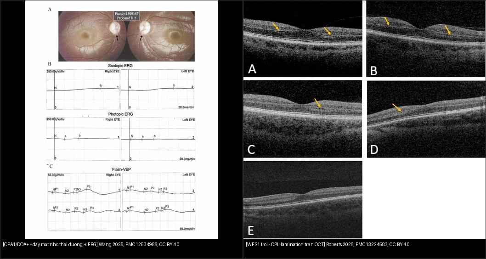
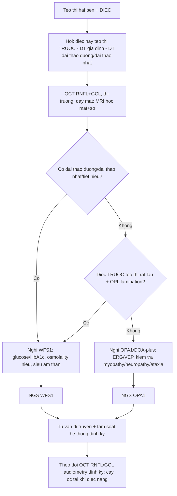
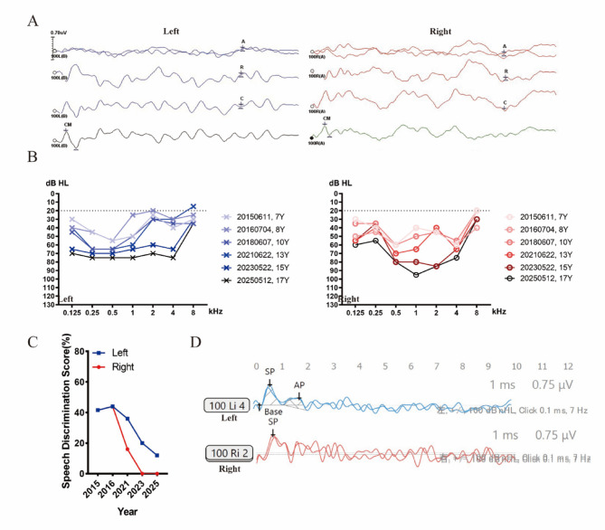
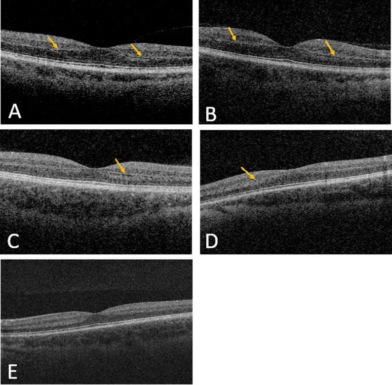
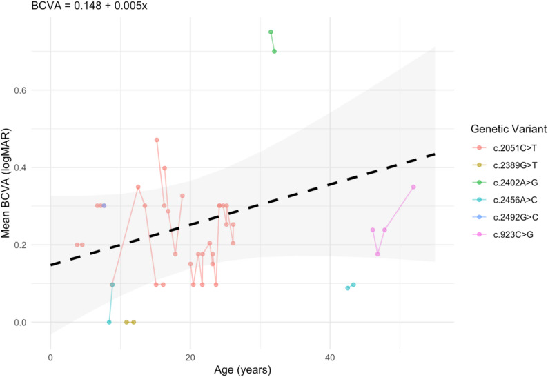

# 437 — Teo thị kèm ĐIẾC: DOA+/OPA1 & WFS1 trội (Wolfram-like) / Optic atrophy with hearing loss (DOA-plus & autosomal dominant WFS1)

**Tags:** `pattern:teo-thi` `pattern:diec-thi-giac` `pattern:benh-ty-the` `vung:than-kinh-thi` `vung:vong-mac` `anatomy:co-dinh-thinh` `protocol:OCT-RNFL-GCL` `protocol:audiometry-ABR` `protocol:MRI-hoc-mat` `score:logMAR`
**Mức chắc chắn (certainty):** tổng hợp y văn (literature synthesis) — nhóm tự biên từ y văn mở: **Kawakita M** *Genes* 2026 (CC BY 4.0, PMC13025685), **Wang H** *Orphanet J Rare Dis* 2025 (CC BY 4.0, PMC12534986), **Roberts JP** *Orphanet J Rare Dis* 2026 (CC BY 4.0, PMC13224583), **Otsuka S** *Genes* 2025 (CC BY 4.0, PMC11764508), **Serbis A** *Int J Mol Sci* 2023 (CC BY 4.0, PMC9960967) và các tổng quan nhiễm sắc thể/ty thể CC BY khác.

> **Vì sao bài này quan trọng:** bài **434** (bệnh TK thị do độc–chuyển hóa & LHON) và **439** (teo thị di truyền DOA/OPA1 & Wolfram) đã nhắc **DOA+** và **Wolfram-like** nhưng chỉ như **một hàng** trong bảng. Nhóm **"teo thị + điếc"** đứng giữa **nhãn khoa – tai – nội tiết – thần kinh**: bệnh nhân thường đến **tai trước** vì **điếc xuất hiện TRƯỚC teo thị (WFS1: điếc trung vị 2 tuổi vs teo thị 10 tuổi)** và **mắt bị bỏ qua**. Với WFS1, bỏ sót nghĩa là **không tầm soát đái tháo đường/đái tháo nhạt/đường tiết niệu** — những cái quyết định tiên lượng (thể lặn **chết trung vị 30–40 tuổi**). Với OPA1, hỏi **điếc + tiền sử gia đình** giúp phân biệt **teo thị di truyền** với **"độc chất" (ethambutol, B12)** và **"glaucoma"** — tránh điều trị sai hướng.

## 1. Tổng quan — vì sao sợi trục TK thị và tế bào lông ốc tai "chết ngược" cùng lúc

- **Hai nhóm nguyên nhân chính của "teo thị + điếc" di truyền:**
  1. **OPA1** (gen nhân, protein màng trong ty thể — GTPase dung hợp ty thể; *autosomal dominant optic atrophy*, ADOA — **teo thị di truyền phổ biến nhất**). Khi tổn thương lan ngoài mắt (**điếc tiếp âm, myopathy, bệnh thần kinh ngoại vi, ataxia, sụp mi, CPEO**) → **DOA-plus**; **~10–20%** người mang đột biến OPA1 có biểu hiện DOA-plus.
  2. **WFS1** (protein lưới nội chất (ER) điều hòa calci): **thể lặn = Wolfram syndrome 1 (WS1, DIDMOAD)** — ĐTĐ + đái tháo nhạt + teo thị + điếc, tiên lượng nặng; **thể trội = "di truyền trội WFS1" (Wolfram-like)** — **điếc tiếp âm sớm + teo thị muộn hơn, thường nhẹ hơn** (trừ **Hattersley–Urano**).
- **Cơ chế hình ảnh (TẠI SAO):**
  - Sợi trục thần kinh thị **không có bao myelin ở đoạn trước màng cứng và phụ thuộc hoàn toàn vào ty thể** để dẫn truyền; **tế bào lông ốc tai** là một trong những tế bào "ngốn" năng lượng nhất cơ thể. Khi **dung hợp ty thể (OPA1)** hoặc **cân bằng calci ER (WFS1)** hỏng → **chết tế bào hạch võng mạc (retinal ganglion cell, RGC)** kiểu **"chết ngược từ sợi trục" (dying-back)** → mỏng dần **lớp sợi thần kinh (RNFL)** và **lớp tế bào hạch (GCL)**.
  - Trên **đáy mắt:** đĩa thị **nhợt màu THÁI DƯƠNG (temporal pallor)** do mất các bó nhú–hoàng điểm; **không phù, không xuất huyết, không viêm** — "teo" chứ không phải "phù/sung huyết".
  - **Vì sao OCT là chốt sớm:** RNFL/GCL **mỏng TRƯỚC khi thị lực giảm rõ**; RNFL thái dương mỏng + GCL mỏng dần theo thời gian = "dấu vân tay" của teo thị di truyền.
  - **WFS1 trội đặc trưng trên OCT: "OPL lamination"** — dải **lớp rối ngoài (outer plexiform layer, OPL)** được **phân lớp rõ rệt**; gặp ở **6/8 ca** quét OCT — dấu **đặc trưng hơn** là chỉ "RNFL mỏng" chung chung.
  - **MRI** hốc mắt/sọ: dây thần kinh thị **mỏng**, tín hiệu T2 có thể tăng; MRI não ở ADOA cho thấy **giảm thể tích chất xám liên quan thị giác**; MRI không có khối, không ngấm — giúp **loại trừ chèn ép/u**.
- **Ngưỡng định lượng nằm lòng:**
  - **OPA1 ở nhóm ĐIẾC:** **8/18.475 proband (0,043%)** có biến thể OPA1 (Kawakita 2026); điếc **tiếp âm (post-lingual), tiến triển, nhẹ–trung bình**; **biến thể missense** gắn với **DOA-plus + ANSD**. → "teo thị" có thể **ẩn** trong cohort điếc.
  - **OPA1 ở nhóm điếc tiếp âm (auditory neuropathy, AN):** **7/452 = 1,55%** (Wang 2025); **85,71% (6/7)** là missense vùng **GTPase**; **4/7 điếc nặng–sâu**; AN khởi phát **trước tuổi 20**, tốc độ mất thính lực **2,74 dB/năm** ở tần số tiếng nói.
  - **WFS1 trội (Roberts 2026, n = 15):** tuổi chẩn đoán **điếc trung vị 2,0 tuổi** vs **teo thị trung vị 10 tuổi**; **15/15 dùng máy trợ thính, 8/15 cấy ốc tai hai bên**; **thị lực và RNFL ỔN ĐỊNH** theo thời gian (**VA 0,052 logMAR/năm, p = 0,159; RNFL 0,038 µm/năm, p = 0,829**); **OPL lamination 6/8 ca**.
  - **WFS1 p.A684V (điểm nóng):** 14 bệnh nhân/13 gia đình (Otsuka 2025), **9 ca lẻ tẻ, de novo ở 7 gia đình**, điếc **nặng–sâu sớm**, **cấy ốc tai cho kết quả tốt**.
  - **WS1 thể lặn (Serbis 2023):** điếc xuất hiện **trung bình 12,5 tuổi (5–39), 62%** bệnh nhân; ĐTĐ non typ 1; bất thường tiết niệu **19–90%, khởi phát ~20 tuổi**; **tuổi chết trung vị 30–40 tuổi**.

## 2. Mẫu hình + chẩn đoán phân biệt theo cơ quan kèm (gamut)

**Câu hỏi lọc:** *"Teo thị hai bên + ĐIẾC — phân biệt bằng cơ quan nào kèm theo và tuổi khởi phát?"* → điếc **sớm hơn nhiều** so với teo thị (WFS1 trội) là chìa khóa định hướng gen.

**Gamut theo tổ hợp cơ quan:**
- **Teo thị + điếc, KHÔNG ĐTĐ, không di truyền lẻ tẻ:** **OPA1/DOA+** (AD) — điếc ANSD + myopathy/neuropathy/ataxia/ptosis/CPEO; đĩa thị nhợt thái dương, ERG giảm.
- **Teo thị + điếc, điếc TRƯỚC, đôi khi ĐTĐ/cataract sớm:** **WFS1 trội (Wolfram-like)** — OPL lamination trên OCT, thị lực ổn định.
- **Teo thị + ĐTĐ + đái tháo nhạt + tiết niệu/thần kinh:** **WS1 thể lặn (DIDMOAD)** — nặng hơn, tiến triển.
- **Mất thị lực CẤP ở người trẻ, không điếc:** **LHON (434)** — 3 đột biến ty thể 11778/14484/3460.
- **Teo thị + bệnh TK/tai–thân khác:** **MELAS/MIDD, POLG, PHARC, CMTX5 (PRPS1)**, hội chứng ty thể phức hợp.
- **Teo thị hai bên MẮC PHẢI (không di truyền):** **độc chất (ethambutol, B12, rượu–thuốc lá, 434)**, **chèn ép/u/viêm (430)**, **glaucoma tiến triển (442)** — luôn loại trừ trước khi gọi "di truyền".

## 3. Bảng so sánh phân biệt (ma trận đối chiếu)

| Thực thể (entity) | Hình ảnh điển hình (đáy mắt / OCT / ERG / MRI) | Chốt vào (rule-in) | Chốt loại (rule-out) | Gợi ý xác nhận |
|---|---|---|---|---|
| **OPA1 — DOA+ (trội)** | Đĩa thị **nhợt thái dương hai bên**; **RNFL/GCL thái dương mỏng**; **ERG/VEP giảm**; MRI dây thị mỏng | **Teo thị hai bên + điếc tiếp âm (ANSD) + tiền sử gia đình AD + myopathy/neuropathy/ataxia** | **Điếc TRƯỚC teo thị rất lâu + ĐTĐ/đái tháo nhạt** → nghĩ WFS1 | **NGS panel OPA1**; OCT RNFL/GCL theo dõi; ERG |
| **WFS1 trội (Wolfram-like)** | **OPL lamination** trên OCT (6/8 ca); đĩa thị nhợt; thị lực & RNFL **ỔN ĐỊNH** | **Điếc tần số thấp sớm (trung vị 2 tuổi) + teo thị muộn hơn (10 tuổi) + ĐTĐ/cataract sớm** | **Thể lặn đầy đủ DIDMOAD + tiết niệu/thần kinh nặng** → WS1 | NGS WFS1; tầm soát đường huyết/thính lực; OCT OPL |
| **WS1 thể lặn (DIDMOAD)** | Teo thị + bất thường não/thần kinh; OCT RNFL/GCL mỏng; MRI não teo | **ĐTĐ typ 1 không tự miễn + đái tháo nhạt + teo thị + điếc + bất thường tiết niệu** | **Teo thị/điếc đơn độc, ĐTĐ tự miễn** → không phải WS1 | Glucose, osmolality nước tiểu, siêu âm thận; NGS WFS1 |
| **LHON** | **Mất thị lực cấp không đau** một mắt rồi hai mắt; đĩa thị phù nhẹ rồi teo | **Nam trẻ, giảm thị lực cấp, không điếc, mẹ/bên mẹ có người bệnh** | **Tiến triển âm thầm nhiều năm + điếc** → OPA1/WFS1 | Đột biến ty thể **11778/14484/3460** |
| **Teo thị do độc chất (ethambutol/B12)** | Đĩa thị nhợt hai bên; RNFL mũi–thái dương mỏng | **Tiền sử dùng ethambutol > 15 mg/kg/ngày, rượu–thuốc lá, thiếu B12** | **Điếc tiếp âm + tiền sử gia đình AD** → nghĩ di truyền | Ngừng thuốc + theo dõi; B12; xem xét gen nếu không đáp ứng |
| **Glaucoma (tiến triển)** | **Lõm/xoang thần kinh thị (cupping)**, RNFL mỏng theo nan hoa | **IOP cao + lõm đĩa + khiếm khuyết thị trường đặc trưng** | **Đĩa thị nhợt phẳng KHÔNG lõm + điếc** → teo thị di truyền | OCT RNFL + thị trường + IOP (442) |
| **Chèn ép/u thần kinh thị (430)** | Dây thị **to/ngấm thuốc**, khối hốc mắt/sọ | **Đĩa phù nặng một bên + mất thị lực nhanh + khối trên MRI** | **Hai bên, nhợt phẳng, tiến triển chậm** → di truyền | **MRI hốc mắt + sọ có/không cản quang** |

*Trái: **OPA1/DOA+** — (A) đáy mắt hai mắt **nhợt đĩa thị thái dương** (mũi tên), (B) **ERG scotopic/photopic giảm biên độ**, (C) VEP nháy (Wang H et al., Orphanet J Rare Dis 2025, PMC12534986 Fig. 3, CC BY 4.0). Phải: **WFS1 trội (Wolfram-like)** — **OPL lamination** trên OCT (mũi tên vàng): dải lớp rối ngoài phân lớp rõ, dấu đặc trưng gặp ở **6/8 ca** (Roberts JP et al., Orphanet J Rare Dis 2026, PMC13224583 Fig. 4, CC BY 4.0). Chốt: **hỏi điếc xuất hiện trước hay sau teo thị** + hỏi ĐTĐ/đái tháo nhạt + OPL lamination. Ảnh ghép letterbox.*

### Ba câu hỏi định hướng gen (ghi vào phiếu khám)
1. **Điếc hay teo thị xuất hiện TRƯỚC?** — điếc sớm (tuổi mẫu giáo) → **WFS1 trội**; teo thị thập niên đầu, điếc muộn hơn → **OPA1**.
2. **Có ĐTĐ/đái tháo nhạt/bất thường tiết niệu?** — có → **WFS1** (thể lặn = DIDMOAD, thể trội = Wolfram-like).
3. **ERG/OCT:** ERG giảm biên độ + RNFL thái dương mỏng (OPA1) vs **OPL lamination** (WFS1 trội).

## 4. Protocol chụp–xét nghiệm + tầm soát hệ thống + sơ đồ

**Nhãn khoa (theo dõi định lượng):**
- **OCT RNFL + GCL (bắt buộc):** đo µm từng phần tư; **RNFL thái dương mỏng** là dấu sớm; theo dõi tốc độ mỏng (**RNFL ~0,04 µm/năm ở WFS1 trội** = gần như ổn định).
- **Thị trường Humphrey 30–2/24–2:** khiếm khuyết **trung tâm/trung tâm-cạnh (cecocentral)**; **không** theo kiểu mất nửa thị trường của glaucoma.
- **Đáy mắt màu + ảnh đĩa thị:** nhợt thái dương, đĩa phẳng **không lõm**.
- **ERG/VEP** khi cần phân biệt tổn thương RGC vs tế bào cảm quang.
- **MRI hốc mắt + sọ (có/không cản quang):** dây thần kinh thị mỏng/hai bên; **loại trừ u/chèn ép/viêm**.

**Tai – thính học:**
- **Audiometry lưỡi tần + ABR + OAE/CM:** **AN/ANSD = ABR mất sóng nhưng CM (cochlear microphonic) còn** → hướng **OPA1/WFS1**; máy trợ thính hạn chế (**5 ca ít hiệu quả**), **cấy ốc tai** cho kết quả tốt.

**Hệ thống (bắt buộc khi nghi WFS1):**
- **Glucose lúc đói/HbA1c** (ĐTĐ không tự miễn); **osmolality niệu/huyết + test nhịn nước** (đái tháo nhạt); **siêu âm thận–đường tiết niệu** (ứ nước, bàng quang thần kinh); **tuyến giáp/sinh dục**; đánh giá thần kinh–tâm thần.
- **Xét nghiệm gen (NGS panel teo thị + điếc)** + **tư vấn di truyền**: OPA1/WFS1 trội = **50%** cho con; WS1 lặn = **25%**.

## 5. Biến thể bình thường và cạm bẫy

- **"Teo thị ở người lớn = bình thường do tuổi"** — bỏ qua điếc và tiền sử gia đình → **bỏ sót di truyền**. Luôn hỏi **điếc** và **vẽ phả hệ**.
- **Nhầm DOA với GLAUCOMA:** khiếm khuyết thị trường trung tâm dễ bị đọc là "glaucoma"; chốt: **đĩa thị nhợt phẳng KHÔNG lõm**, **IOP bình thường**, **điếc kèm theo** → teo thị di truyền (442).
- **Điếc trẻ em bị gọi "viêm tai/điếc đột ngột":** đặc điểm **ANSD (ABR mất sóng, CM còn)** + **máy trợ thính kém hiệu quả** là cờ đỏ hướng **OPA1/WFS1**; **cấy ốc tai** là lựa chọn (kết quả tốt ở p.A684V).
- **WFS1 trội có thị lực/RNFL ỔN ĐỊNH** — đừng vì "không tiến triển" mà loại trừ; giá trị nằm ở **tầm soát ĐTĐ/đái tháo nhạt** cho bệnh nhân và gia đình.
- **Biến thể VUS rất nhiều:** trong cohort điếc OPA1, **5/8 biến thể là VUS** → **xét nghiệm âm/VUS KHÔNG loại trừ**; cần **phân ly gia đình + đánh giá chức năng**.
- **WS1 lặn dễ bị chẩn đoán "typ 1 diabetes"** rồi bỏ qua teo thị/điếc sớm → **ĐTĐ không tự miễn + teo thị + điếc = nghĩ WS1** (tầm soát mắt–tai cho mọi trẻ ĐTĐ không tự miễn).
- **Phản biện trung thực nguồn:** các **tần suất khác nhau rất lớn theo cách chọn mẫu** (OPA1 chiếm **10–20%** trong cohort *nhãn khoa* nhưng chỉ **0,043%** trong cohort *điếc*) — **không dùng một con số để kết luận chung**.

## 6. Tự lượng giá — Blind Quiz

**Ca 1 — Phả hệ + thính lực đồ của 8 gia đình cùng có "teo thị + điếc":**

- Hỏi: kiểu di truyền? Hai nửa ký hiệu trong phả hệ nghĩa là gì? Thính lực đồ gợi ý gì?

<b>Bấm để hiện đáp án (findings + chẩn đoán)</b>

- Phả hệ: **nửa TRÁI tô đen = điếc**, **nửa PHẢI tô xám = teo thị** — cho thấy **đồng thời hai tính trạng trong cùng gia đình**, **di truyền trội NST thường (AD)** (có ca **de novo**, không có tiền sử gia đình ở một số nhánh).
- Thính lực đồ: **điếc tiếp âm, tiến triển, nhẹ–trung bình**, đối xứng.
- Số liệu: biến thể OPA1 gặp ở **8/18.475 proband (0,043%)** cohort điếc; **missense vùng GTPase** gắn với **DOA-plus + ANSD**.
- Nguồn ảnh: Kawakita M et al., Genes 2026 (PMC13025685) Fig. 1, CC BY 4.0.

**Ca 2 — Trẻ có "điếc tiếp âm": ABR, audiogram, khả năng nghe hiểu và đo CM:**

- Hỏi: vì sao ABR "mất sóng" mà vẫn không phải "điếc hoàn toàn"? Dấu nào phân biệt **auditory neuropathy** với điếc ốc tai thông thường?

<b>Bấm để hiện đáp án (findings + chẩn đoán)</b>

- **(A) ABR:** **mất sóng** ở 100 dB nHL nhưng ghi được **sóng CM (cochlear microphonic)** hai tai → tổn thương **dây thần kinh/bó sợi (neuropathy)**, không phải ốc tai.
- **(B) audiogram:** điếc **nhẹ–trung bình**, tiến triển; **(C) phân biệt lời giảm dần theo năm** (không tương xứng mức điếc); **(D) CM/SP** ghi nhận được.
- Chẩn đoán: **auditory neuropathy spectrum disorder (ANSD) do OPA1** — kèm **teo thị di truyền**; cấy ốc tai có thể cho kết quả tốt.
- Số liệu: OPA1 gặp **7/452 (1,55%)** cohort AN; **85,71% missense GTPase**; **4/7 điếc nặng–sâu**; mất **2,74 dB/năm** ở tần số tiếng nói.
- Nguồn ảnh: Wang H et al., Orphanet J Rare Dis 2025 (PMC12534986) Fig. 2, CC BY 4.0.

**Ca 3 — Cùng bệnh nhân OPA1: đáy mắt và điện sinh lý thị giác:**

- Hỏi: dấu nào ở đĩa thị (A)? ERG (B) và VEP (C) cho thấy gì, và tại sao phần thị giác lại "âm thầm"?

<b>Bấm để hiện đáp án (findings + chẩn đoán)</b>

- **(A)** đáy mắt hai mắt: **nhợt đĩa thị vùng thái dương** (mũi tên) — mất bó nhú–hoàng điểm, không phù/xuất huyết.
- **(B) ERG scotopic/photopic:** biên độ **giảm**; **(C) flash-VEP:** đáp ứng giảm — tổn thương **tế bào hạch/lớp sợi trục** chứ không phải cảm quang.
- Vì sao "âm thầm": **RGC chết dần từ sợi trục**, RNFL/GCL mỏng **trước khi** thị lực giảm rõ → **OCT mới là chỉ điểm sớm**; đây là lý do **phải soi đáy mắt ở mọi trẻ điếc không rõ nguyên nhân**.
- Nguồn ảnh: Wang H et al. (PMC12534986) Fig. 3, CC BY 4.0.

**Ca 4 — Bệnh nhân WFS1 trội (Wolfram-like): OCT hoàng điểm:**

- Hỏi: dấu "OPL lamination" là gì? Dấu này có gì đặc trưng so với chỉ "RNFL mỏng"?

<b>Bấm để hiện đáp án (findings + chẩn đoán)</b>

- Dấu hiệu: **lớp rối ngoài (outer plexiform layer, OPL)** tạo **dải phân lớp rõ (lamination)** — mũi tên vàng (các ca A, B, C...).
- Chẩn đoán: **di truyền trội WFS1 (Wolfram-like)** — điếc sớm (trung vị **2,0 tuổi**) + teo thị muộn hơn (trung vị **10 tuổi**); **OPL lamination 6/8 ca** quét OCT.
- Ý nghĩa: dấu **đặc trưng hơn** "RNFL mỏng" chung chung; đi kèm **thị lực/RNFL ỔN ĐỊNH** theo thời gian → nhưng **vẫn phải tầm soát ĐTĐ**.
- Nguồn ảnh: Roberts JP et al., Orphanet J Rare Dis 2026 (PMC13224583) Fig. 4, CC BY 4.0.

**Ca 5 — WFS1 trội: thị lực (BCVA) và RNFL theo thời gian:**

- Hỏi: hai đồ thị dọc thời gian nói gì về tiên lượng thị giác ở WFS1 trội?

<b>Bấm để hiện đáp án (findings + chẩn đoán)</b>

- **BCVA (logMAR):** độ dốc **0,052 logMAR/năm (p = 0,159)** — gần như **không đổi**.
- **RNFL (µm):** độ dốc **0,038 µm/năm (p = 0,829)** — **ổn định**.
- Kết luận: ở **WFS1 trội**, teo thị tiến triển **rất chậm/ổn định** (khác LHON cấp và khác WS1 lặn nặng) → **giá trị chính của chẩn đoán gen là tầm soát ĐTĐ/đái tháo nhạt**, không phải tiên lượng mù nhanh.
- Nguồn ảnh: Roberts JP et al. (PMC13224583) Fig. 2, CC BY 4.0.

## Bài liên quan chéo
- [400 – Tổng quan Mắt & thị giác](../400-tong-quan-mat-thi-giac/lesson.md)
- [430 – Đường thị giác & viêm TK thị vs NAION](../430-duong-thi-giac/lesson.md)
- [433 – Phù đĩa thị vs drusen đĩa thị (Frisén/IIH)](../433-phu-dia-thi-drusen/lesson.md)
- [434 – Bệnh TK thị do độc–chuyển hóa & LHON](../434-teo-thi-than-kinh-thi-doc-va-LHON/lesson.md)
- [439 – Teo thị di truyền: DOA/OPA1 & Wolfram](../439-teo-thi-di-truyen/lesson.md)
- [442 – Glaucoma (OCT RNFL/GCL)](../442-glaucoma-OCT/lesson.md)

## Ảnh
- `437_teothi-diec_OPA1_phaha-audiogram_PMC13025685-Fig1-CCBY.jpg` — Kawakita M et al., Genes 2026 (PMC13025685) Fig. 1, CC BY 4.0.
- `437_teothi-diec_OPA1_tien-trien-thinh-luc_PMC13025685-Fig2-CCBY.jpg` — Kawakita M et al. (PMC13025685) Fig. 2, CC BY 4.0.
- `437_teothi-diec_OPA1_thinh-hoc-AN_PMC12534986-Fig2-CCBY.jpg` — Wang H et al., Orphanet J Rare Dis 2025 (PMC12534986) Fig. 2, CC BY 4.0.
- `437_teothi-diec_OPA1_day-mat-ERG_PMC12534986-Fig3-CCBY.jpg` — Wang H et al. (PMC12534986) Fig. 3, CC BY 4.0.
- `437_teothi-diec_WFS1_OPL-lamination-OCT_PMC13224583-Fig4-CCBY.jpg` — Roberts JP et al., Orphanet J Rare Dis 2026 (PMC13224583) Fig. 4, CC BY 4.0.
- `437_teothi-diec_WFS1_BCVA-doc-thoi-gian_PMC13224583-Fig2-CCBY.jpg` — Roberts JP et al. (PMC13224583) Fig. 2, CC BY 4.0.
- `437_teothi-diec_WFS1_RNFL-doc-thoi-gian_PMC13224583-Fig3-CCBY.jpg` — Roberts JP et al. (PMC13224583) Fig. 3, CC BY 4.0.
- `composite_OPA1-vs-WFS1.jpg` — ghép Fig. 3 (Wang H et al., PMC12534986, CC BY 4.0) + Fig. 4 (Roberts JP et al., PMC13224583, CC BY 4.0) bằng `tools/make_composite.py`.
- Chi tiết giấy phép từng ảnh trong `images/CREDITS.md`. AuntMinnie/EyeWiki: **chỉ dẫn link, không tải**.

> Không dùng để chẩn đoán độc lập khi chưa có người hướng dẫn.
