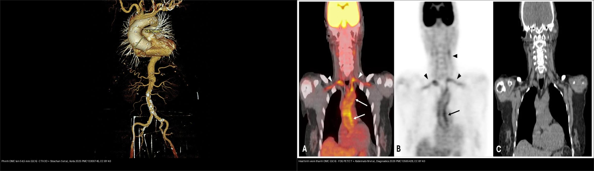
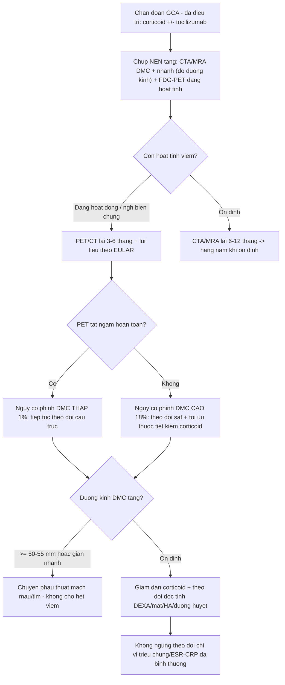
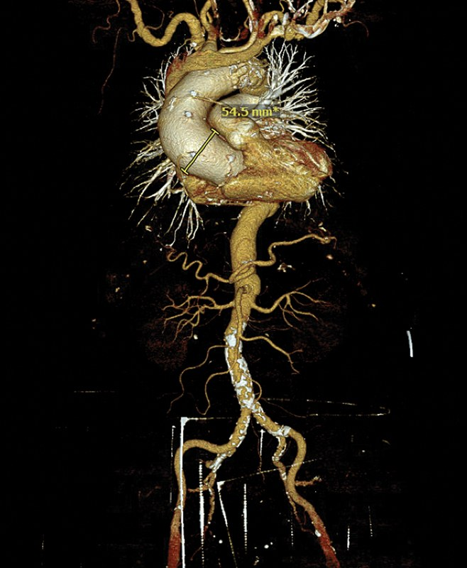
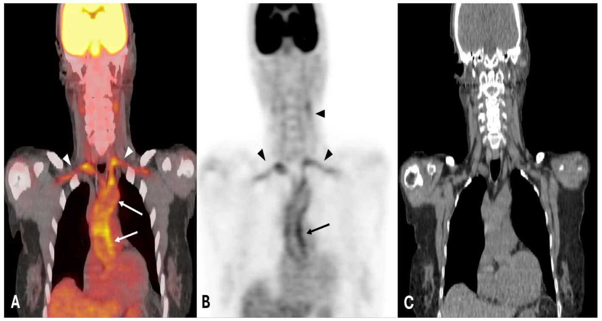
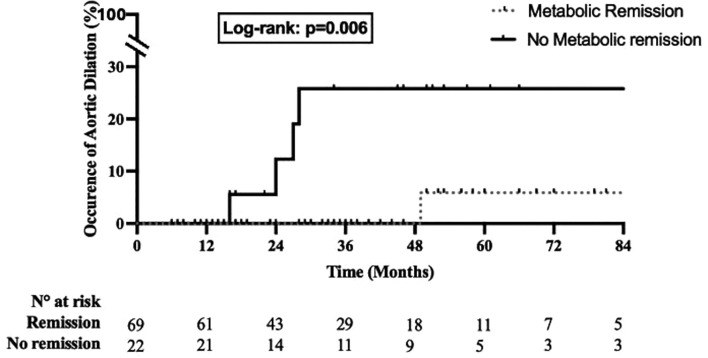
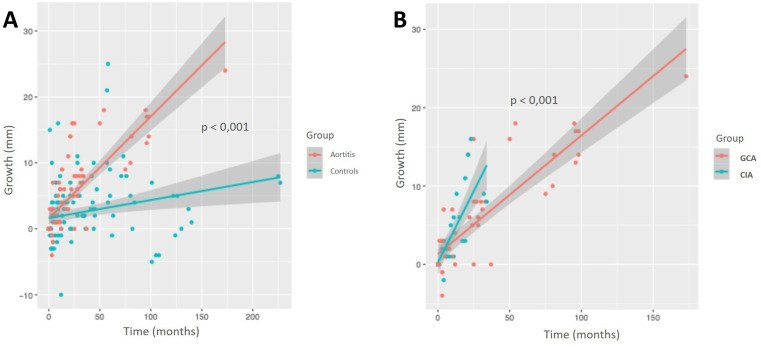
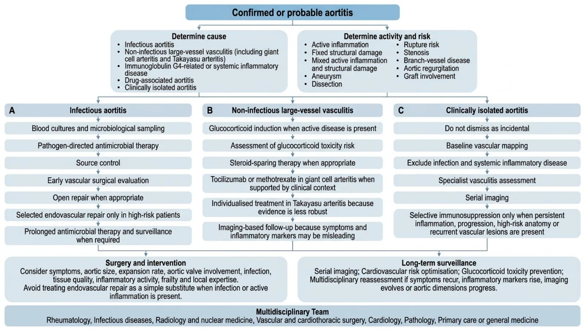
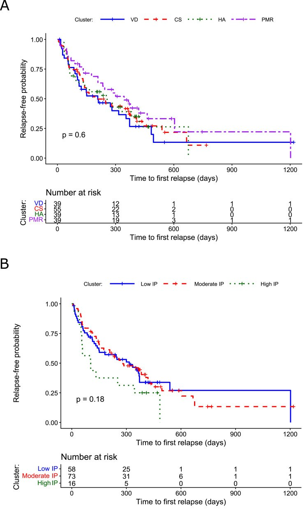

# 438 — Theo dõi dài hạn viêm ĐM tế bào khổng lồ & biến chứng mạch lớn: aortitis, phình/tách thành ĐMC, lịch CT/PET & tác dụng phụ corticoid / Long-term follow-up of giant cell arteritis & large-vessel complications

**Tags:** `pattern:day-thanh-mach` `vung:thanh-mach-lon` `score:ACR-EULAR-2022` `protocol:CTA-MRA` `protocol:FDG-PET-CT` `protocol:theo-doi-GCA`
**Mức chắc chắn (certainty):** tổng hợp y văn (literature synthesis) — nhóm tự biên từ y văn mở (Aorta 2025 CC BY 4.0; Diagnostics 2026 CC BY 4.0; RMD Open 2026 CC BY-NC 4.0 ×3; J Pers Med 2026 CC BY 4.0; Ther Adv Musculoskelet Dis 2026 CC BY-NC 4.0; Front Med 2026 CC BY 4.0), chưa gắn một ca nguyên văn đơn lẻ xuyên suốt.

> **Vì sao bài này quan trọng:** bài 435 (GCA & AAION) và 436 (Takayasu vs GCA) dừng ở **chẩn đoán cấp**. Nhưng GCA là **bệnh mạn tính hệ thống**: nguy cơ tử vong và tàn phế muộn đến từ **biến chứng ĐMC (phình/tách thành)** và **độc tính corticoid tích lũy** — cả hai chỉ lộ ra khi **theo dõi dài hạn** đúng cách. Đây là phần "sau khi đã chẩn đoán" quyết định tiên lượng (prognosis).

## 1. Tổng quan — GCA không chỉ là bệnh động mạch thái dương + tại sao viêm và tổn thương cấu trúc "tách rời" trên hình ảnh

- **Viêm mạch lớn (large-vessel vasculitis, LVV)** gặp ở **khoảng một nửa số ca GCA** nếu chủ động tầm soát bằng hình ảnh; nhiều ca **không có triệu chứng sọ (cranial symptoms)** — đây là lý do "GCA mạch lớn (LV-GCA)" dễ bị bỏ sót sau khi bệnh nhân hết đau đầu.
- **Cơ chế hình ảnh (TẠI SAO):** viêm u hạt bắt đầu từ **lớp áo ngoài (adventitia)** qua mạng **vasa vasorum**, lan vào **lớp áo giữa (media)** → phá hủy cơ trơn, **đứt gãy sợi elastin & collagen** → **thành mạch yếu dần**. Phá hủy lớp giữa tạo **giãn/phình**, thâm nhiễm + tăng sinh nội mạc tạo **hẹp**. Trên hình ảnh, điều này phân thành **hai "ngăn" không song hành**:
  - **Hoạt tính viêm (activity):** giàu tế bào viêm tăng chuyển hóa glucose (**GLUT-1**) → **ngấm ¹⁸F-FDG dọc thành mạch**, và **thành mạch nhạy gadolinium / sáng T2-STIR** trên MRI. **Đây là phần CÓ THỂ ĐẢO NGƯỢC và thay đổi theo điều trị.**
  - **Tổn hại cấu trúc cố định (fixed structural damage):** phình, tách thành, hẹp — **không ngấm FDG sau khi viêm đã "cháy hết"** nhưng **vẫn tiếp tục tiến triển** vì thành mạch đã mất chức năng đàn hồi. **Đây là phần KHÔNG hồi phục và có thể lớn lên dù xét nghiệm viêm đã bình thường.**
- **Hệ quả thực hành:** **"hết viêm" không đồng nghĩa "hết nguy cơ"**. Xét nghiệm viêm (ESR/CRP) và triệu chứng có thể bình thường trong khi **túi phình ĐMC vẫn âm thầm lớn** → phải **theo dõi hình ảnh cấu trúc định kỳ dù bệnh nhân thấy khỏe**.
- **Số liệu nằm lòng (dịch tễ & tốc độ giãn):**
  - **Cohort dân số Olmsted (289 ca GCA, theo dõi tới 2020):** tỉ lệ mắc **biến chứng mạch lớn (large-artery involvement) tích lũy 15 năm** = **14,8%** (1950–1974) → **30,2%** (1975–1999) → **49,2%** (2000–2016), HR **3,48** (2000–2016 so với 1950–1974). So với người không GCA: **HR 3,22** (95% CI 1,83–5,68); **phình ĐMC ngực HR 13,46** (1,78–101,98) trong khi **phình ĐMC bụng không tăng** (HR 1,08, không ý nghĩa). **Ẩn sâu: phân bố ngực ưu thế rõ rệt.**
  - **Tốc độ giãn túi phình trước mổ (23 ca aortitis mô học — 13 GCA + 9 CIA — so 42 chứng thoái hóa):** **0,177 ± 0,01 mm/tháng (≈ 2,12 mm/năm)** so với **0,039 ± 0,02 mm/tháng (≈ 0,47 mm/năm)** → **giãn nhanh gấp 4,5 lần**; thể **aortitis đơn độc lâm sàng (CIA)** giãn **gấp đôi GCA**.
  - **Tắt ngấm chuyển hóa (metabolic extinction) trên PET/CT dự báo nguy cơ phình:** trong 91 ca LV-GCA điều trị tocilizumab, **76% đạt đáp ứng chuyển hóa hoàn toàn**; **phình ĐMC xảy ra 1%** ở nhóm **tắt ngấm hoàn toàn** so với **18%** ở nhóm **không tắt ngấm** (log-rank **p = 0,006**).
- **Gánh nặng corticoid (glucocorticoid, GC) — "cái giá" của theo dõi dài hạn:** phân tích 18.301 ca GCA ở Pháp (2010–2022) — dù liều cao giảm dần theo thời gian nhưng **liều tích lũy 2 năm vẫn tới 7,6 g** (ca chẩn đoán 2022). **Mỗi gram GC cộng thêm:** tử vong **HR 1,024** (1,021–1,027); nhiễm trùng nặng **1,050** (1,038–1,062); biến cố tim mạch lớn (MACE) **1,015** (1,010–1,020); **gãy xương loãng** **1,013** (1,006–1,019). Ngay cả liều thấp **≤ 5 mg/ngày** kéo dài năm vẫn làm **tăng nhiễm trùng** (HR 1,13) và **MACE** (HR 1,04) → **mục tiêu là giảm liều tích lũy nhanh nhất có thể bằng thuốc tiết kiệm corticoid (steroid-sparing)**.

## 2. Mẫu hình + chẩn đoán phân biệt theo vị trí (gamut)

**Hai câu hỏi lọc khi đọc hình ảnh một bệnh nhân GCA:**
1. **Thành ĐMC DÀY/NGẤM — do viêm hay do xơ vữa/giả bắt bắt giữ?** (phần "hoạt tính")
2. **Lòng mạch GIÃN/HẸP/TÁCH — cấu trúc đã hỏng chưa?** (phần "tổn hại cấu trúc", cần can thiệp/mổ)

**Gamut "thành ĐMC dày — lòng giãn/hẹp" ở người > 50 tuổi có GCA:**
- **Viêm mạch tự miễn:** **LV-GCA** (ưu thế ĐMC ngực — cung, ĐMC lên, dưới đòn/nách/cảnh); **aortitis đơn độc lâm sàng (CIA)** — chỉ có aortitis, không đủ tiêu chuẩn GCA/TAK; **viêm mạch Takayasu** (xem bài 436 — người trẻ hơn, hẹp dài đoạn); **aortitis IgG4** (kèm viêm tụy/thận mạn, giả u quanh thận).
- **Nhiễm khuẩn (cấp cứu, trước khi tăng ức chế miễn dịch — PHẢI LOẠI TRỪ):** **aortitis nhiễm khuẩn (mycotic)** — túi phình mọc nhanh, khí/thâm nhiễm quanh mạch, cấy máu (+); **aortitis do giang mai** — phình ĐMC lên cao, "double-ring"/canxi vòng; lao.
- **Không viêm (bắt chước):** **xơ vữa động mạch** — canxi hóa, mảng lệch tâm ở ngã ba, ngấm FDG nhẹ *nhưng không giảm sau điều trị kháng viêm*; **aortitis do thuốc** (ức chế điểm kiểm soát miễn dịch — nivolumab...); **bệnh Erdheim–Chester** (dày thành ĐMC + "thận lông").
- **Hệ quả lên mắt:** tổn thương cùng cơ chế viêm nội mạc/huyết khối gây **CRAO (tắc ĐM mắt — bài 444)**, **AAION/mù do thiếu máu đĩa thị (bài 435)**, **hẹp ĐM cảnh gây bệnh mạch não**.

## 3. Bảng so sánh phân biệt (ma trận đối chiếu)

| Thực thể (entity) | Hình ảnh điển hình (CTA/MRA + FDG-PET/CT) | Chốt vào (rule-in) | Chốt loại (rule-out) | Gợi ý xác nhận |
|---|---|---|---|---|
| **LV-GCA / aortitis GCA** | **Dày thành ĐMC đồng tâm, ngấm đồng nhất dọc thành**; ưu thế **ĐMC ngực/cung/nhánh trên**; PET **ngấm FDG lan toàn thành**; giai đoạn muộn → **phình cách xa dưới động mạch dưới đòn** | **Tuổi ≥ 50 + tiền sử/đang GCA + dày thành ngấm trên PET/CT + ĐMC ngực** (phình ngực HR 13,46) | Canxi hóa ngã ba + mảng lệch tâm không ngấm → xơ vữa | **ACR/EULAR 2022 GCA ≥ 6 điểm**; FDG-PET/CT; CTA/MRA theo dõi |
| **Aortitis đơn độc lâm sàng (CIA)** | Chỉ **aortitis mô học/hình ảnh** (thường gặp trên bệnh phẩm sau mổ ĐMC), không thỏa tiêu chuẩn GCA/TAK | **Mô bệnh aortitis u hạt + rất ít/không đau đầu, ESR/CRP có thể bình thường + không bằng chứng ngoài ĐMC** | Đủ ACR/EULAR 2022 GCA (≥ 6) hoặc TAK → gọi theo bệnh chính | Hội chẩn thấp khớp + mô bệnh; **giãn nhanh gấp đôi GCA** → theo dõi sát |
| **Takayasu (TAK)** | **Hẹp/tắc dài đoạn**, thành dày, nhiều nhánh; ưu thế cung ĐMC + dưới đòn/cảnh/thận; **người trẻ** | **Người trẻ (≤ 40–60) + giảm mạch chi + chênh HA hai tay ≥ 20 mmHg + tổn thương nhiều nhánh** | > 60 tuổi + triệu chứng sọ → GCA | **ACR/EULAR 2022 TAK ≥ 5 điểm**; Numano (bài 436) |
| **Aortitis nhiễm khuẩn (mycotic)** | **Túi phình mọc nhanh**, thành mỏng/thâm nhiễm quanh mạch, khí mô mềm, có thể tách thành | **Sốt + đau lưng/bụng + phình mới + cấy máu (+)** (Salmonella, E. coli...) | Thành dày xơ đều, không sốt, ngấm FDG giảm sau kháng viêm → viêm mạch | **Cấy máu + MRI/CTA khẩn + mổ/dẫn lưu**; KHÔNG tăng ức chế miễn dịch mù |
| **Xơ vữa (atherosclerosis)** | Canxi hóa trong thành, mảng **lệch tâm ở ngã ba**, thành mỏng–trung bình, ngấm FDG nhẹ | **Canxi hóa + nguy cơ tim mạch + phân bố ngã ba** ở người lớn tuổi | **Ngấm FDG thành lan, thành dày tròn đồng tâm, giảm sau điều trị kháng viêm** → viêm mạch | Đối chiếu yếu tố nguy cơ; PET trước–sau điều trị |

*Trái: **phình ĐMC lên 54,5 mm** trên dựng hình 3D ở ca GCA (Strachan S et al., Aorta 2025, PMC13300745, CC BY 4.0). Phải: **hoạt tính viêm** — thành ĐMC lên/cung ngấm FDG mạnh (A fused, B AC-PET, mũi tên) và **nhánh trên vai hai bên** (đầu mũi tên) (Abdelnabi M et al., Diagnostics 2026, PMC13565428, CC BY 4.0). Hai ngăn: **cấu trúc (trái) vs hoạt tính (phải)**. Ảnh ghép letterbox.*

**Quiz composite:** một bệnh nhân GCA có *cả* hai hình trên. Hình nào quyết định "còn viêm đang điều trị" và hình nào quyết định "cần mổ/phẫu thuật mạch"?

<b>Bấm để hiện đáp án</b>

- **Phải (FDG-PET/CT) = hoạt tính viêm** → định hướng **điều trị kháng viêm** (corticoid ± tocilizumab), theo dõi tắt ngấm.
- **Trái (CTA 3D) = tổn hại cấu trúc** → quyết định **theo dõi kích thước/mổ**: đo đường kính tối đa mỗi lần; **≥ 50–55 mm** hoặc giãn nhanh là chỉ định tham khảo chuyên khoa mạch máu/tim (con số tuyệt đối theo hướng dẫn phẫu thuật, cần đối chiếu ACC/AHA 2022).
- **Chốt:** không suy "hết viêm = hết bệnh"; phình có thể lớn dù ESR/CRP bình thường.

## 4. Protocol theo dõi + thang điểm + xử trí

**Hình ảnh nền tảng — "chụp cái gì để theo dõi cái gì":**
- **FDG-PET/CT = theo dõi HOẠT TÍNH.** Nhịn đói ≥ 6 giờ, đường huyết < 7 mmol/L; đọc ngấm **thành mạch so với gan** theo **thang thị giác 0–3** (grade 0–1 coi như "tắt ngấm"). PET **giảm ngấm khi kiểm soát viêm** nên dùng để **đánh giá đáp ứng & tắt ngấm**, **không** để phát hiện hẹp/phình xơ cố định (có thể **âm FDG**).
- **CTA/MRA = theo dõi CẤU TRÚC.** Đo **đường kính ĐMC tối đa** ở cùng mốc giải phẫu mỗi lần (khó nhất là so sánh khi lần đầu chỉ làm PET/CT liều thấp) + ghi **tốc độ giãn (mm/năm)**; MRI **T2-STIR thành sáng + ngấm gadolinium** để đánh giá phù viêm.
- **Lịch theo dõi (khung thực hành):** chụp **ĐMC + các nhánh lúc chẩn đoán** (nền tảng so sánh), lặp **3–6 tháng khi bệnh hoạt động/nghi biến chứng**, rồi **mỗi 6–12 tháng → hàng năm** khi ổn định; **theo dõi tiếp tục kể cả khi triệu chứng & ESR/CRP đã bình thường** (surveillance "song song", không dừng theo triệu chứng).
- **Siêu âm tim:** tìm **hở van ĐMC (aortic regurgitation)** do giãn gốc ĐMC/van — *một biến chứng cơ học* cần đánh giá riêng (đau ngực/khó thở mới ở người GCA cũ).
- **Xét nghiệm & độc tính:** ESR/CRP **không loại trừ** hoạt động; theo dõi **glucose, huyết áp, mật độ xương (DEXA), mắt (glaucoma/đục thủy tinh thể), calci/vitamin D** vì độc tính corticoid tích lũy.

**Thang điểm & phân tầng:**
- **ACR/EULAR 2022 — GCA (phân loại, bắt buộc tuổi ≥ 50):** **≥ 6 điểm** gồm mất thị lực đột ngột +3; ESR ≥ 50 mm/h hoặc CRP ≥ 10 mg/L +3; sinh thiết (+) hoặc dấu quầng +5; cứng khớp vai/cổ +2; đau hàm/lưỡi +2; đau đầu thái dương mới +2; đau da đầu +2; khám ĐM thái dương bất thường +2; tổn thương ĐM nách hai bên +2; **FDG-PET ngấm lan ĐMC +2** (dùng lại ở theo dõi như một "khung" ghi bằng chứng mạch lớn).
- **Ngưỡng cảnh báo cấu trúc (kinh điển, mốc tham khảo):** **ĐMC lên ≥ 50–55 mm** (nguy cơ tách thành tăng vọt) hoặc **tốc độ giãn nhanh** → chuyển **phẫu thuật tim–mạch**; **gốc ĐMC giãn gây hở van** → cân nhắc thay toàn bộ ĐMC lên khi mổ. *(Số tuyệt đối theo ACC/AHA cần đối chiếu bản gốc — chưa trích trực tiếp trong các bài nguồn này.)*

**Xử trí nền tảng:**
- **Corticoid** là nền tảng; **tocilizumab** (ức chế thụ thể IL-6) là thuốc tiết kiệm corticoid hàng đầu: **tỉ lệ lui bệnh OR 4,30** (so với chứng), gộp các thuốc sinh học **OR 2,58**; **ức chế TNF-α làm tăng nhiễm trùng (OR 2,41) — không ưu tiên**.
- **Mục tiêu:** giảm **liều tích lũy corticoid** (mỗi gram đều có giá) nhưng **không ngừng theo dõi mạch lớn**. **Không tăng ức chế miễn dịch trước khi loại trừ aortitis nhiễm khuẩn.**
- **Aortitis đơn độc (CIA) sau mổ ĐMC:** **không mặc định điều trị ức chế miễn dịch cho mọi ca** — cân nhắc chỉ khi còn **viêm dai dẳng/tiến triển/giải phẫu nguy cơ cao**; nhưng **không được xem là "phát hiện mổ không quan trọng"** — phải hội chẩn và theo dõi.

## 5. Biến thể bình thường và cạm bẫy

- **Xơ vữa "giả aortitis" trên PET:** người lớn tuổi ngấm FDG nhẹ ở mảng xơ vữa → dễ gọi nhầm viêm. Phân biệt: **lệch tâm, có canxi, ở ngã ba, không giảm sau điều trị kháng viêm** (khác viêm mạch = ngấm **lan thành, đồng tâm, giảm sau điều trị**).
- **PET âm không loại trừ ("burnt-out"):** tổn hại cấu trúc cố định (phình/hẹp) có thể **âm FDG** dù vẫn tiến triển → **vẫn phải CTA/MRA** định kỳ.
- **ESR/CRP bình thường không loại trừ tái phát/biến chứng:** nhiều ca LV-GCA **không có dấu hiệu viêm rõ** — đừng ngừng theo dõi hình ảnh vì xét nghiệm đẹp.
- **Aortitis nhiễm khuẩn bị bỏ sót:** tăng corticoid/ức chế miễn dịch "mù" cho một túi phình nhiễm khuẩn = **thảm họa** (vỡ mạch). Luôn hỏi: **sốt? cấy máu? phình mọc nhanh?**
- **Aortitis do thuốc ức chế điểm kiểm soát miễn dịch (nivolumab...):** hình ảnh giống viêm mạch nguyên phát → hỏi kỹ **thuốc đang dùng** trước khi chốt GCA.
- **Đau đầu mới sau khi hết giai đoạn đầu:** đừng chỉ nghĩ tái phát GCA — **hở van ĐMC do giãn gốc ĐMC**, tách thành, hẹp mạch cũng có thể là nguyên nhân → cần chụp mạch/thành mạch, không tăng corticoid mù.
- **Cạm bẫy "đọc CTA một mình":** CTA đo cấu trúc tốt nhưng **không nói hoạt tính**; ngược lại PET nói hoạt tính nhưng **không đo lòng mạch** → **bắt buộc tiếp cận đa phương thức (CTA/MRA + PET/CT) và ghi rõ mốc đo**.

## 6. Tự lượng giá — Blind Quiz

**Ca 1 — Nam 71 tuổi, GCA 4 năm, hiện hết triệu chứng sọ, ESR/CRP bình thường. CTA kiểm tra định kỳ:**

- Hỏi: mô tả tổn thương? Nhìn gì để ra quyết định? Vì sao xét nghiệm bình thường mà vẫn lo?

<b>Bấm để hiện đáp án (findings + chẩn đoán)</b>

- Dấu hiệu (findings): **phình ĐMC lên đường kính 54,5 mm** trên dựng hình 3D; thành mạch dày.
- Chẩn đoán (diagnosis): **phình ĐMC ngực liên quan GCA** (aortitis → phá hủy lớp giữa). **Điểm mấu chốt:** nguy cơ phình ĐMC ngực tăng mạnh ở GCA (**HR 13,46**); phình do aortitis giãn **gấp 4,5 lần** chứng thoái hóa.
- Cần làm: đo lại đúng mốc giải phẫu để tính **tốc độ giãn**; **≥ 50–55 mm** hoặc giãn nhanh → **hội chẩn phẫu thuật mạch máu/tim** (không chờ "hết viêm"); đánh giá **hở van ĐMC**.
- Cạm bẫy: ESR/CRP bình thường **không loại trừ** tổn hại cấu trúc đang tiến triển.
- Nguồn ảnh: Strachan S et al., Aorta 2025 (PMC13300745) Fig. 2, CC BY 4.0.

**Ca 2 — Nữ 68 tuổi, GCA thể mạch lớn, đang bước vào điều trị ức chế miễn dịch. FDG-PET/CT:**

- Hỏi: thành phần nào "ngấm"? Đây là hoạt tính hay tổn hại cấu trúc? Trước khi lên thang ức chế miễn dịch phải loại trừ gì?

<b>Bấm để hiện đáp án (findings + chẩn đoán)</b>

- Dấu hiệu (findings): **thành ĐMC lên/cung ngấm FDG mạnh** (A fused; B AC-PET — mũi tên), kèm **ngấm nhánh trên vai hai bên** (đầu mũi tên). Đây là **hoạt tính viêm** (tế bào viêm tăng GLUT-1).
- Chẩn đoán (diagnosis): **GCA mạch lớn (LV-GCA) đang hoạt động.**
- Trước khi tăng ức chế miễn dịch: **loại trừ aortitis nhiễm khuẩn** (cấy máu, lâm sàng sốt, hình túi phình/thâm nhiễm quanh mạch) — không được tăng corticoid "mù".
- Theo dõi: lặp PET/CT tìm **tắt ngấm** — nhóm tắt ngấm có nguy cơ phình ĐMC **1%** so với **18%**.
- Nguồn ảnh: Abdelnabi M et al., Diagnostics 2026 (PMC13565428) Fig. 8, CC BY 4.0.

**Ca 3 — Cùng bệnh nhân, so sánh hai lần PET/CT và nguy cơ phình ĐMC:**

- Hỏi: hai đường cong nói gì? "Tắt ngấm chuyển hóa" có ý nghĩa tiên lượng nào?

<b>Bấm để hiện đáp án (findings + chẩn đoán)</b>

- Dấu hiệu (findings): đường cong **tỉ lệ mắc phình ĐMC tích lũy** cao hơn rõ ở nhóm **không tắt ngấm hoàn toàn** so với nhóm **tắt ngấm** (**log-rank p = 0,006**).
- Ý nghĩa: **tắt ngấm chuyển hóa hoàn toàn** (grade 0–1 so với gan) trên PET/CT lặp lại sau tocilizumab **giảm nguy cơ phình ĐMC** (1% vs 18%) → PET là công cụ **theo dõi đáp ứng**, không chỉ chẩn đoán.
- Nguồn ảnh: Dumont A et al., RMD Open 2026 (PMC13034310) Fig. 2, CC BY-NC 4.0.

**Ca 4 — Hai túi phình ĐMC ngực được mổ: một có aortitis, một thoái hóa. So đồ thị tốc độ giãn:**

- Hỏi: nhóm nào giãn nhanh hơn và nhanh bao nhiêu lần? Thể aortitis nào giãn nhanh nhất?

<b>Bấm để hiện đáp án (findings + chẩn đoán)</b>

- Dấu hiệu (findings): nhóm **aortitis** (đỏ) có độ dốc lớn hơn rõ (p < 0,001) so với **chứng thoái hóa** (xanh); trong aortitis, **CIA** dốc hơn **GCA** (B).
- Số liệu: **0,177 mm/tháng (2,12 mm/năm)** so **0,039 mm/tháng (0,47 mm/năm)** = **4,5 lần**; **CIA = 2× GCA**.
- Ý nghĩa: aortitis viêm cần **khoảng theo dõi ngắn hơn** (phát hiện sớm tốc độ giãn bất thường).
- Nguồn ảnh: Benichou A et al., RMD Open 2026 (PMC13264951) Fig. 1, CC BY-NC 4.0.

**Ca 5 — Bệnh nhân mới chẩn đoán "aortitis xác định/khả năng", cần một quy trình:**

- Hỏi: lưu đồ chia aortitis thành mấy nhóm nguyên nhân? Vì sao "theo dõi dài hạn" tách khỏi "điều trị"?

<b>Bấm để hiện đáp án (findings + chẩn đoán)</b>

- Dấu hiệu/khung: chia **nhiễm khuẩn (A)** · **viêm mạch lớn không nhiễm khuẩn (B)** · **aortitis đơn độc lâm sàng (C)**; sau đó **phẫu thuật/can thiệp** + **theo dõi dài hạn** (chụp cấu trúc định kỳ, phòng độc tính corticoid, hội chẩn đa chuyên khoa).
- Nguyên tắc: **phân loại theo NGUYÊN NHÂN trước** (nhiễm khuẩn vs miễn dịch) mới quyết định điều trị; theo dõi tiếp tục **kể cả sau khi triệu chứng/xét nghiệm cải thiện**.
- Nguồn ảnh: Georghiou GP et al., J Pers Med 2026 (PMC13514586) Fig. 4, CC BY 4.0.

**Ca 6 — Theo dõi nguy cơ tái phát khi giảm/ngừng corticoid:**

- Hỏi: đồ thị nói gì về khả năng còn lui bệnh không corticoid theo thời gian? Các "cụm" triệu chứng có khác nhau không?

<b>Bấm để hiện đáp án (findings + chẩn đoán)</b>

- Dấu hiệu (findings): xác suất **không tái phát** giảm dần theo thời gian (nhiều ca tái phát trong ~1–2 năm đầu); **phân nhóm theo triệu chứng** (A: rối loạn thị giác/đau đầu/PMR...) **không khác biệt ý nghĩa** (p = 0,6), phân nhóm **theo xét nghiệm viêm** cũng không khác nhiều (p = 0,18).
- Ý nghĩa: **giảm corticoid cần theo dõi tái phát sát**, không dựa vào "kiểu triệu chứng" để dự đoán; hỗ trợ **thuốc tiết kiệm corticoid** để giảm liều tích lũy.
- Nguồn ảnh: Gorlen TF et al., Ther Adv Musculoskelet Dis 2026 (PMC13487055) Fig. 3, CC BY-NC 4.0.

## Bài liên quan chéo
- [400 – Tổng quan Mắt & thị giác](../400-tong-quan-mat-thi-giac/lesson.md)
- [435 – GCA & AAION vs NAION](../435-gca-va-naion-aion/lesson.md) (chẩn đoán cấp, halo sign, TAB, corticoid liều cao)
- [436 – Takayasu vs GCA (viêm mạch lớn)](../436-takayasu-vs-gca/lesson.md) (phân biệt tuổi + hình ảnh thành mạch, Numano, ACR/EULAR 2022)
- [444 – Tắc mạch võng mạc](../444-tac-mach-vong-mac/lesson.md) (CRAO — biến chứng mạch cấp)
- [451 – Biểu hiện mắt của bệnh hệ thống](../451-he-thong-mat/lesson.md)

## Ảnh
- `438_phinh-dmc-len_CTA_PMC13300745-Fig2-CCBY.jpg` — Strachan S et al., Aorta 2025 (PMCID: PMC13300745) Fig. 2, CC BY 4.0.
- `438_gca-fdg-pet-dmc_PETCT_PMC13565428-Fig8-CCBY.jpg` — Abdelnabi M et al., Diagnostics 2026 (PMCID: PMC13565428) Fig. 8, CC BY 4.0.
- `438_pet-tat-ngam_PETCT_PMC13034310-Fig1-CCBYNC.jpg` — Dumont A et al., RMD Open 2026 (PMCID: PMC13034310) Fig. 1, CC BY-NC 4.0.
- `438_phinh-dmc-theo-pet-PMC13034310-Fig2-CCBYNC.jpg` — Dumont A et al. (PMC13034310) Fig. 2, CC BY-NC 4.0.
- `438_toc-do-phinh-aortitis_PMC13264951-Fig1-CCBYNC.jpg` — Benichou A et al., RMD Open 2026 (PMCID: PMC13264951) Fig. 1, CC BY-NC 4.0.
- `438_lo-trinh-theo-doi_PMC13514586-Fig4-CCBY.jpg` — Georghiou GP et al., J Pers Med 2026 (PMCID: PMC13514586) Fig. 4, CC BY 4.0.
- `438_tai-phat-KM_PMC13487055-Fig3-CCBYNC.jpg` — Gorlen TF et al., Ther Adv Musculoskelet Dis 2026 (PMCID: PMC13487055) Fig. 3, CC BY-NC 4.0.
- `composite_phinh-dmc-vs-hoat-tinh-viem.jpg` — ghép Fig. 2 (PMC13300745) + Fig. 8 (PMC13565428) bằng `tools/make_composite.py`.
- Chi tiết giấy phép từng ảnh trong `images/CREDITS.md`. AuntMinnie: chỉ dẫn link, không tải.

> Không dùng để chẩn đoán độc lập khi chưa có người hướng dẫn.
