# 439 — Teo thị di truyền: DOA/OPA1 & Wolfram / Hereditary optic atrophy beyond LHON

**Tags:** `pattern:teo-thi` `vung:than-kinh-thi` `score:GCL` `protocol:OCT-thi-truong` `protocol:MRI-hoc-mat`
**Mức chắc chắn (certainty):** tổng hợp y văn (literature synthesis) — nhóm tự biên từ 4 nghiên cứu mở (J Curr Ophthalmol 2026 CC BY-NC-SA + Ophthalmology Science 2026 CC BY + Diagnostics 2025 CC BY + Front Neurol 2022 CC BY), chưa gắn ca nguyên văn đơn lẻ.

## 1. Tổng quan — vì sao sợi trục thị chết, và số nào nằm lòng

- **Tế bào hạch võng mạc (retinal ganglion cell, RGC)** là neuron có **nhu cầu năng lượng cực cao**: đoạn sợi trục chưa myelin trong nhãn cầu dài ~1 mm tiêu thụ ATP lớn để chạy bơm ion và vận chuyển sợi trục. Vì thế **teo thị di truyền là bệnh của ty thể (mitochondria) hoặc của gene nhân chi phối ty thể** — cả LHON (mtDNA), DOA (OPA1) lẫn Wolfram (WFS1) đều quy về **chết RGC do mất cân bằng năng lượng nội bào**.
- **DOA (dominant optic atrophy, teo thị trội trẻ — bệnh Kjer):** gene **OPA1** (3q29) mã hóa **GTPase màng trong ty thể** chi phối **dung hợp (fusion)** và cấu trúc mào ty thể. Đột biến → mạng lưới ty thể phân mảnh → RGC chết theo kiểu **chọn lọc bó sợi nhúi hoàng điểm (papillomacular bundle)**. Di truyền **trội (autosomal dominant)**.
- **Wolfram (DIDMOAD):** gene **WFS1** (4p16.1) mã hóa **wolframin** ở màng lưới nội chất (ER) — đột biến gây **stress ER + chết tế bào** ở tế bào beta tụy, thần kinh thị và não; di truyền **lặn (autosomal recessive)**. Bộ tứ: **đái tháo đường (DM) + teo thị + đái tháo nhạt (DI) + điếc**; ngoài ra thoái hóa **thân não–tiểu não**.
- **TẠI SAO OCT hoàng điểm chốt hơn soi đáy mắt:** **GCL/GCC là thân tế bào**, **RNFL là sợi trục**. Thân tế bào (GCL) và sợi trục (RNFL) cùng mỏng theo bệnh; trong DOA **mỏng chọn lọc ô thái dương** của RNFL và **GCC/hoàng điểm** vì bó nhúi (sợi mảnh, nhiều ty thể) chết trước — soi đáy mắt chỉ thấy **nhợt thái dương (temporal disc pallor)** ở thì muộn.
- **TẠI SAO MRI trong teo thị di truyền:** với **DOA đơn thuần MRI sọ–ổ mắt thường bình thường** (dùng để loại viêm/chèn ép); với **Wolfram MRI sọ bắt buộc** — thoái hóa cầu não/tiểu não, tăng tín hiệu chất trắng, **mất tín hiệu sáng của thùy sau tuyến yên trên T1** khi có ĐTĐ nhạt trung ương (đây là dấu **mất tín hiệu mỡ thần kinh trung ương**, không phải bệnh thị).
- **Số nằm lòng (định lượng):**
  - **DOA** là teo thị di truyền hay gặp nhất, ước tính **~1/10.000–1/50.000**; khởi phát **thời thơ ấu** (đa số **< 10 tuổi**), tiến triển **chậm–ẩn**.
  - Trong một gia hệ DOA lớn nhất đã mô tả (**64 người**, mất đoạn OPA1 10 kb gồm exon 30–31): thị lực **0 → 1,61 logMAR**; mất thị lực **trung vị ~0,018 logMAR/năm (0,18 logMAR/thập kỷ)**; RNFL mỏng **thái dương 1,13 µm/năm**, **trên 0,70**, **dưới 0,50**, **mũi KHÔNG đổi** (nhóm tác giả, Ophthalmology Science 2026).
  - Thể **OPA1 c.3011T>C (p.Leu1004Pro):** thị lực **0,22–0,82 logMAR**, nhợt thái dương + **RNFL thái dương mỏng chọn lọc + mất GCC** trên **võng mạc ngoài nguyên vẹn, không nang** (J Curr Ophthalmol 2026).
  - **Hiệu suất xét nghiệm gene (NGS) teo thị 2 bên: 31,6%** (57 gia đình); **OPA1 là nguyên nhân trội hàng đầu (n = 7)**, kế đó **NR2F1 (n = 4)**; nhóm **lặn**: **TMEM126A, NBAS, PTPN23, WFS1**. Điểm mấu chốt: hiệu suất **46,2% (18/39) khi khởi phát nhũ nhi/đầu trẻ** vs **0% (0/18) khi khởi phát muộn** — NGS **không đáng làm** ở teo thị muộn không rõ nguyên nhân (Front Neurol 2022).
  - **Wolfram:** ước tính **~1/160.000–1/770.000**; tuổi khởi phát kinh điển **DM ~6 tuổi → teo thị ~11 tuổi → ĐTĐ nhạt ~14 tuổi → điếc ~16 tuổi**; **93%** bệnh nhân có biểu hiện thần kinh, xuất hiện **~23–26 tuổi**, suy giảm nhận thức muộn hơn (**29,9 ± 12,2 tuổi**).

## 2. Mẫu hình + chẩn đoán phân biệt theo vị trí (gamut)

- **Câu hỏi lọc 1 — thời điểm:** **nhũ nhi/đầu trẻ** (DOA, thể lặn TMEM126A/NBAS, WFS1) · **thanh niên 15–35** (LHON — bài 434) · **muộn > 50** (thiếu máu NAION, chèn ép).
- **Câu hỏi lọc 2 — ngoài mắt:** **teo thị đơn thuần** (DOA, thể lặn) vs **teo thị kèm bệnh hệ thống** (Wolfram: DM/ĐTĐ nhạt/điếc/thần kinh; OPA3/Costeff: đục thủy tinh thể + acid 3-methylglutaconic niệu; DOA+: điếc, mất điều hòa, bệnh cơ).
- **Câu hỏi lọc 3 — tính chất thị trường:** **ám điểm trung tâm–manh điểm** (bó nhúi: DOA, LHON, độc chất) · **khuyết trung tâm/trung tâm–manh điểm** trong DOA lan rộng ở người lớn tuổi · **thu hẹp đồng tâm** (teo lan tỏa, teo sau phù).
- **Gamut teo thị di truyền:** **AD** (OPA1/DOA, DOA+ cùng OPA1, OPA3, WFS1 thể Wolfram-like) · **AR** (WFS1 Wolfram, CISD2/WFS2, TMEM126A, NBAS, PTPN23) · **X-linked** (ổ OPA2, WDR45).
- Gợi nhớ phân loại theo cơ quan bị tổn thương: **"M–N–E"** — **M**itochondria (LHON, OPA1, OPA3) · **N**ucleus/ER (WFS1, TMEM126A, NBAS) · **E**xtraocular (thần kinh–nội tiết: DM, ĐTĐ nhạt, điếc).

## 3. Bảng so sánh phân biệt (ma trận đối chiếu)

| Thực thể (entity) | Hình ảnh điển hình | Chốt vào (rule-in) | Chốt loại (rule-out) | Gợi ý xác nhận |
|---|---|---|---|---|
| **DOA / OPA1** (trội) | Đĩa **nhợt thái dương** 2 bên; **RNFL thái dương mỏng chọn lọc**; **mất GCC** trên võng mạc ngoài nguyên vẹn; thị trường ám điểm trung tâm–manh điểm | **Trẻ, tiến triển chậm–ẩn 2 bên; tiền sử gia đình trội; nhợt thái dương** | Đau + ngấm MRI + hồi phục từng đợt → viêm thị | **Giải trình tự OPA1** (nhớ MLPA/CNV cho mất đoạn lớn) |
| **DOA+ / OPA1 lan tỏa** | Teo thị + **điếc tiếp âm, mất điều hòa, bệnh cơ ty thể, sụp mi, liệt vận nhãn** | **Teo thị + ≥1 dấu hiệu thần kinh–cơ** | Teo thị đơn thuần → DOA cổ điển | OPA1 + EMG/audiometry |
| **Teo thị lặn (TMEM126A/NBAS/PTPN23)** | Đĩa **nhợt lan tỏa**, RNFL mất lan tỏa; có thể kèm tiểu não/chậm phát triển | **Bố mẹ không bệnh (lặn), khởi phát sớm, có bệnh toàn thân** | Trội + tiền sử gia đình → OPA1 | **NGS/panel**: TMEM126A, NBAS, PTPN23 |
| **Wolfram (WFS1, lặn)** | Đĩa **nhợt 2 bên**; **MRI sọ**: teo cầu não/tiểu não, tăng tín hiệu chất trắng, **mất tín hiệu sáng thùy sau tuyến yên T1**; **mất phản xạ hầu (67%)** | **Teo thị + DM trẻ + ĐTĐ nhạt ± điếc**; bộ tứ DIDMOAD | Teo thị đơn thuần, không nội tiết → DOA | **WFS1**; glucose/HbA1c, copeptin, audiometry |
| **Wolfram-like (WFS1 trội)** | Teo thị + điếc ± DM **nhẹ hơn**, thường **trội** | **Teo thị + điếc + tiền sử trội** | Bộ tứ đầy đủ + lặn → Wolfram kinh điển | WFS1 (biến thể AD); phân biệt bằng phả hệ |
| **OPA3 / Costeff** | Teo thị + **đục thủy tinh thể**; kèm **acid 3-methylglutaconic niệu** | **Teo thị + đục thủy tinh thể sớm** | Không đục TTT, không rối loạn chuyển hóa | OPA3 + acid hữu cơ niệu |
| **LHON** (bài 434) | **Giả phù đĩa sớm**; GCL mất **0–45 ngày** khi RNFL còn phù; RNFL giảm nặng **sau 120 ngày** | **Nam 15–35, 2 bên, không đau, dòng mẹ** | Đĩa nhợt thái dương tiến triển chậm → DOA | **mtDNA m.11778/14484/3460** |
| **Độc–chuyển hóa** (bài 434) | RNFL **thái dương** mỏng; tiền sử thuốc/thiếu dinh dưỡng | **Ethambutol > 15 mg/kg/ngày, thiếu B12, rượu–thuốc lá** | Không phơi nhiễm, trội/lặn rõ → di truyền | Ngưng thuốc; B12, homocysteine/MMA |
| **Viêm thị** | **Ngấm cản quang + T2 sáng** TK thị; đau khi liếc (bài 430) | **Đau + ngấm MRI + hồi phục từng đợt** | Không đau/không ngấm, tiến triển đều → di truyền | AQP4/MOG; MRI não–tủy |
| **Chèn ép giao thoa** | **Bán manh 2 thái dương** + teo dải băng đĩa (bài 431/432) | **Bán manh 2 thái dương + khối trên MRI** | Ám điểm trung tâm đơn thuần → không phải giao thoa | MRI yên/giao thoa có tiêm |

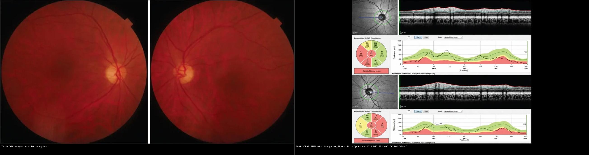
*Trái: đáy mắt 2 mắt — đĩa **nhợt ưu thế thái dương**. Phải: bản đồ **RNFL** — ô **thái dương (T) mỏng chọn lọc** trong khi các ô khác còn tốt, đúng chân dung "teo bó nhúi" của DOA/OPA1 (J Curr Ophthalmol 2026, PMC13524400 Fig. 2 & 3, CC BY-NC-SA 4.0). Ảnh ghép letterbox.*

**Quiz composite:** che 2 nhãn, hỏi vì sao **cùng một bệnh** mà đáy mắt chỉ "hơi nhợt" còn RNFL lại mất **chọn lọc ô thái dương**? Di truyền kiểu gì?

<b>Bấm để hiện đáp án</b>

- **Di truyền TRỘI (OPA1/DOA):** bó nhúi (sợi mảnh, mật độ ty thể cao) chết trước → **nhợt thái dương + RNFL ô T mỏng chọn lọc**, các ô mũi/trên/dưới còn tương đối.
- Cần: **giải trình tự OPA1**, tư vấn **trội 50%**, sàng lọc người thân; **nhớ MLPA/CNV** vì **mất đoạn lớn (như mất đoạn 10 kb exon 30–31)** có thể lọt giải trình tự thường.
- Đối chiếu: teo thị do **độc–chuyển hóa** cũng mỏng ô thái dương nhưng **có tiền sử thuốc/dinh dưỡng** và **không có phả hệ trội** (bài 434).

### Vì sao "teo thị trội" của trẻ lại nhợt ở THÁI DƯƠNG — không phải toàn đĩa
- Bó sợi nhúi vào đĩa ở **phía thái dương** chứa **sợi trục mảnh nhất, nhiều ty thể nhất** → nhạy nhất với thiếu năng lượng (OPA1) → **nhợt thái dương + mỏng RNFL thái dương** là dấu sao.
- Khi bệnh lan rộng/ở người lớn tuổi, nhợt có thể **lan toàn đĩa** và thị trường xấu thêm — **đừng loại DOA chỉ vì nhợt lan rộng**.

## 4. Protocol chụp + hệ điểm chuẩn hóa

- **Khám nền (bắt buộc):** thị lực (**logMAR**), **thị giác màu Lanthony D-15 / Ishihara** (DOA: **rối loạn xanh–vàng/tritan**; LHON: đỏ–xanh), **thị trường tự động 24-2**, phản xạ đồng tử (RAPD — có thể **âm** vì 2 bên đối xứng), soi đáy mắt.
- **OCT (chốt cấu trúc):** **vòng RNFL quanh đĩa** + **GCC/GCL hoàng điểm** — ghi **µm theo ô và theo bản đồ theo tuổi** (normative database); theo dõi **RNFL thái dương** (mỏng ~1,13 µm/năm) và **GCC**.
- **Điện sinh lý:** **VEP** (tăng thời gian tiềm tàng) + **ERG** khi cần phân biệt bệnh võng mạc; **đo thị giác màu**.
- **MRI:** DOA đơn thuần → **loại viêm/chèn ép** (T1 fat-sat sau tiêm + T2 fat-sat, bài 430). **Nghi Wolfram → MRI sọ + tuyến yên**: tìm **mất tín hiệu sáng thùy sau tuyến yên T1**, thoái hóa cầu não/tiểu não, tăng tín hiệu chất trắng.
- **Xét nghiệm gene (quy trình):**
  - **Khởi phát nhũ nhi/đầu trẻ** (hiệu suất NGS cao) → **panel teo thị/NGS**: **OPA1 trước**; âm tính → **MLPA/CNV** (bắt mất đoạn lớn); nhóm lặn: **TMEM126A, NBAS, PTPN23, WFS1**; X-linked: locus OPA2/WDR45.
  - **Khởi phát muộn không rõ nguyên nhân** → NGS giá trị thấp (0%), ưu tiên tìm **nguyên nhân mắc phải** (độc chất, thiếu máu, chèn ép).
  - Nghi **LHON** → **mtDNA** (bài 434); nghi **Wolfram** → **WFS1** + xét nghiệm nội tiết.
- **Tầm soát ngoài mắt khi nghi Wolfram:** glucose/HbA1c/OGTT, **nghiệm pháp nhịn nước + copeptin** (ĐTĐ nhạt trung ương), **audiometry**, siêu âm/niệu động học (bàng quang thần kinh), đánh giá thần kinh/cognitve **định kỳ** (xuất hiện ~23–26 tuổi, nhận thức muộn hơn 29,9 ± 12,2 tuổi).
- **Tư vấn:** DOA/Wolfram-like = **trội (50%)**; Wolfram = **lặn (25%)**, tầm soát anh chị em + tư vấn di truyền; **LHON = dòng mẹ** (bài 434).

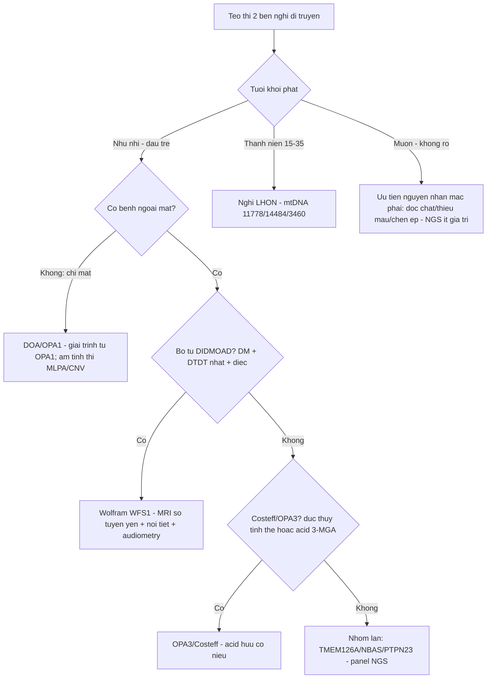

## 5. Biến thể bình thường và cạm bẫy

- **RNFL mỏng theo tuổi (~0,2 µm/năm sinh lý)** — luôn so **bản đồ theo tuổi/normative**, đừng gọi teo bệnh lý khi lệch nhẹ.
- **Nhãn "teo thị vô căn/do tuổi"** dễ bỏ sót **DOA trẻ, Wolfram, độc chất**: luôn hỏi **phả hệ** (trội/lặn/dòng mẹ) + **thuốc (ethambutol, linezolid, amiodarone)** + **DM/điếc/khát nhiều**.
- **Mất đoạn lớn OPA1 lọt giải trình tự** — gia hệ DOA lớn nhất từng bị bỏ sót nếu chỉ sequencing; **luôn thêm MLPA/CNV** khi OPA1 âm tính mà chân dung vẫn trội.
- **"Teo thị trội = lành, nhẹ" là sai**: mất thị lực có thể tới **1,61 logMAR**, tiến triển **~0,18 logMAR/thập kỷ** — cần theo dõi và phục hồi chức năng.
- **Wolfram có thể bắt đầu bằng teo thị trước khi có DM/điếc** → đừng gạt chẩn đoán khi chưa đủ bộ tứ; **theo dõi nội tiết theo thời gian**.
- **Đừng nhầm mất tín hiệu sáng thùy sau tuyến yên (dấu ĐTĐ nhạt trung ương) với tổn thương thị** — hai điều khác nhau, cùng trên một MRI Wolfram.
- **RAPD âm không loại trừ** — vì 2 mắt tổn thương **đối xứng**, như trong DOA.

## 6. Tự lượng giá — Blind Quiz

**Ca 1 — Bé 9 tuổi, bố cũng mờ mắt từ nhỏ; thị lực giảm dần 2 bên KHÔNG đau. Đáy mắt:**
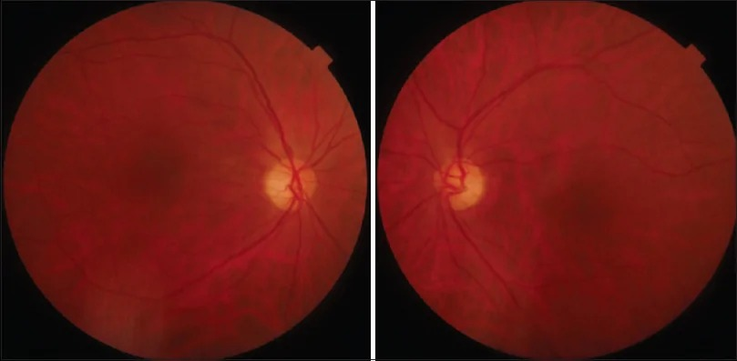

- Hỏi: mẫu nhợt ưu thế vùng nào? Kiểu di truyền? Xét nghiệm đầu tay?

<b>Bấm để hiện đáp án (findings + chẩn đoán)</b>

- Dấu hiệu (findings): đĩa thị **nhợt ưu thế thái dương** 2 mắt; bờ đĩa còn rõ (không phù) — "teo bó nhúi".
- Chẩn đoán (diagnosis): **DOA/OPA1 (teo thị trội trẻ)** — vì trẻ, 2 bên, không đau, tiến triển chậm, **tiền sử gia đình trội**.
- Xét nghiệm: **giải trình tự OPA1** (âm tính → **MLPA/CNV**); tư vấn **trội 50%**, sàng lọc người thân.
- Nguồn ảnh: J Curr Ophthalmol 2026 (PMC13524400) Fig. 2, CC BY-NC-SA 4.0.

**Ca 2 — Cùng bệnh nhân, OCT quanh đĩa + GCL/GCC + thị trường:**
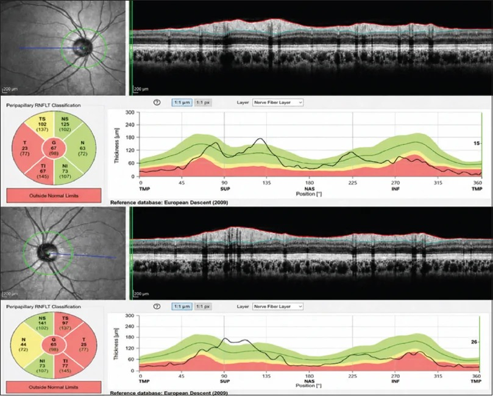
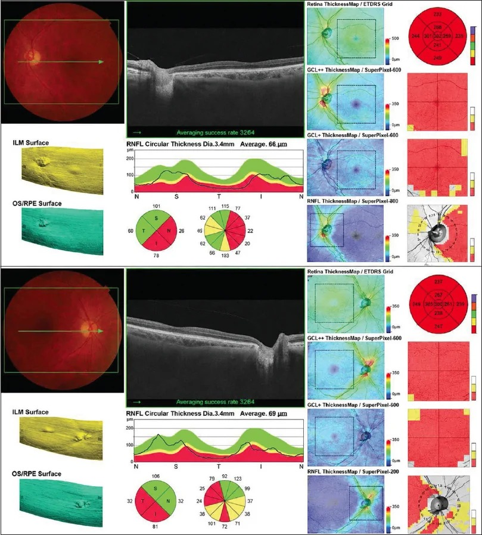
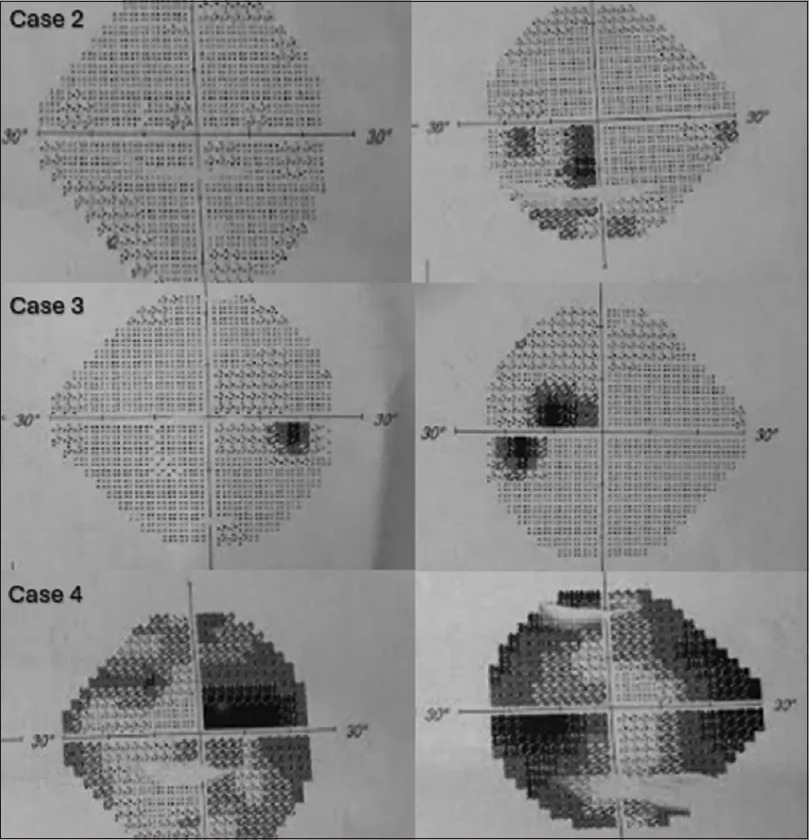

- Hỏi: ô nào mỏng nhất (RNFL)? GCL/GCC mất ở đâu? Thị trường khuyết kiểu gì? Nếu ô **mũi** cũng mỏng đều thì nghĩ gì?

<b>Bấm để hiện đáp án (findings + chẩn đoán)</b>

- Dấu hiệu (findings): **ô thái dương (T) mỏng chọn lọc** trên RNFL (classification "outside normal limits" vùng thái dương); **GCC/GCL mất vùng thái dương–hoàng điểm**; thị trường **ám điểm trung tâm/trung tâm–manh điểm** ("có/khuyết trung tâm"), giai đoạn muộn lan thêm.
- Vì sao: bó **nhúi hoàng điểm (thái dương)** gồm sợi mảnh, mật độ ty thể cao → nhạy thiếu năng lượng → chết trước; **thân tế bào (GCL) và sợi trục (RNFL) cùng mỏng**, khớp thị trường.
- Nếu **mỏng lan tỏa cả ô mũi** → cân nhắc **teo thị lặn (TMEM126A/NBAS)** hoặc teo muộn lan rộng — mở rộng panel gene.
- Nguồn ảnh: J Curr Ophthalmol 2026 (PMC13524400) Fig. 3, 4, 7, CC BY-NC-SA 4.0.

**Ca 3 — Ba người trong cùng gia hệ DOA (OPA1), mức độ rất khác nhau. Đọc hàng đầu → hàng cuối:**
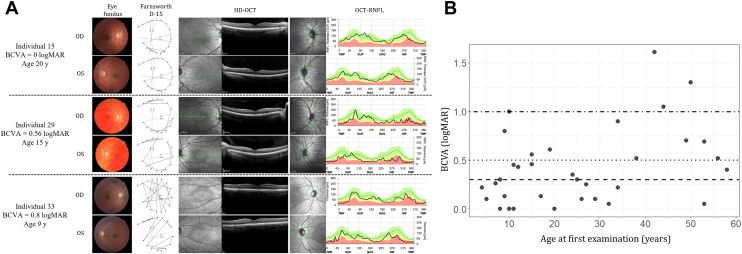

- Hỏi: tại sao cùng một đột biến mà người **nhẹ 0 logMAR**, người **nặng 1,61 logMAR**? Điều này ảnh hưởng tư vấn thế nào?

<b>Bấm để hiện đáp án (findings + chẩn đoán)</b>

- Dấu hiệu (findings): từ trên xuống — người **15 tuổi 0 logMAR** (đáy mắt gần bình thường, RNFL còn tốt) → **29 tuổi 0,56 logMAR** → **33 tuổi 0,8 logMAR** (nhợt + RNFL mỏng rõ); phả hệ kèm thị lực giảm theo tuổi.
- Cơ chế: **biểu hiện biến thiên trong cùng gia hệ (variable expressivity)** — thị lực **tương quan với độ dày RNFL/GCL**, **tương quan yếu với tuổi**; mất **~0,018 logMAR/năm**.
- Tư vấn: **không hứa "nhẹ" cho con** dù cha mẹ nhẹ; theo dõi định kỳ; nhớ **MLPA/CNV** (gia hệ này do **mất đoạn 10 kb exon 30–31**).
- Nguồn ảnh: Ophthalmology Science 2026 (PMC13382307) Fig. 3, CC BY 4.0.

**Ca 4 — Bé gái 11 tuổi, bố mẹ KHÔNG bệnh, teo thị 2 bên lan tỏa, không đau, không bệnh nội tiết. Ảnh:**
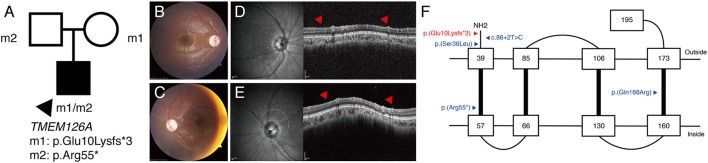

- Hỏi: kiểu di truyền? Xét nghiệm nào? Vì sao khác DOA?

<b>Bấm để hiện đáp án (findings + chẩn đoán)</b>

- Dấu hiệu (findings): đáy mắt **nhợt lan tỏa** 2 bên; OCT **mất RNFL nặng lan tỏa**; phả hệ có **bố mẹ mang dị hợp ghép (compound heterozygous)**.
- Chẩn đoán (diagnosis): **teo thị lặn (AR) do TMEM126A** — di truyền **lặn** (bố mẹ không bệnh), khởi phát sớm, thường **không kèm bệnh ngoài mắt**.
- Xét nghiệm: **panel/NGS** (TMEM126A, NBAS, PTPN23); tư vấn **lặn 25%**.
- Nguồn ảnh: Front Neurol 2022 (PMC9441910) Fig. 3, CC BY 4.0.

**Ca 5 — Trẻ teo thị 2 bên kèm đái tháo đường và NGHE KÉM (audiogram). Ảnh đáy mắt + OCT + thính lực:**
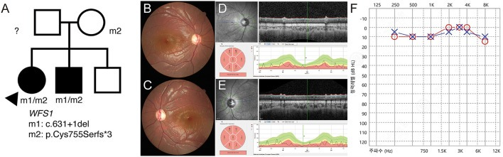

- Hỏi: hội chứng nào? Bộ tứ? Xét nghiệm bổ sung ngoài gene?

<b>Bấm để hiện đáp án (findings + chẩn đoán)</b>

- Dấu hiệu (findings): đĩa **nhợt 2 bên** + RNFL mỏng + **audiogram mất nghe**; phả hệ **lặn** (bố mẹ mang biến thể ghép `c.631+1del` / `p.Cys755Serfs*3`).
- Chẩn đoán (diagnosis): **Wolfram syndrome (WFS1)** — bộ tứ **DIDMOAD**: đái tháo đường + teo thị + đái tháo nhạt + điếc; ở ca này đã lộ **DM + điếc + teo thị**.
- Bổ sung: **copeptin/nhịn nước** (ĐTĐ nhạt), **MRI sọ–tuyến yên**, niệu động học, theo dõi thần kinh (xuất hiện ~23–26 tuổi).
- Nguồn ảnh: Front Neurol 2022 (PMC9441910) Fig. 4, CC BY 4.0.

**Ca 6 — Cùng bệnh nhân Wolfram, MRI sọ:**
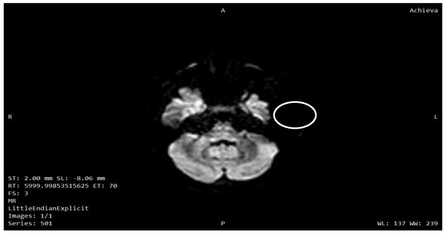
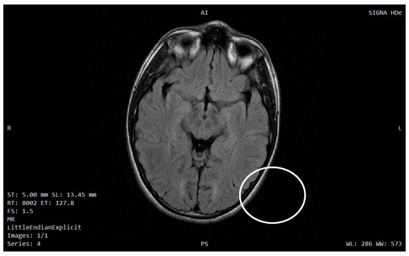

- Hỏi: tổn thương ở đâu? Vì sao MRI sọ cần cho teo thị di truyền nghi Wolfram?

<b>Bấm để hiện đáp án (findings + chẩn đoán)</b>

- Dấu hiệu (findings): **DWI** tăng tín hiệu vùng **thân não (cầu não)** (vòng tròn) và **FLAIR** **tăng tín hiệu chất trắng trên lều** — chân dung thoái hóa thần kinh của Wolfram.
- Vì sao MRI sọ: phân biệt **teo thị đơn thuần (DOA)** với **bệnh thoái hóa thần kinh trung ương**; ở Wolfram, **93%** bệnh nhân có biểu hiện thần kinh, khởi phát **~23–26 tuổi**, suy giảm nhận thức muộn hơn (**29,9 ± 12,2 tuổi**).
- Nguồn ảnh: Diagnostics 2025 (PMC12732145) Fig. 2–3, CC BY 4.0. *(Lưu ý phản biện: hình chỉ mô tả đại thể theo chú thích nguồn; đối chiếu thêm chuỗi xung trước khi chốt vị trí từng ổ.)*

## Bài liên quan chéo
- [400 – Tổng quan Mắt](../400-tong-quan-mat-thi-giac/lesson.md)
- [434 – Teo thị do độc–chuyển hóa & LHON](../434-teo-thi-than-kinh-thi-doc-va-LHON/lesson.md) (LHON dòng mẹ; GCL/RNFL lệch pha)
- [430 – Đường thị giác: viêm vs NAION](../430-duong-thi-giac/lesson.md) (loại viêm/thiếu máu)
- [431 – U TK thị](../431-u-than-kinh-thi/lesson.md) · [432 – Vùng yên](../432-vung-yen/lesson.md) (chèn ép — bán manh 2 thái dương)
- [433 – Phù đĩa thị vs drusen](../433-phu-dia-thi-drusen/lesson.md) (giả phù vs phù thật)
- [442 – Glaucoma OCT](../442-glaucoma-OCT/lesson.md) (RNFL/GCL mỏng — so cơ chế)
- [456 – Bệnh võng mạc trẻ sinh non](../456-benh-vong-mac-tre-sinh-non/lesson.md) (mắt nhi — nhóm tân mạch/bong)

## Ảnh
- `439_OPA1-do-day-mat-nhot_Fundus_PMC13524400-Fig2.jpg`, `439_OPA1-RNFL-thai-duong-mong_OCT_PMC13524400-Fig3.jpg`, `439_OPA1-GCL-mat_OCT_PMC13524400-Fig4.jpg`, `439_OPA1-am-diem-trung-tam_TVF_PMC13524400-Fig7.jpg`, `composite_teo-thi-di-truyen_OPA1-day-mat-vs-RNFL.jpg` — J Curr Ophthalmol 2026 (PMCID: PMC13524400), CC BY-NC-SA 4.0.
- `439_OPA1-do-nang-bieu-hien_Fundus-OCT_PMC13382307-Fig3.jpg` — Ophthalmology Science 2026 (PMCID: PMC13382307), CC BY 4.0.
- `439_Wolfram-cau-nao-DWI_MRI_PMC12732145-Fig2.jpg`, `439_Wolfram-chat-trang-FLAIR_MRI_PMC12732145-Fig3.jpg` — Diagnostics 2025 (PMCID: PMC12732145), CC BY 4.0.
- `439_teo-thi-lan-TMEM126A_Fundus-OCT_PMC9441910-Fig3.jpg`, `439_Wolfram-WFS1_Fundus-OCT_PMC9441910-Fig4.jpg` — Front Neurol 2022 (PMCID: PMC9441910), CC BY 4.0.
- Chi tiết giấy phép từng ảnh trong `images/CREDITS.md`. AuntMinnie: chỉ dẫn link, không tải.

> Không dùng để chẩn đoán độc lập khi chưa có người hướng dẫn.
