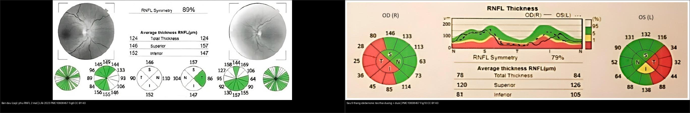
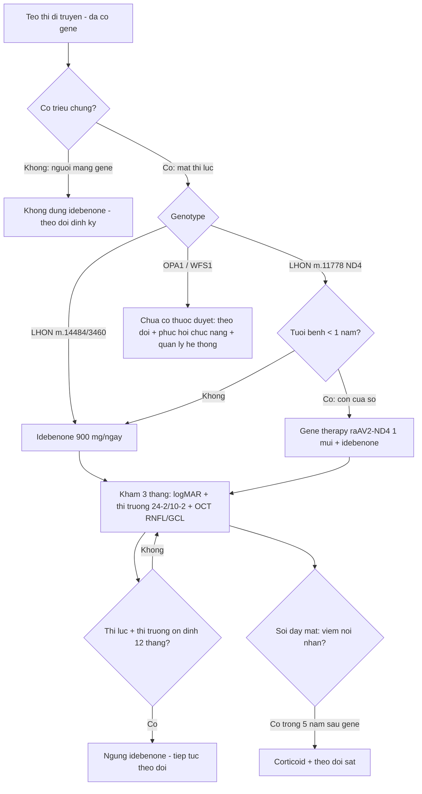
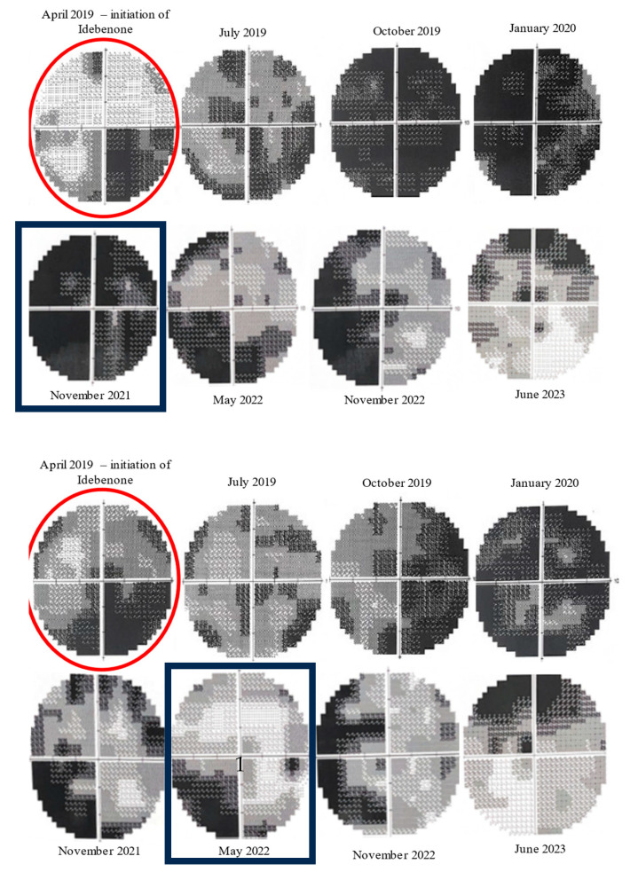
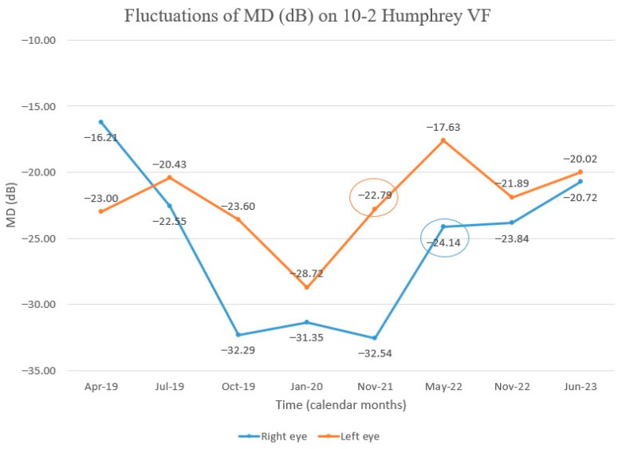
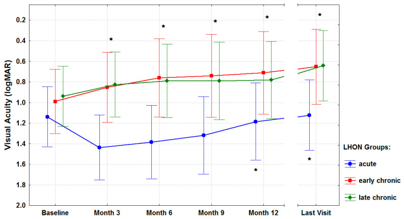
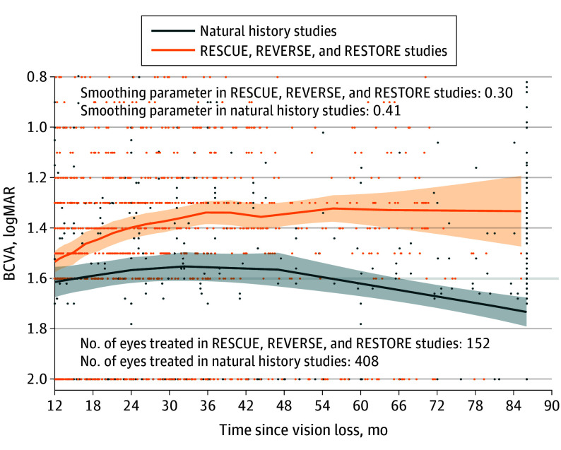
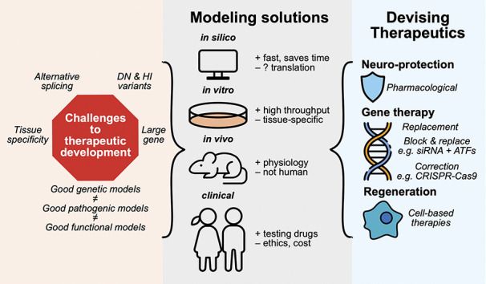
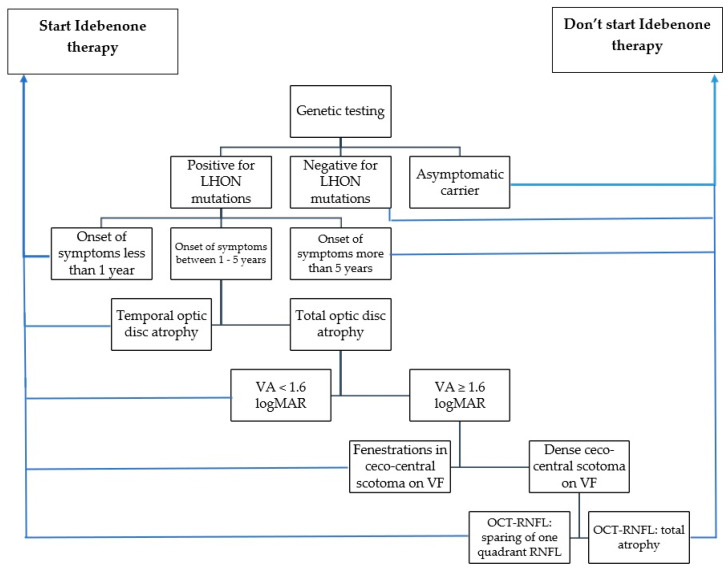

# 440 — Theo dõi & điều trị teo thị di truyền: idebenone, gene therapy & phục hồi chức năng / Hereditary optic atrophy — monitoring & treatment

**Tags:** `pattern:teo-thi` `vung:than-kinh-thi` `score:logMAR` `protocol:OCT-thi-truong` `protocol:gene-therapy`
**Mức chắc chắn (certainty):** tổng hợp y văn (literature synthesis) — nhóm tự biên từ y văn mở (Life 2023 CC BY + J Clin Med 2021 CC BY + JAMA Ophthalmol 2025 CC BY-NC-ND + J Neuroophthalmol 2023 CC BY + Indian J Ophthalmol 2025 CC BY-NC-SA), chưa gắn ca nguyên văn đơn lẻ.

> Bài này là **nửa sau của bài [439](../439-teo-thi-di-truyen/lesson.md)**: 439 lo chẩn đoán – định lượng – gene; 440 lo **theo dõi định kỳ + chọn thuốc/can thiệp + ngưỡng ngừng điều trị**. Điểm chốt: teo thị di truyền **không phải bệnh "hết thuốc"** — RGC còn sống vẫn có thể "tái hoạt" chuyển tín hiệu và hồi phục một phần.

## 1. Tổng quan — vì sao vẫn hồi phục được, và số nào nằm lòng

- **Cơ chế nền (nhắc 439):** tế bào hạch võng mạc (retinal ganglion cell, RGC) tiêu thụ ATP cực lớn ở đoạn sợi trục chưa myelin (~1 mm trong nhãn cầu). Đột biến **mtDNA (LHON m.11778G>A / m.14484T>C / m.3460G>A)** hoặc **gene nhân (OPA1, WFS1…)** → chuỗi hô hấp ty thể hỏng → mất ATP + dư ROS → chết bó nhúi hoàng điểm. **Nhưng**: trong giai đoạn đầu, một phần RGC chỉ **mất chức năng (dysfunctional), chưa chết** — đây là **"cửa sổ chữa được"**.
- **TẠI SAO idebenone cứu được RGC "ngủ":** idebenone là **benzoquinone chuỗi ngắn** — **chuyển điện tử trực tiếp cho phức hợp III (complex III) bỏ qua phức hợp I (complex I) bị hỏng**, khôi phục tổng hợp ATP và giảm ROS. Vì vậy hiệu quả **không phụ thuộc đúng locus đột biến** (dùng được cho cả 3 đột biến chính) và **tốt nhất khi còn RGC sống**.
- **TẠI SAO gene therapy dùng được cho LHON:** m.11778G>A nằm ở **MT-ND4 (ND4)** — protein **hydrophobic, không qua được màng ty thể nếu chỉ chèn gene nhân**. Chiến lược **allotopic expression**: gắn thêm **tín hiệu định vị ty thể (MTS)** để protein ND4 tổng hợp ở ribosome bào tương rồi **nhập lại ty thể** — vector **rAAV2/2-ND4 (lenadogene nolparvovec)**, **1 mũi tiêm nội dịch kính duy nhất**.
- **Số nằm lòng (định lượng):**
  - **Idebenone liều được duyệt: 900 mg/ngày** (Raxone 150 mg × 6 viên; **uống cùng thức ăn** để tăng sinh khả dụng); **chưa đủ dữ liệu < 12 tuổi**.
  - Mức cải thiện thị lực theo **thời điểm bắt đầu điều trị** (23 BN LHON, J Clin Med 2021): **cấp (≤ 1 năm): −0,52 ± 0,46 logMAR**; **bán cấp (1–5 năm): −0,39 ± 0,27 logMAR**; **mạn (> 5 năm): −0,33 ± 0,28 logMAR** (p < 0,001 mọi nhóm) — **càng sớm càng tốt, nhưng mạn vẫn hồi phục được**.
  - **Theo dõi mỗi 3 tháng** khi đang điều trị; **ngừng idebenone khi thị lực + thị trường ỔN ĐỊNH 12 tháng** không còn cải thiện.
  - **Gene therapy (lenadogene nolparvovec, RESTORE 5 năm):** 76 BN tiêm (RESCUE 39 + REVERSE 37) → 62 vào RESTORE (81,6%), 55 hoàn tất 5 năm; **cải thiện 2 mắt tính từ nadir −0,4 ± 0,5 logMAR (> 4 dòng)**, **66,1% (41/62) đạt ≥ 3 dòng ở ≥ 1 mắt**; **khác biệt mắt tiêm vs mắt sham không có ý nghĩa (−0,05 logMAR; P = 0,27)**; **viêm nội nhãn muộn 4 BN / 8 biến cố** (2–5 năm).
  - **So sánh gián tiếp (645 BN / 17 nghiên cứu):** 338 BN idebenone (9 nghiên cứu) vs 307 BN rAAV2-ND4 (8 nghiên cứu); **không có thử nghiệm đầu-đối-đầu**; khác biệt thị lực **6 tháng không có ý nghĩa** (MD 0,07; P = 0,83).
  - **OPA1/DOA: CHƯA có thuốc được duyệt** — chỉ có đường ống phát triển (neuroprotection, gene replacement, CRISPR, tế bào); kiểm soát yếu tố nguy cơ và phục hồi chức năng.

## 2. Mẫu hình + chẩn đoán phân biệt theo giai đoạn (gamut)

- **Câu hỏi lọc 1 — giai đoạn so với khởi phát:** **cấp ≤ 1 năm** (RNFL còn phù/giả phù đĩa, GCL đã bắt đầu mỏng) · **bán cấp 1–5 năm** (RNFL/GCL mỏng tiến triển) · **mạn > 5 năm** (RNFL teo thái dương–lan tỏa, GCL mỏng nặng).
- **Câu hỏi lọc 2 — genotype quyết định can thiệp:** **LHON m.11778/14484/3460** → idebenone ± gene therapy (chỉ **ND4/11778** mới có liệu pháp gene đã thử nghiệm) · **OPA1 (DOA)** → chưa có thuốc đặc hiệu, theo dõi + tránh độc chất · **WFS1** → kiểm soát DM/ĐTĐ nhạt/điếc song song.
- **Mẫu hình OCT theo thời gian (trục theo dõi):** **cấp = RNFL DÀY (phù) + GCL mỏng sớm** → **teo thái dương chọn lọc** → **mạn = RNFL mỏng lan tỏa**; **GCL mỏng là dấu sớm nhất** (đôi khi đã mỏng khi RNFL còn phù, xem 434).
- **Gamut "tái hoạt":** thị lực đứng yên rồi **cải thiện chậm sau nhiều tháng** điều trị (báo cáo tới **36 tháng**) — **đừng ngừng quá sớm vì thấy "đứng"**; mốc ngừng là **12 tháng ổn định**.

## 3. Bảng so sánh phân biệt (ma trận đối chiếu) — chọn can thiệp

| Lựa chọn (option) | Chỉ định / hình ảnh theo dõi | Chốt vào (rule-in) | Chốt loại (rule-out) | Gợi ý xác nhận |
|---|---|---|---|---|
| **Idebenone uống** | LHON có đột biến (mọi locus), **còn giai đoạn hồi phục**; OCT RNFL/GCL, thị trường 24-2/10-2 | **LHON + RGC còn sống (GCL chưa mất hoàn toàn) + khởi phát càng gần càng tốt** | **Người mang gene KHÔNG triệu chứng** (chưa có chỉ định); thị lực + thị trường đã ổn định **12 tháng** | **900 mg/ngày ÷ 6 viên, cùng thức ăn**; khám **3 tháng/lần** |
| **Gene therapy rAAV2/2-ND4** | LHON do **m.11778G>A (MT-ND4)**; tiêm nội dịch kính 1 lần | **m.11778G>A + mất thị lực còn trong cửa sổ (RESCUE ≤ 6 tháng, REVERSE 7–12 tháng)** | Đột biến **khác ND4** (14484/3460) không có chỉ định virus này | Theo dõi **viêm nội nhãn tới 5 năm**; BCVA từ nadir −0,4 logMAR |
| **EPI-743 / đồng yếu tố ty thể** | Liệu pháp bổ trợ, bằng chứng yếu; thử nghiệm nhỏ ở trẻ DOA/LHON | **DOA nặng, tiến triển nhanh** khi chưa có thuốc duyệt (đồng thuận nhóm, không bắt buộc) | Không có bằng chứng pha 3 → **không thay thế idebenone/gene ở LHON** | Thử nghiệm lâm sàng có kiểm soát |
| **Phục hồi chức năng thị giác** | Cận thị hỗ trợ (kính viễn/trợ thị), đào tạo lệch manh điểm, hỗ trợ đọc | **Teo thị 2 bên mọi mức, kể cả đã "hết thuốc"** | **Không dùng để thay cho điều trị sinh học khi còn cửa sổ** | Khám chỉnh thị + phục hồi chức năng |
| **Tránh độc chất ty thể** | Ethambutol > 15 mg/kg/ngày, linezolid, amiodarone, rượu–thuốc lá, thiếu B12 | **Đang dùng thuốc độc ti thể + teo thị** | Không phơi nhiễm + tiền sử gia đình rõ → di truyền thuần | Ngưng thuốc; B12/homocysteine, xem 434 |
| **Kiểm soát bệnh hệ thống (WFS1)** | WFS1: DM, ĐTĐ nhạt, điếc, thần kinh | **Bộ tứ DIDMOAD** | Teo thị đơn thuần → DOA/OPA1 | HbA1c, copeptin/nhịn nước, audiometry (xem 439) |

*Trái: **cấp** — RNFL DÀY 2 mắt (phù đĩa, sinh hiệu còn "hy vọng"); phải: **sau 9 tháng idebenone** — teo ô **thái dương + dưới** (RNFL thái dương OD 25 µm / OS 32 µm, mất "đối xứng" 89% → 79%) — cùng một bệnh, hai thì. Nguồn: Life 2023 (PMC10608457) Fig. 6 & 10, CC BY 4.0. Ảnh ghép letterbox.*

**Quiz composite:** che 2 nhãn, hỏi **thời điểm nào còn "đáng đầu tư" điều trị** và **dấu OCT nào cho biết đã sang thì teo**?

<b>Bấm để hiện đáp án</b>

- **Thì cấp (trái) = cửa sổ điều trị tốt nhất:** RNFL **dày do phù** nghĩa là sợi trục còn đó, RGC chỉ "ngủ" → idebenone (và/hoặc gene nếu m.11778) có cơ hội.
- **Thì teo (phải) = đã mất sợi trục:** RNFL ô **thái dương + dưới** tụt còn 25–32 µm (ngoài giới hạn bình thường, đỏ), **đối xứng RNFL tụt 89% → 79%** — nhưng **mạn vẫn có thể hồi phục một phần** (−0,33 logMAR, xem mục 1), nên **không từ chối điều trị chỉ vì đã teo**.
- Nguồn: Life 2023 (PMC10608457) Fig. 6 và 10, CC BY 4.0.

## 4. Protocol theo dõi + ngưỡng ngừng điều trị + flowchart

- **Bộ đánh giá mỗi lần khám (3 tháng/lần khi điều trị):** thị lực **logMAR** (ETDRS) · **thị trường tự động 24-2** (và **10-2** khi còn ám điểm trung tâm) · **OCT: pRNFL quanh đĩa + GCL/GCC hoàng điểm** (ghi µm theo bản đồ tuổi) · thị giác màu · soi đáy mắt; **ghi lại nadir** (đáy thị lực) làm mốc tính "cải thiện từ nadir".
- **Theo dõi cấu trúc (chốt tiến triển):** BIO (RNFL) **mỏng theo 4 ô**; **ô thái dương nhạy nhất** (439: ~1,13 µm/năm) và **GCL mỏng sớm hơn RNFL** → **theo dõi GCL** để bắt tiến triển sớm; **RNFL phù che mất mất GCL** ở thì cấp.
- **Ngưỡng ngừng idebenone:** **thị lực + thị trường ỔN ĐỊNH 12 tháng** mà không cải thiện thêm → ngừng (có thể thử lại/thay đổi nếu tái tiến triển). **Theo dõi ngay cả sau khi ngừng**.
- **Theo dõi dưới gene therapy:** BCVA, NEI VFQ-25 (chất lượng sống), **soi đáy mắt tìm viêm nội nhãn muộn tới 5 năm** (4 BN/8 biến cố giữa 2–5 năm); OCT RNFL/GCL song song.
- **MRI (loại trừ + WFS1):** T1 fat-sat sau tiêm + T2 fat-sat ổ mắt/đường thị (loại viêm/chèn ép, 430); **nghi WFS1 → MRI sọ–tuyến yên** (mất tín hiệu sáng thùy sau tuyến yên T1, thoái hóa cầu não/tiểu não).
- **Hồ sơ theo dõi gia đình:** **không dùng idebenone cho người mang gene không triệu chứng**; sàng lọc anh chị em + tư vấn di truyền (dòng mẹ ở LHON; trội 50% ở OPA1); phục hồi chức năng + hỗ trợ xã hội ngay từ lúc chẩn đoán.

## 5. Biến thể bình thường và cạm bẫy

- **"Đã teo là hết" — SAI:** nhóm **mạn > 5 năm vẫn cải thiện −0,33 logMAR**; **kéo dài điều trị** (báo cáo tới 36 tháng) vì hồi phục rất chậm → **đừng ngừng sớm**.
- **Nhầm "ổn định 3–6 tháng" với "hết đáp ứng":** mốc ngừng chính thức là **12 tháng ổn định**, không phải 1 lần khám đứng yên.
- **Theo dõi bằng RNFL đơn thuần ở thì cấp:** **phù RNFL có thể dày lên** dù GCL đã mỏng → luôn đọc **GCL/GCC** song song (439/434).
- **Cho người mang gene không triệu chứng uống idebenone:** **không có chỉ định** — chỉ theo dõi (sơ đồ chọn bệnh, Life 2023).
- **Bỏ sót nguyên nhân độc–chuyển hóa song song:** **ethambutol > 15 mg/kg/ngày, linezolid, amiodarone, B12 thấp, rượu–thuốc lá** — ngưng thuốc có thể hồi phục; đừng quy hết cho "di truyền" (434).
- **Gene therapy không phải "chữa khỏi":** khác biệt **mắt tiêm vs sham không có ý nghĩa ở 2 năm và 5 năm**, lợi ích **hai mắt từ nadir** (cơ chế chuyển vector đối bên) — **tư vấn đúng kỳ vọng**; vẫn phải theo dõi **viêm nội nhãn tới 5 năm**.
- **Không dùng idebenone cho < 12 tuổi** (chưa đủ dữ liệu) và **không quên cho uống cùng thức ăn** (tăng hấp thu).
- **Cạm bẫy hình ảnh:** đĩa "nhợt giả" do ánh sáng kém/ảnh mờ trên OCT chất lượng thấp (signal quality thấp, hiển thị xám) → chụp lại trước khi kết luận tiến triển.

## 6. Tự lượng giá — Blind Quiz

**Ca 1 — Nam 46 tuổi, LHON m.11778G>A thể bán cấp, bắt đầu idebenone; thị trường 24-2/10-2 trước và sau điều trị:**

- Hỏi: đọc chuỗi thị trường 10-2 này thấy gì? Vì sao ban đầu **xấu đi rồi mới tốt lên**? Có nên ngừng thuốc khi 3 tháng đầu chưa cải thiện?

<b>Bấm để hiện đáp án (findings + chẩn đoán)</b>

- Dấu hiệu (findings): chuỗi **24-2/10-2** từ lúc bắt đầu idebenone — **ban đầu ám điểm trung tâm sâu rộng hơn**, sau **~30 tháng điều trị** (11/2021) **thu hẹp và nông dần**, thị trường trung tâm cải thiện rõ (trên = mắt phải, dưới = mắt trái).
- Vì sao: hồi phục "tái hoạt" RGC **rất chậm**; giai đoạn đầu có thể còn tiến triển tự nhiên rồi mới cải thiện — **đừng ngừng sớm**.
- Xử trí: **tiếp tục idebenone 900 mg/ngày**, khám 3 tháng/lần; **ngừng khi ổn định 12 tháng**.
- Nguồn ảnh: Life 2023 (PMC10608457) Fig. 7, CC BY 4.0 (Baltă G et al.).

**Ca 2 — Cùng bệnh nhân: theo dõi MD (mean deviation) trên thị trường 10-2:**

- Hỏi: MD đi theo hướng nào? Mắt nào cải thiện trước? Điều này thay đổi cách bạn tư vấn gì?

<b>Bấm để hiện đáp án (findings + chẩn đoán)</b>

- Dấu hiệu (findings): MD **giảm (xấu) thời gian đầu** rồi **cải thiện dần**, **mắt trái cải thiện trước** (các giá trị được khoanh tròn là mốc cải thiện). **Hai mắt không hồi phục đồng bộ.**
- Tư vấn: **đáp ứng từng mắt khác nhau và chậm** — hứa hẹn dè dặt, kiên trì theo dõi.
- Nguồn ảnh: Life 2023 (PMC10608457) Fig. 8, CC BY 4.0.

**Ca 3 — Nhóm BN LHON điều trị idebenone: thị lực (logMAR) theo thời gian, chia cấp / bán cấp / mạn:**

- Hỏi: nhóm nào (xanh dương/đỏ/xanh lá) cải thiện mạnh nhất? Nói gì về "cửa sổ vàng"? Nhóm mạn có nên điều trị không?

<b>Bấm để hiện đáp án (findings + chẩn đoán)</b>

- Dấu hiệu (findings): **xanh dương = cấp (≤ 1 năm)** khởi đầu xấu nhất (logMAR cao nhất) nhưng **cải thiện và duy trì tới "Last visit"**; **đỏ = bán cấp (1–5 năm)** và **xanh lá = mạn (> 5 năm)** cũng hướng về thị lực tốt hơn theo thời gian (trục logMAR đảo: càng lên cao = càng tốt).
- Số: **cấp −0,52 ± 0,46 logMAR (từ nadir); bán cấp −0,39 ± 0,27; mạn −0,33 ± 0,28** (p < 0,001 cả ba nhóm).
- Chốt: **càng sớm càng tốt (cửa sổ vàng), NHƯNG mạn vẫn đáng điều trị** — không từ chối nhóm mạn.
- Nguồn ảnh: J Clin Med 2021 (PMC7795141) Fig. 1, CC BY 4.0 (Pemp B et al.).

**Ca 4 — BN LHON m.11778G>A được tiêm gene (rAAV2/2-ND4) một mắt; theo dõi BCVA nhiều năm:**

- Hỏi: đường đỏ (nhóm tiêm) so đường đen (lịch sử tự nhiên) khác nhau thế nào? Lợi ích nằm ở mắt tiêm hay cả hai mắt?

<b>Bấm để hiện đáp án (findings + chẩn đoán)</b>

- Dấu hiệu (findings): đường **đỏ (RESCUE/REVERSE/RESTORE, n = 152 mắt)** nằm **cao hơn (thị lực tốt hơn)** so đường **đen (lịch sử tự nhiên, n = 408 mắt)** trên trục thời gian sau mất thị lực; khoảng tin cậy hẹp hơn.
- Số (RESTORE 5 năm): cải thiện **từ nadir −0,4 ± 0,5 logMAR**; **66,1% (41/62) đạt ≥ 3 dòng ở ≥ 1 mắt**; **khác biệt mắt tiêm vs sham không có ý nghĩa (−0,05 logMAR; P = 0,27)** → lợi ích **hai mắt** (chuyển vector đối bên).
- An toàn: **viêm nội nhãn muộn 4 BN / 8 biến cố (2–5 năm)** → theo dõi đáy mắt dài hạn.
- Nguồn ảnh: JAMA Ophthalmol 2025 (PMC11843360) Fig. 2, **CC BY-NC-ND 4.0** — ảnh giữ nguyên bản, không crop/ghép (Yu-Wai-Man P et al.).

**Ca 5 — Bạn tư vấn BN DOA/OPA1 "có thuốc gì chưa?" Sơ đồ đường ống phát triển điều trị:**

- Hỏi: kể 3 nhóm liệu pháp tương lai cho DOA? Vì sao OPA1 khó làm thuốc (gene lớn, nhiều biến thể)?

<b>Bấm để hiện đáp án (findings + chẩn đoán)</b>

- Dấu hiệu (findings): sơ đồ chia **thách thức** (gene lớn, biến thể DN/HI, tính đặc hiệu mô) → **mô hình** (in silico/in vitro/in vivo/lâm sàng) → **liệu pháp**: **neuroprotection (dược lý)**, **gene therapy (thay thế / khối-thay thế / hiệu chỉnh CRISPR)** và **tái tạo (liệu pháp tế bào)**.
- Chốt: **OPA1/DOA hiện CHƯA có thuốc được duyệt** — trả lời trung thực, định hướng thử nghiệm + phục hồi chức năng + kiểm soát độc chất.
- Nguồn ảnh: J Neuroophthalmol 2023 (PMC10645107) Fig. 4, CC BY 4.0 (Wong DCS et al.).

**Ca 6 — Quy trình chọn bệnh nhân dùng idebenone (sơ đồ gốc):**

- Hỏi: ai **KHÔNG** nên bắt đầu idebenone? Điểm nào dựa trên **OCT-RNFL** để quyết định?

<b>Bấm để hiện đáp án (findings + chẩn đoán)</b>

- Dấu hiệu (findings): nhánh "**Don't start Idebenone**": **người mang gene KHÔNG triệu chứng**; đối với có triệu chứng → cân nhắc theo **thời gian từ khởi phát** (< 1 năm / 1–5 năm / > 5 năm), **kiểu teo (thái dương vs toàn đĩa)**, **VA (≥/< 1,6 logMAR)**, **thị trường (ám điểm nan hoa vs ám điểm trung tâm dày đặc)**.
- Điểm dựa trên OCT-RNFL: khi **VA ≥ 1,6 logMAR** → xét **"sparing of one quadrant RNFL" (còn bảo tồn 1 ô RNFL)** vs **"total atrophy" (teo toàn bộ)**.
- Chốt thực hành: **không dùng cho người mang gene không triệu chứng**; quyết định dựa vào **giai đoạn + OCT-RNFL + thị trường + VA**.
- Nguồn ảnh: Life 2023 (PMC10608457) Scheme 1, CC BY 4.0.

## Bài liên quan chéo
- [400 – Tổng quan Mắt](../400-tong-quan-mat-thi-giac/lesson.md)
- [439 – Teo thị di truyền: DOA/OPA1 & Wolfram](../439-teo-thi-di-truyen/lesson.md) (nửa đầu: chẩn đoán – gene)
- [434 – Teo thị do độc–chuyển hóa & LHON](../434-teo-thi-than-kinh-thi-doc-va-LHON/lesson.md) (LHON; GCL/RNFL lệch pha)
- [430 – Đường thị giác: viêm vs NAION](../430-duong-thi-giac/lesson.md) (loại viêm — ổn định/ngấm)
- [433 – Phù đĩa thị vs drusen](../433-phu-dia-thi-drusen/lesson.md) (giả phù ở thì cấp)
- [442 – Glaucoma OCT](../442-glaucoma-OCT/lesson.md) (RNFL/GCL mỏng — so cơ chế)
- [437 – Teo thị kèm điếc](../437-teo-thi-kem-diec/lesson.md) (OPA1-plus/WFS1 trội — tầm soát điếc)

## Ảnh
- `composite_440_phu-cap-vs-teo-sau-dieu-tri.jpg`, `440_idebenone-thi-truong-cai-thien_TVF_PMC10608457-Fig7.jpg`, `440_idebenone-MD-theo-doi_TVF_PMC10608457-Fig8.jpg`, `440_idebenone-OCT-9-thang-teo_OCT_PMC10608457-Fig10.jpg`, `440_idebenone-chon-benh-nhan_Sodo_PMC10608457-Scheme1.jpg`, `440_idebenone-OCT-phu-nang-cao_OCT_PMC10608457-Fig6.jpg` — Life 2023 (PMCID: PMC10608457), CC BY 4.0.
- `440_idebenone-thi-luc-theo-nhom_TVB_PMC7795141-Fig1.jpg`, `440_idebenone-thi-truong-man-tinh_TVF_PMC7795141-Fig4.jpg`, `440_idebenone-OCT-theo-thoi-gian_OCT_PMC7795141-Fig5.jpg` — J Clin Med 2021 (PMCID: PMC7795141), CC BY 4.0.
- `440_OPA1-duong-di-dieu-tri_Sodo_PMC10645107-Fig4.jpg` — J Neuroophthalmol 2023 (PMCID: PMC10645107), CC BY 4.0.
- `440_gene-therapy-TVL-5-nam_TVB_PMC11843360-Fig2.jpg` — JAMA Ophthalmol 2025 (PMCID: PMC11843360), **CC BY-NC-ND 4.0 (giữ nguyên bản)**.
- Chi tiết giấy phép từng ảnh trong `images/CREDITS.md`. AuntMinnie: chỉ dẫn link, không tải.

> Không dùng để chẩn đoán độc lập khi chưa có người hướng dẫn.
