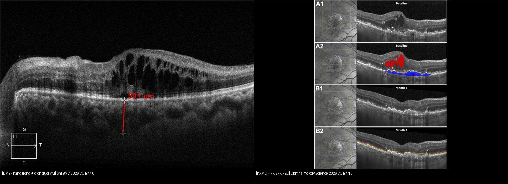
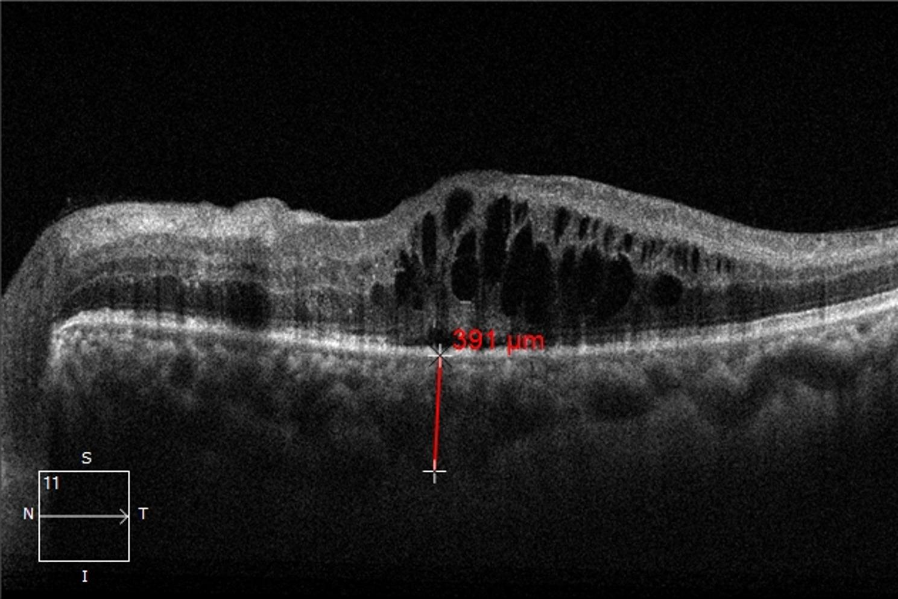
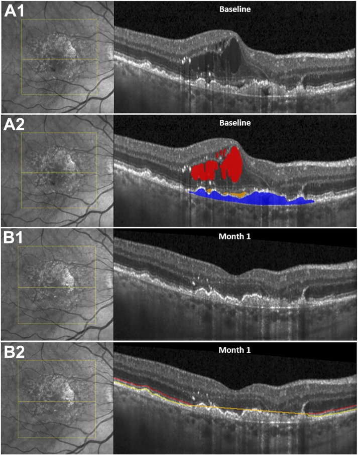
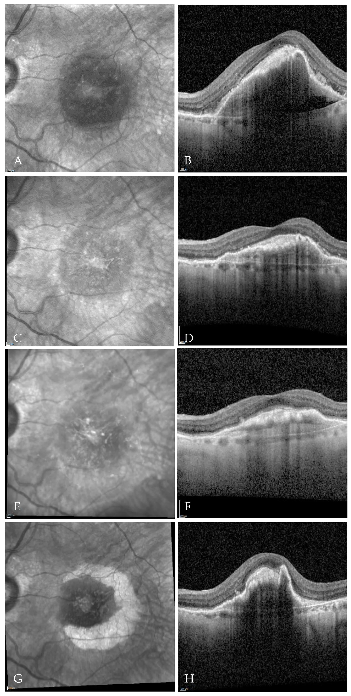

# 441 — OCT hoàng điểm: phù DME vs AMD / Macular OCT: DME vs AMD

**Tags:** `pattern:OCT` `vung:hoang-diem`
**Mức chắc chắn (certainty):** tổng hợp y văn (literature synthesis) — nhóm tự biên từ y văn mở, chưa gắn ca nguyên văn đơn lẻ.

## 1. Tổng quan — đọc OCT theo lớp + số CST

- OCT: nang trong võng mạc (DME) vs dưới/biểu mô sắc tố (AMD ướt) vs drusen (AMD khô). TẠI SAO vị trí dịch quyết định thuốc: DME tiêm nội nhãn anti-VEGF/steroid; AMD ướt CNV cần anti-VEGF sớm giữ thị lực.
- Số nằm lòng: **CST (độ dày trung tâm) ≥ 300–320 µm** = phù có ý nghĩa; **DRIL (mất lớp trong)** + đứt **EZ (ellipsoid zone)** = tiên lượng thị lực kém dù hết phù.
- Ngưỡng điều trị: DME trung tâm + giảm thị → tiêm; AMD ướt (dịch dưới võng mạc + CNV) → anti-VEGF tải 3 mũi/tháng.

## 2. Gamut dày hoàng điểm trên OCT

- **DME:** nang trong + tăng CST + ĐTĐ lâu + 2 bên — anti-VEGF/steroid/laser.
- **AMD ướt:** dịch dưới võng mạc/PED + CNV + già + drusen — anti-VEGF sớm.
- **AMD khô:** drusen + teo địa đồ, không dịch — bổ sung + theo dõi (đừng tiêm).
- **Tắc tĩnh mạch (RVO):** phù + XH + giãn TM 1 góc — anti-VEGF + laser.

## 3. Bảng so sánh

| Thực thể (entity) | OCT điển hình | Chốt vào (rule-in) | Chốt loại (rule-out) | Gợi ý xác nhận |
|---|---|---|---|---|
| DME | **Nang trong + CST ≥ 300 µm**, ĐTĐ 2 bên | **ĐTĐ + nang trong + CST tăng** | Dịch dưới võng mạc + CNV → AMD ướt | HbA1c + tiêm nội nhãn |
| AMD ướt | **Dịch dưới/PED + CNV**, già + drusen | **Dưới võng mạc + CNV + tuổi** | Nang trong thuần + ĐTĐ → DME | FA/OCT-A + anti-VEGF sớm |
| AMD khô | **Drusen + teo**, không dịch | **Drusen + không dịch** | Có dịch → ướt (chuyển điều trị) | Theo dõi, bổ sung |
| RVO | Phù + **XH + giãn TM 1 góc** | **XH + TM giãn theo vùng** | 2 bên đối xứng → DME/HA | Anti-VEGF + laser |

*Trái: nang trong + dịch dưới võng mạc (Shi, BMC Ophthalmology 2026, CC BY 4.0). Phải: đỏ = IRF, vàng = SRF, xanh = PED (Ophthalmology Science 2026, CC BY 4.0). Ảnh ghép letterbox.*

**Quiz composite:** che 2 nhãn, hỏi bên nào là AMD ướt?

<b>Bấm để hiện đáp án</b>

- Trái = **DME** — nang trong là chủ đạo, BN ĐTĐ.
- Phải = **AMD ướt** — PED xanh + SRF vàng ở người già là chốt (DME thuần hiếm PED lớn).

## 4. Protocol OCT

- Macular cube + đo CST + đánh giá DRIL/EZ + so sánh 2 mắt/lần trước.
- FA/OCT-A khi nghi CNV (AMD ướt) hoặc thiếu máu (RVO).
- Tiêm nội nhãn: vô khuẩn + theo dõi viêm nội nhãn (đau + mờ cấp sau tiêm = cấp cứu).

## 5. Cạm bẫy

- **DRIL/EZ đứt** = thị lực không hồi dù CST về bình thường — tiên lượng thật với BN.
- **Vitreomacular traction** giả DME — tìm màng kéo, mổ vitrektomy thay vì tiêm mãi.
- **Viêm nội nhãn sau tiêm** (đau + mờ giờ-ngày) — cấp cứu, đừng chờ tái khám.

## 6. Tự lượng giá — Blind Quiz

**Ca 1 — ĐTĐ mờ 2 mắt. Nhìn OCT, dịch nằm ở khoang nào?**

- Hỏi: nang tối nằm trong hay dưới võng mạc? DME hay AMD ướt? Thuốc gì đầu tay?

<b>Bấm để hiện đáp án (findings + chẩn đoán)</b>

- Dấu hiệu (findings): **nang tối trong võng mạc (intraretinal cysts) + dịch dưới võng mạc**, hoàng điểm dày.
- Chẩn đoán (diagnosis): **DME (phù hoàng điểm đái tháo đường)** — vì nang TRONG là chủ đạo ở BN ĐTĐ (chi tiết bài 443).
- Xử trí: anti-VEGF nội nhãn (tham chiếu: CMT 466 → 279 µm sau 6 tháng Conbercept).
- Nguồn ảnh: Shi et al., BMC Ophthalmology 2026 Fig. 3 (PMC13182033), CC BY 4.0. Lưu ý trung thực nguồn: vạch đỏ 391 µm là SFCT (hắc mạc), không phải CMT.

**Ca 2 — Cụ 78 tuổi mờ 1 mắt. Cặp OCT gốc + bản AI tô màu này đọc thế nào?**

- Hỏi: 3 màu đỏ/vàng/xanh là 3 khoang nào? DME hay AMD ướt? Vì sao phải tách riêng 3 khoang?

<b>Bấm để hiện đáp án (findings + chẩn đoán)</b>

- Dấu hiệu (findings): **đỏ = dịch trong võng mạc (IRF), vàng = dịch dưới võng mạc (SRF), xanh = bong biểu mô sắc tố (PED)** — đủ bộ 3 khoang của tân mạch hắc mạc.
- Chẩn đoán (diagnosis): **AMD ướt (nAMD)** — vì PED + SRF ở người già (DME thuần hiếm khi có PED lớn).
- Vì sao tách khoang: IRF nhiều + EZ mất = tiên lượng thị lực kém nhất; SRF đơn thuần đáp ứng anti-VEGF tốt hơn — thể tích từng khoang quyết định lịch tiêm.
- Nguồn ảnh: Ophthalmology Science 2026 Fig. 1 (PMC13487276), CC BY 4.0.

**Ca 3 — nAMD có PED cao đang tiêm anti-VEGF. Dải OCT theo thời gian này cảnh báo gì?**

- Hỏi: PED xẹp hay phồng dần sau các mũi tiêm? Biến chứng rách nào phải cảnh báo trước khi PED quá cao?

<b>Bấm để hiện đáp án (findings + chẩn đoán)</b>

- Dấu hiệu (findings): **PED tồn tại/dày lên qua các thời điểm** dù đã tiêm aflibercept nhiều mũi (NIR + OCT tương ứng từng cặp).
- Chẩn đoán (diagnosis): **PED kháng trị trong nAMD — nguy cơ rách biểu mô sắc tố (RPE tear)** khi PED cao + căng.
- Xử trí: cảnh báo BN + OCT sát (rách RPE = mất thị lực đột ngột, không có thuốc đảo ngược); cân nhắc đổi thuốc/liều, đừng tiêm mù.
- Nguồn ảnh: J Clin Med 2026 Fig. 5 (PMC13513911), CC BY 4.0.

## Bài liên quan chéo
- [400 – Tổng quan Mắt](../400-tong-quan-mat-thi-giac/lesson.md)
- [401 – Phương thức CĐHA mắt](../401-phuong-thuc-mat/lesson.md) (OCT)
- [411 – Siêu âm nhãn cầu](../411-sieu-am-nhan-cau/lesson.md) (võng mạc)
- [443 – Võng mạc đái tháo đường](../443-vong-mac-dai-thao-duong/lesson.md) (DME + ETDRS)

## Ảnh
- `441_DME-nang-trong_OCT_PMC13182033-Fig3-CCBY.jpg` — Shi et al., BMC Ophthalmology 2026 (PMC13182033), CC BY 4.0.
- `441_nAMD-IRF-SRF-PED_OCT_PMC13487276-Fig1-CCBY.jpg` — Ophthalmology Science 2026 (PMC13487276), CC BY 4.0.
- `441_AMD-PED-tien-trien_OCT_PMC13513911-Fig5-CCBY.jpg` — J Clin Med 2026 (PMC13513911), CC BY 4.0 (gốc .webp, chuyển .jpg giữ nguyên điểm ảnh).
- Chi tiết giấy phép từng ảnh trong `images/CREDITS.md`.

> Không dùng để chẩn đoán độc lập khi chưa có người hướng dẫn.
