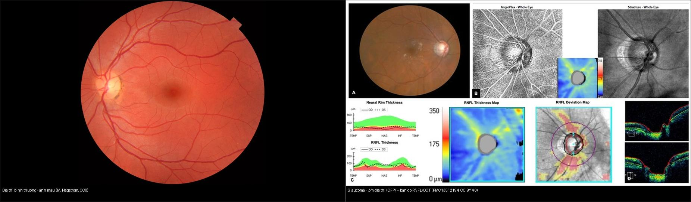
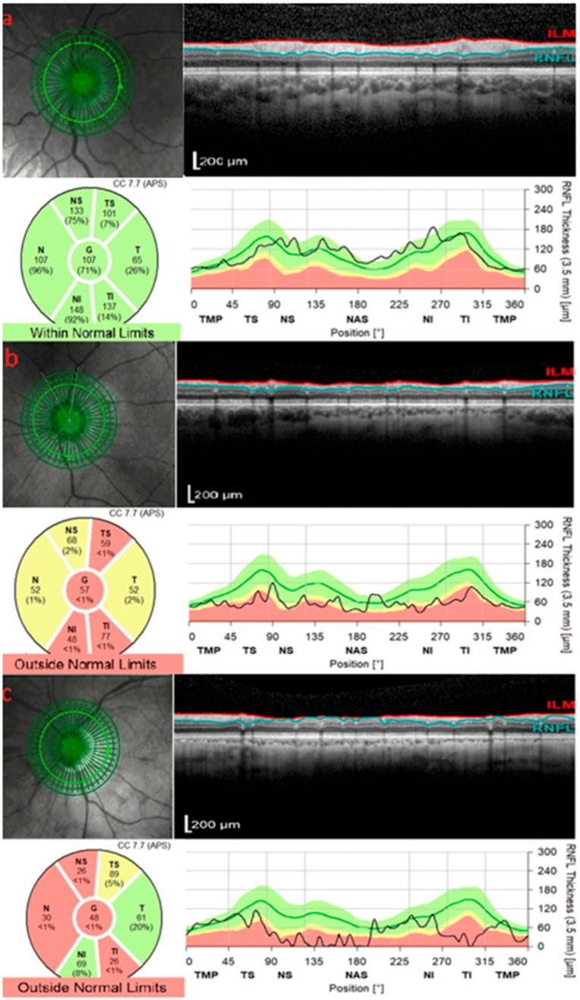
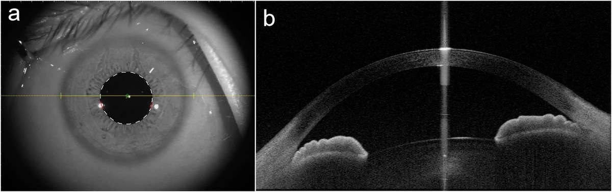
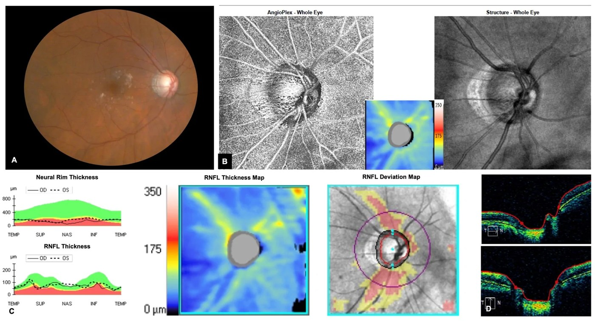

# 442 — Glaucoma: OCT RNFL/GCC + góc tiền phòng / Glaucoma imaging

**Tags:** `pattern:OCT` `vung:than-kinh-thi` `protocol:OCT-RNFL`
**Mức chắc chắn (certainty):** tổng hợp y văn (literature synthesis) — nhóm tự biên từ y văn mở, chưa gắn ca nguyên văn đơn lẻ.

## 1. Tổng quan — sợi thần kinh mỏng trước thị trường + góc mở/đóng

- Glaucoma = bệnh TK thị tiến triển: **RNFL/GCC mỏng trước khi thị trường hỏng** (mất ~30–50% sợi mới có ám điểm). TẠI SAO OCT thay thị trường theo dõi sớm: khách quan, định lượng µm, phát hiện tiến triển.
- Số nằm lòng: RNFL trung bình ~90–100 µm (già mỏng dần ~2 µm/năm sinh lý); **asymmetry 2 mắt > 9 µm** hoặc mỏng dưới bách phân vị 1% = bệnh lý; góc đóng khi **mống mắt–giác mạc chạm nhau ≥ 180–270°**.
- Góc mở (POAG) vs đóng (PACG): soi góc + UBM/AS-OCT — đóng cấp (đau + nôn + mờ + đồng tử giãn) = hạ nhãn áp cấp cứu (mannitol + laser mống mắt).

## 2. Gamut lõm đĩa + mỏng RNFL

- **POAG:** lõm rộng + RNFL dưới/trên mỏng + nhãn áp cao + góc mở — nhỏ giọt/mổ.
- **PACG:** góc đóng + cơn cấp (đau/nôn) — hạ áp cấp cứu + laser.
- **Glaucoma sắc tố/giả tróc:** sắc tố + lõm lệch + trẻ cận (sắc tố)/già (giả tróc) — laser mống mắt/thể thủy tinh.
- **Glaucoma thứ phát do rò ĐM cảnh–xoang hang (CCF):** tăng áp TM ổ mắt → **góc đóng + giãn mạch kết mạc + lồi mắt**; tăng nhãn áp MỘT bên kèm đỏ mắt mạn, nghe tiếng thổi → CTA/DSA (bài 423).
- **Teo TK thị phi glaucoma:** nhợt + RNFL mỏng toàn bộ + nguyên nhân TK (viêm/chèn ép — bài 430/431).

## 3. Bảng so sánh

| Thực thể (entity) | Hình ảnh/lâm sàng | Chốt vào (rule-in) | Chốt loại (rule-out) | Gợi ý xác nhận |
|---|---|---|---|---|
| POAG | **Lõm rộng + RNFL dưới mỏng + góc mở** | **Asymmetry > 9 µm + nhãn áp cao** | Góc đóng → PACG | Nhỏ giọt + thị trường + OCT định kỳ |
| PACG cấp | **Góc đóng + đau/nôn + đồng tử giãn** | **Cơn cấp + nhãn áp rất cao** | Góc mở → POAG | Hạ áp cấp cứu + laser mống mắt |
| Teo TK phi glaucoma | Nhợt + mỏng toàn bộ + bệnh TK | **Nguyên nhân TK rõ + không tăng áp** | Nhãn áp cao + lõm → glaucoma | (bài 430/431) |

*Trái: đĩa thị bình thường (ảnh màu). Phải: glaucoma — lõm đĩa thị rộng, giảm vành thần kinh (neural rim) trên ảnh màu + bản đồ RNFL/dẫn lệch cho thấy sợi thần kinh mỏng. Nguồn: M. Häggström (CC0) + Diagnostics 2026 PMC13512194 (CC BY 4.0). Ảnh ghép letterbox.*

Hai hình đối chiếu chuỗi xung/định lượng (dùng trong quiz mục 6):

*OCT quanh đĩa thị: (a) RNFL trong giới hạn bình thường (bản đồ xanh, chỉ số ≥ bách phân vị 5%); (b, c) ngoài giới hạn (vàng/đỏ, "outside normal limits"). Thang RNFL ~0–350 µm. Nguồn: Diagnostics 2025 PMC12691375 (CC BY 4.0).*

*AS-OCT tiền phòng: (a) ảnh sinh hiển vi với đường quét; (b) mặt cắt OCT góc tiền phòng (tương quan mống mắt–giác mạc, có thể chạm nhau khi góc đóng). Nguồn: BMC Ophthalmol 2026 PMC13617717 (CC BY-NC-ND — giữ nguyên bản).*

## 4. Protocol

- OCT RNFL + GCC + đầu đĩa + góc (AS-OCT/UBM) + thị trường 24-2 + nhãn áp ngày (dao động).
- Theo dõi tiến triển: GPA/event + trend (tốc độ µm/năm vượt sinh lý = tiến triển).

## 5. Cạm bẫy

- **Cận thị nặng** RNFL mỏng giả + đĩa nghiêng — dùng normative cận thị + GCC hoàng điểm.
- **Phù đĩa cấp** RNFL dày giả (bài 430) — đừng đọc glaucoma khi đĩa phù.
- **Góc hẹp không triệu chứng** — soi góc mọi nghi ngờ, đừng chờ cơn cấp.
- **Glaucoma 1 bên + đỏ mắt mạn + lồi mắt** → loại trừ **CCF** trước khi chỉ điều trị nhãn áp: nghe tiếng thổi, tìm TM mắt trên giãn/đổ đầy sớm xoang hang (bài 423). Bỏ sót = mù do tăng áp TM kéo dài.

## 6. Tự lượng giá — Blind Quiz

**Ca 1 — Bé trai 62 tuổi, RNFL phải mỏng hơn rõ rệt so với trái. Nhìn bản đồ OCT, phân tích trước.**

- Gợi ý lâm sàng: khám tầm soát glaucoma, nhãn áp cao, chưa có khiếm khuyết thị trường rõ.
- Câu hỏi: Bản đồ nào là "ngoài giới hạn bình thường"? Dấu hiệu chốt nằm ở bản đồ nào (dẫn lệch/deviation)? Định lượng chốt là gì?

<b>Bấm để hiện đáp án (findings + chẩn đoán)</b>

- Các panel **(a) trong giới hạn bình thường** (bản đồ xanh, phần lớn chỉ số ≥ bách phân vị 5%); **(b, c) ngoài giới hạn** (vàng/đỏ ở cực trên–dưới, "outside normal limits").
- Chốt: **bản đồ dẫn lệch (RNFL deviation map)** + **bản đồ độ dày RNFL theo 12 múi** — sợi mỏng cực dưới/trên trước khi thị trường hỏng (mất ~30–50% sợi mới có ám điểm).
- Ngưỡng: **bất đối xứng 2 mắt > 9 µm** hoặc RNFL dưới bách phân vị 1% = bệnh lý; theo dõi **tốc độ mỏng (µm/năm)** vượt sinh lý (~2 µm/năm) = tiến triển.
- Nguồn: Diagnostics 2025 PMC12691375, CC BY 4.0.

**Ca 2 — Bệnh nhân glaucoma tiến triển: nhìn ảnh màu + bản đồ RNFL/OCT, mô tả dấu hiệu chốt.**

<b>Bấm để hiện đáp án (findings + chẩn đoán)</b>

- **Lõm đĩa thị (cupping) rộng + giảm vành thần kinh (neural rim)** trên ảnh màu; bản đồ RNFL thưa/mỏng + dẫn lệch đỏ ở cực dưới–trên; OCT B-scan cho thấy mỏng lớp sợi.
- Chẩn đoán: **glaucoma** (tổn thương TK thị + lõm đĩa + mỏng RNFL). Cần tương quan với thị trường 24-2 + nhãn áp ngày.
- Nguồn: Diagnostics 2026 PMC13512194, CC BY 4.0.

**Ca 3 — Bệnh nhân đau mắt + nôn + mờ cấp + đồng tử giãn cố định. AS-OCT cho thấy gì?**

<b>Bấm để hiện đáp án (findings + chẩn đoán)</b>

- AS-OCT: **góc tiền phòng hẹp/đóng** — mống mắt tiến sát vùng lưới–giác mạc (iridotrabecular contact), có thể chạm **≥ 180–270°**.
- Chẩn đoán: **glaucoma góc đóng cấp (PACG)** → **hạ nhãn áp cấp cứu** (mannitol + nhỏ giọt + laser mống mắt) là "giờ vàng" thị lực.
- Nguồn: BMC Ophthalmol 2026 PMC13617717, CC BY-NC-ND (giữ nguyên bản).

## Bài liên quan chéo
- [400 – Tổng quan Mắt](../400-tong-quan-mat-thi-giac/lesson.md)
- [401 – Phương thức CĐHA mắt](../401-phuong-thuc-mat/lesson.md) (OCT)
- [441 – OCT hoàng điểm](../441-OCT-hoang-diem/lesson.md)

> Không dùng để chẩn đoán độc lập khi chưa có người hướng dẫn.
